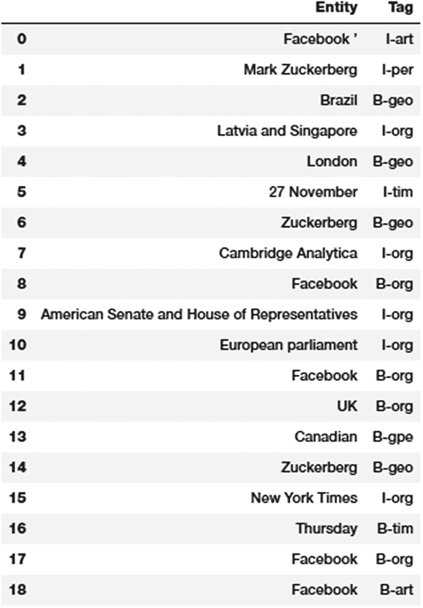

# 获取输入句子对应的输出命名实体识别标签

## 定义函数提取三元组

现在让我们定义一个函数，从句子中提取我们的单词、词性标签和命名实体识别标签三元组。我们将对所有输入句子应用此函数。

```python
def sent2labels(sent):
    return [label for token, postag, label in sent]

agg_func = lambda s: [(w, p, t) for w, p, t in zip(s['Word'].values.tolist(),
                                                    s['POS'].values.tolist(),
                                                    s['Tag'].values.tolist())]
grouped_df = df.groupby('Sentence #').apply(agg_func)
```

## 查看示例句子

我们现在可以通过以下代码查看数据集中的一个带注释的示例句子。

```python
sentences = [s for s in grouped_df]
sentences[0]
```

输出：
```
(('of', 'IN', 'O'), ('demonstrators', 'NNS', 'O'), ('have', 'VBP', 'O'), ('marched', 'VBN', 'O'), ('through', 'IN', 'O'), ('London', 'NNP', 'B-geo'), ('to', 'TO', 'O'), ('protest', 'VB', 'O'), ('the', 'DT', 'O'), ('war', 'NN', 'O'), ('in', 'IN', 'O'), ('Iraq', 'NNP', 'B-geo'), ('and', 'CC', 'O'), ('demand', 'VB', 'O'), ('the', 'DT', 'O'), ('withdrawal', 'NN', 'O'), ('of', 'IN', 'O'), ('British', 'JJ', 'B-gpe'), ('troops', 'NNS', 'O'), ('from', 'IN', 'O'), ('that', 'DT', 'O'), ('country', 'NN', 'O'), ('.', '.', 'O'))
```

上述输出展示了一个带有词性标注和命名实体识别标签的标准化分词句子。我们来看看如何使用之前定义的函数，将每个已标注的分词句子用于特征工程。

```python
sent2features(sentences[0][5:7])
```

输出：
```
[{'bias': 1.0, 'word.lower()': 'through', 'word[-3:]': 'ugh', 'word[-2:]': 'gh',
  'word.isupper()': False, 'word.istitle()': False, 'word.isdigit()': False,
  'postag': 'IN', 'postag[:2]': 'IN', 'BOS': True, '+1:word.lower()': 'london',
  '+1:word.istitle()': True, '+1:word.isupper()': False, '+1:postag': 'NNP',
  '+1:postag[:2]': 'NN'},
 {'bias': 1.0, 'word.lower()': 'london', 'word[-3:]': 'don', 'word[-2:]': 'on',
  'word.isupper()': False, 'word.istitle()': True, 'word.isdigit()': False,
  'postag': 'NNP', 'postag[:2]': 'NN', '-1:word.lower()': 'through',
  '-1:word.istitle()': False, '-1:word.isupper()': False, '-1:postag': 'IN',
  '-1:postag[:2]': 'IN', 'EOS': True}]

sent2labels(sentences[0][5:7])
```

输出：
```
['O', 'B-geo']
```

上述输出展示了对两个样本词元及其相应命名实体识别标签所提取的特征。现在，我们通过对输入句子进行特征工程，并获取相应的命名实体识别标签来进行预测，从而准备好训练数据集和测试数据集。

## 准备训练数据

```python
from sklearn.model_selection import train_test_split
import numpy as np

X = np.array([sent2features(s) for s in sentences])
y = np.array([sent2labels(s) for s in sentences])

X_train, X_test, y_train, y_test = train_test_split(X, y, test_size=0.25, random_state=42)

X_train.shape, X_test.shape
```

输出：
```
((35969,), (11990,))
```

## 训练模型

现在该开始训练我们的模型了。为此，我们使用之前提到的 `sklearn-crfsuite`。`sklearn-crfsuite` 框架是一个轻量级的 [CRFsuite（`python-crfsuite`）](https://github.com/scrapinghub/python-crfsuite) 封装器，它提供了一个与 Scikit-Learn 兼容的 `sklearn_crfsuite.CRF estimator`。因此，你可以使用它配合 Scikit-Learn 的模型选择工具（交叉验证和超参数优化），并使用 `joblib` 保存/加载 CRF 模型。你可以通过 `pip install sklearn_crfsuite` 命令来安装这个库。

现在，我们将使用 `sklearn-crfsuite` API 文档中提到的默认配置来训练模型，你可以通过 [`https://sklearn-crfsuite.readthedocs.io/en/latest/api.html`](https://sklearn-crfsuite.readthedocs.io/en/latest/api.html) 访问该文档。此处的目标是命名实体识别标注，所以我们不会过多关注模型的调优。这里提到了一些关键的**超参数**和模型参数：

*   `algorithm`：训练算法。我们使用 `L-BFGS` 进行梯度下降来优化并获取模型参数。
*   `c1`：套索（L1）正则化的系数。
*   `c2`：岭（L2）正则化的系数。
*   `all_possible_transitions`：指定 CRFsuite 是否生成训练数据中未出现的转移特征。

```python
import sklearn_crfsuite

crf = sklearn_crfsuite.CRF(algorithm='lbfgs',
                           c1=0.1,
                           c2=0.1,
                           max_iterations=100,
                           all_possible_transitions=True,
                           verbose=True)
crf.fit(X_train, y_train)
```

输出：
```
loading training data to CRFsuite: 100%|██| 35969/35969 [00:15<00:00, 2384.94it/s]
type: CRF1d
Number of features: 133629
Seconds required: 3.486

L-BFGS optimization
c1: 0.100000
c2: 0.100000
num_memories: 6
max_iterations: 100
epsilon: 0.000010
stop: 10
delta: 0.000010
linesearch: MoreThuente
linesearch.max_iterations: 20

Iter 1   time=4.01  loss=1264028.26 active=132637 feature_norm=1.00
Iter 2   time=3.99  loss=994059.01 active=131294 feature_norm=4.42
...
...
Iter 99  time=2.07  loss=32324.92 active=58249 feature_norm=219.98
Iter 100 time=2.09  loss=32316.67 active=58226 feature_norm=220.04
L-BFGS terminated with the maximum number of iterations
Total seconds required for training: 228.530

Storing the model
Number of active features: 58226 (133629)
Number of active attributes: 29279 (90250)
```

Number of active labels: 17 (17)

## 模型保存与加载

现在，你可以使用以下代码保存此模型，该代码利用了 `joblib` 框架。

```python
from sklearn.externals import joblib

joblib.dump(crf, 'ner_model.pkl')
```

如果这个模型训练时间过长，你可以使用以下代码加载我们 GitHub 仓库中提供的预训练模型，仓库地址为 `https://github.com/dipanjanS/text-analytics-with-python`。

```python
crf = joblib.load('ner_model.pkl')
```

## 模型性能评估

现在，让我们在测试数据上评估我们的模型在命名实体识别标注上的性能！下面的代码展示了一个样本预测结果和实际标签。看起来我们表现不错！

```python
y_pred = crf.predict(X_test)

print(y_pred[0])
```

```
['O', 'O', 'O', 'O', 'B-per', 'I-per', 'O', 'B-org', 'O', 'O', 'B-gpe', 'O', 'O', 'O', 'O', 'O', 'O', 'O', 'O', 'O', 'O', 'O', 'O', 'O', 'O', 'O', 'O', 'O', 'O']
```

```python
print(y_test[0])
```

```
['O', 'O', 'O', 'O', 'B-per', 'I-per', 'O', 'B-org', 'O', 'O', 'B-gpe', 'O', 'O', 'O', 'O', 'O', 'O', 'O', 'O', 'O', 'O', 'O', 'O', 'O', 'O', 'O', 'O', 'O', 'O']
```

下面的代码帮助我们评估模型在整个测试数据集上的性能，并获取关键的分类模型性能指标。

```python
from sklearn_crfsuite import metrics as crf_metrics

labels = list(crf.classes_)

labels.remove('O')

print(crf_metrics.flat_classification_report(y_test, y_pred, labels=labels))
```

```
              precision    recall  f1-score   support

       B-org       0.81      0.73      0.77      5116
       B-per       0.85      0.84      0.84      4239
       I-per       0.85      0.90      0.88      4273
       B-geo       0.86      0.91      0.89      9403
       I-geo       0.81      0.80      0.81      1826
       B-tim       0.93      0.89      0.91      5095
       I-org       0.82      0.79      0.80      4195
       B-gpe       0.97      0.94      0.96      3961
       I-tim       0.84      0.81      0.82      1604
       B-nat       0.50      0.24      0.32        55
       B-eve       0.51      0.33      0.40        80
       B-art       0.36      0.14      0.20       102
       I-art       0.24      0.07      0.10        90
       I-eve       0.45      0.19      0.27        74
       I-gpe       0.86      0.53      0.66        36
       I-nat       0.57      0.22      0.32        18

   micro avg       0.86      0.85      0.86     40167
   macro avg       0.70      0.58      0.62     40167
weighted avg       0.86      0.85      0.85     40167
```

我们有意省略了 `Others` 标签，以便了解模型在其余关键标签上的表现。评估统计数据表明，该模型似乎很好地学习了转移特征，总体 F1 分数达到了 85%！我们可以通过微调特征工程步骤以及超参数调优来获得更好的结果。

# 使用我们训练的 NER 模型构建端到端命名实体识别标注器

如果我们无法在将来用模型标注新句子（假设我们希望将该模型投入生产），那就毫无乐趣（或价值！）可言了。让我们尝试构建一个端到端的工作流，对示例文档进行 NER 标注。为便于回顾，我们的示例文档内容如下。

```python
import re

text = """Three more countries have joined an "international grand committee" of parliaments, adding to calls forFacebook’s boss, Mark Zuckerberg, to give evidence on misinformation to the coalition. Brazil, Latvia and Singapore bring the total to eight different parliaments across the world, with plans to send representatives to London on 27 November with the intention of hearing from Zuckerberg. Since the Cambridge Analytica scandal broke, the Facebook chief has only appeared in front of two legislatures: the American Senate and House of Representatives, and the European parliament. Facebook has consistently rebuffed attempts from others, including the UK and Canadian parliaments, to hear from Zuckerberg. He added that an article in the New York Times on Thursday, in which the paper alleged a pattern of behaviour from Facebook to "delay, deny and deflect" negative news stories, "raises further questions about how recent data breaches were allegedly dealt with within Facebook."

"""

text = re.sub(r'\n', ", text)
```

流程的第一步是分词并进行词性标注，代码如下所示。

```python
import nltk

text_tokens = nltk.word_tokenize(text)

text_pos = nltk.pos_tag(text_tokens)

text_pos[:10]
```

```
[('Three', 'CD'), ('more', 'JJR'), ('countries', 'NNS'), ('have', 'VBP'), ('joined', 'VBN'), ('an', 'DT'), ('"', 'NNP'), ('international', 'JJ'), ('grand', 'JJ'), ('committee', 'NN')]
```

下一步是从经过词性标注的文本文档中提取特征，我们可以使用之前定义的函数来完成。

```python
features = [sent2features(text_pos)]

features[0][0]
```

```
{'bias': 1.0, 'word.lower()': 'three', 'word[-3:]': 'ree', 'word[-2:]': 'ee',
'word.isupper()': False, 'word.istitle()': True, 'word.isdigit()': False,
```

现在该用我们刚刚训练的 CRF 模型来预测从示例文档中提取的特征了。

```
'postag': 'CD', 'postag[:2]': 'CD', 'BOS': True, '+1:word.lower()': 'more',
'+1:word.istitle()': False, '+1:word.isupper()': False, '+1:postag': 'JJR',
'+1:postag[:2]': 'JJ'}
```

```
labels = crf.predict(features)
doc_labels = labels[0]
doc_labels[10:20]
```

```
['O', 'O', 'O', 'O', 'O', 'O', 'O', 'O', 'B-art', 'I-art']
```

## 最后一步是将实际文本词元与对应的 NER 标签相结合，并从 NER 标签中提取相关命名实体。见图 8-8。



图 8-8 来自 NER 模型的命名实体

```
text_ner = [(token, tag) for token, tag in zip(text_tokens, doc_labels)]
print(text_ner)
```

```
[('Three', 'O'), ('more', 'O'), ('countries', 'O'), ..., ('Facebook', 'B-art'), ("', 'I-art'), ('s', 'O'), ('boss', 'O'), (',', 'O'), ('Mark', 'B-per'), ('Zuckerberg', 'I-per'), (',', 'O'), ('to', 'O'), ('give', 'O'), ('evidence', 'O'), ('on', 'O'), ('misinformation', 'O'), ('to', 'O'), ('the', 'O'), ('coalition', 'O'), ('.', 'O'), ('Brazil', 'B-geo'), ...]
```