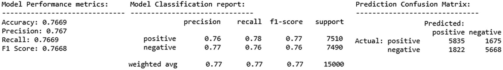
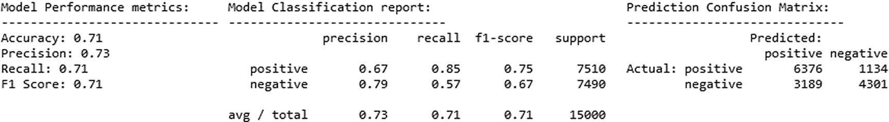

# 跑且又是狐狸的动物？

`formula = read_expr('runs(x) & fox(x)')`

`m.satisfiers(formula, 'x', g)`

```
{'f'}
```

这些输出不言自明，其中我们评估了一些开放性问题，比如哪些动物在跑？哪些动物既能跑又是狐狸？我们在输出中得到了相关的符号，可以将其映射回实际的动物名称（提示：`a: alex, f: felix`）。我们鼓励你通过构建自己的假设、域和规则，尝试更多命题和 FOL 表达式。

## 总结

在本章中，我们涵盖了专注于文本数据语义分析的多个主题。我们重新回顾了第 1 章中关于语言语义的一些概念。我们详细查看了 `WordNet` 语料库，并通过实际示例探索了同义词集的概念。我们还使用同义词集和现实世界的例子分析了第 1 章中的各种词汇语义关系。我们研究了包括蕴涵、同音异义词和同形异义词、同义词和反义词、下义词和上义词、以及整体词和部分词在内的关系。

语义关系和相似度计算技术也通过利用各种同义词集之间的共同上义词的示例进行了详细讨论。我们还讨论了一些在语义和信息提取中广泛使用的流行技术，包括词义消歧和命名实体识别。我们查看了来自 `spaCy` 和 `NLTK` 的最先进的预训练 NER 模型，包括利用 `Stanford Core NLP` NER 模型。我们还学习了如何从头开始构建我们自己的 NER 标注模型！除了语义关系，我们还重新回顾了与语义表示相关的概念，即命题逻辑和一阶逻辑。我们利用定理证明器，并通过计算方式评估了命题和逻辑表达式。下一章将聚焦于 NLP 中最流行的应用之一——情感分析。敬请期待！

# 9. 情感分析

在本章中，我们将探讨自然语言处理（NLP）、文本分析和机器学习中一个最有趣且应用最广泛的领域。这里要解决的问题是情感分析或观点挖掘，即我们希望分析一些文本文档，并根据这些文档的内容来预测其情感或观点。情感分析或许是自然语言处理和文本分析中最流行的应用之一，有大量的网站、书籍和教程都在探讨这个主题。情感分析在处理主观文本时效果最佳，因为这类文本中人们会表达观点、感受和情绪。从实际工业应用的角度来看，情感分析被广泛用于分析公司调查、反馈问卷、社交媒体数据，以及针对电影、地点、商品等的评论。其核心思想是分析人们对特定实体的反应，并根据他们的情感采取有见地的行动。

一个文本语料库由多个文本文档组成，每个文档可以简单到只有一个句子，也可以复杂到包含多个段落的完整文档。文本数据尽管高度非结构化，但可以分为两大类文档。*事实性文档*通常描述某种陈述或事实，不带任何特定的感受或情感。这类文档也被称为客观文档。另一方面，*主观性文档*则表达感受、情绪、情感和观点。

情感分析通常也被称为观点分析或观点挖掘。其关键思想是运用文本分析、NLP、机器学习和语言学中的技术，从非结构化文本中提取重要信息或数据点。这反过来又能帮助我们得出定性输出，例如整体情感是积极、中性还是消极，以及定量输出，例如情感极性、主观性和客观性比例。情感极性通常是一个数值分数，分配给文本文档中积极和消极的方面，并基于表达感受和情感的具体词语和短语等主观参数。*中性*情感通常极性为 `0`，因为它不表达任何特定情感；*积极*情感的极性为 `> 0`；而*消极*情感的极性为 `< 0`。当然，您可以根据所处理的文本类型随时更改这些阈值，对此没有硬性约束。

在本章中，我们将专注于分析一个大型的电影评论语料库，并从中提取情感。我们将介绍多种用于分析情感的技术，包括：

*   基于无监督词典的模型
*   传统的监督式机器学习模型
*   较新的监督式深度学习模型
*   先进的监督式深度学习模型

除了研究各种方法和模型，我们还将简要回顾机器学习流程中关于文本预处理和标准化的关键方面。此外，我们还会对我们的预测模型进行深入分析，包括模型解释和主题模型。

这里的关键是理解我们如何解决像非结构化文本情感分析这样的问题，学习各种技术和模型，并理解如何解读结果。这将使您今后能够在自己的数据集上应用这些方法。本章展示的所有代码示例均可在本书的官方 GitHub 仓库中找到，地址是 [`https://github.com/dipanjanS/text-analytics-with-python/tree/master/New-Second-Edition`](https://github.com/dipanjanS/text-analytics-with-python/tree/master/New-Second-Edition)。让我们开始吧！

## 问题陈述

本章的主要目标是预测从互联网电影数据库（IMDB）获取的大量电影评论的情感。该数据集包含 50,000 条电影评论，这些评论已根据其内容被标记为积极和消极情感类别标签。此外还有一些未标记的电影评论。该数据集可以从 [`http://ai.stanford.edu/~amaas/data/sentiment/`](http://ai.stanford.edu/%257Eamaas/data/sentiment/) 获取，感谢斯坦福大学的 Andrew L. Maas、Raymond E. Daly、Peter T. Pham、Dan Huang、Andrew Y. Ng 和 Christopher Potts 提供。该数据集也曾用于他们著名的论文《为情感分析学习词向量》，该论文发表于第 49 届计算语言学协会年会（ACL 2011）的会议论文集。他们提供了原始文本形式的数据集以及已经处理好的词袋格式的数据集。

在本章的分析中，我们将使用原始的带标签电影评论。因此，我们的任务是预测 15,000 条带标签电影评论的情感，并使用剩余的 35,000 条评论来训练我们的监督式模型。在使用无监督模型时，为了保持一致性并方便比较，我们仍将预测 15,000 条评论的情感。

## 设置依赖项

我们将使用几个特定于文本分析、NLP 和机器学习的 Python 库和框架。虽然这些将在每个章节中提及，但您需要确保已安装 `Pandas`、`NumPy`、`SciPy` 和 `Scikit-Learn`，它们用于数据处理和机器学习。本章使用的深度学习框架包括基于 `TensorFlow` 后端的 `Keras`。我们使用的 NLP 库包括 `spaCy`、`NLTK` 和 `Gensim`。我们还将使用第 3 章中自定义开发的文本预处理和标准化模块，您可以在名为 `contractions.py` 和 `text_normalizer.py` 的文件中找到它们。与监督式模型拟合、预测和评估相关的工具包含在 `model_evaluation_utils.py` 中，因此请务必将这些模块以及本章的其他 Python 文件和 Jupyter notebook 放在同一个目录下。

## 获取数据

该数据集将随本章的代码文件一起，放在本书的 GitHub 仓库 [`https://github.com/dipanjanS/text-analytics-with-python`](https://github.com/dipanjanS/text-analytics-with-python) 中，文件名为 `movie_reviews.csv`。它包含 50,000 条带标签的 IMDB 电影评论。该文件应位于本书第二版目录下本章对应的 notebook 文件夹中。如果需要，您也可以从 [`http://ai.stanford.edu/~amaas/data/sentiment/`](http://ai.stanford.edu/%257Eamaas/data/sentiment/) 下载数据。获得 CSV 文件后，您可以使用 `Pandas` 中的 `read_csv(...)` 工具函数轻松地在 Python 中加载它。

# 文本预处理与标准化

在深入特征工程和建模过程之前，关键步骤之一是清理、预处理和标准化文本，以便将短语和单词等文本组件转换为标准格式。我们多次提到这一点，因为它对于任何 NLP 流程都是最关键的阶段之一。预处理使得文档语料库能够实现标准化，这有助于构建有意义的特征，并减少因多种因素（例如无关符号、特殊字符、XML 和 HTML 标签等）引入的噪声。我们在第 3 章中构建的 `text_normalizer` 模块包含了文本标准化所需的所有实用工具。您还可以参考一个名为 `Text Normalization Demo.ipynb` 的 Jupyter notebook 示例，以获得更具交互性的体验。为了帮您重温，本节将描述我们文本标准化流程中的主要组件。

*   **清理文本：** 我们的文本通常包含 HTML 标签等不必要的内容，这些内容在分析情感时没有太大价值。因此，我们需确保在提取特征之前将其移除。`BeautifulSoup` 库在提供必要函数方面表现出色。我们的 `strip_html_tags(...)` 函数负责清理并剥离 HTML 代码。

*   **移除重音字符：** 在我们的数据集中，处理的是英文评论，因此我们需要确保将重音字符转换并标准化为 ASCII 字符。一个简单的例子是将 `é` 转换为 `e`。我们的 `remove_accented_chars(...)` 函数在这方面提供了帮助。

*   **扩展缩略形式：** 在英语中，缩略形式是单词的简写版本。这些现有单词或短语的简写版本是通过移除特定字母和发音创建的。通常情况下，单词中的元音会被移除。示例包括 `do not` 变为 `don't`，以及 `I would` 变为 `I'd`。缩略形式会在文本标准化中带来问题，因为我们不仅要处理撇号等特殊字符，还必须将每个缩略形式转换为其扩展后的原始形式。我们的 `expand_contractions(...)` 函数使用正则表达式以及 `contractions.py` 模块中映射的各种缩略形式，来扩展文本语料库中的所有缩略词。

*   **移除特殊字符：** 文本清理和标准化的另一个重要任务是移除那些会增加非结构化文本噪声的特殊字符和符号。使用简单的正则表达式即可实现此目的。我们的 `remove_special_characters(...)` 函数用于移除特殊字符。在我们的代码中，我们保留了数字，但如果您不希望数字出现在标准化语料库中，也可以将其移除。

*   **词干提取和词形还原：** 词干通常是单词可能的基本形式，可以通过在词干上附加词缀（如前缀和后缀）来创建新单词。这被称为*屈折变化*。获取单词基本形式的逆向过程被称为词干提取。一个简单的例子是 `WATCHES`、`WATCHING` 和 `WATCHED`，它们都有词根词干 `WATCH`。`NLTK` 包提供了多种词干提取器，例如 `PorterStemmer` 和 `LancasterStemmer`。词形还原与词干提取非常相似，都是移除单词词缀以获得单词的基本形式。然而，这里的基本形式被称为根词而不是根词干。区别在于根词始终是一个词汇正确的单词（存在于词典中），而根词干可能不正确。我们在标准化流程中仅使用词形还原来保留词汇正确的单词。`lemmatize_text(...)` 函数在这方面提供了帮助。

*   **移除停用词：** 尤其在从文本构建有意义的特征时，那些几乎没有或完全没有意义的词被称为停用词。如果你对文档语料库进行简单的术语或单词频率统计，这些通常是最终出现频率最高的词。像“a”、“an”、“the”等词就是停用词。没有通用的停用词列表，但我们使用来自 `NLTK` 的标准英语停用词列表。如果需要，您还可以添加特定于您领域的停用词。`remove_stopwords(...)` 函数用于移除停用词，并保留语料库中最具意义和上下文的单词。

我们在以下名为 `normalize_corpus(...)` 的函数中整合了这些组件，该函数可以将文档语料库作为输入，并返回经过清理和标准化文本文档的相同语料库。请参考第 3 章，更详细地回顾文本预处理。现在我们的标准化模块已准备就绪，我们可以开始建模和分析语料库了。

# 基于无监督词典的模型

过去我们讨论过无监督学习方法，这类方法指的是无需标注数据即可直接应用于数据特征的特定建模方法。任何组织机构面临的主要挑战之一，就是由于缺乏时间和资源来完成繁琐的数据标注工作，导致难以获取标注数据集。在这种情况下，无监督方法就非常有用，本节我们将探讨其中几种方法。即使我们有标注数据，本节也能让你深入了解基于词典的模型是如何工作的，从而在你没有标注数据时，也能将它们应用到自己的数据集上。

无监督情感分析模型使用精心整理的知识库、本体、词典和数据库，这些资源包含关于主观词汇、短语（包括情感、情绪、极性、客观性、主观性等）的详细信息。一个典型的词典模型会使用*词汇表*（lexicon），也称为专门用于情感分析的词典或词汇库。这些词汇表包含与正面和负面情感相关的词汇列表，还包括极性（负面或正面得分的强度）、词性标注、主观性分类（强、弱、中性）、情绪、情态等信息。你可以使用这些词汇表，通过匹配文本中出现的特定词汇，并考虑否定参数、周围词语、整体语境、短语等其他因素，以及聚合总体情感极性分数，来计算文本的情感倾向。目前有几种常用的情感分析词典模型，其中部分如下：

- 刘兵词典
- `MPQA` 主观性词典
- `Pattern` 词典
- `TextBlob` 词典
- `AFINN` 词典
- `SentiWordNet` 词典
- `VADER` 词典

这并不是一个详尽的词典模型列表，但它们绝对是当今最流行的几种。我们将利用电影评论数据集，通过实践代码和示例，更详细地介绍最后三种词典模型。我们使用最后 15,000 条评论并预测其情感，然后根据模型评估指标（如准确率、精确率、召回率和 F1 分数，这些内容我们已在第 5 章详细讨论过）来评估模型的性能。由于我们有标注数据，因此可以很容易地看到这些电影评论的真实情感值与我们基于词典模型预测的情感值之间的匹配程度。你可以参考名为 `Sentiment Analysis - Unsupervised Lexical.ipynb` 的 Jupyter 笔记本进行交互式体验。在开始分析之前，我们先使用以下代码片段加载必要的依赖项和配置设置。

```

# 情感分析词典与工具介绍

```python
import pandas as pd
import numpy as np
import text_normalizer as tn
import model_evaluation_utils as meu

np.set_printoptions(precision=2, linewidth=80)
```

现在，我们加载 IMDB 评论数据集，并提取出最后的 15,000 条评论用于分析。我们不需要对其进行标准化处理，因为我们将使用的大多数框架都会在内部处理此问题，但根据需求，某些框架可能需要一些基本的预处理步骤。

```python
dataset = pd.read_csv('movie_reviews.csv.bz2', compression='bz2')

reviews = np.array(dataset['review'])
sentiments = np.array(dataset['sentiment'])

# extract data for model evaluation
test_reviews = reviews[35000:]
test_sentiments = sentiments[35000:]
sample_review_ids = [7626, 3533, 13010]
```

我们还提取了一些样本评论，以便在这些样本上运行模型，并详细解读其结果。

## 刘兵词典

该词典包含超过 6,800 个单词，已分为两个文件：`positive-words.txt`（包含约 2,000 个词/短语）和 `negative-words.txt`（包含超过 4,800 个词/短语）。该词典由刘兵历经多年开发并维护，Nitin Jindal 和刘兵在其原始论文《Identifying Comparative Sentences in Text Documents》（发表于 2006 年西雅图第 29 届年度国际 ACM SIGIR 会议论文集）中对此进行了详细说明。如果你想使用该词典，可以从 [`https://www.cs.uic.edu/~liub/FBS/sentiment-analysis.html#lexicon`](https://www.cs.uic.edu/%257Eliub/FBS/sentiment-analysis.html%2523lexicon) 获取，该页面包含一个链接，可以将其作为压缩包（RAR 格式）下载。

## MPQA 主观性词典

MPQA 是“多视角问答”的缩写，它包含一系列多样的资源，涉及意见语料库、主观性词典、主观性语义注释、论证词典、辩论语料库、观点查找器等。该资源由匹兹堡大学开发并维护，其官方网站 [`http://mpqa.cs.pitt.edu/`](http://mpqa.cs.pitt.edu/) 包含所有必要信息。其中，主观性词典是其观点查找框架的一部分，包含主观性线索和上下文极性。更多细节可参见 Theresa Wilson、Janyce Wiebe 和 Paul Hoffmann 的论文《“Recognizing Contextual Polarity in Phrase-Level Sentiment Analysis”》（发表于 HLT-EMNLP-2005 会议论文集）。你可以从其官方网站 [`http://mpqa.cs.pitt.edu/lexicons/subj_lexicon/`](http://mpqa.cs.pitt.edu/lexicons/subj_lexicon/) 下载主观性词典。该词典包含数据集 `subjclueslen1-HLTEMNLP05.tff` 中的主观性线索。以下代码片段展示了词典中的一些示例行。

```
type=weaksubj len=1 word1=abandonment pos1=noun stemmed1=n priorpolarity=negative
type=weaksubj len=1 word1=abandon pos1=verb stemmed1=y priorpolarity=negative
...
...
type=strongsubj len=1 word1=zenith pos1=noun stemmed1=n priorpolarity=positive
type=strongsubj len=1 word1=zest pos1=noun stemmed1=n priorpolarity=positive
```

每一行包含一个特定单词及其相关极性、词性标注信息、长度（目前仅有长度为 1 的单词）、主观性上下文以及词干信息。

## 模式词典（Pattern Lexicon）

`pattern` 包是一个用 Python 编写的完整自然语言处理框架，可用于文本处理、情感分析等。它由 CLiPS（计算语言学与心理语言学中心）开发，该中心是安特卫普大学文学院语言学系下属的一个研究机构。`pattern` 使用其自身的情感模块，该模块内部使用一个词典，你可以从其官方 GitHub 仓库 [`https://github.com/clips/pattern/blob/master/pattern/text/en/en-sentiment.xml`](https://github.com/clips/pattern/blob/master/pattern/text/en/en-sentiment.xml) 获取该词典。它包含了完整的基于主观性的词典数据库。词典中的每一行通常如下例所示。

```
Thus you get important metadata information like WordNet corpus
identifiers, polarity scores, word sense, POS tags, intensity,
subjectivity scores, and so on. These can in turn be used to compute
sentiment over a text document based on polarity and subjectivity.
Unfortunately, the pattern has still not been ported officially for
Python 3.x and it works on Python 2.7.x. However, you can load up this
lexicon and do your own modeling as needed. Even better, the popular
framework TextBlob
uses this for sentiment analysis and is available in Python 3!
```

## TextBlob 词典

如前所述，`pattern` 包有一个很好的情感分析模块，但遗憾的是它只适用于 Python 2.7.x。然而，我们的重点是构建基于 Python 3.x 的应用，所以我们可以直接使用 `TextBlob`！`TextBlob` 使用的词典与 `pattern` 相同，并且可以在其 GitHub 上的源代码中获取，地址为 [`https://github.com/sloria/TextBlob/blob/dev/textblob/en/en-sentiment.xml`](https://github.com/sloria/TextBlob/blob/dev/textblob/en/en-sentiment.xml)。下面是从该词典中选取的一些示例。

通常，特定的形容词具有极性得分（消极/积极，范围 -1.0 到 +1.0）和主观性得分（客观/主观，范围 +0.0 到 +1.0）。可靠性得分指明形容词是手动标记的（1.0）还是推断得出的（0.7）。词语按义项进行标记，例如，ridiculous (pitiful) = 消极，ridiculous (humorous) = 积极。Cornetto id（词汇单元 id）和 Cornetto synset id 指的是荷兰语的 Cornetto 词汇数据库。WordNet id 指的是英语的 WordNet3 词汇数据库。词性标注（POS）使用宾夕法尼亚树库约定。让我们看看如何使用 `TextBlob` 进行情感分析。

```python
for review, sentiment in zip(test_reviews[sample_review_ids], test_sentiments[sample_review_ids]):
    print('REVIEW:', review)
    print('Actual Sentiment:', sentiment)
    print('Predicted Sentiment polarity:', textblob.TextBlob(review).sentiment.polarity)
    print('-'*60)
```

## 使用 TextBlob 进行情感分析

你可以检查一些特定电影评论的情感倾向以及 `TextBlob` 预测的情感极性得分。通常，正分表示积极情感，负分表示消极情感。你可以使用特定的自定义阈值来确定什么是积极或消极。我们基于多次实验使用了 0.1 的自定义阈值。以下代码计算了整个测试数据集上的情感倾向。见图 9-1。



**图 9-1** 基于模式词典（Pattern Lexicon）模型的性能指标

```python
sentiment_polarity = [textblob.TextBlob(review).sentiment.polarity for review in test_reviews]

predicted_sentiments = ['positive' if score >= 0.1 else 'negative'

for score in sentiment_polarity]

meu.display_model_performance_metrics(true_labels=test_sentiments,

predicted_labels=predicted_sentiments,

classes=['positive', 'negative'])
```

我们得到了 77% 的总体 F1 分数和准确率，考虑到这是一个无监督模型，这个结果已经很不错了！查看混淆矩阵，我们可以清晰地看到，被错误分类为积极和消极的评论数量几乎相等，这使得每个类别的精确率和召回率结果一致。

## AFINN 词典

AFINN 词典可能是最简单、最流行的词典之一，可广泛用于情感分析。它由 Finn Årup Nielsen 开发和维护，你可以在 Finn Årup Nielsen* 的论文中找到关于此词典的更多详细信息，论文标题为 *“A New ANEW: Evaluation of a Word List for Sentiment Analysis in Microblogs”*，出自 ESWC2011 研讨会论文集。该词典的当前版本是 `AFINN-en-165.txt`，包含超过 3,300 个单词，每个单词都有一个极性得分。

你可以在作者的官方 GitHub 仓库中找到此词典及其早期版本（包括 `AFINN-111`），地址为 [`https://github.com/fnielsen/afinn/blob/master/afinn/data/`](https://github.com/fnielsen/afinn/blob/master/afinn/data/)。作者还在其基础上用 Python 创建了一个很好的包装库，也叫做 `afinn`，我们将用它来进行分析。你可以使用以下代码导入该库并实例化一个对象。

```python
In [3]: from afinn import Afinn

...:

...: afn = Afinn(emoticons=True)
```

现在我们可以使用这个对象，并通过以下代码片段计算我们选定的四个示例评论的极性。

```python
In [4]: for review, sentiment in zip(test_reviews[sample_review_ids], test_sentiments[sample_review_ids]):

...:     print('REVIEW:', review)

...:     print('Actual Sentiment:', sentiment)

...:     print('Predicted Sentiment polarity:', afn.score(review))

...:     print('-'*60)

REVIEW: no comment - stupid movie, acting average or worse... screenplay - no sense at all... SKIP IT!

Actual Sentiment: negative

Predicted Sentiment polarity: -7.0

REVIEW: I don't care if some people voted this movie to be bad. If you want the Truth this is a Very Good Movie! It has every thing a movie should have. You really should Get this one.

Actual Sentiment: positive

Predicted Sentiment polarity: 3.0

REVIEW: Worst horror film ever but funniest film ever rolled in one you have got to see this film it is so cheap it is unbelievable but you have to see it really!!!! P.s watch the carrot

Actual Sentiment: positive

Predicted Sentiment polarity: -3.0
```

我们可以比较每条评论的实际情感标签并查看预测的情感极性得分。负极性通常表示消极情感。为了在我们的完整测试数据集（包含 15,000 条评论，我使用了原始文本文档，因为 AFINN 会考虑表情符号和感叹号等其他方面）上预测情感，我们可以使用以下代码片段。我使用 >= 1.0 的阈值来判断整体情感是否为积极。你可以根据自己语料库的分析来选择你自己的阈值。

```python
In [5]: sentiment_polarity = [afn.score(review) for review in test_reviews]

...: predicted_sentiments = ['positive' if score >= 1.0 else 'negative' for score in sentiment_polarity]
```

现在我们已经有了预测的情感标签，我们可以使用我们的工具函数，根据标准性能指标来评估模型性能。见图 9-2。



**图 9-2** 基于 AFINN 词典模型的性能指标

```python
In [6]: meu.display_model_performance_metrics(true_labels=test_sentiments,

predicted_labels=predicted_sentiments, classes=['positive', 'negative'])
```

# 情感分析模型评估与SentiWordNet词典

我们得到了 71% 的总体 F1 分数，考虑到这是一个无监督模型，这已经相当不错了。查看混淆矩阵，我们可以清晰地看到，有相当多的基于*消极*情感的评论被错误分类为积极（3,189），这导致消极情感类别的召回率较低，为 57%。积极类别的性能在召回率或命中率方面更好，我们在 7,510 条积极评论中正确预测了 6,376 条，但由于在消极情感评论的情况下做出了许多错误的积极预测，精确率为 67%。

## SentiWordNet 词典

WordNet 语料库是英语中最流行的语料库之一，广泛应用于自然语言处理和语义分析。WordNet 为我们引入了同义词集（synset）的概念。SentiWordNet 词典基于 WordNet 同义词集，可用于情感分析和意见挖掘。SentiWordNet 词典通常为每个 WordNet 同义词集分配三个情感得分。这些包括一个积极极性得分、一个消极极性得分和一个客观性得分。更多详细信息可在其官方网站 [`http://sentiwordnet.isti.cnr.it`](http://sentiwordnet.isti.cnr.it) 上找到，包括研究论文和词典的下载链接。我们使用 NLTK 库，它提供了对 SentiWordNet 的 Python 接口。假设我们有形容词 “awesome”。我们可以使用以下代码片段获取与此词同义词集相关的情感得分。

```python
In [8]: from nltk.corpus import sentiwordnet as swn

...:

...: awesome = list(swn.senti_synsets('awesome', 'a'))[0]

...: print('Positive Polarity Score:', awesome.pos_score())

...: print('Negative Polarity Score:', awesome.neg_score())

...: print('Objective Score:', awesome.obj_score())

Positive Polarity Score: 0.875

Negative Polarity Score: 0.125

Objective Score: 0.0
```

现在，让我们构建一个通用函数，用于基于文档中匹配的同义词集来提取和聚合整个文本文档的情感得分。

```python
def analyze_sentiment_sentiwordnet_lexicon(review, verbose=False):
```

# 对文本进行分词与词性标注

```python
tagged_text = [(token.text, token.tag_) for token in tn.nlp(review)]

pos_score = neg_score = token_count = obj_score = 0
```