# 汇总最终分数
final_score = pos_score - neg_score
norm_final_score = round(float(final_score) / token_count, 2)
final_sentiment = 'positive' if norm_final_score >= 0 else 'negative'
if verbose:
    norm_obj_score = round(float(obj_score) / token_count, 2)
    norm_pos_score = round(float(pos_score) / token_count, 2)
    norm_neg_score = round(float(neg_score) / token_count, 2)

    # 以美观表格展示结果
    sentiment_frame = pd.DataFrame([[final_sentiment, norm_obj_score, norm_pos_score, norm_neg_score, norm_final_score]],
                                    columns=pd.MultiIndex(levels=[['情感统计：'],
                                                                    ['预测情感', '客观性',
                                                                    '积极', '消极', '综合']],
                                                            labels=[[0,0,0,0,0],[0,1,2,3,4]]))
    print(sentiment_frame)
    return final_sentiment
```

我们的函数接收一条电影评论，对每个单词标注其对应词性标签，根据词性标签提取匹配同义词集标记的情感分数，最后汇总得分。当我们对示例文档运行该函数时，这一过程会更加清晰。

```python
In [10]: for review, sentiment in zip(test_reviews[sample_review_ids], test_sentiments[sample_review_ids]):
...:     print('评论：', review)
...:     print('实际情感：', sentiment)
...:     pred = analyze_sentiment_sentiwordnet_lexicon(review, verbose=True)
...:     print('-'*60)
评论： no comment - stupid movie, acting average or worse... screenplay - no sense at all... SKIP IT!
实际情感： negative
情感统计：
预测情感 客观性 积极 消极 综合
0      negative      0.76  0.09  0.15  -0.06

评论： I don't care if some people voted this movie to be bad. If you want the Truth this is a Very Good Movie! It has every thing a movie should have. You really should Get this one.
实际情感： positive
情感统计：
预测情感 客观性 积极 消极 综合
0      positive      0.76  0.19  0.06  0.13

评论： Worst horror film ever but funniest film ever rolled in one you have got to see this film it is so cheap it is unbelievable but you have to see it really!!!! P.s watch the carrot
实际情感： positive
情感统计：
预测情感 客观性 积极 消极 综合
0      positive       0.8  0.12  0.07  0.05
```

在格式化的数据框中，我们可以清楚地看到每条示例电影评论的预测情感、情感极性分数以及客观性分数。现在让我们用这个模型预测所有测试评论的情感，并评估其性能。综合情感极性被归类为积极（而`< 0`为消极）的阈值为`>=0`。参见图 9-3。


**图 9-3** 基于 SentiWordNet 词典的模型性能指标

```python
In [11]:  norm_test_reviews = tn.normalize_corpus(test_reviews)
...: predicted_sentiments = [analyze_sentiment_sentiwordnet_lexicon(review, verbose=False) for review in norm_test_reviews]
...: meu.display_model_performance_metrics(true_labels=test_sentiments, predicted_labels=predicted_sentiments, classes=['positive', 'negative'])
```

我们得到了整体 F1 分数为 60%，这相比我们之前的模型确实有所下降。可以看到大量消极评论被错误分类为积极。或许调整这里的阈值会有所帮助！

## VADER 词典

由 C.J. Hutto 开发的 VADER 词典基于规则的情感分析框架，专门针对社交媒体中的情感分析进行了调优。VADER 代表情感意识词典与情感推理器。该框架的详细信息可阅读 Hutto, C.J.和 Gilbert, E.E. (2014)的原始论文《VADER：一种用于社交媒体文本情感分析的简约规则模型》，该论文收录于第八届国际博客与社交媒体会议(ICWSM-14)论文集。您可以使用基于 NLTK 接口的库，位于`nltk.sentiment.vader`模块下。您也可以从[`https://github.com/cjhutto/vaderSentiment`](https://github.com/cjhutto/vaderSentiment)下载实际词典或安装框架，该网站还包含 VADER 的详细信息。

这个词典位于名为`vader_lexicon.txt`的文件中，包含了与单词、表情符号和俚语（如`wtf`、`lol`、`nah`等）相关的情感分数。总共超过 9,000 个词汇特征，最终从中精选出超过 7,500 个经过验证的效价分数词汇特征纳入词典。每个特征均按`"[-4] 极度消极"`到`"[4] 极度积极"`的等级进行评分，并允许`"[0] 中性（或不在范围内、不适用）"`。

词汇特征的选择过程保留所有平均评分非零且标准差小于 2.5 的特征，该标准差由十位独立评分者的汇总结果确定。以下展示 VADER 词典的部分示例：

```
:(    -1.9   1.13578     [-2, -3, -2, 0, -1, -1, -2, -3, -1, -4]
:)    2.0    1.18322     [2, 2, 1, 1, 1, 1, 4, 3, 4, 1]
...
terrorizing  -3.0  1.0         [-3, -1, -4, -4, -4, -3, -2, -3, -2, -4]
thankful     2.7   0.78102     [4, 2, 2, 3, 2, 4, 3, 3, 2, 2]
```

上述词典示例中的每一行都代表一个唯一的词条，可以是表情符号或单词。第一个标记表示单词/表情符号，第二个标记表示平均情感极性分数，第三个标记表示标准差，最后一个标记表示十位独立评分者给出的评分列表。现在让我们使用 VADER 来分析我们的电影评论！我们按如下方式构建自己的建模函数。

```python
from nltk.sentiment.vader import SentimentIntensityAnalyzer

def analyze_sentiment_vader_lexicon(review, threshold=0.1, verbose=False):
    # 预处理文本
    review = tn.strip_html_tags(review)
    review = tn.remove_accented_chars(review)
    review = tn.expand_contractions(review)

    # 分析评论的情感
    analyzer = SentimentIntensityAnalyzer()
    scores = analyzer.polarity_scores(review)

    # 获取汇总分数与最终情感
    agg_score = scores['compound']
    final_sentiment = 'positive' if agg_score >= threshold else 'negative'
    if verbose:
```


# 显示详细情感统计信息

`positive = str(round(scores['pos'], 2)*100)+'%'`
`final = round(agg_score, 2)`
`negative = str(round(scores['neg'], 2)*100)+'%'`
`neutral = str(round(scores['neu'], 2)*100)+'%'`
`sentiment_frame = pd.DataFrame([[final_sentiment, final, positive, negative, neutral]], columns=pd.MultiIndex(levels=[['SENTIMENT STATS:'],['Predicted Sentiment', 'Polarity Score', 'Positive', 'Negative', 'Neutral']], labels=[[0,0,0,0,0],[0,1,2,3,4]]))`
`print(sentiment_frame)`
`return final_sentiment`

在我们的建模函数中，我们进行了一些基本的预处理，但保留了标点符号和表情符号。除此之外，我们使用 VADER 来获取评论文本的情感倾向性以及积极、中性和消极情感的占比。我们还基于用户为聚合情感倾向性设定的阈值来预测最终情感。通常，VADER 建议将聚合倾向性 >= 0.5 视为积极，[-0.5, 0.5] 之间视为中性，< -0.5 视为消极。在我们的语料库中，我们使用 >= 0.4 作为积极的阈值，< 0.4 作为消极的阈值。以下是对我们样本评论的分析。

```
In [13]: for review, sentiment in zip(test_reviews[sample_review_ids], test_sentiments[sample_review_ids]):
...:     print('REVIEW:', review)
...:     print('Actual Sentiment:', sentiment)
...:     pred = analyze_sentiment_vader_lexicon(review, threshold=0.4, verbose=True)
...:     print('-'*60)
REVIEW: no comment - stupid movie, acting average or worse... screenplay - no sense at all... SKIP IT!
Actual Sentiment: negative
SENTIMENT STATS:
Predicted Sentiment Polarity Score Positive Negative Neutral
0            negative           -0.8     0.0%    40.0%   60.0%

REVIEW: I don't care if some people voted this movie to be bad. If you want the Truth this is a Very Good Movie! It has every thing a movie should have. You really should Get this one.
Actual Sentiment: positive
SENTIMENT STATS:
Predicted Sentiment Polarity Score Positive             Negative Neutral
0            negative          -0.16    16.0%  14.0%   69.0%

REVIEW: Worst horror film ever but funniest film ever rolled in one you have got to see this film it is so cheap it is unbelievable but you have to see it really!!!! P.s watch the carrot
Actual Sentiment: positive
SENTIMENT STATS:
Predicted Sentiment Polarity Score Positive Negative Neutral
0            positive           0.49    11.0%    11.0%   77.0%
```

我们可以看到每一条样本电影评论的情感倾向和倾向性得分的详细统计数据。让我们在完整的测试电影评论语料库上尝试我们的模型，并评估模型性能。

```
In [14]: predicted_sentiments = [analyze_sentiment_vader_lexicon(review, threshold=0.4, verbose=False) for review in test_reviews]
...: meu.display_model_performance_metrics(true_labels=test_sentiments, predicted_labels=predicted_sentiments, classes=['positive', 'negative'])
```

图 9-4 显示总体 F1 分数和模型准确率均为 71%，与基于 AFINN 的模型非常相似。基于 AFINN 的模型仅在平均精确率上领先 1%；否则，两个模型的性能相似。

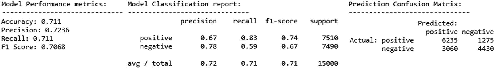

图 9-4
基于 VADER 词典的模型性能指标

# 使用监督学习进行情感分类

构建模型以理解文本内容并预测基于文本的评论的情感另一种方法是使用监督机器学习。更具体地说，我们使用分类模型来解决这个问题。我们在第 1 章的“监督学习”部分介绍了与监督学习和分类相关的概念。关于构建和评估分类模型的细节，如果需要，可以前往第 5 章复习相关知识。在后续部分，我们将构建一个自动化的情感文本分类系统。实现这一目标的主要步骤如下：

1. 准备训练集和测试集（可选地还有一个验证集）。
2. 预处理和标准化文本文档。
3. 特征工程。
4. 模型训练。
5. 模型预测与评估。

这些是构建我们系统的主要步骤。最后一个可选步骤是将模型部署到你的服务器或云端。图 9-5 展示了使用监督学习（分类）模型构建标准文本分类系统的详细工作流程。

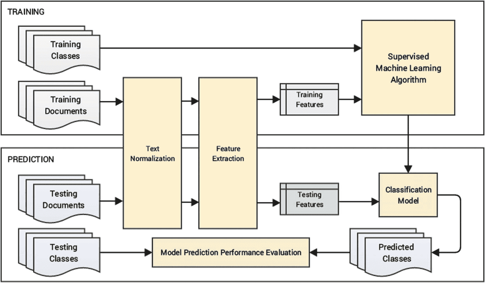

图 9-5
构建自动化文本分类系统的蓝图

在我们的场景中，文档指的是电影评论，类别指的是评论的情感，可以是积极或消极，这使得它成为一个二分类问题。在接下来的部分中，我们将使用传统的机器学习方法和较新的深度学习方法构建模型。你可以参考名为 `Sentiment Analysis - Supervised.ipynb` 的 Jupyter 笔记本以获得互动体验。让我们在开始之前加载必要的依赖项和设置。

```
In [1]: import pandas as pd
...: import numpy as np
...: import text_normalizer as tn
...: import model_evaluation_utils as meu
...: import nltk
...: np.set_printoptions(precision=2, linewidth=80)
```

我们现在可以加载我们的 IMDB 电影评论数据集，使用前 35,000 条评论来训练模型，并保留其余 15,000 条评论作为测试集来评估模型性能。除此之外，我们还使用我们的标准化模块来标准化我们的评论数据集（我们工作流程中的步骤 1 和 2）。

```
In [2]: dataset = pd.read_csv('movie_reviews.csv.bz2', compression='bz2')
...:
...: # take a peek at the data
...: print(dataset.head())
...: reviews = np.array(dataset['review'])
...: sentiments = np.array(dataset['sentiment'])
...:
...: # build train and test datasets
...: train_reviews = reviews[:35000]
...: train_sentiments = sentiments[:35000]
...: test_reviews = reviews[35000:]
...: test_sentiments = sentiments[35000:]
...:
...: # normalize datasets
...: stop_words = nltk.corpus.stopwords.words('english')
...: stop_words.remove('no')
...: stop_words.remove('but')
...: stop_words.remove('not')
...:
...: norm_train_reviews = tn.normalize_corpus(train_reviews)
...: norm_test_reviews = tn.normalize_corpus(test_reviews)
review sentiment
0  One of the other reviewers has mentioned that ...  positive
1  A wonderful little production. The...  positive
2  I thought this was a wonderful way to spend ti...  positive
3  Basically there's a family where a little boy ...  negative
4  Petter Mattei's "Love in the Time of Money" is...  positive
```

我们的数据集现在已经准备好并标准化，因此我们可以从文本分类工作流程的步骤 3 开始，构建我们的分类系统。

## 传统监督机器学习模型

在本节中，我们使用传统的分类模型来对电影评论的情感进行分类。我们的特征工程技术（步骤 3）将基于词袋模型和 TF-IDF 模型，这些在第 4 章的“文本数据特征工程”部分已经详细讨论过。以下代码片段帮助我们在训练集和测试集上使用这两种模型来构建特征。

```
In [3]: from sklearn.feature_extraction.text import CountVectorizer, TfidfVectorizer
...:
...: # build BOW features on train reviews
...: cv = CountVectorizer(binary=False, min_df=0.0, max_df=1.0, ngram_range=(1,2))
...: cv_train_features = cv.fit_transform(norm_train_reviews)
...: # build TFIDF features on train reviews
...: tv = TfidfVectorizer(use_idf=True, min_df=0.0, max_df=1.0, ngram_range=(1,2), sublinear_tf=True)
...: tv_train_features = tv.fit_transform(norm_train_reviews)
...:
...: # transform test reviews into features
...: cv_test_features = cv.transform(norm_test_reviews)
...: tv_test_features = tv.transform(norm_test_reviews)
...:
...: print('BOW model:> Train features shape:', cv_train_features.shape, ' Test features shape:', cv_test_features.shape)
...: print('TFIDF model:> Train features shape:', tv_train_features.shape, ' Test features shape:', tv_test_features.shape)
BOW model:> Train features shape: (35000, 2090724)  Test features shape: (15000, 2090724)
TFIDF model:> Train features shape: (35000, 2090724)  Test features shape: (15000, 2090724)
```

我们将单词和二元组纳入我们的特征集。我们现在可以使用一些在文本分类中效果很好的传统监督机器学习算法。我们建议将来在自己处理数据集时，使用逻辑回归、支持向量机和多项朴素贝叶斯模型。在本章中，我们使用逻辑回归和 SVM 构建了模型。以下代码片段有助于初始化这些分类模型估计器。

```
In [4]: from sklearn.linear_model import SGDClassifier, LogisticRegression
...:
...: lr = LogisticRegression(penalty='l2', max_iter=100, C=1)
...: svm = SGDClassifier(loss='hinge', max_iter=100)
```

在不深入太多理论复杂性的情况下，逻辑回归模型是一种用于分类的监督线性机器学习模型，尽管其名称带有“回归”。在这个模型中，我们试图预测给定电影评论属于某个离散类别（在我们的场景中是二元类别）的概率。模型用于学习的函数表示如下：

`P(y= positive | X) = σ(θ^T X)`

`P(y= negative | X) = 1 - σ(θ^T X)`

其中，模型试图使用特征向量 *X* 预测情感类别，而 `σ(z) = 1 / (1 + e^(-z))`，这被广泛称为 **sigmoid 函数** 或 **逻辑函数**。该模型的主要目标是搜索 *θ* 的最优值，使得当特征向量 *X* 对应积极电影评论时，积极情感类别的概率最大，而当 *X* 对应消极电影评论时，该概率较小。逻辑函数有助于对概率进行建模以描述最终的预测类别。可以通过使用标准方法（如梯度下降）最小化适当的代价/损失函数来获得 *θ* 的最优值。逻辑回归也被广泛称为 ***MaxEnt (最大熵) 分类器***。

我们现在使用 `model_evaluation_utils` 模块中的工具函数 `train_predict_model(...)` 在训练特征上构建逻辑回归模型，并在测试特征上评估模型性能（步骤 4 和 5）。

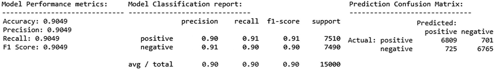

图 9-6
基于词袋特征的逻辑回归模型性能指标

```
In [5]: # Logistic Regression model on BOW features
...: lr_bow_predictions = meu.train_predict_model(classifier=lr, train_features=cv_train_features, train_labels=train_sentiments, test_features=cv_test_features, test_labels=test_sentiments)
...: meu.display_model_performance_metrics(true_labels=test_sentiments, predicted_labels=lr_bow_predictions, classes=['positive', 'negative'])
```

我们得到了 90.5% 的总体 F1 分数和模型准确率，如图 9-6 所示，这非常出色！现在我们可以使用以下代码片段类似地基于我们的 TF-IDF 特征构建一个逻辑回归模型。

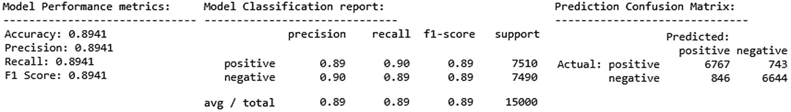

图 9-7
基于 TF-IDF 特征的逻辑回归模型性能指标

```
In [6]: # Logistic Regression model on TF-IDF features
...: lr_tfidf_predictions = meu.train_predict_model(classifier=lr, train_features=tv_train_features, train_labels=train_sentiments, test_features=tv_test_features, test_labels=test_sentiments)
...: meu.display_model_performance_metrics(true_labels=test_sentiments, predicted_labels=lr_tfidf_predictions, classes=['positive', 'negative'])
```

我们得到了 89% 的总体 F1 分数和模型准确率，如图 9-7 所示，这很好，但之前的模型稍好一些。你可以类似地使用我们之前创建的 SVM 模型估计器对象 `svm`，并使用相同的代码片段使用 SVM 模型进行训练和预测。我们使用 SVM 模型获得了 90% 的最高准确率和 F1 分数（有关分步代码片段，请参阅 Jupyter 笔记本）。因此，你可以看到这些监督机器学习分类算法在构建文本情感分类器方面是多么有效和准确。

## 更新的监督深度学习模型

在过去十年中，深度学习彻底改变了机器学习领域。在本节中，我们构建一些深度神经网络，并基于词嵌入的高级文本特征进行训练，以构建一个文本情感分类系统，类似于我们在上一节中所做的。让我们在开始分析之前加载以下必要的依赖项。

```
In [7]: import gensim
...: import keras
...: from keras.models import Sequential
...: from keras.layers import Dropout, Activation, Dense
...: from keras.layers.normalization import BatchNormalization
...: from sklearn.preprocessing import LabelEncoder
Using TensorFlow backend.
```

到目前为止，我们的 Scikit-Learn 模型直接接受情感类别标签 `positive` 和 `negative`，并在内部执行这些操作。然而，对于我们的深度学习模型，我们需要显式地对它们进行编码。以下代码片段有助于对我们的电影评论进行分词，并将基于文本的情感类别标签转换为独热编码向量（构成步骤 2 的一部分）。

```
In [8]: le = LabelEncoder()
...: num_classes=2
...: # tokenize train reviews & encode train labels
...: tokenized_train = [tn.tokenizer.tokenize(text) for text in norm_train_reviews]
...: y_tr = le.fit_transform(train_sentiments)
...: y_train = keras.utils.to_categorical(y_tr, num_classes)
...: # tokenize test reviews & encode test labels
...: tokenized_test = [tn.tokenizer.tokenize(text) for text in norm_test_reviews]
...: y_ts = le.fit_transform(test_sentiments)
...: y_test = keras.utils.to_categorical(y_ts, num_classes)
...:
...: # print class label encoding map and encoded labels
...: print('Sentiment class label map:', dict(zip(le.classes_, le.transform(le.classes_))))
...: print('Sample test label transformation:\n'+'-'*35, '\nActual Labels:', test_sentiments[:3], '\nEncoded Labels:', y_ts[:3], '\nOne hot encoded Labels:\n', y_test[:3])
Sentiment class label map: {'positive': 1, 'negative': 0}
Sample test label transformation:

Actual Labels: ['negative' 'positive' 'negative']
Encoded Labels: [0 1 0]
One hot encoded Labels:
[[ 1.  0.]
 [ 0.  1.]
 [ 1.  0.]]
```

因此，从上面的输出中我们可以看到，我们的情感类别标签是如何被编码为数值表示，然后又转换为独热编码向量的。我们在本节中使用的特征工程技术（步骤 3）是稍微更高级的词向量化技术，基于词嵌入的概念。我们使用 Word2Vec 和 GloVe 模型来生成嵌入。Word2Vec 模型由 Google 构建，我们在第 4 章的“词嵌入”部分详细介绍了它。在此场景中，我们将 `size` 参数设置为 `500`，表示每个单词的特征向量大小为 `512`。

```
In [9]: # build word2vec model
...: w2v_num_features = 512
...: w2v_model = gensim.models.Word2Vec(tokenized_train, size=w2v_num_features, window=150, min_count=10, sample=1e-3)
```

我们使用第 4 章中该模型的文档词向量平均方案，将每条电影评论表示为其所有不同词对应的词向量表示的平均向量。以下函数有助于计算任何文本语料库的平均词向量表示。

```
def averaged_word2vec_vectorizer(corpus, model, num_features):
    vocabulary = set(model.wv.index2word)
    def average_word_vectors(words, model, vocabulary, num_features):
        feature_vector = np.zeros((num_features,), dtype="float64")
        nwords = 0.
        for word in words:
            if word in vocabulary:
                nwords = nwords + 1.
                feature_vector = np.add(feature_vector, model[word])
        if nwords:
            feature_vector = np.divide(feature_vector, nwords)
        return feature_vector
    features = [average_word_vectors(tokenized_sentence, model, vocabulary, num_features) for tokenized_sentence in corpus]
    return np.array(features)
```

我们现在可以使用此函数在我们的两个电影评论数据集上生成平均词向量特征。

```
In [10]: # generate averaged word vector features from word2vec model
...: avg_wv_train_features = averaged_word2vec_vectorizer(corpus=tokenized_train, model=w2v_model, num_features=w2v_num_features)
...: avg_wv_test_features = averaged_word2vec_vectorizer(corpus=tokenized_test, model=w2v_model, num_features=w2v_num_features)
```

GloVe 模型，全称为 Global Vectors，是一种用于获取词向量表示的无监督模型。该模型由斯坦福大学创建，在各种语料库（如维基百科、Common Crawl 和 Twitter）上进行训练，相应的预训练词向量可供使用，并可用于我们的分析需求。感兴趣的读者可以参考 Jeffrey Pennington、Richard Socher 和 Christopher D. Manning 的原始论文，标题为“GloVe: Global Vectors for Word Representation”，以获取更多详细信息。spaCy 库提供了 300 维的词向量，这些词向量使用 GloVe 模型在 Common Crawl 语料库上进行训练。它们提供了一个简单的标准接口来获取每个单词的 300 维特征向量以及完整文本文档的平均特征向量。以下代码片段利用 spaCy 为我们的两个数据集获取 GloVe 嵌入。

```
In [11]: # feature engineering with GloVe model
...: train_nlp = [tn.nlp_vec(item) for item in norm_train_reviews]
...: train_glove_features = np.array([item.vector for item in train_nlp])
...:
...: test_nlp = [tn.nlp_vec(item) for item in norm_test_reviews]
...: test_glove_features = np.array([item.vector for item in test_nlp])
```

你可以使用以下代码检查基于每个模型的数据集的特征向量维度。

```
In [12]: print('Word2Vec model:> Train features shape:', avg_wv_train_features.shape, ' Test features shape:', avg_wv_test_features.shape)
...: print('GloVe model:> Train features shape:', train_glove_features.shape, ' Test features shape:', test_glove_features.shape)
Word2Vec model:> Train features shape: (35000, 512)  Test features shape: (15000, 512)
GloVe model:> Train features shape: (35000, 300)  Test features shape: (15000, 300)
```

从上述输出中我们可以看到，正如预期的那样，Word2Vec 模型的特征大小为 500，而 GloVe 特征的大小为 300。

我们现在可以继续到分类系统工作流程的步骤 4，在此我们构建并在这些特征上训练一个深度神经网络。我们使用一个全连接的四层深度神经网络（多层感知器或深度 ANN）作为我们的模型。在任何深度架构中，我们都不计算输入层，因此我们的模型将由三个隐藏层组成，每层有 512 个神经元或单元，以及一个输出层，包含两个单元，用于根据输入层特征预测积极或消极情感。图 9-8 描绘了我们用于情感分类的深度神经网络模型。

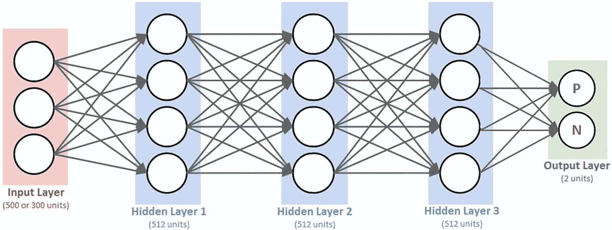

图 9-8
用于情感分类的全连接深度神经网络模型

我们称之为全连接深度神经网络（DNN），因为相邻层中的神经元或单元完全成对连接。这些网络也被称为深度人工神经网络（ANN）或多层感知器（MLP），因为它们有多个隐藏层。以下函数利用 TensorFlow 之上的 Keras 来构建所需的 DNN 模型。

```
def construct_deepnn_architecture(num_input_features):
    dnn_model = Sequential()
    dnn_model.add(Dense(512, input_shape=(num_input_features,), kernel_initializer="glorot_uniform"))
    dnn_model.add(BatchNormalization())
    dnn_model.add(Activation('relu'))
    dnn_model.add(Dropout(0.2))
    dnn_model.add(Dense(512, kernel_initializer="glorot_uniform"))
    dnn_model.add(BatchNormalization())
    dnn_model.add(Activation('relu'))
    dnn_model.add(Dropout(0.2))
    dnn_model.add(Dense(512, kernel_initializer="glorot_uniform"))
    dnn_model.add(BatchNormalization())
    dnn_model.add(Activation('relu'))
    dnn_model.add(Dropout(0.2))
    dnn_model.add(Dense(2))
    dnn_model.add(Activation('softmax'))
    dnn_model.compile(loss='categorical_crossentropy', optimizer="adam", metrics=['accuracy'])
    return dnn_model
```

从前面的函数可以看出，我们接受一个 `num_input_features` 参数，该参数决定输入层所需的单元数（Word2Vec 为 `512`，GloVe 特征为 `300`）。我们构建一个 `Sequential` 模型，它帮助我们线性堆叠我们的隐藏层和输出层。我们对所有隐藏层使用 `512` 个单元，激活函数 `relu` 表示修正线性单元。该函数通常定义为 `relu(x) = max(0, x)`，其中 *x* 通常是神经元的输入。这在电子和电气工程中通常被称为 ***斜坡函数***。与之前流行的 sigmoid 函数相比，现在更倾向于使用该函数，因为它试图解决梯度消失问题。当 *x* > 0 且 *x* 增加时，sigmoid 的梯度变得非常小（几乎消失），但 `relu` 可以防止这种情况发生。除此之外，它还有助于梯度下降更快收敛。请注意，我们还使用了一种称为 ***批量归一化*** 的新技术。批量归一化是一种提高神经网络性能和稳定性的技术。其关键思想是归一化每一层的输入，使其具有均值为 0、标准差为 1 的输出激活。请记住，它被称为批量归一化，因为在训练期间，我们会针对每个批次归一化前一层的激活，也就是说，我们应用一个变换，使得我们试图将平均激活保持在接近 0，标准差保持在接近 1。这在一定程度上有助于正则化。批量归一化试图保持输入到神经单元的数据分布恒定。这有助于将梯度保持在适当的范围内，否则可能导致梯度消失，尤其是在使用 sigmoid 等激活函数时。我们还以 `Dropout` 层的形式在网络中使用正则化。通过添加 0.2 的丢弃率，它在训练模型期间的每次更新时随机将 20% 的输入特征单元设置为 0。这种形式的正则化有助于防止模型过拟合。最终的输出层由两个单元组成，并使用 `softmax` 激活函数。Softmax 函数本质上是我们之前看到的逻辑函数的泛化，可用于表示 *n* 个可能类别结果上的概率分布。在我们的例子中，*n* = 2，类别可以是积极或消极，softmax 概率将帮助我们确定最终类别。二元 softmax 分类器也可以互换地称为 ***二元逻辑回归函数***。`compile(...)` 方法用于在我们训练 DNN 模型之前配置其学习或训练过程。这涉及在 `loss` 参数中提供一个代价或损失函数。这将是模型试图最小化的目标或目的。根据你要解决的问题类型，有多种损失函数，例如用于回归的均方误差和用于分类的分类交叉熵。有关可能的损失函数列表，请查看 `https://keras.io/losses/`。我们将使用 `categorical_crossentropy`，它有助于最小化 softmax 输出的误差或损失。我们需要一个优化器来收敛我们的模型并最小化损失或误差函数。梯度下降或随机梯度下降是流行的优化器。我们使用 `adam` 优化器，它只需要一阶梯度和非常少的内存。Adam 还使用动量，其中每次更新不仅基于当前点的梯度计算，还包括前一次更新的一部分。这有助于更快的收敛。感兴趣的读者可以参考原始论文 `https://arxiv.org/pdf/1412.6980v8.pdf` 以获取有关 `adam` 优化器的更多详细信息。最后，`metrics` 参数指定模型性能指标，这些指标用于在训练期间评估模型（但不用于修改训练损失本身）。现在，让我们基于我们的训练评论的 Word2Vec 输入特征表示来构建一个 DNN 模型。

```
In [13]: w2v_dnn = construct_deepnn_architecture(num_input_features=w2v_num_features)
```

你也可以借助 Keras，使用以下代码来可视化 DNN 模型架构。见图 9-9。

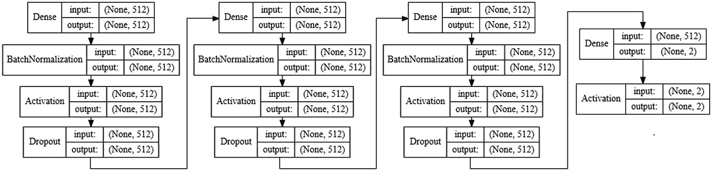

图 9-9
使用 Keras 可视化 DNN 模型架构

```
In [14]: from IPython.display import SVG
...: from keras.utils.vis_utils import model_to_dot
...:
...: SVG(model_to_dot(w2v_dnn, show_shapes=True, show_layer_names=False, rankdir="TB").create(prog='dot', format="svg"))
```

现在我们训练我们的模型，训练数据是 Word2Vec 特征的训练评论数据集，由 `avg_wv_train_features` 表示（步骤 4）。我们使用 Keras 的 `fit(...)` 函数进行训练过程。有一些参数你应该了解。`epoch` 参数表示对所有训练示例进行一次完整的前向和后向传播。`batch_size` 参数表示在一次后向和前向传播过程中，通过 DNN 模型一次传播的总样本数，用于训练模型和更新梯度。因此，如果你有 1,000 个观测值，并且你的批量大小是 100，那么每个 epoch 将由 10 次迭代组成，其中 100 个观测值将一次通过网络，并且隐藏层单元上的权重将被更新。

我们还指定了一个 `validation_split` 值为 0.1，用于从训练数据中提取 10% 作为验证数据集，以评估每个 epoch 的性能。`shuffle` 参数在训练模型时对每个 epoch 中的样本进行打乱。

```
In [18]: batch_size = 100
...: w2v_dnn.fit(avg_wv_train_features, y_train, epochs=10, batch_size=batch_size, shuffle=True, validation_split=0.1, verbose=1)
Train on 31500 samples, validate on 3500 samples
Epoch 1/10  31500/31500 - loss: 0.3378 - acc: 0.8598 - val_loss: 0.3114 - val_acc: 0.8714
Epoch 2/10 31500/31500 - loss: 0.2877 - acc: 0.8808 - val_loss: 0.2968 - val_acc: 0.8806
Epoch 3/10 31500/31500 - loss: 0.2766 - acc: 0.8854 - val_loss: 0.3043 - val_acc: 0.8726
Epoch 4/10 31500/31500 - loss: 0.2702 - acc: 0.8888 - val_loss: 0.2964 - val_acc: 0.8786
...
...
Epoch 9/10 31500/31500 - loss: 0.2456 - acc: 0.8964 - val_loss: 0.3180 - val_acc: 0.8680
Epoch 10/10 31500/31500 - loss: 0.2385 - acc: 0.9014 - val_loss: 0.3126 - val_acc: 0.8717
```

前面的代码片段告诉我们，我们已经在训练数据上训练了 DNN 模型 10 个 epoch，批量大小为 100。我们获得了接近 88% 的验证准确率，这相当不错。现在是时候对我们的模型进行真正的测试了！让我们在测试评论的 Word2Vec 特征上评估我们的模型性能（步骤 5）。

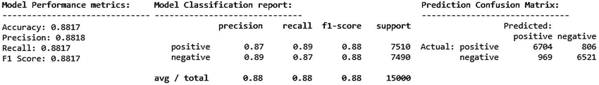

图 9-10
基于 Word2Vec 特征的深度神经网络模型性能指标

```
In [19]: y_pred = w2v_dnn.predict_classes(avg_wv_test_features)
...: predictions = le.inverse_transform(y_pred)
...: meu.display_model_performance_metrics(true_labels=test_sentiments, predicted_labels=predictions, classes=['positive', 'negative'])
```

图 9-10 中的结果显示我们获得了 88% 的模型准确率和 F1 分数，这非常棒！你可以使用类似的工作流程，为我们的 GloVe 特征构建并训练一个 DNN 模型，并评估模型性能。以下代码片段描绘了我们文本分类系统蓝图步骤 4 和 5 的工作流程。


# 构建 DNN 模型  
`glove_dnn = construct_deepnn_architecture(num_input_features=300)`  

# 在 GloVe 训练特征上训练 DNN 模型  
`batch_size = 100`  
`glove_dnn.fit(train_glove_features, y_train, epochs=5, batch_size=batch_size, shuffle=True, validation_split=0.1, verbose=1)`  

# 获取测试评论的预测结果  
`y_pred = glove_dnn.predict_classes(test_glove_features)`  
`predictions = le.inverse_transform(y_pred)`


# 评估模型性能

`meu.display_model_performance_metrics(true_labels=test_sentiments, predicted_labels=predictions, classes=['positive', 'negative'])`

我们使用 GloVe 特征获得了 86%的整体模型准确率和 F1 分数，这仍然是不错的表现，但并未优于使用 Word2Vec 特征得到的结果。你可以参考`Sentiment Analysis - Supervised.ipynb`这个 Jupyter notebook，查看该代码的逐步输出结果。关于利用更新的深度学习模型和方法论构建文本情感分类系统的讨论到此结束。接下来，我们将学习先进的深度学习模型！

## 先进的监督式深度学习模型

在上一节中，我们使用了全连接深度神经网络和词嵌入。另一种新颖且有趣的监督式深度学习方法涉及循环神经网络（RNN）和长短期记忆网络（LSTM），它们也考虑了数据（词语、事件等）的序列性。这些模型比常规的全连接深度网络更先进，通常训练时间也更长。我们借助 TensorFlow 之上的 Keras，尝试构建一个基于 LSTM 的分类模型，并使用词嵌入作为特征。你可以参考名为 `Sentiment Analysis - Advanced Deep Learning.ipynb` 的 Jupyter notebook 获得交互式体验。

我们使用之前分析中创建的正则化并预处理后的训练和测试评论数据集 `norm_train_reviews` 和 `norm_test_reviews`。假设你已经加载了这些数据，我们将首先对这些数据集进行分词处理，使得每条文本评论分解成对应的标记（工作流程步骤 2）。

```
In [1]: tokenized_train = [tn.tokenizer.tokenize(text) for text in norm_train_reviews]
...: tokenized_test = [tn.tokenizer.tokenize(text) for text in norm_test_reviews]
```

对于特征工程（步骤 3），我们创建词嵌入。但是，我们将使用 Keras 来创建它们，而不是使用像 Word2Vec 或 GloVe 这样预构建的嵌入。词嵌入倾向于将文本文档向量化为固定大小的向量，使得这些向量能够捕捉上下文和语义信息。为了生成嵌入，我们使用 Keras 的`Embedding`层，该层要求文档表示为分词后的数值向量。我们已经在 `tokenized_train` 和 `tokenized_test` 变量中拥有了分词的文本向量。然而，我们需要将它们转换为数值表示。除此之外，我们还需要向量具有统一的大小，即使分词后的文本评论由于每条评论中标记数量的差异而长度可变。为此，一种策略是获取最长评论（具有最大标记/词语数量）的长度，并将其设置为向量大小。我们称之为 `max_len`。较短的评论可以在开头用一个 `PAD` 项进行填充，以使其长度增加到 `max_len`。我们需要创建一个词语到索引的词汇表映射，以便将每个分词的文本评论表示为数值形式。注意，你还需要为填充项创建一个数值映射，我们将其称为 `PAD_INDEX`，并分配数值索引 `0`。对于未知的词语，以防后续在测试数据集或新的、未见过的评论中出现，我们还需要将它们分配到一个索引。这是因为我们只会在训练数据上进行向量化、特征工程和模型构建。因此，如果出现了一个新词（最初并非模型训练的一部分），我们会将其视为词汇表外（OOV）词，并分配一个常量索引（我们将此词命名为 `NOT_FOUND_INDEX`，并分配索引 `vocab_size+1`）。

以下代码片段帮助我们根据训练文本评论文档集 `tokenized_train` 创建此词汇表。

```
In [2]: from collections import Counter
...:
...: # build word to index vocabulary
...: token_counter = Counter([token for review in tokenized_train for token in review])
...: vocab_map = {item[0]: index+1
for index, item in enumerate(dict(token_counter).items())}
...: max_index = np.max(list(vocab_map.values()))
...: vocab_map['PAD_INDEX'] = 0
...: vocab_map['NOT_FOUND_INDEX'] = max_index+1
...: vocab_size = len(vocab_map)
...: # view vocabulary size and part of the vocabulary map
...: print('Vocabulary Size:', vocab_size)
...: print('Sample slice of vocabulary map:', dict(list(vocab_map.items())[10:20]))
Vocabulary Size: 82358
Sample slice of vocabulary map: {'martyrdom': 6, 'palmira': 7, 'servility': 8, 'gardening': 9, 'melodramatically': 73505, 'renfro': 41282, 'carlin': 41283, 'overtly': 41284, 'rend': 47891, 'anticlimactic': 51}
```

在这个例子中，我们使用了词汇表中的所有词语。你可以通过使用 `Counter` 的 `most_common(count)` 函数，并从训练语料库的唯一词语列表中提取前 `count` 个词语，轻松地过滤并使用更相关的词语。我们现在根据 `vocab_map` 对分词后的文本评论进行编码。除此之外，我们还将文本情感类别标签编码为数值表示。

```
In [3]: from keras.preprocessing import sequence
...: from sklearn.preprocessing import LabelEncoder
...:
...: # get max length of train corpus and initialize label encoder
...: le = LabelEncoder()
...: num_classes=2 # positive -> 1, negative -> 0
...: max_len = np.max([len(review) for review in tokenized_train])
...:
...: ## Train reviews data corpus
...: # Convert tokenized text reviews to numeric vectors
...: train_X = [[vocab_map[token] for token in tokenized_review]
for tokenized_review in tokenized_train]
...: train_X = sequence.pad_sequences(train_X, maxlen=max_len) # pad
...: ## Train prediction class labels
...: # Convert text sentiment labels (negative\positive) to binary encodings (0/1)
...: train_y = le.fit_transform(train_sentiments)
...:
...: ## Test reviews data corpus
...: # Convert tokenized text reviews to numeric vectors
...: test_X = [[vocab_map[token] if vocab_map.get(token) else vocab_map['NOT_FOUND_INDEX']
...:            for token in tokenized_review]
...:               for tokenized_review in tokenized_test]
...: test_X = sequence.pad_sequences(test_X, maxlen=max_len)
...: ## Test prediction class labels
...: # Convert text sentiment labels (negative\positive) to binary encodings (0/1)
...: test_y = le.transform(test_sentiments)
...:
...: # view vector shapes
...: print('Max length of train review vectors:', max_len)
...: print('Train review vectors shape:', train_X.shape,
' Test review vectors shape:', test_X.shape)
Max length of train review vectors: 1442
Train review vectors shape: (35000, 1442)  Test review vectors shape: (15000, 1442)
```

从前面的代码片段和输出中，可以清楚地看到，我们将每条文本评论编码成一个数值序列向量，使得每条评论向量的大小为 1,442，这基本上是训练数据集中评论的最大长度。我们对较短的评论进行填充，并截断较长评论的多余标记，以使每条评论的形状恒定，如输出所示。我们现在可以继续进行步骤 3 和分类工作流程步骤 4 的一部分，通过引入`Embedding`层并将其与基于 LSTM 的深度网络架构相结合。

```
from keras.models import Sequential
from keras.layers import Dense, Embedding, Dropout, SpatialDropout1D
from keras.layers import LSTM
EMBEDDING_DIM = 128 # dimension for dense embeddings for each token
LSTM_DIM = 64 # total LSTM units
model = Sequential()
model.add(Embedding(input_dim=vocab_size, output_dim=EMBEDDING_DIM, input_length=max_len))
model.add(SpatialDropout1D(0.2))
model.add(LSTM(LSTM_DIM, dropout=0.2, recurrent_dropout=0.2))
model.add(Dense(1, activation="sigmoid"))
model.compile(loss="binary_crossentropy", optimizer="adam",
metrics=["accuracy"])
```

`Embedding`层帮助我们从头开始生成词嵌入。该层也初始化了一些权重，并根据我们的优化器进行更新，类似于当网络尝试在每个 epoch 中最小化损失时，其他层中神经元单元的权重。因此，`Embedding`层试图优化其权重，以便我们获得最佳的词嵌入，从而在模型中产生最小误差，并捕捉词语之间的语义相似性和关系。我们如何获得嵌入？假设我们有一条包含三个词语 `['movie', 'was', 'good']` 的评论和一个由 82,358 个词语到索引映射组成的 `vocab_map`。词嵌入的生成方式类似于图 9-11 所示。

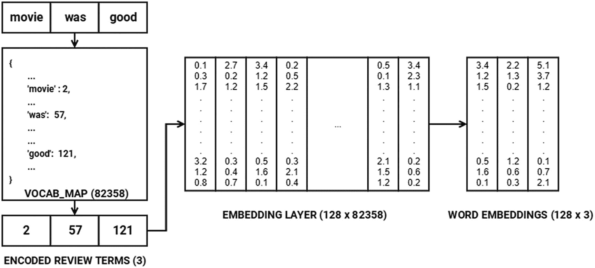

**图 9-11** 理解词嵌入是如何生成的

根据我们的模型架构，`Embedding`层接受三个参数：

* `input_dim`，等于词汇表大小（`vocab_size`）82,358
* `output_dim`，值为 128，表示密集嵌入的维度（由图 9-11 中`Embedding`层的行表示）
* `input_len`，指定输入序列（电影评论序列向量）的长度，值为 1,442

在图 9-11 所示的例子中，由于我们有一条评论，维度是(1, 3)。这条评论基于`VOCAB_MAP`被转换为一个数值序列(2, 57, 121)。然后，从`Embedding`层中选择代表评论序列中索引的特定列（列索引 2、57 和 121 处的向量），以生成最终的词嵌入。这给出了一个维度为(1, 128, 3)的嵌入向量，当每一行基于每个序列词嵌入向量表示时，也可以表示为(1, 3, 128)。像 Keras 这样的许多深度学习框架将嵌入维度表示为(*m*， *n*)，其中*m*代表我们词汇表中的所有唯一词语（82,358），n 代表`output_dim`，本例中为 128。考虑图 9-11 中所示层的转置版本，你就可以很好地理解了！

如果你将编码后的评论词语序列向量表示为独热编码格式(3, 82358)，并与表示为(82358, 128)的`Embedding`层进行矩阵乘法（其中每一行代表词汇表中一个词语的嵌入），你将直接获得评论序列向量的词嵌入(3, 128)。如前所述，当输入数据通过整个网络传播时，嵌入层中的权重在每个 epoch 中根据输入数据进行更新和优化，以最小化整体损失和误差，从而获得最大的模型性能。

这些密集的词嵌入随后被传递到拥有 64 个单元的 LSTM 层。我们在第 1 章简要介绍了 LSTM 架构。LSTM 试图克服 RNN 模型的缺点，特别是在处理长期依赖关系以及当与单元（神经元）关联的权重矩阵变得过小（导致梯度消失）或过大（导致梯度爆炸）时出现的问题。这些架构比常规的深度网络更复杂，深入探讨内部细节和数学概念超出了当前的范围，但我们将在此尝试涵盖要点，而不涉及过多的数学内容。

有兴趣研究 LSTM 内部原理的读者可以查阅启发这一切的原始论文，由 Hochreiter, S. 和 Schmidhuber, J. 所著的 "Long Short-Term Memory"，发表于 *Neural Computation*, 9(8), 1735-1780。我们在图 9-12 中描绘了 RNN 的基本架构，并将其与 LSTM 进行了比较。

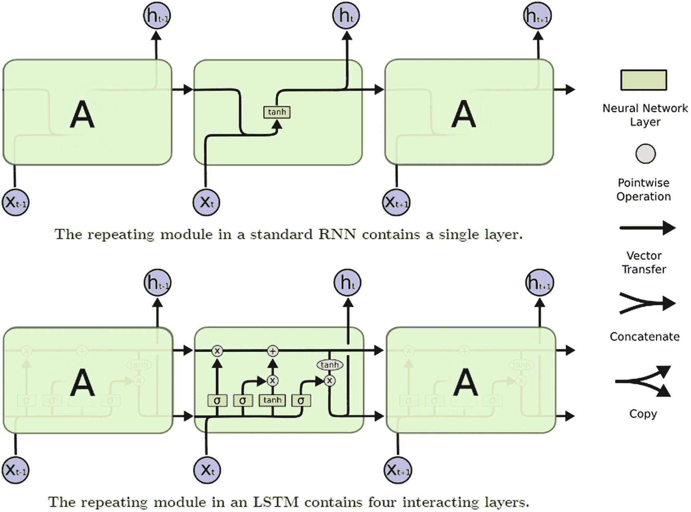

**图 9-12** RNN 和 LSTM 单元的基本结构（来源：Christopher Olah 的博客：colah.github.io）

RNN 单元通常具有重复模块的链（当我们展开循环时会发生这种情况），因此模块可能具有简单的结构，也许只是带有`tanh`激活函数的一层。LSTM 也是一种特殊类型的 RNN，具有类似的结构，但 LSTM 单元拥有四个神经网络层而不仅仅是一个。LSTM 单元的详细架构如图 9-13 所示。

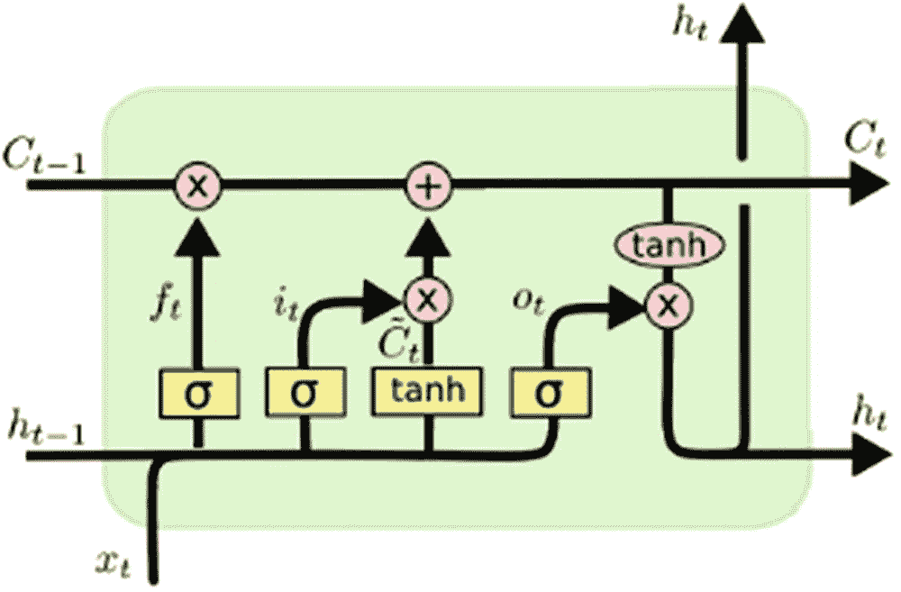

**图 9-13** LSTM 单元的详细架构（来源：Christopher Olah 的博客：colah.github.io）

符号*t*表示一个时间步，*C*表示单元状态，*h*表示隐藏状态。门控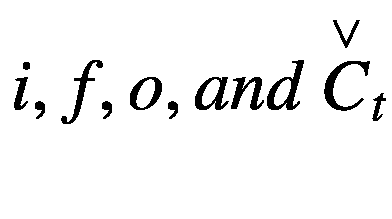有助于从单元状态中移除或添加信息。门控*i*、*f*和*o*分别代表*输入*、*输出*和*遗忘*门。每个门都由 sigmoid 层调制，该层输出 0 到 1 之间的数字，控制这些门输出应通过多少。这保护并控制了单元状态。信息如何通过 LSTM 单元的详细工作流程如图 9-14 所示，分为四个步骤。

1. 第一步涉及遗忘门层*f*，它帮助我们决定应该从单元状态中丢弃哪些信息。这是通过查看先前的隐藏状态*h*[*t* − 1]和当前输入*x*[*t*]来完成的，如方程所示。sigmoid 层有助于控制应保留或遗忘多少信息。

2. 第二步描述了输入门层*i*，它有助于决定哪些信息将存储在当前单元状态中。输入门中的 sigmoid 层有助于决定基于*h*[*t* − 1]和*x*[*t*]应更新哪些值。tanh 层有助于基于*h*[*t* − 1]和*x*[*t*]创建一个新的候选值向量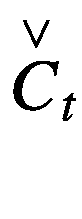，该向量可以添加到当前单元状态。因此，tanh 层创建这些值，而带有 sigmoid 层的输入门有助于选择应更新哪些值。

3. 第三步涉及利用前两步得到的结果，将旧的单元状态*C*[*t* − 1]更新为新的单元状态*C*[*t*]。我们将旧的单元状态乘以遗忘门（*f*[*t*] × *C*[*t* − 1]），然后加上由输入门缩放到 sigmoid 层的新候选值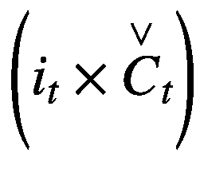。

4. 第四步也是最后一步帮助我们决定最终输出应该是什么，这基本上是单元状态的一个过滤版本。带有 sigmoid 层* o*的输出门帮助我们选择单元状态的哪些部分将传递到最终输出。当通过 tanh 层时，将其与单元状态值相乘，从而得到最终的隐藏状态值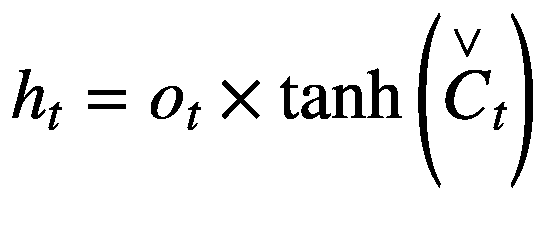。

这些步骤在图 9-14 中进行了描述，并附有必要的注释和方程。我要感谢我们的好朋友 Christopher Olah 提供了详细的信息以及描绘 LSTM 网络内部工作原理的图片。我们建议访问 Christopher 的博客[`http://colah.github.io/posts/2015-08-Understanding-LSTMs`](http://colah.github.io/posts/2015-08-Understanding-LSTMs)了解更多详情。同时也要感谢 Edwin Chen，他以易于理解的方式解释了 RNN 和 LSTM。我们还建议参考 Edwin 的博客[`http://blog.echen.me/2017/05/30/exploring-lstms`](http://blog.echen.me/2017/05/30/exploring-lstms)，以获取关于 RNN 和 LSTM 工作原理的信息。

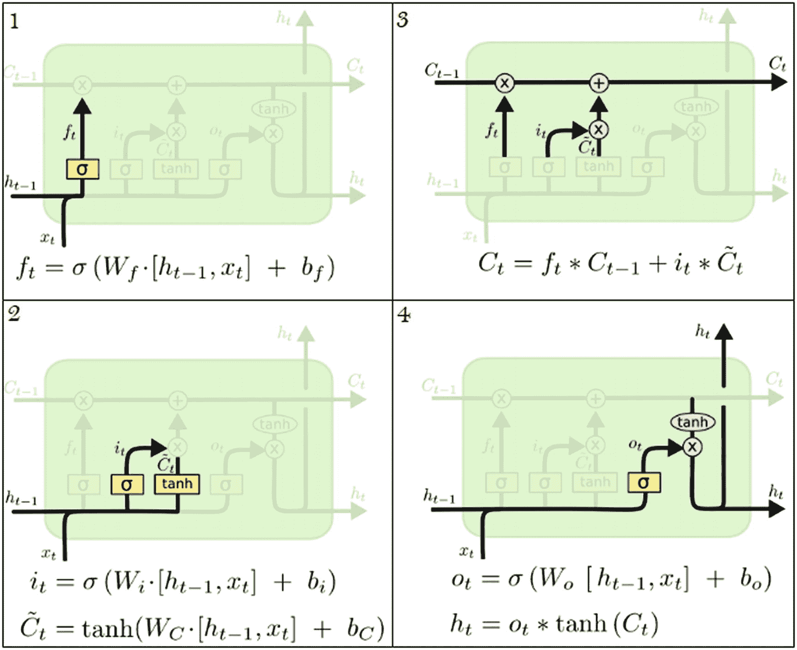

**图 9-14** LSTM 单元中数据流详解（来源：Christopher Olah 的博客：colah.github.io）

我们深度网络中的最后一层是带有 1 个单元和 sigmoid 激活函数的`Dense`层。我们基本上使用`binary_crossentropy`函数配合`adam`优化器，因为这是一个二分类问题，模型最终将预测出`0`或`1`，我们可以通过标签编码器将其解码回负面或正面的情感预测。

你也可以在此处使用`categorical_crossentropy`损失函数，但随后你需要使用一个包含两个单元的`Dense`层并配合`softmax`函数。现在我们的模型已经编译好并准备就绪，我们可以进入分类工作流程的步骤 4——训练模型。我们采用与之前深度网络模型类似的策略，在训练数据上训练模型，设置 5 个 epoch，批次大小为 100 条评论，并使用 10%的训练数据作为验证集来测量验证准确率。

```
In [4]: batch_size = 100
...: model.fit(train_X, train_y, epochs=5, batch_size=batch_size,
...: shuffle=True, validation_split=0.1, verbose=1)
Train on 31500 samples, validate on 3500 samples
Epoch 1/5 31500/31500 - 2491s - loss: 0.4081 - acc: 0.8184 - val_loss: 0.3006 - val_acc: 0.8751
Epoch 2/5 31500/31500 - 2489s - loss: 0.2253 - acc: 0.9158 - val_loss: 0.3209 - val_acc: 0.8780
Epoch 3/5 31500/31500 - 2656s - loss: 0.1431 - acc: 0.9493 - val_loss: 0.3483 - val_acc: 0.8671
Epoch 4/5 31500/31500 - 2604s - loss: 0.1023 - acc: 0.9658 - val_loss: 0.3803 - val_acc: 0.8729
Epoch 5/5 31500/31500 - 2701s - loss: 0.0694 - acc: 0.9761 - val_loss: 0.4430 - val_acc: 0.8706
```

在 CPU 上训练 LSTM 是出了名的慢，正如你所见，我的模型在配备 8GB 内存的 i5 第三代英特尔 CPU 上训练仅五个 epoch 就花费了大约 3.6 小时。当然，像谷歌云平台或 AWS 这样的云环境在 GPU 上训练同一模型耗时不到一小时。因此，我建议你选择基于 GPU 的深度学习环境，尤其是在处理 RNN 或基于 LSTM 的网络架构时。根据前面的输出，我们可以看到仅用五个 epoch，我们就获得了不错的验证准确率。是时候测试我们的模型了！让我们看看它在测试评论上的情感预测效果如何，并使用与之前模型相同的模型评估框架（步骤 5）。

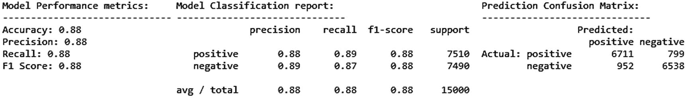

**图 9-15** 基于 LSTM 深度学习模型在词嵌入上的性能指标

```
In [5]: # predict sentiments on test data
...: pred_test = model.predict_classes(test_X)
...: predictions = le.inverse_transform(pred_test.flatten())
...: # evaluate model performance
...: meu.display_model_performance_metrics(true_labels=test_sentiments,
...:                    predicted_labels=predictions, classes=['positive', 'negative'])
```

图 9-15 展示的结果表明，我们获得了 88%的模型准确率和 F1 分数，这相当不错！使用更多高质量的数据，你可以期望获得更好的结果。尝试使用不同的架构进行实验，看看是否能得到更好的结果！

## 分析情感成因

我们构建了监督式和非监督式模型，根据评论的文本内容来预测电影评论的情感。虽然特征工程和建模无疑是当前的首要任务，但你也需要知道如何分析和解释模型预测背后的根本原因。在本节中，我们将分析情感成因。其理念是找到导致正面或负面情感的根本原因或关键因素。第一个关注领域是模型解释，我们试图理解、解释和说明分类模型做出预测背后的机制。第二个关注领域是应用主题建模，从正面和负面情感评论中提取关键主题。

### 解释预测模型

机器学习模型面临的挑战之一是从试点或概念验证阶段过渡到生产阶段。业务部门和关键利益相关者通常将机器学习模型视为复杂的黑箱，并提出这样的问题：我为什么要相信你的模型？解释复杂的数学或理论概念无济于事。有没有办法以易于解释的方式解释这些模型？事实上，这个话题最近在 2016 年获得了广泛关注。请参考 M.T. Ribeiro、S. Singh 和 C. Guestrin 的原始研究论文 "Why Should I Trust You?: Explaining the Predictions of Any Classifier"（来自[`https://arxiv.org/pdf/1602.04938.pdf`](https://arxiv.org/pdf/1602.04938.pdf)），以了解更多关于模型解释和 LIME 框架的信息。

有多种方法可以解释我们的预测性情感分类模型所做的预测。我们想了解为什么一条正面评论被正确预测为具有正面情感，或者一条负面评论被正确预测为具有负面情感。除此之外，没有模型是 100%准确的，因此我们也想了解错误分类或错误预测的原因。本节使用的代码可在名为 `Sentiment Causal Analysis - Model Interpretation.ipynb` 的 Jupyter notebook 中找到，以获得交互式体验。

让我们首先为目前为止对我们效果最好的模型构建一个基本的文本分类流水线。这是基于词袋特征模型的逻辑回归模型。我们利用 Scikit-Learn 的流水线模块，使用以下代码构建这个机器学习流水线。

```
from sklearn.feature_extraction.text import CountVectorizer
from sklearn.linear_model import LogisticRegression
from sklearn.pipeline import make_pipeline
```


# 构建 BOW 特征于训练评论
`cv = CountVectorizer(binary=False, min_df=0.0, max_df=1.0, ngram_range=(1,2))`
`cv_train_features = cv.fit_transform(norm_train_reviews)`

# 构建逻辑回归模型
`lr = LogisticRegression()`
`lr.fit(cv_train_features, train_sentiments)`

# 构建文本分类管道
`lr_pipeline = make_pipeline(cv, lr)`

# 保存预测类别列表（positive, negative）
`classes = list(lr_pipeline.classes_)`

---

我们基于`norm_train_reviews`构建模型，其中包含我们在之前所有分析中使用的标准化训练评论。现在分类管道已准备就绪，您可以通过`pickle`或`joblib`保存分类器和特征对象来部署模型，类似我们在第 5 章“模型部署”部分讨论的内容。假设我们的管道已投入生产，如何将其用于新的电影评论？让我们尝试预测两条新样本评论（未用于训练）的情感。

```
