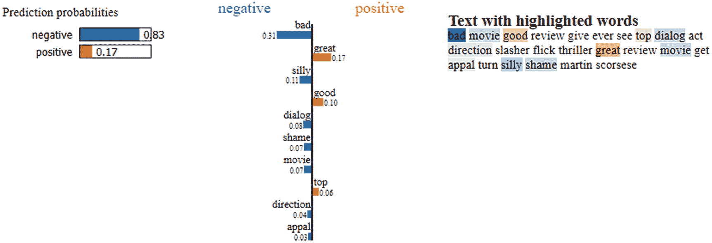
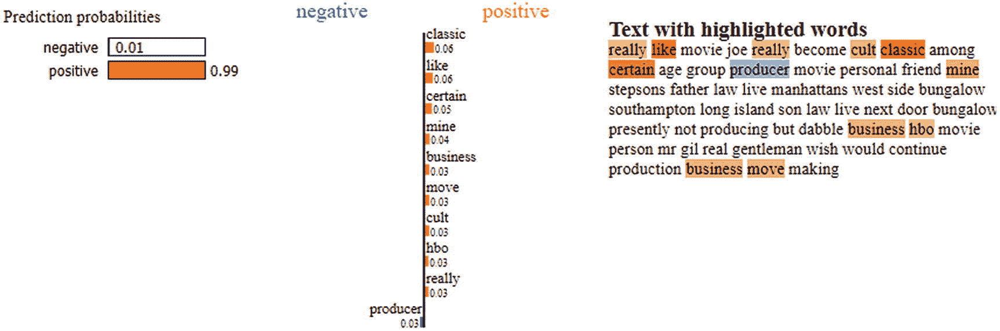
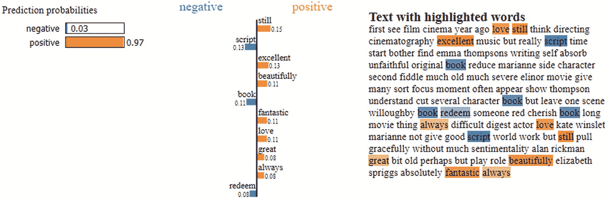

# 模型解释辅助函数

```python
def interpret_classification_model_prediction(doc_index, norm_corpus, corpus, prediction_labels, explainer_obj):
    # 显示模型预测和实际情感
    print("测试文档索引: {index}\n 实际情感: {actual}\n 预测情感: {predicted}"
          .format(index=doc_index,
                  actual=prediction_labels[doc_index],
                  predicted=lr_pipeline.predict([norm_corpus[doc_index]])))

    # 显示实际评论内容
    print("\n 评论内容:", corpus[doc_index])

    # 显示预测概率
    print("\n 模型预测概率:")
    for probs in zip(classes, lr_pipeline.predict_proba([norm_corpus[doc_index]])[0]):
        print(probs)
```

## 展示模型预测解释

```python
exp = explainer.explain_instance(norm_corpus[doc_index],
                                 lr_pipeline.predict_proba, num_features=10, labels=[1])
exp.show_in_notebook()
```

上述代码片段利用 `skater` 解释我们的文本分类器，以一种易于理解的形式分析其决策过程。尽管从全局角度来看，模型可能很复杂，但在局部实例上解释和近似模型行为却更容易。这是通过围绕感兴趣数据点 *X* 的邻近区域学习模型来实现的：对 *X* 周围的实例进行采样，并根据它们与 *X* 的接近程度分配权重。因此，这些局部学习的线性模型有助于以更简单的方式解释复杂模型，提供类别概率以及主要特征对类别概率的贡献，从而辅助决策过程。

让我们从测试数据集中选取一条电影评论，该评论的实际情感和预测情感均为负面，并用我们在前面代码片段中创建的辅助函数进行分析。



**图 9-16** 分类模型对负面评论正确预测的模型解释

```python
In [6]: doc_index = 100
   ...: interpret_classification_model_prediction(doc_index=doc_index, corpus=norm_test_reviews, corpus=test_reviews, prediction_labels=test_sentiments, explainer_obj=explainer)

测试文档索引: 100
实际情感: negative
预测情感: ['negative']
评论: Worst movie, (with the best reviews given it) I've ever seen. Over the top dialog, acting, and direction. more slasher flick than thriller.With all the great reviews this movie got I'm appalled that it turned out so silly. shame on you martin scorsese
模型预测概率:
('negative', 0.827942236512913)
('positive', 0.17205776348708696)
```

图 9-16 所示的结果向我们展示了类别预测概率以及贡献最大的前 10 个特征，这些特征对预测决策过程起到了最大作用。这些关键特征也在标准化后的电影评论文本中进行了高亮显示。在此场景下，我们的模型表现相当不错，我们可以看到导致评论负面情感的关键特征，包括 `bad`、`silly`、`dialog` 和 `shame`，这些特征都是合理的。除此之外，单词 "great" 对 0.17 的正面概率贡献最大，事实上，如果我们从评论文本中删除这个词，正面概率会大幅下降。

以下代码对一条测试电影评论进行了类似分析，该评论的实际情感和预测情感均为正面。



**图 9-17** 分类模型对正面评论正确预测的模型解释

```python
In [7]: doc_index = 2000
   ...: interpret_classification_model_prediction(doc_index=doc_index, corpus=norm_test_reviews, corpus=test_reviews,prediction_labels=
   ...: test_sentiments, explainer_obj=explainer)

测试文档索引: 2000
实际情感: positive
预测情感: ['positive']
评论: I really liked the Movie "JOE." It has really become a cult classic among certain age groups.The Producer of this movie is a personal friend of mine. He is my Stepsons Father-In-Law. He lives in Manhattan's West side, and has a Bungalow. in Southampton, Long Island. His son-in-law live next door to his Bungalow.Presently, he does not do any Producing, But dabbles in a business with HBO movies.As a person, Mr. Gil is a real gentleman and I wish he would have continued in the production business of move making .
模型预测概率:
('negative', 0.014587305153566432)
('positive', 0.9854126948464336)
```

图 9-17 所示的结果向我们展示了模型做出将本条评论预测为正面这一决策的主要特征。基于内容，评论者非常喜欢这部电影，并且在某些年龄群体中它确实是一部真正的 cult 经典。在最后的分析中，我们来看一个模型做出错误预测示例的模型解释。



**图 9-18** 分类模型错误预测的模型解释

```python
In [8]: doc_index = 347
   ...: interpret_classification_model_prediction(doc_index=doc_index, corpus=norm_test_reviews, corpus=test_reviews, prediction_labels=test_sentiments, explainer_obj=explainer)

测试文档索引: 347
实际情感: negative
预测情感: ['positive']
```

评论: When I first saw this film in cinema 11 years ago, I loved it. I still think the directing and cinematography are excellent, as is the music. But it's really the script that has over the time started to bother me more and more. I find Emma Thompson's writing self-absorbed and unfaithful to the original book; she has reduced Marianne to a side-character, a second fiddle to her much too old, much too severe Elinor - she in the movie is given many sort of 'focus moments', and often they appear to be there just to show off Thompson herself. I do understand her cutting off several characters from the book, but leaving out the one scene where Willoughby in the book is redeemed? For someone who red and cherished the book long before the movie, those are the things always difficult to digest. As for the actors, I love Kate Winslet as Marianne. She is not given the best script in the world to work with but she still pulls it up gracefully, without too much sentimentality. Alan Rickman is great, a bit old perhaps, but he plays the role beautifully. And Elizabeth Spriggs, she is absolutely fantastic as always.

### 模型预测概率

`('negative', 0.028707732768304406)`
`('positive', 0.9712922672316956)`

上述输出告诉我们，模型将这条电影评论预测为正面情感，而实际上该评论的真实情感标签是负面。图 9-18 中的结果告诉我们，评论者在电影评论中表现出正面情感的迹象，尤其是在他/她表达“我很喜欢它。我仍然认为导演和摄影都很出色，音乐也同样出色……艾伦·瑞克曼很棒，也许年纪有点大，但他把角色演得很美。伊丽莎白·斯普里格斯，一如既往地绝对出色”的部分。来自同一部分的关键词已被展示在贡献正面情感的主要特征中。模型解释也正确识别了评论中导致负面情感的部分，例如“但确实是剧本，随着时间的推移，越来越困扰我。”因此，这是一条较为复杂的评论，因为它同时包含了正面和负面情感。最终的解释权在读者手中。你现在可以使用同样的框架来解释你自己的分类模型，并了解你的模型在哪些方面表现良好，在哪些方面可能需要改进！

## 分析主题模型

另一种分析关键术语、概念或主题（这些是造成情感的原因）的方法是使用一种不同的方法，称为*主题建模*。我们在第 4 章的“文本数据特征工程”一节的“主题模型”部分介绍了一些主题建模的基础知识。主题模型的主要目的是提取和描绘关键主题或概念，这些主题或概念通常是潜在的，在庞大的文本文档语料库中并不十分突出。我们在第 6 章中看到了使用潜在狄利克雷分配（LDA）和非负矩阵分解（NMF）进行主题建模的方法。在本节中，我们使用非负矩阵分解。如需交互式体验，请参考名为 `Sentiment Causal Analysis - Topic Models.ipynb` 的 Jupyter 笔记本。

分析的第一步是合并所有标准化的训练和测试评论，并将这些评论分为正面情感评论和负面情感评论。完成此操作后，我们将使用 TF-IDF 特征向量化器从这两个数据集中提取特征。以下代码片段可帮助我们实现这一点。

```python
In [11]: from sklearn.feature_extraction.text import TfidfVectorizer

...:

...: # 合并所有标准化评论

...: norm_reviews = norm_train_reviews+norm_test_reviews

...: # 仅对正面评论提取 tf-idf 特征

...: positive_reviews = [review for review, sentiment in zip(norm_reviews, sentiments) if sentiment == 'positive']

...: ptvf = TfidfVectorizer(use_idf=True, min_df=0.02, max_df=0.75,

ngram_range=(1,2), sublinear_tf=True)

...: ptvf_features = ptvf.fit_transform(positive_reviews)

...: # 仅对负面评论提取 tf-idf 特征

...: negative_reviews = [review for review, sentiment in zip(norm_reviews, sentiments) if sentiment == 'negative']

...: ntvf = TfidfVectorizer(use_idf=True, min_df=0.02, max_df=0.75,

ngram_range=(1,2), sublinear_tf=True)

...: ntvf_features = ntvf.fit_transform(negative_reviews)

...: # 查看特征集维度

...: print(ptvf_features.shape, ntvf_features.shape)

(25000, 933) (25000, 925)
```

从前面的输出维度可以看出，我们通过将 `min_df` 设为 0.02、`max_df` 设为 0.75，过滤掉了之前构建分类模型时使用的许多特征。这是为了加快主题建模过程，并移除那些出现频率过高或过低的特征。现在让我们导入主题建模过程所需的依赖项。

```python
In [12]: import pyLDAvis

...: import pyLDAvis.sklearn

...: from sklearn.decomposition import NMF

...: import topic_model_utils as tmu

...:

...: pyLDAvis.enable_notebook()

...: total_topics = 10
```

Scikit-Learn 中的 `NMF` 类帮助我们进行主题建模。我们还使用 `pyLDAvis` 来构建主题模型的交互式可视化。非负矩阵分解（NNMF）的核心原理是将矩阵分解（类似于 SVD）应用于一个非负特征矩阵 *X*，使得分解可以表示为 *X* ≈ *WH*，其中 *W* 和 *H* 都是非负矩阵，如果将它们相乘，应能近似重构出特征矩阵 *X*。可以使用像 L2 范数这样的代价函数来获得这种近似。让我们应用 NNMF 从我们的正面情感评论中提取 10 个主题。

### 基于正面情感评论特征构建主题模型

```python
pos_nmf = NMF(n_components=total_topics, solver="cd", max_iter=500,

              random_state=42, alpha=.1, l1_ratio=.85)

pos_nmf.fit(ptvf_features)
```