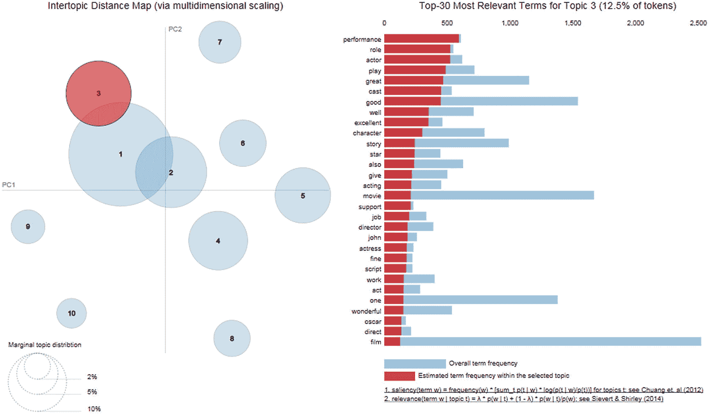

# extract and display topics and their components
pos_feature_names = np.array(ptvf.get_feature_names())
feature_idxs = np.argsort(-pos_weights)[:, :15]
topics = [pos_feature_names[idx] for idx in feature_idxs]
for idx, topic in enumerate(topics):
    print('Topic #'+str(idx+1)+':')
    print(', '.join(topic))
    print()
```

**主题 #1:**
`but, one, make, no, take, way, even, get, seem, like, much, scene, may, character, go`

**主题 #2:**
`movie, watch, see, like, think, really, good, but, see movie, great, movie not, would, get, enjoy, say`

**主题 #3:**
`show, episode, series, tv, season, watch, dvd, television, first, good, see, would, air, great, remember`

**主题 #4:**
`family, old, young, year, life, child, father, mother, son, year old, man, friend, kid, boy, girl`

**主题 #5:**
`performance, role, actor, play, great, cast, good, well, excellent, character, story, star, also, give, acting`

**主题 #6:**
`film, see, see film, film not, watch, good film, watch film, dvd, great film, film but, film see, release, year, film make, great`

**主题 #7:**
`love, love movie, story, love story, fall love, fall, beautiful, song, wonderful, music, heart, romantic, romance, favorite, character`

**主题 #8:**
`funny, laugh, hilarious, joke, humor, moment, fun, guy, get, but, line, show, lot, time, scene`

**主题 #9:**
`ever, ever see, movie ever, one good, one, see, good, ever make, good movie, movie, make, amazing, never, every, movie one`

**主题 #10:**
`comedy, romantic, laugh, hilarious, fun, humor, comic, joke, drama, light, romance, star, british, classic, one`

尽管某些主题可能非常通用，但我们可以看到，有些主题清晰地表明了评论中导致其产生正面情感的具体方面。你可以利用 `pyLDAvis` 以交互式可视化方式展示这些主题。



**图 9-19** — 正面情感影评主题模型可视化

```python
In [14]: pyLDAvis.sklearn.prepare(pos_nmf, ptvf_features, ptvf, mds="mmds")
```

图 9-19 中的可视化向我们展示了来自正面影评的 10 个主题，我们可以看到我们之前的输出中主题 5 的最相关术语（`pyLDAvis` 对主题有自己的排序方式）。从这些主题和术语来看，我们可以看到像 `movie cast`、`actors`、`performance`、`play`、`characters`、`music`、`wonderful`、`script`、`good` 等术语在不同主题中促成了正面情感。这相当有趣，并且让你深入了解评论中哪些组成部分造就了评论的正面情感。如果你使用 Jupyter notebook，这种可视化是完全可交互的。你可以点击左侧“主题间距离图”中代表主题的任意气泡，以查看右侧条形图中每个主题下最相关的术语。

左侧的图是使用多维缩放（MDS）渲染的。相似的主题应彼此靠近，不相似的主题应彼此远离。每个主题气泡的大小基于该主题及其组件在整个语料库中的频率。

右侧的可视化展示了最热门的术语。当没有选择主题时，它会显示语料库中前 30 个最显著的术语。一个术语的*显著性*被定义为该术语在语料库中出现的频率以及它在区分不同主题时的区分因素。当选择一个主题时，图表会变为类似图 9-19 所示，展示该主题下前 30 个最相关的术语。相关性度量由 *λ* 控制，可以通过条形图顶部的滑块进行调整（请参考 notebook 进行交互操作）。对可视化背后更多数学理论感兴趣的读者，建议查阅 `https://cran.r-project.org/web/packages/LDAvis/vignettes/details.pdf`，这是 R 包 `LDAvis` 的小品文，该包已作为 `pyLDAvis` 移植到了 Python。

现在，让我们提取主题，并对电影评论数据集中我们负面情感评论进行同样的分析。

```python
