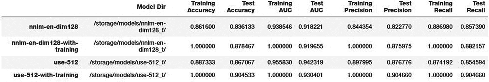
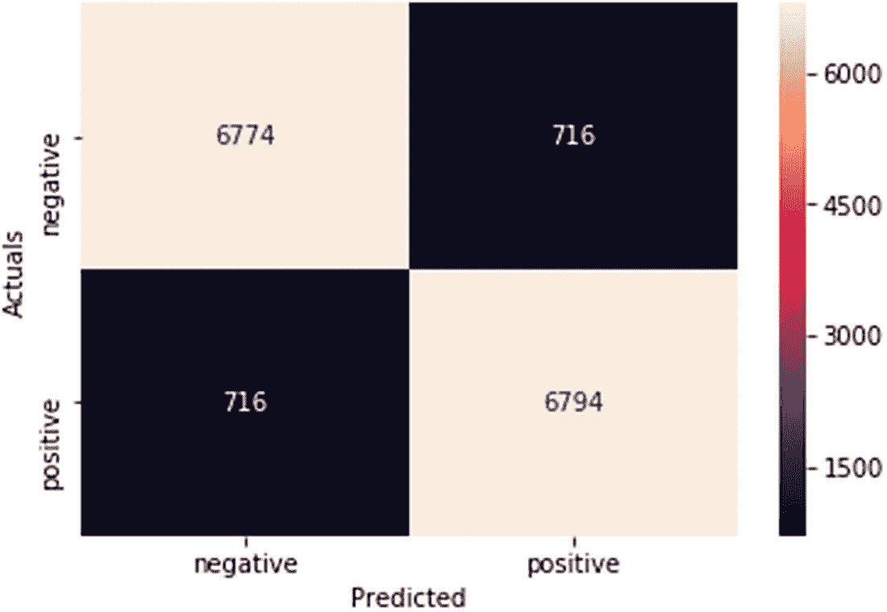

# 训练约 12 个周期

`256*1500 / 30000 == 12.8`

```python
We had set our `batch_size` to 256 and
we will be flowing in data in batches of 256 records for 1,500 steps.
This translates to roughly 12–13 epochs.
```

## 模型训练

接下来，我们在训练数据集上训练模型，并每隔 100 步评估一次训练集和验证集。

```python
tf.logging.set_verbosity(tf.logging.ERROR)

import time

TOTAL_STEPS = 1500
STEP_SIZE = 100

for step in range(0, TOTAL_STEPS+1, STEP_SIZE):
    print()
    print('-'*100)
    print('Training for step =', step)
    start_time = time.time()
    dnn.train(input_fn=train_input_fn, steps=STEP_SIZE)
    elapsed_time = time.time() - start_time
    print('Train Time (s):', elapsed_time)
    print('Eval Metrics (Train):', dnn.evaluate(input_fn=predict_train_input_fn))
    print('Eval Metrics (Validation):', dnn.evaluate(input_fn=predict_val_input_fn))
```

```text
Training for step = 0
Train Time (s): 78.62789511680603
Eval Metrics (Train): {'accuracy': 0.84863335, 'accuracy_baseline': 0.5005, 'auc': 0.9279859, 'auc_precision_recall': 0.92819566, 'average_loss': 0.34581015, 'label/mean': 0.5005, 'loss': 44.145977, 'precision': 0.86890674, 'prediction/mean': 0.47957155, 'recall': 0.8215118, 'global_step': 100}
Eval Metrics (Validation): {'accuracy': 0.8454, 'accuracy_baseline': 0.505, 'auc': 0.92413086, 'auc_precision_recall': 0.9200026, 'average_loss': 0.35258815, 'label/mean': 0.495, 'loss': 44.073517, 'precision': 0.8522351, 'prediction/mean': 0.48447067, 'recall': 0.8319192, 'global_step': 100}
Training for step = 100
Train Time (s): 76.1651611328125
Eval Metrics (Train): {'accuracy': 0.85436666, 'accuracy_baseline': 0.5005, 'auc': 0.9321357, 'auc_precision_recall': 0.93224275, 'average_loss': 0.3330773, 'label/mean': 0.5005, 'loss': 42.520508, 'precision': 0.8501513, 'prediction/mean': 0.5098621, 'recall': 0.86073923, 'global_step': 200}
Eval Metrics (Validation): {'accuracy': 0.8494, 'accuracy_baseline': 0.505, 'auc': 0.92772096, 'auc_precision_recall': 0.92323804, 'average_loss': 0.34418356, 'label/mean': 0.495, 'loss': 43.022945, 'precision': 0.83501947, 'prediction/mean': 0.5149463, 'recall': 0.86707073, 'global_step': 200}
...
...
...
Training for step = 1400
Train Time (s): 85.99037742614746
Eval Metrics (Train): {'accuracy': 0.8783, 'accuracy_baseline': 0.5005, 'auc': 0.9500882, 'auc_precision_recall': 0.94986326, 'average_loss': 0.28882334, 'label/mean': 0.5005, 'loss': 36.871063, 'precision': 0.865308, 'prediction/mean': 0.5196238, 'recall': 0.8963703, 'global_step': 1500}
Eval Metrics (Validation): {'accuracy': 0.8626, 'accuracy_baseline': 0.505, 'auc': 0.93708724, 'auc_precision_recall': 0.9336051, 'average_loss': 0.32389137, 'label/mean': 0.495, 'loss': 40.486423, 'precision': 0.84044176, 'prediction/mean': 0.5226699, 'recall': 0.8917172, 'global_step': 1500}
Training for step = 1500
Train Time (s): 86.91469407081604
Eval Metrics (Train): {'accuracy': 0.8802, 'accuracy_baseline': 0.5005, 'auc': 0.95115364, 'auc_precision_recall': 0.950775, 'average_loss': 0.2844779, 'label/mean': 0.5005, 'loss': 36.316326, 'precision': 0.8735527, 'prediction/mean': 0.51057553, 'recall': 0.8893773, 'global_step': 1600}
Eval Metrics (Validation): {'accuracy': 0.8626, 'accuracy_baseline': 0.505, 'auc': 0.9373224, 'auc_precision_recall': 0.9336302, 'average_loss': 0.32108024, 'label/mean': 0.495, 'loss': 40.135033, 'precision': 0.8478599, 'prediction/mean': 0.5134171, 'recall': 0.88040406, 'global_step': 1600}
```

根据输出日志，我们可以看到在验证数据集上总体准确率接近 87%，AUC 达到了 94%，对于这样一个简单的模型来说，效果相当不错！

## 模型评估

现在我们来评估模型，并检查其在训练集和测试集上的整体性能。

```python
dnn.evaluate(input_fn=predict_train_input_fn)
```

```text
{'accuracy': 0.8802, 'accuracy_baseline': 0.5005, 'auc': 0.95115364,
 'auc_precision_recall': 0.950775, 'average_loss': 0.2844779,
 'label/mean': 0.5005, 'loss': 36.316326, 'precision': 0.8735527,
 'prediction/mean': 0.51057553, 'recall': 0.8893773, 'global_step': 1600}
```

```python
dnn.evaluate(input_fn=predict_test_input_fn)
```

```text
```

# 模型评估与迁移学习实验

{'accuracy': 0.8663333, 'accuracy_baseline': 0.5006667, 'auc': 0.9406502, 'auc_precision_recall': 0.93988097, 'average_loss': 0.31214723, 'label/mean': 0.5006667, 'loss': 39.679733, 'precision': 0.8597569, 'prediction/mean': 0.5120608, 'recall': 0.8758988, 'global_step': 1600}

我们在测试数据上获得了接近 87%的总体准确率，这与我们之前在验证数据集上观察到的结果一致。因此，这应该能让你了解，利用预训练的通用句子嵌入是多么容易，无需担心特征工程或复杂建模的麻烦。

## 扩展：使用不同通用句子嵌入的迁移学习

现在，我们尝试根据不同的句子嵌入来构建不同的深度学习分类器。我们将尝试以下模型：

* `NNLM-128`
* `USE-512`

我们还将介绍两种最主流的迁移学习方法。

* 使用冻结的预训练句子嵌入构建模型
* 构建一个在训练期间微调并更新预训练句子嵌入的模型

以下通用函数可以即插即用地从`tensorflow-hub`中加载不同的通用句子编码器。

```python
import time

TOTAL_STEPS = 1500
STEP_SIZE = 500

my_checkpointing_config = tf.estimator.RunConfig(
    keep_checkpoint_max = 2,       # 保留最近 2 个检查点。
)

def train_and_evaluate_with_sentence_encoder(hub_module, train_module=False, path=""):
    embedding_feature = hub.text_embedding_column(
        key='sentence', module_spec=hub_module, trainable=train_module)

    print()
    print('='*100)
    print('Training with', hub_module)
    print('Trainable is:', train_module)
    print('='*100)

    dnn = tf.estimator.DNNClassifier(
        hidden_units=[512, 128],
        feature_columns=[embedding_feature],
        n_classes=2,
        activation_fn=tf.nn.relu,
        dropout=0.1,
        optimizer=tf.train.AdagradOptimizer(learning_rate=0.005),
        model_dir=path,
        config=my_checkpointing_config)

    for step in range(0, TOTAL_STEPS+1, STEP_SIZE):
        print('-'*100)
        print('Training for step =', step)
        start_time = time.time()
        dnn.train(input_fn=train_input_fn, steps=STEP_SIZE)
        elapsed_time = time.time() - start_time
        print('Train Time (s):', elapsed_time)
        print('Eval Metrics (Train):', dnn.evaluate(input_fn=predict_train_input_fn))
        print('Eval Metrics (Validation):', dnn.evaluate(input_fn=predict_val_input_fn))

    train_eval_result = dnn.evaluate(input_fn=predict_train_input_fn)
    test_eval_result = dnn.evaluate(input_fn=predict_test_input_fn)

    return {
        "Model Dir": dnn.model_dir,
        "Training Accuracy": train_eval_result["accuracy"],
        "Test Accuracy": test_eval_result["accuracy"],
        "Training AUC": train_eval_result["auc"],
        "Test AUC": test_eval_result["auc"],
        "Training Precision": train_eval_result["precision"],
        "Test Precision": test_eval_result["precision"],
        "Training Recall": train_eval_result["recall"],
        "Test Recall": test_eval_result["recall"]
    }
```

现在我们可以使用这些定义好的方法来训练我们的模型。

```python
tf.logging.set_verbosity(tf.logging.ERROR)
results = {}

results["nnlm-en-dim128"] = train_and_evaluate_with_sentence_encoder(
    "https://tfhub.dev/google/nnlm-en-dim128/1", path='/storage/models/nnlm-en-dim128_f/')
results["nnlm-en-dim128-with-training"] = train_and_evaluate_with_sentence_encoder(
    "https://tfhub.dev/google/nnlm-en-dim128/1", train_module=True, path='/storage/models/nnlm-en-dim128_t/')
results["use-512"] = train_and_evaluate_with_sentence_encoder(
    "https://tfhub.dev/google/universal-sentence-encoder/2", path='/storage/models/use-512_f/')
results["use-512-with-training"] = train_and_evaluate_with_sentence_encoder(
    "https://tfhub.dev/google/universal-sentence-encoder/2", train_module=True, path='/storage/models/use-512_t/')
```

```text
====================================================================
Training with https://tfhub.dev/google/nnlm-en-dim128/1
Trainable is: False
====================================================================
Training for step = 0
Train Time (s): 30.525171756744385
Eval Metrics (Train): {'accuracy': 0.8480667, 'auc': 0.9287864, 'precision': 0.8288572, 'recall': 0.8776557}
Eval Metrics (Validation): {'accuracy': 0.8288, 'auc': 0.91452694, 'precision': 0.7999259, 'recall': 0.8723232}
...
...
Training for step = 1500
Train Time (s): 28.242169618606567
```

# 模型评估与最佳模型加载

## 训练配置与评估指标

### 使用 `nnlm-en-dim128` 模型（可训练）

**初始评估指标：**
- 训练集：`{'accuracy': 0.8616, 'auc': 0.9385461, 'precision': 0.8443543, 'recall': 0.8869797}`
- 验证集：`{'accuracy': 0.828, 'auc': 0.91572505, 'precision': 0.80322945, 'recall': 0.86424243}`

**训练步骤 0：**
- 训练时间：`45.97756814956665` 秒
- 训练集指标：`{'accuracy': 0.9997, 'auc': 0.9998141, 'precision': 0.99980015, 'recall': 0.9996004}`
- 验证集指标：`{'accuracy': 0.877, 'auc': 0.9225529, 'precision': 0.86671925, 'recall': 0.88808084}`

**训练步骤 1500：**
- 训练时间：`44.654765605926514` 秒
- 训练集指标：`{'accuracy': 1.0, 'auc': 1.0, 'precision': 1.0, 'recall': 1.0}`
- 验证集指标：`{'accuracy': 0.875, 'auc': 0.91479605, 'precision': 0.8661916, 'recall': 0.8840404}`

### 使用 `universal-sentence-encoder` 模型（不可训练）

**初始评估指标：**
- 训练集：`{'accuracy': 0.8591, 'auc': 0.9373971, 'precision': 0.8820655, 'recall': 0.8293706}`
- 验证集：`{'accuracy': 0.8522, 'auc': 0.93081224, 'precision': 0.8631799, 'recall': 0.8335354}`

**训练步骤 0：**
- 训练时间：`261.7671597003937` 秒
- 训练集指标：`{'accuracy': 0.8591, 'auc': 0.9373971, 'precision': 0.8820655, 'recall': 0.8293706}`
- 验证集指标：`{'accuracy': 0.8522, 'auc': 0.93081224, 'precision': 0.8631799, 'recall': 0.8335354}`

**训练步骤 1500：**
- 训练时间：`258.4421606063843` 秒
- 训练集指标：`{'accuracy': 0.88733333, 'auc': 0.9558296, 'precision': 0.8979955, 'recall': 0.8741925}`
- 验证集指标：`{'accuracy': 0.864, 'auc': 0.938815, 'precision': 0.864393, 'recall': 0.860202}`

### 使用 `universal-sentence-encoder` 模型（可训练）

**初始评估指标：**
- 训练集：`{'accuracy': 0.99916667, 'auc': 0.9996535, 'precision': 0.9989349, 'recall': 0.9994006}`
- 验证集：`{'accuracy': 0.9056, 'auc': 0.95068294, 'precision': 0.9020474, 'recall': 0.9078788}`

**训练步骤 0：**
- 训练时间：`313.1993100643158` 秒
- 训练集指标：`{'accuracy': 0.99916667, 'auc': 0.9996535, 'precision': 0.9989349, 'recall': 0.9994006}`
- 验证集指标：`{'accuracy': 0.9056, 'auc': 0.95068294, 'precision': 0.9020474, 'recall': 0.9078788}`

**训练步骤 1500：**
- 训练时间：`305.9913341999054` 秒
- 训练集指标：`{'accuracy': 1.0, 'auc': 1.0, 'precision': 1.0, 'recall': 1.0}`
- 验证集指标：`{'accuracy': 0.9032, 'auc': 0.929281, 'precision': 0.8986784, 'recall': 0.9066667}`

## 结果分析与最佳模型加载

我已在输出中列出了重要的评估指标，可以看到我们的模型确实取得了不错的结果。图 10-11 中的表格清晰地总结了这些对比结果。



**图 10-11** 比较不同通用句子编码器的结果

```python
results_df = pd.DataFrame.from_dict(results, orient="index")
results_df
```

看来，经过微调的谷歌通用句子编码器在测试数据上为我们提供了最佳结果。让我们加载这个保存的模型，并在测试数据上运行评估。

```python
# 获取最佳保存模型的位置
best_model_dir = results_df[results_df['Test Accuracy'] == results_df['Test Accuracy'].max()]['Model Dir'].values[0]

# 加载模型
embedding_feature = hub.text_embedding_column(key='sentence', module_spec="https://tfhub.dev/google/universal-sentence-encoder/2", trainable=True)
dnn = tf.estimator.DNNClassifier(hidden_units=[512, 128], feature_columns=[embedding_feature], n_classes=2, activation_fn=tf.nn.relu, dropout=0.1, optimizer=tf.train.AdagradOptimizer(learning_rate=0.005), model_dir=best_model_dir)

# 定义获取模型预测的函数
def get_predictions(estimator, input_fn):
    return [x["class_ids"][0] for x in estimator.predict(input_fn=input_fn)]

# 获取模型对测试数据的预测
predictions = get_predictions(estimator=dnn, input_fn=predict_test_input_fn)
predictions[:10]
```

输出：
```
[0, 1, 0, 1, 1, 0, 1, 1, 1, 1]
```

评估模型性能的最佳方法之一是以混淆矩阵的形式可视化模型预测（见图 10-12）。



图 10-12：基于最佳模型预测的混淆矩阵

```python
import seaborn as sns
import matplotlib.pyplot as plt
%matplotlib inline
```

```python
with tf.Session() as session:
    cm = tf.confusion_matrix(test_sentiments, predictions).eval()
    LABELS = ['negative', 'positive']
    sns.heatmap(cm, annot=True, xticklabels=LABELS, yticklabels=LABELS, fmt="g")
    xl = plt.xlabel("Predicted")
    yl = plt.ylabel("Actuals")
```

我们还可以使用 Scikit-Learn 打印模型的分类报告，以描述可从混淆矩阵推导出的其他重要指标，包括精确率、召回率和 F1 分数。

```python
from sklearn.metrics import classification_report
print(classification_report(y_true=test_sentiments, y_pred=predictions, target_names=LABELS))
```

```
          precision    recall  f1-score   support

negative       0.90      0.90      0.90      7490
positive       0.90      0.90      0.90      7510
avg / total    0.90      0.90      0.90     15000
```

模型在测试数据上的整体准确率和 F1 分数达到了 90%，效果非常不错。你可以亲自尝试一下，或许能得到更高的分数；如果是这样，请告诉我！

## 总结与未来展望

通用语句嵌入无疑是推动迁移学习在各种 NLP 任务中应用的一大步。事实上，我们已经看到像 ELMo、Universal Sentence Encoder 和 ULMFiT 这样的模型通过展示预训练模型可用于在 NLP 任务中取得最优结果而登上了头条。我对 NLP 进一步泛化以及使我们能够轻松解决复杂任务的未来前景感到无比兴奋。

本书最后一章到此结束。希望这能帮助你在现实世界中应用在这里学到的一些知识，来解决你自己在 NLP 领域的实际问题。永远记住`奥卡姆剃刀`原则，即最简单的解决方案通常是最好的解决方案。尽管深度学习方法当下可能很热门，但它们并非解决所有问题的万能钥匙。只有当你认为这样做完全合理时，才应该利用它们；随着时间推移，通过直觉、实验、练习和阅读，你会更好地理解这一点。现在，去解决一些有趣的 NLP 问题，并告诉我你的成果吧！

## 索引

### A

- 形容词短语（ADJP）
- 高级特征工程模型
  - 加载圣经语料库
  - FastText 模型
  - GloVe 模型
  - Word2Vec（参见 Word2Vec 模型）
- 副词短语（ADVP）
- 亲和传播（AP）算法
- AFINN 情感词典
- 美国国家语料库（ANC）
- Anaconda Python 发行版
- 应用程序编程接口（API）
- 人工智能（AI）
- 人工神经网络（ANN）
- 计算语言学协会（ACL）
- 原子单元
- 自动文档摘要
  - 基于抽象的技术
  - 基于抽取的技术
  - Gensim 的摘要模块
  - 潜在语义分析（LSA）
  - 低秩奇异值分解（SVD）
  - 显著度分数
  - 奇异值分解（SVD）
  - Skyrim
  - TextRank 算法
  - 文本整理
  - TF-IDF 特征工程
  - 词频统计

### B

- 巴科斯-诺尔范式（BNF）
- Bagging 方法
- N 元词袋模型
- 词袋模型
- 基线句子嵌入模型
- 批归一化
- 句子起始符（BOS）
- 行为理论
- Bing Liu 情感词典
- Boosting 方法
- 英国国家语料库（BNC）
- Brown 语料库
- 字节字符串

### C

- 规范形式
- 基于质心的聚类模型
- 荷兰数学与计算机科学中心（CWI）
- 字符向量化
- 图表解析
- 儿童语言数据交换系统（CHILDES）
- 引用形式
- 分类模型
  - 词袋
  - 模型性能对比
  - 混淆矩阵
    - 准确率
    - 逻辑回归模型
    - 性能指标
    - 精确率
    - 召回率
    - 结构
  - 集成方法

### 评估

- FastText 嵌入
- GBM（梯度提升机）
- GloVe 嵌入
- 逻辑回归
- 评估指标
- 模型性能
- 文章
- 混淆矩阵
- 一致性
- 误分类的新闻组
- 预测
- 监督学习算法
- 支持向量机
- 模型调优
- 五折交叉验证方案
- 逻辑回归
- 朴素贝叶斯模型
- Scikit-Learn 管道对象
- 多项式朴素贝叶斯
- 随机森林
- 支持向量机
- TF-IDF（词频-逆文档频率）
- 训练
- 调优
- Word2Vec
- 文本清洗
- 聚类分析
- 聚类算法
- 电影聚类
- AP 算法（亲和传播算法）
- 特征工程
- k-means 聚类（参见 K-means 聚类算法）
- Ward 凝聚层次聚类（参见 Ward 凝聚层次聚类）
- 折叠吉布斯采样
- 柯林斯伯明翰大学国际语言数据库（COBUILD）
- 柯林斯语料库
- 公共语言运行时（CLR）
- 组合语义学
- 计算语言学与心理语言学（CLiPS）
- 条件随机场（CRF）
- 常量符号
- 成分语法
- 短语结构规则
- 句法树
- NLTK 与斯坦福 Core NLP
- 名词短语
- 介词短语
- 递归特性
- 句法表示
- 动词短语
- 构造性二难推理
- 基于内容的分类
- 上下文无关文法（CFG）
- 连续词袋（CBOW）模型
- 架构
- 上下文词
- 语料库词汇表，构建
- 深度学习架构
- 运行，模型
- 目标词
- 词嵌入
- 当代美国英语语料库（COCA）
- 拼写纠正
- `case_of()` 函数
- `known()` 函数
- TextBlob 库
- 余弦相似度
- 字符袋向量化
- 实现
- 词项向量
- 向量表示
- `cossim()` 函数
- CPython

### D

- 数据库编程
- 数据准备
- 数据预处理与标准化
- `normalize_corpus(...)` 函数
- 简单的 pandas 过滤操作
- 数据整理阶段
- 数据检索
- 陈述句
- 深度学习（DL）
- 分类器
- 混淆矩阵
- 模型训练
- NNLM-128
- Scikit-Learn
- tensorflow-hub
- 通用句子编码器
- USE-512
- 深度神经网络（DNN）
- 树状图
- 基于密度的聚类模型
- 依存语法
- DAG（有向无环图）
- 句法功能
- 句法树
- 标注
- 有向无环图（DAG）
- 话语分析
- 选言三段论
- 基于分布的聚类模型
- Doc2Vec
- 与 Word2Vec 模型对比
- 文档
- 文档聚类
- 文档频率（DF）
- 文档相似度
- 聚类
- 凝聚层次
- 聚类标签
- 树状图
- 连接矩阵
- 余弦相似度
- 成对
- 文档摘要

### E

- ElasticSearch
- 嵌入
- 定义
- 预测方法
- 文本
- 通用句子编码器
- 来自语言模型的嵌入（ELMo）
- 句尾（EOS）
- 集成模型
- 字符串中的转义序列
- 欧几里得距离
- 感叹句
- 执行速度性能
- 缩写扩展

### F

- 事实性文档
- 假负例（FN）
- 假正例（FP）
- FastText 模型
- Facebook
- `gensim.models.fasttext` 模块
- 子词模型
- 向量表示
- 特征工程
- N-gram 词袋模型
- 词袋模型
- 嵌入
- 标签编码
- 独热编码
- TF-IDF 模型
- 特征提取
- 特征矩阵
- 一阶逻辑（FOL）
- 组成部分
- 定义
- 泛化
- HOL（高阶逻辑）
- 实例化
- 自然语言陈述，表示
- PL（命题逻辑）
- 量词
- `fit_transform(...)` 函数
- 函数符号

### G

- Gensim 库
- Gensim 框架，主题模型
- 特征工程
- 词袋模型
- 文档频率
- `gensim.models.Phrases` 类
- 短语生成模型
- LDA（参见 潜在狄利克雷分配（LDA））
- LSI（参见 潜在语义索引（LSI））
- 结果
- 主导主题分布
- 主导主题，研究论文
- 主数据框
- 主题预测
- 相关研究论文
- 全局解释器锁（GIL）
- 全局向量（GloVe）模型
- 矩阵分解
- SGD（随机梯度下降）
- spaCy 框架
- `en_vectors_web_lg` 模型
- k-means 聚类
- 与 Word2Vec 模型对比
- 谷歌 N-gram 语料库
- 梯度提升机（GBMs）
- 图形用户界面（GUIs）
- 格罗宁根意义银行（GMB）

### H

- Hadoop 分布式文件系统（HDFS）
- 汉明距离
- 同形异音词
- 异形同音词
- 层次聚类模型
- 凝聚式
- 树状图
- 距离度量
- 分裂式
- 连接准则
- 高阶逻辑（HOL）
- 同音词
- 同形同音异义词
- 同形词
- 人机交互（HCI）
- 超参数
- 下位词
- 假言三段论

### I

- 言后行为
- ImageNet
- 祈使句
- 索引与切片
- InferSent
- 信息过载
- 信息检索（IR）
- 内部-外部-开始（IOB）标记
- 集成开发环境（IDE）
- 互联网电影数据库（IMDB）
- 疑问从句
- 逆文档频率（IDF）
- IronPython

### J

- Java 虚拟机（JVM）
- 即时编译（JIT）
- Jython

### K

- Keras
- 核技巧
- 关键短语提取
- `collocation`
- `computation`
- `defined`
- `FreqDist` 类
- `n-grams`
- `pointwise mutual information`
- `text_normalizer` 模块
- `terminology extraction`
- `uses`
- `weighted tag-based phrase extraction`
- `chunker`
- `get_chunks()` 函数
- `POS` 标签
- `text_normalizer` 模块
- `TextRank` 算法
- `TF-IDF` 权重
- 关键词上下文索引（KWIC）
- K 均值聚类算法
- `cluster movie data`
- `defined`
- `kmeans++ 方案`
- `NP 困难问题`
- `pairwise document similarity`
- 库尔贝克-莱布勒散度（KL 散度）

### L

- 标签编码
- 兰卡斯特-奥斯陆-卑尔根语料库（LOB 语料库）
- 潜在狄利克雷分配（LDA）
- `collapsed Gibbs sampling method`
- `core algorithm`
- `Gensim`
- `MALLET`
- `topic coherence`
- `aggregation`
- `confirmation measure`
- `four-stage pipeline`
- `probability calculation`
- `segmentation`
- `topic model`
- `coherence scores`
- `output`
- `tuning`
- `best model`
- `coherence score`
- `optimal number of topics`
- `term-topic dataframe`
- `topic-term dataframe`
- 潜在语义分析（LSA）
- 潜在语义索引（LSI）
- `dense matrix`
- `document-topic matrix`
- `influential topics, sample papers`
- `low-rank SVD`
- `model`
- `modelling themes`
- `NIPS 研究论文`
- `SVD 技术`
- `topics, sample papers`
- `top influential terms`
- 词形还原
- 莱文斯坦编辑距离
- `boundary conditions`
- `defined`
- `edit distance matrices`
- `implementation`
- `O(mn) 空间复杂度`
- `Python`
- 词汇语义学
- 词汇相似度
- 词库
- 语言学家
- 劳埃德算法
- 言内行为
- 逻辑回归模型
- 长短期记忆网络（LSTM）
- 长字符串

### M

- 机器学习（ML）
- 语言机器学习工具包（MALLET）框架
- 曼哈顿距离
- 最大熵（MaxEnt）分类器
- 最大似然估计（MLE）
- `min_count` 参数
- 模型调优
- 肯定前件
- 否定后件
- 形态学
- 电影推荐器
- `components`
- `cosine similarity`
- `matrix dataframe, input`
- `Okapi BM25`（参见 Okapi BM25 排序）
- `popular movies`
- `similar movies`
- `text preprocessing`
- `TF-IDF`
- `TMDB 电影数据集`
- 多类别分类
- 多标签分类
- 多层感知机（MLP）
- 多项式朴素贝叶斯
- 多视角问答主观性词典（MPQA 主观性词典）

### N

- 命名实体识别（NER）
- `CRF 序列模型`
- `端到端工作流`
- `GMB`
- `IOB 标记`
- `JAR 文件`
- `名词短语`
- `sklearn-crfsuite 框架`
- `spaCy`
- `斯坦福 CoreNLP`
- 自然语言
- `cognition`
- `cognitive learning`
- `定义`
- `direction of fit`
- `语言习得`
- `意义的意义模型`
- `语言与现实的关系`
- `三角参照模型`
- `usage`
- 自然语言生成（NLG）
- 自然语言处理（NLP）
- `共指消解`
- `框架`
- `人机交互`
- `机器翻译`
- `问答系统`
- `语音识别系统`
- `文本分类`
- `文本摘要`
- `词义消歧`
- 自然语言工具包（NLTK）
- 否定极性
- 负面情感
- 神经网络语言模型（NNLM）
- 中性情感
- N 元语法
- `nltk 库`
- `nltk.download()` 命令
- `nnlm-en-dim128`
- 非负矩阵分解（NNMF）
- `normalize_corpus(...)` 函数
- 名词短语（NP）
- `numpy_input_fn()` 函数

### O

- 面向对象原则（OOP）
- Okapi BM25 排序
- `defined`
- `Gensim 框架`
- `implementation`
- `数学定义`
- `pairwise document`
- `概率相关性`
- `搜索引擎`
- `排名前五的电影`
- 独热编码
- 一对多（OvR）策略
- 操作系统（OS）
- 光学字符识别（OCR）
- 词汇表外（OOV）

### P

- 包管理
- 填充（PAD）术语
- PageRank 算法
- 基于划分或基于质心的聚类模型
- 词性（POS）
- `ClassifierBasedPOSTagger` 类
- `evaluate()` 函数
- `feature_detector()` 函数
- `NLTK`
- `None` 标签
- `宾夕法尼亚树库标签`
- `RegexpTagger`
- `sentence`
- `SequentialBackoffTagger` 类
- `spaCy`
- `tag()` 函数
- Pattern 库
- Pattern 词典
- 宾夕法尼亚树库
- 言后行为
- 语音学
- 音系学
- 正面情感
- 语用学
- 谓词符号
- 预测方法
- 介词短语（PP）
- 主成分分析（PCA）
- 概率上下文无关文法（PCFG）
- 概率统计模型
- 命题逻辑（PL）
- `矛盾`
- `推理`
- `逻辑运算符`
- `逻辑证明`
- `重言式`
- `真值`
- pyLDAvis 框架
- PyPy

### Python

- Anaconda Python 发行版
- 应用软件
- 不足之处
- 集成开发环境 (IDE)
- 实现方式
- Jupyter 笔记本
- 操作系统 (OS)
- 包管理
- 字符串（参见 文本数据）
- 语法与结构
- 文本数据（参见 文本数据）
- 版本
- 虚拟环境
- Python 增强提案（PEP）第 20 号（PEP 20）
- Python 包索引（PyPI）
- Python 标准库（PSL）

### Q

- 量词
- 问答系统（QAS）
- 快速思维向量

### R

- 随机森林
- 原始字符串
- 推荐系统
- `re.compile()` 方法
- 循环神经网络（RNN）
- 递归下降解析
- `re.findall()` 方法
- `re.finditer()` 方法
- 正则表达式（regex）
- 正则化
- 强化学习
- 关系从句
- `re.match()` 方法
- 移除重音字符
- 移除特殊字符
- 移除停用词
- `replace()` 函数
- 基于请求的分类
- `re.search()` 方法
- 资源描述框架（RDF）
- `re.sub()` 方法
- 路透社语料库

### S

- 科学计算
- Scikit-Learn 框架，主题模型
- 词袋模型
- LDA 模型
- 最大贡献，研究论文
- 主题-词项矩阵
- LSI 模型
- 关键主题
- 奇异值分解（SVD）
- 主题生成
- NMF 模型
- 文档-主题矩阵
- 生成的主题
- LDA 模型
- 预测主题
- `pyLDAvis` 框架
- 可视化
- 脚本语言
- 语义分析
- 蕴含关系
- `evaluate()` 函数
- 一阶逻辑（FOL）
- 表达式求值
- 证明器
- 规则表达
- `satisfiers()` 函数
- 上位词矩阵
- 下位词与上位词
- 命名实体识别（NER）（参见 命名实体识别（NER））
- 命题逻辑（PL）
- 关系与相似度
- 相似度矩阵
- 同义词与反义词
- 同义词集
- WordNet
- 词义消歧
- 语义学
- 反义词
- 大写词
- 定义
- 一阶逻辑（FOL）（参见 一阶逻辑（FOL））
- 网络与模型
- 网络本体语言（OWL）
- 命题逻辑（PL）（参见 命题逻辑（PL））
- 多义词
- 资源描述框架（RDF）
- 相似度
- 同义词
- 类型与角色
- 词形
- 符号学
- 半监督学习
- 句子分词
- NLTK 框架
- `nltk.sent_tokenize(...)` 函数
- 预训练分词模型
- `PunktSentenceTokenizer` 类
- `RegexpTokenizer` 类
- 情感分析
- IMDB
- 原始带标签的电影评论
- 文本分析
- 情感因果关系
- 模型解释
- 分类模型
- 代码
- 负面评论
- 非负矩阵分解（NNMF）
- 规范化文本评论
- 规范化训练评论
- 正面评论
- 根本原因
- Scikit-Learn
- `skater` 框架
- 词频-逆文档频率（TF-IDF）
- 主题建模
- 可视化
- SentiWordNet 词典
- 移归约解析
- 短字符串
- Sigmoid 函数
- 相似度度量
- 相似度的距离度量
- KL 散度
- 奇异值分解（SVD）
- Skip-Gram 模型
- 架构
- 上下文词
- 实现
- 语料库词汇表
- 深度学习架构
- 生成器，构建
- 运行
- 词嵌入
- 欧氏距离度量
- t-SNE
- `word_model` 嵌入层
- Skip-thought 向量
- 斯科伦化
- 天际省
- 切片
- 社交媒体
- Solr
- `spacy` 库
- 词干提取与词形还原
- 随机梯度下降（SGD）
- 停用词
- 字符串字面量
- 文体学
- 主观性文档
- 主谓宾（SVO）模型
- 监督深度学习模型
- 批归一化
- 二元逻辑回归函数
- `compile(...)` 方法
- 深度神经网络（DNN）
- 文档词向量平均方案
- 嵌入层
- `fit(...)` 函数
- GloVe 嵌入
- Keras
- 长短期记忆网络（LSTM）
- `most_common(count)` 函数
- 神经网络
- 数值表示
- 独热编码向量
- 未登录词（OOV）
- 正则化
- 循环神经网络（RNN）
- 序列模型
- Sigmoid 函数
- 文本分类系统蓝图
- 验证数据集
- 词嵌入
- Word2Vec
- 监督学习
- 支持向量机（SVM）
- 语法与结构
- 从句
- 短语
- 词性标注（POS）
- 主谓宾（SVO）模型
- 语序类型学
- 词
- 系统编程

### T

- t-分布随机邻域嵌入（t-SNE）
- `tensorflow-hub`
- 词频（TF）
- 词频-逆文档频率（TF-IDF）模型
- 文档频率（DF）
- 逆文档频率（IDF）
- `idf` 矩阵
- 数学表示
- 词频（TF）
- `tfidf` 矩阵
- `TfidfTransformer`
- `TfidfVectorizer`
- 文本分析
- TextBlob 词典
- `Textblob` 库
- 文本分类
- 应用
- 二元分类
- 蓝图
- 数据检索
- 定义
- 固有属性
- 机器学习技术
- 预测数据
- 监督机器学习算法
- 任务变体
- 文本数据
- 训练与测试数据集
- 训练数据
- 类型
- 无监督学习
- 文本分类器
- 分类模型（参见 分类模型）
- 文本语料库
- `brown` 语料库
- 单语语料库
- NLTK
- `nltk.download()` 命令
- 常用资源
- 路透社语料库
- 树库
- WordNet 语料库
- 文本语料库
- 重音字符/字母
- 缩写

### 词汇处理与文本分析

### 文本预处理与标准化

#### 基础操作
- `string` - 字符串
- `basic operations` - 基本操作
- `formatting` - 格式化
- `indexing and slicing` - 索引与切片
- `literals` - 字面量
- `methods` - 方法
- `regular expressions` - 正则表达式
- `representation` - 表示

#### 核心处理步骤
- `case conversions` - 大小写转换
- `expanding contractions` - 扩展缩写
- `HTML tags` - HTML 标签处理
- `lemmatization` - 词形还原
- `removing accented characters` - 移除重音字符
- `sentence tokenization` (见 `Sentence tokenization`) - 句子分词
- `special characters` - 特殊字符处理
- `stemming` - 词干提取
- `stopwords` - 停用词处理
- `tags removal` - 标签移除
- `text correction` (见 `Text correction`) - 文本校正
- `text normalizer` - 文本规范化器
- `text preprocessor` - 文本预处理器
- `word tokenization` (见 `Word tokenization`) - 单词分词

#### 文本校正
- `repeating characters` - 重复字符处理
- `wrong spellings` (见 *Correcting spellings*) - 拼写错误

### 文本处理与分析

#### TextRank 摘要算法
- `document similarity matrix` - 文档相似度矩阵
- `networkx library` - networkx 库
- `PageRank` - PageRank 算法
- `steps` - 步骤

### 文本相似度
- `Cosine distance` (见 `Cosine similarity`) - 余弦距离
- `distance metrics` - 距离度量
- `Euclidean distance` - 欧几里得距离
- `Hamming distance` - 汉明距离
- `Levenshtein Edit distance` (见 `Levenshtein Edit distance`) - 莱文斯坦编辑距离
- `Manhattan distance` - 曼哈顿距离
- `NumPy arrays` - NumPy 数组
- `word representations` - 词表示

### 文本语法与结构

#### 分析与机器学习
- `analytics and machine learning` - 分析与机器学习
- `constituency parsing` - 成分句法分析
  - `algorithms` - 算法
  - `CFG` - 上下文无关文法
  - `NLTK and standord parser` - NLTK 与 Stanford 解析器
  - `nltk.CFG.fromstring()` function - `nltk.CFG.fromstring()`函数
  - `PCFG` - 概率上下文无关文法
  - `phrase structure rules` - 短语结构规则
  - `treebank-based grammar` - 基于树库的语法
- `dependency parsing` - 依存句法分析
  - `CLEAR dependency scheme` - CLEAR 依存方案
  - `Graphviz` - Graphviz 工具
  - `NLP4J` - NLP4J 库
  - `NLTK and the Stanford Dependency Parser` - NLTK 与 Stanford 依存解析器
  - `root of sentence` - 句子根节点
  - `spaCy` - spaCy 库
  - `universal dependency` - 通用依存关系

#### 词性标注与浅层解析
- `libraries and dependencies` - 库与依赖
- `POS tagging` (见 `Parts of speech (POS)`) - 词性标注
- `shallow parsing` - 浅层解析
  - `chunking and chinking` - 组块与切块
  - `combined_taggers()` function - `combined_taggers()`函数
  - `conll2000 data` - conll2000 数据集
  - `conll_tag_chunks()` function - `conll_tag_chunks()`函数
  - `conlltags2tree()` function - `conlltags2tree()`函数
  - `NGramTagChunker class` - `NGramTagChunker`类
  - `parse()` function - `parse()`函数
  - `phrases` - 短语
  - `treebank data` - 树库数据
  - `tree2conlltags` function - `tree2conlltags`函数
  - `techniques` - 技术

### 文本整理与特征工程

#### TF-IDF 方案与主题建模
- `Text wrangling` - 文本整理
- `TF-IDF scheme` - TF-IDF 方案
- `Topic modeling` - 主题建模
  - `Gensim` (见 `Gensim framework`, topic model) - Gensim 框架
  - `matrix factorization` - 矩阵分解
  - `research papers` - 研究论文

#### 数据检索与处理
- `data retrieval` - 数据检索
- `load and view dataset` - 加载与查看数据集
- `NIPS conference` - NIPS 会议
- `objective` - 目标
- `text wrangling` - 文本整理
- `Scikit-Learn framework` (见 `Scikit-Learn framework`, topic model) - Scikit-Learn 框架
- `SVD` - 奇异值分解

#### 传统特征工程模型
- `Bag of N-Grams model` - N-Gram 词袋模型
- `Bag of Words model` - 词袋模型
- `document similarity` (见 `Document similarity`) - 文档相似度
- `TF-IDF model` (见 `Term frequency-inverse document frequency (TF-IDF) model`) - TF-IDF 模型
- `topic modeling` - 主题建模
  - `LDA` - 潜在狄利克雷分配
  - `LSI` - 潜在语义索引

### 传统监督机器学习模型
- `train-test splitting function` - 训练测试分割函数
- `transform(…) function` - `transform(…)`函数
- `treebanks` - 树库

### 评估指标
- `True negative (TN)` - 真负例
- `True positive (TP)` - 真正例

### Unicode 与通用嵌入
- `Unicode` - Unicode
- `Universal embeddings` - 通用嵌入
- `Universal sentence encoders` - 通用句子编码器
  - `data ingestion` - 数据摄入
  - `deep learning model` - 深度学习模型
  - `GitHub repository` - GitHub 仓库
  - `Google` - Google
  - `load and view data set, pandas` - 使用 pandas 加载与查看数据集
  - `load dependencies` - 加载依赖
  - `model evaluation` - 模型评估
  - `model training` - 模型训练
  - `text wrangling` - 文本整理
  - `TF-Hub` - TensorFlow Hub

### 无监督学习算法

#### 无监督基于词典的模型
- `AFINN` - AFINN 词表
- `Bing Liu’s` - Bing Liu 词表
- `MPQA subjectivity` - MPQA 主观性词表
- `pattern` - pattern 库
- `POS` - 词性
- `SentiWordNet` - SentiWordNet
- `TextBlob` - TextBlob 库
- `VADER` - VADER 情感分析工具

### V 相关概念
- `VADER lexicon` - VADER 词典
- `Variable symbols` - 变量符号
- `Vector space models (VSMs)` - 向量空间模型
- `Verb phrase (VP)` - 动词短语
- `Version incompatibility` - 版本不兼容
- `Virtual environment` - 虚拟环境

### W, X, Y 相关概念
- `Ward’s agglomerative hierarchical clustering` - Ward 凝聚层次聚类
  - `dendrogram` - 树状图
  - `distance metric` - 距离度量
  - `linkage criterion` - 链接准则
  - `Ward’s minimum variance method` - Ward 最小方差法
- `Web, chat, email, tweets` - 网页、聊天、邮件、推文
- `Web development` - Web 开发
- `Web ontology language (OWL)` - Web 本体语言
- `Web scraping` - 网页爬取
- `Word-embedding models` - 词嵌入模型
- `Word lemmas` - 词元
- `WordNet` - WordNet 词典
- `Word stems` - 词干
- `Word tokenization` - 单词分词
  - `nltk.word_tokenize(...)` function - `nltk.word_tokenize(...)`函数
  - `RegexpTokenizer class` - `RegexpTokenizer`类
  - `robust tokenizers` - 鲁棒分词器
  - `TokTokTokenizer` - TokTok 分词器
  - `TreebankWordTokenizer` - TreebankWord 分词器
- `Word2Vec model` - Word2Vec 模型
  - `CBOW model` (见 `Continuous Bag of Words (CBOW) model`) - CBOW 模型
  - `Gensim framework` - Gensim 框架
  - `implementation` - 实现
  - `model` - 模型
  - `parameters` - 参数
  - `t-SNE, visualize` - t-SNE 可视化
  - `machine learning tasks` - 机器学习任务
  - `document-level embeddings` - 文档级嵌入
  - `sample corpus, visualize` - 样本语料库可视化
- `Skip-Gram model` (见 `Skip-Gram model`) - Skip-Gram 模型

### Z
- `Zen of Python` - Python 之禅