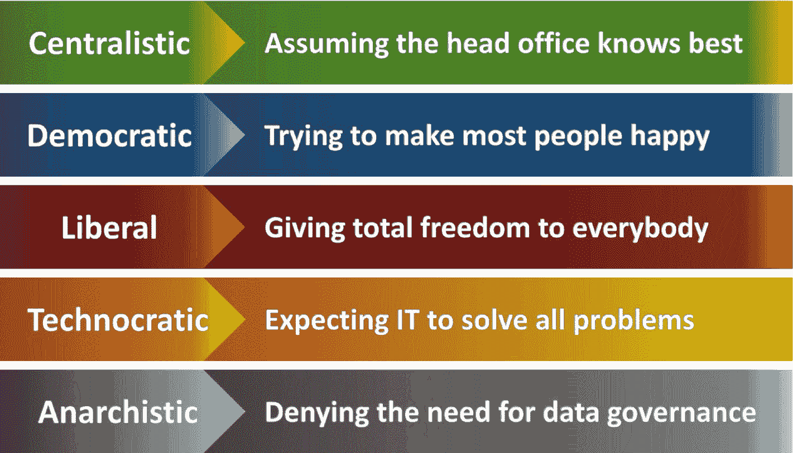

# 1. 了解你的组织

图 1-1

智慧企业

每个人都在谈论“数据”。当你询问企业高管数据的重要性时，典型的回应是激烈赞同。事实上，越来越多的组织意识到数据正变得日益重要。

没错，他们可能在多年甚至数十年间没有专门的数据管理也依然成功。但即使不是数据专家也能看到，技术的演进已使数据管理变得势在必行。数据带来了许多机遇，而那些未能利用数据的组织则会面临诸多竞争劣势。

这是否意味着大多数组织都已做好充分准备，来应对数据时代带来的挑战与机遇？

你大概猜到了，这原本是一个反问句。但究竟是什么阻碍了组织从认知到行动的关键一步？

让我们来仔细审视一番。

要改变一个组织，你需要了解这个组织。

要理解当今组织如何处理数据，回顾其历史发展颇有裨益：数据并非突然登上舞台。数据的重要性在过去几十年间是逐步提升的。

因此，通常没有一个明确的时刻或事件促使某个组织决定“我们需要治理和协调数据”。就像寓言中的温水煮青蛙 ^(⁷) 一样，那些本应对数据的“大爆炸”式出现做出反应的组织，却未能意识到数据的渐进式崛起。

相反，组织内各个领域越来越多的优秀人才看到了行动的必要性或机遇。通常，IT 部门成为孵化器，人们在这里意识到技术上的可能性。然而，在许多其他情况下，业务部门 ^(⁸) 的非技术人员感受到了痛点，并决定为此做点什么。

随着时间的推移，这种发展催生了一些典型的做法（以及随之而来的问题）。让我们仔细看看。

## 五种隐性的数据治理模式

你无法不治理数据。数据无处不在，人们会处理它。他们会在其被允许的框架内，以及其组织对不被允许活动的容忍范围内，根据各自的具体情况，做他们认为最合适的事情。

这种情况类似于政治国家及其政府体系，这让我可以用政治标签来描述组织处理数据的五种模式（图 1-2）。

我们会看到，作为国家政府形式效果最好的模式，在组织中未必效果最好。这一发现尤其适用于像数据管理这样广泛的议题。

请随意在你的组织中寻找这些模式。识别出模式有助于你应对相关风险。

图 1-2

组织中的实际治理模式

### 集权式数据治理

集权式模式往往出现在管理结构严密的组织中。你经常能在传统的实体组织中找到它。我有时也称其为“象牙塔模式”，因为它常常忽略了局部的知识和经验。

在许多情况下，其积极的出发点是组织坚信，在任何情况下，“必须有人负责”。

在现实中，当涉及数据处理时，这种方法常常导致以下情况：

*   组织中所有的数据专家都属于一个中央团队。
*   其他部门需要向该团队寻求见解。部门的自主活动被禁止或得不到资金支持。
*   该团队只专注于分析。一些集权式组织也有一个处理主数据的中央团队，但这两个团队通常不被强制合作。

然而，这种非常传统的设置伴随着一些风险：

1.  **脱节**

    人们要么是业务专家，要么是数据专家。他们可能彼此无法理解。可能没有人既懂业务问题，又懂如何通过数据管理来解决这些问题。

2.  **利益冲突**

    数据人员的目标通常与业务部门不同。可能没有一种机制能根据业务相关性来优先安排数据团队的活动。结果，数据团队可能专注于成功率更高的主题，或从数据科学角度看更有趣的项目。

3.  **忠诚度错位**

    当业务团队与他们的中央“服务提供商”之间存在明确界限时，人们不会感觉自己属于一个更大的群体。他们很容易从“他们”（另一方）和“我们”的角度思考问题。结果，数据人员常常不觉得自己是根据其意见所做的业务决策的一部分，也看不到这与他们工作的联系。每当业务团队成功时，他们往往只会与那些他们认为属于“我们”的人庆祝——这常常排除了那些“服务提供商”。

    总而言之，集权式模式已不再适合支持一个日益依赖跨职能协作的商业世界。

### 民主式数据治理

民主式数据治理听起来不错，对吧？

我们应该认识到，民主是为政治国家这类社群而发展出来的。这类社群的大多数成员都是长期利益相关者，因此对短期收益不太感兴趣。

要从原始的参与模式迈向可持续的民主，这些社群必须引入某些规则，以避免多数人获得短期收益，却对全体人口造成长期负面影响。

**示例**

让我们想象一个孤岛上的社群。为了改善集体生活，他们同意以民主方式做出所有决策。

过了一段时间，这个社群中最贫困的四分之三人口组织起来。他们提议将最富有的四分之一人口的财富平均分配给全体成员。

不幸的是，这个岛上的社群没有保护财产的“规则”。结果，由于 75%的人口投票支持这项提案，一项重新分配财富的法律得以通过。

然而，从那一刻起，人们开始努力避免成为最富有的四分之一人口。生产力和创造力停滞不前，岛上的繁荣遭受了严重打击。

大多数民主政体都成功商定了一套规则来避免此类情况。^(⁹) 他们明白，对多数人立即有利的事情，长远来看可能会危及整个社群。

尽管这样的设置对国家而言非常出色，但对组织来说却被证明并非最佳选择。在这里，管理者可能试图通过争取多数人的同意，来自私地提升自己部门的成功。如果他们的提议为组织三分之二的人带来微薄利益，却对其余三分之一的人造成灾难，他们仍然能够获得多数同意，而对整个组织毫无裨益。

往好了说，这些管理者只能希望组织足够庞大，能够承受他们的自私行为。往坏了说，他们可以随时离开组织，而自己的履历上则增添了一项看似令人印象深刻的成就。

那么，一个典型的民主组织是什么样子的呢？

-   所有部门都参与对话（这绝对是一件好事！）。
-   总是寻求所有利益相关者的同意（有时甚至是正式批准）。
-   决策的主要标准是共识或多数投票。

这种设置伴随着不少风险：

-   “多数人同意”并不等同于“最佳解决方案”。多数投票可能只代表少数人的价值，从而对整体组织产生负面影响。
-   个人议程可能会阻碍组织前进的道路。
-   管理者因同意同事的提议而获得回报，以便这些同事日后也能同意他们自己的建议。
-   民主流程可能需要很长时间才能最终做出决策。
-   缺乏多数支持可能被用作不作为的借口：“我已经尝试了一切，但组织不愿意跟进。”

这个模型的一个重大危险在于，它听起来像是正确的事情。谁又敢说反对民主呢？

### 自由式数据治理

一些组织决定不对数据处理进行规范。

有趣的是，我们主要谈论的并不是那些对数字化等现代数据议题陌生的传统组织。

相反，我们看到相当多的科技初创公司应用了这种模式。大多数情况下，原因是这些组织专注于高速发展其主要业务领域，不希望任何内部法规拖慢他们的脚步。

这种行为让我想起了第一次互联网浪潮中的主角们。他们中的许多人因为缺乏适当的财务设置而失败。当时没有首席财务官（CFO）就相当于今天没有首席数据官（CDO）。而且请期待后果会类似！

自由式数据治理通常具有以下特征：

-   各方完全自治。
-   数据事务的责任在部门层面定义，程度各不相同。
-   数据领域存在许多伪专家。
-   每当人们公开交流数据方法时，他们的重点不是说服他人，而是自我吹捧。

这种环境伴随着一系列广泛的风险：

-   大量孤立设置（例如，多个独立且互不兼容的词汇表）。
-   业务模式变革缓慢。
-   人们发现问题，但不知道该找谁谈。
-   一半人成为宿命论者。另一半人成为利己主义者（略有夸张）。
-   变革的复杂性：没有人能全面了解某项特定变革的所有影响。这就是为什么重大的业务变革通常需要对 IT 全景进行完整评估。

### 技术官僚式数据治理

在 2019 年 9 月的一次数据会议上，我听到有人说：“我们数据问题的解决方案不是技术，而是架构！”不用说，这个人是在他所在组织的架构团队工作……

虽然我同意这句话的第一部分，但第二部分反映了一种典型的视角：假设你需要从*解决方案*的正确部分开始。技术官僚方法常常忘记，相反，你应该从*问题*开始。

我给技术官僚组织的建议是：为了有效治理数据，*所有*方面都需要做出贡献——但请考虑顺序，不要从技术开始。（注意：也不要从架构开始！）

但技术官僚组织是什么样子的呢？我们通常会发现这种设置：

-   人们将数据视为一个技术议题。
-   数据事务的责任已明确定义——但全部都在 IT 部门。
-   有大量软件用于管理和分析数据——但业务方面几乎没人理解其背景。
-   方法：“这是解决方案。你有需要解决的问题吗？”

风险：

-   错失了需要同时理解*业务情况*和技术选项的机会。
-   业务方面越来越脱离：“让 IT 去处理吧。”

IT 部门常常甚至不认为这种情况是个问题。“它运行着呢……”

### 无政府式数据治理

通常情况下，资深业务人士习惯于相信他们数十年的经验。利用众多这类资深人士的经验和知识是传统组织的典型做法。

在此类组织中，经验和直觉的运用通常得到了良好的管理。你会发现大量的指导委员会——经理们在那里交换意见，并以某种方式达成决策。然而，从未有人试图描述从“直觉到理性”的路径：如何验证感受，如何正确看待它们，如何将它们与具体的业务目标相匹配？

相反，任何一位经验丰富的经理所说的话都被假定为是该经理执行了可靠（尽管是无意识的）评估过程的结果。

正如你可能猜到的，在这种模式下，除了作为轶事依据外，数据毫无立足之地。（你会把“我这个月已经见过两次这种情况了！”算作运用数据吗？）

几乎没有任何有意识的管理发展会催生出这样一种数据治理模式。

而且，确实，无政府式数据治理并非决策的结果。它恰恰代表了一种没有任何有意识引入模式的状态。

不幸的是，这正是许多组织在数据管理方面所处的状况！

无政府式数据治理通常具有以下特征（我仅稍作夸张）：

-   在受监管领域之外，数据是个无足轻重的话题。
-   对经理的尊重与其资历成正比。一位服务了 30 年的人肯定懂。
-   “约翰就是这么说的！”被视为一个有效的论据。
-   难以理解管理层的决策。
-   对业务模式实施变革风险很高，因为没人敢质疑高管的决策。

这种治理模式与自由模式有一个共同的关键风险：

-   变革的复杂性：由于缺乏对数据全景的概览，没人能估计变革的影响。这就是为什么任何重大的业务变革都需要对 IT 系统全景进行全面评估。

在这种环境中，很难通过根本原因分析从失败中吸取教训。相反，人们倾向于回避那些曾经导致失败的决策，而不去探究其因果关系。

图 1-3

事实是决策的敌人

## 数据事务中的行为模式

理解你所在组织当前的数据治理方法很重要。然而，具体的行动需要更深入地了解你组织中的人员如何（以及为何）应对数据挑战。

### “数据是 IT 部门的事”

如果你随机询问任何组织的 100 名员工，“数据是 IT 话题吗？”，你至少会听到 95 次“是”。

人们为什么会这么想？毕竟，在计算机出现之前，数据早已存在。

想听个例子吗？这就是！

圣经在描述耶稣基督诞生时是这样开头的：^(¹⁰)

> ^(*1*) *当那些日子，凯撒*奥古斯都 *有旨意下来，叫天下人民都报名上册。* ^(*2*) *这是居里扭作*叙利亚 *巡抚的时候，头一次行报名上册的事。* ^(*3*) *众人各归各城，报名上册。*（路加福音，1971）

这次人口普查就是一个古老的数据管理例子。我们可以假设凯撒奥古斯都没有 IT 部门。不过，他很可能有一个**数据**部门。

让我们来看看 IT 的角色。自从这门学科发展起来，它就一直利用硬件和软件来帮助更有效地处理所有这些数据。

结果，任何想要获取数据的人都必须与 IT 部门沟通。数据的采集、传输和存储也是如此。

而 IT 代表着巨大的进步！没有当今的技术，我们只能利用数据价值的一小部分。凯撒奥古斯都会为能拥有哪怕一部分处理他所收集数据的可能性而兴奋不已。

许多人似乎忘记了：IT 代表信息*技术*，而不是信息本身。IT 旨在为拥有数据的业务职能提供服务，以便利数据的处理。

我们现在能得出结论说我们需要把“数据”从 IT 部门剥离出来吗？

事实上，数据办公室是否设在 IT 部门之下，对其成功并非至关重要。关键的是其**授权**和支持。而且，数据办公室需要是一个独立的团队，不应与其他任何学科混杂在一起。

在这种情况下，数据办公室应设在其可信度和有效性最高的地方。这可能是 IT 部门，也可能是任何其他职能，具体取决于组织的文化和传统。

尽管有上述陈述，你可能仍希望让员工知道，数据*不是*信息技术。

### “我们可以专注于分析”

数据世界过于庞大且相互关联，无法只聚焦于某一个方面。你需要审视整个数据宇宙才能实现数据可持续管理。但你会一次又一次地发现，人们将“数据”和“分析”混为一谈。

这种情况让我想起一个古老的故事：

*一天，母鸡把小鸡们召集起来，郑重其事地告诉它们：“现在你们长大了，我可以和你们分享一个智慧。到现在为止，你们被告知鸡舍的篱笆就是世界的尽头。”她用翅膀指向地平线，深吸一口气，将她的智慧分享给下一代：“篱笆**不是**世界的尽头！世界的尽头在那边，在森林的边缘……”*

如果一个组织的数据活动直接始于数据科学和分析，你可能无法获得期望的结果。这是因为数据世界的范围超越了分析。

这就是为什么你可能希望首先建立一个恰当的**数据基础**，以确保所使用的数据的结构、用语和质量得到充分理解。这样的基础需要涵盖主数据和事务数据，并且应适用于内部和外部数据。需要正确定义数据治理，以确保每个人都遵守相同的规则。

如果你把数据比作冰山，分析就是可见的部分。记住，这仅仅是远小于整体的一部分！

但是，你如何判断一个组织是对数据有全面的认识，还是只关注分析呢？

看看该组织最高数据负责人的职位描述。即使这个职位被称为“数据管理负责人”或“首席数据官”——如果其描述与首席分析官或机器学习团队负责人的描述相同——那么这个组织可能搞错了方向。

一个典型的警报信号是，组织期望首席数据官能够在技术上指导数据科学家，例如，使用 `Python` 和 `TensorFlow` 实现无监督机器学习模型。这样的组织确实是将首席数据官与数据科学团队负责人混淆了。^(¹¹)

如果不及早解决，这是一种危险的情况，因为这种数据团队会不断产出“成果”，所以差距不会很快显现。

### “这是数字化转型”

数字化转型是需要恰当数据管理的众多领域之一。但它并非唯一的一个。因此，管理组织数据的优先级不应由组织的数字化转型团队（或任何其他需要数据的单一领域）来设定。

数字化转型可能会成为你数据办公室的头号议题。但只有在对所有领域进行跨职能审查之后，你才能确定这一点！

### 分析瘫痪

有些组织坚信自己是数据驱动的，但实际上，他们却被数据所阻碍。

我指的是那些允许滥用数据的组织。其结果是，数据变成了一种武器，或者人们用数据来质疑每一个他们不喜欢的决策。

如你所知，几乎任何事物你都能用数据证伪——前提是由你来决定使用哪些数据以及如何操作。

但最常见的情况是，人们在没有百分之百的数据支持时就不敢做决定。一个典型例子是在“选择 X”和“不选择 X”之间做抉择，而数据可以证明这两种选择都带有风险。被数据阻碍的组织在这种情况下往往*不做决定*。相反，他们会要求请求者重新评估，并带回更多证据。最终，要么根本不做任何决定，要么请求者会篡改数据，使其完全支持其中一种选项。显然，这两种结果都不可取。

这种行为为数据办公室提供了很好的存在理由。由于其中立性，它没有取悦任何一方的利益。

这也是组织*不应该*拥有超过一位（高层）首席数据官（CDO）的一个充分理由：必须有人拥有最终决定权。

### “数字原住民知道怎么做”

他们真的知道吗？

大多数数字原住民主要熟悉数据的*使用*。他们不一定知道如何获取、管理、组织和提供数据。

这里我们面临两种根本不同的技能集。知道如何在女王餐桌上吃饭，并不意味着你就能成为星级大厨。

数字原住民中最大的问题往往是他们对数据的简化观点。作为现代设备的用户，他们往往只看到其中容易的部分。或者，正如欧洲领先的 IT 与科技杂志 *c’t* 所言：“虽然所有数字原住民都知道如何在 Instagram 上发一张自拍，但他们中几乎没有人知道什么是命令行，更不用说编程了”（Gieselmann, 2020）。^(¹²)

相反，我们需要的是那些知道如何服务这些数字原住民的人。不幸的是，这种人非常罕见。

### “我们的业务部门可以自行处理数据”

人们通常认为职能专家也能够处理自己工作所涉及的数据方面。这种假设在许多情况下不仅是错误的。它还会导致**筒仓思维**、不一致性和重复劳动。

### “一切都没问题”

这是目前为止我从高管那里听到的最常见的说法。他们会问：“你打算解决什么问题？”

在那些尽管从未考虑过专门的数据管理，却已成功运营数十年的传统组织中，你经常能听到这种说法。

但在那些自认为已做好充分准备，可以进行有效报告、数据分析和人工智能的动态初创公司中，你也能找到这种说法。

这种情况最具挑战性。这个问题本身是合理的。但如果提问者不愿意倾听你的意见——或任何其他被视作可信赖顾问的人——那么这个问题将始终得不到答案。

### “整顿一下，打个勾了事”

并非所有组织都意识不到自己面临数据问题。糟糕数据的影响已经变得过于明显，或者所需的数据根本不存在。

但并非所有应对措施都同样适合可持续地解决问题。一个非常危险的选择是“一次性”方法：设立一个项目来解决组织的数据问题，并打算在项目结束后恢复一切照旧。

这种方法是什么样的？这样的组织不会寻找首席数据官（CDO），甚至不会设立数据办公室。相反，他们会聘请一家外部咨询公司，或寻找一位临时的数据经理来“解决我们的数据问题”。

你可能猜到了，这种思路注定会失败，就像你不能指望“一劳永逸”地修好一个技术设备，然后期望它不再出故障一样。

因此，至关重要的是要在组织中灌输这样一种认识：必须像对待其他资产一样对待数据——这意味着需要持续的主动管理。

英飞凌科技公司的首席数据治理总监 Jürgen Schubert 博士是这样说的：“数据不是一个有结束日期的项目。你需要持续不断地投入精力。”

但为什么那些绝不会认为自己可以停止维护有形资产的组织，却认为他们可以一劳永逸地整理好他们的数据呢？

在过去几年里，我遇到了三种主要模式：

1.  **数据不被视为一种资产。**

第一个原因无疑是数据尚未被视为一种具有完整价值的资产。

在这种情况下，我建议明确与组织的传统（有形）资产进行比较，并仔细审视其他无形资产，如专利。人们会发现比他们最初想到的更多的共同点。因此，这种比较通常会产生令人惊讶的效果。

关于数据作为资产的更多思考，请参见第 16 章。

2.  **权宜之计的数据处理。**

一些组织遵循务实的方法：“哪里坏了，我们就修哪里！”他们愿意在必要时再次启动一个新的数据修复项目。

如果你面临这种情况，引用外部专家的知识可能会有所帮助。早在 1993 年（那时几乎没有人谈论数据管理），G. Labovitz 和 Y. Chang 就在他们著名的著作《Making Quality Work: A Leadership Guide for the Results-Driven Manager》（Labovitz, Chang, & Rosansky, 1993）中描述了**1-10-100 法则**。该法则量化了低质量的隐藏成本。

根据 1-10-100 法则，如果你在错误造成损害之前纠正它，你可以将失败成本降低十倍。如果你从一开始就防止错误发生，你甚至可以将成本降低一百倍。^(¹³)

即使没有科学证据证明精确的因子，这一法则的数量级已经随着时间的推移在各个领域得到证实，包括数据质量领域。

换句话说：是的，持续的数据管理需要花钱。但如果用它来保持你的数据质量处于良好状态，与需要修复数据质量相比，你的组织将节省大量资金；而与数据质量不足所造成的损害相比，你将节省更多的资金。

用你组织中观察到的例子来支撑这一法则应该不难。

你可以在第 10 章中读到更多关于数据质量的内容。

3.  **数据被视为竞争者。**

另一种完全不同的、导致不可持续方法的原因是当前高管们害怕失去影响力或独立性。他们宁愿聘请一个可以随时解聘的外部团队，也不愿接受一个永久的额外权威。

这种局面的挑战在于，没有人会承认自己被这种动机驱使。每当你感觉某位高管“应该更明白事理”时，你可能需要深入挖掘并提出更多问题，以了解敌意行为背后的真正驱动力。

如果你将数据办公室定位为永久的支持来源，你或许就能展示其即时价值。人们需要理解，数据办公室的主要目标是帮助其他职能部门表现得更好，而不是取代它们。

关于利益相关者管理的更多思考，请参见第 4 章。

脚注 1 2 3 4 5 6 7

