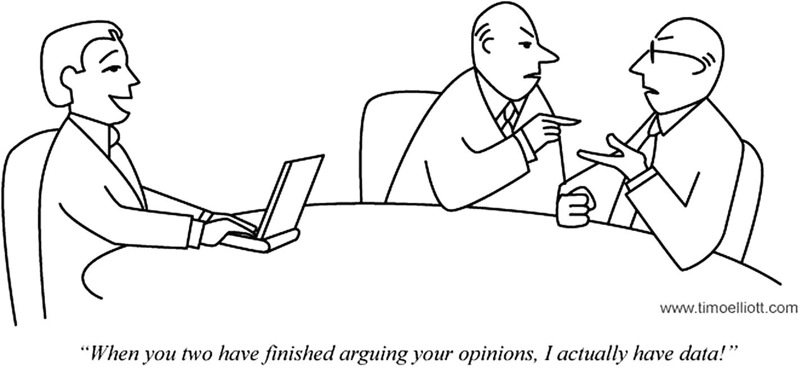
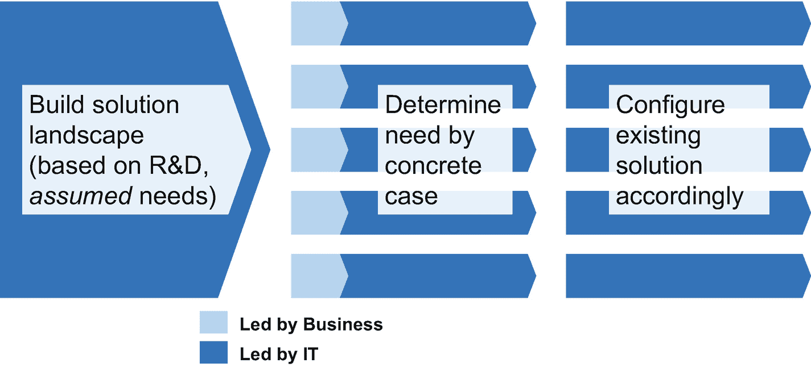
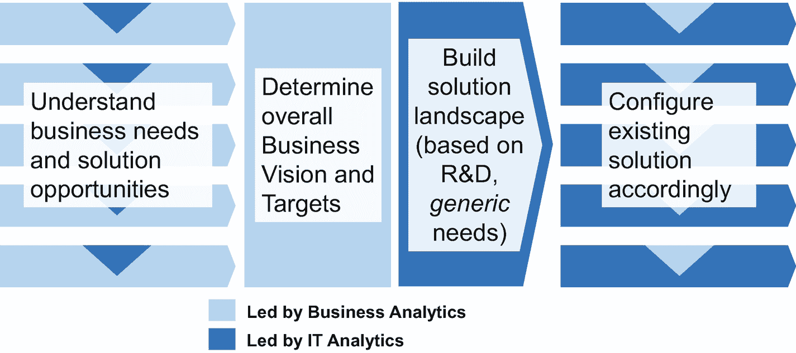
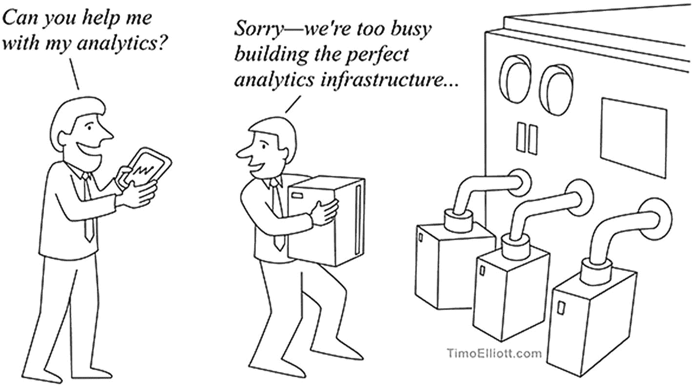

# 2. 有效数据管理的各个方面

图 2-1

观点很好——数据更佳

## 成熟度评估

要使数据管理行之有效，需要考虑许多不同方面。本章旨在让你对最关键的要素有一个总体认识，后续章节将进行深入探讨。

在阅读本章时，你或许希望对照“理想状态”对你的组织进行一次`成熟度评估`。我建议你不要在正式化此评估上花费过多精力。能够对其进行衡量就足够了，这样你就可以在推进过程中量化进展。

然而，理解`成熟度评估`存在两个截然不同的目标群体，这一点至关重要，它们需要完全不同的方法：

-   第一个目标群体包括你自己以及所有已经全身心投入、希望让组织成为数据驱动的人。这个群体需要知道还有多少工作要做、工作在哪里开展，以及阻力会有多大。

-   第二个群体包括所有仍需被说服“我们目前存在问题”的利益相关方。对于这个群体，差距分析应包含错失的机遇和未解决的问题，以及各自相关的财务影响。

理想情况下，你会同时进行这两项评估。在利益相关方被说服之前，你不会将第一个评估结果用于他们。但一旦他们被说服，这个`成熟度评估`就为制定路线图和公开讨论优先级奠定了坚实的基础。

## 两大主要差距

正如我们在前一章所见，任何常见的数据治理模型似乎都无法充分应对数据管理和分析带来的挑战与机遇。

那么，所有模型共同的主要差距是什么？

大多数组织面临以下两大挑战：

-   **缺乏协作**

-   **缺乏业务所有权**

我建议你在评估组织时，密切关注这两个领域。它们会反复出现，并且应该在所有数据管理学科中得到解决。

## 辅助性原则

我们已经看到，历史上形成的处理数据的方式可以用政治学术语来描述。但是，当我们试图开发有用的`解决方案`时，我们在州政府治理领域也能找到很好的类比。

在这两个领域都已被证明成功的一个方法是`辅助性原则`。

`辅助性原则`是“中央权力机构应履行辅助职能，仅执行那些无法在更基层层面完成的任务”的原则。^(¹⁴)

但这个原则在数据管理的背景下意味着什么呢？

你会发现领导者们常常自问：

-   数据应该由一个被充分授权的、高度专业化的中央团队集中管理吗？

-   还是应该让整个组织的每个人都参与数据管理？

如果你遵循`辅助性原则`，你会发现它**不是**这两种极端情况。

相反，`辅助性原则`建议，在合理的地方集中数据职责，而将其他部分留给“现场”——这可能指的是业务职能部门、子公司或地域单元，具体取决于你的组织。

仅靠智能地拆分职责并不能解决你的问题。要使其发挥作用，你需要为所有涉及的团队配备他们所需的一切！

在本书中，你将找到关于数据管理的哪些领域应该委派或集中的建议。现在，我们可以陈述我们的第一个定理。

**`数据管理定理 #1`**

数据相关职责和活动的组织需要在集中与委派之间进行谨慎的平衡。

-   任何集中都需要充分的理由。

-   任何委派都必须包含信任和支持。

## 业务导向

技术驱动型的人常常倾向于从解决方案入手。他们的想法是“肯定有一个应用能用到这个新奇的高科技！”

如果你想避免落入闲置高科技的陷阱，就不要从解决方案开始——而要从问题或机遇开始。

经验表明，这种范式转变很难被消化，尤其是对于经验丰富的 `IT` 领导者。他们习惯于主动提供最先进的解决方案。

为了应对这一挑战，你可以考虑以下三点建议：

-   始终自问：是存在一个问题（某些事情没有按应有的方式运作）、一个机遇（目前运作尚可，但仍有改进空间）还是一项创新（一种新的商业模式）？确定并量化真实的痛点或可能的收益。

-   寻求对话：共同假设收益，并与相应的业务职能部门一起验证。

-   培养产品思维：从项目经理到产品负责人的转变对数据管理是有益的。它增加了超越项目结束的长期视角！

我用两个图表来说明这种变化。建议增加业务投入这一点，通过第二个图表中浅色区域的增加来体现。

这就是 `IT` 团队几十年来一直采用的工作方式。

图 2-2

传统的步骤顺序

而这是让业务职能尽早参与的新模式。

图 2-3

业务驱动的方法

这种模式的一个重要方面是缺少严格的交接点：在整个周期中，双方都参与对话。这对于`瀑布式项目`而言，甚至在产品的整个生命周期中都是可行的。

非常小的公司通常不会面临缺乏业务导向的问题。在这里，`IT` 人员通常与业务部门关系密切，原因很简单，就是公司规模小。有时，优化流程的人同时也负责后续的软件修改。

然而，这种公认非常有效的方法无法规模化。随着组织的成长，对专业化的需求也随之增加。但角色的专业化需要有意识地在所有这些专家之间组织对话。

这时，主动数据管理便登场了。

业务视角与技术之间的差距主要存在于流程和数据领域。

此外，来自双方的人员常常认为自己很开放，而实际上却不自觉地固守旧有的思维模式。他们中的许多人确信自己的思考和行动是为了组织的利益。

图 2-4

分析工作因分析而过载

为了应对这种情况，数据办公室需要具备以下能力的团队成员：

-   理解流程和数据

-   理解推动 `IT` 专家和业务专业人士前进的动力是什么

-   设法保持“中立”，即他们不以预设的视角工作，对双方的想法和关切同样开放

-   能够进行调解并展现同理心

同样，这种数据办公室角色的授权必须来自最高层，而尊重和信誉则需要通过数据办公室自身的出色工作来赢得。

**`数据管理定理 #2`**

数据管理是每个人的职责——贯穿整个组织。尤其不是 `IT` 部门的工作，并且它不从技术开始。

它关乎在深刻理解双方的基础上，在业务与 `IT` 之间搭建桥梁。

## 商业导向

除非你为公共或非营利组织工作，否则处理数据需要为股东创造可衡量的价值。

归根结底，任何在数据上投入的组织都希望看到回报。我称之为`数据回报率`。

这个表述源于金融术语“投资回报率”——这对于任何需要花钱的活动都至关重要：只有当它能带来回报时，你才会去做。

“`数据回报率`”这一表述背后的理念是：处理数据本身并非目的。所有数据活动都必须根据其对组织整体状况的影响来评判。

这包括间接和长期影响，以及潜在问题的规避（这意味着要处理风险）。^(¹⁵)

短期内，一些高管可能会因为“大家都在做”、“这是未来的趋势”或“我们不应落伍”而同意投资数据。然而，从长远来看，尤其是`首席财务官`会希望看到回报的计算结果。

正如第 16 章所述，构建令人信服的商业案例，其目的并非为了让数据投资看起来足够有吸引力从而获得资金支持。相反，你需要从一开始就具备商业导向。确定一个负面的商业案例并非失败！

### 协作

协作至关重要，原因如下：

-   每位利益相关者都参与其中。

-   组织的所有领域都参与其中。

-   组织从全体员工的共同创造力和知识中受益。

-   它避免了平行的重复工作（这会导致效率低下和不一致）。

遗憾的是，协作不会自动发生。在数据事务上推行协作理念，是`首席数据官`应首先引入组织的创新之一。

协作需要一个能够促成并推动它的环境。这个环境包括治理和组织架构，但也需要激励机制和培训。人们需要理解为什么离开自己的“孤岛”对他们有益。

## 数据办公室

协调一致的协作需要一个强大的枢纽，且该枢纽不能有任何自身的职能利益。按照定义，数据办公室就是这样一个地方。

如果你想动员并充分利用组织内全体员工的智慧，我强烈建议：

在数据办公室内设立一个专门的协作职能，负责促进和协调所有利益相关者之间的协作。

## 清晰的数据所有权

没有清晰的数据所有权，每个人都会觉得自己有权处理各种数据，而没有人觉得需要对数据负责。这种行为会导致不同“孤岛”之间的不一致。

所有权促使人们相互沟通。“我需要 X，我知道谁拥有它。所以我要去找那个人谈谈”——这才是你希望看到的行为。

## 决策与升级流程

你不需要一个升级流程，因为人们之间相处得很好？

我不同意。

如果你把分歧的结果交给个人关系来处理，很可能无法做出最佳决策。

相反，一个基于事实和规则的决策流程假定：

-   所有各方都怀着善意行事，代表各自的职能立场。

-   由此得出的结论可能无意识地存在偏见。

-   但即使是基于事实的职能结论，如果仅局限于对单一职能的影响，也可能并非最优。

**`数据管理定理 #3`**

仅仅依据*某些*事实来做决策是不够的。你需要考虑*所有*相关事实——贯穿整个组织。

作为此类决策流程的一部分，“升级”简单来说就是将决策权提升一个层级。理想情况下，你希望将其从部门视角提升到跨职能视角（这有助于减轻偏见），并最终提升到整体“股东”视角（这能消除偏见）。

这样的流程有助于做出不受个人视角和动机影响的决策。

此外，即使是组织中较低层级的员工，也会被鼓励立即提出跨职能的优化方案，因为他们预见到自己将被要求从跨职能的角度思考问题。

## 信息共享

你可能希望同时分享官方信息和想法。而这不是一条单行道。每个人都应该能够以系统化的方式与他人分享自己的想法。

本质上，你需要一个或多个技术平台，但你的治理机制也需要将其宣称为唯一的去处。并且，数据办公室的成员应该被期望成为首批积极使用这些平台的人。

## 数据管理网络

你如何了解组织各个领域的不同视角？毕竟，任何组织都包含以职能为导向的人、以地域为导向的人、以成本为导向的人、以客户为导向的人，以及其他各种不同侧重点的人。

是的，你需要构建一个网络，将所有这些人都汇聚在一起。

除了面向全体员工的协作平台之外，建立一个面向“数据专家”的专用网络也是很好的。

这样的网络应该足够全面，能够覆盖你组织的所有领域，但也应该足够精简，以便能够进行联合电话会议以及其他潜在的联合“实时”活动。因此，一种有前景的方法是，与指定的数据管理员合作，每人代表一个特定的群体。

数据管理网络的一个关键理念是将信息流从“批量模式”转变为“对话模式”。换句话说，讨论应该成为可能。数据办公室工作人员的积极主持将确保讨论聚焦，而文档记录将允许适当的后续跟进。

请记住数据管理定理 #2：数据管理是每个人的工作——在每个组织中都是如此。

## 检查清单

你的方法应该……

-   连接不同部门
-   连接业务与 IT
-   连接数据供应链的所有环节
-   奖励协作
-   让人们自愿协作
-   让合作变得容易
-   利用协同效应
-   避免重复和不一致
-   为所有议题明确指定的联系角色和人员

## 动机

我之前提到过，没有强有力的董事会授权，数据管理永远无法奏效。

同样，仅有强大的授权也是不够的。

那些被强迫服从但内心并不信服的人，可能会找到办法来破坏你的工作。

**数据管理定理 #4**

首席数据官既需要董事会的授权，也需要员工的理解与支持。

前者必须从一开始就存在。

后者必须由首席数据官来争取实现。

## 跨职能性

**优化法则**源于运筹学的一个古老发现：

**对整个组织而言最佳的数据方案**

始终优于

**所有局部最佳数据方案的总和**。

换言之：如果组织内不同部门各自独立优化，你将无法为组织实现最优配置。

为何如此？

试想那些确实可以独立优化的领域，例如图形加速器、线性方程组或 `MapReduce`。这类方案成功的基本前提是什么？

答案在于**不存在相互依赖关系**！

当某个过程的最终或阶段性结果影响到另一过程的结果时，这两个并行过程就存在相互依赖关系。

任何组织中的数据都面临着同样的情况：数据跨越职能和地域边界。

举例来说？财务部门识别的客户支付信用，应与销售部门共享。销售代表收集的客户信息，应提供给客户服务部门。

人们越来越多地谈论“客户 360”，这绝非偶然：客户各方面的信息（通常由不同部门收集）需要整合汇总，并向组织内所有潜在用户开放。360 度全景周期这一概念，恰如其分地体现了其核心理念：从各个角度审视客户。

这种做法并非简单改进各职能的活动。若不能系统性地跨渠道共享客户数据，即便是针对 B2B 客户的**全渠道解决方案**等重要进展，也根本无法实现。

不过，这种 360 度视角并不仅限于客户数据。产品数据与销售、电子商务、市场营销、生产、财务、客户服务等部门都息息相关。市场洞察则关系到定价、产品开发、市场营销以及研发等众多领域。

从数据角度看，众所周知，局部最优方案的总和通常不等于全局最优方案。如前所述，原因在于不同领域之间存在大量相互依赖关系。

以下两个示例有助于理解这一数学法则：

*   销售部门希望增加收入，最容易的办法是同意折扣。但财务部门则认为折扣会降低利润率。
*   项目团队希望按时、按预算完成。这可能导致次优方案，因为未考虑对未来项目及其他部门的影响。

这是一个组织层面的挑战：团队成员通常知道什么对组织最有利——但他们惧怕自己的上司，因为上司的激励（无论是正式还是非正式的）都基于其自身负责领域的孤立成果。

我们必须认识到，没有任何一个部门拥有独立的股东。为某个部门创造价值，若导致其他部门成本增加，从全局来看并无意义。

因此，在董事会层面有意识地应对这一局面至关重要：

**通过让所有人始终聚焦于整个组织的利益。**

组织可以通过遵循以下原则来实现这一目标。

### 聚焦组织级目标，而非部门级目标

应鼓励管理者和个人贡献者，如同自己是组织所有者一般行事。这可以通过将每个人的目标与组织目标对齐来实现。

如果不主动处理这个问题，组织最终只能依赖员工偶然拥有“正确态度”。这种方法对某些人有效，但绝不可能适用于所有人。

管理层常常自豪地谈论他们“卓越的员工队伍使我们有别于竞争对手”。坦白说，如果一个行业内的所有优秀人才都恰好决定为你的组织工作，而能力差的人都去了你的竞争对手那里，这简直是难以置信的巧合。

相反，你应该通过激励和奖励机制，让即使是最自私的员工也自愿为组织做出最佳贡献——因为这对他们个人也是最有利的！^(¹⁶)

你还需要定期评估什么能激励员工行动——因为这是会随时间变化的。

### 激励协作

设定协作目标——激励员工在自己负责领域之外创造价值。

这也应纳入商业案例的结构！如果项目能从组织角度创造出最佳解决方案（即其他部门也能受益），那么它们就应该获得更多资源、时间和资金支持。

确保不同部门的成员彼此认识（且信任）也有助于实现这一目标。因此，团队建设活动和全组织范围的成功庆祝活动能够创造非常切实的价值。

### 让“聚焦”成为组织文化的一部分

应培养一种“设身处地站在组织所有者角度思考”的文化（即使没有单一所有者）。

这种文化并不等同于“专注于财务股东价值！”每个组织都必须兼顾股东、员工和客户这三者。明智的所有者恰恰会这么做。许多组织所缺乏的，是一种鼓励**每一位员工**都采取相同视角的文化。

你或许还应收集“全组织思维”的杰出案例，并公开表彰这些典范人物。这些案例不应仅限于团队合作顺畅的情况，也可以包括员工单方面采取行动而使其他部门受益的事例。

认为某些团队比其他团队更重要是有害无益的——即使一个组织将其成功主要归功于某个特定团队（例如工程团队）。相反，人们应该将组织视为一个类似人体的整体：

*   足球运动员或许认为脚是他最重要的身体部位——但如果前交叉韧带（ACL）撕裂了，脚又能做什么呢？这条韧带基本将膝盖固定在一起，膝关节功能失常，再好的脚也无用武之地。
*   没有强壮的身体来执行指令，大脑又能做什么？
*   此外，考虑一下身体的所有“支持功能”。你的大肠无疑不是身体中最光鲜的部分——但老兄，如果它工作不正常，人可要遭大罪了！
*   而且，没有人会问心脏和肺哪个更重要。任何一个器官如果出了问题，整个有机体都将不可避免地衰竭。

**数据管理定理 #5**

`数据管理`需要具备跨职能性——因为数据本身就是跨职能的。

## 变革管理

如今，几乎没有哪个组织是彻底以数据为中心的。换句话说，将焦点放在数据上意味着对几乎所有组织进行一次根本性的变革。

或者，正如生物技术公司`Abcam`的消费者洞察与分析副总裁 Kirstie Speck 在一次数据会议上所说：“要意识到你们从事的是变革管理行业！算法反而是简单的部分。”

过去几十年间，大多数组织都曾多次面临变革的需求。这促使一门专门管理变革的学科发展起来。你可以认为，由此产生的方法论同样适用于庞大的“数据变革”。

**数据管理定理 #6**

成为数据驱动型组织需要在整个组织范围内推行变革。

### 数据素养

我记得曾与一家大型企业的产品经理讨论产品与服务的逻辑。他清楚自己商业上想要什么，但却无法将其描述出来。可他早已发现现有的系统架构不够灵活。

当我问及过去现有的产品模型是如何在软件方案中实现的，他回答说：“我不知道。但我是在结果基础上搭建的。我们信息技术部的同事帮我搞定了所有技术工作。”

这不应该是目标！相反，业务人员需要理解如何清晰表达自己的业务需求。他们的想法通常有结构，但自己并未意识到。他们应该意识到。

有时，当被问到正确的问题时，业务管理者可能会自行发现其思维中存在逻辑漏洞——而部门之外的人又如何能发现这一点呢？

毋庸置疑，我与那位产品经理讨论的产品架构不仅灵活性不足，而且在整个组织内的实施也不一致——不同的人对其理解各不相同。业务负责人既无法发现问题，更别提解决问题了。

谢天谢地，你可以通过提升组织的数据素养水平来改善这种情况：

### 帮助员工理解数据

与其将数据逻辑“外包”给信息技术部（后者可能并不完全理解所有的业务动机），更有效的方法是帮助业务人员理解数据的基本原理，并用无歧义的语言表达他们期望的逻辑。

在此背景下，关键的一点是：你的目标不是让所有员工像“学习”词汇一样去“学习”数据。数据本身会不断变化。相反，要训练员工去“思考”。他们应该能够自主做出判断，并自行跟上任何变化。

### 共享知识

2019 年，我在迪拜的一场人工智能大会上发表演讲，迪拜人工智能事务国务部长奥马尔·苏丹·奥拉马发表了开幕致辞。他提醒与会者，中世纪之前的中东地区曾一度在全球科学领域处于领先地位。然而在两百年内，这一优势便丧失了。转折点是什么？

# 知识共享与数据管理

据这位部长所言，转折点是一个名叫约翰内斯·古腾堡的人的一项小发明：机械[活字印刷术](https://en.wikipedia.org/wiki/Movable_type)。

这项发明将书籍（以及书中的知识）普及给了大众——但中东地区除外，那里书籍被禁长达数百年。

迪拜从这段历史中学到了什么？他们不会再让下一次革命从身边溜走。正因如此，他们是唯一设有专职人工智能事务国务部长的国家。

但我们又能从这个故事中学到什么？

如果你想充分利用员工的力量，知识共享至关重要。组织应该通过让全员接受数据培训来实现知识民主化。

### 共享数据

每个人都应该获得可供分析的数据。这不仅限于熟练的数据科学家——即使是蓝领工人都能从描述其直接工作环境的数据中得出有价值的结论。并且，每个人都应被鼓励在基于数据发现问题时勇敢发声。

一个正面例子：“自从三天前我改变了步骤 A 和步骤 B 的顺序，缺陷数量就下降了，这从白板上的数据就能看出来。我会坚持新顺序，并将发现分享给我的主管。”

即便存在信息安全与数据隐私的限制，仍有足够的数据可供全体员工使用，从而为整个组织带来有价值的额外洞察：汇总或匿名化的数据可以揭示趋势，而无需暴露个人身份信息。

### 数据管理定理 #7

数据处理*并非*仅属于少数专家小组的课题。

数据驱动型组织需要提升全体员工的技能，并且需要为他们提供访问所有相关数据的权限。

脚注 1 2 3