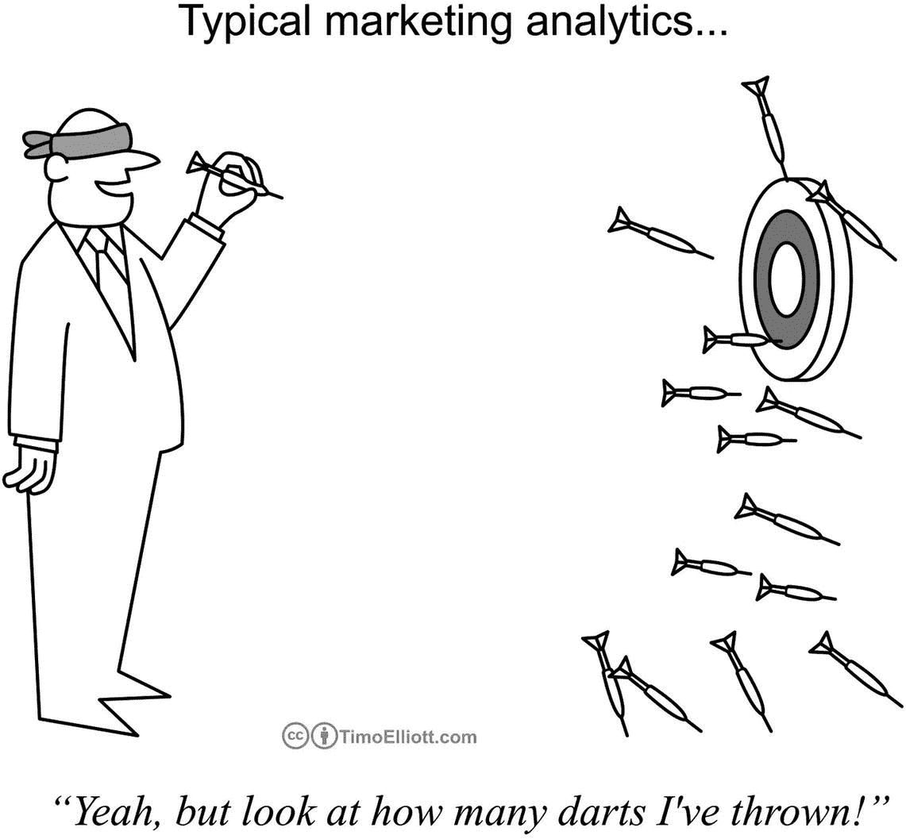
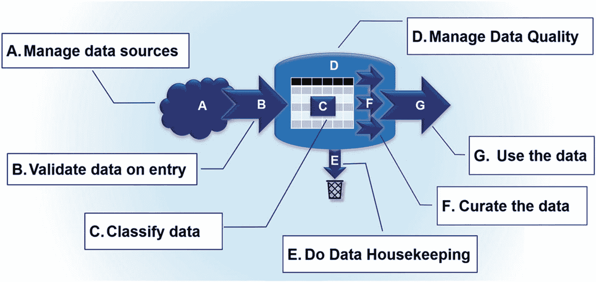

# 3. 数据供应链

*图 3-1：仅关注分析如同蒙眼投飞镖*

数据不会从天而降。它被采集或获取、管理、存储、转换、传输，并最终被使用。

这些环节都不能孤立看待，因为它们彼此紧密依赖。这也就是为什么一个组织的数据办公室应对数据的整个生命周期负责。我将其称为“数据供应链”。

让我们来看看数据供应链的七个步骤。

*图 3-2：数据供应链的七个步骤*

## A. 管理数据源

数据并非凭空存在。其中很大一部分是由你的组织有意识地创造的，一部分是获取的，有时则由第三方提供。即使数据是副产品，它也可能具有很高的价值。

典型的数据来源多种多样，包括：
- 员工的数据录入（通过键盘、语音、扫描仪、摄像头或其他设备）
- 收到的电子邮件和消息
- 纸质文档的成像解读
- 物联网设备
- 机器
- 软件（例如，日志文件）
- 组织间共享的数据
- 社交媒体
- 数据科学家在网络上“某处”发现的数据
- 客户在你的网站上输入的数据
- 流数据（连续流）
- 来自外部数据提供商的`主数据`和`事务数据`

如果不全面管理甚至不协调这些多样化的数据源，将会导致问题，其中最严重的四个问题是：

1.  **重复数据采集**
    某些类型的数据会被不同职能部门所需。如果没有协调，它们可能会独立采集相同的数据。
    我记得有一个组织，其全球总部就与邓白氏公司签了三份独立的合同。这是浪费金钱。为多个用户统一管理数据采集显然更便宜。
    此外，一次性获取数据可以减少总体工作量。这就是为什么即使对于免费获取的数据，这样做也是有意义的。

2.  **数据不一致**
    如果团队彼此独立地搜寻数据，他们最终通常会使用不同的数据源，或者获取相同但时效性不同的数据。
    所有这些都破坏了“单一事实来源”原则，尤其是对于那些不受你组织控制的数据而言！

3.  **数据歧义**
    在互联网上发现的数据含义可能模棱两可或不清楚。
    然而，这类数据是数据科学家常用的信息来源。他们经常下载带有列标题的数据文件，需要解释（避免用“猜测”这个词）其含义。即使他们的假设是正确的，一列的准确定义也可能不清楚。

4.  **偏差风险**
    如果每个团队或部门都负责获取所需的外部数据，中立性可能无法得到保证。人们可能会倾向于选择支持他们目标的数据。或者，他们可能会使用多个数据源，并最终选择能带来最有利结果的那个数据源。

你自己的组织情况如何？你的组织中有人了解所有数据源的概况吗？是否有关于外部数据获取的规则，并且这些规则是否得到执行？

所有这些活动都是数据办公室的职责。

但是，如何建立这样一个组织呢？
- 建立一个负责所有外部数据源的中央职能部门。
- 使该部门成为人们搜索信息的首选之地。
- 确保该部门协调所有活动并提供完全的透明度。
- 将执行权和所有权留给专家部门。通过数据治理确保在该部门不知情的情况下不会发生任何事情。
- 委派该部门澄清所有外部数据的定义。
- 让他们将所有输入的数据与企业数据模型进行匹配。^(¹⁷) 该模型需要将外部数据和内部数据联系起来。一个典型的例子是将邓白氏数据与你的内部客户数据库对齐。

## B. 在输入时验证数据

验证数据的最佳时机是什么时候？是的，在输入时。保持清洁数据的清洁比一遍又一遍地重新验证数据要容易得多。

并非所有数据都需要具有最高质量——但你始终需要知道数据质量有多好。

此外，数据不仅需要验证和清洗。它还需要：
- 与内部数据同步（包括历史数据）
- 在必要时进行匿名化/混淆处理
- 用元数据标记

## C. 对数据进行分类

数据有结构，任何想要使用数据的人都必须理解这种结构。

大多数组织在引用数据方面都有现成的结构。但至关重要的是要查看所有数据源，以确保它们尽管来源不同，但能相互匹配。

一个文档完善的数据模型对于记录业务参与者希望如何运营其业务至关重要。同时，它也需要足够好，以便 IT 部门能将其转化为数据库模式（Schema）和解决方案。

IT 架构师不仅需要理解业务数据模型以优化物理实现的数据结构。他们还需要理解数据本身，从而能够提出合适的硬件、平台和解决方案、物理数据模型、容量规划以及数据库类型。

**示例**
如果产品特性列表简单明了，IT 架构师会选择关系型数据库。然而，复杂的产品组合可能会导致更复杂的结构：
- 特性可能是可选的、强制的或有条件的。
- 其中一些可能具有可变数量的参数。
- 每个参数可能带有不同的度量单位（`kg`/`lb`）。

在这种情况下，`SQL` 数据库可能会变得非常复杂，由多个表组成。此外，其大多数字段都会是空的。这就是为什么 `NoSQL` 数据库可能是更好的选择。

最终的决定还需要考虑*如何使用*数据。向 `SQL` 数据库中插入记录通常比向 `NoSQL` 数据库插入要快。你可以再次看到，需要大量的业务输入才能决定最佳的 IT 架构。

即使是未结构化的数据也需要分类。没有哪个有意义的数据源会因其无结构而无法确定和记录其结构。你至少需要相应的元数据来理解数据并能够处理它。所需元数据的级别取决于底层数据的内容及其业务用途。所有这些都是需要从业务人员那里收集的非技术信息。

**总结**：将业务知识和逻辑转化为 IT 架构师所需的信息是数据办公室的一项关键任务。与职能业务代表不同，数据办公室必须始终采取跨职能的视角。

## D. 管理数据质量

在接受《Information Age》采访时，Andy Joss^(¹⁸) 说道：
> *人工智能和机器学习很流行。但是，如果你在训练一个 AI 模型，拥有真正好的数据会让你对获得正确结果更有信心。* (Baxter, 2019)

这是对“垃圾进，垃圾出”这一更直白说法的非常礼貌的转述。

如果你使用的数据质量低劣（或者至少你不知道数据质量是否良好），你就无法相信任何结果。^(¹⁹)

更糟糕的是，你通常无法从结果中判断底层数据是好是坏。这与食物不同，你的味觉或胃会立即对菜肴的质量给出反馈。

想象一下，你计算一个产品发布成功的几率，得到了“62.3%的成功概率”的结果。根据你数据的质量，这个结果可能非常准确，也可能完全是无稽之谈——即使计算方法完美无缺。

现在假设产品发布了。无论它成功还是失败，你事后都无法知道这个预测有多好，因为失败和成功都与预测结果相符。

### E. 进行数据整理

大量数据可能会让你忽略真正的宝藏。这就像把好酒倒进一桶水里。因此，你应该安装一个永久过滤器，用来检查哪些数据应丢弃，哪些应保留。

此外，需要主动管理数据留存规定。一方面，你通常有义务将某些数据记录保留最短的时间。另一方面，数据隐私法规（如 GDPR）不允许你无限期地保留所有数据。

无论哪种情况，在此环节的失误都可能导致极其高昂的代价。

### F. 管理数据

仅在存储库中拥有完美的数据并不足以支持其使用。

你还需要确保每个人都使用正确的数据，并且数据能够被可持续地使用。

#### 数据管理的目的

让我们从数据用户的角度来看——你可以将其作为你的检查清单：

用户需要知道什么？
-   我在哪里可以找到我需要的数据？
-   我如何使用这些数据？
-   这些数据的解释说明是什么？
-   谁拥有这些数据（以便我需要进行更改时联系）？
-   之前是否有人已经开始使用这些数据？我可以重复使用什么？

而用户需要依赖什么？
-   提供给用户的数据是正确的、唯一的真实版本、始终是最新的、与其描述相符，并且具有足够高的可用性。
-   任何问题和变更都将提前充分沟通。
-   数据安全和隐私已得到妥善处理。

#### 良好数据管理的各个方面

数据需要以*可持续*的方式使用。换句话说，仅仅在数据获取或首次使用时质量良好是不够的。未来，每当数据的内容或结构发生变化时，新数据都需要被自动使用，无需任何人工干预。

具体来说：
1.  **集中化数据存储**
    不要让人们在原始数据上工作——让他们使用网络服务来更新或使用数据。

2.  **集中化数据逻辑**
    不要在客户端应用程序中实现通用数据逻辑——应集中实现。客户端应用程序应调用网络服务来应用该逻辑。

3.  **让用户理解数据**
    要求数据用户与数据所有者沟通。后者是解释数据预期逻辑的最佳人选。

4.  **提供数据访问权限**
    向用户提供他们所需的所有数据的访问权限，同时提供有关数据结构、相互依赖关系、质量、生命周期终结以及任何其他相关属性的信息。
    这适用于所有类型的数据：主数据、元数据和事务数据。

5.  **理解并记录数据转换**
    在整个数据供应链中，数据会被合并、过滤、计算、派生或丰富。许多此类活动在数据管理成为公认学科之前就已经存在了几十年。
    因此，你的数据供应链也早已存在。在大多数情况下，这些不同类型的数据操作和转换背后的逻辑缺乏系统性的文档。
    然而，为了充分管理你的数据供应链，你需要了解正在发生的事情。

在大多数情况下，从业务方面开始评估，即询问业务所有者数据应如何进行逻辑转换，是`不`有效的。他们通常不具备能够解释的专业知识。

相反，你需要对前辈们已实现的逻辑进行逆向工程。这是一个漫长而繁琐的过程，包括处理多页 SQL 操作和 COBOL 源代码等挑战。

那么，有哪些好处能证明这种努力是值得的呢？

第一个（也是最重要的）好处是，你将获得关于`当前`对组织数据正在执行的操作的全貌。无论原始数据有多好，如果你不了解它后来是如何被处理的，任何由此产生的数据存储库都是无用的。

其次，你可以请业务人员根据他们的业务概念来验证结果。对他们来说，验证你呈现给他们的东西，比自己从头开始指定要容易得多。

第三，你可能能够降低这些数据转换的复杂性。如果业务专家不理解数据转换逻辑，那么一个更简单的逻辑可能也同样有效。

最后，如果业务人员理解了“他们的”数据正在经历什么，他们会更愿意承担所有权。

当你发现并记录所有数据操作时，你应该将其置于变更控制之下：未经稳健流程（文档必须是其中的重要组成部分）的批准，不得进行任何更改或添加。

## 6. 记录数据使用情况

向所有人提供访问权限并不意味着你不需要知道谁在使用数据：如果数据结构或内容发生变更，你需要立即知道谁会受到影响。

是的，始终记录谁在使用什么会增加大量额外工作。最初，这听起来可能有些矫枉过正。但大多数组织都会发展到知识无法再装进人们脑海的程度。即使某些组织可以，也要考虑到人员离职或退休的情况。文档会一直留存。

## 向用户提供信息

文档和发布至关重要：数据格式、接口、技术访问描述、数据所有者以及数据变更流程需要对任何（潜在）用户透明。请考虑以下三个组成部分：

### 1. 数据目录

数据目录为用户提供有关他们所需数据的所有相关信息。

### 2. 网络服务目录

这是面向应用程序开发人员和数据科学家的数据访问技术描述。没有它，人们可能会重新开发已有逻辑，或不断追踪源代码以寻找合适的网络服务。

### 3. 内网网站

数据专职团队以外的人员可能不知道去哪里寻找信息，因为他们无法对自身需求进行分类。他们甚至可能不知道数据目录和数据库之间的区别。但他们不应该必须知道这些！

相反，你应该为他们提供一个单一的信息入口，在那里他们可以以易于理解的方式找到所有信息。

这样的内网站点随后会以用户友好的方式将用户引导至数据目录或网络服务目录。它还将提供对解释性文档（包括经典演示文件）、数据策略、流程等的访问。

最后，用户应该找到一个反馈渠道，他们可以通过该渠道向数据办公室指出缺失或错误的信息，并提出改进数据管理的建议。这方面应成为你数据工作流程的一部分。

## G. 使用数据

最后，我们来到了许多组织决定从这一步开始的环节。

但即使是数据的使用，也远不止花哨的数据分析和彩色图表。

组织中的数据使用与其自身一样是多方面的。

典型的使用方式包括：

- 业务运营使用
- 关键绩效指标（`KPI`）计算
- 报表生成
- 分析（人工智能、数据科学、机器学习）
- 机器人流程自动化（`RPA`）
- 审计支持
- 用于测试或验证目的

所有这些都需要一致的数据。这就是为什么上述任何步骤都不应交由一个只涵盖所列领域之一或之二的实体来处理。

数据分析人员往往倾向于在使用数据之前先“修复”数据。不要支持这种想法；也不要从分析工作的角度反向推进。这可能会使你的数据对其他重要用途变得毫无价值。