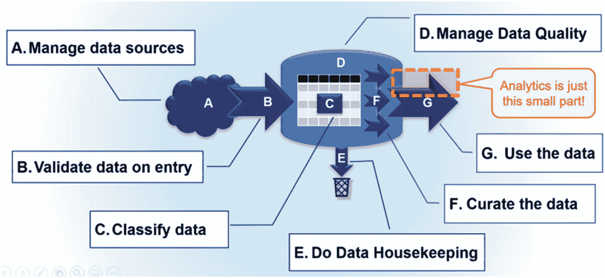

# 总结：覆盖整个数据供应链

我见过太多组织任命一位首席`分析`官，并期望获得卓越洞见。这类组织将其数据关注范围局限于`G`步骤的一个子集。他们甚至未能覆盖数据使用的所有方面，更不用说其之前的关键步骤了。

让我们再看一下本章的开篇图示。显而易见，“分析”仅仅代表了数据办公室职责中的一小部分。

**图 3-3** 数据供应链包含的不仅仅是分析

为什么高管们常常只关注分析和可视化？因为他们只考虑数据管理中那些`可见`的部分！

这种做法类似于设计一座仅由高空观景台构成的建筑。你不需要成为建筑师也能明白，重力会阻止这种方案成功。

相反，使用直升机确实能让你获得期望的视野——但只是暂时的，直到燃料耗尽。

数据的使用遵循同样的逻辑。这就是为什么覆盖整个数据供应链总能带来回报。打好基础，然后逐层搭建建筑。当你最终抵达观景台时，就能确保它是稳定且可持续的。

## 数据管理定理 #8

数据管理需要覆盖数据供应链的所有环节，从数据的创建或获取，一直到数据的使用。

脚注 1 2 3