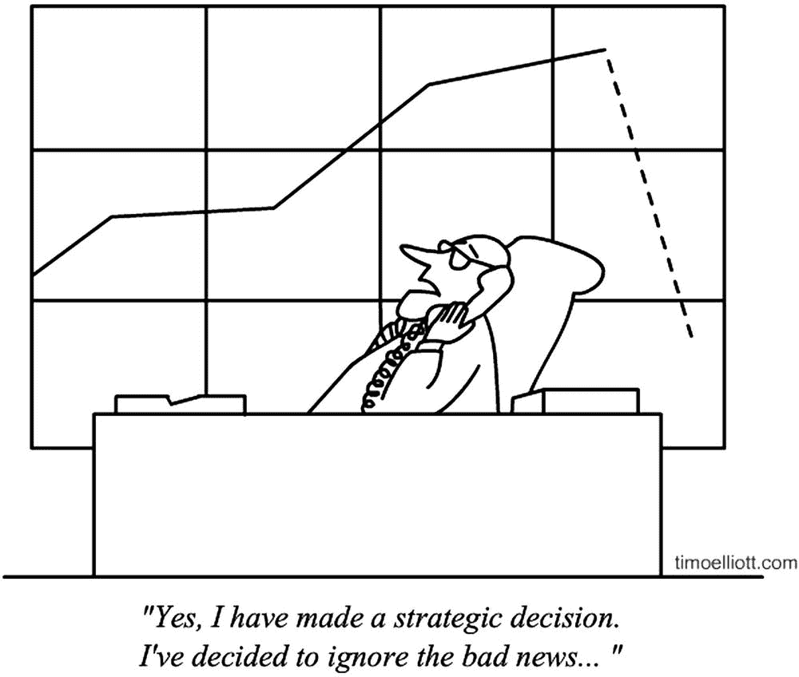
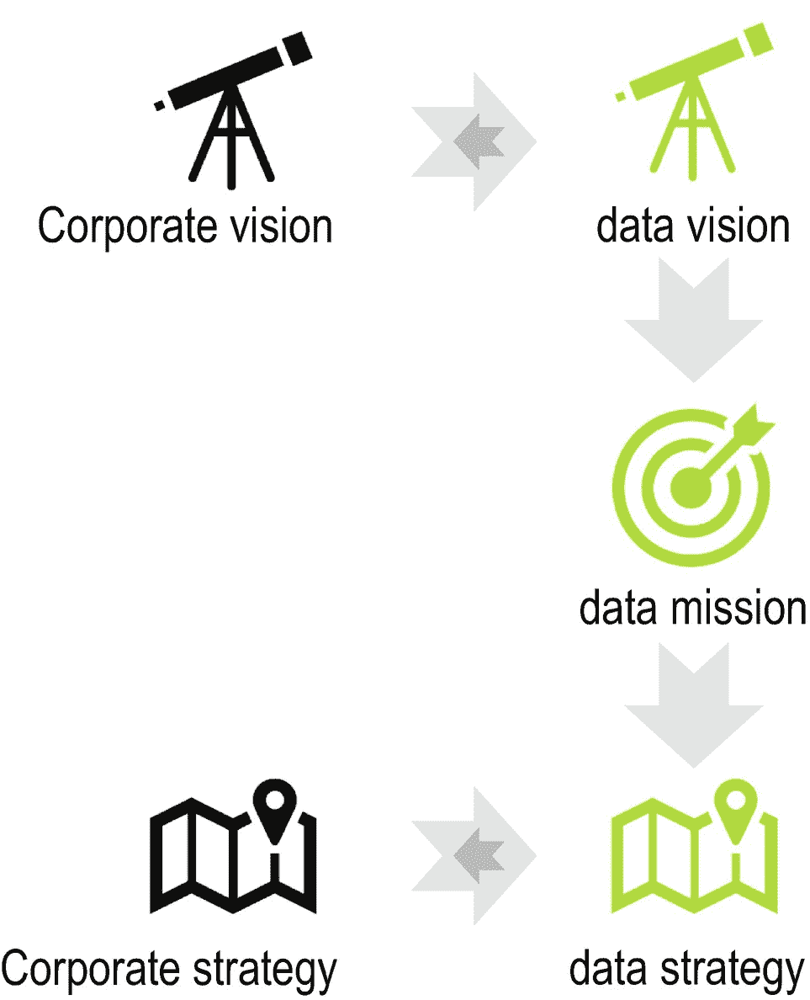
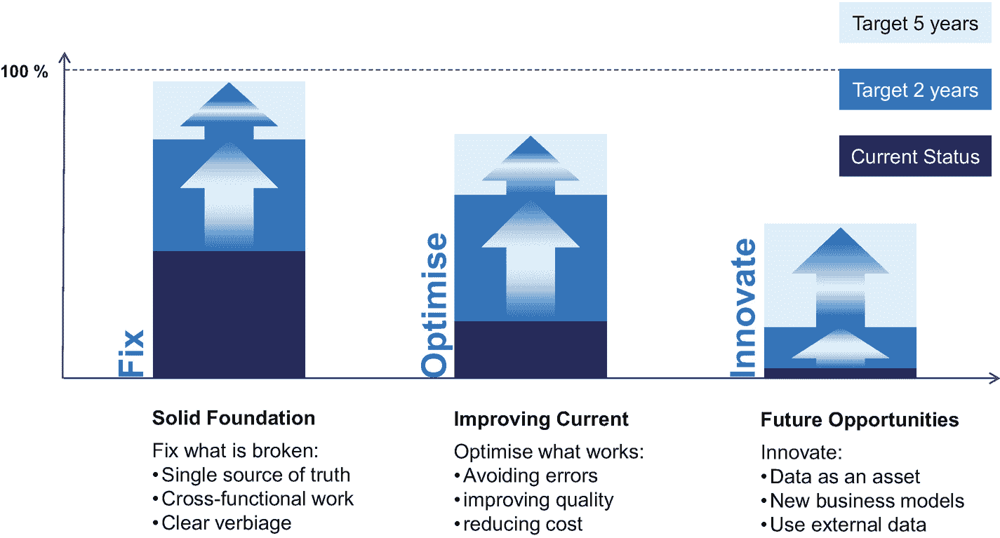
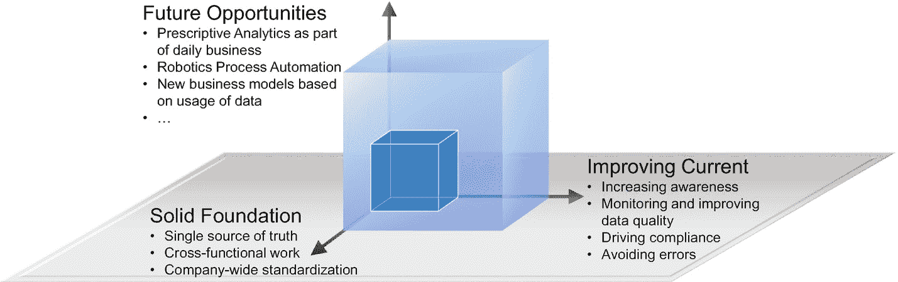
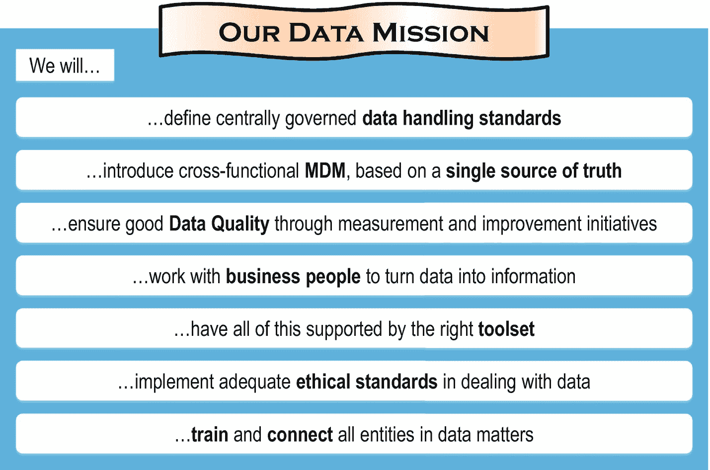

# 4. 数据愿景、使命与战略

**图 4-1** 忽视数据也是一种战略

## 数据战略——真的吗？

### 战略与执行

成功的商业领袖经常强调执行的必要性。肯·艾伦曾说过：“大多数战略就像新年决心，充满美好的意图，却没有执行意愿或能力”（Allen, 2019）。

换句话说，专注于执行至关重要。然而，光跑得快是不够的。你需要知道前进的方向。

肯·艾伦还说过：“在 DHL，我需要一个清晰的转型战略，让每个人都能执行。我需要确保整个公司专注于‘做事’——做正确的事”（Allen, 2019）。

这段话清楚地表明，战略是必要的——只要它能指导组织中的每个人并促成实际行动。任何偏离这一目的的战略层面都是对精力的浪费。

### 敏捷时代的战略

鉴于我们观察到的快速变化，明确的愿景、使命或战略是否过于静态？难道所有这些在执行之前就过时了吗？敏捷是否正在取代所有规划？

的确，赫尔穆特·冯·毛奇²⁰在 150 年前就说得对：“没有任何作战计划能在与敌军主力首次接触后依然确定不变”（Wikiquote – 老赫尔穆特·冯·毛奇, 1871）。

值得注意的是，即便是冯·毛奇也总是有计划的——但他随时准备在必要时改变它。

需要设定方向并提前规划的主要原因在于，人们始终需要指引——无论这个方向可能变化得多快。

你还需要一个计划和基线。否则，变化很快就会变得随意。

最后，当前的方向、计划和基线需要让所有利益相关者可见。如果之前的方向没有被沟通，你又如何能沟通任何方向的改变呢？

#### 类比

想象一下，几艘拖船试图用拖缆共同将一艘大船拖过狭窄的港口。

为了提高效率，所有拖船必须朝同一个方向拉动。

无论船只需要改变方向的频率有多高，所有拖船都必须同步执行每一次动作。

这需要对方向以及每一次必要的变化进行清晰的沟通。

在组织中，总体方向是通过愿景、使命和战略来描述和分享的。

像数据这样关键且跨职能的主题，应遵循同样的路径，原因相同。

### 文化会把战略当早餐吃掉吗？

确实如此。然而，如果没有一个好的战略作为“早餐”，文化也会饿死……

但什么才能让一个战略变得“好”呢？一个好的战略服务于一个目的：它驱动行为。

首席数据官（CDO）在制定组织中数据的愿景、使命和战略之前，需要问正确的问题：

-   **愿景**：比如说，从现在起五年后，这个组织管理数据的方式会是什么样子（现状如何）？

-   **使命**：我们打算实现哪些目标来达成我们的愿景？

-   **战略**：业务优先级是什么？我们采取哪些步骤来实现目标？

在你制定了愿景、使命和战略之后，你应该为第四步做好准备：基于你的战略制定计划。

一个计划应该始终包含支持你战略的活动，以及战术性或操作性的活动。一个完整的计划能帮助你确定活动的优先级。

不要纠结于将你的想法归类为战略、愿景或使命的困难。只要你实现了这些不同类别背后的目的，就没问题。

无论你对这些类别有什么普遍了解，都可以自由地将其应用于数据。

#### 类比

想想登山者。

-   你的**愿景**是选择你想攀登的山峰，以及你希望完成这一壮举的日期。

-   你的**使命**是在一年中的特定时间段内，以特定的日行进度，在规定时间内完成攀登。你每天晚上都可以检查你的使命是否按计划进行。

-   你的**战略**包括实现方面，如团队成员数量或装备。

-   你的**计划**描述了每天的执行情况。它可能会随着前提条件的变化而变化。

这一切与你组织的总体方向有何关系？请看图 4-2。

**图 4-2** 公司方向与数据方向

你应该基于公司愿景来制定你的数据愿景。同时，你的想法也可能影响这个总体愿景，例如，通过将“成为数据驱动型组织”纳入公司愿景。

你的愿景必须明确体现出是你组织总体愿景的重要组成部分。Gartner Group 的詹姆斯·威尔逊在一次 Gartner 会议上强调：“这并非关于一个小型数据管理团队交付小成果。这关乎公司改变其思维并重新思考其业务。”

为了使这变得具体，你的数据使命应该描述你将使用哪些组件来实现你的数据愿景。这是数据办公室特有的工作。

数据战略应同时受到你的数据使命（“**如何**处理所有选定的组件？”）和公司战略的影响。同样，你的数据战略也可能反过来影响公司战略，例如，在确定组织的长期优先级方面。

## 愿景

### 愿景应达成什么目标？

数据愿景的主要目的是确保所有利益相关者（尤其是董事会和您）在组织的数据雄心方面达成共识。

您的愿景应从三个方面回答基本的方向性问题：

1.  几年后，您所在组织的数据处理应呈现何种面貌？

    - 您打算让数据部门在后台支持组织的业务，还是希望其主动重塑业务模式？

    - 您想建立一个强大的数据管理组织，还是主要侧重于在业务职能部门内培养强大的数据能力？

    - 您打算为数据的*所有*用途打下坚实基础，还是希望专注于一流的数据分析能力？

2.  您的组织希望通过数据实现什么目标？

    - 您是否希望所有客户、合作伙伴和利益相关者都**信任您组织的数据**，将其作为业务决策的可靠依据？

    - 您是否专注于将**数据作为资产**进行评估，使其成为组织文化的一部分？

    - 是否将已建立的**数据治理**作为首要愿景，假设这能让您实现所有其他与数据相关的目标？

3.  数据在您的业务模式中扮演什么角色？

    - 数据是否预期用于支持**现有**业务模式？

    - 数据是否预期用于改进这些业务模式，例如通过数字化？

    - 您是否希望它创造**新**的业务模式？

    - 数据是否应该**本身**成为一种业务模式？

### 愿景应关注什么？

您可能不需要将上述所有要点都纳入愿景。要点越少，可能越容易记住（也越容易保持关注）。

考虑需要向组织传达什么内容会有所帮助。他们需要听到整个列表吗？或者某些要点已经明确，反而需要向组织强调那些对他们来说是新的要点的重要性？

舍弃任何大家都理解的部分（或者将它们总结在一个要点中）绝对是个好主意，这样人们可以专注于新的方面。这样做并不会使其他方面变得无关紧要。

在某些情况下，您可能希望专注于数据管理的特定领域，在这些领域您看到了巨大的机遇或巨大的差距。您的愿景是让组织的数据雄心聚焦于这些点的绝佳场所。

如果您的组织倾向于非常保守，那么您的愿景可以强调在数据事务方面成为开放型组织的目标。或者，正如伊莎贝尔·巴罗佐-戈麦斯在 2018 年担任 Sparebank 1 数据治理负责人时所总结的那样：“为你的愿景增添好奇心。”

如果你的组织过去将数据管理局限于少数几个主题，例如主数据管理或报表，那么强调处理数据的各个不同方面同等重要可能很有价值。

例如，可以在当今丰富多彩的分析报告与被忽视的繁琐数据质量工作之间实现预期平衡。

为了表明这种平衡，您可以让您的愿景由目标数量的支柱或关注领域组成。

为什么不使用图表来说明您认为组织目前所处的位置，以及您打算以多快的速度使其朝着您的数据愿景发展呢？

图 4-3 中的示例基于**修复**、**优化**和**创新**三大支柱。您可以为图表柱状图下方的每个支柱添加特定于组织的方面。

图 4-3 愿景示例 – 修复、优化、创新

如果您想强调恰好三个领域具有相似的相关性，您可以使用三维坐标系来展示它，如图 4-4 所示。

图 4-4 三维愿景

或者，您可以围绕组织在数据方面的目标状态来构建愿景，例如：

> *到（年份），我们希望成为一个组织，其中……*

> *…… 数据得到集中治理和标准化*

> *…… 数据被业务职能部门理解，而不仅仅是 IT 部门*

> *…… 数据正成为所有业务职能部门之间的通用语言*

> *…… 在财务上，我们将数据视为资产，至少在内部是这样。*

并且请记住，一个简洁的愿景需要与所有利益相关者进行大量的准备工作，以便它对每个人的日常工作都具有意义和相关性。

## 使命

如您所见，一个好的愿景不可或缺。然而，它可能过于抽象，无法直接从中推导出您的战略，更不用说具体的行动计划了。这正是清晰的使命可以发挥作用的地方。使命描述了您的组织希望（并授权）您去追求的具体目标。

有效使命陈述的关键方面是：

-   您的使命应该是可衡量的，以便您可以定期检查进展情况。一个好的使命陈述将帮助您随时间推移发现差距或延误。

-   您的使命应该包含一系列具体目标。每个目标都应支持您的数据愿景——从而支持组织的愿景。

-   此外，好的目标应该足够具体（且简洁），以获得董事会批准——这是您细化实施计划之前所必需的。

当然，没有放之四海而皆准的数据使命。但组织数据使命的以下七个方面可以作为一个不错的起点。

我邀请您根据组织存在的差距和机遇，将此列表转化为您特定的数据使命。您还可以在图 4-5 中找到关于每个方面的一些评论。

图 4-5 数据使命示例

### 定义集中治理的数据处理标准

此目标期望数据部门引入数据流程、统一数据词汇表、数据策略和规则。您不需要集中执行所有事务，但需要建立组织范围的标准。

与所有相关利益相关者共同制定此类标准，将使数据部门能够成为“数据粘合剂”以及业务与 IT 部门所有职能之间的翻译官。

### 基于单一事实来源引入跨职能的主数据管理

虽然您可能不需要集中维护主数据和参考数据，但您肯定希望停止不同领域的独立活动。您可以通过集中治理、单一主数据存储库以及明确定义的主数据消费标准（例如通过 Web 服务）来实现这一点。

由此产生的实施计划将需要一个较长的周期。这很可能是组织“历史遗留问题”最多的领域。例如，请考虑硬编码的参考数据或本地未受监管的主数据维护。

### 通过评估与改进举措确保良好的数据质量

同样，你也不希望数据办公室的任何人负责修复数据质量问题。相反，数据的所有者应当承担起责任。但他们必须知道如何去做，并且应当基于通用标准来执行，这样才能在整个组织内对数据质量进行比较。

这个目标让你能够建立一套组织层面的方法，用于评估数据质量、查找问题的根本原因，并确定解决这些根本原因的责任方。数据办公室可以充当推动者和严格的监督者，而具体业务职能则负责执行。

你无需重新发明轮子；六西格玛（`Six Sigma`）可以帮助你和业务职能团队。

### 与业务人员合作，将数据转化为信息

数据办公室的团队将与所有业务职能的人员合作，将数据转化为信息。他们将运用现代数据分析方法，从报告到人工智能，无所不包。

与之前的要点一样，数据办公室可能无需在中央象牙塔里完成所有分析和数据科学工作。相反，你或许希望在集中与分权之间找到平衡。

这个目标将使你能够与业务人员和信息技术（IT）部门合作，共同寻求最佳配置。在组织内部安排分析专家的工作时，你将致力于在贴近业务、协作与协同效应之间找到恰当的平衡。

### 借助合适的工具集来支撑这一切

数据办公室不应创建影子 IT 部门，任何业务职能也不应有此倾向。不过，数据办公室非常适合与 IT 部门联手，为组织的业务职能提供服务。你可以从界定数据办公室与信息技术团队之间的职责划分开始，这项工作最好由中立的协调人主持。

你还需要倾听业务人员的意见，了解他们的优先事项。（比如我可以告诉你，他们讨厌冗长、官僚的流程。）由于你还要负责长远规划，因此需要在可持续性与敏捷方法之间找到平衡点。

### 在处理数据时实施充分的道德标准

数据办公室需要在“可能之事”“允许之事”和“有益之事”之间找到平衡。要做到这一点，通常有两个指引力量确保数据处理的道德性：法律以及人类的福祉（特别是组织内部员工和客户的福祉）。这两者缺一不可——无论是利用法律漏洞的正式合规，还是不考虑法律形式的善意亲民做法，都是不够的。

这个目标既需要一个宏大的计划，也需要持续不断的努力。

### 在所有数据事务上培训和连接各实体

并非所有财务问题都需要财务部门来解决，正如人类福祉并非人力资源部门的专属责任一样。同样，数据是整个组织的任务，而不只是一个中央数据办公室的责任。

这个目标要求你建立组织层面的数据网络，连接跨职能或跨地域的人员，并建立适当的培训和沟通机制，以打造一支具备数据素养的员工队伍。

## 战略

### 为何需要数据战略？

好的战略能让团队做出左右抉择并进行优先级排序，这是除了业务案例、资源、依赖关系等之外的关键因素。它有助于避免在每一个个案中都进行基础性的讨论。

当你面临多个同等有效的备选方案时，这种方向性支持尤为重要。它还能确保不同决策之间的一致性。

一个典型的例子是在“通过完美解决方案吸引客户”和“通过有竞争力的价格吸引客户”之间做选择。两种方案都有效，但混合使用会导致品牌认知模糊。

### 数据战略与组织战略相比如何定位？

你的数据战略并非独立存在的战略。组织的战略必须处于主导地位。

正如国际知名作家兼战略顾问伯纳德·马尔（`Bernard Marr`）曾言，“每家企业都应当从战略出发，而不是从数据本身开始”（Marr, 2019）。

上面的例子很好地说明了数据战略与企业战略的关系：

-   一方面，数据管理需要支持品牌认知，例如通过声明“我们希望成为所有高质量供应商中成本最低的竞争者”来实现。

-   另一方面，成为低成本供应商并不意味着要采取低成本的数据方法。一个组织可以决定大力投资数据，以找到如何在保持盈利的同时成为价格最低的供应商。

这也是为什么不存在一种完美的数据战略。它在很大程度上取决于组织的整体战略方向。

你将如何制定数据战略？理想情况下，应在制定组织战略的过程中紧密配合。首席数据官（`CDO`）应当参与企业战略的制定。基于对数据所能实现之事的了解，也许有理由去影响组织战略。

如果你作为 `CDO` 加入的组织已经拥有企业战略呢？接受它，并使数据战略与之匹配。描述数据管理如何支持该战略。并随时准备为该战略的后续发展做出贡献。

### 如何制定并维护你的数据战略？

预先安排定期战略匹配评审。要问：我们是否仍在正轨上？如果不是，是因为战略指引了错误的方向，还是我们没有正确地执行它？

如果你在任何时候发现数据战略不再能（充分）支持企业战略，请启动调整流程。不要等到下一次企业战略评审。

同时，随时欢迎从数据角度向整体战略提供反馈。只是别忘了，数据并非企业战略的驱动因素。

# 你衡量成功的个人标准

我们已经讨论了数据办公室的愿景、使命和战略，以及它们与企业对应目标之间的关系。

但随着时间的推移，你如何衡量自己工作的成功呢？

有些方面你可能不会写入正式声明，但会与团队分享并定期回顾。

一个典型的内部成功标准是数据办公室和首席数据官在组织内的地位。虽然这是成功的先决条件，但这个标准通常不会出现在愿景、使命和战略的任何公开版本中。

尤其是在数据办公室成立初期，你不能依赖任何传统。你必须赢得法律、风险或安全部门同事可能已经从前辈那里继承来的所有尊重。

这方面的进展很难衡量。但为了自我欺骗，仍然值得思考。

数据办公室可以被视为关键支持职能之一，既需要论据也需要权威来让人们改变行为。那么，为什么不以处于类似地位的其他部门作为你的基准呢？

一个相对可衡量的标准可能是“我们被邀请支持他人的频率有多高？”它可以记录从“强加于人”到“成为值得信赖的顾问”的转变。

这个方面至关重要，你或许希望将其纳入团队成员的个人目标中。

以下是衡量措施成功与否的另一种测试：倾听员工的心声，了解他们在处理数据的语境中提及“我们”时的含义。他们指的是整个组织，还是各自的微观世界，例如他们的团队或部门？

我记得一位财务高级副总裁曾说过：“**我们**需要跨职能协作。”不幸的是，在这个句子中，“我们”指的是财务部门。应收账款团队被期望与他们的控制同事紧密合作，而与销售部门等部门的对话则不被视为优先事项。

在成熟的组织中，“我们”主要用于描述整个组织。这在数据管理中极其重要，因为并不存在所谓的“财务数据”或“营销数据”。相反，我们应该谈论的是“我们”组织数据的财务或营销视角。

同样，“他们”一词不应被用来描述其他团队（或者，在“那些高层办公室里的人”的意义上，指代最高管理层）。它应该指组织外部的各方，主要是竞争对手。

脚注 1
