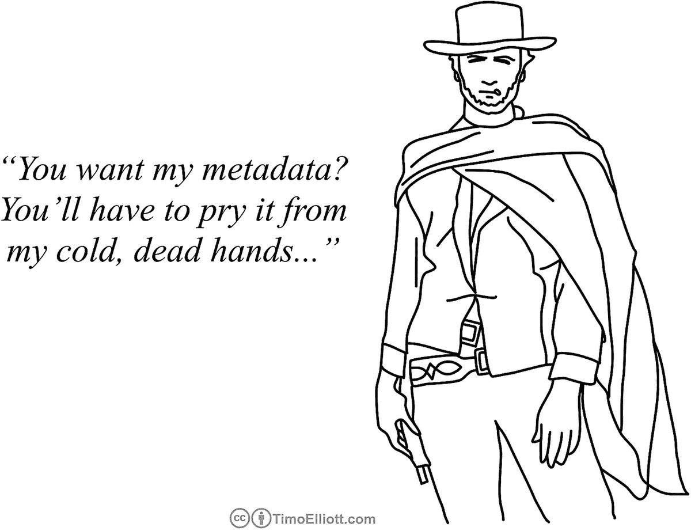

# 5. 主数据管理

图 5-1

谁拥有数据？

## 静态数据过时了吗？

数据管理关乎分析、机器学习和通过可视化获得的洞察，对吧？那么，为什么这本书在战略部分之后，甚至在介绍数据治理之前，就立即讨论主数据呢？

而且，是的，在敏捷时代，主数据有时听起来像是来自过去的束缚。

但事实远非如此。

在 2019 年 12 月的一篇 LinkedIn 帖子中，“数据耳语者”斯科特·泰勒这样说道：“主数据与宏观趋势无关！”

我完全同意。尽管对主数据的变更可能需要变得越来越敏捷，但对主动管理的主数据的需求不会很快消失。

事务数据反映了日常的交易或事件，通常甚至是作为副产品创建的。相比之下，主数据是有意识地维护以支持业务活动的。

即使分析集中在事务数据（包括大数据）上，仔细观察就会发现，如果没有主数据，任何事务数据都无法被分类和解释（从而提供业务洞察）。

此外，基于不良主数据创建的事务数据将不可避免地继承后者低劣的质量。

而这可能会成为一个代价高昂的问题。我记得有一家公司，销售主管指着桌上的一堆信件对我说，所有这些信都是寄给客户的，并标有“退回寄件人 – 无法投递”。这些客户的服务已经提供，但相应的发票却无法送达。该公司的地址数据太糟糕了，财务影响直接冲击了利润底线！

当然，主数据并不仅限于客户数据，而是与组织的所有领域都相关。我不知道有哪个业务职能*不*需要或不拥有主数据。

而且，数字化甚至加剧了不良主数据对组织各个部分的影响。

2019 年，德勤曾询问首席采购官们在掌握数字复杂性方面面临的最大挑战。高达 60% 的首席采购官提到的最频繁话题是“低劣的主数据质量、标准化和治理”^(²¹)（Delesalle & Van Wesemael, 2019）。欢迎来到一个首席数据官变得不可或缺的世界！

## 主数据涵盖哪些内容？

### 主数据、参考数据与元数据

主数据、参考数据与元数据之间的界线并非完全清晰。不过，我的建议是不要花太多精力去寻找一个完美的定义。你需要有充分的理由来区分任何两种数据类型。否则，这纯粹是一种学术练习。

一个国家的邮政编码格式可以被视为主数据，但也可以被视为元数据。汇率可以被视为参考数据——由于它会不断变化，你也可以将其视为交易数据。

你必须确定一种分类吗？只有当你有实际理由这样做时才需要！

这里提供三个可能促使你进行分类的驱动因素：

- 需要不同的流程
- 需要变更所有权
- 变更影响程度不同

这将允许你通过引用主数据、参考数据或元数据，为不同类型的数据定义治理规则。

考虑到这三个方面，有两个标准浮现在脑海中：

1. **不同的流程**

   你最终需要区分**数据结构的变更**和**数据内容的变更**。

   前者通常会导致应用程序、接口或数据库的重新设计。它们与后者有根本性的不同，后者理想情况下通过配置使应用程序的行为发生变化。数据结构的变更通常需要比数据内容的变更更复杂、不同的流程。

2. **不同的责任归属**

   你会发现，**责任归属**也沿着这些界限有所不同：关于客户、地点和产品的数据由业务人员在其日常工作中定义，因为单个错误的影响有限。任何对构建或指定此类数据的数据进行的变更，都可能影响大量记录。这同样适用于通常以批处理模式进行的大规模数据变更。这就是为什么此类变更的责任应由数据所有者承担，他们有时甚至需要组织影响分析。

因此，我们可以提出以下分类：

1. **交易数据**
   - 通过执行业务流程创建

2. **元数据**
   - 指定参考数据、主数据和文档
   - 由数据所有者管理

3. **参考数据**
   - 由用于维护主数据的 IT 应用程序访问
   - 对参考数据的变更可能会影响主数据。如果某个职位名称被更改或停用，所有拥有该头衔的员工都会受到影响
   - 由数据创建者维护
   - 通常由一组值组成，主数据实体的属性从中选择

4. **主数据**
   - 由业务部门内的人员维护
   - 单个变更对业务流程的影响很小（甚至没有影响）
   - 如果单条记录出错，影响通常仅限于处理该记录的交易
   - 然而，维护过程中的系统性缺陷可能会产生重大的负面影响

如果你选择这些标准作为区分依据，你就可以更容易地为那些仅需在数据维护工具中进行变更的数据，与那些需要评估（并可能变更）组织应用系统架构的数据，定义不同的变更流程。

再次强调，你的定义应由业务目的驱动。如果你打算对两种不同类型的参考数据区别对待，请随意进一步细分。如果你对主数据和参考数据应用完全相同的流程，那么就用一个术语来描述这两者。

但要着眼未来：保持灵活性，以便在未来区分今天看似相似的事物！

请注意，在整本书中，我额外使用了“主数据”这个表述作为涵盖主数据、参考数据和元数据的通用术语。因此，每当我说“MDM”（主数据管理）时，我指的是对所有三种类型数据的管理。你无需遵循这个习惯，但在阅读时应该了解这一点。

### 主数据示例

- 参与方：客户、供应商、外部合作伙伴、员工、政府机构
- 与服务相关的事物：产品、备件、耗材、物料
- 公用设施：叉车、机器、车辆、打印机
- 地理信息：工厂、仓库、办公室、销售区域、地址

### 参考数据示例

以下示例展示了参考数据的多面性。它们清晰表明，协调参考数据并商定规则是一项核心任务，理想情况下应由数据办公室承担。

#### 汇率

每个跨国组织都需要准确的汇率来进行交易和估值。

汇率计算有多种不同方式，你必须确定交易地点以及采用卖出价还是买入价。同样关键的是，为每笔交易商定基础价格以哪种货币计算。

此外，还需要决定汇率的更新频率——根据用途不同，范围可从实时变动到月度汇率。

如果你遗漏了任何一个方面，都会陷入歧义。这会导致同一笔采购出现两种不同的价格——无论对你的客户或供应商关系，还是对财务核算而言，这都是最坏的情况。

汇率会随着持续的交易而每秒变化。然而，如果考虑每一次变动，就无法建立稳定的工作基础，出口价格也可能持续波动。

波动性货币要求对汇率变化做出快速反应，但你通常不会在采购后的几秒钟内立即卖出外币——无论你的汇率处理多么精确，你都面临着售后货币贬值的风险。

商业伙伴之间的交易汇率通常可以自由商定，但绝不允许存在歧义。

你在税务、关税和报告等领域面临的受监管计算，通常必须遵循外部规则，包括变动频率和舍入规则。

在这两种情况下，存储汇率历史记录都极其重要。否则，你将无法追溯计算过去某笔交易适用的汇率。

所有这些方面都表明，集中处理汇率对任何组织都至关重要。例如，如果销售和财务部门各自为政，你将面临严重的对账问题；而如果将汇率选择权交给商业智能和分析人员，不同的人会得出不同的结果。

我的建议如下：

- 为此领域谨慎定义并选定一位数据业务负责人。该负责人需要与所有其他利益相关者协调一致。
- 让数据办公室成为强制性监管者，以避免各自为政。
- 与数据业务负责人和利益相关者群体共同制定并记录明确的规则。
- 确保你订阅了所有已商定的汇率来源，并将这些值存储在参考数据存储库中。始终拥有每个来源准确完整的汇率历史记录至关重要。
- 考虑存储组织自身的特定属性，例如是否接受某种特定货币作为支付方式，以及在哪一波动水平下向风险管理发送警报。

#### 地址数据

地址信息非常复杂。地址本身以及地址与业务方的分配关系都处于持续变化之中。

即使拥有规范地址逻辑的国家也会面临歧义。

- 地址的典型组成部分通常可以缩写，这会导致同一地址存在不同但有效的拼写方式（例如，"rd" 与 "road"）。
- 地址的某些部分是可选的，即仅为了清晰而提供，并非确定精确位置所必需。
- 许多国家存在多种有效的地址确定方式，这往往是因为引入了新方法，但人们仍在沿用旧方法。
- 有些国家拥有完善的地址和邮政编码系统，但几乎无人使用。
- 不同的字母体系使情况更加复杂。

所有这些问题都造成了歧义，因此简单的字符串比较不足以确定两个地址是否指定了同一位置。

整个地址管理主题值得用一本专著来讨论。

**建议：**

- **规范化：** 就单一领先标准和明确的映射规则达成一致（例如，在涉及多种字母表的情况下，要有清晰的音译标准）。
- **考虑使用地理坐标：** 它们不受拼写和格式的影响，因为它们能明确指定一个物理位置。但要注意：摩天大楼可能容纳数百个组织，它们具有相同的 `x` 和 `y` 坐标。而且建筑物的形状通常与一对地理坐标的矩形区域不符。请考虑使用地理围栏技术，并利用第三个坐标进行垂直区分。
- **考虑使用外部地址清洗服务：** 没有任何组织拥有地球上所有国家/地区的完美地址数据，但一些提供商与不同的本地地址提供商合作，以提供全球范围内的精确地址数据。
- **出于合规和法律原因：** 为每个当事方保留地址历史记录，并保留客户提供的任何原始地址。
- **使用特定于国家/地区的地址逻辑：** 包括相关的元数据。您可以自行实现，也可以使用 `API` 或外部数据提供商。在任何情况下，都要考虑到每日变更的可能性。

## 3. 语言数据

一种语言就是一种语言？当然，世界比这要复杂得多……

典型的挑战包括：

- **不同的字母表：**（拉丁语、西里尔语、希伯来语、韩语、中文），其中大多数都有多个子集。

- **同一国家/地区内同一语言的不同拼写标准：**（挪威语）

- **音译并非总是明确无误：**（日语的汉字）

- **同一语言存在多种国家/地区版本：**（英语）

- **一个国家/地区内存在多种语言：**（印度、瑞士、加拿大）

**建议：**

- **在处理多种语言时，始终使用 `Unicode`。**

- **定义一种内部主导语言和字母表。** 始终映射到您的默认语言。这为您提供了仅需管理 `(n-1)` 种关系，而不是每两种语言之间的 `n*(n-1)/2` 种关系。

- **采用国家/地区加语言的组合方式：**（正如大多数语言服务提供商所做的那样），并为每个国家/地区定义一个默认语言。

- **语言处理必须能够定义组织内不得翻译的特定表达方式：** 例如，作为品牌的一部分。请考虑到，在大多数情况下您仍然需要进行音译。并且，必须能够处理组织范围内所有其他特定表达方式的翻译。

## 组织层级

您的组织是否时常重组？它是否收购并整合其他组织？它是否通过自己的子公司进入新市场？它是否与其他组织合资成立公司？除非您是本地烟囱清洁工，否则您至少会回答一次“是”。

但在这些情况下，谁负责？结构存储在哪里？又是如何存储的？

传统上，财务部门以外的人倾向于认为组织层级结构是直观清晰的。但细节中藏着魔鬼，而且有很多充分的理由可以避免在功能软件中经常出现的硬编码层级结构。

**建议：**

- **澄清组织层级结构可能存在的不同目的。** 组织的内部结构通常与外部法律结构不同。如有必要，维护两个或更多不同的层级结构。

- **坚持将此信息的保管权交给数据办公室，** 以确保对层级信息进行可持续的、跨职能的、全面的管理。

- **确定最合适的数据业务负责人。** 根据您组织的概况，负责人可能是财务部、法务部、并购部，甚至是专门的业务转型部门。

- **设计您的层级数据结构，** 使其能够通过配置来实现变更。

- **与业务负责人合作处理层级不同演进阶段之间的映射，** 以实现适当的同比比较，这项任务颇具挑战性。这种映射必须提供给所有数据使用者，以确保报告和分析的一致性。

- **存储的历史数据结构应允许：** 一旦日期确定，就能轻松地将事件和交易分配到层级的正确部分，特别是对于面向法律目的的层级。

### 元数据示例

元数据的类型与其它数据的类型一样多。本质上，元数据描述其他数据。

以下是一些示例：

#### 1. 格式描述

主数据和交易数据的大部分元素都需要格式描述，以便进行数据验证，并在必要时解释数据。典型的例子是账号的长度和格式。

外部数据的格式描述也属于元数据，例如增值税号的格式和长度。

#### 2. 文档信息

**文档的分类和标记：** 存储的原始文档拥有大量的元数据元素，例如格式、页数或最后修改日期。大多数文件格式甚至将部分元数据作为文件本身的一部分进行存储。

**影像文档的元数据标签要少得多：** 例如来源、作者或大小——这里，额外的信息来自 `OCR` 和文本分析。这就是为何在收到任何此类影像时就应执行这些步骤的原因，以便能够立即找到并有效利用它。

完整的 `OCR` 和文本分析通常会将整个文档转化为系统化的信息，使原始文档影像成为一个附属方面。在这种情况下，大多数信息可以被视为交易数据，而非元数据。您的划分应再次遵循其目的：哪些数据应受您的元数据策略约束，哪些数据应由您的交易数据策略覆盖？

#### 3. 大数据分类

与影像文档的元数据类似，非结构化的大数据文件也需要元数据，例如日期、来源或使用的字符集。

这些元数据元素是后续步骤中准确解释数据内容所必需的。

从这个意义上说，“非结构化”这个术语即使对于大数据存储库最初的原始版本来说也并不恰当。它将通过初步分析变得越来越结构化，直到您确定了足够的元数据，使其能够应用于分析算法，例如用于模式识别或相关性发现。

此外，元数据发现有助于确保大数据存储库的任何内容与您想要应用的机器学习算法所使用的训练数据相匹配。

有效的元数据管理有助于以结构化的方式完成所有这些工作。

## 管理主数据

### 跨职能的 `MDM`

主数据大多是跨职能的。换句话说，不止一个团队或部门依赖于某一特定的主数据集。然而，许多组织仍然拥有由不同团队自主维护的、分散的主数据。

## 数据模型

一个透彻的数据模型对于主数据的设计至关重要。

元数据与数据模型密切相关。属性的基数（`cardinality`）和格式需要在数据模型中维护，元数据管理必须从数据模型中获取这些信息。

但是，主数据和参考数据的逻辑和结构也应在数据模型中定义。

作为一般规则，所有业务逻辑和结构应首先放入数据模型。然后，基于数据模型来定义主数据及其维护。

### 主数据的历史视图

主数据、参考数据和元数据都需要一个历史维度：即属性值随时间推移而发生的变化。

你应该始终能够重现过去某个特定日期（如果你提前维护了主数据，甚至可以是未来某个日期）的情况。出于法律原因、调试目的或场景模拟等需求，你可能都需要这种能力。

这就是为什么 `Web` 服务应该始终提供一种调用变体：在该调用中提供一个日期，`Web` 服务返回该日期对应的结果。这有助于你使用过去和未来的数据进行测试、重现案例以评估索赔，以及验证错误消息。

完备的历史记录还能为你提供额外的数据验证机制。例如：

*   在一个状态为“在建中”的设施中，不能有产品生产出来。如果发现此类组合，应向用户标记提示。

*   你不能向一个不再有效（或尚未生效）的邮政编码发货。历史视图可以在拒绝该邮政编码时添加历史信息：提示“不再有效”或“自……起才有效”比单纯提示“无效！”提供了更丰富的信息。

*   即使是当前有偿还能力的客户，如果其信用评级在过去两年的大部分时间里一直很差，也可能需要密切监控（或被限制使用信用付款）。

但在处理历史数据时，你也会面临挑战：

*   变更后的同比比较：如果你重组了客户细分，就很难确定每个细分市场客户忠诚度的同比发展情况。

*   虽然 `NoSQL` 数据库通常无需重新设计就能处理数据模型的变更，但 `SQL` 数据库很容易出现问题。它们无法识别新增的表，会遗漏丢失的表，并且对主键结构的变更很敏感。

*   即使数据库能够处理结构变更，客户端应用程序也可能无法做到——除非它被有意识地设计成能在不同模式下工作。不幸的是，这种能力通常是硬编码的。更常见的情况是，应用程序被修改以支持新的逻辑，从而失去了支持先前逻辑的能力。

这些案例说明了将软件和数据库的向后兼容性添加到任何变更的需求清单中是多么重要——无论是大型版本发布，还是敏捷项目的迭代冲刺。

## `MDM` 与主数据软件

### 主数据设计风格

设计和实现主数据并非只有一种方法。根据你的功能性及跨功能性业务需求，你可以为整个主数据环境或其部分选择不同的主数据设计风格。你可能决定采用混合解决方案，无论是临时性的还是作为长期目标的一部分。

典型的主数据设计风格有^(²³)

1.  **集中式**

    从数据质量的角度来看，完全集中的解决方案提供了最安全的方法。它便于组织单一事实来源原则——其中大部分原则已经体现在数据库设计中。

    请注意，集中化的是数据本身，而非维护工作。来自世界各地的数据管理员可以直接在集中式解决方案中维护数据，无论该方案是本地部署还是在云端运行。

2.  **虚拟集中式**

    过去 20 年的技术进步越来越使数据仓库的逻辑结构与其物理设计解耦。大多数数据库解决方案都支持分布式数据库设置，在这种设置下，记录可以分布在多个远程位置，或者数据库会在同一数据库的不同实例之间自动复制所有记录。

    基于云的数据库解决方案甚至不知道还有其他的工作方式。

    因此，全球性的组织覆盖范围不再是维护独立、本地数据库的借口。只有连接性有限的地区才可能有理由保留本地数据仓库——但这些理想情况下应只是单个逻辑数据库的只读副本或缓存。

    提醒一句：在单个物理或虚拟数据库中，主键并不能防止重复。拼写错误和不同的拼写方式可能导致多条记录指向同一个“事物”，而数据库的字符串比较功能可能无法发现这一点。（另见第 10 章“保持数据清洁”一节。）

3.  **分布式读取**

    有时，遗留应用程序无法切换为从现代 `MDM` 解决方案消费数据，例如，当大型机无法调用主数据 `Web` 服务，或者修改旧系统的风险被认为过高时。

    在这些情况下，你应至少尝试将这一主数据领域的所有维护工作切换到一个集中式解决方案（除非当前的主数据维护是不可分割的整体遗留系统的一部分）。然后，你可以建立一个复制机制，定期更新任何本地仓库以供本地消费。

    大多数专业的 `MDM` 解决方案都能支持所有这些风格。但你通常会在遗留基础架构中发现限制。这就是为什么 `MDM` 软件的一个重要选择标准是其与遗留解决方案共存和交互的能力。

4.  **分布式读写**

    如果技术限制阻止你集中化即使是单一类型的主数据，你可能被迫将其保留在多个仓库中。在这种情况下，你需要确保这些仓库之间的定期同步，以尽可能接近单一事实来源的状态。不过，由于缺乏实时同步，业务流程应假设数据仓库会暂时出现不同步的情况。

    这种方法需要一个主数据源的中央注册表，记录它们之间的相互依赖关系，以及它们的更新和使用频率，这样你就可以系统地自动化同步过程。

## 5. 独立式

这是遗留环境中最常见的设计风格。它通常在一个缺乏数据治理的组织中历经数十年发展而成，主数据常常被作为孤立的功能实现项目的附属方面来规范和实现。

这种风格的优势在于能够快速实现本地或功能性解决方案——但其无数的缺点会让你希望转向其他风格。

然而，在某些情况下，在不同地点维护的数据在逻辑上确实是独立的。这通常发生在特定主数据仅在有限上下文中有用的情况下。

在这种情况下，可能没有足够好的商业案例来将这些主数据集成到组织级的主数据环境中。但你不应放弃，而应等待时机，例如，等到各自的功能解决方案被替换或现代化。

只要组织被迫采用这种主数据设计风格，就必须通过严格的治理来弥补技术支持的不足，以确保手动避免数据质量问题。

这种劳动密集型的手动数据质量工作需要额外的资源。你可能希望利用这一点来构建商业案例，以转向更可持续的主数据解决方案。

## 首先明确你的需求

尽管许多软件包都标榜为“MDM”，但这个缩写指的是一种管理主数据的方法，而非一套 IT 解决方案。

咨询公司高德纳一针见血地指出：“MDM 是一项复杂且昂贵的工作。作为一种技术驱动的业务举措，仅靠软件本身无法应对这一挑战”（Parker & Walker, 2019）。

正因如此，我强烈建议你将选择主数据软件视为主数据建设之旅的最后一步。尽早了解现有现成解决方案的能力固然不错，但这些能力不应决定业务需求。

如果你不清楚主数据软件应实现什么功能，也没有建立相应的治理机制来确保人们使用该软件，那么你就有可能无法选出最合适的软件解决方案。更糟糕的是，即便选出了方案，也极有可能无法得到恰当使用——甚至完全搁置。

### 确定你的需求

以下是我基于在各类组织中的经验所作的估算：一个组织对主数据解决方案 80%的需求，都可以通过数据管理框架的分析与开发，在前期提前确定。

有趣的是，这 80%的需求中包含许多无需在“对错”之间抉择的决策（因为任何一种方向都可行）。

其他可以（且必须）在前期明确的事项包括：需要访问系统的用户和应用程序数量，以及它们将如何访问数据。这正是为何需要尽早定义数据维护流程。此外，你还必须确定应用架构中的任何约束条件——这并不局限于遗留应用程序。

只有其余 20%的业务需求是在使用主数据解决方案的过程中逐渐形成的。而且，这 20%中的大部分同样属于改进建议，而非“生死攸关”的情况。

原因很简单：大多数主数据解决方案的提供商会定期整合客户的反馈。除非你的组织与其他所有组织完全不同，否则你不太可能提出其他组织从未遇到过的需求。因此，你可以预期多个 MDM 解决方案都不会对你的组织构成真正的“致命障碍”。

对此，你应在流程早期就熟悉主流主数据解决方案提供商的产品——但不必立即着手筛选备选名单。

相反，这些解决方案的功能特性可以帮助你塑造目标架构，该架构由治理机制、流程以及支撑它们的解决方案共同组成。

### 瀑布式还是敏捷式？

你会选择哪种方法——瀑布式还是敏捷式？能否完全基于敏捷方法来收集需求？

几乎不言而喻，已实施解决方案的持续改进默认应采用敏捷方式。

同样显而易见的是，选择解决方案的过程至少需要部分遵循瀑布式方法，因为你必须在某个时间点做出方向性决策（你不会希望过于频繁地在 MDM 工具之间切换）。

与此同时，治理框架和主数据流程的开发应以敏捷方式进行。对主数据解决方案需求的文档化，可以是团队真正践行敏捷工作方式时一个令人欣喜的副产品。

你甚至可以使用敏捷方法来开发主数据治理和流程^(²⁴)。在这种情况下，关于治理和流程的用户故事也可以被视为主数据解决方案的用户故事。你的敏捷待办事项列表可以成为确定主数据解决方案需求说明的一部分。

### 自建还是购买？

数十年来，组织一直被迫自行构建主数据解决方案。当时市场上可用的解决方案不够成熟，而且零散割裂：多领域主数据解决方案尚未出现，几乎没有哪个解决方案能与其他方案良好集成，更不用说与数据管理的其他部分（例如数据建模工具）集成。

与此同时，情况已显著改善。解决方案提供商受益于主数据解决方案相对独立的行业特性。这意味着提供商无需投入过多精力为不同行业开发专用解决方案。

但与为满足组织特定需求而定制的内部解决方案相比，即便是这些日益复杂的主数据解决方案也存在一个关键劣势：如果某项功能不可用，你无法简单地自行添加——你必须寄希望于解决方案提供商也认为这是一个好（且紧急）的想法。

对解决方案提供商的依赖是一个挑战，尤其是在使用基于云的解决方案时，其可配置性通常仅限于非核心方面。

如果你当前已有一个或多个遗留的主数据解决方案，暂时保留它们，并先引入与这些遗留方案配合使用的治理流程，或许是合理的做法。你很可能在此过程中学到很多东西，这有助于你日后选择出色的专业解决方案。

要决定自建还是购买，你应诚实评估：你的组织在处理主数据方面，是希望将其打造为竞争优势，还是仅仅作为一种专业的后台活动，以帮助组织专注于业务目标。

第二种方法并无不妥！它的优势在于，你可以选择一套主数据解决方案，并开发部分治理流程来适配该方案。

选择解决方案的过程也会因此变得更容易：你可以列出一系列符合核心需求的选项，然后选择性价比最高的那一个。

脚注 1 2 3 4
