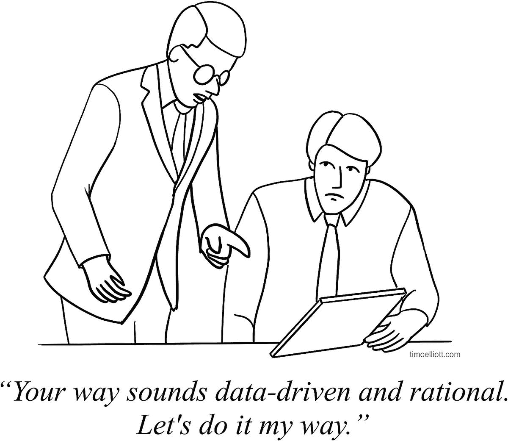
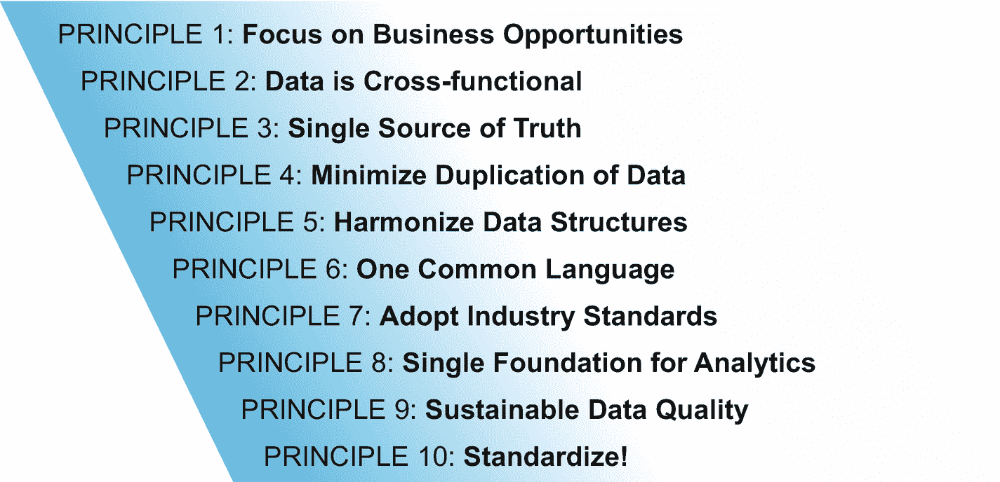
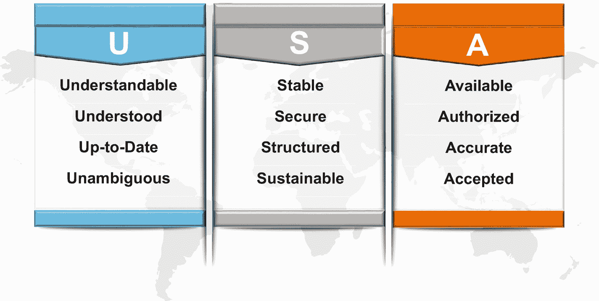
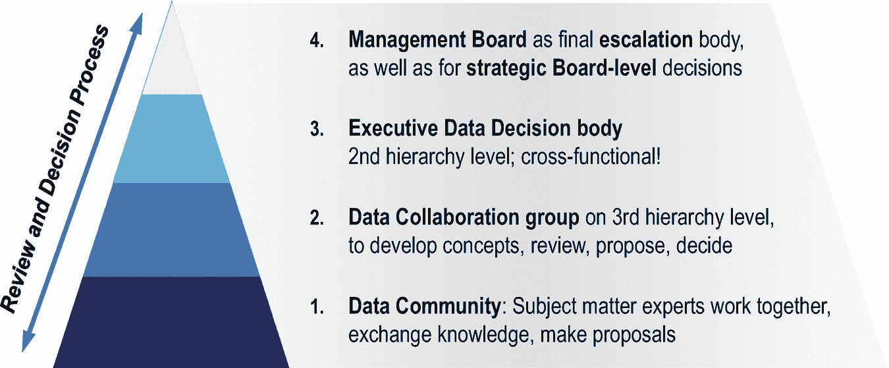

# 6. 数据治理

图 6-1：没有治理的数据，不过是一项不具约束力的建议

## 塑造一套数据原则

在大多数情况下，数据驱动型组织的前进方向会与组织以往的方向有所不同。除了阐述宏观愿景外，数据办公室团队还需要在非常具体的案例中判断：某项提案是否符合数据战略、是否需要调整，或者是否遗漏了某些内容。

一个由数据专家组成的团队或许能够准确判断每一个具体案例的优劣。一份记录详尽的技术性数据架构文档也无疑能帮助 `IT` 部门把事情做对。但总体理念可能需要一种能被所有人理解的通用导向，无论是资历最深的数据库专家，还是市场营销主管。

哥伦比亚广播公司的杰里米·科恩在 2018 年伦敦的一次数据会议上用了这样一个比喻：“指南针胜过地图！我们并非无所不知。”一套数据原则可以成为你的指南针。将这些数据原则视为数据的“宪法”。它们可以在标准与政策尚未覆盖的新情况下提供指引方向。

但不要仅仅由你自己起草这些原则并强加于他人——即使你认为自己知道该怎么做！你或许更希望与来自业务和 `IT` 各部门的关键数据参与者共同制定这些原则。（请放心，合适的人选会来自你的数据网络内部。）自己或与整个数据办公室团队一起创建一份初始草案，以确保讨论方向正确，这是完全可以的。你可以将你在组织中已识别出的关键点融入进去。典型的候选点包括：

*   所有数据都有其所有者。
*   优先关注最关键的数据。
*   关注根本原因而非表面症状。

但同样重要的是，要尽快让关键人员参与进来，例如通过研讨会的方式，让他们共同拥有最终成果。虽然你不应接受与数据战略有根本性偏离的内容，但你应该对“无伤大雅”的更改持开放态度，比如措辞上的修改：“你认为你的替代措辞更容易理解？好的，那就用这个吧！”

有时，人们会想出全新的、绝妙的主意。如果你采纳了这些想法，结果不仅会更好，而且你还能赢得这些人的支持！当然，无论在何时，你都是这份文件的正式所有者，这使你能够对其进行微调，使各方贡献者的意见与你的战略目标保持一致。最后，请在最终的文件中提及所有贡献者。这一步将真正使其成为“他们的”文件。

当然，你也不想创建一个冗长、难懂的“怪物”。因此，请聚焦于标题——可以添加背景信息，供那些希望更好理解的人阅读。想一个朗朗上口的标题，以便在你发布某项计划的合规性检查或解释方向时引用。可以考虑“数据信条”或“数据十诫”这类名称。你可以在图 6-2 中找到一个组织典型的数据原则列表。

图 6-2：数据原则示例

## 制定数据政策

### 数据政策有何用处？

数据政策对于指导那些你无法（或不愿）逐一规范的个别情况下的员工行为至关重要。它们是沿着整个数据供应链规范数据处理行为的准则。此外，数据原则和政策应协同作用，使跨职能团队能够推导出具体的规则，以流程或角色与职责的形式覆盖已知情况。

一条经验法则是：只要你有充分理由认为组织内的人员在处理数据时可能不会从组织的最佳利益出发，就需要制定数据政策。典型的动机包括懒惰、无知、自满、自私或考虑不周。数据政策的目的是通过告知每个人应该（或不应该）用哪些数据做什么以及为什么，将人员行为与组织的目标和价值观统一起来。

### 数据政策需要多具个性化？

与数据原则不同，政策需要覆盖整个组织。它们必须立足于整体战略的背景下，并且必须与组织的其他政策相契合。例如，如果你的组织所有其他政策都依赖于跨职能审批流程，那么基于个人决策权来制定数据政策是没有意义的。

其次，数据政策的内容需要针对你的组织量身定制。不要照搬其他组织的数据政策。这样做很可能不能满足你组织的需求，或者你选择的政策风格与其他政策不匹配，风险太高。此外，其他组织的数据政策可能基于不同国家的法律环境；根据适用的地域范围，它们可能过于具体或过于笼统。

然而，需要为你的组织制定一套个性化数据政策，这不应阻止你去查阅几份现有的政策，以检查你是否忽略了某些方面。

### 如何确定政策的责任归属？

作为建立数据政策管理的一部分，你可能希望明确责任归属，因为所有权并不总是直观清晰的。有时，某项典型数据政策的责任已经由另一个团队承担了。这方面最常见的例子可能就是数据保护政策。其他所有权模糊的典型政策涉及在处理数据时强制执行法律要求，例如 `GDPR`、`SOX`（2002 年萨班斯-奥克斯利法案，美国）或 `HIPAA`。^(²⁵)

如果另一个部门传统上负责*所有*政策，包括数据政策，那么一个不错的做法是，将整个政策所有权议题作为你首席数据官职责的一部分请其予以澄清。为此，理想情况下，你应该创建一份你希望自行设计的所有政策的清单，以及另一份你认为应该提供意见的政策清单。

你的主要目标绝对*不应*是争取最大程度的责任权限。相反，你的目标应该是能够为在你的组织中建立强大的数据管理基础。这就是为什么通常不必为每一份政策的最终归属权而争斗。数据办公室被认可为一个利益相关方通常就足够了。如果用户对原始所有权不满意，让他们自己去表达意见。

因此，让另一个部门（例如法务部或沟通部）负责所有政策的责任，而数据办公室负责数据政策的内容，这完全可以接受。

### 如何确定政策的制定方式？

在组织和结构上，你应该遵循你组织处理其政策的方式。必须明确地表明，数据政策并非独立于组织的政策目录之外。此外，与组织的其他政策完全保持一致，可以使你能够复用现有的基础设施，从法律审查、发布到强制执行。

你的组织可能拥有中央政策管理机制。在这种情况下，数据办公室需要成为一个被认可的参与方，拥有一些现有政策的所有权，并成为其他政策的正式贡献者/审批者。如果你的组织尚无任何政策，或者你的组织没有系统性的政策处理方法，我鼓励你自行启动。你甚至可以建立一个项目，使其成为其他团队制定政策的蓝图。

#### 如何制定一套数据策略？

与数据原则一样，让所有相关利益方参与数据策略的制定至关重要。这些利益方包括策略使用者（所有部门）和主题负责人（例如风险管理或数据隐私管理部门）。倾听前者的关切至关重要，同时你需要避免在撰写策略时与后者产生竞争。

当然，这种利益相关者驱动的策略制定方法不应阻止你进行充分的准备工作。理想情况下，你应准备比最终目标更多的策略。如果团队不需要从一张白纸开始，他们通常会感到高兴，而你也能在一定程度上设定议程。

#### 数据策略是什么样的？

出于以下三个原因，此处不会提供示例：

1.  互联网和文献中有大量示例，你应该多看一些。
2.  我选择的任何示例都可能被误解为我建议你撰写策略的方式。事实是：数据策略没有唯一有效（甚至是最佳）的结构。
3.  你的数据策略在格式和结构上应与组织的其他策略保持一致。组织 `A` 成功的数据策略可能在组织 `B` 中完全不适用。

我建议你始终从策略的目的开始讨论：目标结果是什么？策略应导致或防止发生哪种情况？策略旨在执行哪项（内部或外部）规定？牢记这一点，你可以决定特定策略是强制性的、有条件的还是建议性的。后者需要在策略中进行合理程度的论证，因为其目的是被自愿遵守。

如果你在制定数据策略方面有相当大的自由度，你可以考虑使用数据原则的结构（如本章前面所述）：每个原则可以附带一条或多条数据策略来具体化。所有策略都需要获得全球范围内的批准，由管理委员会或由委员会授权做出此类决定的适当审批机构（如本章后面所述）进行。最终，策略需要被共享，并且相关人员需要接受培训。在这两个方面，你可以复用组织先前为处理策略而建立的任何机制。最后，请鼓励反馈。你需要了解人们是否接受你的策略。

## 受管理数据的目标状态

列出明确定义数据的前提条件有多种方式。`GoFair (2019)` 提供了一个公开可用的列表。另一个是“`USA`”标准（图 6-3）。

图 6-3：数据标准（示例）

虽然基本方面总是相似的，但你可能会想开发自己的模型。这将使你能够强调那些对你的组织具有突出重要性的要点。

## 数据治理的范围

组织内处理数据的哪些方面应属于普遍有效的数据治理范畴？简短的回答是“所有方面”。以下是一些典型的问题和答案。

### 数据是否可能因过于机密而无法被治理？

是的，数据可能因过于机密而无法共享。在这种情况下，数据办公室将专注于定义敏感数据需要如何被治理，谁具体负责，以及谁可以访问这类数据。机密数据本身无需提供给数据办公室。

### 我们不应该豁免研究数据吗？

研究自由通常被认为是创造力的前提条件。确实，研究人员应该拥有发现新方法和洞察所需的一切自由。然而，一旦研究结果被共享，就必须能够理解得出这些结果的过程。这就是为什么治理和文档对于科学模型和算法也同样重要。

### 不同类型的数据需要不同的治理吗？

对参考数据、交易数据和大数据进行差异化管理确实是个好主意。

这些数据类型在复杂性、结构、用途和目标群体方面各不相同。同时，数据隐私和数据保护的级别也会不同。

此外，只读数据不需要像组织内部会发生变化的数据那样多的规则。

元数据也需要自己的一套规则，因为它对互操作性有显著影响。

### 对于我们还不知道的数据呢？

处理我们目前尚未意识到的数据方面的工具是策略。所有数据策略的编写方式应能让每个人都从这些策略中推导出任何新数据方面的处理规则。

例如，如果一项新法律要求在两年内进行变更，策略可以规定任何新法律需要在其生效前至少两个月得到遵守。

那么，如果对于一个新主题没有现成的策略呢？请使用你的数据治理机构和流程，尽可能可持续地处理任何新问题！为了让这种方法得到遵循，使其成为强制性的——是的，通过一项策略！

数据管理定理 #9

数据管理需要集中治理。

执行应默认委派。

## 决策与协作

还有什么比将所有责任都投入到定义明确的治理模型中，并在所有层级实现跨职能代表更好的方法呢？

一个好的起点可以是高层模型，如图 6-4 所示。

图 6-4

审核与决策阶梯

如果你从四个不同层级开始，随后可以详细定义每一个层级，并根据组织的结构和需求进行调整。

## 管理委员会

任何组织都不应将管理委员会排除在数据治理架构之外。

我见过许多案例，尤其是在大型企业中，管理委员会被认为过于战略层面，不适合处理“普通”数据议题。这是一个错失良机！

无论管理委员会是否有意识地决策数据议题，其决策都与组织的数据密不可分。他们直接或间接、有意或无意地影响着数据决策。

普华永道数据分析合伙人、奈耶诺德商业大学雅克·德·斯瓦特教授博士，在 2019 年阿姆斯特丹的一次数据会议上直言不讳地说：“重大决策都在董事会会议室做出。”你必须将大数据议题带到那里去。

我们需要明确一点：管理委员会不应被期望讨论常规的数据工作。然而，在有效的数据治理模型中，它需要扮演两个关键角色：

1.  **战略**

    数据战略不能脱离组织的整体战略而独立存在。

    虽然数据战略的制定责任在于首席数据官（`CDO`），但其获得管理委员会的批准至关重要。数据愿景和数据使命也是如此。

    如果管理委员会没有明确声明数据战略得到全力支持并与整体战略一致，`CDO` 在执行中将缺乏权威。

    无论 `CDO` 做什么，都应能够与愿景、使命和战略联系起来：“我们正在做 A，以实现经管理委员会批准的 X。”

    在批准数据战略的同时，应让管理委员会及时了解执行进度。换句话说，定期向管理委员会进行简短更新必须成为整体数据治理的一部分。这能让董事会成员持续关注该主题，并为 `CDO` 开辟一个提出想法或表达关切的渠道。

2.  **升级处理**

    遵循先前描述的辅助性原则，每个层级应尽可能在向上升级前解决争议。

    此外，双方之间的分歧应通过双边方式解决，而不是让所有职能部门都参与进来。董事会层面也是如此，`CDO` 可以调解两位存在分歧的董事会成员达成一致。

    然而，每个组织也需要一个正式流程来解决剩余议题。经验表明，即使在下层未达成一致，小问题也不会被纳入董事会议程。应该提供多种选项，以便在任何层面解决此类问题。

### 执行数据决策机构

在管理委员会之下，通常需要一个权威机构来跨职能部门决策数据事务。只有小型组织才会要求管理委员会来做此类决策。

要使这样的机构拥有足够的权威，它需要代表组织的所有领域。这并不意味着整个第二管理层级都需要加入该机构。相反，可以挑选精通数据的高管代表多个领域——前提是他们已获得管理委员会的预先协调和授权。

一个通常可行的做法是让每位董事会成员挑选一名直接下属，代表该董事会成员的整个职责范围。这至少可以作为一个起点，允许进一步微调，例如，当一位董事会成员下属的两个子职能部门过于独立，以至于一位高管无法同时代表两者时。

我在此有意使用“决策机构”一词，因为我不期望该机构*详细讨论*议题——除非他们真的想这样做。在所有其他情况下，我希望参与数据相关讨论的团队能事先就提案达成一致，并让他们的机构成员了解所有已达成一致的意见以及所有剩余的分歧点。

作为必要的数据升级流程的一部分，只有该机构有权向管理委员会进行任何升级。

我将这个机构称为`数据执行委员会`。如果贵组织有命名惯例，你也可以遵循。

### 数据协作组

为了使`数据执行委员会`能够做出决策，需要一个机构来从内容上准备那些提案、请求或升级材料。

这项工作应由一个跨职能的团队负责人或部门主管小组来完成。

我将这个机构称为`数据管理委员会`，或简称为`数据委员会`。它应由 `CDO` 主持。

该委员会应定期开会，以制定概念、评审、提议、决策或升级：

- `数据管理委员会`评审已确定的数据质量问题。

- 它决定应由数据办公室处理或由跨职能项目团队开展的新议题。

- 它要求数据办公室提供关于其计划、活动和进展的最新信息。`CDO` 可以要求自己的团队负责人向该机构做演示。

- 它评审、预先排序，并就项目提案做出决策，将其纳入组织的项目优先排序或预算编制流程。

- 最后，所有向`数据执行委员会`的请求都需经过该机构。

成员应由`数据执行委员会`的成员任命。数据倡导者通常是一个明智的选择。

虽然`数据执行委员会`受益于有限的成员数量，但`数据管理委员会`可能受益于更大的规模，以确保真正跨职能的讨论和覆盖范围。

### 数据社区

数据专家理想情况下应分布在整个组织中。每个部门都应“说数据语言”。不同可能的角色见第 9 章。

除了成为各自团队的一部分外，他们还应形成一个虚拟社区，该社区尤其为`数据管理委员会`充当主题专家。

人们不需要被指定为数据社区的成员；任何其职责包括维护、保护、共享、改进或解释数据资产的人，都应被视为数据社区的一部分。

然而，这个社区需要积极的引导，以便其成员能够相互协作并相互学习。

该社区应允许这些数据专家带来新想法，并支持跨业务职能的数据项目。该社区的引导者应是数据办公室的一名成员，他也充当连接`数据管理委员会`的桥梁。

### 数据评审与决策流程

在详细阐述所有数据流程（我们在第 8 章讨论）之前，我们需要处理所有数据流程之母，即“数据评审与决策流程”。

该流程描述了议题如何在主题专家与管理委员会之间的评审和决策阶梯上上下流动。它也涵盖了所有其他相关数据流程的处理。

### 实施速度

数据治理无法一蹴而就。与其说是复杂性问题，不如说是让每个人都参与进来的挑战。

即使你知道方向所在，也建议将旅程分解为小步骤。让人们习惯看到数据被治理。

你也会在迈出每一步的过程中不断学习。你原本期望效果很好的做法可能会变得行不通。替代方案可能会出现并改变你最初的想法。

或者，正如昕诺飞企业信息管理全球副总裁拉基·艾哈迈德在 2019 年一次数据会议上所说，“让你的治理框架不断发展。”

一旦你定义好数据治理阶梯的四个层级，关键部分已实施并得到授权评审与决策流程的支持，你就拥有了一个基本的数据治理架构，能够处理所有剩余的议题。

脚注 1
