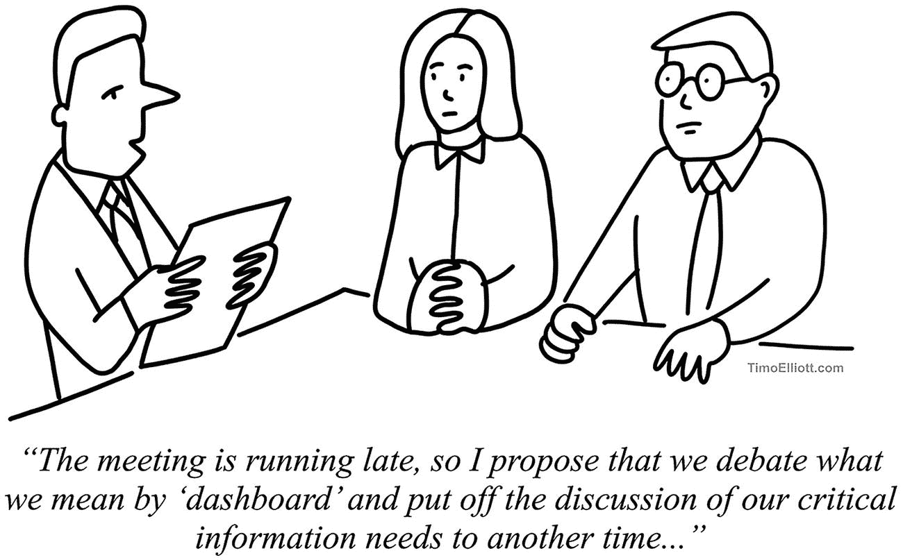

# 7. 数据语言

图 7-1

“我们需要一种语言吗？”——“先定义一下‘语言’……”

## 语言的特征

### 我们不都说英语吗？

为了让人们相互理解，仅仅让他们坐在同一个房间里，并且所有人都会说会听，是远远不够的。

只要你设想一个希腊人和一个印度尼西亚人试图交流的情景，这句话的道理就显而易见了。

这同样适用于不同的行业、组织和部门。正如印度尼西亚人可以学习希腊语并使用词典查词一样，我们也需要语言培训、业务术语词汇表，以及关于如何使用这种语言的精确定义。

这样一个整体架构包括表述的定义（数据词汇表）、数据规则、数据标准以及企业数据模型。本章将描述一个用于定义组织数据语言的总体框架。

### 语言的动态性

语言并非一成不变，因为它需要反映现实。新事物出现需要命名，新活动也需要恰当的动词。

为此，人们会复用生活中其他领域的现有词汇和描述，或者从其他语言借词。有时，他们甚至会人为创造新词，这些词通常基于古老语言或缩写而来。^(²⁶)

以下是围绕英语的三个典型例子：

**示例 1**

几个世纪以来，“链条”和“锯子”一直存在，因此当“链锯”被发明时，并不需要创造新词。

**示例 2**

在农业领域，人们早在工业革命之前就已经使用“拖拉机”（拉丁语：*trahere* – 意为“牵引”），因此当第一台发动机驱动的设备开始翻耕我们的田地时，这个词便顺理成章地被沿用下来。

**示例 3**

古罗马人并不特别擅长数学。如果你尝试用罗马数字计算两个数的乘积，就会明白这一点。

但他们确实需要进行计算和数字相加。他们用来描述这种活动的动词是“computare”。

当第一批机器出现，开始代替人类完成这项工作后，将这些机器称为“计算机”似乎就成了顺理成章的事。

每当需要将整个古老语言（如拉丁语或希伯来语）应用于现代场景时，必须系统地执行扩充词汇的过程，以一致地填补所有空白。如果没有这种协调一致的方法，新创词汇要经过文档记录、标准化并被完全采纳，有时需要花费几个世纪的时间。

那么，语言的这段历史与数据有什么关系呢？

为应对新情况而复用现有术语，或基于现有词汇创造新表达的习惯，并不仅限于我们的私人世界。它在我们的日常业务生活中也屡见不鲜，这会导致跨所有业务领域产生歧义的风险。

而所有这一切同样适用于数据世界。此外，这个数据世界仍然相对年轻。数据语言几乎没有时间发展，导致许多情况和场景缺乏历史上形成的表达方式。

显然，我们需要采取一些措施来解决这些歧义、命名不当以及缺乏明确指代的问题。这既适用于广义上的业务语言，也特别适用于数据语言。

## 数据词汇表

### 什么是词汇表？

词汇表是术语及其定义或解释的存储库。

现代的词汇表还包含交叉引用、同义词、历史记录、层次结构、关系和归属权。

在技术上，好的词汇表工具具备 Web 前端、搜索功能以及包含提案功能的变更工作流。

### 没有词汇表的风险

贵组织最大的十个客户是哪些？

问题很简单？

你能否回答以下所有问题？

- 什么是客户？它是指一个“公司”（如“微软”）？是指一个账户（同一费率表涵盖的所有内容）？还是指我方的销售人员与之沟通的物流采购人员？
- 客户和账户是同一回事吗？
- 我们使用了多少种不同的“账户”定义？
- 我们是否将归属于同一客户的所有组织都合并到一起？我们如何判断？
- 我们认为沃尔沃汽车和沃尔沃卡车是同一家公司的一部分吗？
- “归属于同一”是什么意思？百分之百？多数股权？合资企业？
- 我们选择哪个发货期？
- 我们是否依赖像邓白氏这样的外部供应商提供的数据？我们知道*他们*的定义吗？

你是否同意，像“最大客户”这样一个看似直截了当的问题，其答案并不一定明确？

但这是否意味着我们必须放弃，因为无法得到正确答案？选项是否太多了？

嗯，这其实是一个提出正确问题的问题！

问问自己：我们想用“十大客户”这个信息来做什么？这个问题可能有助于在特定意义上定义“客户”和“大”。

**示例 4**

“一个客户”可以是：

- 如果在某个特定案例中我们搞砸了，所有面临风险的货运量。注意：在某些情况下，即使同一组织内部的区域机构在物流领域也不相互沟通。
- 同一首席执行官领导下的所有实体：如果我们希望建立个人层面的、董事会级别的关系，这一点很重要。但我们该如何处理占股 50%的机构？而且，我们是否也应该关注持有我们大部分客户股份的实体（如投资基���、养老基金等）？
- 同一购买决策下的所有业务：我们如何确定这些决策在哪个层级做出？也许组织的首席执行官并不关心较小的采购决策，将这些决策完全留给各个子公司或部门。

每个行业都有其特定的语言。同一行业内的不同组织也形成了各自独特的措辞。不同的部门使用不同的术语。员工会根据个人背景赋予业务表达不同的含义。我相信你可以根据自己的经验，在以上列表中继续添加内容。

所有这一切都会导致以下两种结果：

- 不同的人用不同的名称称呼同一个对象。
- 同一个表述被用于指代不同的对象。

前者虽令人烦恼（你可能需要提问才能理解），但后者则可能极其危险，因为人们可能在讨论相当长一段时间后，才发现他们谈论的是不同的对象。

我最近与一家大型货运公司的首席财务官交谈。他认为没有必要建立集中管理的词汇表。我问他，在他的公司里，财务部和销售部对“收入”的定义是否相同。他回答说这绝不可能，财务部当然是唯一能定义“收入”的部门。

当我祝贺他其部门对这个术语被公认的业务所有权时，我问道，财务部对“收入”的定义是否已形成文档并与组织内其他部门共享。他假定前者已经做了，但不知道后者。

我解释说，销售部门需要一个表述来形容其月度销售额的货币等值。我说我怀疑他们也使用了“收入”这个术语，只是财务部没有意识到而已。然而，他们定义的方式可能不同：为了计算销售代表的奖金，他们会将当月达成的所有销售交易的价值加总。

## 通用数据语言的重要性

首席财务官说：“不对，那是错的！只有当服务实际交付时，我们才能将其计为收入！”我说：“问题就在于此！一旦不同参与方对同一术语有不同理解，中立机构就有充分的理由来进行协调。”

首席财务官或许确实是“收入”这一术语的所有者——但就这一职责而言，他所在的部门需要与所有其他部门展开对话，以确保所有变体都得到恰当定义，并且命名清晰明确。

在具备完善数据管理机制的组织中，所有这些不同的定义都将经过讨论、制定并记录，成为组织级术语表的一部分。

术语表也是确保流程和政策明确无误书写的前提条件。

此外，相对较新的“数据语言”中包含了一些已在其他语境中使用过的表达方式，缺乏现有的词汇来涵盖这些概念。

因此，业务文档很容易被误解，因为其中使用的词语和表达可能具有多种不同含义。随着数据相关内容的增加，这一问题会愈发严重。

### 常见的混淆情况有哪些？

如果有人使用了对话伙伴无法理解的表达，这本身已是个问题。如前所述，更糟糕的情况是双方对同一表达有不同的用途。我曾目睹一些会议，与会者相互交谈了数小时，才（和我一样）意识到他们指的是不同的事物。有时甚至是在会议结束很久之后，他们才发现这一分歧，并造成了重大影响。

为了让这种情况更具体化，我们来看几个人力资源领域的业务示例。

#### 示例 5

在重组过程中，人力资源部门提到了“受影响”的员工。他们指的是什么？有些员工会理解为“他们的情况会发生变化。”另一些人则会理解为“那些员工会被解雇。”

#### 示例 6

“员工总数”需要定义清楚才能正确映射。兼职人员算作全职员工总数吗？学徒是否包含在内？“非在岗”员工（例如长期病假或休育儿假的员工）呢？

想象一下，三个被收购的组织继续使用各自原有的 HR 系统，而你在此基础上加装了一个统一的报告工具。你必须将这三个组织的异构数据整合在一起。

从技术上讲，对不同数据库表进行并集操作很容易。但相同的标签是否代表相同的列定义？只要数据类型兼容，即使定义不同，你甚至不会收到任何警告。

“员工”是一个典型的实体，可以用多种不同方式来定义。回想一下上面最后一个例子：可能一个组织使用“全职当量”，而另一个组织使用在职人员。一个组织只计算全职员工，而另外两个组织则包含兼职员工。合同工是否包含在内？长期病假员工呢？

术语表在组织数据的任务中能提供极大的支持。映射可能仍然必要，但现在你知道该如何进行了。

除此之外，许多与数据相关的术语既需要解释也需要定义。以“数据模型”这个表达为例，它可不是时尚模特的数字等价物。这样的数据模型可能描述了两个主题之间的“关系”——但这并不能说明他们是朋友还是兄弟。

## 术语表需要包含哪些内容？

术语表并不需要帮助确定“正确”的定义。相反，它需要帮助组织就一种明确无误的语言达成一致。

任何组织都可以自主定义其用语——尽管通常来说，放眼组织之外也是明智之举，以避免在与客户、供应商及其他外部方的对话中产生歧义。

一个完善的术语表需要包含哪些内容？

- 定义
- 同义词
- 相关术语及差异
- 对逻辑数据模型和业务流程的引用
- 谱系
- 变更请求的工作流

## 如何引入术语表？

你是否需要说服人们术语表是有意义的？可能不需要。更常见的挑战是将多个独立的术语表合并成一个。每个部门主管、每个项目经理、每个业务架构师都曾遇到过歧义和误解的问题。

一个常见的结论是在各自职责范围内创建术语表。你会在市场部的内网网站上找到“市场术语表”，在大多数项目文件的附录中找到术语表，而大多数专业文档（如政策或专家报告）也都附有各自独立的术语表。

那么，如何将所有术语表合并成一个？又如何确保将来不会再有人创建另一个单独的术语表？

这始于授权：你需要一个跨职能、董事会级别的决策，规定术语表的所有权属于数据办公室。

是的，这个话题重要到值得董事会做决策。

