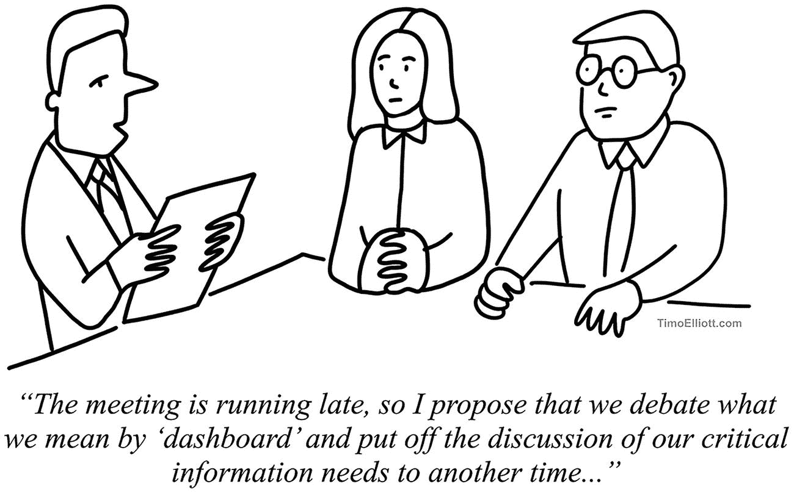

# 7. 数据语言

图 7-1

“我们需要一种语言吗？”——“先定义一下‘语言’……”

## 语言的特征

### 我们不都说英语吗？

为了让人们相互理解，仅仅让他们坐在同一个房间里，并且所有人都会说会听，是远远不够的。

只要你设想一个希腊人和一个印度尼西亚人试图交流的情景，这句话的道理就显而易见了。

这同样适用于不同的行业、组织和部门。正如印度尼西亚人可以学习希腊语并使用词典查词一样，我们也需要语言培训、业务术语词汇表，以及关于如何使用这种语言的精确定义。

这样一个整体架构包括表述的定义（数据词汇表）、数据规则、数据标准以及企业数据模型。本章将描述一个用于定义组织数据语言的总体框架。

### 语言的动态性

语言并非一成不变，因为它需要反映现实。新事物出现需要命名，新活动也需要恰当的动词。

为此，人们会复用生活中其他领域的现有词汇和描述，或者从其他语言借词。有时，他们甚至会人为创造新词，这些词通常基于古老语言或缩写而来。^(²⁶)

以下是围绕英语的三个典型例子：

**示例 1**

几个世纪以来，“链条”和“锯子”一直存在，因此当“链锯”被发明时，并不需要创造新词。

**示例 2**

在农业领域，人们早在工业革命之前就已经使用“拖拉机”（拉丁语：`trahere` – 意为“牵引”），因此当第一台发动机驱动的设备开始翻耕我们的田地时，这个词便顺理成章地被沿用下来。

**示例 3**

古罗马人并不特别擅长数学。如果你尝试用罗马数字计算两个数的乘积，就会明白这一点。

但他们确实需要进行计算和数字相加。他们用来描述这种活动的动词是“`computare`”。

当第一批机器出现，开始代替人类完成这项工作后，将这些机器称为“计算机”似乎就成了顺理成章的事。

每当需要将整个古老语言（如拉丁语或希伯来语）应用于现代场景时，必须系统地执行扩充词汇的过程，以一致地填补所有空白。如果没有这种协调一致的方法，新创词汇要经过文档记录、标准化并被完全采纳，有时需要花费几个世纪的时间。

那么，语言的这段历史与数据有什么关系呢？

为应对新情况而复用现有术语，或基于现有词汇创造新表达的习惯，并不仅限于我们的私人世界。它在我们的日常业务生活中也屡见不鲜，这会导致跨所有业务领域产生歧义的风险。

而所有这一切同样适用于数据世界。此外，这个数据世界仍然相对年轻。数据语言几乎没有时间发展，导致许多情况和场景缺乏历史上形成的表达方式。

显然，我们需要采取一些措施来解决这些歧义、命名不当以及缺乏明确指代的问题。这既适用于广义上的业务语言，也特别适用于数据语言。

## 数据词汇表

### 什么是词汇表？

词汇表是术语及其定义或解释的存储库。

现代的词汇表还包含交叉引用、同义词、历史记录、层次结构、关系和归属权。

在技术上，好的词汇表工具具备 Web 前端、搜索功能以及包含提案功能的变更工作流。

### 没有词汇表的风险

贵组织最大的十个客户是哪些？

问题很简单？

你能否回答以下所有问题？

- 什么是客户？它是指一个“公司”（如“微软”）？是指一个账户（同一费率表涵盖的所有内容）？还是指我方的销售人员与之沟通的物流采购人员？
- 客户和账户是同一回事吗？
- 我们使用了多少种不同的“账户”定义？
- 我们是否将归属于同一客户的所有组织都合并到一起？我们如何判断？
- 我们认为沃尔沃汽车和沃尔沃卡车是同一家公司的一部分吗？
- “归属于同一”是什么意思？百分之百？多数股权？合资企业？
- 我们选择哪个发货期？
- 我们是否依赖像邓白氏这样的外部供应商提供的数据？我们知道*他们*的定义吗？

你是否同意，像“最大客户”这样一个看似直截了当的问题，其答案并不一定明确？

但这是否意味着我们必须放弃，因为无法得到正确答案？选项是否太多了？

嗯，这其实是一个提出正确问题的问题！

问问自己：我们想用“十大客户”这个信息来做什么？这个问题可能有助于在特定意义上定义“客户”和“大”。

**示例 4**

“一个客户”可以是：

- 如果在某个特定案例中我们搞砸了，所有面临风险的货运量。注意：在某些情况下，即使同一组织内部的区域机构在物流领域也不相互沟通。
- 同一首席执行官领导下的所有实体：如果我们希望建立个人层面的、董事会级别的关系，这一点很重要。但我们该如何处理占股 50%的机构？而且，我们是否也应该关注持有我们大部分客户股份的实体（如投资基金、养老基金等）？
- 同一购买决策下的所有业务：我们如何确定这些决策在哪个层级做出？也许组织的首席执行官并不关心较小的采购决策，将这些决策完全留给各个子公司或部门。

每个行业都有其特定的语言。同一行业内的不同组织也形成了各自独特的措辞。不同的部门使用不同的术语。员工会根据个人背景赋予业务表达不同的含义。我相信你可以根据自己的经验，在以上列表中继续添加内容。

所有这一切都会导致以下两种结果：

- 不同的人用不同的名称称呼同一个对象。
- 同一个表述被用于指代不同的对象。

前者虽令人烦恼（你可能需要提问才能理解），但后者则可能极其危险，因为人们可能在讨论相当长一段时间后，才发现他们谈论的是不同的对象。

我最近与一家大型货运公司的首席财务官交谈。他认为没有必要建立集中管理的词汇表。我问他，在他的公司里，财务部和销售部对“`收入`”的定义是否相同。他回答说这绝不可能，财务部当然是唯一能定义“`收入`”的部门。

当我祝贺他其部门对这个术语被公认的业务所有权时，我问道，财务部对“`收入`”的定义是否已形成文档并与组织内其他部门共享。他假定前者已经做了，但不知道后者。

我解释说，销售部门需要一个表述来形容其月度销售额的货币等值。我说我怀疑他们也使用了“`收入`”这个术语，只是财务部没有意识到而已。然而，他们定义的方式可能不同：为了计算销售代表的奖金，他们会将当月达成的所有销售交易的价值加总。

## 通用数据语言的重要性

首席财务官说：“不对，那是错的！只有当服务实际交付时，我们才能将其计为收入！”我说：“问题就在于此！一旦不同参与方对同一术语有不同理解，中立机构就有充分的理由来进行协调。”

首席财务官或许确实是“`收入`”这一术语的所有者——但就这一职责而言，他所在的部门需要与所有其他部门展开对话，以确保所有变体都得到恰当定义，并且命名清晰明确。

在具备完善数据管理机制的组织中，所有这些不同的定义都将经过讨论、制定并记录，成为组织级术语表的一部分。

术语表也是确保流程和政策明确无误书写的前提条件。

此外，相对较新的“数据语言”中包含了一些已在其他语境中使用过的表达方式，缺乏现有的词汇来涵盖这些概念。

因此，业务文档很容易被误解，因为其中使用的词语和表达可能具有多种不同含义。随着数据相关内容的增加，这一问题会愈发严重。

### 常见的混淆情况有哪些？

如果有人使用了对话伙伴无法理解的表达，这本身已是个问题。如前所述，更糟糕的情况是双方对同一表达有不同的用途。我曾目睹一些会议，与会者相互交谈了数小时，才（和我一样）意识到他们指的是不同的事物。有时甚至是在会议结束很久之后，他们才发现这一分歧，并造成了重大影响。

为了让这种情况更具体化，我们来看几个人力资源领域的业务示例。

#### 示例 5

在重组过程中，人力资源部门提到了“受影响”的员工。他们指的是什么？有些员工会理解为“他们的情况会发生变化。”另一些人则会理解为“那些员工会被解雇。”

#### 示例 6

“员工总数”需要定义清楚才能正确映射。兼职人员算作全职员工总数吗？学徒是否包含在内？“非在岗”员工（例如长期病假或休育儿假的员工）呢？

想象一下，三个被收购的组织继续使用各自原有的 HR 系统，而你在此基础上加装了一个统一的报告工具。你必须将这三个组织的异构数据整合在一起。

从技术上讲，对不同数据库表进行并集操作很容易。但相同的标签是否代表相同的列定义？只要数据类型兼容，即使定义不同，你甚至不会收到任何警告。

“`员工`”是一个典型的实体，可以用多种不同方式来定义。回想一下上面最后一个例子：可能一个组织使用“全职当量”，而另一个组织使用在职人员。一个组织只计算全职员工，而另外两个组织则包含兼职员工。合同工是否包含在内？长期病假员工呢？

术语表在组织数据的任务中能提供极大的支持。映射可能仍然必要，但现在你知道该如何进行了。

除此之外，许多与数据相关的术语既需要解释也需要定义。以“数据模型”这个表达为例，它可不是时尚模特的数字等价物。这样的数据模型可能描述了两个主题之间的“关系”——但这并不能说明他们是朋友还是兄弟。

## 术语表需要包含哪些内容？

术语表并不需要帮助确定“正确”的定义。相反，它需要帮助组织就一种明确无误的语言达成一致。

任何组织都可以自主定义其用语——尽管通常来说，放眼组织之外也是明智之举，以避免在与客户、供应商及其他外部方的对话中产生歧义。

一个完善的术语表需要包含哪些内容？

- 定义
- 同义词
- 相关术语及差异
- 对逻辑数据模型和业务流程的引用
- 谱系
- 变更请求的工作流

## 如何引入术语表？

你是否需要说服人们术语表是有意义的？可能不需要。更常见的挑战是将多个独立的术语表合并成一个。每个部门主管、每个项目经理、每个业务架构师都曾遇到过歧义和误解的问题。

一个常见的结论是在各自职责范围内创建术语表。你会在市场部的内网网站上找到“市场术语表”，在大多数项目文件的附录中找到术语表，而大多数专业文档（如政策或专家报告）也都附有各自独立的术语表。

那么，如何将所有术语表合并成一个？又如何确保将来不会再有人创建另一个单独的术语表？

这始于授权：你需要一个跨职能、董事会级别的决策，规定术语表的所有权属于数据办公室。

是的，这个话题重要到值得董事会做决策。

# 数据规则与标准

## 规则与标准的目的

为什么我要在“语言”这一部分讨论数据规则与标准？

虽然“创造表达”和“定义表达”之间的界限是模糊的，但这一切都始于共同语言。

在大多数情况下，你会隐含地建立一条规则，以弥合组织数据语言中的歧义缺口。

如果你详细描述了数据实体及与数据相关的表达，并且将数据实体之间的关系扩展到算法和依赖关系，那么你正处于定义数据规则与标准的过程中。

在数据领域，规则与标准之间并没有学术上严格的划分。我将“规则”用于偏向技术性的指令（包括元数据），而将“标准”用于规范，通常以描述性文本的形式呈现。在您的日常实践中，可以不必拘泥于这种区分。

在任何规则和标准未被遵守的情况下，你需要区分可接受的偏差、暂时可接受的偏差和违规。详细说明这一点也是管理数据规则与标准的一部分。

### 示例 7

一个经典的数据规则会规定，任何地址数据库中的邮政编码格式必须遵循万国邮政联盟公布的格式。^(²⁷) 它会指定细节级别（例如，“每个国家可以有多个邮政编码格式”），以及底层元数据如何编码（例如，作为正则表达式^(²⁸)）。

相应的数据标准会规定，根据 UPU 发布的变更，元数据需要多久更新一次。

理想情况下，数据标准甚至会引用软件开发人员应该用于验证邮政编码的库和对象。它可能会说明使用该库是强制性的，并且不允许直接使用元数据。

如果你有一条数据原则要求使用 API 和 Web 服务而不是直接使用原始数据来开发软件解决方案，那么你可以直接从该原则推导出这个数据标准。

## 数据标准

标准描述了事物应该如何（或不应该如何），作为组织数据处理所达成的目标的一部分。

它的编写方式必须能够让你客观地判定合规性。换句话说，不能存在对数据标准是否被遵守产生分歧的情况。

顺便说一句，第一个标准应该描述标准本身的性质。前面这两段已经勾勒出了这样一个典型的数据标准。

### 数据规则

`数据规则`将数据描述到最细节的层面，直至元数据结构。

同时，`数据规则`绝不局限于单个实体或属性。例如，它可以规定一个实体中三个属性只能有两个属性具有非零值。

但这些`数据规则`从何而来？

在很大程度上，数据规则基于业务规则。它们是对组织业务应如何运作的转化，以便能够在软件中直接实现。

反之，软件开发者对如何实现的不确定性，是数据规则缺失或不完整的有力指标。`数据办公室`应系统性地利用此类情况作为机会，与业务负责人澄清数据规则（迫使后者思考其背后的业务规则）。

简言之，您可以将`数据规则`视为`企业数据模型`的主要输入。在将`数据规则`转化为`数据模型`的过程中，实现组织业务视图与技术视图匹配的很大一部分工作就此完成。

### 数据规则与标准的制定

如果您的数据规则和标准包含创建所有必要数据流程和 IT 解决方案所需的所有信息，那么它们就是*完整*的。

但请不要将此视为建议您在准备定义流程之前就完成所有数据规则和标准。相反，这应是一个迭代过程：

- 流程的开展会发现数据标准中的缺口。

- 填补这些缺口将有助于完善流程。

您可以（并且应该）在不同的主题领域并行工作，并处于不同的成熟度水平。

并且，请在`数据规则`和`标准`完善之前就开始使用它们。在许多情况下，只有通过实际应用这些`数据规则`和`标准`，才能发现其中的缺口或不准确之处。

### 数据规则与标准的文档化

`数据办公室`开发的任何内容当然都需要文档化。但您应该在哪里以及如何文档化`数据规则`和`标准`呢？

与政策不同，`数据规则`和`标准`不能轻易合并到现有的、同类型但与数据无关的存储库中。理想情况下，不应存在其他此类存储库，因为`数据规则`和`标准`应覆盖整个业务。

这种情况为您提供了在`数据办公室`内部开发所需存储库的自由。

`数据规则`和`标准`与术语表密切相关，并且在流程的上下文中是必需的。应通过同一用户界面（例如，同一个`数据办公室`内网站点）提供访问权限。

其他一切则取决于您用于文档化和发布数据相关信息的软件解决方案。集成良好的解决方案允许您将术语表与`数据规则`和`标准`一同维护。

重要的是，不仅要文档化标准和规则本身，还要文档化它们的来源和实施状态。

最后，我个人建议任何定义都不能缺少示例。

## 数据模型

### 数据模型的价值

供应商通常告诉我们，严格的数据模型被高估了，并且`大数据`甚至关注非结构化数据。但果真如此吗？

如果我们说数据是一种语言，那么数据模型可以视为其语法。

有幸学过拉丁语的人可能还记得这样的场景：即使知道句子中的每个单词，也不足以理解句子的含义。我敢打赌，正是在那时你明白了语法的重要性！

数据也是如此。如果你不知道数据之间如何相互关联，以及它们的结构和含义是什么，零散的数据就无法转化为信息。

由于没有结构和逻辑的数据毫无价值，因此您需要为组织的数据建立一套强大、定义明确的“语法”。

### 单一数据模型的价值

并行使用多个数据模型的负面影响并非只是学术理论。今天大多数组织都能观察到这一点。历史常常导致不同团队使用不同的显式或隐式数据模型。

毫不奇怪，大多数不一致之处都可以在不同功能的交界处观察到。大多数功能都了解数据模型中属于自己的部分，但会按照自己的假设来定义其他部分。

所有数据消费者都因缺乏单一数据模型而遭受不一致之苦：

-   在`分析`领域，使用不同的数据模型会导致结果不一致，即使不同团队使用相同的数据集。

-   如果使用基于不同数据模型的来源中的参数来指导日常运营，则无法实现最优运营。

-   标准报告显示不一致的信息，并且`KPI`不可靠。

-   如果无法基于标准数据模型进行业务模式变更，则会变得复杂。

-   随着数据日益迁移到云端并由第三方`SaaS`提供商管理，数据将不得不符合外部数据模型。

-   如果您朝着单一事实来源迈进，某些实现可能会因为基于不同的数据模型而崩溃。典型情况是主键冲突或重复项。可能几个月后第一个“重复项”才会导致数据库表崩溃，但它肯定会在某个周末发生……

这就是为什么每个组织都应同意致力于建立一个单一数据模型。它通常被称为`企业数据模型`，缩写为`CDM`。

### 客户数据示例

外部提供商提供代管客户群的服务。这很简单，对吧？“客户就是客户，客户始终是客户”，而且根据行业不同，客户会拥有一组特定的属性。没有疑问吗？

让我们从两个不同的角度来验证这个假设：

1.  **客户层级**

    -   您是否希望将一个特定组织与其母公司视为同一个客户？

    -   如果一家公司持有另一家公司的部分股份：这算作同一家公司吗？如果仅持有很小比例，可能不算？是否存在一个自然阈值？

    -   如果两个不同的组织属于同一个企业集团，它们是否应该被关联？

    -   您的数据模型能否处理客户层级的变化（例如，您的客户之间发生的并购）？

为了理清思路，我们需要做两件事：

首先，我们需要理解客户分类背后的目的（或多个目的）：我们想用这些客户记录做什么？

例如：如果我们希望避免对同一组织给出不一致的定价（“我在 X 子公司的同事告诉我，他们比我们在 Y 子公司的折扣更大！”），我们可能不得不考虑组织之间的法律和商业关联。

其次，您必须根据业务需求确定所有需要进行分类和归类的客户属性。“是采购协会 X 的成员”可能是一个在您（或您的云提供商）的“客户”数据模型中缺失的重要属性。

2.  **客户状态**

大多数销售解决方案会区分潜在客户、意向客户、活跃客户、不活跃客户和流失客户。

-   如果是这样，那么任何一个流失客户不都曾经是潜在客户吗？

-   一个流失客户能够重新成为意向客户吗？

-   在与您进行最后一次业务交易后，需要经过多久，您才会将一个流失客户重新视为意向客户？

-   如果不同客户的关联紧密（见上文第 (i) 点），他们是否可以拥有不同的状态？

现在，想象一下您在不同部门之间共享客户数据。如果你们没有就一个统一的 `CDM` 达成一致，一个部门可能会过滤掉所有流失客户，因为它专注于销售活动。而其他部门则需要这些数据，因为它们处理海关事务，在这些事务中，即使客户与我们完成最后一笔交易后，客户数据也需要长期保存。

一个过滤不正确的数据流会导致可见的错误吗？不会，所有流程都会无缝运行。这够了吗？不够，这极其危险，因为它隐藏了数据问题：客户记录可能缺失，但系统无法识别这个缺口。

### 分析与数据建模

当您的数据建模师塑造组织的 `CDM` 时，他们需要考虑所有基础元素及其所有属性和关系。

另一方面，分析工作则需要自由地创建新的数据实体、属性和关系，以揭示有价值的洞察。

但界线应该划在哪里？

作为指导原则，任何源自组织业务模型的数据逻辑都应该是中央管控的 `CDM` 的一部分。

此外，分析人员绝不应在他们的可视化工具中重做该 `CDM`——尽管越来越多的工具提供了这种能力。否则，组织将面临同一份数据在不同的数据模型中独立维护（和建模）的风险。

出于同样的原因，外部数据绝不应直接导入数据可视化工具（除非确实只为单个任务所需）。相反，外部数据需要成为组织“单一事实来源”的一部分，以便所有用户都直接从该来源获取数据，并使用一致的格式和结构。

要在此方面取得成功，您应该让数据分析师能够方便地将数据建模工作留给中央团队——否则，他们可能会为了掌控数据或更快获得结果，而倾向于在自己的工具中建模数据。

首先，您需要明确地定义 `CDM` 涵盖的内容：当过滤条件针对某项具体的分析任务时，您可以保持其灵活性（例如，通过属性组合过滤交易数据以确定相关性）。

每当您的分析人员表示他们需要修改 `CDM` 才能继续时，通常更正确的选择是去处理数据源本身。例如，任何“未知”或“不适用”的值可能都需要从某个从业务角度看应该是纯数值的列中移除。其结果将成为逻辑上的`单一事实来源`的一部分。

为什么您要这样做？首先，不同团队独立进行相同的过滤操作意味着额外的工作量；其次，各团队过滤结果可能略有差异，导致结果无法比较。

从流程上看，任何对核心数据模型扩展的请求都属于“数据逻辑变更”流程组（见第 8 章）。此类请求很好地说明了为什么这个流程需要非常敏捷——数据分析师没有时间等待冗长的审批流程。

同时，数据模型的扩展通常不会带来任何向后兼容性问题，因此预计对现有解决方案和数据库的影响是有限的。

# 结论

每个组织都应该拥有一个统一的企业数据模型（CDM）。它需要与术语表以及业务流程紧密关联，并且对组织内的所有人都应具有约束力。

虽然我们需要处理半结构化和非结构化数据的灵活性，或尝试未来的可能性，但我们现有的业务模型必须由一个定义清晰的 CDM 来描述。

这样的 CDM 不仅能在不同体系需要对接时避免冲突，还有助于防止数据丢失和误解——这些问题往往不易被察觉。

“单一事实来源”的理念也同样适用于实体间的格式与关系。

为了实现这一目标，你可以尝试应用本书中所描述的“数据管理基础 101”。由于其中任何一个步骤都不容易执行，拥有一个框架会大有裨益：

1. **与**所有相关利益方**讨论**挑战。解释问题所在，争取他们对后续步骤的支持。
2. **设立**一个**项目**，至少涵盖前两个阶段：制定目标与确定差距。为该项目争取资金和人员（你需要在业务部门和 IT 部门获得资源以支持此阶段）。
3. **开发**理想的 CDM，即能够准确描述当前业务状况，并具备足够灵活性以覆盖未来变化的**数据模型**。这是一项需要与业务部门紧密合作进行的活动。
4. **获得**跨职能部门的**批准**，以确认该理想 CDM。
5. **盘点**现有的数据模型——包括隐式模型和显式模型。有时你需要对现有应用程序进行逆向工程。
6. **记录**所有**偏差**。
7. **评估**当前及未来偏离理想 CDM 所产生的负面**影响**。请利益相关方量化这种影响。数据办公室团队只需提供支持。
8. 基于影响和优先级，**制定**一份**路线图**。这可能是一份多年的路线图，但它应涵盖通向全面实施 CDM 的整个过程。
9. **获得**你的**路线图批准**，将步骤 7 的成果作为你的商业案例。在采取后续任何步骤时，你都应能引用该批准。
10. **将实施工作**作为统一计划下的各个独立项目来**运行**。虽然数据办公室无需亲自运行每个实施项目（它们甚至可能是其他项目的子项目），但你需要掌控整个计划。

最大的挑战是说服业务人员，让他们相信组织需要朝着单一 CDM 努力。至关重要的是，要帮助他们看到投资的回报，即“数据回报率”。

考虑到你组织内（特别是你的数据办公室团队）的带宽，你可能会觉得这个计划过于庞大。不过，请随意从小处着手！

对于你的团队来说，从一个子集开始（“客户”通常是一个不错的选择）总比完全不开始要好。而且，第一个子集的任何可见成功都可能增加业务部门对你总体目标的认可。

# 选择软件解决方案

## 你需要一个工具来管理数据语言吗？

一个好的工具能让你的工作更轻松。但这并非先决条件。不要等到有工具再行动。术语表太重要了，不能推迟引入。

工具可以实现自动化，但所有活动也可以手动完成。如果你从电子表格开始，其实际使用甚至可能比你在开始前必须猜测更能提供对工具业务需求的洞察。

工具最大的优势是所有信息都可以立即在线获取。人们倾向于下载文件并在离线状态下使用——这是手动管理带来的重大风险，无论是对你的术语表、规则和标准，还是对数据模型而言。

## 有哪些主要需求？

数据专家通常对管理数据语言的工具所需的功能有很好的理解。然而，他们常常低估两个关键需求：

1. **用户体验**
   目标用户是业务人员，而不是 IT 管理员或数据库设计者。

2. **协作能力**
   一个良好管理的数据语言的任何方面都不能在象牙塔中创造。它的成长需要每个人的参与。

总而言之，一个工具如果拥有所有必要的技术特性，并且用户体验看起来像下面这个例子，那就是一个好工具。

**示例 8**

我打开浏览器，点击“术语表”的书签。我输入一个表达式或描述。如果找到了我需要的内容——太好了！如果没有，我就描述我需要什么。

我可以处理业务用例：无需勾选复选框，我可以写下“两名员工因未意识到他们用同一个词表达了不同含义而沟通了整整一小时”，或者“我不确定在 X 场景下的收入计算是否应该包含内部收入”。我知道会有一个能干的人阅读这些内容。

系统会创建一个工单，我会在约定时间内（基于记录在案的服务级别协议）收到个人回复。工单管理功能会启动一个流程，与所有相关利益方一起解决该问题。

系统会随时向我通报任何进展，并确保我的工单不会被遗忘。

结果，包括对我们组织语言（即术语表、规则、标准或 CDM）的任何可能变更，都会被广泛传达，我可以在线查阅讨论的历史记录。

你可以将此视为你可以与利益相关方共同开发的用例示例。这些用例有助于确保你解决的是**他们**的业务问题，而不是任何学术性的数据问题。

之后，你可以使用这些用例来检查你的数据语言设置是否按预期工作。

脚注 1 2 3
