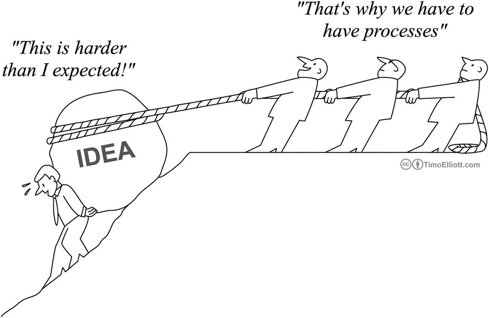
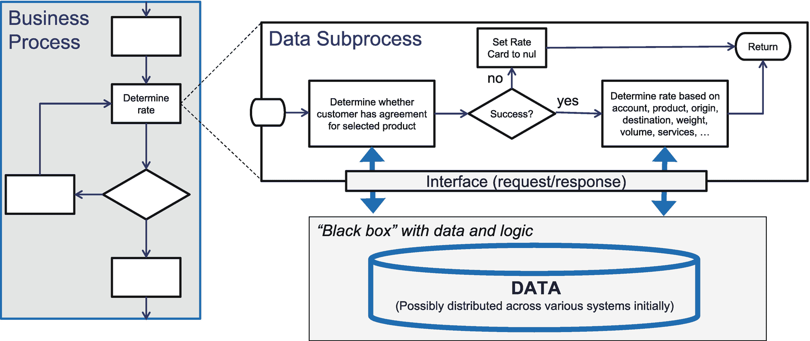

# 8. 数据流程

图 8-1 – 流程至关重要

## 为什么要规定流程？

无论人们是否喜欢，你都需要规定他们应该如何对待数据。否则，你将无法保证所有任务都得到处理，或者所有必要的活动都能正确执行。

描述流程很复杂——因为你不会希望“下一步”是未定义的或含糊不清的。然而，这绝对是一项很快就能见到回报的工作。

考虑到流程的数量及其复杂性，不应期望数据办公室以外的任何人记住所有数据流程。但他们应该知道该问谁或去哪里查找。关于组织概念，请参见第 11 章。

开发数据流程的一个好的起点是你的一套数据政策（这也是为什么建议尽早开始制定这些政策的另一个原因）。

每个流程都需要服务于一个目的，即具体化一项政策，并专注于交付具体的、所需的结果。

## 流程开发要点

### 所有权

流程关乎所有权：每一步都需要一个负责人。为了使组织独立于单一个人，负责人应该是职能而非个人。但你总是需要能够确定职责背后的具体人名。

### 现有数据流程

不要重新发明轮子：如果已有运作良好的流程，就将其纳入。这样可以提高它们的接受度。

### 协作

不要闭门开发流程。从目标开始，并就这些目标达成共识。这会增加人们反对那些达成目标的流程的难度。

## 一般性考虑

### 技术债务处理

紧张的业务时间线可能要求接受临时解决方案。然而，这种接受必须是暂时的。由此产生的“技术债务”需要记录在案，以确保最终获得解决。（参见“项目数据审核流程”部分中的让步处理。）

### 冲突管理

缺乏带宽、资金、专家、时间等因素可能导致相互冲突的需求。这些冲突需要通过站在整个组织的角度（“什么对股东最有利？”）来解决。第 6 章介绍的“数据审核与决策流程”，包括其下设机构数据执行委员会和数据管理委员会，将提供必要的跨职能协调机制。

即使模型设计得再好，你也会面临挑战，但你需要主动管理这些挑战。这就是为什么这样一个主流程应该包含一个通用的升级流程（另请参见第 2 章中的“决策与升级流程”）。挑战包括（但不限于）实体间的对齐、法律议题、`InfoSec`约束以及预算和资源限制。

### 易用性

关键关注点应是“避免官僚主义”。遵循此流程必须具有吸引力和诱惑力。否则，人们会直接忽略它，或者选择非正式的方式来处理数据。这就是为什么，例如，应该为用户提供一个“帮助他们避免遗漏”的模板，而不是看起来像额外工作的东西。并且，请不要要求用户在首次提交时就提供所有细节——反正你还是需要与请求者沟通的。

### 流程触发器

每个数据流程都需要一个或多个明确定义的“流程触发器”。其目的是：

-   明确在哪些情况下数据流程会被激活
-   确保在必要时能从其他流程中激活数据流程
-   告知人们流程如何被触发，以及谁有权触发

一个流程触发器总是伴随着对前置条件和所需提供信息的描述。判断一个流程触发器是否有效且完整必须简单明了。该描述需要从用户的角度出发：我们需要让每个人都能轻松地找到正确的类别以应用正确的流程。

以下是典型流程触发器的列表：

#### 项目批准或资金申请

项目需要符合数据要求才能获得批准，无论是作为初始批准还是项目最终交付物的批准。如果你的组织设有`ARB`（架构评审委员会），其批准也应成为该流程的一部分。

#### 问题报告

如果有人报告某事物存在问题，需要触发正确的流程。此机制不仅适用于业务用户或 IT 专家。它还包括数据办公室内部数据质量评估的任何发现。

#### 变更请求

变更请求的典型例子涉及数据结构、术语、应用程序、数据处理流程、数据源或数据流。

#### 技术债务到期

每个暂时批准的技术债务都附带一个到期日期。在该日期到来时，如果技术债务尚未结清，则必须触发一个数据流程以便对该债务采取行动。建议还设置一个预警触发器，以便及时通知即将到期的债务，从而采取纠正措施。

#### 澄清请求

现有政策或指南可能含糊不清。必须有一个正式的流程供用户请求澄清。此流程可以非常精简，因为它通常不需要对主题本身进行任何更改。

#### 升级

升级常常带有负面的含义。但如果运用得当，升级仅仅是通过将决策权提升到更高层级来帮助解决冲突。重要的是要认识到，在大多数情况下，分歧与个人恩怨或缺乏理解无关。相反，不同的人基于其各自的角色有不同的优先事项。在更高层级解决冲突意味着采取更广阔的视角：我们组织的所有者会如何决策？为了使升级不掺杂情绪，一个描述清晰的升级流程大有裨益。

### 数据审核关口

需要经过数据审核关口的活动标准：

1.  **对数据结构或逻辑的潜在更改**
    例如：不同部门之间的数据字段映射；“客户”属性的结构变更

2.  **引入数据处理方式（流程、角色）的变更**
    例如：作为引入新的 MDM 解决方案一部分的`主数据`管理

3.  **对数据生命周期（来源、流动、修改、消费）的潜在更改**
    例如：将`主数据`复制到云平台（`Oracle`、`Salesforce`）

4.  **疑似违反数据标准或数据原则的情况**
    例如：重复的参考数据维护，从不可靠来源获取数据

这组标准应能通过始终只要求提供特定类别或入口点所需的信息，来保持流程的精简。

## 具体流程组

### 数据请求流程

数据请求流程描述了某人如何获取数据或数据访问权限以便处理数据。这涵盖了从支持运营流程到数据科学的所有使用类型，无论是请求单条记录还是一组事务，是一次性请求还是永久数据访问。这并非不必要的官僚程序，因为业务职能对数据未经协调地使用是导致数据误解的首要原因。

来自所有职能领域的数据请求需要以高度透明的方式进行协调和统一，且响应时间要短。你肯定不希望项目因等待数据而延误……

如有必要，需要对请求进行优先级排序。因此，该流程应基于投入和收益来定义标准。

为了让数据办公室能够协调此项活动，需要与所有业务部门建立正式的互动，以确定其具体的数据需求。

这些需求包括：

-   请求的提供方式（访问权限、格式等；一次性与重复性；全量与增量）
-   时间线与紧急程度
-   数据内容
-   依赖关系
-   所需质量

评估这些需求将引出一系列与数据相关的活动、职责和里程碑。

如果发现直接获取数据是最佳方法，则可能会做出此决定——但必须透明公开，并管理所有相关风险。

所有数据请求者都应首先与数据办公室沟通。他们需要分享其业务目标以及计划的业务流程。

作为回应，数据办公室需要分享现有的目标、指南和治理规则。然后，各工作流应进行差距分析。

某些可交付成果（解决方案、数据）可能已经存在。需要以数据请求者能够自行查阅的方式使其可见——这将有助于聚焦于真正的差距所在。

**不要过度交付！** 有时数据请求者并不需要高质量的数据。在这种情况下，数据提供者不应坚持提供更高质量的数据。

同时，数据办公室也承担着咨询角色。数据请求者可能低估了接受低质量数据的长期影响或副作用。任何此类请求都需要在推进前与数据专家进行沟通，以便进行权衡。

一个恰当的设置能让您对每一个数据或数据相关服务的请求做出适当的响应：

-   数据已经可用？直接使用即可。
-   数据能在规定时间内由某个数据提供团队提供？去做吧！
-   由于技术原因，数据活动无法并行处理？确定优先级。
-   数据提供需要更多资金或资源？准备一份资金申请。

它还能让您区分以下情况：

-   短期、与项目相关、精度需求低的数据（例如，支持规划）
-   长期、最终、与项目无关的数据获取（塑造长期组织架构）

您需要能够提升数据质量：

-   数据建模和数据映射需要在所有职能活动中一致地应用。
-   所有数据源需要达成一致（单一事实来源）。
-   短期差距需要被揭示，并在长期规划中予以覆盖。

### 项目数据评审流程

大多数项目都需要并使用数据，您需要确保他们以正确的方式使用。这就是为什么您需要在整个项目中定义数据控制点，从项目准备阶段就开始，以便及早发现不合规情况，并让请求者有机会重新提交提案，最好是在数据办公室的支持下进行。

只要项目对数据有影响，所有数据方面都需要在批准前通过项目数据评审流程进行审查。这需要成为一个强制性流程，是所有项目获得批准和/或资金支持的前提条件。

该流程描述了此项强制评审的标准、评审步骤、评估领域以及负责方。输出成果是一份数据评审文档，外加一份摘要，该摘要将成为任何项目批准或资金申请的强制性组成部分。摘要列出了所有潜在的偏差、可能的选项以及最终判断。

典型的评审领域包括：CDM 合规性、单一事实来源，以及正确释义和术语。该流程还会确定项目旨在改变当前 CDM 或术语的领域，以确保变更请求得到恰当提交（参见本章后面的“数据逻辑变更流程”）。

主题专家需要从数据角度评判各项计划——面向高管的 PowerPoint 演示并不能保证架构的合规性。

为了提高效率，所有这些都可以成为综合架构评审的一部分，一次性覆盖所有架构方面。这也是任何组织成立架构评审委员会的另一个好理由，该委员会成员来自 IT 架构团队和数据办公室。

如果架构评审委员会不同意项目方法，则需将案例提交给数据管理委员会，并附上不同的选项以及支持或反对它们的所有已知论据。

## 项目数据评审流程

项目数据评审流程可能是最常处理“数据特许”的流程：并非所有解决方案都能现实地一次性实现数据合规。只要有充分理由暂时偏离，可能会获得有条件的批准，同时附带有时限的数据特许。

您需要一个专门的流程来处理获得特许的步骤以及现有特许的管理，包括在特许即将到期或已经到期时的跟进。在到期之前，解决方案必须合规，或者（仅在存在充分理由的情况下）需要延长特许期限，并且该解决方案仍保留在待监控的特许清单中。

此流程不仅限于瀑布式项目，敏捷项目需要略微不同的方法，因为你无法为每个冲刺进行全面评审。相反，所有可预见的架构问题应在早期阶段得到覆盖，只有在该计划执行过程中出现新发现时，才会触发另一次评审。

### 项目何时需要进行数据评审？

并非所有项目都需要进行数据评审。作为一般规则，在以下情况下需要进行评审：

-   涉及处理数据（检索、创建、修改、删除）的流程。
-   将要构建或更改处理数据（检索、创建、修改、删除）的软件。
-   业务逻辑的变更导致数据逻辑的变更。

**示例：**

-   当数据源被添加到数据仓库，或者数据仓库中的数据被用于运营目的时
-   当引入新软件用于在本地（或云端，如果是基于云的话）维护数据时
-   当某个应用程序需要一个设施代码列表时
-   当某个应用程序将主数据或事务数据发送给另一个应用程序时
-   当数据为了在不同法律实体或地理实体之间进行交换而进行映射时
-   当需要在数据录入时或数据传输后进行数据验证时
-   当来自不同实体（例如，被收购的组织）的数据被合并到单个数据库时
-   当数据打算被复制以提供给另一个应用程序或用户组时
-   当数据隐私（可能）受到影响时
-   当数据质量是一个关键因素时

### 数据管理并非首要联系人的情况

以下情况听起来可能像是数据相关的话题，但应由其他职能部门牵头：

-   物理数据连接（局域网/广域网）：需与 IT 基础设施团队核实。
-   信息安全：这属于信息安全团队的议题。
-   数据中心运营。
-   数据传输协议。
-   为应对数据量增长而增加的额外硬盘空间。
-   数据加密算法的实施。

### 典型的项目数据评审

某个团队提出一种新方案，其中主数据的某些部分将通过电子表格维护并通过电子邮件分发，或者将引入未跨职能部门统一的术语。

-   这种问题将在项目数据评审过程中暴露出来，并与项目团队讨论替代方案。
-   项目最终决定采用的任何方案，都将通过一份数据评审文件进行评估，该文件首先由您的数据管理委员会审查。

还将提供一份摘要，该摘要将成为项目批准/资金申请的必要组成部分。

## 支持流程

数据团队需要此类流程来为各职能部门提供支持，尤其是在项目前期阶段（在仍有可能时指明正确方向）。

在项目审批过程中才发现不合规的数据处理方式为时已晚。数据专家需要尽早参与项目启动范围界定阶段。这包括数据管理部门的`数据架构师`和`业务专家`。

这些专家将帮助定义合规的方法。他们将协助创建不同的选项以及可能的分阶段方法。他们将定期在数据管理团队内部审查当前的思路状态。

## 数据内容变更流程

对数据内容的变更通常影响有限，因此可以采用精简的流程。风险在于数据处理不合规的情况，例如参考数据被硬编码到应用程序中，导致参考数据存储库的变更无法更新应用程序。

大多数数据变更已经基于运营流程，而这些流程通常由执行业务的职能部门定义。这些流程需要相互配合，有些流程可以根据其他流程的经验进行改进。这是一项长期活动，而进行适当的盘点则是重要的第一步。

最终，对主数据的变更应当成为一个配置问题。大多数组织尚未达到这种成熟度。这就是为什么此类变更通常需要跨各个业务职能部门进行影响评估。此类评估需要成为任何现有功能数据变更流程的一部分。

## 数据质量管理流程

需要监控数据质量，并解决与质量目标的偏差。

根据质量问题的影响程度，您需要采取不同的应对措施：

1.  **接受**
    措施：不采取行动，因为影响太小（这就是量化任何报告问题影响的重要性所在）。

2.  **缓解**
    措施：应用变通方案（例如，人工处理），或实施自动化预处理软件——直到集成完毕，或通过更改映射逻辑（可能会反过来接受其他影响）。

3.  **解决**
    措施：更改软件（甚至可能是将在两年内退役的遗留软件），或更改流程，或更改业务规则（或上述各项的组合）。

## 数据逻辑变更流程

针对数据结构、数据规则、数据流程或数据术语表的变更，您需要不同的流程。

为避免不协调的数据活动，所有与数据相关的变更请求都需要遵循此流程。最关键的请求是因业务逻辑变更而引起的数据模型变更。

该流程确保对预期变更进行明确描述，并评估其对所有其他职能部门的影响。它将建议一个增强的项目范围，其中发现需要增加必要的活动以避免不良影响。

跨职能的审批流程和让步处理（如前所述）需要成为此流程的一部分。

## 数据术语表流程

您可以想象，仅有一个术语表和一位负责人是不够的。

此外，您还需要制定一个流程，明确在遇到问题、提案或需要澄清时，应与谁沟通。

您还需要定义负责审查任何此类输入的各方，以及最终做出决定或回复的步骤。

## 数据访问请求流程

对数据平台的数据访问需要在用户对灵活性的需求与平台提供商对充分且审慎使用的需求之间取得平衡。

此类流程应旨在将用户数量减少到必要的最低限度，同时为那些具备必要资质和业务需求的少数用户提供足够的平台使用灵活性。

标准：

-   用户是否具备相关技能？
-   是否有业务上的正当理由？

## 在业务流程中管理数据

数据话题不仅需要通过专门的数据流程来处理。此外，任何现有业务流程中都包含数据组件。

您的数据治理职能应出于以下两个原因对业务流程中的这些部分进行治理：

-   您可能希望确保始终根据您的数据原则、标准和规则来处理数据，即使在涉及数据专家的部门日常工作中也是如此。
-   不同的业务流程可能共享相同的数据需求。它们应使用相同的数据子流程以确保一致性。这样，应用程序开发将能够使各种业务应用程序使用相同的 `API` 或 `Web` 服务，从而避免在 IT 方面也出现重复。

但是，如何从业务流程过渡到数据呢？

如果您的组织拥有完善的流程管理职能，那么您的情况就很幸运。一个组织的流程记录得越好，就越容易确定与数据相关的子流程。

如果情况并非如此，您可以利用数据层面来推动流程的规范化文档化。根据应用程序工作流对流程进行重组通常是一个可行的选择。如果您的数据办公室在此过程中支持业务团队，那么确定数据子流程就可以成为一个可喜的附带效应。

您可以通过分析业务流程每个步骤的数据流来确定数据子流程：

-   数据输入在哪里被预期？
-   数据在哪里被查找？
-   数据在哪里被验证（通常包括查找要对照验证的数据）？
-   数据在哪里被修改、合并、删除等等？

将所有的发现和结果记录在业务流程文档以及数据办公室文档中非常重要。您还需要添加对所使用的任何 `Web` 服务或 `API` 的交叉引用。

图 8-2 中显示了一个（简化的）数据子流程示例。

图 8-2 一个数据子流程

另一个动机是，这种方法将技术性数据处理与流程解耦。业务流程所有者无需关心数据子流程的内部细节。只需说明需要*什么*即可，至于*如何*实现可以留给数据专家处理。
