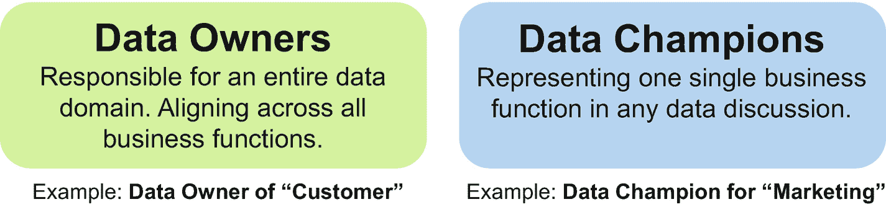

# 9. 角色与职责

图 9-1

您是否总是清楚谁负责什么？

## 角色与职责简介

为什么我们要在考察角色和职责*之前*先讨论流程？

答案很简单：每个角色、每项职责都需要服务于某个目的。任何未在任何流程中出现的角色都是不必要的。

理想的做法是，先从流程中推导出职责。一旦所有职责明确，你就可以塑造与之关联的角色。在此过程中，你需要考虑哪些职责应由不同的角色承担，以及哪些职责应归属于同一个角色。请以职责分离和双人复核原则作为指导。

职责的一个良好起点是我们在第 8 章中讨论过的数据相关流程列表。

基于我们在此处确定的任务，我们已能区分出承担内容职责的职能团队、承担维护职责的职能团队以及集中式数据角色。

在 IT 方面，我们可以识别出技术架构师和应用架构师。其他 IT 人员，如数据库设计师和软件开发人员，也可能在处理数据方面发挥重要作用。不过，我个人建议将内部 IT 组织交由 CIO 管理，并基于可交付成果与 IT 部门开展协作。

### 数据所有者与数据倡导者

数据管理需要业务部门的参与。你可以通过两种方式让业务人员为数据管理做出贡献并施加影响：代表*组织的某个部门*（例如销售部）或代表*某个数据域*（例如客户或产品）。

区分这两种角色至关重要，因为数据域通常是跨职能的。

到目前为止，这两种角色都还没有一个公认的通用术语。我决定采用常用的“数据所有者”和“数据倡导者”这两个术语，如图 9-2 所示。

图 9-2 数据所有者 vs. 数据倡导者

请随意用符合贵组织习惯和文化的头衔来替换这两个术语。

#### 数据所有者

数据所有者是业务团队的成员，他们从内容角度承担组织数据领域中特定区域的责任，通常是公司数据模型（`CDM`）的一个子集。数据所有者的职责绝不能重叠。`CDM` 的每一部分都必须明确无误地分配给唯一一位数据所有者。请不要允许存在市场营销客户数据所有者和财务客户数据所有者并存的情况。客户数据所有者必须与所有相关方协调一致。

#### 数据倡导者

数据倡导者可以被视为组织特定部分的数据拥护者。

我们可以区分出职能性数据倡导者（例如，财务数据倡导者）、组织性数据倡导者（例如，子公司数据倡导者）和地域性数据倡导者（例如，东南亚数据倡导者）。在此你可以看到，职责确实可能重叠，但视角不同。

此类数据倡导者起初并不需要具备跨职能的视角。你可以要求每个业务领域的负责人任命一位其信任的数据倡导者，因为该数据倡导者将在整个组织的所有数据讨论中代表该业务领域。

数据倡导者的典型职责：

*   成为面向网络的单一联络点，即处理总部及所有实体提出的跨职能数据议题。

*   成为所在代表实体或职能部门内部任何人提出的任何数据相关问题、咨询或建议的单一联络点。分享和解释总部的数据信息。确保组织的数据原则在其自身实体内部得到解释和理解。（如果你拥有职责范围重叠的数据倡导者，则应提前确定，例如，是以区域结构还是职能结构为主要结构。）

*   本地数据网络：了解本地的数据管理员，以便他们能够相互联系。让他们理解自己的工作如何影响其他职能部门数据管理员的工作。

*   确保将本地专业知识带入全球讨论，例如，关于本地地址处理习惯的知识、最佳的外部数据来源，或影响数据处理的本土法规。

*   确保本地项目明确考虑数据方面，并从数据角度为其提供支持。与中央数据办公室协作，制定一致的方法。

*   全面了解本地控制措施，以确保日常的数据质量。

*   观察本地活动，留意数据相关问题。根据数据发现，开展本地举措和根本原因分析，理想情况下采用`六西格玛`方法。

*   整合本地在数据方面的需求：对工具的需求（例如，分析可视化）、数据源、特定国家的数据结构（例如，针对所需的交易许可证）、本地数据源的验证（例如，在法规变更时）。

*   通过网络确定最佳实践（以及效果**不佳**的方法），为自身开展或支持的本地项目做准备。

*   当不同职能部门的人员对如何在本地处理数据持有不同看法时，促进相关讨论。

### 数据创建者与数据消费者

数据创建者和数据消费者是两个重要的利益相关群体，但他们扮演着完全不同的角色。请克制将他们混为一谈的冲动。

这些角色通常不是全职工作。它们描述了业务部门人员在履行其职能职责之外所承担的一系列责任。

**数据创建者**在其日常业务职能中持续维护数据。他们负责数据的内容和质量，但不负责数据的结构。

**数据管家**是组织中数据创建者的一个子群体。他们经验丰富，通常与数据办公室和数据所有者保持长期沟通。在其职能范围内，他们积极关注数据质量问题以及进一步提升数据质量的机会。他们参与数据指标的制定（参见第 10 章），并能从数据角度为流程和应用开发提供基于经验的意见。

**数据消费者**是来自所有业务领域和各类职业的人员，他们的共同特点是工作主要依赖数据。他们依赖良好的数据质量，但通常无法立即对其施加影响。

他们亲身体验过使用低质量数据意味着什么。因此，在管理数据质量方面，他们的声音至关重要。

数据消费者中最大的群体是分析与数据科学团队。但还有更多消费者存在于运营流程、财务、客户服务、绩效和监管报告等领域，仅举几例。

你已经可以看到，数据创建者和数据消费者并非互斥的群体。负责丰富数据的角色通常同时属于这两个群体。担任这类职位的人通常是那些最容易说服，让他们认识到需要关注数据质量的人。

同样的道理也适用于数据供应链末端的人员，尤其是财务和分析部门。无论数据供应链中哪个环节出错，都不可避免地会影响到他们。

但是，当这些人理解良好数据质量的必要性时，他们往往倾向于认为自己需要亲自处理数据质量——在使用数据之前先进行修复。这种行为在缺乏主动数据管理传统的组织中尤为常见。

对于这些人来说，关键是要首先理解仅仅为了单一目的而修复数据并非可持续的方法。应鼓励他们*报告*任何观察到的数据问题，这样组织才能找到根本原因，并在问题发生之处予以解决。

但你同时还需展示数据办公室有能力且有意愿沿着数据供应链管理数据质量。只有当数据消费者看到了成效，他们才会把这项工作放心地交给数据办公室。

一个积极管理的数据消费者社群是传递信息的合适途径，也是一个极佳的反馈渠道。

## 其他业务角色

### 业务所有权角色

业务应用所有者和业务流程所有者同样是关键角色。如果执行得当，他们会采取跨职能的视角。

但请不要将这些角色与你的数据所有者角色混淆。它们同等重要，但却是独立、分开的角色。

成熟的组织会协调所有这些角色之间的跨职能对话，通常由首席转型官（若业务模式充满活力）或全球业务服务主管（若业务模式已视为成熟）牵头。数据办公室应参与此类对话。不过，首席数据官不必主导。

在缺乏此类系统性对话的组织中，你可能希望主动出击。你可以以一种方式组织与数据相关的角色，使得组织期望在所有跨职能议题上看到类似的架构。

换句话说，总要有人迈出第一步——为什么不能是你呢？

## 缺乏所有权

在找不到所有者的情况下，请运用“高管所有权”原则：告知负责的高管，他或她是最终所有者。高管通常没有时间，因此会讨厌这个主意。好处是所有权可以向下委托。高管会乐于利用这个选项。

有时你甚至找不到一个自然而然地拥有某软件所有权的职能。对于已存在多年的遗留解决方案，这种情况经常发生。IT 部门可能一直在维护它们，但从未有人主张业务所有权，也没人知道谁在使用该应用程序。但突然你可能需要解决该应用程序中的数据不合规问题。

一个可行但诚然大胆的方法：由数据办公室主张业务所有权。公开宣布停用。找出谁最担忧。那个人就可以成为所有者，以防止不受控制地停用。如果无人响应，则广泛沟通每一步，执行你的停用计划。并准备好回滚计划！

## 集中化角色

遵循辅助性原则（参见第 2 章），某些角色需要集中化，以确保行为一致并避免双重并行工作。

你的数据治理团队应检查任何数据相关流程中的各项活动，判断其是否需要集中管理。

根据组织的结构，成为中央组织一部分的角色集合会有所不同。

虽然你会与业务和 IT 的其他职能部门共同确定一份合适的中央角色清单，但应考虑到这些职能部门通常存在偏见：大多数职能领域倾向于将所有繁重工作集中化，同时乐于接受下放的决策权。

这就是为什么理想情况下，你应在开始对话之前就在数据办公室内部准备好初步的组织架构。这样，当有人提出变更建议时，你可以要求其给出充分的理由。

本章为你提供了一系列集中职责的清单，并细分为可能的团队。这份清单并非详尽无遗或规定性的，而应有助于确定一个良好的初始细节水平。

请记住，数据办公室中合适的团队或团队成员数量取决于组织的规模、数据办公室的预算以及员工队伍的数据素养水平（请回顾第 2 章中有效数据管理的第十个方面）。

以下结构旨在具备可扩展性，即可变数量的职责可以构成一个角色，且单个团队可以涵盖所描述的一个或多个领域。

### 数据治理

以下是数据治理职能的典型职责清单：

- 定义、维护并记录`数据维护`流程。

- 定义、维护并记录变更数据`结构`的流程（换言之，治理企业数据模型，而数据架构负责其内容）。

# 数据治理核心职责

- 管理`外部数据`来源和标准（包括与外部数据供应商的协议）。
- 制定`培训`并执行`沟通`。
- 记录并发布`数据政策与标准`。
- 描述`数据规则`与`逻辑`（依据数据架构的意见）。
- 管理一个单一的、跨职能的业务术语`词汇表`。

## 数据质量

很少有哪个数据领域能像数据质量这样，需要像理解数据和人员行为那样，具备深厚的业务知识。以下列出的一个`DQ`职能的职责清单并不声称完整：

- 定义并分类可靠的指标（`数据质量指标` – 参见第 10 章）和`报告`。
- 管理和衡量`数据质量`；使用度量标准和启发式方法。
- 验证现有和拟议的关键绩效指标。
- 与`业务职能和 IT 部门`合作，建立主数据和交易数据的单一视图。
- 为数据质量建立并发布`仪表盘`。
- 确定关键问题并进行`根本原因分析`（`六西格玛` – 参见第 11 章）。

## 数据解决方案与项目

数据管理不应局限于扮演数据的规则制定者、警察和服务台角色。必须有人将数据从其象牙塔中解放出来。

换句话说，关于数据的专业知识和认知需要转化为日常流程和应用。

你可能需要承担数据解决方案与项目领域的以下职责：

- 担任所有与数据相关、具有跨职能关联性的主要软件（主要是数据库、数据维护工具和网络服务）的业务负责人。
- 管理解决方案和实施的`路线图`（需基于业务优先级、技术能力以及自身的成本/收益分析 – 参见第 16 章）。
- 跨职能协调针对数据解决方案的`变更请求`，并从业务角度领导实施项目。
- 执行或组织`可用性分析`。
- 协调由数据倡导者、数据管家、分析团队和主题专家组成的全球`网络`。
- 在数据相关事务上，主动支持并指导`迁移`和`转型`项目。部署由数据办公室拥有的数据应用程序，并从数据处理角度支持其他应用程序的部署（例如，在特定国家的主数据配置领域）。
- 管理与数据相关的不合规情况（“数据债务”）。
- 组织`跨职能`协作。

## 主数据管理

虽然主数据的`维护`通常在各业务职能内部进行，但你需要协调所有这些活动。

以下是一些典型的核心主数据职责：

- 确保`主数据`、`参考数据`和`元数据`得到妥善维护。
- 协调重大主数据变更的`影响分析`。
- 监控主数据的正确`使用`。
- 记录主数据全貌。
- 担任`MDM`工具的业务负责人或产品负责人。

## 数据架构

数据架构不能在单一业务职能内部完成，也不应由纯技术 IT 架构师负责。

原因在于，就像建筑物一样，你需要一个单一的、总体的架构来反映你的组织。内容输入必须来自各个业务职能，但所有这些都需要被整合成一个单一的企业数据模型。

在数据标准领域，数据架构与数据治理之间没有客观的界限。一些组织区分组织标准和功能标准：组织标准由数据治理负责，而功能标准则由数据架构负责。

虽然没有绝对的对错，但我个人建议将所有标准的职责交由数据治理负责，而功能专业知识则来自数据架构。这种设置可以避免对边界案例职责归属的不确定性，同时仍能充分利用数据架构的专业知识。

按照这种设置，一个核心数据架构团队的典型任务包括：

- 基于业务流程和能力维护业务`数据模型`。
- 对数据模型执行`差距分析`。
- 支持数据治理制定和执行`功能数据标准`。
- 与其他架构学科保持一致。
- `评估`业务变更对数据结构的影响。

## 数据隐私与合规

这些话题比数据办公室的概念更为古老。这就是为什么大多数组织已经有负责人了。而且，坦白地说，你未必需要争夺这里的负责人身份。最终，从组织的角度来看，关键目标是确保有合适的负责人到位。如果情况已经如此，那就没有问题需要解决，所以不必强求。

相反，你需要确保数据办公室在此被认可为利益相关者。在许多组织中，法务部门对合规的含义有深刻的理解——但他们可能无法将其转化为日常工作中可行的实践指南。

这正是数据办公室可以提供支持的地方，包括提供具体的示例和检查清单。

注意：如果没有其他部门承担职责，或者董事会希望数据办公室负责，那就接受吧！数据办公室并非承担数据隐私职责的最差选择。但在这种情况下，应该是由你主动向其他部门寻求建议，例如在法律事务方面。

以下是数据办公室在数据隐私方面典型的职责清单：

- 与法务部门和信息安全部门合作处理`合规`和`数据隐私`事宜。
- 支持业务职能正确应用数据隐私法规。
- 确保数据隐私政策和流程目标明确、尽可能清晰无歧义，并得到理解。

## 数据科学

在大多数组织中，集中化所有数据科学活动可能没有意义——你可能会失去数据科学家与其所服务的业务职能之间必要的紧密联系。

然而，建立一个规模虽小但实力强大的核心数据科学团队作为数据办公室的一部分是非常有价值的。理想情况下，你应打造一个数据科学“卓越中心”，作为组织数据科学家社区的科学枢纽——这是职能数据科学家通常没有机会做到的事情。

这样一个卓越中心的典型职责是：

- 评估并在所有业务职能间`共享`数据科学家的`知识`。
- 在数据科学领域代表你的组织面向`外部世界`（这并不意味着阻碍其他数据科学家的外部联系！）。
- 运行跨职能的`数据科学`活动（相关性、因果关系、概率、预测）。
- 与 IT 部门合作构建目标`分析`格局。
- 探索更新的数据概念，如区块链或物联网（并在可能的情况下邀请职能团队参与）。

## 数据分析与商业智能

同样，大量的数据分析和商业智能（`BI`）工作应在业务职能内部完成，尤其是随着诸如 `BI` 自助服务等概念的发展，即使是半专业人士也能更容易地将数据转化为信息。

然而，一个卓越中心在此也能增加价值，作为协调职能，并通过帮助业务职能准确使用数据、工具和算法来发挥作用。与这些业务职能建立友好关系、避免被视为竞争对手至关重要。

以下是一个分析与 `BI` 卓越中心中你可以看到的职责清单：

- 从技术角度支持职能`分析与 BI 团队`。
- 在数据分析与 `BI` 领域代表你的组织面向`外部世界`。
- 与数据科学和 IT 部门合作构建我们的目标`分析`和`数据可视化`格局。
- 与业务职能一起运行跨职能的`预测分析`项目。
- 支持业务`报告`。
- 研究`大数据`概念：在处理和利用外部及内部海量数据方面，有什么新动向？
