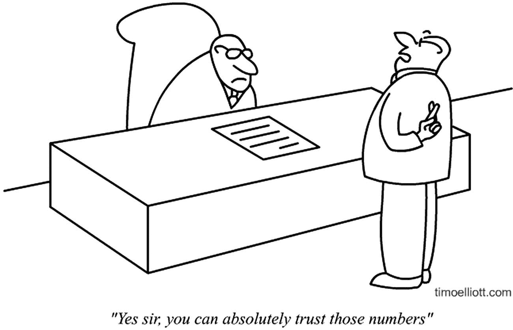
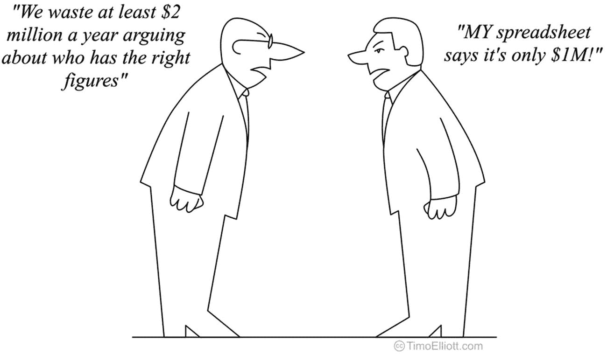

# 10. 数据质量



图 10-1

数据质量？只能祈祷好运……

## 为什么数据质量很重要？

“数据质量”*听上去*很重要。几乎没有人会质疑数据质量的重要性。正因如此，它有可能变成另一个空洞的口号。如果你期望“高数据质量”，会显得非常专业。

是的，数据质量确实重要。数据质量如此重要，以至于我要用一个专用缩写。对我来说，它就是`DQ`，而`DQ`应该被列为你优先事项清单的首位。

遗憾的是，有些人认为，只要没有异常情况发生，良好的数据质量就是常态。良好的数据质量并非常态。绝非如此。换句话说，除非一个组织主动且积极地致力于数据质量工作，否则你可以假定该组织的数据质量是糟糕的。

**示例 1**

一家跨国企业认识到需要清理某些国家分支机构中的地址数据。该公司决定指派总部的一个庞大团队负责清理工作。这个团队失败了。最终，这些数据在语法上正确了，但既不能用于创建客户 360 度视图，甚至也不适合用于将客户分配到销售区域。

结果发现问题是多方面的：

*   多年来客户数据采集不完整，导致缺少那些无法从其他数据推导出来的属性。
*   此外，部分国家分支机构被允许将一些数据字段滥用于特定国家的用途，导致这些内容在整个企业背景下毫无用处。^(²⁹)
*   最后，清理客户数据需要大量关于每个国家提供地址的习惯以及公司结构的本地知识。总部团队并不具备这些知识。

## 危险的数据质量立场

在那些没有专门关注数据质量的组织中，我发现了一些不同的模式，在此进行描述。请根据这些模式检查你自己的组织。提高认识能让你据此调整你的`DQ`策略。

### 假设你的数据质量良好

为什么组织常常专注于分析，而不是覆盖整个数据供应链？通常，这是因为决策者想当然地认为他们的数据状况良好（“管理良好的组织拥有好数据！”）。这与一种普遍存在且潜意识里的假设相吻合，即他们所有的数据都是好的，因为到目前为止还没有人抱怨。

有时候，组织的领导者甚至从未考虑过`DQ`。我非常理解他们！想想看：你上次有意识地想到自己的耳朵是什么时候？挺久以前了吧？嗯，这很正常！人们只有在耳朵疼或听力下降时才会想到它们。我们在`DQ`周围观察到的现象也是如此。它并非高管日常思维过程的一部分。

这意味着我们面对的不是一个智力问题，而是一个*认知*问题。我建议你首先解决这个问题，然后才提出任何改进数据质量的技术或组织措施。如果没有高层的支持，就很难推进`DQ`工作（更不用说为这类工作争取资金了）。

### 假设你的数据质量足够好

你可能时不时听到过这样的说法：

> *它可能不完美，但到目前为止已经足够好了。我们遵循 80/20 法则，不要小题大做！*

但是，如何判断 20% 的努力是否真的带来了 80% 的质量水平呢？即使如此：80% 真的足够吗？

### 假设你无法衡量数据质量

宿命论者说：

> *你只能根据其他数据来衡量 DQ——而这些数据本身也可能是错的。所以你根本无从知晓！*

是的，`DQ`并不简单。它需要复杂的规划和依赖关系的确定。但衡量数据是可能的——至少在一定程度上是可行的。大多数情况下，合理性检查是有效的。只要你意识到其局限性，任何衡量都比完全不衡量要好。

### 假设糟糕的数据质量是“数据办公室”的任务

谁应该负责修复糟糕的数据？是数据办公室的数据专家吗？数据质量不足通常**不是**数据本身的问题，而是一个业务问题。在这种情况下，数据专家可以帮助描述问题及其影响。他们甚至可能支持修复数据，但他们不应该独自修复数据，原因有三：

1.  **修复数据所需的内容知识应该由业务负责人掌握。**
2.  **应该迫使业务人员承担起所有权——他们的数据是其业务的核心部分。**
3.  **如果不解决根本原因，数据质量将很快再次恶化。**

谢天谢地，业务职能部门有多种方法可以改进其数据质量。他们可以使用`六西格玛`来确定根本原因，这样他们就不仅仅是治标，而是可以采用经过验证的`六西格玛`方法论来解决这些根本原因。我鼓励你与所有业务职能部门分享`六西格玛`方法。如果`六西格玛`已经是贵组织工具箱的一部分，那么请支持这些团队将其应用于数据。有关如何在数据管理背景下使用`六西格玛`的详细信息，请参见第 11 章。

### 假设每个人都想要好的数据质量

老实说：组织中的某些人会从糟糕的数据质量中获益。如果没有积极的`DQ`管理和适当的激励措施，他们就找不到任何理由为良好的`DQ`做出贡献。例如，想想那些典型的业绩不佳者，他们不希望自己的表现通过数据变得可见。但也有一些日常问题，员工能从糟糕的数据中获益。

**示例 2**

想象一位负责客户数据录入的员工，他使用的系统会根据元数据验证某些数据字段的格式。由于录入速度快会得到奖励，这位员工在每小时录入的客户记录数量与录入数据的准确性之间面临冲突：你不能在单个记录上花费太多时间才能达到小时目标。但有时数据丢失或不一致，查找信息会花费大量时间，例如，查阅客户网站来确定增值税号。作为一种快速解决方案，这位员工决定在这种情况下输入语法上有效的虚拟数据。结果：绩效目标达成——客户数据错误！这对这个人有好处——对组织却有坏处。

### 只在陷入困境时才处理数据质量

只要`DQ`没有给你带来明显的痛苦，就很容易忽视它。我们之前将这确定为八种典型行为模式之一——请参见第 1 章。一个被动应对`DQ`的组织无法避免其影响。它只能推迟影响的发生。如果不在早期阶段处理，某些信息可能会永久丢失。在这种情况下，事后根本不可能恢复良好的数据质量。

如果一个没有主动`DQ`管理的组织想要基于数据做出决策，它可能会面临以下问题：



图 10-2

你有可靠、一致的数据吗？

*   数据不完整或根本无法获取，因为没有计划准备数据以供决策。
*   数据具有歧义性。人们可以根据个人或部门目标对其进行不同的解读。
*   收集和修正所有数据需要很长时间。结果，决策被延迟。

### 仅面向分析用途的数据质量管理

在一次大型会议上，一位专家强调了数据质量的重要性。他的要求是：“确保你们数据湖中的数据得到良好维护。”一个干净的数据湖固然不错。但等到数据入库了才开始关注数据质量，已经太晚了！

遗憾的是，获得可靠分析结果的必要性，往往是驱动数据质量的唯一因素。这也是那些认为数据管理就等同于数据分析的组织的弱点之一。如果它们有数据质量团队，那也是隶属于分析部门的。这种由分析驱动的数据质量，通常无法触及问题的根本原因。相反，它试图在数据湖中（甚至更晚的阶段）修复数据。这种视角使得数据质量变得被动：你只有在发现问题后，才试图去修复它。

这种方法还伴随着更多缺点：

-   它制造了一种虚假的数据质量安全感：只要分析部门不抱怨，数据质量问题似乎就不存在。
-   你通常无法从数据湖中的数据判断其质量是否良好——尤其是当它在语法上是正确的时候。
-   数据湖中的质量问题不仅可能被忽视——后续分析结果的错误同样可能逃过注意。
-   如果“那些分析人员在使用数据之前会修复它”，人们就可能不会在日常工作中注重避免数据质量问题。
-   在任何组织中，数据并非仅在旅程的终点才被使用。在最终进入数据湖之前，它要经历多个阶段。许多数据也用于运营目的，例如生成发票或指导生产流程。这些活动同样需要高质量的数据。那些从运营数据存储库中获取数据的非分析型数据用户，无法从数据湖中的数据修复中获得任何好处。
-   面向分析的数据质量管理会导致用于运营目的（未清洗）的数据与用于分析目的（已清洗）的数据之间产生不一致。
-   后期才修复的数据可能早已造成损害，或导致错误的讯息被传递。

**示例 3**

客户在网站上输入的数据，可能会在在线预订过程中用来做进一步的决策。这意味着数据甚至在传输到后端之前就已经被使用了。如果数据在之后才被修复（例如通过地址验证流程），这对预订过程毫无帮助。

### 在问题首次出现时才进行数据质量管理

即使数据质量是分析领域之外的话题，人们也常常是在问题变得可见时才去修复数据。但事情可能早在更早的阶段就已出错。这类组织通常面临以下问题：

-   数据的某些方面一旦丢失，就可能再也无法恢复。例如，你无法从一次在线购买的剩余细节中推断出客户的满意度评分。
-   如果你在数据处理中途修复数据，最终可能会导致修复“前”与“后”的数据不一致。使用未修复数据的流程将无法与使用修复数据的流程匹配。
-   导致不良数据的流程本身没有得到处理。修复不良数据变成了一项重复发生的、回溯性的工作。

数据质量需要包含预防数据丢失和及时进行恢复活动。如果发现数据导入或数据录入不充分，软件仍可以做出反应，并要求在短时间内填补这一缺口。

### 因为更好的数据质量无法实现或难以实现，而接受低质量数据

很多时候，尤其是数据科学家，会为了某个项目需要特定类型的数据。他们可能在网上搜索，最终在某个地方找到一个 CSV 文件，或者从网站上抓取一个表格。

# 如何处理数据质量？

这本身并非无效的方法，即使通常可以从其他地方获得相同但质量更高的数据。然而，在大多数情况下，数据科学家至少可以充分了解任何此类数据存储库的数据质量水平。

我说的不是对给定文件进行无上下文的评估。

相反，数据科学家还应该关注数据来源：数据有多可靠？有多陈旧？有多大偏差？

这甚至已经发展成为一门独立的学科，通常被称为探索性人工智能。

发现偏差是评估数据质量的重要任务之一。这主要不是为了确定恶意的数据伪造。公共机构系统性地共享被操纵的数据文件的情况，肯定属于例外。但偏差早在有人在你看到文件之前就过滤掉所谓的“异常值”，而你却不知晓过滤标准时就已经开始了。

这是一个需要主动数据质量管理的例子：每位数据科学家可以通过跨多个来源进行搜索来降低风险。但这是额外的工作，而成功应用机器学习算法本不需要这样做。

这就是为什么必须鼓励和奖励数据科学家去付出必要的额外努力。

## 未沟通数据质量水平

有时数据并不完美——但这并不一定使其毫无用处。低质量的数据当然会限制结果的意义，但在许多情况下，有结果总比没有结果更有价值。

然而，为了不过度解读结果，你需要将数据质量水平与结果一同提供。

基于最坏情况设定阈值通常是一个好方法。一个典型且有效的表述可能是：

*根据我们的模型，该关键绩效指标的预期值为 80%。但我们有理由假设数据质量较差：(在此处添加原因)。由此产生的置信区间高达 15 个百分点，因此我们可以假设真实值以 0.95 的概率介于 65% 和 95% 之间。*

## 数据质量必须是最高管理层关注的议题

数据质量影响所有其他类型的质量，并且它影响董事会获得的所有信息。

因此，董事会应该对其组织的数据质量感兴趣。他们可以通过（公正、中立的）数据办公室提供的精选聚合指标体系来了解情况。

## 数据质量需要正确的激励

在管理数据质量时，需要平衡“胡萝卜”和“大棒”。仅仅惩罚劣质数据的提供者，你无法实现数据质量。

本质上，需要给人们充分的理由来提供高质量数据，尤其是在他们本身不是其所提供数据的消费者的情况下。

一种平衡的方法介于惩罚性体系（会让人们试图掩盖低质量）和僵化的奖励体系（存在奖励错误行为的风险）之间。

鼓励数据质量的两种方法是透明度和支持：

1.  **透明度**

    通过让优秀的工作成果变得可见，更容易实现可持续的数据质量。

    最终，数据质量指标的定期沟通可以触发一种“最佳数据质量”的竞赛。这才是你希望人们拥有的思维方式。

2.  **支持**

    数据质量的另一个重要能力是提供建议。

    说“你的数据质量很低”并不能培养正确的数据质量思维。说“这里有一些想法可以帮助你今后达到数据质量目标”则有助于提高对“某人的数据质量不足”这一信息的接受度。

## 让合适的角色主动站出来

不要单枪匹马地为高质量数据奋斗。记住，并非数据办公室的日常工作需要高质量数据。

相反，你或许应该确定哪些业务职能需要高质量数据，或者至少能从中受益。让**它们**去要求更好的数据！

你可能需要首先解释不良数据的影响——许多业务职能部门可能并未意识到这一点。然后，给它们发言权——作为它们的倡导者。

## 聚焦相关数据

数据可能正确但毫无用处。因此，核查数据的相关性也是恰当数据质量管理的一部分。

数据的相关性往往更多取决于目的，而非数据本身。

有时，你可能会想运行回归分析，来找出某些属性与结果之间可能的因果关系——但常识已经告诉你，其中一些属性根本不存在这种关系。如果你仍然这么做，模型可能会因为检测到相关性而错误地推断出因果关系。

如果你从一开始就将这类数据属性排除在分析之外，就能降低误报的风险。从这个意义上说，探索性数据分析（`EDA`；另见第 20 章）是分析领域数据质量的一个关键方面。

## 保持并获取清洁数据

虽然恰当的数据管理侧重于**保持**数据清洁，但数据**清洗**专家始终是必需的。旧的数据桶总会不断出现，需要清理。即便是清洁的数据也会随时间老化，时常需要再次清洗。

尤其是当你看到数据来自外部来源或特定地理区域时，就需要特定的数据知识才能进行高效清洗。

这也是一个很好的理由，说明为何不应将数据清洗局限于一个中央团队，无论这些专家多么聪明。

**示例 4**

去重工作需要的远不止字符串比较。这就是为什么避免重复和去重不仅仅是数据库操作。它们还需要业务知识。

与其问“记录是否相同，或者足够接近以至于可以假定为相同？”，你或许更应问“这些记录是否指向同一事物？”

如果答案是“是”，那么它们就是重复记录，无论它们看起来多么不同。

举一个具体案例，比较英国这五条地点记录：

1. `W1K 7TN`

2. `86-90 Park Ln, Mayfair, London`

3. `Hotel JW Marriott, Grosvenor House, London`

4. `51°30'36.1"N 0°09'15.8"W`

5. `///ahead.foster.waddle`^((30))

这五条记录中的每一条都毫不含糊地标识了英国伦敦的同一个地点。事实上，它们都指向同一个地方。这意味着它们是重复记录。你需要一些背景信息才能发现这一点，并将它们合并为一条记录。

并且，你或许希望保留每条记录中的详细信息，以便最终记录包含更丰富的信息。这样做有什么好处呢？你可以更轻松地检查新记录是否与这种丰富后的记录一致，并且当用户输入任意不同属性的前几个字符时，你可以提供这条记录，从而支持智能数据录入。

但是请注意，你需要结合数据模型来指明哪些标识符本身是唯一的，哪些只有与其他标识符组合起来才是唯一的：在前面的例子中，英国邮政编码对于该地点是排他性的，而地理坐标可能同样适用于摩天大楼的每一层（这就使得有必要添加一个垂直的 Z 坐标来确保唯一性），而且伦敦有两座不同的建筑都叫“格罗夫纳之家”。

那么，如何利用人类知识和计算机知识来实施恰当的数据清洗呢？

1.  **利用数据和算法。**

    谢天谢地，大量知识已被融入算法中。专业的地址管理解决方案会指出，前面例子中的所有记录都指向同一个地点。

    这就是为什么在第一步骤中，应该利用现成的计算机知识（通常是能够保证数据和算法自动维护的外部 API）。

2.  **利用人类专家。**

    但在第二步，你需要人工验证，适用于所有对算法结果信心不足的情况。

    例如，你可以请某个国家的同事来帮助验证和清洗来自该国的客户数据。这些同事可能比高技能的中央团队人员更了解该国的地址结构或法律问题。

3.  **尽早验证。**

    如果你正在导入外部数据，或者将来自收购组织的合并到你的数据存储库中，这个清洗步骤应该在流程早期进行。事后才请当地专家清理可能为时已晚——在早期技术验证步骤中，你可能已经永久丢失了所谓的重复数据。经验法则是“在转换前清洗”。

    因此，不要采用传统的

    ```
    [提取]➔[转换]➔[加载]➔[验证]
    ```

    你可以将流程增强为

    ```
    [提取]➔[验证]➔[清洗]➔[转换]➔[加载]➔[验证]
    ```

## 人人有责

越来越多的数据科学家在寻求高质量数据。但定期清理数据湖就足够了吗？

不，还不够。如前所述，你需要在整个数据供应链中管理数据。应用数据质量的最佳时机是在数据入口处。这可以防止不良数据进入系统。

如果组织将数据质量融入每个处理数据的角色和流程中，就能实现更持久的数据质量。此外，总体工作量也会下降，因为保持数据清洁比事后清理更容易。

## 数据质量需要被衡量

你如何判断你的数据质量是好的？你如何确定随着时间的推移是否有所改进？

方法是引入度量标准和启发式规则，并将其在整个组织内制度化地持续应用。

第二步，你需要定义什么是“足够好”，以及什么样的数据质量水平对应什么样的业务影响。

这有助于你“对照某些标准”来衡量数据质量，以确定是否需要采取行动。

我们将在本章后面详细讨论这部分内容。

## 数据质量需要付诸行动

仅仅发现数据质量糟糕是不够的。必须对此采取行动。

幸运的是，大多数人都会同意这一点。

不幸的是，人们倾向于直接寻求解决方案来修复问题。

**示例 5**

想象一个组织，其销售线索数据库存在重复记录问题。

如果你发现了这个问题，可以快速建立一个去重流程，可能基于外部数据来修复公司名称的拼写错误。

但再深入思考一下，你可能会想了解**为什么**在销售线索中会发现如此多的重复记录。

我曾遇到过这样一个案例。我要求团队进行根本原因分析以确定原因。我们很快意识到，该组织的销售部门设立了一个激励方案，以鼓励销售团队生成销售线索。

现在想象一下，一位销售人员发现了一个潜在客户，并将其录入系统。一条消息弹出，显示“销售线索已注册”。

这位销售人员会倾向于做什么？是的，他或她可能会考虑稍微改变一下拼写，例如，将“组织 ABC”改为“组织 A.B.C”。

结果是什么？基于错误信息的奖金发放，数据库中拼写略有差异的重复记录，误导性的关键绩效指标（如销售线索转化率）计算，甚至可能导致同一个潜在客户被两个不同的销售计划独立地重复联系两次。

这里需要解决的根本问题，主要不是从数据库中清除重复记录（=治标），而是改变行为，可能通过修改激励方案来实现。

换句话说，你需要处理的是**根本原因**。

## 业务指标管理

# 有意义的业务质量指标需要主动管理数据质量。为什么？

人们普遍认为关键绩效指标（`KPIs`）对于指导业务至关重要。但人们往往忘记`KPIs`是基于数据的。低质量的数据会导致无用（甚至具有误导性）的质量指标。

这意味着在管理业务之前，我们需要先管理好数据，以便知道如何指导业务。

数据管理的一个关键方面是定义`数据质量指标`（`DQIs`）。这些`DQIs`需要告诉你我们的数据质量有多好。

在此背景下，我们还需要衡量数据`处理`过程的质量，而不仅仅是最终数据的质量，这一点非常重要。

但如何有效使用`DQIs`呢？以下是一些思考。

## 衡量团队绩效

你可以定制你的`DQIs`来衡量特定角色或团队的绩效。

正如许多组织对`KPIs`所做的那样，你可以按照组织层级结构定义`DQIs`的层次结构。某一层级上的多个`DQIs`被整合为更上一级的一个`DQI`——这个`DQI`再与其它同样被整合的`DQIs`一起，形成再上一级的组合`DQI`。

这种方法有三个优点：

-   每个组织层级都有数量可控的`DQIs`需要关注——从团队主管（例如销售、财务或客服部门）开始，直至董事会层面，例如`CFO`可能要对名为“财务数据质量”的`DQI`负责。
-   这种层级结构允许在某个整合`DQI`显示问题时深入探究。
-   对`DQ`的责任划分清晰明确，毫无歧义。

## 衡量数据一致性

一致性检查不应等待问题出现后才进行。它们应作为一项计划性活动——系统且定期地执行。

你可能还想在应用系统架构发生任何重大变更之前立即运行这些检查。新的算法可能不如其前一个版本那样容错，因此之前未被检测到的数据不一致可能会导致改进后的算法失效。

## 考虑启发式方法

从一个国家的有效邮政编码列表中移除一个邮政编码是允许的——那个村庄可能已被废弃。但如果这种合法操作针对该国一半的邮政编码进行，那就应该拉响警报了。

换句话说，重复执行一个合法操作可能不再具备合法性。但这可能也并非完全无效。算法往往没有足够的信息来做出判断。

这正是启发式方法发挥作用的地方。算法不是完全自主地判定并处理不良数据案例，而是搜索可疑案例并将其报告给人工处理。

这种方法旨在将需要人工审查的案例数量减少到可控范围。这也是为什么这类算法宁可报告大量误报，也不愿错误地接受一个真实错误的原因。

然后，由人工来决定报告的案例是否确实是错误，是误报，还是需要进一步评估才能确定。

此外，此类结果还可用于微调算法，可能借助`AI`的支持。

## 识别不良行为

意外地鼓励不良行为很容易发生，通常是通过通用激励措施的设计或`DQIs`本身造成的。

因此，你应该密切关注所有`DQIs`的设计和使用情况：它们是否会鼓励或奖励不良行为？它们是否仍然反映业务目标？衡量逻辑是否仍然有效？是否需要添加新的`DQIs`？

作为一项常规的预防措施，你可以预见性地安排定期的`DQI`审查，并邀请一个明确的跨职能利益相关者小组参与。数据办公室绝不应孤立地定义`DQIs`。

## 分解质量衡量

只要有可能，就将你的质量衡量分解到不同的群体中！

这可以让你找出表现最佳的群体，并了解他们采取了哪些不同的做法——前提是群体规模足够大，能够得出具有统计意义的结论。

有时，我们并不清楚哪种质量水平算是“好”或“足够好”。但你始终可以判断趋势：`DQI`是否会随着时间推移而改善？某些行动对特定`DQIs`有何影响？

以下是我认为数据质量指标应涵盖的方面列表：

1.  经典的数据输入错误——通过用户界面或批量上传
2.  数据传播和使用问题
3.  数据完整性问题
4.  数据结构问题（因正确数据存储在不正确的数据模型下导致的错误，例如，主键冲突可能导致记录被拒，而实际上问题出在数据库表的键定义错误）
5.  数据重复
6.  数据完整性（即使所有记录都正确，不完整也可能导致错误的比例）
7.  数据老化问题（曾经正确但未能恰当反映不断变化的现实的记录）
8.  变更持续时间（数据变更不应耗时过长，否则数据会过时或存在完整性风险）
9.  已修复问题或错误的百分比
10. 更新的及时性
11. 趋势：`DQIs`随时间如何变化？
12. 合理性检查：语法上有效但“可疑”的情况

分解质量衡量对于让董事会级别关注`DQIs`也至关重要。

我们都知道，几乎没有董事会成员愿意花时间审查一个充满`KPIs`的电子表格。高管们希望通过例外管理，找出关键领域并集中精力解决它们。

与大多数其他指标一样，因此建议创建`DQIs`的层级结构。这个层级结构需要与组织的组织结构相匹配，以便每个`DQI`都有一个明确的责任人，即承担具体角色的个人：

-   任何层级上的任何角色所有者都负责若干相关的`DQIs`。
-   这些`DQIs`通常被整合为一个汇总的`DQI`，代表该角色所有者的数据质量水平。`DQIs`的选择和权重由角色所有者提出，并报请其直属上级批准。
-   只要此类`DQI`显示为绿色（即至少达到预先商定的阈值），其他人就不会要求该角色所有者进一步深究。
-   然而，该责任人会管理下一层级所有更细粒度的`DQIs`，以便在其中一个指标影响其被考核的`DQI`之前采取预防措施。
-   在奖金与管理者个人绩效挂钩的组织中，此类`DQI`可以成为计算依据的一部分。

### 质量管理需覆盖数据

您的组织是否已通过质量管理认证？例如，获得了`ISO 29000`系列标准认证？很可能已经认证了！

但是，数据质量管理是否已成为该质量管理体系及认证的明确组成部分？组织内部的质量审计是否涵盖了数据质量？

大多数组织尚未迈出这关键一步。但您应把握这一独特契机，主动与组织的质量管理团队展开对话。

他们可能会惊讶地发现来自意料之外的盟友，因而很乐意联手合作。并且他们应当理解：服务质量、产品质量与合规质量，是如何与底层数据质量紧密相连的。

若您们共同致力于将组织范围的质量管理扩展到覆盖数据，则应借此机会建立一个真正的跨职能架构。

如果您成功将`DQ`评估纳入现有的质量与合规审计中，您将在多个方面受益：

-   借助质量管理组织现有的权威性。
-   复用已有的组织架构和方法。
-   将业务质量与数据质量一同审视——反映两者间密切的因果关系。
-   无需让繁忙的数据专家耗费时间在数据质量审计上。
-   非正式地说：您避免了成为"坏人"。虽然您制定了`DQ`规则，但由他人协助您执行——而这并不总是与结交朋友同步的。