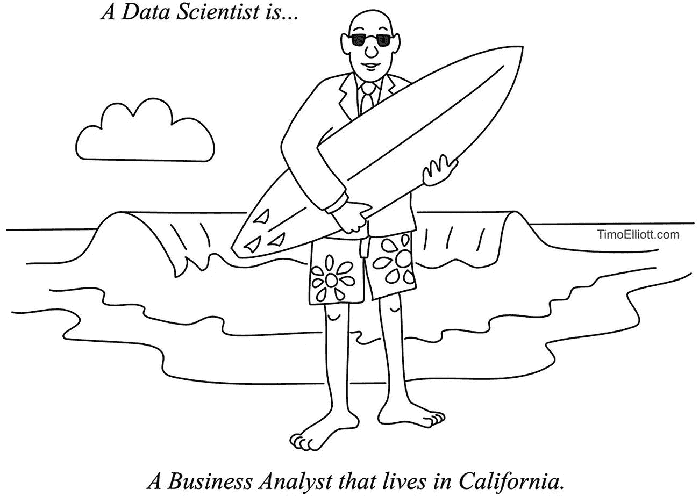
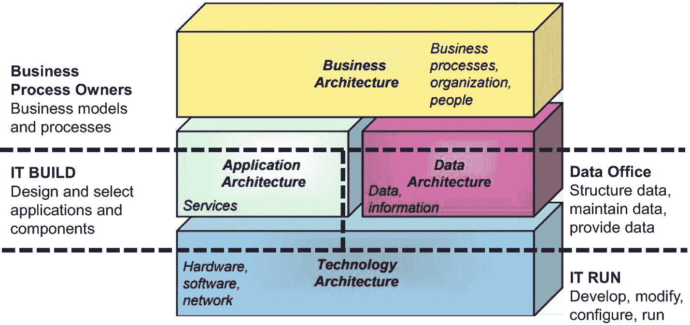

# 11. 塑造数据办公室团队

`图 11-1` 什么是数据科学家？

## 高效创建数据团队

要确保高效，您需要精心设计并组建您的数据办公室团队。

您的团队需要明确覆盖所有相关数据主题，其角色需对外部世界易于理解，并且团队之间需能高效协作。

不存在唯一最佳的组织结构。也请不要期待我会提出一个通用的组织架构图。相反，我建议提供几组在任何数据办公室组织中都应存在的职责。

## 数据架构与词汇表

### “数据语言”团队

如前所述，数据词汇表、规则、标准及数据模型这些主题紧密相连。这四个领域之间需要大量互动。

因此，即使在较大的组织中，也将它们置于同一部门下是合理的。这样一个部门将负责数据管理的“逻辑”方面。

根据您组织的规模，您可以将该部门分解为子团队。典型的架构包括专门的词汇表管理团队、数据标准团队和数据架构团队。

### 词汇表管理

谁应该负责管理组织的词汇表？我建议您挑选整个数据办公室团队中最不“书呆子气”的成员。

此人需具备卓越的人际交往和沟通能力，因为需要与所有业务职能保持持续对话。此外，还应是一位语言专业人士，对语言的细微差别有良好感知。

掌握多种语言是加分项。其主要目的可能不是创建多语言词汇表，而是能够理解同一事物有多种表达方式。归根结底，数据是“另一种语言”。

### 如何组织数据架构？

企业数据模型（`CDM`）的责任应归属于专门的数据架构团队。

一些组织在其 IT 部门内设有架构团队。他们通常认为架构的所有方面都应由 IT 负责。

出于充分的理由，这并非专家中的主流观点。

让我们看看一个领先的架构模型——`TOGAF`。³¹ 它将架构分为四类：

*   业务架构

*   数据架构

*   解决方案架构

*   技术架构

顾名思义，业务架构自然是业务部门的职责。应用架构和技术架构是经典的 IT 职责。

数据架构是连接两个世界的桥梁，这正是数据办公室在组织中应如何定位自己的方式。

关于数据架构的边界以及解决方案架构的起点，可能存在一些讨论，尤其是在数据库和接口领域。如有疑问，组织可应用以下标准：任何与逻辑相关的内容归属数据办公室侧，而技术方面则归属 IT 侧。

根据组织数据环境的复杂程度，将数据架构拆分为逻辑领域（业务数据架构）和技术领域（技术数据架构）可能是合理的。

隶属`CDO`的逻辑团队负责数据架构的业务方面。它定义诸如以下的不同主题：

*   数据的结构（特别是企业数据模型）

*   数据科学家在数据模型方面拥有何种程度的自由度

*   必须向谁提供哪些数据，以及预处理的深度

*   作为特定`API`的一部分，应提供哪些参数

相应地，技术数据架构将定义`API`的类型、技术数据模型以及数据库内由此产生的表结构。

`图 11-2` 简要概述了架构的各个学科及其在组织中的位置。注意，在`DevOps`情况下，与 IT 运维相关的问题通常由应用架构处理。

`图 11-2` `TOGAF`模型

尽管可能分属组织的不同部分，但所有架构团队应共同致力于构建统一的企业架构视图。

这种方法创建了一个单一的虚拟团队，同时团队成员向组织的不同部分汇报，从而减少偏见和筒仓思维。

这种联合工作模式应由一个包含所有架构学科代表的委员会来支持。这样的架构审查委员会必须有权共同做出决策，或向更高层的决策流程提交架构声明。

### 如何让数据架构更具吸引力？

`数据架构师`在组织中扮演着充满挑战的角色。

他们往往被视为"坏蛋"，主要工作就是告诉业务部门和项目团队什么不该做。因此，这些人通常不会自愿参与其中。

不幸的是，优秀的`数据架构`就像出色的安全保障——其好处通常是无形的。只有糟糕或缺失的数据架构才会产生可见的负面影响。

#### 类比

为什么`数据架构师`在项目团队中往往不如其他架构师受欢迎？

项目团队通常这样看待架构：

`技术架构师`铺设道路，`解决方案架构师`制造汽车，`业务架构师`教人驾驶——而`数据架构师`则告诉他们哪里是红灯、限速多少……

遗憾的是，`数据架构师`通常精通自己的专业领域，但就像许多其他领域的专家一样，他们往往不擅长自我营销。

我记得在一次数据架构会议上，数十位经验丰富的`数据架构师`抱怨说，`解决方案架构师`会被邀请参与项目，而`数据架构师`却不会。一项快速调查显示，其结果是项目团队中`解决方案架构师`与`数据架构师`的平均比例超过 20:1。

毫无疑问：你必须帮助你的`数据架构师`。你需要提升他们的价值。仅仅强制要求他们参与是不够的。

不要指望随着时间的推移人们会理解这种需求。他们不会。也就是说，他们不会将任何成功归功于`数据架构`。

事实上，除了`数据治理`之外，`数据架构`是组织中最需要推广和解释的领域，以获得必要且应得的认可。

#### 你能做什么？

- 举出实际案例——来自过去或其他组织的。

- 描述场景：如果不让`数据架构师`参与，会发生什么？

- 运用类比（延续前面的类比：遵守交通中的红灯和限速实际上对健康有益）。

- 强调`数据架构师`工作中的支持性方面——毕竟，他们帮助项目找到可行的数据方案，并帮助避免可能延误项目的错误。

- 利用你作为`首席数据官`的权威。如果你说`数据架构师`至关重要，那肯定没错。

- 教导你的`数据架构师`学会自我推销（有时外部培训能创造奇迹）。

#### 分析

为数据利用而建立的组织架构复杂到足以写一本专著，而最佳架构在很大程度上取决于具体情境，例如组织本身、其历史、组织架构以及可用人才的数量。

不过，一些考量可能有助于塑造这样的组织，首先要问：一个单一的`分析`团队对整个组织来说是否真的是最佳选择。

#### 跨部门分析

如何让`分析`"一体化"运行？

如果把`分析`交给`IT`部门，最终你会得到一辆一流的赛车却没有驾驶员：所有技术都在，但几乎没人能将其应用到实际问题上。

然而，如果将`分析`交给业务部门，你可能会看到各种职能孤岛的形成，尤其是在大型组织中。我从未见过在这样的组织中能成功形成自组织的跨职能`分析`方法。

相反，你可以预期每个`分析`孤岛会独立发展。它们会有熟悉各自业务领域的专家，从而能够提出正确的问题。

另一方面，技术解决方案可能只能是次等水平，因为职能`分析`部门大多缺乏足够规模来模仿组织的全部`IT`智能。

此外，许多业务主题会被并行多次处理，因为这些`分析`孤岛之间可能互不通气。在那些规模太大而无法由一个中央管理团队管理的组织中，这种情况经常出现。它们要么将管理层划分为职能组，要么划分为地理组。

`联邦制`通常被视为组织上的必要选择。众所周知，定期让几十位管理者围坐一桌是没意义的：你很快会看到一小群人在讨论某个具体业务职能或国家组织特有的议题，而其他人则会感到无聊。

然而，`分析`领域的联邦制方法也伴随着风险。其弊端清单从重复工作到数据解释不一致，不一而足。

你可以通过早期设计一个中央`数据分析`实体作为`数据办公室`的一部分来避免这些弊端，从而为所有这些领域创建共同基础。

可以想象，这样的设计需要权威，因为它要求各职能孤岛放弃部分自主权。

这就是为什么值得为你的组织`管理委员会`编写一个相关的故事。你可以描述当前的架构、它所助长的行为，以及包括财务影响在内的后果。然后提出一个能够应对这种局面、使组织"面向未来"的治理结构。

此类提案的典型方面包括：

- `IT`部门的角色——作为拥有技术垄断权的实体，并有义务将各业务职能的`分析`团队视为其客户

- 所有孤岛之间共同数据标准的必要性，包括它们在`数据办公室`中的职责

- 数据知识管理的中央协调，包括培训、经验分享、跨孤岛联合专家组和项目

- 全组织范围内、由业务驱动的`数据分析`优先级

- 将所有孤岛在各级管理层面上联系起来的协作机构

### 数据科学

在大型组织中，你会发现两种截然不同的数据科学架构。一种是集中式方法，由一批高度专业的数据科学家组成，通常聚集在总部的某一栋楼或某一层（并且通常向`IT`部门汇报）；另一种是联邦式方法，即数据科学家遍布于各个业务职能部门。

显然，这两种方法各有优缺点。

-   `集中式`方法有利于数据科学家之间紧密协作，交流最新的工具或算法。但他们常常生活在象牙塔中，脱离了本应支持的`业务`。

-   另一方面，`联邦式`方法让数据科学家接触真实的业务，包括那些让业务人员夜不能寐的问题。但他们彼此分离，提问、交流想法或分享解决方案的机会有限。

因此，我通常建议采用`混合方法`：一种联邦式架构，数据科学家向“他们的”业务职能部门汇报，同时建立一个强大的数据科学网络。

虽然大部分日常工作在各个业务职能部门内进行，但这种模式需要为数据科学家设定专门的时间段进行线下聚会，形式从非正式聊天到跨职能的黑客马拉松。

这样的网络必须足够强大，以确保数据源、算法和逻辑等数据科学宝藏在整个组织内具有可见性和透明度，从而避免单个数据科学家制造“黑箱”。毕竟，不同的数据科学团队可能会因其职能经理的影响而产生职能偏见，并且被驱使为自己的业务职能部门服务。

为了支持联邦式网络中的集中化方面，你甚至可以考虑引入矩阵式组织，即整个组织中所有数据科学家都虚线汇报给`CDO`下属的`数据科学主管`。

此外，除了“本地”团队外，建立一个规模虽小但功能强大的中央数据科学团队可能也是个好主意。这一举措有助于打造中央专业能力，从而能够创建“卓越中心”。此外，它让数据办公室可以直接获取数据科学能力，而无需请求某个业务职能部门“帮忙”。这样的团队可以独立于现有本地团队的任何由职能决定的优先事项，处理跨职能的数据科学工作。

### 数据报告管理

管理者喜欢报告——尤其是带有彩色图表和大字体的报告（这很合理）。但他们真的*需要*它们到什么程度？如何确定一份报告的商业价值？

如果报告管理是集中治理的，那么这一领域可以变得更高效。

这里，“治理”并不意味着完全由中央执行。但是，一个集中的报告和标准库有助于避免重复以及不正确或不一致的逻辑。与其他中央数据管理职能（例如`数据建模`或`主数据管理`）的紧密合作有助于提高报告质量。

集中报告治理的另一个目标是成本意识。当报告由`IT`部门应业务用户请求提供时，或者现有的报告团队创建它们时，这些报告给人的感觉就是“免费的”。但它们并非如此。

一个中央报告团队应该关注什么？以下是我的清单：

1.  **成本管理报告**

    一份报告的典型价格标签会涵盖创建成本、维护成本和复杂性成本（后者随报告总数量的增加呈指数级增长）。

    即使无法进行交叉收费，完全透明地了解这些成本也会激励报告消费者淘汰或共享报告。

2.  **运行报告**

    并非所有业务职能部门都想建立自己的报告团队。有些部门规模太小，或者过于专注于其核心业务目标而无暇顾及。

    这为“自愿”的集中式报告提供了机会。你可以让各部门自行选择是独立完成还是请求中央团队支持。一旦头两个部门请求集中报告服务，协同效应就会显现。

    中期来看，一个中央报告团队将能够提供标准化报告，与通常由职能或区域报告团队开发的定制报告相比，这些报告对报告请求者来说应该更便宜。

3.  **开发并治理自助服务**

    组织会受益于一个允许自助式报告的环境，这能为业务分析师提供所需的灵活性。然而，自助式报告也需要积极治理，以避免不同业务职能部门创建的报告之间出现不一致。

    你应该确保所有相关管理者都能访问，包括他们的移动设备。并请与`IT`部门合作来实现这一点。这是一项实实在在的成果，管理者可能会因此非常欣赏你。

4.  **促进协作与交流想法**

    在分散式报告中，重复发明轮子的情况屡见不鲜。无论是报告背后的逻辑、数据的特定视图，还是某些可视化工具的使用——为什么不分享想法和经验呢？一个中央团队可以促进这一点，从而在组织内部塑造一个“报告社区”。是由你的数据消费者社区来涵盖这一方面，还是专门塑造一个报告社区，通常取决于你组织的规模。如果社区太小太多，它们将难以达到活跃社区生活所需的临界规模。

最后，提醒一句：集中式职能往往会变得官僚化。这通常伴随着可用性下降和响应速度变慢，而这比什么都更影响用户接受度。

因此，监测此类趋势是`CDO`的一项关键任务，无论是通过与中央报告团队定期评审，还是通过定期的用户调查。

## 文档管理

### 集中式方法能够创造价值

大多数组织（不仅仅是大型组织）在文档管理方面都面临着一个两难困境。

每当某个部门从纸质文档转向数字化时，他们通常是在引入某个功能软件包的过程中完成的，而文档管理或多或少是该软件包的一个集成组件。在每种情况下，文档管理大多与该软件包所支持的业务流程良好集成——但通常与所有其他业务功能和流程完全分离。

当文档的关联性超出单个部门范围时，这种方法就会成为挑战。这通常发生在端到端流程跨越职能部门边界的情况下。试想一种场景：客户服务部门需要访问客户合同，并且需要将该合同与具体案例（例如客户索赔）关联起来。

这个例子说明，没有简单的解决方案。要么你单独集成每个部门的流程和文档，要么你创建一个组织级的文档管理系统，但它与功能软件不完全集成（如果该部门选择了 SaaS 模式，即其软件由组织外部的第三方运行，情况更是如此）。

这个挑战显然无法由多个业务职能部门独立解决。它需要一个中央业务实体（又名数据办公室）和作为技术解决方案提供者的 IT 部门，与所有业务职能部门紧密合作共同努力。

数字文档还存在其他结构性的挑战，这些挑战绝对可以通过集中式方法最有效地解决，例如：

- **抵触情绪**：人类喜爱纸张握在手中的感觉。

- **跨不同业务领域的文档与数据关联**：文档可供所有相关职能部门使用。没有一张纸需要被成像和存储超过一次。

- **OCR 与自动标记**：大多数文档包含所有相关信息，既有结构化的（如账号），也有非结构化的（如客户投诉信中的关键词）。适当的 OCR 流程有助于自动标记文档。系统性的条形码或二维码编码（例如，对分发给客户的自家表单进行编码）可以降低自动分类的错误率。

- **技术协同效应**：管理一个归档库比管理多个实例更便宜，即使文档数量更多。

### 数据管理中的文档？

让我们将“文档管理”定义为以可打印且可供人类阅读的独立页面形式维护信息的学科。

文档管理是数据办公室的学科吗？

是的，原因有二：

1.  **文档就是数据。**

    文档并非孤立存在。它们包含有待解读的信息。这甚至适用于不包含任何字母数字字符的抽象艺术图纸。

    有时你甚至无法在传统文档和结构化数据之间划清界限。试想那些存储为数据记录加上模板引用（例如以 XML 文件形式）的文档。或者，试想那些从未被打印，而是直接发送到文档存储库的文档，通常以`pdf`文件或图像的形式存在。

2.  **文档并非孤立存在。**

    没有元数据，文档就毫无意义。你需要元数据，例如标识符、属性或标签，来查找文档、组织文档、归档或删除文档（参考 GDPR），或将它们与其他数据关联起来。

### 如何组建文档管理团队？

文档在性质上是多样化的，就像任何其他类型的数据一样。它们从数字收据（数量巨大但结构简单）到复杂的维护合同（数量少、包含文本和图表、多个签名、同一文档的多个版本）不一而足。

文档管理团队有两个主要任务：建立文档管理解决方案和日常管理文档。

1.  **日常管理文档**

    许多围绕文档处理的任务可以实现自动化。然而，也存在局限性。

    虽然现代软件可以帮助提取元数据，但最终决定权往往掌握在人类手中。这不仅仅是因为提取逻辑不成熟。有时，文档中包含的元数据质量很差。

    回想一下你见过的文档，它们带有元数据字段“作者”：这个字段有多少次披露了作者的真实姓名？在大多数情况下，它包含的是多年前创建该文档的人的名字。这可能与手头的文档完全不同，后者是从前者复制并修改而来的；有时它甚至是模板的“作者”，即企业设计部门负责模板的人员。

    你可以想象，在这种情况下，自动从现有元数据中提取字段是没有意义的。负责文档管理的人员应该监控这种情况。也有必要与数据质量部门合作，设定正确的指标和目标。

    此外，在涉及文档量预测和性能需求时，文档管理职能部门需要充当与 IT 部门的接口。由于图像文档的体量巨大，文档存储库通常是整个组织中存储密度最高的数据库。

2.  **建立文档管理解决方案**

    文档管理团队需要理解不同的需求。他们需要能够分析软件解决方案，无论是专用的文档管理系统，还是功能型解决方案中的文档处理组件。

    最终，他们需要决定是采用一个或多个专用文档管理解决方案，还是不同的职能部门应该使用与其功能软件解决方案良好集成的文档组件。

    所有这些都需要对业务有深刻的理解以及良好的应用知识。文档管理者需要回答诸如此类的问题：

    - “一刀切”的方案是否可行，或者我们是否应该为不同类型的文档采用不同的解决方案？是否存在任何协同效应（共享数据键；或利用单一工作流的益处）能够证明采用单一解决方案是合理的？

    - 功能型应用程序能否与中央文档存储库对接，或者中央文档中心是否应该指向各个功能型解决方案中的文档？

    - 在分布式文档存储库的情况下，我们如何组织中央元数据管理？

    - 在分布式文档存储库的情况下，我们如何避免文档重复？如果两个不同的部门（例如，财务部和海关）需要访问同一份实体文档，我们如何确保它只存储一次，但两个部门都能访问，并且两个部门的应用程序都能引用它？

**注意**

在较小的组织中，整个“文档管理团队”可能只有一个人。文档管理甚至可能只是一个人承担的多个角色之一。然而，需要涵盖的主题列表相对独立于你所在组织的规模。

## 数据质量

数据质量有两个组织方面的考量。

一个方面是建立一个承担组织级责任的中央数据质量实体。另一个方面是贯穿整个组织的普遍数据质量责任。

### 中央数据质量团队

中央数据质量团队需要深入了解业务——因为数据质量始终与业务交付成果直接相关。

您不会希望团队里有一群"要么百分百完美要么什么都不是"的学院派人士。在大多数情况下，目标质量水平是成本与收益的函数，因此低于 100%的目标往往才是更优选择。

# 数据质量管理与组织

幸运的是，您无需将昂贵且稀缺的数据科学家调入数据质量团队。具备深厚业务背景的数据分析师完全足以胜任数据质量岗位。

以下是能令您的数据质量团队受益的几项技能：

-   扎实的六西格玛培训（本章后续将讨论）将帮助数据质量团队确定根本原因，并避免通过"治标不治本"的捷径来解决问题。
-   良好的业务理解能力使团队能够确定（并达成共识）合适的数据质量目标。
-   项目管理技能（瀑布式与敏捷式）有助于开展自身的数据质量改进计划，并从数据角度支持业务项目。
-   具备管控思维的人员将帮助您监控、报告和跟进数据质量问题。

中央数据质量团队面临的一个重大风险是，它可能被视为"数据警察"。相反，您希望他们被看作是业务的支持者。因此，他们的关注点不应是确保人们正确对待数据，而是将数据作为一种宝贵资源加以推广。

理想情况下，遵守所有数据标准的压力应来自数据消费者自身，而非直接来自总部职能部门（如数据质量负责人）。实现这一目标的关键在于，除了创建数据驱动型组织外，还要提供行为的*透明度*。

第一步是与所有业务部门协作设定数据质量目标。这样的对话将让您的数据质量团队扮演协调者的角色，因为数据使用者会要求数据创建者确保数据质量达标。作为第二步，如果您广泛公布目标的达成水平，各团队可能会为了不显得落后而尝试改进其数据处理方式。

## 跨组织的数据质量

每个人都对数据质量负有责任——但您几乎无法触及组织中的每一个人，更不用说在日常工作中影响每一个人了。这正是数据管理员的用武之地。在完成常规工作的同时，他们应视自己为数据大使，并将数据质量作为一种思维模式加以推广。

# 管理主数据

主数据的管理可分为设计、协调与维护。

## 主数据维护

维护是数据管理员的职责，其首要技能要求是对数据的职能背景有深刻理解。除非您的组织规模太小，无法在业务部门内设置合格的数据管理员，否则永远不应将此角色集中化。

## 主数据设计

业务部门原则上知道自身需要什么，但他们未必能将需求转化为主数据概念。而且，他们可能主要关注自身的职能需求。因此，您需要一个集中化团队来设计涵盖全组织、跨职能的主数据目标环境，以及实现该环境的路径。所有设计工作，包括选择最佳样式，都应密切配合数据架构部门完成。

您并非总能奢侈地从零开始重新设计主数据环境。在大多数情况下，您必须处理遗留环境、隔离的数据存储库，以及因技术需求而在不同位置维护相同数据等问题。在这种条件下为顺畅运行主数据找到合适的配置，是一项巨大挑战——可能是中央主数据管理团队面临的最大挑战。但您绝不应等待完美环境就绪才开始行动。由于大多数组织中存在海量的技术依赖关系，即使在敏捷组织中，这可能也需要数年时间。

我的务实建议是：组建一个团队，将其 75%的精力用于在现有约束下运行和优化主数据。剩余 25%的精力则用于根据业务需求、技术可能性以及当前运营中的发现来设计目标环境。

## 主数据协调

协调是中央主数据团队的一项关键职责。缺乏协调将导致效率和一致性无法实现，原因如下：

-   每个主数据领域通常由单一职能部门拥有——但数据通常被多个职能部门所需。
-   此外，虽然每个主数据领域的维护责任应仅由一个职能部门承担，但这在许多组织中并非普遍做法。
-   主数据质量的标准化衡量方法以及最低质量水平的确定，必须与主数据的所有业务利益相关方共同商定。
-   每个组织都需要设立单一联系点，供所有人查询主数据的可用性——无论是用于机器操作，还是用于流程自动化（机器人流程自动化，RPA）。
-   不同业务部门需求的协调、平衡与优先级排序，应交由没有既得职能利益的方完成，以避免结果产生偏差。决策建议的制定同样如此。

# 数据项目办公室

## 又一个额外的管理职能？

数据驱动型组织会开展数据项目。与其它数据相关活动一样，这不应在职能、组织或地理上的孤岛中进行。您更希望看到的是全组织的协调、优先级排序与协作。

在一个管理良好的组织中，各方明确承诺遵循单一数据供应链，该供应链由组织所有部门共享。因此，任何部门都无权单方面更改它，正如任何部门都不应被允许构建平行的数据供应链一样。

您几乎找不到一个仅影响单一职能部门的数据项目。大多数数据项目具有跨职能的相关性，正如数据本质上就是跨职能的一样。甚至不同的专项数据项目之间通常也存在紧密的相互依赖关系。因此，组织需要管理对其单一数据供应链的所有变更，以实现一致性，包括一致的概念数据模型（CDM）。此类变更通过项目实现，这就有理由将专门的"数据项目办公室"作为数据办公室的一部分。

## 数据项目办公室的职责

典型的项目办公室活动当然也适用于数据项目办公室。作为一般原则，数据项目办公室会处理那些本会加重各项目负担的行政事务。规划、协调与沟通是另外的常见任务。

但数据项目办公室还会负责以下事项：

-   确保所有人都遵循数据标准与原则，并协助检查合规性。
-   不仅监控活动的执行情况，还要监控后续可预测功能与收益的交付。考虑到量化数据相关收益的困难，这项任务在处理数据项目时常常被忽略。
-   最后，它要支持从可能过时的传统项目文化，向渴望有意识地平衡敏捷性与可持续性的现代项目文化过渡。

## 重点关注领域

与任何其他团队相比，数据项目办公室的设立必须重点关注以下两个方面：

1.  **敏捷性**
    在当今的项目管理文化中，几乎没有人期望所有需求都能在项目启动前就收集完毕。越来越多情况下，项目被期望在开发过程中确定业务需求及其优先级并予以实施，包括立即进行实施和部署。
    虽然敏捷性是任何现代项目管理的基本组成部分，但在处理数据时尤其需要关注：将速度作为首要关注点的敏捷性会危及互操作性并加剧歧义问题。这就是为什么敏捷数据处理需要纪律性——无论是在管理技术变更还是记录技术变更方面。
    您可能需要查阅第 20 章关于 DataOps 的一些思考，这可以成为确保管理良好的敏捷性的有效方法论。

2.  **协作**
    从数据的角度来看，任何工作流都不应孤立地进行。相互依赖性既存在于任何单一的瀑布式项目内部，也存在于敏捷项目的不同阶段或冲刺之间。仔细审视之下，大多数看似独立的项目实际上都存在数据相互依赖性。

## 组织内数据项目办公室的定位

任何数据项目办公室都要负责纯粹的数据项目以及其他项目中的数据相关方面，尤其是在那些没有其他项目管理组织的机构中。

在已有跨职能项目办公室的组织中，数据项目办公室仍有其存在的理由。但在这种情况下，它将更多地扮演支持性角色：它将涵盖通用项目办公室不具备专业知识来处理的所有数据特定项目管理活动。在通用项目办公室和数据项目办公室共存的情况下，就明确划分职责达成一致至关重要。这项工作应在设立阶段就完成，并且应包括紧密合作的承诺。

## 设立数据项目办公室

第 9 章“数据解决方案与项目”一节中描述的所有职责都将归属于这个团队。承担这类职责的合适人选，其数据能力仅仅是次要优势。他们首先需要具备强大的项目管理技能（包括瀑布式和敏捷式），以便能够管理自己的项目，**并**从数据角度支持业务或 IT 项目。

您可能希望在任何项目或 Scrum 团队中都有一位值得信赖的数据代表——不一定是全职资源，但要能接触到所有细节。他们必须能够遵守这些团队的规则，同时以非对抗性的方式强制执行数据需求。

在初步建立阶段，数据项目办公室应专注于其支持者的角色，以赢得认可。随着人们开始理解这个新实体的价值，合规性的强制执行应逐步加强。

# 数据服务职能

为组织提供一个处理数据事务的单一联系点是有益的。您正在为组织服务。因此，为什么不效仿专业的客户服务实体，采用后端加前端的组织结构来响应呢？

像往常一样，不同的角色并不一定意味着不同的人员。根据您组织的规模，整个数据服务职能可能仅由一个人组成。（不过，您可能需要确保存在一个备份人员来处理因假期或病假导致的缺勤。）

整个设置的关键目的是提供可供人们交谈的联系人，以及可供人们阅读的文档。但您还需要后端职能，负责跟进专家、回复请求者，并最终将这两者连接起来。前端职能是首要联系点。它还负责管理任何服务级别协议（SLA）。一个工作流工具可以帮助跟进并避免出现无人处理的请求。在大型组织中，记录工作量并避免因不太重要的请求占用关键资源可能是有意义的。

## 业务服务台

在您的组织中，所有有数据相关问题（或建议、投诉等）的员工都知道该找谁谈吗？他们需要知道吗？

理想情况下，所有类型的数据相关话题都应有一个单一的联络点。数据办公室在处理案例分类方面应该比任何请求者更有优势。这就是为什么为数据话题设立一个业务服务台是有意义的，类似于 IT 组织已经使用了几十年的服务台。（您甚至可以考虑与 IT 部门设立一个联合服务台，使请求者更便捷。）

谁会在这样的服务台工作？没有哪个服务台客服能回答所有内容相关的问题——至少不能在第一次通话中就做到。这就是为什么您需要通才，他们能充分理解所有内容相关的问题，以便能够确定正确的专家。

那么，您将如何在组织内定位您的数据服务台呢？即使您说您的服务台是为“一切数据事务”服务的，有些人也不会理解这包含什么，您可能需要帮助他们理解这类服务台的范围。这就是为什么让业务人员参与服务台的开发是个好主意，包括流程设计以及（理想情况下）支持性工作流解决方案的设计。

在此背景下，主动沟通、提供培训和提供示例是很有益的。任何数据问题都不应因为有人不敢问而未被提出！

# 数据办公室与数据科学家管理

为了让数据办公室获得信誉，数据服务台应该接手报告上来的话题，即使这些话题并非正式地“在范围之内”。

事实上，您不能责怪任何人不知道什么属于“数据”范畴。这是一个灰色地带，虽然有些话题在某些组织中被归为“数据”，但在其他组织中则属于不同的职能部门。典型的例子有“与数据相关的欺诈”或“数据安全”。

有时，在您的组织内，某个新话题一直没有人负责。您可以利用这个机会来明确职责，理想情况下是通过数据治理机构，即数据管理委员会或数据执行委员会。

## 数据组织联络

数据处理伴随着许多非内容相关的方面。它们涵盖了从文档到数据办公内联网站点，包括在线信息的充分提供。

数据办公室日常工作的一个重要方面是跟进数据让步和数据质量问题。谁负责哪个行动？该行动何时到期？

您可以通过将所有此类活动集中到一个专门的实体中来提高效率。这个团队不需要由数据专家组成。

与数据办公室的其他领域一样，最佳规模取决于您组织的规模。较大的组织将从专门的数据相关活动项目办公室中受益，其中包括项目管理资源。在较小的组织中，首席数据官的助理可以作为任何组织数据话题的联系人。介于两者之间的各种规模也是可行的。

## 吸引并留住专家人才

数据专家很难吸引，也很难留住。这一点尤其适用于（但不限于）数据科学家。

造成这种情况的原因有很多。当然，数据科学家是稀缺人才。我指的是真正的数据科学家，而不是那些改头换面的分析师或技艺高超的电子表格魔术师。我想到的是那些具备数学背景、编程技能、创造力、好奇心以及自律精神的人。

但那些为数不多的真正专家呢？让我们看看影响专家决定加入、留下或离开的十个方面。

我将重点聚焦于数据科学家，因为这是最具挑战性的员工群体。不过，大多数方面同样适用于其他数据专家。

### 多样性是有益的——作为一种结果

在过去 20 年里，我团队中有来自四大洲、三十多个不同国籍的人。而且，平均有 50%的直接下属是女性。

这有回报吗？是的，绝对有！无论面对什么主题，我总能获得不止一种视角。不同背景的人对事物的看法各不相同，常常能得出令人惊喜的解决方案。多元化群体内的讨论通常更富有成效。

但我是如何做到这一点的呢？我设定过性别平等目标吗？我是否致力于让团队中不同国籍或族裔的代表性达到平衡？

我认为，我在为团队选拔成员时要求相当严格。我希望他们拥有卓越的知识和智力潜力、正确的态度以及必要的软技能。然而，性别、出身和肤色从来都不是我的考量标准。

那么，为什么我的方法总能带来非常多元化的团队呢？

这是因为现实本身就是多元的，没有哪个性别或民族天生优于其他。除了我之前提到的“硬性”标准外，我总是在寻找能够补充团队中已有特征的特质。这种方法带来了性别、出身、年龄以及其他常受歧视属性的广泛多样性。

反之，如果你设定了硬性的平等目标，你往往会被迫选择第二好的候选人。这对你的组织不利，对最佳候选人也不公平。让我们坦诚相待：仅仅因为对方是一个 50 多岁的白人男性就拒绝他，这同样是歧视。

这就是为什么我认为通过实行“反向不平等”来对抗不平等是不可取的——即使你的初衷值得赞赏。

总结我的经验：如果你明确允许多样性，它的力量就会显现，而不是靠强制推行！这能帮助你同时实现多样性**和**最佳团队。

### 人人都想加入谷歌

你的组织有吸引力吗？我是说，*真的*有吸引力？

坦诚地说，大多数组织对外人并没有什么吸引力，无论组织内部的员工激励和文化有多好。

与其他求职者一样，数据科学家也会评估潜在雇主。当然，数据科学家优先考虑列表的首位是数据科学本身。但在工作条件和内容之外，接下来什么最重要呢？

那就是：“这份工作能给我的简历增光添彩吗？”

对某个组织的终身忠诚并不在数据科学家的优先列表上。许多人已经在考虑“可能的下一任雇主”了。

你能想象一位数据科学家自豪地说“我在一家中型公司做数据科学，这家公司生产沥青铣刨机用的注入泵！”吗？相比之下，如果是“我是亚马逊机器学习团队的一员！”呢？

当你的组织既不是谷歌也不是亚马逊时，要吸引优秀的数据科学家，你应该宣传这个职位本身提供的机会，而不是你的组织有多成功。毕竟，成功与否，取决于看待的角度。

### 隔壁的挑战更诱人

篱笆那边的草总是更绿吗？

很可能并非如此，但一个无法比较的人又怎会知道呢？

留住人才的关键在于满意度。快乐的员工较少会将当前职位与理论上的备选方案进行比较。

结论：一位快乐的数据科学家会留下来。

错。

你可能在战略会议上听到过自己说“伟大是优秀的敌人”。但你知道吗？对于数据科学家而言，**伟大的工作是优秀工作的敌人**。

因此，你需要一个持续观察和执行的留存策略。“今天世界上最好的工作”明天可能就变成第二好的了。

首先，你的目标是让你的数据科学家感到快乐。

其次，你还要解释他们为什么应该感到满意，以及为当前的组织工作有哪些特别之处。

这些原因可能是组织特有的，也可能适用于你所在的行业。举一个正面的例子，看看拜耳制药公司的首席数据科学家安吉丽·莫勒的声明：“在医疗健康领域推动数据科学非常有价值，因为它能显著造福患者”（莫勒，2019 年）。

通常建议将数据科学家带离他们的舒适区。向他们展示你组织的运营情况。让他们倾听客户的声音。向他们解释他们正在处理的数据意味着什么。

### 请不要开会

“团队会议就是团队会议。每个人都必须参加！”你可能听过这种说法。甚至可能就是你说的。

对于许多数据科学家来说，会议完全是浪费时间——甚至比其他员工群体感受更甚。

通常，只要有可能，让他们参加大小会议变成*可选*的，会很有帮助。

在这种情况下，你将需要引入其他沟通方式来接触你的数据科学家。这些方式可能包括在他们工作地点进行个别口头汇报。是的，这工作量更大，但数据科学家通常很欣赏这种努力。

为数据科学家准备相关信息时，像为管理委员会准备汇报那样——简洁明了、切中要点——是个不错的主意。

### 基础设施在哪里？

一位出色的 F1 赛车手不愿意加入一支没有竞争力赛车的车队。

同样，一位优秀的数据科学家会期望所有基础设施都就位并可随时使用。

那些渴望从零开始构建数据科学基础设施的数据科学家，与那些只想做数据科学的数据科学家是不同的。我猜后者会更多。

如果你真的没有任何可以组建数据科学团队的基础，那就试着找那些少数愿意做先驱的人。这类数据科学家可能更贵一些（他们需要有人员管理经验，并且精通技术*和*数据科学！）——但你可以期待他们成为你未来的团队负责人。

他们也可能比一般的数据科学家更忠诚一点——也许不是对组织，而是对他们建立起来的数据科学生态系统。

### 游乐场 vs. 战略

一个漂亮且设施齐全的游乐场足以吸引小孩子。但这种方法对数据科学家也适用吗？

对大多数人来说，不适用。

数据科学家通常希望朝着一个目标努力——可以说是着眼于大局。接受培训和学习新东西对他们来说当然很重要。但大多数人是希望做这些事情是有原因的。

这就是为什么你应该与你的数据科学家分享组织的业务目标和数据目标。

但不是通过开会来分享……

#### 脱离业务

你是否坐在数据科学的角落里，摆弄着你能获取的数据源，然后等待业务人员带着需求来找你？

有些数据科学家或许确实喜欢这样的安排。然而，他们中的大多数更希望成为宏大图景的一部分。

此外，数据科学家通常在跨学科团队中最高效。毕竟，他们应该有能力解决业务同事所面临的真正挑战。

这就是为什么我始终建议，大多数数据科学家应该与他们的业务伙伴坐得近一些——甚至可以成为业务团队的一员。

同时，让你所在组织的所有数据科学家都感受到自己是数据科学社区的一份子，这一点至关重要。

#### 琐碎低级的工作

新的数据科学团队必须努力争取在业务社区中获得认可——然后才能被委托那些大型、昂贵的项目。这意味着要从小的步骤开始。现实中，这通常是通过一些小忙来体现的：“请帮我找到 X”，“A 和 B 相关吗？”，“你能从这份列表中剔除异常值吗？”。

一位刚刚从“多维梯度收敛标准”中毕业的数据科学家，在此刻可能会感到被冒犯。为什么他们要学习如此高深的知识，却只是为了回到大学前的水平？

请设法影响团队的积极性。这要回归到基本点：我的首要目标是让我的客户满意。

#### 数据科学也可能很枯燥

想象一位数据科学家，他最终在组织内找到了完美的位置，通过完全与业务团队对齐来服务于更大的蓝图。一切都很好吗？

并不一定。

数据科学家可能会发现自己身处一个“使用者”的境地。他们学习了所有的算法和逻辑，而现在，只需一行代码就能在 `TensorFlow` 中初始化一个模型，再一行代码就能用其他人收集的数据来训练它。

想想典型的电脑游戏开发者：他们通常不喜欢玩自己开发的游戏。优秀的数据科学家也常有同感。

这正是黑客马拉松发挥作用的地方，你也可以与其他组织（当然不是竞争对手）的数据科学家团队举办数据科学竞赛。在这样的竞争环境下，即使是在网络上寻找有用的数据并试图正确理解它，也可能变得有趣。

#### 获得认可？

数据科学家如何才能因其几乎无人能及的惊人脑力劳动而获得认可？

我的意思是，他们如何才能*真正地*被认可？我说的可不是人们承认自己学过物理或数学后，所面对的那种夹杂着敬畏、厌恶和焦虑的复杂情绪！

讲述故事！用业务的语言向你的业务人员传达成功案例。告诉他们，这是仅靠计算机和算法无法做到的事情。

#### 数据科学家 vs. 数据库管理员

所有与数据处理相关的工作都是数据科学家的任务吗？至少是那些“普通”业务团队成员无法完成的工作吗？

# 数据科学家的角色与期望管理

如果一位数据科学家在数据的各个方面都表现出色，他们很快就会成为所有数据相关事宜的首选咨询对象。

不幸的是，这其中包含了大量对数据科学家而言是大材小用的数据活动，或者通常需要完全不同资质才能完成的工作。

这些活动中有很大一部分应归入 IT 领域。这就是为什么数据处理应该是数据办公室与 IT 部门之间的初始对接任务中的重点领域。而且，无论达成何种协议，都应该记录在案并在这两个团队之外进行沟通。如果数据科学家知道，在遇到数据科学领域之外的请求时该向谁求助，这也会有所帮助。

## 解决世界饥饿问题

但是，如果在某个组织内，一位数据科学家因交付了卓越成果而出名，会发生什么？

期望值会上升。特别是那些第一次看到神经网络如何从（看似）混乱的数据中“学习”模式的业务人员，往往会留下深刻印象。

你该如何应对不切实际的期望？

将这些期望作为内部沟通的一部分进行管理。所有员工都需要理解：

*   数据科学家应该做什么（以及你不应期望他们做什么）。

*   数据科学能实现什么，以及什么是不可能的。（每个人都知道没人能确定下周的彩票号码。不过，有些请求也差不多那样了。）

你可能不想完全揭穿数据科学的神秘面纱。你的专家应该得到他们应得的尊重。但是，当然要防止你的业务同事将数据科学家视为历史上第一批成功的炼金术士。

## 六西格玛

你可能听人说六西格玛已经过时了，或者它已被敏捷所取代。

不要相信他们。迄今为止，还没有任何方法论被证明优于六西格玛。而敏捷则是另一回事。敏捷和六西格玛可以很好地协同工作。

让我们看看六西格玛如何帮助改进数据处理。

### 六西格玛与数据

人们倾向于治标不治本。部分原因是动机错误——人们期望快速解决问题。但另一个原因是，人们认为自己知道原因。乍一看，它似乎如此明显。

但是，人们认为是问题根源的东西，实际上往往本身就是一个症状，是由更深层次的问题引起的。

许多理解这种情况的组织将六西格玛作为核心原则和方法论引入所有业务职能。这既带来了一套工具，也带来了一种不同的思维方式。

但六西格玛与数据有什么关系呢？

联系有两点：

*   首先，没有适当的数据，你几乎无法进行任何根本原因分析。

*   其次，六西格玛方法论也非常适合解决与数据相关的问题。

有趣的是，大多数与数据相关的问题，其根本原因都会追溯到数据之外。数据问题的典型根本原因包括从缺乏流程知识到导致错误行为的不当激励等。

### 在数据办公室内设立六西格玛

如果数据办公室内设有数据质量团队，这就是对数据问题开展六西格玛计划的地方。如果没有这样的团队，这便是一个建立它的绝佳理由。

数据质量团队应始终扮演数据质量监护人的角色，而非所有者。业务领导者必须承担起所有者的责任。一个问题的业务负责人不应该能够将分析和必要的修复工作“外包”给数据办公室。

这再次清晰地说明了为什么数据办公室必须拥有以下权力（且无需征得所有受影响职能部门的同意）：

*   开展六西格玛计划

*   对确定的根本原因要求采取行动

*   组建跨职能团队

*   通过衡量和咨询来伴随项目进行

这是为什么？设想以下情况：团队 A 引入了一个新流程，减少了团队 A 的工作量。同时，这个流程给使用团队 A 输出的团队 B 带来了问题。对团队 B 的影响可能超过团队 A 节省的精力。

换句话说，从股东的角度来看，这个新流程是个坏主意。如果从团队 B 开始进行根本原因分析，很快就会发现团队 A 那边的情况。显然，团队 A 不应该有权力说“别管闲事——这不关你的事！”

这个例子清楚地表明，这样的六西格玛团队绝不能被安置在任何业务职能部门内部，以避免这种不健康的偏见。如果设置得当，由于其向职能上独立的首席数据官汇报，数据办公室是一个完美的场所。

一旦你拥有了所需的授权、必要的数据质量团队结构以及合适的六西格玛专家，你就可以为数据相关问题定义六西格玛流程了。

### 典型的 DMAIC 数据处理流程

在六西格玛中，`DMAIC`代表经典改进流程的五个阶段：`定义`-`测量`-`分析`-`改进`-`控制`。

这些阶段可以轻松用于构建一个`数据驱动的六西格玛流程`，如下所述。通过这些步骤，您将能看出强有力的授权和稳定的治理结构有多么关键。

#### 定义

流程始于问题的登记。^(³²) 流程应为以下来源做好准备：

1.  **通过数据网络报告的问题**

    在单个国家出现的问题，可能被认为过于微小或解决成本过高。如果发现它们在全球多个地点重复出现，我们可能就有了充分的商业理由采取行动。

2.  **通过 `DQIs` 指示的问题**

    我们对数据质量的测量越多，暴露的薄弱环节就越多。恰当的根本原因分析有助于避免仓促行动。

3.  **系统性流程评估**

    基于与全球流程负责人及其团队的深入讨论，对所有相关流程进行系统性审查始终是一个好方法。

4.  **此前已知的问题**

    有时问题已存在很长时间。它们可能在过去被收集或报告过，但未得到处理。现在我们有机会评估它们并使其显性化。如果理由充分，就很难忽视。

5.  **高层管理要求**

    有时要求直接来自高层，例如来自关键客户的高管投诉，或高管因数据不可用而感到失望。

一旦登记，该问题将被分配给数据办公室内的数据质量改进分析师（`DQIA`），理想情况下是数据质量团队的成员。

`DQIA`将（预先）评估该案例：这真的是一个问题吗？是否需要分析？是否属于之前报告问题的一部分？这是一个改善客户体验或业务绩效的机会吗？

#### 测量

使用适当的指标（数据质量指标/`DQIs`）对现状进行测量。

问题的量化也属于此阶段——这是后续能够衡量进展的前提条件。

影响由`DQIA`量化，并构建初步商业案例：问题的影响是否严重到足以启动系统性分析？

如果影响证明有继续推进的必要，`DQIA`将进入下一步。

#### 分析

`DQIA`与所有相关职能中受影响的人员协作，执行根本原因分析。其结果是一个项目建议书，包括可能的工作流及其职能负责人。

如有必要，数据决策机构会被要求首先批准一个预备项目，旨在创建商业案例，确定 IT 成本、项目周期和资源需求。

最终，数据决策机构将被要求对案例进行优先级排序，并做出继续/终止决策。

#### 改进

在最终批准和资金到位后，改进项目的实际执行开始。

项目类型可以多种多样，例如：

1.  **对照术语表进行验证**

    此类项目有助于解决误解。通常从盘点现有文档和 IT 应用程序开始，然后进行协调或标准化项目。

2.  **数据质量评估项目**

    此类项目始于将报告的业务问题转化为数据问题。

    需要与 IT 部门紧密合作，以确保使用适当的数据管理解决方案来定位和量化问题。

    此类项目的输出可以是评估的制度化（例如，通过数据质量仪表板），或是为解决已确定问题而提出另一个项目的建议。

3.  **数据质量改进项目**

    此类项目通常跟随数据质量评估项目之后——理想情况下，评估项目会为此类改进项目提供成本、资源、周期和成功标准。

4.  **参与和知识计划**

    评估常常暴露出员工队伍中知识或意识的缺乏。您可以通过一个专门针对培训、改进信息交流或员工参与的项目来解决这一问题。

    这是一个很好的例子，说明数据管理并非纯粹的技术学科。

请注意，这些项目并非都必须由数据办公室的成员来执行。每个项目应由最合适的业务职能部门执行——要么是受影响最大的部门，要么是负责所提议活动的部门。

不同职能部门可以运行此类子工作流——但必须有一个部门牵头并提供项目经理。数据办公室的联络人将跟进状态和进展。

#### 控制

完成改进项目后，需要对结果进行测量。此阶段将由最初问题的数据质量负责人执行。该负责人将向批准该项目的机构报告这些结果。该机构决定项目是否关闭、终止，或在更早阶段重新启动（例如，完善分析或提出不同的项目设置）。

在适用的情况下，项目实施的变更将向更广泛的受众传达。可能需要更新政策和程序，也可能需要修改培训内容。

脚注 1 2