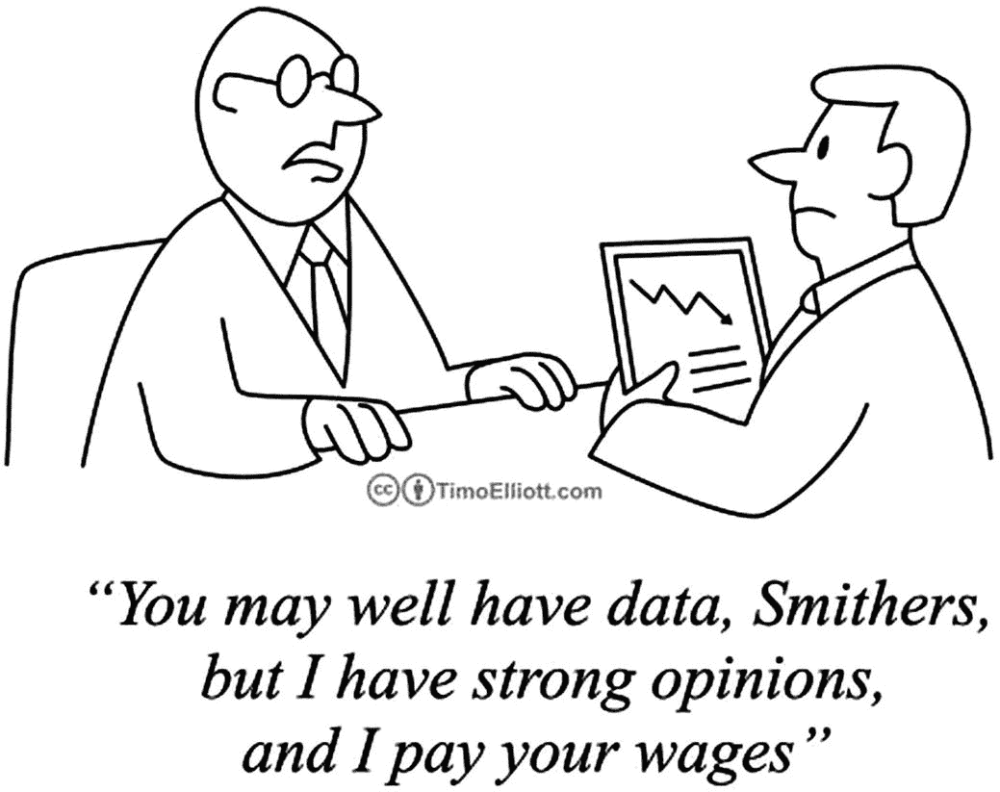
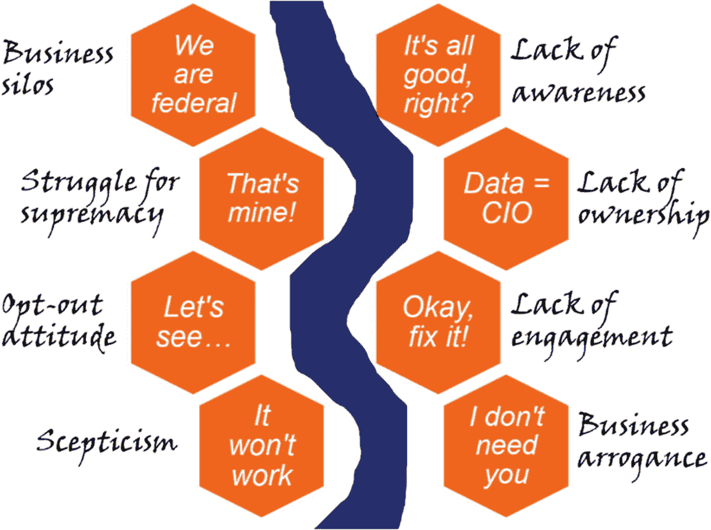
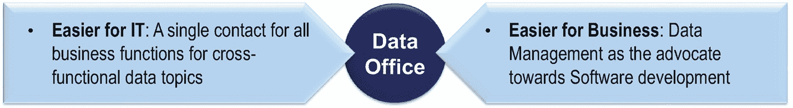
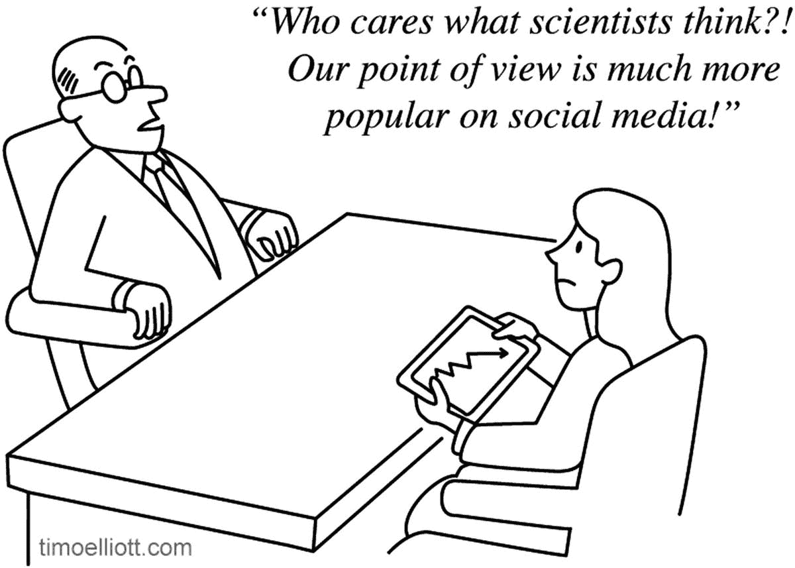
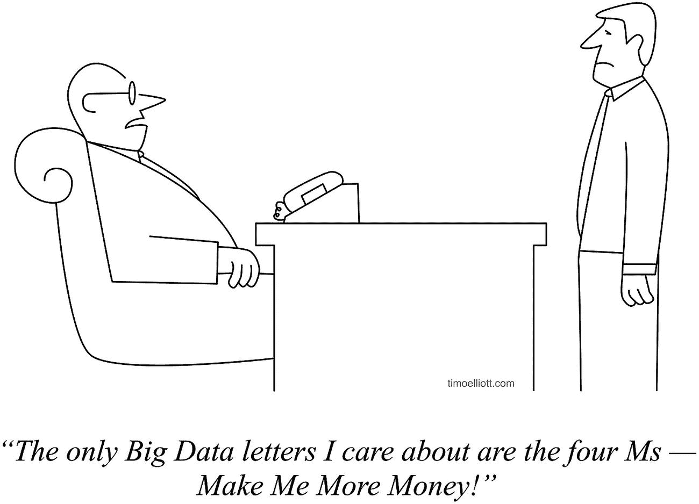

# 12. 首席数据官的典型挑战

图 12-1 数据在您组织中的地位如何？

## 为什么当首席数据官（CDO）如此艰难？

*商业案例很出色，故事也很引人入胜。数据解决方案相比传统方法的优越性已被证实。资金获批，项目启动。*

*准备工作却一拖再拖。IT 部门抱怨缺乏测试能力。初步结果已经得出，却无法验证。数据专家要么忙着寻求支持，要么无所事事。赞助方保持沉默。项目先是时间耗尽，随后资金见底。它悄无声息地停止了，已经实现的功能也无人问津。*

这种情况听起来是不是很熟悉？欢迎加入这个俱乐部！

让首席数据官的工作充满挑战的，并非技术、绝妙创意或优秀战略的匮乏，而是像这样的情景。

但到底发生了什么？

在这个案例中，常见的情况是业务团队感到不安，而他们的经理则感觉受到了威胁：“他们想告诉我们，电脑能比我们做得更好，尽管我们有几十年的业务经验……？”

结果就是，团队没有提供正确的信息、准确的数据、反馈以及适当的测试等等。

他们中没有人担心个人后果——反正这个项目一开始就没有一个投入的高管赞助人。

**让这个项目失败的并非技术或缺乏商业价值——而是人性！**

这个故事是常态，还是一个悲惨的特例？

不幸的是，在任何数据尚未深深植根于其基因中的组织里，你几乎都不得不预料到这类情况，即使它刚刚设立了 CDO 职位并承诺为数据办公室提供资金。

要理解失败的原因，我们首先应该看看一个打算设立首席数据官（CDO）的组织其背后的动机。

### 那么，CDO 是怎么诞生的？

挑战就从这里开始：很少有组织是因为董事会（a）理解数据能实现什么以及（b）知道需要做什么才能达到目标，才设立 CDO 的。

相反，大公司常常决定设立 CDO 这个职位，因为“这是当下应该做的正确事情”。通常，某位董事会成员在听到或读到“数据是成功的关键”或“数据是二十一世纪的石油”后，觉得有必要采取行动。

让我们明确一点：这样的组织已经远远领先于其他那些仍然认为他们二十世纪的配置足以应对日益增长的数据量及其机遇的组织。

然而，即使是在许多设立了 CDO 职位的组织中，高层管理人员也并不真正了解“数据”意味着什么，以及 CDO 具体应该负责什么。

这常常导致对 CDO 的期望模糊不清，例如“请把我们转型成一个以数据为核心的企业！（完成后记得通知我们一声）”。

### 为什么 CDO 常常在几个月后就离职？

#### 1. 没有工作描述

如果企业内部没人知道“好工作”到底意味着什么，那么因为工作出色而获得奖励就很难了。而且，数据处理方面的巨大改进常常是看不见的，因为所有有形的好处都被那些从数据办公室成果中获益的职能部门领走了。

#### 2. 在组织内没有确立的角色

几位董事会成员可能会张开双臂欢迎 CDO——但其他许多领导者可能不会。他们看不到 CDO 应该填补的空白，甚至可能将这一新职位视为内部竞争。

#### 3. 非理性行为

对首席数据官来说是常识的东西，未必是每位董事会成员合乎逻辑的结论。

高德纳集团数据与分析战略研究副总裁艾伦·邓肯将几乎所有新任 CDO 的第一个经验总结为：“决策者是情绪化的，而非理性的。光有答案是不够的。”

#### 4. 但期望值很高！

你可能没有被期望去解决世界饥荒问题。但期望值往往也差不多。你的组织想要应对数字时代的挑战，而高层管理者期望 CDO 能奇迹般地实现这个目标。

这些要点说明了为什么一个好的 CDO 不仅被期望是知识领袖。在接下来的章节中，你将读到我认为对成为成功 CDO 至关重要的其他领导素质。

为了铺垫场景，我将从一系列我见过的许多 CDO 和其他数据领导者面临的挑战开始。

你可能也遇到过以下一种或多种情况：

-   从事数据工作的 IT 人员大多不以业务为导向，不会主动确定下一步必要步骤。
-   大多数数据专家分散在各个业务职能中。
-   对财务数据的访问被人为限制。
-   让你的团队传达你们整天在做什么极为困难。
-   IT 部门仍然在不询问根本业务问题的情况下就满足请求。
-   信息安全部门的人不与业务部门的数据人员合作。他们按照自己一贯的方式，独立负责信息安全工作。
-   作为某个业务职能部门一部分的数据管理团队，与该部门合作良好，但数据人员感觉自己被系统地排除在其他业务部门之外，他们的工作遭到这些部门的破坏或重复。

这些都是组织内数据文化不成熟的一些症状。缺乏处理此类情况的既定机制。

如果你不觉得自己完全格格不入，请继续往下读。

在图 12-2 中，我将我的观察归为八类。每一类都可能阻碍你通往数据驱动型组织的旅程，就像巨大的岩石可以阻止河流奔向大海一样。

*图 12-2 — CDO 在企业挑战中曲折前行*

你如何应对这些挑战？在许多情况下，没有笔直的道路，所以你也许需要像在丘陵地带蜿蜒的河流一样曲折前进。

以下是我从 CDO 和其他数据领导者的真实经验中总结出的一些建议。

## 权力之争

你的组织在过去已经形成了自己的运作模式。往往需要数十年才能制定出一套成熟的政策体系，以确保所有议题都被覆盖。

如今，一位首席数据官（CDO）登场了，但其职责却模糊不清。CDO 的典型职责此前一直分散在 IT、法务、风险管理、财务等部门。没有人愿意向这位新来的首席数据官让渡自己的影响力或权力。

如果这场冲突得不到解决，你就会看到无休止的日常权力之争。数据办公室将难以有效运作，甚至无法运作，因为数据团队的成功取决于协作。如何应对这些挑战？以下是我的思考：

1.  **授权。**

    我的第一条建议听起来可能并不复杂，但在很多情况下执行起来颇具挑战性：

    从一开始就向上级争取明确的授权
    *  在引入数据办公室的流程中尽早提出
    *  作为不可协商、不可动摇的授权，如同财务总监（CFO）的授权一样
    *  由董事会本身传达（而不是让你像举着许可证一样到处展示你的授权）

    向董事会解释采取这种方法的必要性至关重要。你或许可以主动提出由你负责起草授权的具体措辞。毕竟，你才是专家。

    别忘了提供几个选项（所有你认为可以接受的选项），以表明你接受董事会的权威，并且他们有最终决定权。

    这种方法也是检验你所在组织准备情况的早期试金石：如果董事会拒绝给予你这种初始支持，你就应该开始回复猎头了！

2.  **每个议题都有其历史上的“所有者”。**

    但仅有授权可能还不够。你还必须应对那些视你为竞争对手的人。

    针对这种情况，我推荐两条通用原则：
    *  不在单一领域开战。不要树敌。你需要盟友。
    *  分而治之！放弃非关键领域。

    是否需要进一步行动取决于具体情况。你可能会面临以下两种挑战形式：

    **变体 1：“别插手！这是我的数据！”**

    在这种情况下，你可能无需升级事态或寻求董事会的支持。

    毕竟，是有人在阻止组织内的一部分数据接受专业的数据处理。

    让情况透明化，并让其他人去抱怨：那些得不到其他人所获得的、正确数据和优质数据服务的人自然会表达不满。

    **变体 2：“我无需向你汇报！”**

    你是否主要想巩固自己的权力基础？这通常不是 CDO 应有的有益态度。你现在遇到了问题，而且理应是遇到了问题！

    否则，就利用你的可信度来建立信任和长期关系。从那些你感觉在领导层网络中地位最稳固的人开始。并且要诚实！毕竟，你是想支持其他职能部门，而不是成为他们的老板。

## 缺乏认知

如果你听到消防车驶来，却看不到任何火情，你会想知道他们要做什么。此时你有两个选择：

*   你让他们离开，因为你认为他们出现没有理由。
*   你思考他们出现是否有什么你还未（尚未）意识到的原因。

短暂思考之后，你可能会同意第二种选择更为妥当。也许消防车出动的理由并不像明火那样显而易见。

CDO 首次抵达一个组织，常常是类似的事件。你会观察到同样的两种反应模式：一些人会认为 CDO 的到来必有充分理由，而另一些人则会因为看不到“燃眉之急”而认为设置 CDO 纯属多余。

你可能想知道哪些相关利益方属于第二类。这类人典型的言论（通常以隐晦的方式表达）包括：

*   “你打算解决什么问题？”
*   “过去几十年没有 CDO，我们不是一直很成功吗？”
*   “你在制造重复工作，因为你打算在这里做的每件事都已经有人负责了。”

我们姑且认为这些人是真的不懂，也就是说，这确实是他们真实的想法。

在这种情况下，一个好的反应是以非常谦逊的方式解释背景情况。

你可以邀请团体或个人（对于高层管理人员，建议采用后者）就这个话题进行交流。请不要说教——而是进行开放的对话。倾听和提问是这类对话的主要组成部分。

结果，你不仅可能更好地根据对方的处境来调整你的说辞，也可能更深入地了解组织，包括其不成文的规定。

从内容上看，缺乏认知体现在两个根本问题上：“为什么？”和“为什么是现在？”你该如何回应？

### 为什么我们应该管理数据？

对这个问题最理想的回应是基于事实，描述*整体*的核心理由——也就是你的核心故事！

这个故事不应涉及以数据为中心的技术性论点。“我们需要干净的数据！”对大多数高管来说意义不大。相反，你或许应该提供一个商业层面的理由，思路如下：

数据办公室的首要目标是帮助组织
*   赚钱
*   省钱
*   保持竞争优势

换句话说，CDO 旨在让组织内的其他所有人都能更加成功。

尽可能描述当前工作方式中的差距，以及组织内错失的机会。同时说明你为什么得出这样的判断。（为了在此处具有可信度，你应该先与一线人员沟通，然后再安排与高管的会议！）

你越是能精准地确定那些领导们所面临的业务挑战，并专注于为这些挑战开发解决方案，你就越有可能成为他们认可的、能够解决问题的人。

### 为什么我们应该现在就管理数据？

在回答这个问题时，你或许可以完全同意，过去确实存在积极的数据管理并非必需的时代：哪个组织在 1990 年代需要一位首席数据官呢？

然而，“时代正在改变”，正如鲍勃·迪伦几十年前教导我们的那样。

那么，是什么发生了变化？

首先，人们知道过去几年数据的数量呈指数级增长。大家也都清楚，这种发展势头短期内不会停止。

其次，客户期望已经改变。电子商务的繁荣让许多客户了解到技术上什么是可能的。他们为什么要接受更差的体验呢？

最后，商业决策不应再仅凭直觉做出——无论拥有这种直觉的人经验多么丰富。这个世界对这种管理风格来说已经变得过于复杂。此外，通过数据做出最佳决策的能力，正随着数据量和辅助算法质量的同步快速增长而迅速提升。

## 业务孤岛

专业的数据管理本质上是跨职能的。这样可以避免歧义和重复。

另一方面，职能负责人可能看不到将精力投入到主要使其他部门受益的事情上的价值。他们的考核严格基于自己团队的目标，他们不希望任何精力从达成这些目标中转移。

这种情况有多种表现形式。以下是我非常常见的两种变体。

### 变体 1：“我们最清楚什么对自己有利。”

这事实上可能是对的！并非所有事都需要集中管理。

如果这种说法频繁出现，它应当为你提供一个绝佳的基础，以便与强大的本地或职能团队共同制定治理模式。

想想看，通过中央赋能，让强大的职能团队贴近其业务伙伴工作。

再想想看，通过人际网络将人们联系起来，实现协同效应。

通过满足人们在某些领域的自主权要求，你应当寻求他们同意将其他议题集中管理，例如在标准化措辞和流程方面。

### 变体 2：“如果我不需要与其他人对齐，我会更快。”

也许你在确保各部门在请求 IT 支持时不会绕过你方面取得了良好进展。然而，他们往往根本不需要 IT 支持——因为他们已经建立了自己的“影子 IT”团队或结构。

但该如何回应呢？

确实，对齐需要时间。但缺失对齐的后果是什么？

-   活动和沟通局限于职能范围之内。
-   错失了与其他职能团队交流的机会。
-   不同部门对于同一议题得出了不同的结论。
-   数据来源可能存疑。数据可能被误解。
-   重复进行着已经完成过的工作。

然而，在这种情况下，仅仅依靠基于事实的论点可能并不足够。不进行对齐仍然更快，因此也更具吸引力。

这里有两种额外的活动可能会有所帮助。一是提出一个可靠的商业案例，展示可持续数据工作的长期收益。

二是创造一种双赢局面：你首先需要找出职能负责人或项目经理想要加快进度的*原因*。在许多情况下，是因为他们要履行已承诺时间表的压力。这种情况允许你与项目经理合作：你可以共同在第一次就把事情做对，同时修改时间表使其成为可能。毕竟，修改时间表有其充分的理由，而且这些理由显然不是由于糟糕的项目管理造成的！

这种方法有助于你实现几件事。项目经理获得了足够的时间，同时也有机会交付高质量的工作。如果你给他们真正的选择，绝大多数项目经理会更倾向于后者。

此外，如果成功，你可能为未来类似的情况赢得了一个盟友。而且你也有机会证明，由于第一个项目奠定的坚实基础，未来的项目会变得更简单、更快、更便宜。

## 缺乏所有权

数据所有权是数据管理中一个并不为多数人所熟悉的概念。

但即使在业务团队之间，要达成“让我来负责！”这种意义上的所有权也很困难。一旦某个业务概念被认为是“技术性的”，人们往往乐于将责任外包给 IT 部门。

而且，说实话，为什么有人要去做别人自愿做的工作呢？在大多数组织中，在过去几十年里，当有必要时，IT 部门已含蓄地接受了数据所有权。

难道不应该就这样保持现状吗？嗯，如果你打算充分利用数据的全部潜力，就不能把关于业务模型及其数据表示的决策留给技术数据建模、软件开发或数据库设计方面的专家。

事实上，正如 Nordea 银行数据治理与信息架构主管 Ole Busk Poulsen 在 2019 年维也纳的一次数据会议上强调的那样：“所有权始于组织高层。”

但是，如何让人们承担起所有权呢？同样，关键是要创造双赢局面。这需要一个强大的数据办公室。你需要与业务职能部门合作，帮助他们理解如何将他们的业务概念转化为数据结构。

同时，你要向 IT 部门解释，你是在让他们工作更轻松：他们不必同时与多个业务职能沟通并平衡相互冲突的需求，而是将数据办公室作为他们的单一联络点和不同业务职能之间的协调者。这让他们能够专注于自己的核心职责：提供满足业务需求的一流 IT 解决方案。

图 12-3 说明了数据管理组织的这种双赢局面。

图 12-3

业务与 IT 之间的协调者

## 旁观态度

并非每个人都是你的朋友或敌人。许多人介于两者之间，你的很多同事可能尚未做出决定。他们会观望一段时间，然后才决定是支持你还是不支持你。

他们在想什么？简单来说，类似于“如果我们喜欢，我们就跟着做。否则，我们继续做自己的事。”

他们是否因为你有授权而被迫支持并跟随你？

-   正式的董事会支持很棒——但强制忠诚不如自愿忠诚有效。
-   个别高管的信服式支持也很好——但本质上很脆弱：管理者来来去去。

请不要完全依赖高层的支持！即使你拥有这种支持，也要为没有这种支持的时刻做好准备，同时尽可能充分利用最初那些接纳你的人的初始支持。

在任何组织中，都有一些部门不依赖于“被喜爱”。但数据办公室不是法务部或信息安全部！所有团队都应该*想要*与你合作。

但是，如何培养自愿的忠诚度，又如何说服那些尚未决定的人，让他们觉得站在你这边是可取的？

解决这个挑战的关键是让人们想要参与进来。他们需要变得有责任感，并且需要预见到不配合会带来的不利之处。

我的建议：

**努力克服“我们 vs. 他们”的陷阱。**

记住我在第 1 章谈论“集中式数据治理”时说过的话？一个人忠诚的程度和方向通常通过微小的词语表现出来，其中之一就是“我们”。

如果你仔细听一个人说话，你会发现当他说“我们”时，指代的是什么。

你会发现，人们通常指代的是自己所在的部门或团队。这是竖井思维的警示信号。这表明他们意图优化自己所在的部门，而不是寻求组织的整体最优。

员工经常用“我们”来描述全体员工，而用“他们”来描述高管。这种观点也暗示了你组织内部存在着迫在眉睫的利益冲突。

好消息是，你可以影响这种情况。

> 注意
>
> 这并不是要改变语言（那只能治标！），而是要鼓励每个人都关注***整个***组织。

你不需要要求人们利他。相反，你要让人们认为“如果这对组织有好处，那对我也一定有好处！”

而在首席执行官（毕竟他代表着整个组织）眼中成为一个优秀的贡献者，对他们来说也是一个完全可接受的动机。

反过来，你可以提出与数据相关的绩效指标（理想情况下甚至可以与奖金挂钩），让人们因在*其他*领域提供了更好的数据以及取得了与数据相关的成功而获得奖励。

一个首席数据官（CDO）和数据办公室，从其定义上来看，着眼的是整个组织而非仅部分部门，因此能立即从这种视角中获益。

一旦某位业务同事（潜意识里！）开始使用“我们”这个词来指代“你和我”，你可能就找到了一个很有前景的合作伙伴。

最终，在高管中，你应该寻求与那些经常使用“我们”来指代整个组织——而用“他们”指代其竞争对手——的人进行合作。

### 置身事外

*“让我们坐下来看看首席数据官(CDO)如何解决我们所有的数据问题……！”*

置身事外是否令人感到惬意？你可以向后一靠，看着别人试图完成任务。如果那个人成功了，你可以祝贺；如果失败了，承担责任的是那个人，而不是你。

有一定数量的超然同事是没问题的。但当你面对太多置身事外的同僚时，你会作何反应？也许“置身事外”已经发展成组织文化的一部分，因为那些积极参与的人被分配了执行任务，或者积极参与的管理者被视为“资历尚浅”。

通常的经验法则是：让人们负起责任，并奖励那些提供支持的人。

以下步骤可能会有所帮助：

-   公开地与那些与你并肩作战（并且值得这份荣誉！）的人分享成功的荣光。与你合作必须让他们有所回报。赞美不会让你付出任何代价。
-   将数据办公室的精力集中在支持那些积极参与的同僚的活动上。除非你有一个非常庞大的团队，否则这足以让你忙个不停！
-   利用你的职权（和治理机制）将数据方面的责任分配给同僚。并利用数据所有权机制。那些置身事外的人最终可能会留下对所有人可见的、糟糕的记录。
-   邀请知名的支持者加入你的治理机构。让这些机构来决定处理数据时的责任归属。让人们渴望被邀请进入这些委员会，以免决策权落入他人之手。让他们明白要如何才能获得席位。
-   向置身事外的同僚提议相关数据角色：“鉴于您在分析和市场营销方面的专业知识，我想建议（也可以说：推举）您作为组织的‘数据倡导者’，代表整个市场营销部门！”
-   证明“数据”是面向未来的，并且会一直存在。描述早期参与者的机会。让人们不想错过这趟列车。

### 怀疑主义

*“又要增加一层官僚机构……！”*

人们见过太多的热潮来了又走，都承诺会带来显著的改进。但大多数不仅未能兑现，反而总是增加了复杂性。

一个新的、专门的数据管理机构可能会引发同样的担忧。你通常会听到这样的说法：“为什么我不能直接找 IT 部门了？如果中间夹个数据办公室，一切只会变得更慢！”或者“是的，数据很重要。但再增加一个职能又能带来什么附加值呢？”

这种看法可以理解，但很危险。如果不能（迅速！）妥善处理，它会导致人们忽视新的数据办公室，继续像以前一样工作。这种行为已经导致整个数据办公室变得无用和被边缘化。

你不能通过传统的培训来解决这种情况。在这种情况下，人们首先需要的不是*知道*——他们需要的是*看到*。

但是，如何让不同层级、不同角色的员工“看到”呢？

如果你无法通过执行典型的数据办公室活动来立即创造可见的价值，那么就帮你的同事一两个忙吧！

换句话说，倾听他们的担忧——不仅是数据方面的！在你力所能及的地方帮助他们。借给他们一个项目经理来有效地建立他们的项目。让你的词汇表经理从语言角度审阅他们的文档。诸如此类。

这种做法可能看起来会不必要地分散你对“真正任务”的精力。但是，请相信我，这是一项值得投入的精力！

### 业务傲慢

这可能是一个大胆的标题。但是，任何曾有过被同事拒绝帮助经历的人，都知道看到那些自认为可以独自完成一切的人失败是一种什么感觉。

是的，有时候接受支持的建议是困难的——即使你正在挣扎。这是源于你自己的骄傲、感知到的他人的期望，或者是“靠自己独立完成一切”的雄心。

即使这种行为不符合为组织尽最大努力的责任，也没有人会轻易放弃它。

你可以通过双边和多边的方法来解决这类情况。

**双边**方法寻求与拒绝你支持的同事进行个人对话。第一步是找出所观察到行为背后的潜在动机。

然后，你可以根据你对对方的了解来制定你的策略：

-   你可以提议将你的贡献隐藏在幕后，这样同事看起来仍然是成功的。或者你提出一种正式的合作伙伴关系，既能展示目标的达成，也能体现协作。
-   你可以达成一个协议，例如，一个业务计划的第一阶段在没有数据办公室支持的情况下完成，而第二阶段则从一开始就让数据专家成为团队的一员。
-   第三种选择是反向寻求帮助，以避免出现别人欠你人情的情况。

**多边**方法旨在建立一种鼓励相互支持的文化。这可能会达到一种程度，即那些不主动寻求帮助的人会显得不好。

当有太多的人真心相信他们自己更懂，或者他们传统的方法优于数据驱动的方法时，通常建议采用这种选项。

然而，如果这些人只占一小部分，你可能什么都不需要做。让他们失败，集中精力支持其他人。

## 总结：成功的先决条件

经历过所有这些挑战，我们看到很多缓解或解决它们的方法。

但同样公平地说，一些成功的先决条件是首席数据官无法控制的。

如果你无法满足以下三个先决条件，那么你作为 CDO 的努力可能会举步维艰。

### 董事会的支持（积极的！）

你需要的是真正的支持，而不是同情。

“这是正确的事情，没有备选方案。我会捍卫并推动它。”这种表态会管用。

“看起来不错。去试试创造价值吧……”这种表态不会让你成功。

不要指望任何董事会成员都已经完美准备好支持你——这是罕见的例外。即使是那些设立你职位的人，可能也只是履行了一种被感知到的义务：“作为一个现代化组织，我们应该有一个 CDO。”然而，这并不能保证必要的支持。

除了让你的团队能够开展工作，或者在你从零开始组建团队之外，我建议你在头 30 天内把大部分时间花在个人对话上，首先要与日常处理数据的同事交谈，然后是与董事会成员交谈。提出问题，确定痛点。与高管交谈时，始终要解释、说明并概述如果得不到董事会的全力支持会带来的风险。

你不需要所有董事会成员都全心全意支持你。但你身边需要有关键人物。记住，他们不需要理解数据逻辑和算法的细节。但他们必须确信 CDO 和数据办公室是必要的，并且他们必须相信你是担任这个角色的合适人选。

30 天后，你可能希望对自己的处境进行个人评估：你感觉自在吗？如果描述的任何一项挑战变成现实，你有足够多的董事会成员可以依靠吗？你有多大信心董事会会支持你，或者至少不会支持你的任何反对者？

#### 适当的汇报线

如果你作为首席数据官需要向首席财务官汇报，请设身处地想一想：首席财务官会优先解决财务问题，还是支持客户服务、销售和生产？

答案很简单。如果一位首席财务官“拯救了世界”，却没有解决财务挑战，那么评判结果将是“不及格！”

因此，在这种情况下，该受责备的不应是这位高管，而应是组织的汇报与奖励结构。

职能型高管处理职能型问题——跨职能型高管处理跨职能型问题。道理就是这么简单。

因此，首席数据官应向跨职能型高管汇报，或向拥有明确跨职能授权职能型高管汇报。

遗憾的是，大多数高管职位都是职能型的——无论是市场营销与销售、运营、人力资源，还是财务。有些组织甚至只有两名员工拥有跨职能角色：首席执行官和首席执行官的个人助理。

事实上，考虑到数据主题的关键性，向首席执行官汇报对首席数据官来说并非最差的选择。然而，许多监事会希望数据办公室在证明其价值并证明其关键性之后，才会将首席数据官纳入董事会。首席数据官进入董事会的门槛仍然很高。

在这种情况下，应该设立一个首席转型官、首席创新官或类似的、明确肩负跨职能职责的职位，让首席数据官向其汇报。

如果组织中不存在这些角色，首席执行官可以明确授予董事会某位成员一项额外的跨职能授权，使其在现有职能职责之外，足以管理数据。

不要接受降低标准的安排！这并非关乎你能否身居高位——而是关乎你能否做好自己的工作。

图 12-4

不当汇报线示例

#### 明确的期望

你是新任首席数据官，因此人们可能会期望你实现世界和平、消除贫困、预防地震。

对吧？

当然，这显然被大大夸张了，但期望的范围确实很广。从“至少不会造成什么害处……”到“我们期望那 15 个人能把我们从一家实体企业转变为数字企业”。

因此，你的目标不应该是提高或降低期望。相反，你应致力于对首席数据官能够且应该实现的目标，形成一个既雄心勃勃又切合实际的看法。

此外，你应该将期望与假设联系起来：“如果发生了 XYZ，那么我们就能够实现 ABC。”这一点很重要，原因有二：这能降低你受自身无法影响的外部因素的制约程度；同时，这也让你能够预先阐明自己在财务、组织和战略方面的需求。

很快，你可能就希望整合出一份你的 *conditio sine qua non*^(³³)，也就是那些你不愿做出任何承诺的条件。

这些条件可能包括你的预算和人员配置状况，以及所需的最低程度的组织和战略自由。

你当然能够判断在是否接受这份工作邀请之前，应该提出其中多少条件——但迟迟不提其余条件可能并非明智之举。

虽然你会在上任的头 30 天致力于争取高管支持，但在第二个月，结合你的高层目标与计划来提出你的需求，或许是恰当时机。

但不要花太多时间详细阐述那些计划。相反，你应该着手关注最初的“低垂果实”，因为你可能希望在担任首席数据官的头 100 天内，交出一份积极的工作成绩单。

图 12-5

数据——董事会真正关心的是什么

#### 数据事务中明确的角色

你可能希望尽早明确自己大致的职责范围。这有助于避免因其他领域的问题而受到指责。你的首席财务官应该明白，你的团队不应对数据湖配置错误或对关键数据源的访问延迟负责。如果只在你的团队因他人造成的复杂业务项目整体延误而受责后才澄清这些事宜，那听起来像在找借口。

像数据办公室这样的新职能，不可避免地会改变各职能职责之间的界线。

除了在组织层面需要避免职责重叠或空白，你还应在最初几天里防止内部竞争，例如与 IT 团队、可能存在的数字化团队、业务转型团队等的竞争。

你还应利用这段时间，概述你关于数据相关决策与协作机构的构想，包括应邀请谁、他们的任务和权限是什么。

虽然你的详细组织架构会随着时间逐步完善，但你或许希望在头 60 天内解决这些根本性的冲突源头。这将使你日后能专注于相关的内容主题。

再次强调，这并非要扩大你的职责范围——而是为了管理期望。

脚注 1

