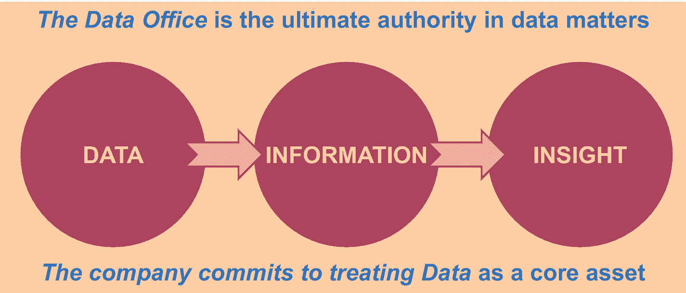

# 15. 治理心理学

图 15-1

数据或许站在你这边——但这可能还不够！

## 别在老地方圈地

适当的数据治理是不可或缺的。但这必须是“首席数据官发明的治理”吗？

人们会难以接受一项取代了先前看似运行良好的政策的新政策。那么，你为何想要改变这样的政策呢？

如果你将现有政策纳入你的整体数据治理框架中，你就能赢得原制定者以及那些乐于遵守原有规则的人成为盟友。

另一个考虑将现有政策或标准视为“少一个燃眉之急”的理由是，这能让你专注于剩下的、真正的差距。你可以宣称对这些数据治理元素的所有权，而无需改变它们。而在需要调整的地方，例如，为了考虑新的决策主体，你可以强调核心规则保持不变。

有时，你甚至可以将最初为单一业务领域制定的规则或标准进行泛化推广。你通常可以预期，那些工作成果被应用到自身职责范围之外的人会非常忠诚。

这与其说是要不惜一切代价找到最佳方案，不如说是通过同理心赢得人心。如果现有政策或规则有任何改进空间，你仍然可以随着时间的推移进一步优化它——最好是与原制定者一起。

## 设计可接受的初始架构

塑造一个被普遍接受的框架是明智的，数据管理在其中拥有明确定义的角色。

-   一种模式可以是：所有基础性工作要么由 IT 部门（数据库、基础设施、许可证等）负责，要么由数据管理部门（数据规则、治理、业务对齐、术语表等）负责。
-   你或许可以（暂时）接受其他团队负责那些你实际上认为是数据管理办公室职责范围的领域。事实上，这可能会帮助你获得支持，并减轻不可避免的权力竞争感。
-   如果你能出色地解决痛点，组织（通常是董事会）可能会考虑让你也负责其他领域。但不要自己主动去推动，除非你有充分的理由这样做。

## 将你的权威建立在公认的权威之上

来自董事会的总体授权是必需的，但它在日常工作中可能帮不上忙，你也不想整天像出示警徽一样把它亮出来。因此，审视一下还有什么能增强你的权威会很有帮助——即使它可能不是正式意义上的。

如果你将已知的组织战略转化为数据战略，你应该会很有把握：“为了实现（组织战略 X），我们需要专注于（数据战略 Y）。”

除此之外，你可以尝试引用董事会成员和其他有影响力的高管的话。你可以作为旁白提及，始终避免显得傲慢。那些积极支持你的人甚至可能会确认你可以引用他们的话（“我们的 CFO 让我也考虑一下……”）。

但你也可以引用那些在言论或书面中支持你观点的人。如果你积极倾听，你会听到许多可能对你有用的说法。例如，他们可能表示认为数据有价值，或者在做出决定之前强调需要更加关注数据。

每当你做会议记录时（这是框定协议的有力工具！），你都要记录下任何此类言论，甚至可以通过提出恰当的问题，把需要说的话“放进”相关高管的嘴里。最终，人们应该会形成这样一种印象：绝大多数决策者都支持首席数据官和数据办公室的方向。

## 平衡两个极端

如果解决结构性问题的方法是选择正确的极端，那么成功的领导者会多得多：在没有任何专业知识的情况下，你选对的几率也只有 50%。

相反，成功的管理意味着在两个极端之间找到恰当的平衡。这种方法首先包含一个与态度密切相关的初始思考过程，然后是基于密切观察和积极倾听的持续调整过程。

需要平衡的领域有很多。让我以其中四个为例进行说明。

### 在绝对主义与民主之间

绝对主义意味着“我知道答案。我来制定规则。你们必须遵守。”许多部门都倾向于遵循这种方法：我们是专家，而其他人不是。为什么要让他们参与规则的制定呢？

民主则意味着“除非得到多数支持，否则不要制定规则。”采用这种方法，可能会出两个问题。首先，你可能会面临所有部门都必须为了更大的利益（即股东视角）而让步的情况，而民主会导致多数投票反对股东的利益。其结果是要么形成各自为政的心态（因为各方都同意“各干各的”），要么做出一个让多数利益相关者受益但整体组织却受损的财务上不健康的决定。其次，重要但令人痛苦的决定（例如财务纪律或法律合规）可能会因为大多数部门不喜欢而被阻挠。

但在两个极端之间，从整体政策角度和具体案例处理角度，都存在一个折中位置：

1.  **治理**
    如果决策的范围受到限制，以避免做出对组织有负面影响的决策，那么民主是可以奏效的——就像宪法在民主制度中防止多数派压制少数派一样。首先，一套指导方针框架会有所帮助。它需要足够通用，以便在董事会层面进行处理（例如，“安全至上”或“合规至上”）。此外，一份获得认可的数据战略以及一份数据原则清单，将允许利益相关者在不危及数据目标的情况下运用他们的管理自由度。

2.  **个案处理**
    以权威做出决定并不意味着忽视其他意见。因此，一个实用的方法是首先让所有利益相关者参与进来，听取所有论点，然后设计一个解决方案。让所有利益相关者对该解决方案进行最终评审，作为一项卫生检查是有意义的。它只允许在附带充分理由的情况下提出异议。如果你最终做出决定（或者将你的解决方案提交数据委员会审批），那么没有人会感到惊讶，而且每个人都有机会提供有分量的反馈。

### 在集中式与本地化解决方案之间

严格的集中式方法无法考虑本地特性。然而，本地化方法倾向于产生本地优化的解决方案。稍微不同的本地解决方案可能已经导致不同的“最佳方案”，从而产生大量并存的解决方案。

同样，通过平衡的方法，你会找到最佳方案。你可以努力寻求一个集中式的解决方案，但同时让所有本地利益相关者以及你的虚拟功能专家网络参与进来。他们的意见需要有实质内容，并且需要从整体业务案例的角度来看待，而不仅仅是本地案例。

在这种背景下，至关重要的是要有整体业务案例来考虑“复杂性成本”，即必须维护多种不同（通常是本地化）解决方案或解决方案方面所带来的影响。这种影响呈指数级增长，特别是当你考虑到错误风险以及未来对整个生态系统进行根本性变革所需的上线时间时。

### 在标准化与个性化之间

每一位首席数据官都迟早会面临这样的两难境地：数据架构师关心数据结构，而分析人员则关心他们的自由度。同样，你会遇到想要固定模式的数据库设计者，而业务人员则希望拥有自由，让应用程序和数据库能够快速反映业务逻辑的任何变化。

谢天谢地，你不需要在这两个极端之间做出抉择。在“标准化”与“个性化”之间，有一个绝佳的方法，那就是“**可配置化**”。

这种方法对你的企业数据模型会产生影响：如果可能，有效场景不应存在于数据模型之外，甚至不能作为“已批准的例外”。相反，要努力将所有有效的变体都视为数据模型的一部分。其优点在于，你迫使业务人员思考他们的业务目标和偏好，与此同时，以一种软件架构师能够无歧义地实现数据结构的方式，记录了整个业务模型。

当然，这付出的代价是数据模型变得更加复杂。但这个代价不应太高。当架构师和软件开发人员将业务逻辑落实到应用程序和数据库结构中时，任何额外的细节层级都有助于避免误解。如果有人认为由此产生的数据模型过于复杂，那就提醒他们：这个数据模型反映了组织的业务模型——因此，业务模型本身可能也很复杂。

### 在粗略与完美之间

让我们将理想解决方案的工作量定义为 100%。仅覆盖正常流程、没有任何异常或偏差，需要花费多少工作量呢？最多只占全部工作量的 5%。

人们在压力之下往往倾向于追求这一点：忽略适当的异常处理，从而降低成本和缩短时间。基于数据的解决方案的一个主要目的，就是处理与正常流程的偏差。原因是这些偏差构成了业务成本的主要部分。这就是为什么任何人都不应该止步于 5%！

但是，你是否有必要追求 100%的覆盖率？可能不需要。著名的 80/20 法则通常也适用于数据。用 20%的工作量覆盖完美解决方案的 80%，远比仅用 5%的工作量覆盖一个正常的流程要好得多。并且，请记住，你不需要永久放弃那剩余的 20%。将所有缺口登记为`Data Concessions`，随着时间的推移，这些问题可能会被逐步解决。

## 塑造你的数据品牌

对许多员工来说，“数据办公室”可能听起来非常技术化。你应该把它变成一个人们能够产生共鸣的品牌。如果你的组织政策允许，可以考虑设计一个标志——简单、色彩丰富且积极向上。每当你提供服务或发布消息时，就使用这个标志。

简化数据办公室的职责也是个好主意，这样人们就能更容易地理解它，如图 15-2 所示。

图 15-2

数据办公室简介

## 电梯演讲

每个人都知道电梯演讲的重要性。你的电梯演讲还是最新的吗？

当然，数据管理没有一个通用的电梯演讲。故事在很大程度上取决于组织的情况，也取决于你自己的想法。但有一些模式值得遵循。试着想出一个通用陈述（你的核心信息，与目标受众无关），然后紧跟一个针对特定目标的特定信息。请记住：每个人看到的问题不同，评判机会的方式也不同，这通常基于他们各自的角色。

1.  **通用信息**
    想出一个能深深印在人们脑海里的、一句话就能讲清楚的故事梗概。例如：“我认为我们需要一个专门的数据权威机构来稳定运营，并支持基于事实的决策。”

# 数据挑战与沟通策略

在“数据”方面，我们面临一个特定的挑战：很多人，包括大多数高管，不知道数据是什么，或者他们认为你在谈论 IT。

这种情况可能需要一个开场白——但同样也不应超过一句话。有时高管不需要理解整个概念——他们只需要相信你。引用外部公认的权威可能会有帮助。

你的目标应该是让你的对话者想要了解更多信息。你可以做一个大胆的声明，或者简单地激发高管的好奇心。

想一想，在谈话结束后，董事会成员至少应该记住的一两个关键词。尽管你需要谨慎利用有限的时间，但你应该在时间允许的范围内，尽可能多地使用这一两个关键词。

## 针对特定目标的信息

为了准备一个好（且简短！）的故事，你需要列出对高管来说所有有意义的事情，这些事情在有数据管理的情况下会比没有数据管理时做得更好。

一个好的清单可以涵盖以下三个部分：

*   我们今天在哪些方面没有达到目标（但数据管理可以帮助解决）？
*   我们今天在哪些方面甚至可能超越目标（通过数据管理）？
*   数据管理为更美好的未来提供了哪些机遇？

现在你可以从这三个主题中各选取最重要的一个点。这样就有了三个强有力的论点，涵盖了广泛的业务领域。

假设数据根本就不是决策的焦点，那么一个典型的为筹备数据管理办公室而准备的电梯演讲可以是：

*您认为我们今天在多大程度上基于数据做决策？您是否总是充满信心？*

*您是否知道我们拥有（或可以获得）大量数据，可以帮助我们做出更好的决策？*

*我们的组织在您的领域之外拥有大量对您有价值的数据。*

或者，如果组织的主要问题是每个职能部门都各自为政：

*我们可以从数据中获得比今天多得多的洞察。所有职能部门都在自行其是。这导致了大量的重复和歧义。并且没有一个职能部门掌握全局。*

当高管们想要花哨的东西，却没有看到全面的数据图景时：

*说实话，仅仅建立一个分析团队是不够的。需要做大量的基础工作，将所有业务职能部门整合在一起。数据可能是错误的或不完整的。这就是为什么无论数据在何处被触及，都需要进行管理——而这基本上无处不在。*

试着把脚伸进门里——获得一个口头的承诺，这样你在后续跟进时就可以引用它：

*当我向董事会提交我的方案时，您会支持我吗？您愿意抽出 30 分钟时间让我事先向您介绍这个方案吗？*

## 如果董事会成员问起你的提案

*我正在考虑设立一个专门的、有授权的数据办公室。数据不应该是某个现有部门（即使是 IT 部门）的副业。为了成功运作，我在考虑两个步骤：*

*步骤一：我希望获得高管的授权，因为我的成功不应该完全取决于自愿接受。*

*步骤二：然后将由我来说服所有职能部门参与进来。毕竟，我是想支持他们，而不是从他们那里夺走任何东西。*

与大多数说明一样，少即是多。如果有什么不清楚的地方，董事会成员会提问的。
