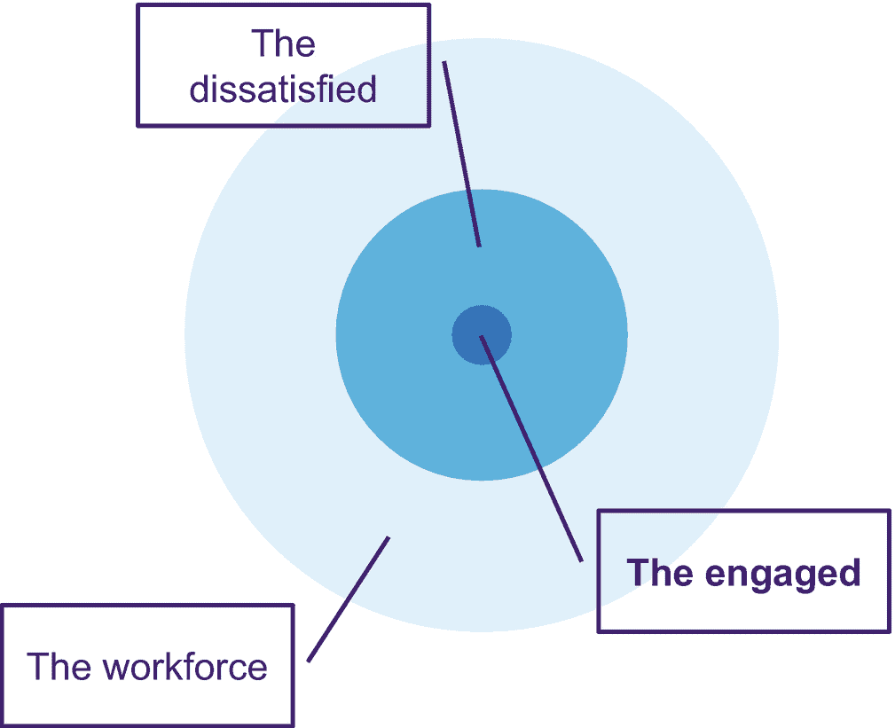
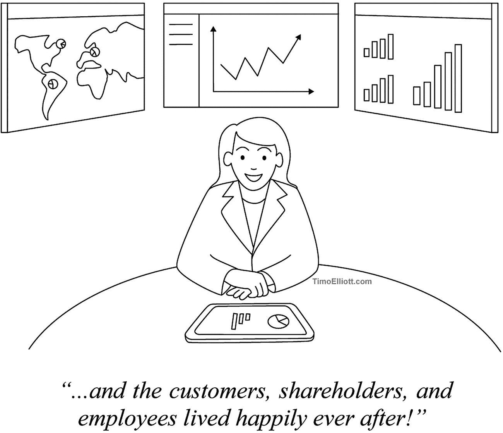
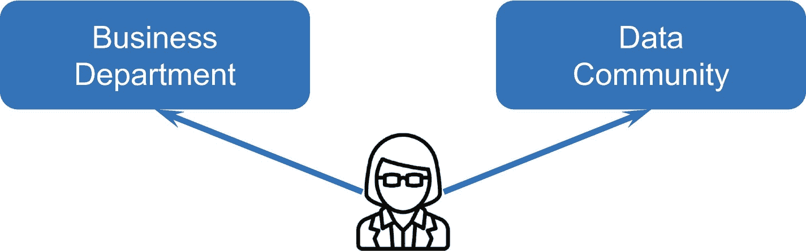

# 13. 首席数据官如何（不）行事

图 13-1

领导者的四个秘诀？

## 不要依赖正式权威

当然，你应该坚持在拥有足够正式权威的前提下起步——但不要依赖它：是的，每个人都应该知道董事会支持你。然而，这只是“必要条件”，而非“充分条件”。

因此，在许多情况下，你将不得不运用非正式的权力。

用 Monty Halls^(³⁴)的话来说，你正面临“人生中需要你引领的时刻”。你不能只是管理、授权或执行。

## 从小处着手，谨慎选择“战场”

你不必在上任头 100 天内就让组织的收入翻倍。相反，问问自己：

- 最显著的痛点是什么？
- 哪些领域数据处理（最）低效？
- 哪些是“低垂的果实”？
- 到目前为止，哪些领域没有人愿意接手？

你最初行动的重要标准不是“效率”，而是“有效性”。换句话说，绝对结果比结果与付出的比例更重要。

劳埃德银行集团应用科学主管 Abhijit Akerkar 给出了一个很好的建议。他说：“不要从你数据最多的地方开始——要从影响最好的地方开始。”

但不要把这理解为建议你不择手段地采取策略。为了避免肮脏的变通方法，你处理即使是最初的那些主题时，也应确保解决方案以后能够推广到具体案例之外。

## 保持谦逊

不要试图摆出无所不知的姿态，也不要假装你的职位本身就赋予了你指挥他人的权力。

正如 Gartner 公司马克·科尔曼在 2017 年伦敦数据与分析大会上所警告的那样：“试图强制控制会招致抵抗，而非合作。”

那么，替代方案是什么呢？

-   与其说“从数据角度看，你需要这样做”，不如问“您想了解您的方法对数据产生的影响吗？”
-   与其说“数据将比你当前的工作做得更好”，不如说“数据将助您进一步优化工作”。
-   与其说“你需要控制好你的重复数据”，不如说“我相信你已经很好地控制了重复数据。能否与我分享一下你是怎么做的？”

请注意，第三个问题并非诱导性问题！如果重复数据**没有**得到控制，对方将不得不承认这一点，届时你可以提供帮助。如果数据管理得当，你甚至能从中学习。你可以肯定其方法，并询问双方能否将这一概念推广到组织的其他领域。

### 以协作者姿态示人

并非所有数据活动都需要集中管理。相反，所有处理数据的职能部门都应理解数据。你的数据办公室应在以下方面提供支持：

-   打好基础：业务团队可以开展工作所依据的基础。
-   提供可适应不同业务需求的治理框架。
-   提供培训与教育。

目标可以是让你的同事工作更轻松，以便他们能专注于核心职责。（请记住，他们中的大多数人从事某些基础性工作，仅仅是因为这项工作不可或缺，且没有其他人愿意做。）

**分析示例**：如果业务部门有自己的分析团队，你可能不希望将这一职能剥离。相反，你的团队负责提供基础，即明确定义的“单一事实来源”、无歧义的术语以及企业级标准化数据模型。这样，这些团队就能深入数据，从其职能角度获取洞察，而无需再处理所有基础性工作。请记住，你需要在组织级事实（已预处理）和职能分析的自由度之间找到平衡。

请记住，你可以*主动提出*负责某个部门的分析任务。有些部门可能会乐于接受你的提议（这或许能让你打造出更强大的分析卓越中心）。人们喜欢拥有选择权。只要从数据管理角度看两种选择都可接受，就给予他们这个选择权。

**参考数据管理示例**：业务部门应维护其拥有的数据。数据管理团队甚至可能不需要在此扮演审批角色——只要规则已制定、审批流程已定义即可。

### 避免不当用语

你和团队成员使用的语言与面向内部客户的语言是不同的。市场营销负责人可能不知道什么是实体关系图。然而，从内容上讲，如果用非技术性语言解释，他或她会立刻明白两个实体之间所期望的关系。

此外，你应该从对话对象的角度出发，这不同于你的数据视角。对业务人员而言，遵守企业数据模型并无实际意义——他们看不到遵循 CDM 的任何好处。

最后，问题不仅仅在于避免技术术语。

哪些词汇是业务人员*不想*听到的，即便内容与他们相关？这个清单因组织而异，但以下词汇几乎总会榜上有名：

-   数据
-   治理
-   规则；合规
-   等待；长期
-   数据模型（包括相关的术语，如对象或基数）

确定适合你所在组织的清单会很有帮助。请为所有这些词汇和表述思考替代方案。向同事们解释，并询问他们如何称呼。在正式启用任何替代术语之前，先与同事进行测试。

### 走出去与人交流

如果不四处走动（或出差），与人交谈，你就不可能有效地将传统组织转变为数据驱动型组织。

或者，正如曾带领 DHL 快递扭亏为盈的首席执行官肯·艾伦所说：“有一件事是肯定的：你不可能坐在办公桌后面就建立起卓越的业务”（Allen, 2019）。

数据管理关乎信任，其重要性超过其他一切。

如何赢得信任？面对面与人交谈。拜访他们的工作场所——无论是高管办公室还是流水线。

并且，不要一开始就分享你的真知灼见。要学会倾听和提问。

与那些你期望他们日后阅读并遵循你信息的人建立人际关系至关重要。扪心自问：你*自己*又是以多大的热情去阅读一个陌生人的信息呢？

脚注 1

## 利益相关方

图 14-1

并非所有人都喜欢你的信息

### 管理各级利益相关方

与任何其他角色一样，你需要了解自己在组织中的地位，才能规划你的行动方案。为此，你必须：

-   识别你的支持者和反对者
-   了解他们的知识背景和动机
-   准确把握他们的支持程度，即他们帮助你实现目标的意愿和能力

利益相关方管理并不局限于高层。实际上，组织内的每一个人都是利益相关方。（你见过哪个领域不处理数据吗？）数据管理不能（也不应该试图）躲在一个舒适的角落里，只与邻近部门打交道……

本章旨在分享关于有效利益相关方管理的一些想法。大多数想法并非数据管理所独有，因为这都关乎如何与跨部门、跨层级的人打交道。

#### 记录你的洞察

你可能已在公司工作多年，并且自信对多数利益相关方已经“了如指掌”。

但是，你知道是什么在驱动他们所有人吗？你确定他们对具体提案会作何反应吗？

为了真正有效地管理利益相关方，你需要付出额外的努力。而这类努力正是我们常常试图避免的：繁琐的记录工作。但我向你保证，这种努力是值得的！以下是我最喜欢的三步法快速总结：

1.  系统地维护一份（可能非常庞大的）利益相关方名单。涵盖所有职能部门和所有地区。
2.  将利益相关方分为对你的想法和愿景持积极、中立和消极态度三类。
3.  记录某人是否**积极**支持或抑制。这些人需要特别关注。

#### 对利益相关者进行分类

你最忠实的支持者通常可以在那些对现状不满的人中找到，尤其是那些你作为`CDO`打算解决的问题所涉及的人。因此，在四处宣讲你的故事时，要留意这些人。

等等——还有第二个标准！你不要那些总是抱怨或对一切都感到不爽的人。你要找的是那些准备并愿意采取行动的人。唉，你得预料到他们只占少数（见图 14-2）。

图 14-2

寻找你的支持者

这些人就是你想要让他们参与所有讨论的人，让他们（正确地）觉得，*你*就是他们长久以来一直在等待的那个人。

你如何确定这些支持者？

1. 确定“积极参与者”。
   并非所有不满且有远见的人都准备好积极支持你。你可以阐述你的愿景，所有人都表示同意。这是否意味着你现在获得了广泛支持？不幸的是，未必如此。你需要进行某种形式的“淘金”，才能最终找到那些“金块”——也就是那些为数不多、会积极支持你的人。在此过程中，你需要识别并暂时排除以下几类人：
   - 那些喜欢你的想法，但也能接受现状的人。对他们来说，机会的价值不足以抵消参与可能带来的摩擦。
   - 那些总是抱怨，但自己没有任何动力去改善任何事情的人。
   - 那些有很棒的想法，但没有精力去付诸实施的人。
   - 那些看到了价值，但希望**你**能包办一切，因为他们要么太懒，要么忙于其他事情的人。
   - 那些嘲笑抵制者、以显示自己高人一等的愤世嫉俗者。
   - 那些假装理解，但实际上毫无头绪的人。
   - 那些希望你成功，但自己并不需要通过这种改变来（被认为）成功的人。

2. 确定“不满者”和“远见者”。
   - 如果有问题存在，那么当前必定有人深受其苦——找到他们！沿着层级向上追溯，从告诉你问题的人开始，一直找到那些认为当前状况是个问题的高层管理人员。
   - 即使当前没有问题，也可能有人理解数据如何帮助改善现状——找到他们！你可能会找到比管理者更多的专家——这没关系！

剩下的就是那些“金块”——通常是一小部分愿意采取行动的不满者或远见者。我指的是那些公开支持你的想法、抵御阻力的人，那些为你的计划投入时间或资源的人，以及那些与你共担失败风险的人。他们就是你——跨越所有层级——要寻找的人。

#### 确定你的高管盟友

当然，一个强大的盟友比一个积极但却是“纸老虎”要好得多。这就是为什么你应该特别关注那些你希望（且需要）成为你盟友或赞助者的人。这通常会是少数几个有影响力的高管。这些关系值得你投入大量时间和精力。

如果你自己没有担任董事会成员这种奢侈条件，你需要一位执行发起人。而且，这必须是一位积极的发起人！正如 Brent Dykes^(³⁵) 曾经在他的博客上所言：

> 成功与失败的区别，通常归结于发起人的[承诺和参与程度](http://www.computerworld.com/article/2557876/it-project-management/the-elusive-executive-sponsor.html)。没有承诺，一位积极参与的执行发起人可能会参加每一次会议，但只会口头支持——从不以项目成功所需的资源、预算或政治影响力来支持它。没有参与，一位承诺坚定的执行发起人则会变成一个缺席的拉拉队长，他太忙了，以至于无法为项目的成功做出贡献。（Dykes, 2016）

#### 了解你盟友的动机

人们站在你这一边可能有各种原因。这很正常。但你始终应该知道*为什么*某个人想要支持你。

-  那些为了“更宏大的利益”而行动的人，通常是最可靠的支持者——但很少是最有影响力的。
-  那些认为你的敌人也是他们的敌人的人，是危险的支持者。他们的观点可能随时改变，例如当人们调任新职位时。
-  可能有些人期望你解决他们自己造成的、可能与数据无关的问题。在这里，你需要管理他们的期望，同时确认你将让他们的生活变得更轻松。

总而言之，请记住，你的支持者并不等同于“好人”，正如你的反对者也不一定是“坏人”。你的一些同事可能出于好意而反对你，而另一些人则可能出于自私的原因支持你。

#### 具体建议

1.  **绝不回击。**
    你的反对者会试图伤害你。不要以牙还牙。旁观者将无法判断谁对谁错。

2.  **与董事会成员保持对话。**
    董事会成员应该始终意识到行动的必要性。建议与个别董事会成员定期召开会议，或同意不时地沟通交流，这样你就不会沦为一个乞求者。

3.  **让人们提供资源。**
    如果你需要资金，与已有资助的计划合作：尝试创造一个双赢的局面，让他们因你的加入而受益。这种情况常常会激励项目负责人分享他们的预算和资源。此外，值得确定并利用志愿的 IT 资源：那些喜欢你的想法并有一定精力支持你的人，无需任何正式的资源分配。

4.  **调解，调解，再调解。**
    不要低估在不同关切之间进行平衡的力量。与个人交谈，与成对的人交谈。倾听！为谈判增加不同的维度，以避免陷入“分蛋糕”的局面，让各方固守自己的“红线”。一个成功的调解者能让双方都受益。

5.  **积极建立信任。**
    信任几乎不可能通过技巧获得——它必须真正地赢得。你应该通过你的行为证明自己是一个值得信赖的人：
    -   保持可预测性。
    -   推广组织目标，而非个人目标。
    -   信守承诺。

6.  **创造盟友，而非下属。**
    没有人应该因为被迫而跟随你，更不用说因为恐惧了。另一方面，大多数人不会仅仅因为你是个好人就支持你。因此，专注于创造价值、寻找**共同基础**、并塑造双赢局面至关重要。试点项目大有裨益。它们能让你快速展示切实成果，从而提升接受度。

7.  **投入时间和精力。**
    我前面已经提到，理解单个参与者为什么会有如此行为至关重要。不要接受简单的答案！有时，你可能需要进行彻底的根源分析，才能触及某人动机的根源。

8.  **与“积极参与者”合作。**
    你不仅仅是“拥有”支持者——你需要积极地让他们参与进来。这里有一些想法：
    -   与支持者一起构建论证方案。这需要是一个共同的方案，而不是“你个人的”方案。
    -   创建由那些准备按你的思路行动的人组成的虚拟团队。
    -   让他们发声。不要期望他们盲从你的想法。
    -   就共同愿景达成一致。与他们所有人一起制定一个可执行的计划。
    -   给人们一个（正式或非正式的）角色，使他们成为你事业中的常规组成部分。

### 为利益相关者量身定制你的故事

大约 500 年前，在东方某地，天才奥马尔发明了一种新型茶壶。他采用新型黏土，制成双层结构，中间夹着一层空气。由于使用了预制模具，生产效率高且成本低廉。

他决定将茶壶卖给苏丹。获准觐见后，他讲述道：“看，这个茶壶容量巨大，能长时间保温，手柄非常舒适，而且生产成本比传统茶壶更低！”——“那又怎样！”苏丹说，“我只要吩咐一声就有茶喝，茶水从来都够，有奴隶为我保温，我也从不需要碰手柄。更何况，与我的财富相比，节省的那点钱根本不算什么。我没兴趣！下一位！”

回到家，奥马尔重新思考了一遍。这么多实实在在的优点！苏丹就是不明白——真是个傻瓜！如果他记住了我，以后我再也没法向他推销任何东西了。

奥马尔决定搬到另一个苏丹国，在那里再试一次。但这次，他选择了不同的策略。他明白了，不该责怪苏丹，而该怪自己那套蹩脚的推销说辞。

于是，他确定了宫廷中的相关利益相关者，包括厨师长、苏丹私人奴隶的主管、司酒官和财务官。然后，他与每个人分别约谈。

他向厨师长解释说，他的保温茶壶不需要持续加热，因此相比传统茶壶，能更长时间保持茶香稳定。财务官得知每把茶壶能节省多少钱（以及大量采购能节省巨额开支）。主管则有机会测试茶壶的用户友好性，并确认手柄真的不会发烫——这能为奴隶们省去不少麻烦。后来，奥马尔邀请苏丹的司酒官共饮一杯茶，向他展示自己陶坊生产销售的这些新茶壶使用起来多么方便。

几天后，在一次苏丹与核心顾问的会议上，一名奴隶被烫伤了手指，失手将茶壶摔碎在地上。

愤怒的苏丹召来奴隶的主管，要求他确保此类事情不再发生。主管道歉，并提到一家名为“奥马尔陶坊”的新店有款茶壶，表面不会发烫。司酒官补充说，奥马尔的茶壶几乎从不洒茶。

正在监督顾问会议膳食供应的厨师长也证实，奥马尔陶坊的茶壶能保持茶香，避免茶汤苦涩。

苏丹说道：“奥马尔的茶壶一定很出色！恐怕要花大价钱，但可能值得投资！”

财务官插话道：“如果我没弄错，这些茶壶甚至比我们一直采购的还要便宜。”

“那究竟为什么，”苏丹说，“我们到现在还没买这些茶壶？”不久之后，奥马尔陶坊便被称作“苏丹陛下御用供应商”。

首席数据官们能从这则故事中学到什么？

图 14-3

讲述能引起共鸣的故事

1. 光有充分的论据站在你这边是不够的。
2. 不同的利益相关者关注不同的方面。

### 提出正确的问题

为什么在提出故事或方案之前，先向利益相关者提问并倾听他们如此重要？

你可能已经猜到了：在为利益相关者构思一个恰当的故事之前，你需要了解该利益相关者的立场。

请预料到每个人——不仅仅是高管——都会问“这对我有什么好处？”你需要准备好令人信服地回答。而不同的利益相关者需要不同的答案。

那么，如何为每个利益相关者打造一个完美的故事呢？第一步，专注于利益相关者抱怨或至少认同的任何差距。

这让你能够挑选出一两个对该利益相关者造成严重困扰的弱点，或者你认为自己能提供最有吸引力解决方案的弱点。

你可以从列出现有组织中可以通过数据方法克服的弱点清单开始。第二步，核实关键利益相关者如何看待这些差距：

1. 他们是否认同你的判断？
2. 如果你向他们解释，他们是否会认同？
3. 他们认为自己能独立解决，还是通过现有组织解决？
4. 或者，他们是否会否认弱点的存在（也许因为他们本身就是问题的一部分）？

这份（动态更新的！）文档——一个简单的矩阵就足够了——应该成为你主动管理利益相关者的基础。

你的故事随后应该包含根本原因分析：是什么导致了这种弱点？正如我们从六西格玛中了解到的，通常需要平均问五次“为什么”，才能找到最终的根本原因。

只要有可能，就用真实的案例来丰富你的故事。当你与高管交谈时，如果你使用从他们团队成员那里了解到的案例，可能会更容易引起共鸣。

以下是一些你可以向任何董事会成员提问的问题：

1.  **关于前进方向的初步想法**
    *   制定一项数据战略来支持公司战略，怎么样？
    *   开展跨职能协作，怎么样？
    *   提高所有员工的数据意识，怎么样？
    *   定期衡量我们数据质量，怎么样？

2.  **现状问题**
    *   我们是否拥有合适的人才？
    *   我们是否以最佳方式处理数据？
    *   （**您**是如何处理数据的？）
    *   我们是否已为数据做好准备？
    *   您今天是否感到自信？

3.  **认知**
    *   您是否了解我们组织的数据质量有多好？无论是用于运营目的，还是用于分析？
    *   您是否了解我们拥有哪些数据？
    *   您是否了解我们可能拥有哪些数据？
    *   您是否了解数据的价值？
    *   您是否了解其中的机遇？
    *   谁在确保您的数据在整个组织中得到一致管理？
    *   您发现组织的公关危机有多快？是通过分析社交媒体早期发现，还是通过新闻媒体事后才得知？
    *   您能否将 Twitter 上关于贵组织的一条负面推文，与涉及该推文作者的某个特定事件联系起来？

#### 选择正确的弱点

弱点清单本身在很大程度上取决于组织内的具体情况。因此，重点关注来自*业务*视角的弱点至关重要。

像“缺乏数据所有权”这样的问题，*不*应该被列入这份清单。它更应该被视为你在构建故事时从某个弱点中推导出的根本原因之一。

那么，有哪些典型的业务弱点可以通过数据方法来应对呢？

总的来说，你可以区分高管层关注点和日常业务关注点。

典型的日常业务关注点包括：

-   我缺乏信息。没有系统的方法来找到我需要的东西。
-   我通常能发现问题，但不知道问题出在哪里，以及何时发生。
-   如果我想做任何更改，必须在实际变更前几个月提交申请。
-   我经常发现自己使用的是过时的信息（而且通常我甚至不知道这些信息是否仍然准确）。
-   我们的 IT 同事不理解我们的业务。
-   我们的业务同事不理解基本的 IT 原则。

高管层的关注点可能包括：

-   我们未能及早发现不良的发展趋势。
-   我真的很想更多依据事实来做决策。但在很多情况下，我根本没有所有相关信息，有时信息的形式让我需要投入大量时间才能使用。
-   我们缺乏应对市场变化所需的灵活性。
-   业务变更（例如，引入、更改或移除产品）耗时太长，涉及多个部门及大量手动工作。
-   我们似乎在收购的组织（或合并后）存在互操作性问题。

正如你所见，这份清单中完全没有出现“数据”这个词——因为业务人员不会用“数据”来思考。

不要责怪他们。老实说，将业务挑战与数据问题联系起来，并进而与数据解决方案联系起来，是首席数据官（CDO）的责任（也是机遇！）。

在听取利益相关者的意见时，你可能会确定一个反复出现的简短弱点清单。然而，这些弱点在不同的业务职能中通常会有不同的表现形式。

能有机会在整个董事会面前陈述你的故事固然积极，但这应该只是最后一步。在此之前，你需要引导大多数董事会成员完成“他们”各自的个人旅程。你不可能在保持演讲简洁清晰的同时，照顾到每个人的具体痛点。

并且，请记住，你不需要呈现不同的现实。只是每个利益相关者的关注点不同而已。在董事会层面的整体故事绝不能与任何个人故事相矛盾。相反，它应该表明，每个个人故事都与你为整个组织规划的数据故事完美契合。

#### 让数据始终成为议题

不要只做一次展示就销声匿迹。高管们往往记忆力短暂，即使他们当时看起来很感兴趣。你觉得至关重要的头等大事，在董事会成员那里可能只是 16 个议程中的第 7 项。

以下是一些让对话持续进行的建议：

1.  **确保你能再次获得邀请。**

    反复请求允许向董事会做展示，这不太体面。相反，你或许希望让他们主动要求你回来。

    最好的机会就是你做展示的那一刻。告诉他们，在你负责的领域将会发生很多事情，并询问他们是否希望随时了解你的进展。

    提供具体的定期更新（但要谦虚——不能指望你能成为董事会常设会议议程的一部分！）。

2.  **创建一个常规的数据主题。**

    即使你不参加所有董事会会议，数据也可以成为常设议程主题之一。

    一个有前景的方法是定义一份数据记分卡。指标是告诉人们所处位置的最短路径，而董事会成员喜欢简洁。

    也许董事会已经有了一份定期分享的关键绩效指标（KPI）清单。典型的例子包括客户满意度或各渠道收入。尝试将“数据”这个主题添加进去。也许你还能想出一个朗朗上口的名字，比如“数据仪表盘”或“数据指南针”。

    理想情况下，你手头应该有一套你日常使用的层级化数据 KPI（我称之为数据质量指标，简称 DQI——参见第 10 章关于业务指标管理的部分）。与董事会分享最顶层的 DQI，只有在有充分理由时才进行细分。

    但不要只关注问题——也要分享相关的改进成果，并描述它们对组织成功（收入、市场份额、声誉等）的影响。

    所有这些都可以浓缩成一个五分钟的更新。关键信息应该是“一切尽在掌握”（希望你确实如此）。基于这条信息，引起他们的好奇心。除了利己心（“这对我有什么好处？”），好奇心是让高管保持参与的另一大驱动力。

## 塑造你的数据网络

以下是组织数据网络中不同要素可能呈现的样子。

### 职能数据倡导者

关于数据倡导者的著述已经很多，结果导致关于他们角色的观点之多，几乎与使用数据倡导者的组织数量一样多。

我偏好的设置是按部门（例如，地理区域或实体）设立数据倡导者，并搭配作为数据模型特定子集业务管理者的数据业务所有者。每个业务职能以及可能每个地理实体都会选择一名数据倡导者，代表该群体在数据领域的利益和需求。这通常是一位经验丰富、精通数据的职能专家所承担的额外角色。

数据倡导者的角色可能包括：

-   作为与数据网络的单一联络点，即负责处理总部和所有实体间跨职能的数据议题。
-   作为任何团队成员提出的数据相关疑问、咨询或建议的内部“单一联络点”。分享并解释组织的**数据原则**以及数据办公室发布的所有信息。确保其职责范围内的所有人都理解这些内容。
-   本地数据网络：了解本地的**数据管理员**，以便能让他们相互联系。帮助他们理解自己的工作如何影响其他职能领域数据管理员的工作。
-   确保将本地专业知识带入组织范围的讨论中，例如，关于本地地址处理习惯、最佳外部数据来源或影响数据处理的本土法规的知识。
-   确保职能或地理导向的项目明确考虑数据方面，并从数据角度提供支持。与中央数据管理团队合作，保持方法一致性。
-   理解本地、部门或职能层面的控制措施，以确保日常数据质量。
-   观察本地活动，留意数据相关问题。基于数据发现，运用六西格玛方法论开展本地行动和根本原因分析。
-   整合本地对数据的需求（对工具的要求，例如分析可视化；数据源；特定国家的数据结构，例如所需的交易许可证；验证本地数据源，例如在法规发生变化时）。
-   通过数据网络确定最佳实践（以及*效果不佳*的方法），为自身开展或支持的本地/职能项目做准备。
-   当来自不同职能的团队成员对本地数据处理方式有不同看法时，促进讨论。

### 业务数据负责人

数据所有权并非自然而然产生的。大多数业务团队成员并不习惯为数据负责。

但由于数据本质上是跨职能的，当每个可能的数据元素面临变更建议或挑战时，需要有人来协调所有业务职能部门——这个人就是业务数据负责人。

1.  **数据负责人**

    每位业务数据负责人代表数据模型的一个子集，例如，一个数据域（如“客户”或“产品”）。他或她必须与该数据域的所有利益相关者达成一致，超越其自身的业务领域。

    这通常不是一个专职岗位。对于这一角色，组织需要思想开明、不戴“有色眼镜”的人。他们需要能够促进业务职能部门之间的数据协作。

2.  **数据所有权**

    数据域的必要定义应由您的数据架构师协调。他们可以遵循现有的实际标准或最佳实践，但始终应考虑您组织的特性。

    有时，严格沿着数据域边界划分的业务数据所有权并非最优方案，例如，当不同部门负责域内某个实体的不同属性时。在这种情况下，您可能希望偏离组织的领域模型。如果您的领域模型已经分解为业务对象、子域、实体和/或属性，那么这样做会更简单。

3.  **确定数据负责人**

    但如何实际确定业务数据所有权呢？我通常推荐一个三阶段方法：

    阶段一：数据办公室团队确定所有利益相关者的想法，理想情况是通过个人对话。他们会使用领域模型作为模板，引导潜在的业务数据负责人了解所有域，并记录提案。只要某个域或业务对象有志愿者，就很容易打勾完成。

    阶段二：该团队根据在阶段一对业务了解的情况，为所有未覆盖的领域提出业务域负责人。整体结果将形成第一个全面的业务数据所有权矩阵，即不留任何空白点。

    阶段三：业务数据所有权矩阵发送给所有利益相关者，要求进行审阅。提供严格的审阅规则至关重要，以避免个人意见的不可控混杂：
    *   不要求审阅者表达他们的偏好或观点。
    *   相反，期望他们指出不同意的地方，并且最重要的是，说明*为什么*不同意。
    *   只有基于有效业务理由的质疑才能被考虑。
    *   任何未受到质疑的内容均视为已接受。未（及时）反馈视为完全同意。

所有无异议的反馈将被采纳，有争议的所有权点会被标记出来。

结果将通过（跨职能的）数据决策机构传递，以对剩余争议点做出决策。

由于数据办公室按设计原则在所有权分配上并无利害关系，因此您可以接受任何此类业务决策，而不会危及您的数据使命。

### 数据创建者：数据管理网络

这些人员有权按需维护数据——无论是插入新的国家代码还是修改客户记录。他们通常分布在各个部门。

由于数据创建者的工作会影响其他部门，他们应形成一个持续对话的社区。人们并非被“任命”为数据创建者——他们是因其常规业务角色而成为数据创建者的。

### 数据消费者：分析网络

业务职能部门通常拥有自己独立的分析团队。虽然让既懂业务领域又懂数据的人员参与是好事，但这种设置也带来了诸多挑战：

*   大量不同且不兼容的解决方案，各自拥有其技术和逻辑。
*   对相同数据的不同解读方式。
*   在数据来源、应用逻辑等方面缺乏透明度。
*   没有单一的真实数据源。
*   未管理的数据血缘。
*   过多不同用户对数据的不受控使用。
*   隐藏的宝藏：组织中存在大量有价值的数据和逻辑，但人们并未意识到。

对此，数据办公室和 IT 部门可以为所有业务职能部门联合建立一个分析网络。以下是该网络需要处理的一些典型议题：

*   目标架构（由 IT 主导）
*   技术与运营（由 IT 主导）
*   塑造一个针对分析的联合治理结构（由数据办公室主导）
*   就衡量和改进数据质量的集体方法达成一致（由数据办公室主导）
*   协作：团队间经验交流（由 IT 和数据办公室共同主导）

### 双重忠诚

如何让人们愿意成为数据管理网络或数据分析网络的一员？毕竟，他们身处不同部门，向不同的上级汇报。

您当然不想用跨职能的数据忠诚来取代职能忠诚。好消息是，这两种忠诚并非相互排斥。

人们可以通过正式的汇报关系保持其职能忠诚，同时通过成为数据社区的一部分来表达他们对数据世界的承诺（见图 14-4）。因此，他们在与另一方互动时，可以成为各自领域的代表。

图 14-4

数据专家应对两个世界都保持忠诚

## 协调您的数据网络

对于数据办公室来说，主动协调数据网络是一个极好的机会。

像 Yammer 这样的在线协作平台非常适合此目的。但协作平台需要被积极运营。如果人们发现它有用，就会使用它，特别是当他们的疑问得到解答时——无论是来自社区还是数据办公室。

这有助于达到“临界质量”，在较大的组织中您可以更快地达到这一点。没有人会去查看一个每天活跃用户贡献内容少于一条的在线协作平台。

协作平台的一个关键概念是向所有人开放访问权限。虽然指导委员会通常因成员过多而苦恼，但协作平台会随着每个新增成员而获益。

这一点同样适用于信息共享。如果人们知道有一个共享所有信息的单一平台，每个人都会首先去那里查找。

这就是为什么这样一个平台一旦被接受，也可以成为传播与数据相关的消息和信息的绝佳渠道。

最后，请考虑通过联合倡议、竞赛和奖励，让人们感觉到自己是数据社区的一部分。

您可以将成员身份正式化，使其看起来更有价值。这将允许举办“仅限会员”的会议，让人们作为网络成员感受到自己的价值。像印有“数据社区”标签的咖啡杯这样的小物件，会进一步促进这种归属感。

