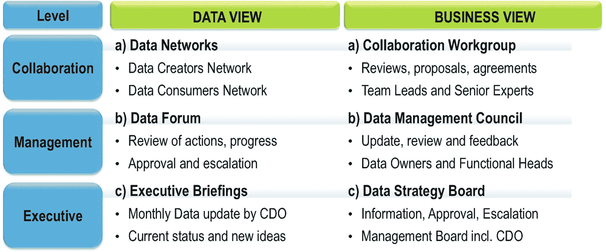

# 根据不同受众制定计划

你无法用同一信息打动所有人。

你不仅需要区分董事会成员和行政文员——在与业务人员和数据达人沟通时，也需要选择不同的措辞。

因此，对受众进行正式分组可能是有意义的，即建立你能以类似方式沟通的正式群体。

首先，数据创建者和数据消费者通常每天没有太多可以互相分享的内容。如果你想讨论参考数据维护，数据消费者会觉得无聊。参考数据维护者也不太关心数据可视化。这就是为什么建立两个独立的网络（或共享聊天论坛内的两个独立区域）通常是合理的。

其次，可能需要将数据消费者进一步细分为运营型消费者和分析型消费者。

第三，你通常会发现“数据”视角和“业务”视角之间存在差异。

-   前者专注于数据相关活动，独立于业务案例方面和优先级排序。

-   后者从整体业务角度看待数据主题：需求、紧迫性、机会、成本、资源和收益。

经验表明，这两种视角涉及不同的人和角色，因此分开组织是合理的。概览请参见图 14-5。



图 14-5

面向两个不同的数据受众

## 经常提出的担忧

“常见问题”更具挑战性的兄弟是“常见担忧”。我们在本章中已经涉及了大部分内容，以下是总结。

### 你试图解决什么问题？

高管们有各自的重点和问题。这就是为什么你需要为每个人量身定制故事。

让我们来看三个例子。

**示例 1**

**CFO 的故事**

`CFO` 深知自己角色的重要性。所以让我们问问 `CFO`：“谁在做相当于 `CFO` 职责的数据活动？”

大多数组织的数据量超过了有形资产。同样可以使用示例和报告来展示数据的财务价值。

如果你解释为什么“数据是一项资产”，`CFO` 会理解。

如果数据存在且价值很高，`CFO` 最不应该否认应该有高级别人员负责管理它。

**示例 2**

**生产部门的故事**

生产主管可能认为没有必要进行主动的数据管理，因为所有 `KPI` 都已经存在了。

一个有趣的问题是：“你知道你的 `KPI` 的准确性吗？”

也许生产主管看待数据类似于电力：它就在那里，你只需要接入一个耗电设备就能让它工作。

你的问题可能是：“你能多快发现正在使用的数据是错误的？”以及“错误的数据引导你的生产过程会有什么后果？”

使用来自操作层面（例如，缺陷传感器的数据）和商业层面（例如，不正确的产品需求数据）的示例至关重要。

**示例 3**

**法务部门的故事**

为什么你所在组织的律师会对数据管理感兴趣？

有趣的问题可能是：“你是否全面了解我们组织隐私政策的遵守情况？我们能确定通过外部审计吗？你能承诺不会保留任何个人数据超过必要时间吗？你知道组织中所有负责个人数据的人员吗？”

此外，你可以询问，如果组织被起诉，是否能够迅速汇集所有信息来证明其清白（或者及早发现确实存在问题）？

显然，还有很多问题可以通过数据管理来解决。维护一个常设的主题列表很有帮助，其中包括所有负责人（或受影响最大的人）。你通常不需要描述你打算如何解决这些问题，因为大多数人更关心最终结果，而不是达成结果的方法。

### 这对我有什么好处？

要使数据办公室成功，他们所做的一切都必须带来益处。不是为了他们自己——这太短视了。不是为了组织——这太遥远了。不，你需要说服个别同事，你的工作能改善他们的处境。

这并不意味着你需要调整你的目标。相反，如果你将预期益处的重点转移一下会有所帮助：从有效但抽象的数据中心目标（如“高质量数据”或“单一数据源”）转向业务团队能够理解的好处。

通常，你会发现人们愿望清单上最重要的是什么——我们称之为“A”。然后你思考数据如何帮助实现这些愿望——我们称之为“B”。那么价值主张就简单地表述为“通过 B 实现 A”。

示例多种多样，例如“通过流程自动化降低劳动力成本”、“通过实时提供所有客户和案例相关信息提高联络中心座席的一次解决率”、以及“通过按星期几精确预测需求来减少过度生产”。

“这对我有什么好处？”的第二个组成部分是经常被低估的个人方面：“这对我个人有什么好处？”

请注意，人们通常不会这么直白地说出来——你需要从字里行间去发现。

在一些（理想的）情况下，部门的成功会成为个人的成功。然而，人们通常渴望个人利益，例如日常工作更省力、自身成就更受关注、或者免受同事的无理指责。

最后，有时你可能需要要求人们遵循你的指示，而他们无法获得（部门或个人的）好处。对“这对我有什么好处？”这个问题的诚实回答可能是：“没有。只是从股东的角度来看更好。”

这显然很难推销，因为大多数人不像亚里士多德曾经提倡的那样，纯粹为了行善而行善。

在这种情况下，你可能需要反过来提供一些东西。谢天谢地，数据办公室的产品组合中有如此多的附加价值，你应该能够为每个人提供一些东西——无论是常规的数据服务，还是数据团队有能力做的其他事情，无论是为了满足部门需求还是个人需求。

### 我没精力处理数据相关的工作

我记得有一位刚上任的 `CFO` 对 `CDO` 说：“你有很多有趣的想法。我保证，一旦我有时间，就会仔细研究。但首先，我需要解决几个紧迫的问题。”

在这个案例中，“时间”既指资源的可用性，也指必要的注意力。而目前，注意力都集中在大量具有极高管理能见度的短期议题上。

由于在该组织中，`CDO` 向 `CFO` 汇报，因此数据办公室团队在其支持角色内尚可自由运作，但短期内无法朝着数据驱动型组织进行战略发展。

从这个故事中，你可以得出两点建议：

1.  **数据需要快速交付价值。**

    如果你通过数据提供附加价值，请不要专注于规模最大或商业案例最突出的举措。

    相反，应从那些你能快速交付、且不需要数据办公室之外投入太多资源的举措开始。这能增加你获得机会来证明自身价值的概率。

2.  **数据不是“额外工作”——它能解决当下问题。**

    利用数据改善业务，并非团队所有其他职责之上的额外任务，因而需要额外资源。相反，它能让解决即便是战术性的问题也变得更容易。

    你可能希望尽早专注于传达这一信息，因为高管们通常不会自然而然地明白这一点。

    你或许记得那个著名的漫画：一个显然刚刚发明了（圆形）轮子的石器时代的人，试图将轮子提供给两个正拼命用方形轮子拉车的同事。这项活动耗费了他们巨大的体力，以至于他们无暇倾听第一个人的提议，而该提议本可立刻让他们的生活轻松许多。

    你还可以用许多其他类比来解释数据带来的机遇。不过，你可能也希望能分享一些来自现实世界的、易于理解的例子。

### 你的战略构想可以明天再看

你是否曾在会计师忙于年终结算时，向他们约过会面？

无论你的战略构想有多棒——在某些情况下，人们总有更紧急的事情要做。

问题在于，当这种情况成为一种常态时。而且，大多数人从 `CEO` 到行政文员，手头总有事情要做。

当这被用作借口时，你可能希望利用你的数据治理来设定并沟通正确的优先级。但仅靠这点可能不够。人们不会立即放下手头的工作来与你的团队合作。

通常，允许人们争取一些时间是个好办法。毕竟，他们并非普遍反对你的想法——他们只是现在不想处理它。

那么，为什么不做个交易呢？“你可以在这周末前完成这些工作，然后让你团队的两名成员与我的团队在 `XYZ` 项目上合作。”请记录这个约定，即使只是通过一封电子邮件。

这样的协议能让你的对接方进行组织和准备。而且，承诺的影响离兑现越远，每个人都会感觉越自在。

为了防止这种方法拖延你的计划，一旦你意识到需要与另一个团队合作，就应尽早提出。

### 这个工作一直是 `IT` 部门负责的

在这里，我们可以区分三种不同的情况：

1.  **数据办公室之外的数据团队**

    过去，某些特定的数据工作可能确实由 `IT` 部门负责。如果这些人或团队做得很好，也许他们应该继续作为数据办公室的一部分做同样的工作。这是一个敏感领域，你应该谨慎倾听和行动。

    在很多情况下，先前负责的团队会很乐意移交所有权——但他们几乎不会放弃自己的资源。正确的顺序仍然是先处理职责问题。一旦职责明确了，你再指出你需要人员来完成这项工作。

2.  **从事数据相关活动的技术团队**

    每当你发现一个*技术型*的 `IT` 团队以前做过数据工作，你可以解释这种转变是合理的。此类对话中值得探讨的问题包括：

    -   他们真的理解你的业务问题吗？

    -   他们是在为你（或与你一起）解决问题，还是主要提供工具？

    根据对方的回答，你或者会拥有职责转移的充分理由，或者会发现优秀的数据专家就身在一个技术团队中，并且他们可能愿意转到数据办公室。

3.  **尚未覆盖的活动**

    `IT` 部门可能提供了有限的服务，这在缺乏整体数据战略的组织中很常见。

    这种不完整的服务通常涵盖了所有技术方面，但缺少了数据全面管理中的关键活动，例如端到端视图或跨业务职能的需求对齐。

    这些情况为你解释业务驱动型数据管理的理念提供了绝佳机会。

### 正确的数据处理会危及我的项目

人们常常担心，如果遵循新的数据规则，他们的项目会变得过于复杂、延期完工，和/或超出预算。

在此值得深入探讨一下。

项目经理或产品负责人通常并不反对“一次做对”。他们只是不想自己看起来表现不佳。

给他们提供有力的论据。

# 应对挑战与变革

-   要么：如果我们多花一个月的时间来确保数据方面的可持续性，整个企业就能做得更好。
-   要么：如果我们现在不这样做，我们就无法从数据办公室获得上线许可。

你可以通过建立数据相关的透明化体系来支持后一点：
-   每个项目都需要进行数据审查，并且结果必须公开。
-   需要定义临时让步的标准。
-   所有这些都必须得到你需设立的数据决策机构的认可。

总而言之，你并非要让项目经理或产品负责人这样的人难做。相反，你为他们争取额外资源或预算提供了有力的理由。几乎没有任何负责人会拒绝获得足够资金和人员来创建可持续解决方案的机会。

## 如果失败了呢？

人们不确定数据办公室是否会成功，也不知道它能否长久存在。

尤其是在注重政治意识的人群中，只要专门的数据管理可能被证明是一场失败的实验，他们就不愿公开支持新任`首席数据官`。他们不想押错赌注。

说实话：除非你之前已经在组织中功勋卓著（或者你能定期与`CEO`共进晚餐），否则这些担忧都是合理的。

在这种情况下，把目光投向组织外部会有所帮助。尽管专门的数据管理在你的组织内部可能还是未知领域，但在组织之外，这已经成为跨行业的成熟做法。

而且，`首席数据官`的数量不仅增长迅猛，而且这种增长趋势已持续了一段时间——长到足以说明这不是一种短暂的昙花一现。

无论你多么确信自己*拥有*适合组织处理数据的正确方法，更明智的做法是强调数据管理并非你独创。

除了那些以数据为主要业务的组织之外，其他许多组织也有大量具体案例可循。你的信息，在大型咨询公司声明的支持下，可以是这样的：

```
我们并非第一个设立数据办公室的组织。其他组织之前已经成功实践过。如果我们不这样做，我们就会失败，或者被竞争对手超越。我们根本承受不起回到原点的代价。
```

与此同时，你可以通过承诺——作为`首席数据官`，你将承担风险——并在万一失败时承担责任——来鼓励个人与你合作。

## 没有数据办公室也运行得很好

我仍然听到那位公司元老说：“没有`首席数据官`，我们几十年来不也一直很成功吗！”

我不得不承认他说得对。而且他的组织内部也从未发生过任何需要变革的事情。

嗯，不是*在*组织内部……

请人们向外看。首先，事物总是在发展。技术在发展，行为在变化，期望在演变。其次，发展的速度在加快。虽然上世纪某种运作模式可以持续数十年，但如今颠覆已成为常态。

那么，哪个领域受到的影响最大？不，不是技术。尽管该领域取得了巨大进步，许多基础商业模式依然未变。汽车、火车和飞机仍然将人类从 A 点运送到 B 点，电脑仍然有屏幕和键盘，电影仍然以矩形格式播放。

我们应预期在未来的几十年里，所有这些领域都会发生根本性的变化。然而，就目前而言，组织需要应对那些已经开始显现的变化。

是的，我指的是数据的世界。当然，未来我们会在数据领域看到许多变化。但与许多其他领域不同，这些变化已经如火如荼。对数据的开发利用多年前就已经走出了实验室。

数据的未来已经开始。

## 我不想改变……

为什么“变革管理”作为一门学科在过去几年里获得了如此多的关注？当我们周围的世界以日益加快的速度变化时，人类适应变化的能力却并没有太大改变。变革更多地被视为一种风险而非机遇。人们倾向于高估负面后果的影响，而低估潜在收益的价值，往往并未意识到这种偏见。

开始主动管理数据意味着一种改变。这就是为什么数据管理就是变革管理。

对未知的恐惧不会以单一的、你可以用准备好的答案来应对的陈述形式出现，就像其他更基于事实的担忧那样。相反，你需要系统地处理这种恐惧。以下是一些思考：

1.  **成为闪亮的榜样。**

    不要要求他人拥抱变化，而是告诉他们*你*是如何做到这一点的。其他人会观察你。他们应该看到你欢迎改变，即使这会危及你自身的安全地位。当然，不要只是装装样子。你需要真正对变革持开放态度，包括未来可能对你当前数据管理方式提出的挑战。

2.  **营造积极的氛围。**

    数据可以是一件令人兴奋的事情。你可以展示各种机遇。目标可以是激发人们的好奇心。给予表达担忧的空间。让人们分享他们的问题和想法，并透明地处理所有这些问题。你可以像推销医疗顾问一样推销数据办公室——帮助你解决当前问题，*并*教你如何从此以后自己照顾好自己。

3.  **化解对未知的恐惧。**

    许多同事可能害怕无法适应新的工作方式。毕竟，`人工智能`和`机器学习`对许多人来说是“魔法”的同义词。你的信息可以是这样：“你不需要详细了解这一切。只需要少数人是真正的专家。数据的存在是为了让组织中其他人的工作生活更轻松。”

## 算法会取代我吗

人们会担心数十年的经验和专长变得无用。而且，我们必须诚实地说，一定数量的特定资质在这种情况下会失去相关性。

那些技能将完全不再被需要的人可能会感到恐惧，这也是合理的。但维持现状并不能解决问题：其他组织将获得成本优势，这会使你自身的更多岗位面临风险。

我认为此时有两个信息至关重要：

1.  **技能提升是可能的。**

    几乎没有人会变得无法挽回地多余。变得多余的是经过训练的特定技能，而不是天赋或才智。培训可以利用后者来培养面向未来的技能。

2.  **`人工智能`与人类相辅相成。**

    `人工智能`和人类扮演着互补的角色——各自可能达到 90%的水平，而两者的结合可能能达到 97%。此外，`人工智能`仍专注于重复性、不太复杂的任务。这可以使人类能够专注于更具挑战性的任务——而这些通常也是人们更喜欢的任务！

    以一个可能存在的网球混合体为例：

    *   **人类**凭借其创造力，仍需要根据即时情况、对手状态的印象以及惊喜因素，来决定击球风格和击球位置。

    *   **机器**凭借其精确性，可以确保球准确地落在人类选手想要它落地的位置。

    另一个有利于人类的方面是质量保证的需求：就目前而言，你不会希望用`AI`来验证`AI`产品。这里你仍然需要人的因素。

    考虑即将出现的用于通过皮肤图像发现癌症的`AI`解决方案。这些解决方案是如何推销给全世界的医生的？他们听到的不是“`AI`将取代医务人员”，而是这样的信息：“这是一个让你变得更强大的工具。”

    你可能希望为你的员工准备类似的信息。不是为了安抚人心——而是因为事实本就如此。

脚注 1