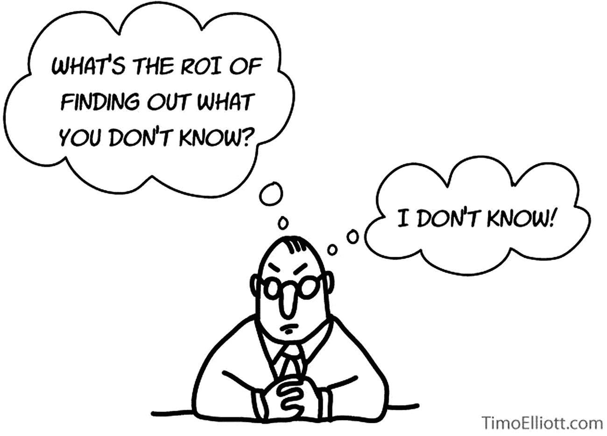
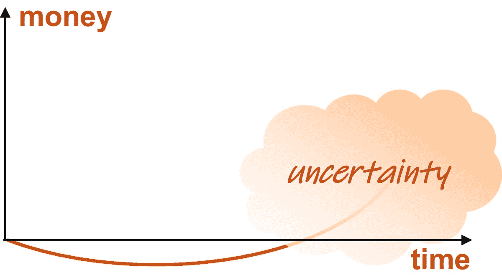
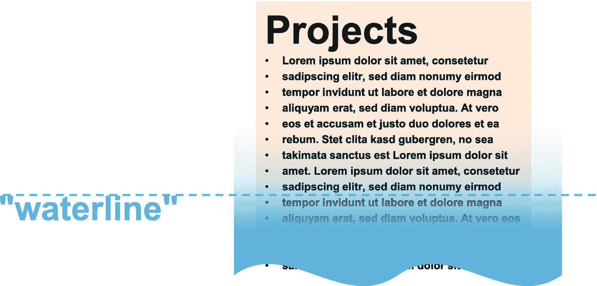
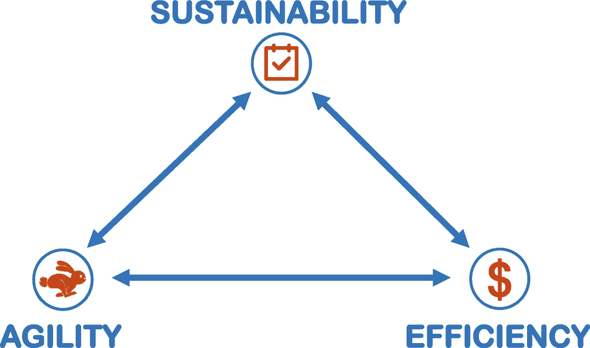
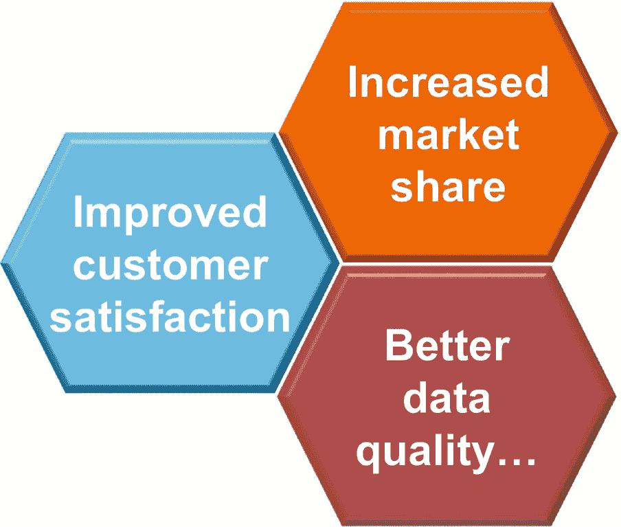
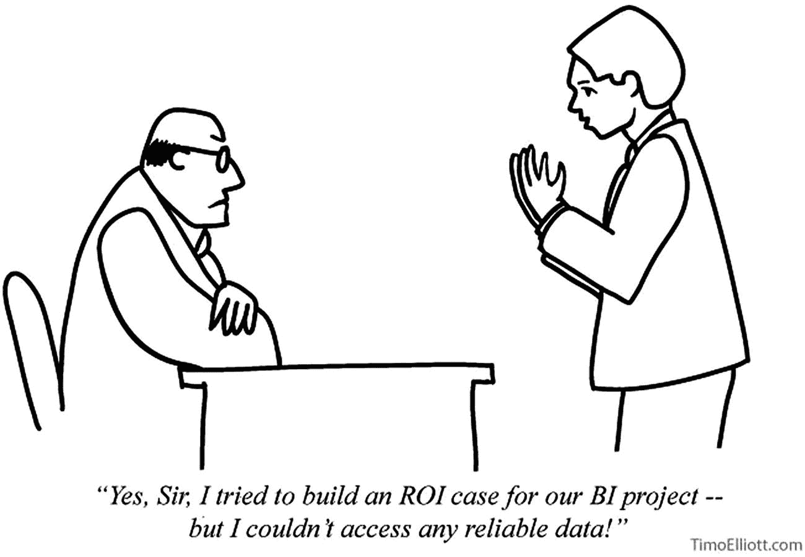
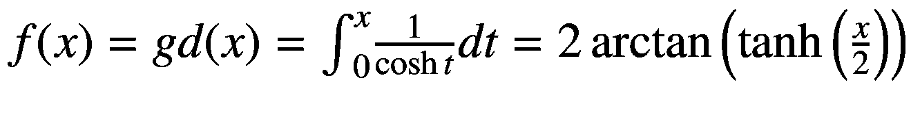
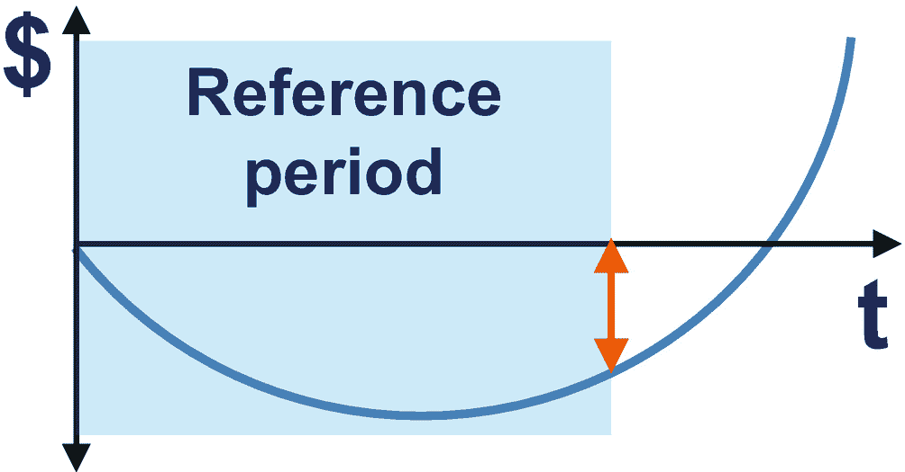
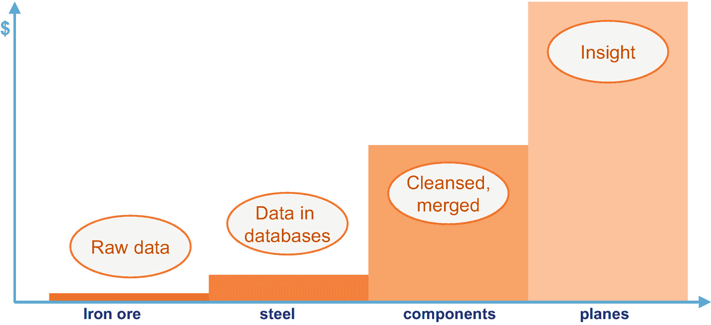
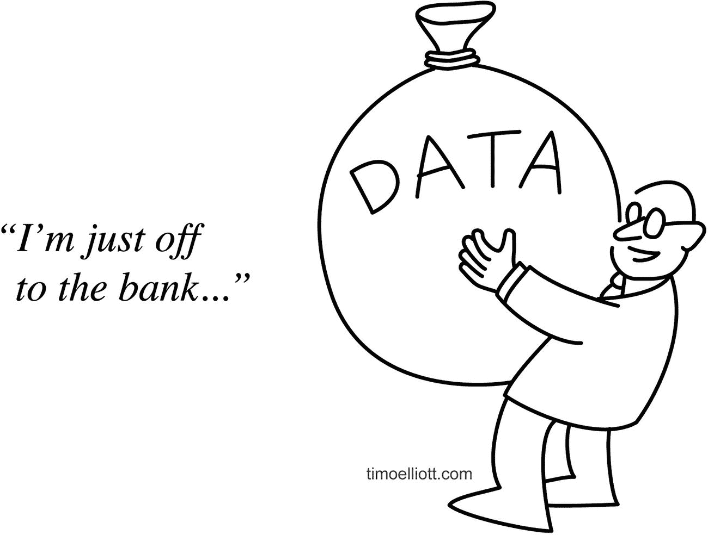

# 16. 数据业务案例



图 16-1

ROI 困境


## 数据的商业案例——为何需要？

不妨想象一下 Gartner 这类机构常用的典型“炒作周期”曲线。

我们正经历一个时期，尤其是围绕**人工智能（AI）**和**机器人流程自动化（RPA）**的最现代数据学科曾被认为即将取代人类智能。

每个组织都在设立 AI、机器学习或数据科学部门，以免错失良机。这就是 Gartner 所称的“期望膨胀期”。

与此同时，我们已经过了“我们必须无条件去做”的阶段。这并不意味着 AI 和 RPA 等主题失败了。它们没有，而且每个人都知道有些组织通过部署这些数据学科获得了成功。

然而，我们已经达到了一个阶段：领导者期望数据能够提升自家组织的盈利能力。这就是为什么我们在申请数据项目资金时，会更频繁地听到“让我看到回报”这句话。

这完全合情合理！那些对组织目标没有直接或间接贡献的数据学科，还是让它们留在大学里成熟吧（说得有点夸张）。

我们已经到达 Gartner 的“泡沫破裂谷底期”了吗？还没有，但我们需要努力使其保持浅显，并进入“稳步爬升恢复期”。

一个关键推动因素：商业案例。你应该遵循“没有案例就没有项目”的原则！

请记住，这并非关于探索数据背后的技术。而是关于投资者和预算持有者对数据投资回报率的信心。

为此，商业案例是正确选择。每当需要为一项活动做决策时，商业案例应该有助于将决策建立在事实基础上。

*用事实来论证数据项目是一种极好的方式*——你可以用数据来支撑人们凭直觉无法理解的东西。

另一方面，商业案例需要数字——不仅关于成本，也关于预期收益。

这对数据项目来说尤其是一个挑战。许多数据项目并不直接提供价值，而是使其他活动能够提供这种价值。

这种矛盾的情况值得本书用专门的一章来讨论。让我们从 CDO 的视角来仔细审视商业案例。

## 完美世界中的商业案例

在深入探讨解决方案之前，我们首先应该定义什么是商业案例，然后理解随之而来的挑战和机遇。

### 商业案例的基本理念

**第一步**：比较项目的投资

* 与**最佳替代投资**（如果资金可用）进行比较，和/或
* 与组织的**资本成本**（如果需要借款）进行比较^(³⁶)

**第二步**：如果项目带来更高回报，就执行它！

诚然，这是一个非常简化的描述——但许多组织中处理商业案例的现实甚至更加简单。

### 随时间变化的资本成本

典型的计算会考虑随时间变化的资本成本。

* 你想知道项目的回报是否高于（假设的）最佳替代投资的利率，即**内部收益率（IRR）**。
* 首先，你确定通过拟议项目支出或赚取的所有资金，以及“生效日期”（即资金流入或流出的日期）。
* 第二步，你通过向前或向后应用利率，将所有项目计算到同一个参考日期（通常是“今天”）。如果你从未来向后计算到今天，这被称为“折现”（见图 16-2）。

  

  图 16-2 对未来价值进行折现

* 如果参考日期是“今天”，结果被称为**净现值（NPV）**。

诚然，这包含了很多未知因素——但这总比仅凭直觉要好。注意：这同样适用于一般的数据管理。

### 示例 1

假设今天要支付 **$95**，一年后你将收到 **$100**。

假设内部收益率（IRR）为 **5%**。

商业案例将考察这两笔金额今天的价值：

1.  今天到期的 $95。
2.  一年后会变成 $100 的金额，按 5% 的 IRR 计算：**$100 / 1.05 = $95.24**（公式：`未来金额 / (1 + IRR)^年数`）

总 NPV 为 `$95 – $95.24 = –$0.24`（负值！）

这个组织会赚钱——但与预定义的替代投资相比，是亏钱的！

在这种情况下，对于组织来说，不执行该项目是更好的选择，因为它们如果把钱投资到别处（或者不用贷款），会赚得更多——前提是它们的 IRR 数字是准确的。

### 对“风险”的考量

预期在未来赚到的钱必须被视为“有风险”。

* 与此同时，替代方案可能进入市场。
* 或者目标解决方案，例如一个产品或一个软件，其计划生命周期有限，从而导致收益递减。

当然，你可以设计复杂的公式来确定一个随时间变化的“风险因子”。然而，正如你所知，未来伴随着不确定性。

图 16-3 说明不确定性常常使得计算盈亏平衡点都成为不可能。



图 16-3 不确定性与时间

这就是为什么大多数组织简单地限制回报计算，例如，三年以后。商业案例会忽略任何在此之后产生的收益。

注意：精确计算是一回事——所有参数是否保持不变则是另一回事。

### 项目选择

如果许多项目都有足够高的 IRR，一个组织可能会限制项目数量，以保持在预定的项目预算之内。结果，即使某些项目被计算为“值得运行”，它们也可能无法越过“水位线”。它们将不会启动。



图 16-4 项目水位线

或者，一个组织可以获得额外资金，例如来自银行或资本市场。只要适用利率低于项目的 IRR，这样做就是有意义的。

在所有情况下，资源的可用性也必须考虑在内。专业知识可能是一种稀缺资源，无法按需简单获取。这是限制项目数量的另一个上限。

### 一切顺利？

这听起来像是一种科学、不可动摇的方法。从股东的角度来看，只要数据相关项目值得运行，它将有助于它们获得资助和批准。

真的如此吗？

在探讨如何让商业案例为你所用的策略之前，让我们先看看商业案例带来的一些陷阱。

可悲的事实是：

* 商业案例伴随着若干挑战。
* **数据**商业案例还会附带一些*额外的*挑战。

让我们逐一审视其中的**九**个挑战：**五个**通用挑战，以及**四个**数据项目特有的挑战。

## 通用挑战


### 商业案例文化

让我们快速做个小测试：大多数人*真正*编写商业案例的目的是什么？

-   判断项目是否应获批
-   作为一种手段，不惜一切代价推动项目获批

你猜对了：遗憾的是，答案并非第一个选项……

项目经理的典型态度（通常受到不成熟组织文化的鼓励）是这样的：“我得‘调整’它，直到它足够‘好’。如果它不够好，项目无法获批，他们就会认为我是个失败者。而我需要让一些项目获批，才能展示我的价值。” 听起来很熟悉吧？

这种行为模式在许多大型跨国公司中都能观察到，即便不是大多数。它导致了次优的资金分配，大量的精力都浪费在“美化案例”上。

对于建立一种有效的商业案例文化，这里有一条经验法则：

不要奖励“漂亮的”商业案例。奖励“诚实的”商业案例。

### 效益的量化

项目所有驱动因素都能被量化吗？比如以下这三个方面？


**图 16-5** – 难以量化的价值

尝试量化声誉不佳对客户忠诚度的影响。这在论证合规工作的合理性时至关重要。

### 组织内部相互冲突的目标

即使每个单独的目标都是合理的，目标之间也可能相互冲突。一组典型的矛盾目标是可持续性、敏捷性和效率——每一项本身都确实可取——见图 16-6。

在运筹学中，这种情况通常通过一个目标函数来处理，其中不同目标的最优权重是优化任务的主题。

然而，在现实生活中，目标函数

```
a * 可持续性 + b * 敏捷性 + c * 效率 ➔ 最大
```

的参数 `a`、`b` 和 `c` 无法客观确定，并且每个业务职能部门都有不同的视角。虽然管理者的奖励方案应旨在使其个人目标与整体组织目标保持一致，但总存在差距。



**图 16-6** – 平衡可持续性、敏捷性和效率

这三个目标中的每一个都具有需要纳入商业案例的价值。风险管理甚至会添加上事件的*概率*——这是你无法明确确定的另一个方面。

对于数据项目而言，处理所有这些方面是数据办公室（Data Office）的任务。一个拥有足够授权的 `CDO`（首席数据官）应能够基于其跨职能、长期的视角（这是 `CDO` 角色的重要组成部分）比其他高管更好地代表股东观点。

`CDO` 面临的最大挑战是如何充分支持可持续性目标——经验表明，组织管理层中积极支持该目标的利益相关者很少。有时，只有 `CDO` 和 `CEO`（首席执行官）支持。如果 `CEO` 即将退休或离职，可能就只剩下 `CDO` 了。

让我们看看组织中其他典型的参与者：

-   典型的**项目经理**旨在最大化敏捷性，以便项目能够快速完成，没有太多“官僚主义负担”。通常情况下，项目经理并不会因可持续性而获得奖励。
-   **首席财务官（CFO）** 关注效率，即追求资金价值最大化，最好能在财年内实现。这包括关注边际成本（`MC`）：一旦额外投入的回报低于某个阈值，`CFO` 提供资金的意愿就会急剧下降。
-   **长期投资者**和所有者通常会将可持续性置于列表前列。对他们来说，只要不产生未来成本，项目花费稍长一点时间也可以接受。
-   **法务部门**会坚持合规性——这是可持续性目标的一部分。对这个部门而言，其他两个目标可能退居其次。

所有这些参与者都需要参与进来，但你需要强制他们量化自己的偏好——这将允许从组织的角度进行全面的成本/效益比较。

### 事后验证困难

想象一下编写商业案例的典型过程：

-   你为商业案例勤勉地计算了成本和效益。
-   然后你运行项目，并成功完成了项目！
-   你确切知道花了多少钱。
-   但是……*你能证明那些效益吗？？？*

问题：

-   声称的效益不易验证。
-   确定的效益无法明确地归属于单个项目。

你应该预见商业案例的验证问题，以便更好地准备下一个商业案例。如果你自己都不相信自己编写的商业案例，那么无论如何你都不应该推动这个项目。



**图 16-7** – 难以量化的效益

### 商业案例快速过时

想象一下，你计算了项目将产生的价值。而且计算得准确又精确。

但时代在变……

事实上，预期的回报距离现在越远，不确定性就越大。

例如，新的技术发展可能会使某个解决方案变得毫无用处。

## 数据相关挑战

数据项目的商业案例有时不免带有讽刺意味：你需要为你的数据编写商业案例，同时你还需要数据来编写商业案例。



**图 16-8** – 商业案例的“第二十二条军规”

这幅漫画提醒我们一个事实：与数据相关的商业案例相比普通商业案例，某些挑战出现的频率更高。

但我们所说的“与数据相关的商业案例”指的是什么？它是针对旨在利用数据或数据处理的项目所编写的商业案例的简称。这些项目可以多种多样，例如：

-   引入跨职能的主数据管理
-   订阅外部数据源
-   组织范围的黑客马拉松
-   增设数据科学职位
-   基于网站访客行为的规范分析
-   从 Hadoop 迁移到 Spark（或任何其他关于技术数据处理的 IT 项目）

以下是数据项目商业案例中最常见的一些挑战。


### 数据并不性感

再来个小测验。下面这个故事哪里有问题？

**示例 2**

在年度高管会议结束后的晚间聚会上，机器学习负责人正与一位三十多岁的首席商务官女士交谈。当我们走近时，听到他对她说：

“……然后我们改进了`神经网络`，放弃了使用简单的`Hard Sigmoid`函数作为激活函数，转而采用`古德曼函数` *。*

这需要更强的计算能力，但我们观察到了远胜之前的结果！”

首席商务官回答：“酷！我迫不及待想让你向管理董事会展示这些技术细节了！

一旦他们弄懂其工作原理，就会立刻为额外的硬件提供预算！”

与此同时，她看着这位英俊的机器学习专家，心想：“他真可爱！”

你找出所有错误了吗？

答案如下：

1.  你不会看到机器学习人员受邀参加高管会议。
2.  没有哪位高管会听一个技术呆子讲话。
3.  董事会成员想知道它**是否**有效，而非**如何**有效。
4.  别指望任何预算，因为董事会成员自以为懂“数据”，其实根本不懂。
5.  懂数据并不会让你变得性感！（抱歉实话实说。）

### 确定使能型项目的收益

数据项目通常是“使能型项目”：其价值增值需要通过后续活动实现。例如：

*   `MDM`（主数据管理）提升运营稳定性。
*   分析为营销部门提供所需的市场洞察，避免将资金浪费在无效的营销活动上。
*   `SOA`^(³⁷)（面向服务架构）避免数据不一致，从而减少财务部门的人工修正工作量。
*   数据科学发现此前未知的关联性，从而实现针对特定地域的服务配置。

为什么即便不存在政治或文化问题，使能型项目也常常缺乏资金支持？

你经常面临以下两个问题：

*   几乎没有（或完全没有）*直接的*财务收益。
*   未来的项目会声称享有这些收益。

打个比方，让我们看看数据领域之外的一个使能型项目。

**示例 3**

哈利法塔的“使能者”：它的地基！

超过 45,000 立方米的混凝土（重逾 110,000 吨）被用于建造这座塔的混凝土和钢结构地基，其中包含 192 根深入地下超过 50 米的桩基：该塔 20%的混凝土都隐藏在地面以下！

如果单独为这座塔的地基做商业论证，会是什么样呢？

*成本巨大，没有一间房间，只有一个平台……*

这个案例已经暗示了第一个可能的方法：地基并非单独获批和获得资金——而是与地面上的塔楼作为一个整体项目一同获批。

### 漫长的盈亏平衡点

一项投资需要多快实现盈亏平衡？

一个项目如果长远来看能够“赚钱”，就应该被推进。

现实中，一个组织获批的项目数量取决于其预算。所有其他项目都不会开展，即使它们承诺能为股东带来净收益。

哪些项目会首当其冲成为牺牲品？通常并非那些`ROI`（投资回报率）最差的项目，而是**那些 ROI 在遥远未来的项目**！

图 16-9 展示了一种情况：盈亏平衡点仅在超出组织设定的参考期**之后**才能达到。这样的组织会为此类项目计算出负的`ROI`。



**图 16-9** 参考期后的盈亏平衡点

毫不意外，许多基础性的数据工作都属于此类。

以下是一些有用的类比，用以向高管解释数据项目的情况：

1.  如果没有长远眼光，航空公司就不会购买新飞机。
2.  在林业领域，采伐成材树木时不栽种新树可以节省成本。然而，这种方法长期来看会毁掉这个组织。

**注：** 一旦你将数据视为一项资产，长远关注甚至能提升组织当前的估值！（请参见本章前文“折现”部分，章节标题为“资本成本随时间变化”）

### 商业领袖的动机

你可能已经注意到，许多项目因非事实原因而被否决。

那么，为什么领导者不支持所有正向的商业论证呢？

是的，有时他们确实**真的**不理解。

但在许多情况下，他们理解，但：

*   看不到对自己有利之处
*   害怕变革
*   更愿意遵循自己的议程

数据商业论证面临的一个特殊挑战是，商业领袖更容易蒙混过关！其他高管对此知之甚少，而且几乎没有人会为自己存有疑虑的倡议的商业论证进行辩护或支持。

## 数据商业论证的八个秘诀

与其抱怨我们无法改变的事情，不如思考如何应对当前局面。

考虑到你的商业论证在获批过程中可能遇到的所有障碍，你需要一套灵活的策略！

虽然这套策略不同组织会有所不同，但我想分享关于数据商业论证的八个秘诀——它们可以构成你策略的一部分。

### I. 主动进行利益相关方管理

你还记得数据商业论证的最后一项挑战吗：对你认为显而易见必须做的事，缺乏高管的支持。

这就是为什么利益相关方管理是关键。了解他们，建立信任，塑造双赢局面，并准备好在一定程度内妥协。

如何做到这一点？建立联系。进行单独会谈——正式会议或边喝咖啡边谈都行。

关键方面在于：

1.  **提问并倾听！**  
    这是我反复强调的一点。它同样适用于商业论证管理。你能借此了解决策者们最重大的痛点。并据此量身定制你的故事。

2.  **引起他们的好奇！让他们眼前一亮！**  
    开发出对特定高管有意义的示例。示例越具体、越形象越好！  
    利益相关方管理还涉及一项单调的工作：文档化。创建你的利益相关方地图。确定并记录决策者之间的关系。让决策者了解其朋友或盟友的（正面）观点。  
    你还应对利益相关方进行分类。以下是一个可能的类别列表：
    *   力不从心者：有兴趣但害怕
    *   抱怨者：过去总是抱怨，现在却不贡献
    *   好奇者：常常一无所知但愿意聆听
    *   自给自足者：认为自己能独立完成一切
    *   肤浅者：想要光鲜的东西却不愿付出艰苦努力
    *   傲慢者：认为数据管理多此一举
    *   投入者：你的完美合作伙伴

你需要针对每种行为模式制定计划。你也可以规划如何将利益相关方从一种模式转变为另一种模式。


### II. 培养数据素养与透明度

人们需要理解你在说什么。你需要管理好预期并进行解释，以建立对数据的信任。

**你需要做什么？**

你需要对全体员工进行数据知识培训。

**说起来容易做起来难？**

没错！但你可以采取一些措施来改善现状。理解数据的人（或者至少了解数据能实现什么的人）会更支持你。

首先，要透明，并诚实地告知所有的优缺点。

现在，为了让你业务案例看起来更好看，隐瞒风险可能颇具诱惑力。但不这样做有几个好处：

1.  **有助于强化透明度。**  
    一旦你的案例被证明是诚实的，你就有权为所有竞品的业务案例设定标准。

2.  **可以提升你的声誉。**  
    处理人们通常不理解的事务的管理者，依赖于建立诚实的声誉。毕竟，你不能指望太多人基于对你的计划进行科学评估后而赞同你。他们需要信任你。

3.  **为你留有余地。**  
    将风险纳入考量可能会使一个项目不如具有相同投资回报率但风险较低的投资有吸引力。但在项目失败时，它可能会为你提供保护——你可以归因于这些风险。

这就是为什么任何风险都应被纳入业务案例中的原因。

其次，不要指望人们会自愿“走进数据的世界”。你最好就在他们所在之处去引导他们。使用他们的语言。并思考那些对他们各自所处情境有意义的类比。

一个很好的例子是，如果你对数据进一步处理，数据的价值会提升。你可以将其与从铁矿石等原材料到飞机这样的最终产品的价值提升进行比较，如图 16-10 所示。

这个例子很容易被理解，并且可以让你将其与数据转化为信息和洞察时的价值提升进行比较（例如，通过构建数据、清洗数据、将合适的数据整合在一起等）。



*图 16-10 价值的演进*

简而言之，你可以将常见的口号“数据 – 洞察 – 行动”与“钢铁 – 飞机 – 航空运输”进行比较。这种比较使得从数据到洞察的路径有多么复杂，相比于从洞察到行动的步骤，变得显而易见。

而且你不必止步于此。正如飞机只有将乘客或货物从 A 点运送到 B 点时才体现价值一样，数据产生的洞察也只有当组织利用它时才能增加价值，例如，通过做出更好的战略或运营决策。

---

### III. 创建并维护数据路线图

只要人们不需要投入资源、资金或遵守规定，他们通常愿意接受路线图上朗朗上口的术语。这就是为什么最好将这两个步骤分开。

作为第一步，你要在不要求具体资源或资金的情况下描述路线图。你通常会解释为什么采取一系列步骤是有意义的。然后你请求大家都对路线图做出承诺。如果人们找不到反对的理由，他们可能会同意。

之后，当你将计划细化为具体项目并需要资金和资源时，你可以引用这个早期的承诺。

一个典型的引用方式可以是：“本项目是我们已批准的、旨在（年份）年底前实现 MDM 现代化的战略的一部分。”

如果这个承诺来自最高层，这种方法显然更有力。人们在拒绝支持董事会的决定之前可能会三思而后行。

这不仅仅是关于单纯的资金流程。也关乎让整个组织的管理者愿意为你的项目提供资源。

---

### IV. 将数据视为资产

数据不仅越来越频繁地被称为资产。它也与正式认可的资产有很多共同点：

*   使用它能带来切实的商业利益，例如：
    *   我们拥有这种资产比没有它时效率更高。
    *   我们能赢得新客户并留住现有客户。
*   我们可以将其转化为价值更高的事物。
*   它会随时间贬值，需要维护。
*   拥有它却不使用是一种浪费。

此外，像数据这样的无形资产甚至比有形资产更有优势：

*   它们不会因使用而变少。
*   它们可以在几秒钟内随处可用，并且每个人都可以同时使用。
*   虽然“压榨资产”在使用有形资产时通常不可持续，但对于数据这样的无形资产来说，这却是实现其价值的绝佳方法。

尽管如此，许多组织并不将数据视为资产。根据 Gartner 前数据与分析副总裁分析师 Valerie A. Logan 的说法，仅有“8%的组织报告其关键信息资产如同资产负债表上的资产一样被衡量”（Logan, 2019）。

或者，正如 Daniel Swarovski Corporation 全球数据与分析主管 Thomas Bodé在 2020 年 2 月巴塞罗那的一次数据会议上所言：“数据是未被充分发掘的资产。”

这种情况应该会激励你，因为它意味着巨大的机遇。

即使法规仍阻止数据被当作资产处理，你也应该探讨这个主题。以下活动可能对你有帮助：

1.  **为数据贴上价格标签。**  
    数据应根据其潜在增值获得一个价格标签。  
    每当作为项目的一部分，数据的价值（通过“提炼”）增加时，你应将此增值计入项目收益——即使实际的增值发生在项目之外。（但要解释你是如何计算的！）

2.  **与用户紧密合作。**  
    让业务团队参与进来！你们可以共同确定数据供应链中每个步骤的附加价值，例如获取、清洗、丰富、业务指标或报告。  
    第二步，让他们对数据的附加价值做出承诺。  
    来自受益者的价值标签，就是进入业务案例的门票！

3.  **善用类比和示例。**  
    有时一个大胆的陈述有助于说明这种等价关系，例如“维护不善的客户数据腐烂得和被遗忘的苹果一样快。”  
    事实上，随着我们数字时代数据流量的增加，数据越来越可以被归类为快速消费品（FMCG）。即使你不在该行业，你也可以考虑使用这个类比。

4.  **提出正确的问题。**  
    帮助他人。不要简单地问“这份报告的价值是什么？”  
    相反，要问“如果没有它，会对你产生什么影响？”

5.  **与 CFO 沟通。**  
    在大多数组织中，一个很有希望的接触点是首席财务官（CFO）。这个人不仅非常有影响力，而且应该比任何人都更了解资产的特性和关键性。

6.  **制定政策。**  
    即使“数据作为资产”对资产负债表没有直接影响，例如，根据 IFRS（国际财务报告准则）作为“无形资产”，^( ³⁸ ) 你也可以努力在组织内部制定政策，允许数据像其他资产一样被对待。  
    这将使你能够将适用于正式认可资产的原则应用到数据上。



*图 16-11 数据是一种资产*


### V. 必要时以隐秘模式开展工作

根据组织处理数据的成熟度水平，数据驱动型举措可能被迫以“隐秘模式”运行，直到能够展示出首批真实证据。

如果在不考虑未来复用的情况下，直接的业务案例无法展现出足够收益，并且也没有人对长期业务案例感兴趣，那么可能有机会将该想法“隐藏”在另一个已获批的项目之中。

这样一来，就可以先实现几个初步的示例。其价值通常会在下一个用例中变得显而易见。

例如，无需再次实现任何与数据相关的逻辑——只需调用（为第一个用例构建的）Web 服务即可。

让第二个用例的项目经理去传播这个消息——人们就会开始相信这个理念。

一旦那些仍想以不规范方式实施的人遭遇到来自他人的阻力，并最终决定遵循规则行事时，你就达成了目标。

### VI. 解释“不这样做”的成本

如我们所知，一个坚实的数据基础往往起着赋能作用，而所有收益都归功于那些受益于这一基础的项目。

与其将部分收益也归因于你的数据基础（并冒着被指责重复计算的风险），不如接受将这些收益分配给那些实施项目的做法。负责这些项目的人可能会感激你帮助他们达成了项目的财务目标。

相反，你可以考虑计算“不创建数据基础的成本”。这种方法可以让你列出所有那些如果没有你的数据贡献，要么根本无法实现，要么至少无法带来同等投资回报的项目。

### VII. 制定并遵循业务案例规则

你会遇到业务案例受到质疑的情况。例如，人们可能会声称你存在偏见，并试图美化你的业务案例。

我们必须承认，这种指责通常并非凭空捏造。当处理间接收益时（这在数据业务案例中很常见），回应这种质疑就变得更加具有挑战性。

因此，做好准备是很有用的，理想情况下，是通过制定普遍接受的业务案例创建原则来做好准备。而且，如果人们不必同时承诺预算和资源，他们更容易接受（合理的）原则。

这就是为什么你可能希望在创建第一个业务案例之前就做好这一点，因为在那时达成一致对任何人都没有代价！

当然，你会包含本章前面描述的所有标准组成部分，例如“净现值”计算，或考虑收益的最长时间范围。

但是，如果你能够成功纳入软性因素的规则，你就可以为数据相关项目带来更显著的收益。

一个例子是前面描述的“不做的成本”计算。这应该在你的业务案例规则列表中名列前茅，以期成为企业标准。

第二个例子是对*条件性*收益的处理。就像灭火器可能永远用不上一样，你可能永远不会面临安全受损或声誉受损的情况。但是，我们仍然有充分的理由去彻底实施数据保护机制，正如有充分的理由配备灭火器一样。

计算这类收益的一个简单规则是将事件的影响乘以其发生概率。一旦就概率和（正面或负面）影响达成一致，收益计算就变得简单了。

### VIII. 培养企业数据文化

看看你的周围：在你的组织中，是否有某个职能部门或部门的几乎所有项目都能获得批准，而无论参与人员是谁？

为什么会这样？是某种特定类型的项目被视为“理所当然”的、“必须做”的事情吗？

根据一个组织（显性或隐性）的文化，某些方面通常被认为是不可协商的。

*   也许数据保护被认为是一个至关重要的方面，以至于所有相关项目都获得了资助。
*   也许存在一个得到董事会支持的长远转型计划，以至于各个项目总是试图让自己被视为其中的一部分，以便获得预算。

你的目标应该是让“成为数据驱动型组织”成为那些由董事会支持的目标或计划之一，甚至成为你组织文化的官方组成部分。

## 将数据作为资产的用例

业务案例不仅仅是财务论证。它们也关乎提出理由来说服他人。

### 什么驱动着你的预测？

这是一个真实的故事。我不会透露该组织的名称，并且已经更改了数字。

*该组织的管理层知道员工需要得到激励。他们决定通过分享一个多年前的故事来培养一种敢于行动的态度：*

*在经历了一段困难时期后，该组织必须为未来几年设定目标。所有高管都基于他们悲观的世界观提出了非常保守的目标。*

*CEO 对这些毫无雄心的目标感到沮丧，他站起来说：“我们的目标是实现十亿美元的收入增长！”所有人都震惊了，因为这看起来并不现实。*

*但是，最终他们所有人都接受了这个目标（实际上，他们别无选择）。所有高管都感到面临挑战，并开始努力工作（他们无论如何也会这么做）。*

*几年后，他们从危机中恢复过来，并实现了那个十亿美元的目标。*

*他们说，如果没有这位雄心勃勃的 CEO，这些结果永远不可能实现！*

*多年后，管理层决定用这个故事来解释他们为什么设定雄心勃勃的目标。持怀疑态度的人会被提醒想起当初的成功故事。*

*不幸的是，与此同时，经济已经疲软。市场在萎缩，竞争对手在提供折扣以争夺市场份额。尽管该组织在运营和商业上都表现良好，但收入和利润都在下滑。雄心勃勃的目标并没有带来帮助。相反，它们模糊了局势，因为每个人都认为努力工作就能像上次一样达成目标。*

以下是任何类型财务预测的三个关键经验教训：

1.  雄心可能是预测的一个有用成分——但如果你将整个计划建立在直觉和雄心的混合体上，那你还不如使用随机数生成器。
2.  忽视外部数据会让你变得盲目。雄心并不能保护你免受市场扭曲的影响。
3.  仅仅根据过去的发展进行外推也不是一个好主意。外部世界在不断变化，这无法从内部数据中推导出来。

你又是如何做预算预测的呢——基于虚构、直觉，还是数据？

### 数据——为什么是现在

有必要强调的是，过去十到二十年间，数据业务案例的基础已经发生了巨大变化。

*   根据 Gartner^(³⁹)的数据，到 2020 年，将有超过 200 亿个连接的传感器、终端和数字孪生体对应着潜在的数十亿物品。
*   可用于分析的数据每两年翻一番。
*   由于必要的计算能力已经具备，旧算法现在可以投入使用。
*   AI 算法的发展迅速推进，因为它已成为数学研究的一个重点领域。
*   数据科学家的数量在增加。作为数学研究的一部分，神经网络正成为一门越来越有吸引力的学科。毕竟，数据科学就是应用数学。
*   客户期望在迅速发展。例如，如果组织询问客户已经提供过的任何信息，客户是无法容忍的。客户知道这是可以避免的。


### 消费者数据

普通数据能否作为资产发挥作用？

**示例 4**

在我年轻时（我是说，*非常*年轻的时候），我曾靠为一家树木农场分发广告宣传单赚点零花钱。

那些宣传单的目标人群是住在带花园房屋里的人——其他人买了那些树也基本派不上用场。

我被派往富裕的住宅区，并且被告知不要在公寓楼、商店或小公司上浪费时间和传单。

如今，这项工作由邮递员完成——但他们并不核查某个地址是否属于目标群体。

因此，如果缺乏本地知识，树木农场就会浪费大量资金，把传单寄送给四楼的住户，而他们只会纳闷如何在阳台上种树。

现在，想象一下，你拥有描述每个住宅区特征的数据：是乡村还是城区，是富裕还是贫困的定居点，等等。这些数据可以显著减少偏差损失，确保你只向足够富裕的乡村地区分发宣传单。

更进一步：假设你拥有所有地址的数据，包括住房类型、花园大小、房产价值以及其他属性。这将使你能够更好地定制营销活动。

最后，如果你能将这些数据与你的客户档案相结合，你就能确定应该向哪些客户推荐哪种产品。

鉴于与每个数据精细度层级相关联的收益，你可以为你的数据添加一个价值标签。或者，如果你需要先获取这些数据，你就能确定愿意投入多少资金才能使其产生回报。

随着时间的流逝，你的数据会老化，你必须定期更新它们，以防止不可避免的浪费日益加剧。

如果树木农场当年请像我这样的年轻人边分发传单边收集所有必要的数据，他们就能收集到大量有价值的数据，甚至可以将这些数据出售给其他组织（当然，只能在`GDPR`允许的范围内）。

现在，让我们重新审视这个示例：^(⁴⁰) 如果文中将“数据”替换为“魔法粉末”——这个故事也同样说得通（尽管听起来有点像童话故事）。

区别何在？组织可以轻易地将这种“魔法粉末”归类为资产。难道它们至少不应该*将*“数据”也视为资产吗？

**数据管理定理 #10**

**组织应将数据视为资产，无论从法律或税务角度它是否被认定为资产。**

脚注 1 2 3 4 5

