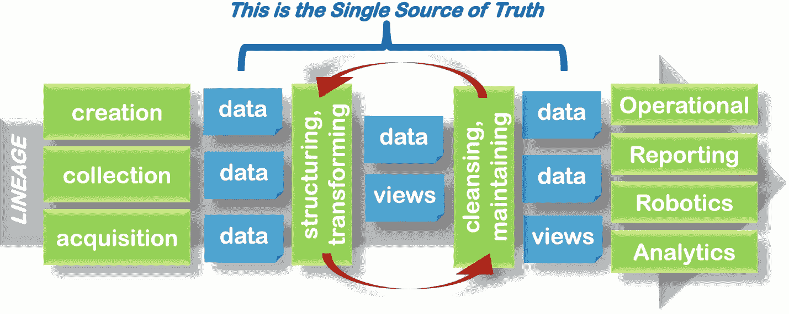
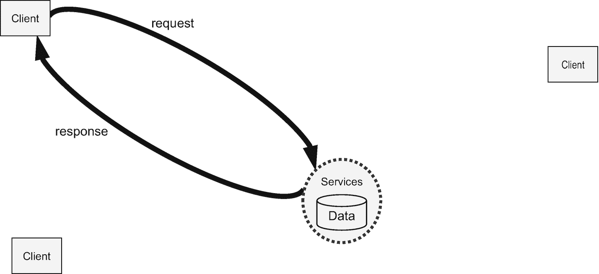
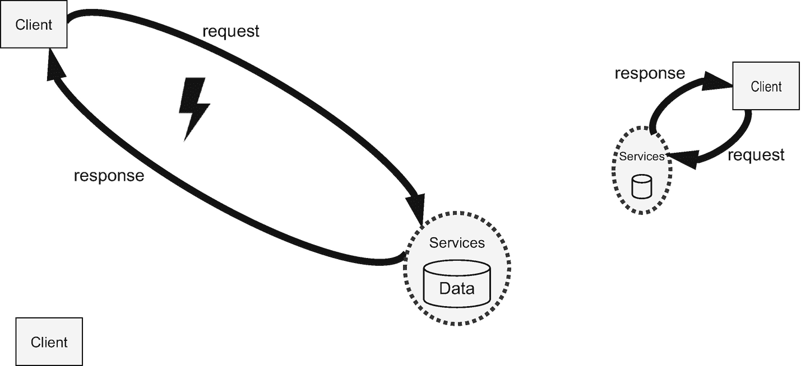
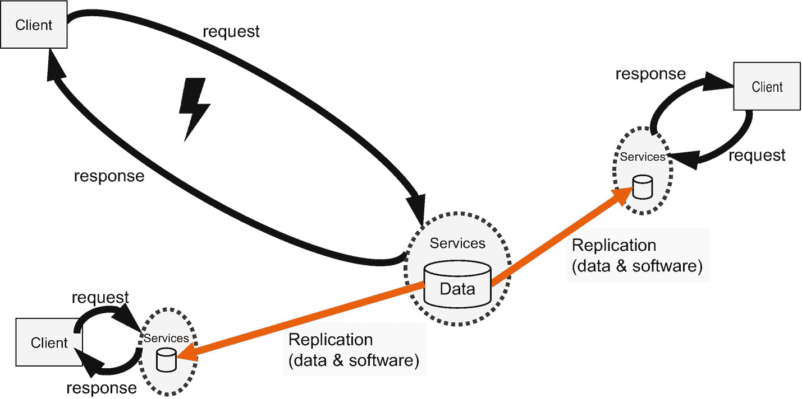
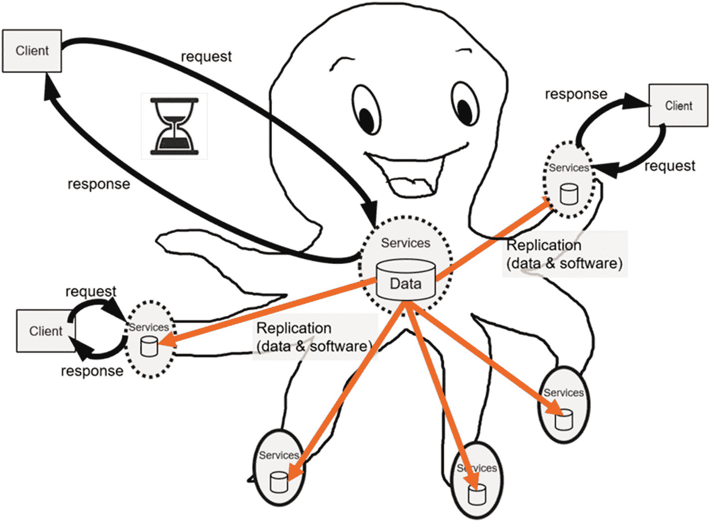

# 19. 数据处理

图 19-1

业务中的数据处理是严肃的

## 虚拟单一事实来源

### `VSSoT` 是什么样的？

你是否将你组织的数据湖视为你的单一事实来源？或者至少是目标？

你不应该这样认为。

“单一事实来源”**不应**被视为彩虹尽头装满黄金数据的那个桶。

相反，数据始终处于一个旅程中，从其创建或进入组织开始，历经修改，直至消耗和废弃。

数据可能被收集、结构化、转换、合并或联接。每一个新实例，无论是表、数据库还是视图，都应当成为你的虚拟单一事实来源（`VSSoT`）的一部分。

请记住，创建这样一个新实例并不会使它的任何前身失效。相同的数据可以在不同的表和视图中找到，而选择最合适的来源并不总是件简单的事。

与其他资产不同，数据不会因消耗而减少，因此它可以被反复修改，并以不同的形式和组合使用，而不会减损。修改甚至不是一个线性的过程。想想外联接这样的操作，其中两个表共同创建一个新表。

此外，同一数据的不同演化阶段可以共存。这可能有帮助，但也伴随着风险：消费者可能意外地使用了错误的演化阶段，例如，使用了经过某些记录过滤或聚合后的数据版本，而其结果却用于另一个领域的其他目的。

一个典型案例：“我们一直使用 A 部门的表 X 进行分析。没人告诉我们，有一天 A 部门改变了他们创建表 X 的逻辑。”

这就是为什么在谈论单一事实来源时，需要涵盖**整个数据谱系**：

*   数据的创建或获取需要被明确无误地定义（来源、规则、时间戳）。

*   数据从一个存储库或阶段到另一个存储库或阶段的旅程必须被明确定义。这包括时间方面的考量，以避免因不同数据元素修改速度不同而导致的不一致。

*   只要输出结果可供多个消费者使用，对数据的任何操作都需要以明确定义的方式进行。

*   数据的时效性也需要被明确定义：从何时起数据被视为“过时”？

如果你将图 19-2 扩展，以匹配你组织的数据谱系，你就可以想象你的 `VSSoT` 的复杂性。所有这些在你的组织中被记录到了什么程度？

图 19-2

复杂的单一事实来源

## 如何塑造 `VSSoT`？

迈向虚拟单一事实来源的第一步是进行清点盘点。

-   绘制数据流图。

-   增加时间维度（顺序；实时与滞后；单条处理与批量处理）。

-   理解每次数据转换的目的。

其结果将是一个“虚拟数据源”。在初始阶段，你可以将其转化为你的“虚拟单一事实来源”，然后在第二阶段开始对其进行优化。

这种优化包括评估哪些数据应该集中化，同时也涉及数据流的同步。然而，其目标**并非**构建*一个单一的数据库*！

即使是数据复制也可以与单一事实来源原则兼容——前提是所有“副本”都作为单一来源的一部分进行管理（并进行同步变更）。

例如，数据存储库的物理结构需要支持数据的消费。如果同一份数据要用于完全不同用途，可能需要将其复制到物理上不同的存储库中，例如用于实时操作目的的内存数据库或高度反规范化的表结构，而用于大规模并行分析处理的 Hadoop 集群或 Spark 弹性分布式数据集（`RDD`）。

边缘计算是数据合理复制的另一个例子——需要以适当且可控的方式进行：如果确保了一致性，就可以将数据移动到边缘——那里靠近客户端，但仍然属于`VSSoT`的一部分！

整个数据供应链需要被完整记录下来，包括业务所有权。理想情况下，每次数据转换步骤都应分配给你现有的某个数据域，这样你就可以复用你现有的、基于域的业务所有权结构及其相关流程。

但不要期望这一切是轻而易举的任务。不同的结构以及可能多种多样的物理数据模型，使得集成不同的数据源和数据转换阶段成为一项具有挑战性的工作。

并且请不要将其视为一次性的活动。新的需求会带来新的转换，这个充满活力的生态系统需要主动管理。

有充分理由表明，在 2018 年的一次会议上，Gartner 集团数据管理策略研究总监 Rick Greenwald 曾预测：“数据集成将成为未来最耗时的任务。”

## 单一逻辑来源

### 面向服务架构（`SOA`）

好的，你已经完全掌控了所有数据。虽然数据是本地维护的，但你的数据有一个集中的（逻辑上的）位置，从而为你的数据创建了虚拟单一事实来源……

……但你的逻辑呢？

你是将逻辑的实现留给客户端应用程序吗？你是否允许它们从单一事实来源获取完美无歧义的数据，然后让它们彼此独立地实现逻辑？

这种方法很容易导致与独立在不同位置维护数据相同的问题。

我偏爱的解决方案基于经典的面向服务架构（`SOA`）。

你可能已经了解到 `SOA` 概念带来的一些优势，包括通过明确定义的请求/响应接口与小型、独立的开发团队合作的可能性，或者支持伴随这种独立性而来的敏捷方法。单一逻辑来源是该架构另一个常常被低估的优势：不仅每个人都使用相同的原始数据——不，任何应用于数据的操作也可以被标准化。

由于需要实现逻辑的人员更少，你降低了不同解读和实现的风险。测试也变得更简单，因为你无需详细测试多个应用程序。

### 分布式逻辑——章鱼原则

`SOA` 通常需要直接实时访问集中提供的 Web 服务，如图 19-3 所示。

图 19-3

Web 服务原则

但如果这无法实现，你该怎么办？

想想那些你期望使用你 Web 服务的客户或业务合作伙伴：

-   他们可能不愿承担数据连接问题会中断其供应链的风险，因为其软件应用程序的一部分位于中断的另一端。

-   他们可能担心依赖不受自己控制、运行在另一组织服务器上的软件。（毕竟，你不是 Salesforce 或 SAP，而是一个“普通的”业务合作伙伴。）

如果外部合作伙伴有这种反应，你会退回到旧的工作方式吗？你会再次向他们发送你的数据（包括定期更新），并请求他们模仿你在内部植入的逻辑吗？换句话说，回到石器时代的工作方式？

对此的解决方案**不是**再次将原始数据文件发送给客户端应用程序！

相反，你可以让 Web 服务靠近客户端，如图 19-4 右侧所示。

图 19-4

本地 Web 服务

在实践中，你会向你的业务合作伙伴或客户提供一个作为黑盒运行的软件片段，精确执行你内部软件所做的操作。理想情况下，它将基于相同的源代码。

第二步，你需要确保数据和软件的更新都由该服务控制，并且在后台执行。

结果就是，整个父服务被镜像到子服务，如图 19-5 所示。

图 19-5

向本地 Web 服务复制数据

这种方法降低了连接问题或你自身基础设施故障的风险。最坏的情况是更新控制器不可用，导致本地 Web 服务基于略微过时的数据运行。

现在想象一下，这种机制被应用于多个本地 Web 服务服务器，运行在各个业务合作伙伴站点：这就是**章鱼**，它的触手象征着将数据*和*逻辑带到客户端附近的能力（图 19-6）。

图 19-6

面向服务架构章鱼

这是“章鱼原则”最关键的一个方面：章鱼代表你的虚拟单一事实来源（`VSSoT`），其触手伸入边缘解决方案。不再由边缘应用程序负责保持其数据和逻辑的最新状态。实际上，整个虚拟的 `SSoT` 对这些应用程序来说可以（并且应该）是完全不透明的。

边缘应用程序甚至无需关心它调用的是本地还是远程的 Web 服务实例。接口是相同的，差异仅限于 `IP 地址` 和端口号。

边缘存储库可能仅限于中央 `SSoT` 的子集，无论是属性还是记录。例如，在某个特定国家运行的产品订购服务，无需复制所有其他国家的价格列表。

但章鱼本身需要确保所有被选中复制到边缘存储库的数据保持最新，并且参照完整性得到保证。

同样，`SSoT`（单一事实来源）的注册表（即整个地图）也需要保持最新。它的创建并非一次性活动，而需要成为每个正在寻找正确信息的利益相关者永久更新的数据源。

时间维度也起着重要作用：所有数据都必须及时提供给任何客户。延迟通常会导致两个相互依赖的数据源之间出现不一致。

然而，数据也不需要提前到位。在某些情况下，延迟数据流可能会节省费用。

为了找到向客户端提供数据的最合适方式，将错误或延迟数据的风险纳入您的商业案例是很有帮助的。有时这可能会变得极其昂贵，例如，客户根据过时的价目表下单，或者因关键数据尚未复制到客户站点而导致客户供应链中断。在其他情况下，这并不重要，例如，当数据用于粗略指示性能水平，而少量过时信息不会实质性地影响结果时。

在略有过时的信息整体影响有限的情况下，您甚至可以计划定期离线操作，进一步减少对数据连接和更新的依赖。这同样适用于不频繁变化的参考数据。

最后，一个精密的更新机制也会将`logic`更新到任何本地实例。就像您电脑上的大多数第三方软件一样，本地实例会定期检查其是否仍为最新。每当有新版本可用时，本地客户端可以下载其后续版本，并使用更新后的逻辑重新启动。

如今人人都在谈论边缘计算。您可以将八爪鱼原则视为边缘计算的推动者，并产生可复制的结果。

## 配置与标准化

同一表达有多种不同的含义显然不是个好主意。为满足组织内不同业务单元或地理单元的不同需求而建立多个逻辑数据模型，也会造成同样的问题。

但标准化总是答案吗？

在某些情况下，存在采用不同逻辑或不同定义的充分理由。

这正是我推荐采用`配置`的地方：您允许在同一数据模型下存在不同的含义或不同的逻辑。

让我们看两个涵盖常用数据领域的示例。

### 示例 1

**产品：**

设想一个全球运营的组织。根据法规要求，其在某些市场需要不同的产品规格。

这些差异不应被视为例外，而应建模为同一产品在不同市场中的变体。

### 示例 2

**设施：**

任何大公司都必须识别和区分不同类型的设施，无论是办公设施、仓库还是建筑工地。

然而，这些不同类型的设施都不应孤立看待，因为许多属性与所有设施都相关。

这就是为什么所有设施都按照单一逻辑进行识别会带来巨大机遇。

不过，您需要添加设施类型等属性，以便不同的应用程序可以对同一数据集拥有各自的特定视图。

这一切难道不会使数据模型更复杂吗？是的，会！但请记住，数据模型旨在反映业务模型。如果这样的数据模型过于复杂，那么您的业务模型也可能过于复杂。

所以，是的，为什么不要求标准化呢？但请从业务模型开始，而不是数据模型。如果数据模型表明需要采取行动，您可以假设您的业务模型过于复杂，并且您应该从那里入手。

然而，如果组织认为业务复杂程度是合适的，那么您就不能期望它能被一个更简单的数据模型所反映。

数据模型可用于制定协调路线图，同时考虑当前业务需求和技术向后兼容性要求。即使所有系统中的业务逻辑都已完全更新，您仍可能因历史数据而陷入复杂性。并且，您可能会面临逐年数据对比的挑战。但这是变革不可避免的代价。

## “生效日期”概念

“生效日期”将单个属性值替换为该属性的历史值流。这些值中的每一个都有一个“生效日期”和一个“到期日期”。一些附加规则：

-   每当一个值需要更改时，旧值在其有效期的最后一天（或小时、分钟等）到期，并立即在其后创建一个带有“生效日期”的新值（即，时间戳不可能落在到期日期和生效日期之间）。

-   如果一个值不再有效，则不应删除。相反，应保留该值，并为其分配一个“到期日期”，指明其最后一个有效日。

-   如果预计不会过期，则链中最新的值需要将其“到期日期”设置为代表“永久”的值。

对一致性的要求需要所有更改在完全同步的情况下进行应用。如果没有“生效日期”概念，一个邮政编码区域可能被分配给一个尚不存在（或不再存在）的销售区域。维护从独立的数据字段开始，然后是依赖于它们的字段。

但我们为什么需要生效日期概念？并非所有数据更改都能在午夜的一秒内完成应用。“生效日期”概念通过允许修改提前配置来解决此问题。

如果与正确实现的服务导向架构结合使用，它使得在任何时间点应用一致的更改成为可能。所有新值在同一秒内生效，一致性得到保证。

可以通过传递目标值、“生效日期”和“到期日期”的网络服务进行维护。网络服务本身执行技术工作，即进行必要的验证检查，然后将新值插入现有链中。这通常包括更改当前属性值的“生效日期”和/或“到期日期”。

这种方法甚至允许处理范围（例如，邮政编码或数字范围）：如果某个范围的一部分需要更改，我们可以让网络服务自行处理。它可以将整个范围拆分为子范围之下的部分（该部分保持不变）、子范围本身（即将更改的部分）以及子范围之上的部分（该部分也保持不变）。虽然上下范围继承了原始链序列，但中间链会按照前面描述的方式插入新值。

使用可以通过两种方式：要么客户端请求某个特定时刻的快照（默认时刻通常是“现在”），要么请求整个链，并可选择提供开始日期和结束日期（如果两者都未提供，则返回整个链）。

这也允许重新建立过去任何时间点的状态，跨越所有数据源和数据存储库。

在分析中，“生效日期”概念允许在任何给定时间点获取主数据快照。

## 让数据国际化

### 巴比伦效应

除非你为一家严格的本国机构工作，否则你将不得不处理多种语言。这一挑战适用于供应商、当局和客户。

尤其是客户，不愿意接受组织定义的标准。在与你的组织沟通时，他们总是坚持使用自己的语言作为沟通语言。在大多数情况下，竞争对手在这方面并不存在问题。

当然，你可以简单地存储所有版本并按原样处理。但是，你在阿拉巴马州的仓库员工或孟加拉国的生产人员可能无法理解某个非洲国家的本地表达方式。

没有简单的解决方案。始终将所有内容从源语言翻译成所有其他语言需要付出巨大的努力。此外，你很快就会遇到歧义问题，因为从语言 A 翻译成语言 B 有多种有效的方式。

### 别名术语

在将本地表达方式翻译成你的内部版本并存储在主数据中之后，你需要能够每当客户在线输入相同的表达方式时，将其与之进行比较。只有当输入的信息与原始术语的翻译方式完全一致时，这才有可能实现。

第一个解决方案是定义一种主导语言，并存储该语言中的所有"主术语"。所有本地版本将被添加为"别名术语"。

然后可以识别客户使用的任何版本，并将其翻译为"主术语"。该版本将供你的组织内所有不了解本地表达方式的员工使用。

例如，你可能希望使用官方英文翻译来存储全球所有城市名称。你会将`Wien`翻译成`Vienna`，这将成为你的"主名称"。每当奥地利客户输入`Wien`时，查找操作会返回`Vienna`作为你的内部"主名称"。

其他示例包括产品名称、法律用语或国家名称。

### 音译

但是你将如何处理不同的字母表？

虽然全球主要的六种字母表（拉丁字母、中文汉字、天城文、阿拉伯字母、西里尔字母、达罗毗荼文）覆盖了全球 90%的人口，但如果你的组织具有真正的全球影响力，你需要支持前 20 种字母表。而且这些字母表中的大多数都有需要考虑的各种变体。

这便是音译登场的地方。它定义了从一个字母表到另一个字母表的逐字符转换。当目标字母表是拉丁字母时，这种方法也被称为`罗马化`。

除非你通过向目标字符添加符号（附加符号）来扩展音译，否则返回原始单词的路径可能会产生歧义——但这甚至可能是源语言拼写中固有的问题，这意味着（IT 中使用的）字符串比较无论如何都不安全。因此，你应始终存储音译后的版本，并且在将其与提供的单词进行比较之前，也应对后者进行音译。

这种方法显然需要标准化的音译方式。你可能会立即想到 ISO 标准，这是正确的方向。

然而，即便是 ISO 标准有时也存在歧义，有时你需要知道一个提供的单词表示哪种语言，才能选择合适的 ISO 标准。

这就是为什么每个组织都需要制定自己的内部标准，以获得可重现的结果。

对自动化音译的一个挑战是，它难以处理那些不是基于单个字符的语言。最显著的例子是表意文字，如中文（每个符号代表一个单词）和音节文字，如日语假名（每个符号代表一个音节）。

在某些字母表中，一个字符的音译取决于它后面的字符——这使得实时音译几乎不可能，例如，当有人在数据录入屏幕上输入文本时。

请注意，即使是 ISO 也为俄语西里尔字母或日语文本的`罗马化`提供了不同的标准。在每种情况下，你都需要一个内部标准来执行音译，这样每个单词都可以仅以一种拉丁语版本存储。然后可以立即将输入该单词的每个数据进行罗马化，并与拉丁语参考版本进行比较以找出可能的匹配项。

总而言之，这个话题很复杂。但是，如果你的组织在众多不同国家开展业务，并且涉及到跨境方面，你将不得不解决这个问题。谢天谢地，有解决方案提供商可以协助你做到这一点。

### 特定国家的语言

在为与来自不同国家的客户互动做准备的过程中，请避免过度简化的诱惑，不要仅仅在你准备的语言中选择一个假设的最接近的匹配项。

人们通常更喜欢说英语，而不是说一种与他们自己的语言接近的语言——这通常源于不喜欢的邻国。这里有两个典型的例子：

- 乌克兰人通常懂俄语，但他们不喜欢被迫用俄语交流（而且，顺便提一下，乌克兰西里尔字母与俄语西里尔字母不同！）。

- 法语在法国、比利时、加拿大和瑞士法语区之间存在差异。在避免使用英语外来词方面，其中一些国家比其他更加严格。

这就是为什么你的国际化设置至少应始终基于语言和国家的组合。

幸运的是，许多组织都面临过类似的挑战，因此已经形成了一套事实上的规则和标准，并且有相应的公共网络服务可用。

无论你决定选择哪种来源，你都应将其作为一项正式规则，以便你的组织的互联网（和内联网）呈现、处理算法和存储都能保持一致。

## 数据债务管理

期望所有项目始终追求“一次就做对”，这不过是一种错觉。事实上，在许多情况下，从临时解决方案入手有其充分的理由，例如，当需要快速修补安全漏洞时。

在这种情况下，你是否要放弃对基本数据标准的合规性要求？

如果处理得当，则不必放弃——至少从长远来看不必。

数据债务管理背后的理念是：只在时间维度上做出妥协。

具体来说，你应该坚持在所有情况下都要求数据审批，包括那些“紧急”情况。反之，你可以规定，如果提案本身已包含在指定截止日期前（通常是第二阶段）修复不合规问题的承诺（以及资金和资源！），那么将授予“临时批准”。

或许没什么理由将这种通用方法仅应用于数据相关的合规性。它应该是一种避免长期依赖临时解决方案的通用方法。（另见第 8 章“技术债务处理”一节）

采用敏捷方法的组织对此概念不会陌生。然而，经验表明，恰恰是这些组织在跟进架构债务、并按照约定时间表强制弥补合规差距方面，最不严格。

在此领域的宽容态度，将不可避免地导致债务的迅速累积！

以下是一个可以规范化你的债务管理流程的可行方案：

1.  **设立架构评审委员会。**

    设立一个成员明确的架构评审委员会，覆盖所有架构学科：

    * 技术架构

    * 数据架构

    * 业务架构

    * 解决方案架构

    请注意，虽然解决方案架构的职责可能由不同团队分担，但此机构需拥有最终决定权。

2.  **引入强制性评审流程。**

    有效的债务管理需要一个架构评审流程。^(⁴⁹)

    你不仅需要为业务转型项目设置这样的流程。它需要覆盖从组织重大变革项目到日常运营的所有内容，并且应该考虑到架构环境的变化可能使先前合规的解决方案变得无效。

    首先，该流程应描述所有触发事件（即启动该流程的事件）。最常见的触发事件当然是提交项目申请，但相关澄清请求或对已批准项目的变更请求也应涵盖在内。

    应包含必要信息的精确列表，最好采用核对清单的形式。记住，尽量保持列表精简，避免不必要的官僚负担。必填字段包括建议的完成截止日期以及负责部门。

    评审流程的主要任务是描述如何处理发现的架构差距。首先，流程需要包含接受临时解决方案的标准，例如，当前违反公共法规或导致重大收入损失的情况。

    与所有流程一样，责任必须明确。谁可以批准、否决或推翻先前的决定？他们的（不）批准标准是什么？升级路径是什么？

3.  **增加“架构债务”流程。**

    在获得企业评审委员会批准豁免后，系统性的跟进是不可或缺的。你应该将其纳入一个描述清晰的流程中。

    首先，该流程需要确保所有（已批准或已发现的）与架构标准的偏差都得到记录。它应基于明确的标识逻辑，为每个单独的豁免分配唯一标识符。并且，每个豁免都必须记录批准的“到期日期”。

    该流程的主要部分是描述对所有例外情况（从批准到结案）的主动跟进流程。

    最后，该流程应明确所有必要活动的责任。数据办公室需要在所有数据架构事项中扮演主要角色。

4.  **确保完全透明。**

    架构豁免不应在闭门状态下处理。每个人都应了解每个项目、流程或解决方案的合规状态。

    这并不是要让员工受技术细节的困扰。相反，你应该考虑定义良好的度量指标，使架构合规水平以及对批准截止日期的遵守程度都能通过定期发布的`KPI`（关键绩效指标）体现出来。

    所需的可见性应通过持续的沟通来实现。此外，通用培训应使所有相关人员充分了解流程，以便能够遵循它。

## 敏捷与数据

### 坚实的基石——为什么？

处理数据时，应该采用敏捷方法还是瀑布方法？

恐怕这可能是个错误的问题……

我们有充分的理由避免在此处做二选一的决定。

每当你需要决定项目方法时，或许可以问：哪些内容可以轻松地以敏捷方式更改，而哪些内容更适合进行仔细的准备和精心的规划？

乍一看，敏捷方法是可行的，因为它避免了瀑布思维带来的许多问题，特别是孤立的职责设置：即使你发现规范不合理，也必须按规范实施。没有人会因为你按规范实施而责备你，但如果你出于最充分的理由偏离规范，一旦出现问题，你就要承担风险。

此外，敏捷方法鼓励组织在必要时改变方向。这对于避免伦敦商学院所说的“承诺升级”至关重要：你明知某件事是错的，却还在继续做下去。

但是，考虑到需要快速响应不断变化的环境，耗时费力的前期工作真的如此重要吗？还是说，总是凭直觉行事更明智？对于你在可预见的未来可能被逻辑束缚的数据架构决策，是否应该以敏捷方式做出？

爱因斯坦曾说过：“如果给我一小时拯救世界，我会花五十五分钟定义问题。” 他说的不是 15 分钟或 30 分钟……

爱因斯坦这样说是基于充分的理由，而这些理由至今仍然有效。

以下是支持基于规划的结构化基础的三点有力理由：

**a) 它能让你在长期保持敏捷。**

**b) 临时决策会产生相互依赖关系。**

**c) 快速修复可能治标不治本。**

如果你为意外情况做好准备，那么当情况发生时，你就能更迅速地做出反应。举两个例子：

*   即使是最敏捷的方法，也无法让你快速更改跨多个应用程序和界面的数据库模式。而涉及与供应商和客户进行`EDI`（电子数据交换）时，以敏捷方式更改消息格式尤其复杂。

*   如果恢复并未纳入最初的考虑范围，那么缺失的数据就无法恢复。

这是否意味着敏捷和规划相互矛盾？

不。敏捷和可持续性是你必须保持平衡的两个重要目标。

一个很好的例子是技术债务的敏捷概念，它允许你快速推进，同时确保不合规问题不会被遗忘。作为适当数据处理流程的一部分（见第 8 章“项目数据审查流程”一节），它为你提供了一个平衡快速实施需求与长期视角的工具。

### 夯实基础——如何做到？

要想长期保持敏捷，你需要落实以下要素（本书已对其中大部分内容进行过讨论）：

- 应用程序能在几分钟内连接的网络服务，理想情况下通过主动管理的企业服务总线实现。

- 关于信息存储位置的文档化知识。

- 结构化的变更流程（知道该向谁请示）。

- 企业级术语表，消除对特定项目术语表的需要。

- 清晰的数据指南，需在任何活动开始前进行传达。

- 便于`IT`实施的企业数据模型——他们能直接从业务数据逻辑中推导出数据库模式。

- 自我维持的六西格玛文化，让员工主动选择使用六西格玛工具（如现场走访、5 个为什么分析法、鱼骨图）来发现根本原因（敏捷不等于“治标不治本”！）。

所有这些方面都必须纳入你的数据治理范畴，因为组织中大多数人会本能地更倾向于追求速效，而非这种可持续的方法。

## 从“快乐路径”开始？

### 什么决定了项目的成败？

无论你采用敏捷模式还是瀑布模式，都希望尽快完成项目。这种愿望本身没有错。毕竟，完成得越早，收益见效也越快。

但你愿意为此付出什么代价？

常见做法是追求`MVP`（“最小可行产品”）。然而，除了大家公认`MVP`是指“在生产环境中能发挥作用的最小范围”之外，人们对它的具体内涵并没有统一的标准。

不幸的是，一种普遍的理解是将`MVP`视为仅覆盖“快乐路径”的解决方案。换言之，它只有在所有规则都被遵守时才能良好运行。

持这种观点的人认为，我们应首先专注于“快乐路径”。一旦该路径就绪，再考虑如何处理异常情况。

这种论调的背后通常不是什么深奥的效率最大化理论或经过深思熟虑的投资方式，而仅仅是因为项目时间压力。

根据我对数百个流程的经验，我提出了`80/5 法则`：如果你想覆盖 100% 的情况，需要投入 80% 的成本去处理那 5% 偏离“快乐路径”的例外情况。（具体数值未必精确到 80% 或 5%，但量级适用于大多数情况。）

第二点观察是：纠正这些偏差产生了企业成本的大头——要么是这些情况下为了最终达成目标而付出的更高直接成本，要么是因客户满意度下降和声誉受损而带来的间接成本。

这就是为什么“`MVP` = 快乐路径”的等式缺乏良好的商业理由。

但你需要 100% 的覆盖率吗？可能不需要。我之前提到过著名的 80/20 法则：用 20% 的精力覆盖最有益的那 80% 功能，比花五倍的成本去覆盖全部业务需求更经济。

同样，在看待可能偏离“快乐路径”的情况时，你可能花费覆盖 4.999 个百分点一半的成本，就能覆盖 5 个百分点中的 4.99 个百分点。为了这么小的增量花这么多钱，实在不值得！

再次强调，不要纠结于精确的数字。而是要弄清楚某个问题的*业务影响*是否值得投入成本去防止其发生。

### 成功的三个维度

最终，如果你想找到最合适的解决方案，就需要基于事实和数据来确定项目范围，而不是凭个人感觉（“我的经验告诉我……”）或受误导的奖励机制（“……按时交付才是关键……”）。

我们在第 16 章讨论过组织内部的目标冲突。项目经理和产品负责人也面临着类似的困境。

任何项目都必须在`成本`（“控制在预算内”）、`速度`（“按时交付”）和`质量`（“满足所有需求”）之间进行优化。

项目经理将如何平衡这些相互矛盾的要求呢？毕竟，创建恰当的加权目标函数这种学术方法既不直接，也无法为项目经理提供可执行的计划。

相反，项目经理会为企业主准备一份提案，希望他们认为该提案已足够平衡。这是一种合理的做法。

但如果项目进行中出了问题怎么办？即使是敏捷方法也可能遇到严重问题，例如，选定的技术解决方案不够完善，或者花了很长时间才找到软件错误。

这类情况需要对三个维度进行重新审视：我们是增加预算，允许更多时间，还是接受质量降低（即在业务需求上妥协）？无论如何，项目经理都会感到不悦——没有人喜欢向指导委员会汇报这种事，即使有绝佳的借口。

那么，项目经理如何才能避免承认失败呢？

# 项目管理中的架构合规性

- **预算？** 在成熟的组织中，非正式地增加开支额度是很困难的。出于谨慎考虑，可能会准备一些备用资金，但选择通常有限。

- **时间？** 一旦进度表达成一致并公布，就不能再单方面更改了。这同样适用于敏捷和瀑布模式，即使前者允许将截止日期作为方法论的一部分进行推移。

- **范围？** 未经业务方同意，已达成共识的功能不能从清单中移除（或移至产品待办列表）。非功能性需求（如响应时间或可用性）也是如此。

- **但等等！** 也许产品可以*在表面之下*进行简化。架构合规性可以被牺牲。例如，信息可以硬编码而不是可配置。新软件可以作为单体模块开发，而不是基于微服务和企服务总线创建模块化解决方案。所有这些都只会给未来的开发带来麻烦……

无论这是项目经理显性还是隐性的想法，都反映了众多项目中的现实。项目经理会首先在不可见的领域以及他/她不受奖励的目标上做出妥协。

这就是为什么首席数据官最希望避免这种情况。在所有架构学科中，数据架构在不被遵守时面临最严重的后果，尤其是在多个项目中形成这种常规模式时。

但你会如何处理这个问题呢？让我提出三个行动领域：

1.  **建立意识。**

没有任何项目是孤立存在的。为了让人们理解项目对组织其他部分的影响，你可以讲述“项目的 3+1 个维度”：你不仅需要考虑项目特有的三个参数——**成本**、**时间**和**范围**，还需要考虑企业参数——**架构**。架构合规性越低，对组织其他部分的影响就越大。

2.  **确保架构的参与。**

必须强制要求架构师参与项目的每个阶段或每次迭代（Scrum）。

在所有计划中，组织需要主动管理其技术债务。跟进数据债务的责任由数据办公室承担。

如果组织采用敏捷方式工作，产品待办事项列表必须包含一个架构待办事项列表。

3. **展示财务影响。**

仅仅基于“秩序原则”或任何其他有效但抽象的理由来要求架构合规性是不明智的。

相反，你应该将视角从孤立项目提升到其对整个组织的影响（股东价值原则）。你可以通过预测架构不合规的影响并为其附加价格标签来做到这一点。

在此，你绝对应该考虑**复杂性成本**，特别是通过说明不断增加的架构违规数量对组织未来业务变更的影响：

*   成本会上升，因为许多领域必须同时进行评估、调整和测试。

*   上市时间会增加，因为组织可能没有足够的专家来并行处理所有必要的变更。这也可能需要额外的接口变通方案。

*   错误风险增加，因为相同的新逻辑必须在大量领域中正确实现。

如果你考虑具体的用例，你会意识到复杂性不仅会让日常工作变得困难，它还会阻碍创新，而创新是成功组织的命脉（图 19-7）。虽然这通常难以量化，但其财务影响不应被低估。

这三个步骤应引导出平衡的架构合规方法。

根据组织的整体情况，董事会始终保留否决架构标准的权利。这是他们的正当权利，并且如果他们是有意识且完全透明地做出决定，那么他们这样做是完全可以接受的。

图 19-7 复杂性成本

## 一种界定范围的方法

我想你现在想知道如何在理想流程和百分之百解决方案之间找到最优解。

与其仅依靠直觉或 30 年的业务经验，你需要数据，以便基于事实做出决策。（这并不令人惊讶，对吧？）

同样，为了获得全貌，你需要考虑“项目的 3+1 个维度”，即项目特定方面以及组织全局视角。

对于后者，你需要了解架构不合规的未来成本，如前所述。对于前者，需要回答以下问题：

*   在相关的业务流程中，哪里可能出错？

*   失败的（直接和间接）成本是什么（请记住第 1 章描述的 1-10-100 规则）？

*   计划要解决这些问题需要多少成本——无论是构建合适的解决方案还是日常运营？

但是，你如何理解哪里可能出错呢？数据在这里也能提供帮助！

以下方法通常可以结合使用：

1. **用户故事**

    导致当前计划的改进需求应该已经为你提供了大量的用例和用户故事。发现的每一个痛点都有可能形成一个用户故事——通常包括观察到的与理想流程的偏差。

2. **先前的流程结果**

    查看过去类似流程或任何新流程的前身的结果：即使流程完全改变，早期版本或其他领域相关流程的许多参数也可能有助于预测预期的异常甚至其频率。

3. **模拟**

    如果你的组织系统地记录了子流程级别的用户模式（例如，网站访问者的点击行为），你将能够详细说明某些用户群体在特定情况下的反应——即使是在不同的上下文中。

    了解目标流程每个方面的概率，并不能立即告诉你最终的异常及其概率。但它们通常允许你使用大量测试用例运行模拟。在这里，随机数生成器可以模拟先前记录的日常生活的变异性。

    谢天谢地，这类模拟通常不需要个人数据。这就是为什么你可以收集关于网站上客户行为以及办公室电脑前员工行为的匿名数据。

当然，所有这些都是一个迭代过程。基于你的发现，你会设计异常处理流程——但这些流程也需要验证，并且它们会带来新的情况，即“异常的异常”。

请随意首先将所有这些应用于你自己的数据处理流程。这些流程无疑容易偏离理想流程。

脚注 1
