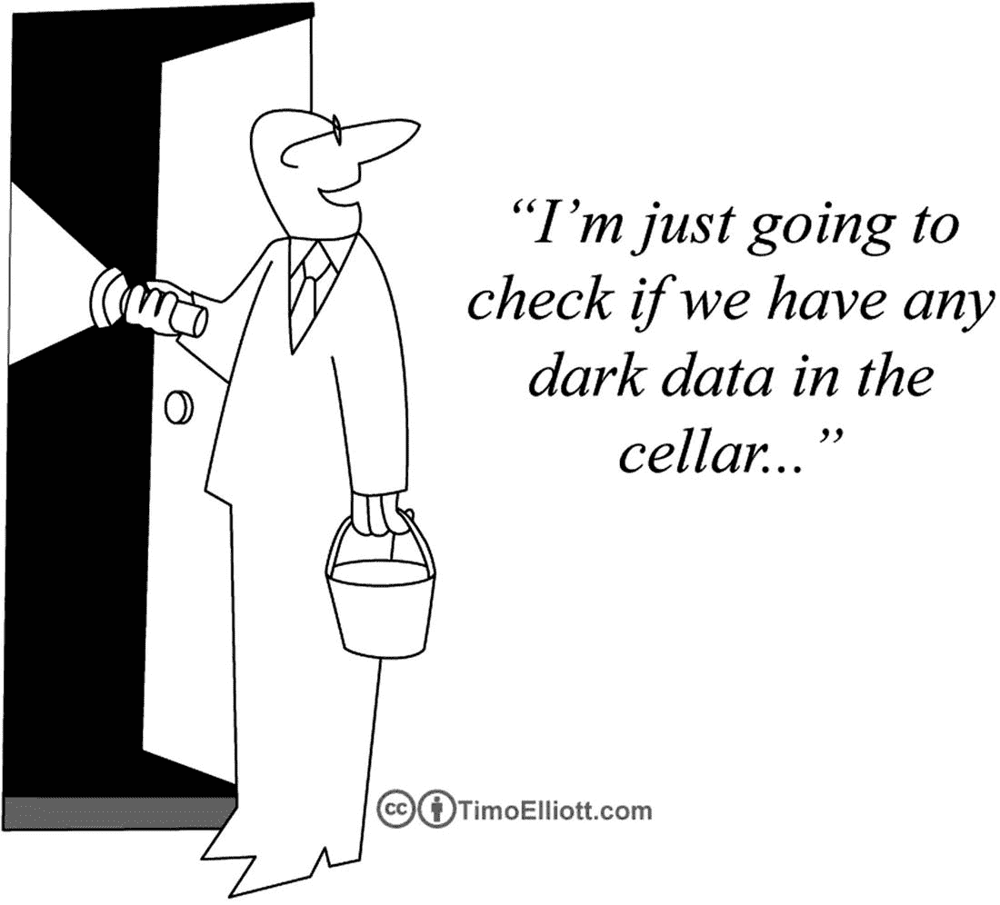
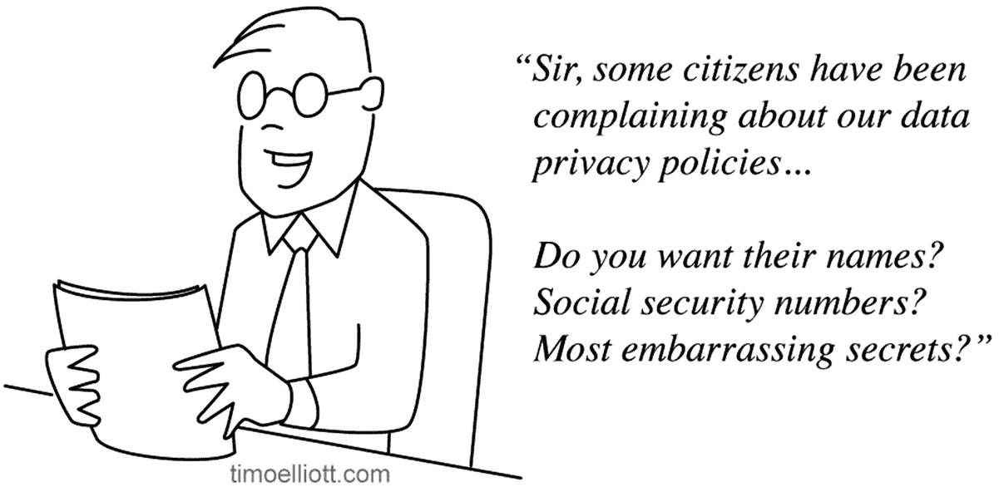

# 17. 数据伦理与合规

**图 17-1** 数据也有阴暗面

## 伦理行为与数据？

### 哪些地方可能出错？

众所周知，大多数国家不允许组织因求职者的肤色或宗教信仰而拒绝录用。其原因不难理解。

但并非所有我们利用数据可能造成的恶行都受法律禁止。其中许多行为仅仅是由于出现时间太短而未被写入法律条文。

另一方面，一些绝无恶意且无意造成伤害的活动是被禁止的，组织可能在毫无不良意图的情况下犯错。

考虑到所有这些因素，当你负责组织的数据处理工作时，该如何处理数据伦理问题呢？

首先，让我们看几个存在争议的数据技术和机遇的例子：

*   在追求平均最优化的同时歧视个人

*   接受以牺牲个人利益为代价的算法错误

*   未经数据主体同意便使用其个人数据，以保护该人免受无关广告的骚扰

*   利用数据对抗他人（作为一种武器）来保护自己

*   分析人们以影响其行为

*   伪造数据或算法，以改变受众对某个情况的看法

你可能会认为其中一些做法是完全错误的，而另一些则可以接受，或者你会说这取决于具体情况。

无论如何，情况并非一目了然，值得深入审视。

### 我们目前处于何种境地？

随着人们开始了解其中的机遇，他们也逐渐意识到其中的风险。

这包括对未知的恐惧：可能根本不存在危险，但由于缺乏透明度，你无法判断。

作为回应，越来越多的国家对数据处理进行监管，透明度成为监管的一部分。

在经历了几次会计丑闻后，美国将重点放在透明度上。要求组织在财务事项上保持透明的`萨班斯-奥克斯利法案`早在 2002 年就已出台。

欧洲的主要关注点是数据隐私。`GDPR`^(⁴¹)于 2018 年 5 月在欧盟生效，经过事实上的宽限期一年后，处罚措施已开始波及整个欧洲的组织。非欧洲组织若想在欧盟开展业务，也必须遵守该法规。

我在美国和其他非欧洲国家的许多同事告诉我，他们认为`GDPR`是对全球数据隐私挑战的一种过度反应。

然而，这不应成为降低合规程度的理由。我通常向我的美国朋友解释，欧洲当局对待`GDPR`的严肃程度，就如同美国当局对待`SOX`合规一样。（猜猜我是如何告诉欧洲人他们需要多么严肃地对待`SOX`的。）

基本上，所有大洲的国家都已将`GDPR`作为制定本国法规的参考点，因为随着技术可能性的发展，数据滥用现象也在增加，而且这不会止步于国界。

但各国并非坐等欧盟法规以便照搬。现有较早的法律例子包括 2017 年的《中华人民共和国网络安全法》，或者更早的《俄罗斯联邦个人数据法》（第 152-FZ 号），该法可追溯至 2006 年，尽管在 2015 年因需要对俄罗斯公民的个人数据进行“本地化”而进行了扩展。^(⁴²)

尽管如此，许多围绕数据的潜在不道德行为尚未受到监管。但各国政府的意识正在提高，预计会有更多法规出台，例如在面部识别领域。今天被允许的行为，明天可能会变得非法。

有趣的是，大多数法规都采用“基于同意的模式”：处理个人数据需要得到该人明确的同意。然而，在个人给予同意的情况下（一些垄断者可能不给他们选择的机会），几乎任何对其数据所做的处理通常都是法律允许的。

你可能仍然希望确定剩余的约束条件。例如，许多国家不允许在某些情况下对人员进行定位，即使已获得个人同意。

### 每个企业面临的问题

在这种情况下，组织在确定其数据伦理方向之前，需要问自己几个问题。典型的例子包括：

*   我们是否会从利用存在争议的数据相关技术和机遇中获益？

*   如果会，这些收益的可持续性如何？

*   我们是为了更大的利益还是出于经济原因而想要遵循伦理？还是两种动机兼而有之？

*   伦理行为在多大程度上对我们有意义？

*   这从经济角度来讲是否划算？是直接的还是间接的？

*   在法律要求之外践行伦理，是否甚至有意义？

*   我们组织内部是否就什么是“合乎伦理”达成共识？

### 你的选择有哪些？

组织并非被迫在合乎道德与不合乎道德之间做出抉择。让我为你列举几个现实的选项：

1.  **合规作为不可妥协的原则**

    你决定不惜一切代价遵守法律。

    在此边界内，商业案例说了算。

    这种方法乍听起来尚可接受。至少在法律合规方面，你立于安全之地。

    但若换个角度审视，风险便显而易见：如果有利可图，你基本上就会采取“只要不禁止就去做”的策略。

    那么，由此产生的风险是什么？

    不幸的是，罚款并非唯一需要考量的负面后果。

    每个人都曾目睹网络舆论风暴在社交媒体上的影响。它们让组织在公众面前形象受损，并影响消费者行为。而这些行为中又有多少是实际违法的呢？仅举两例：法律允许组织以高到将大量患者排除在外的价格销售专利药物，或者用高污染重油为其集装箱船提供燃料。

    如果剑桥分析公司是在获得用户同意的情况下获取所有个人数据，公众的评价也不会从根本上更为有利。这个品牌之所以被摧毁，主要在于其有毒的商业模式。

2.  **基于伦理的商业案例**

    在此，你依然会使用（可能很复杂的）商业案例，同时考虑短期和长期成本。

    但除此之外，你会承认伦理行为似乎存在市场。

    你会问：在遵守法律边界内，不考虑伦理方面的风险是什么？

    本质上，你在商业案例中同时考虑了法律与伦理。

    现在你安全了吗？

    我不得不在此让你失望——仍有相当的风险存在。

    世界比以往任何时候都更具动态性，消费者行为亦是如此。你的商业案例可能无法反映今日之后的客户行为。它可能基于对客户行为过时的认知（依据过去的数字），或者客户偏好在你有机会衡量之后很快发生了变化。

    几年前，当碳中和服务方案出现时，我记得一家快递公司的高管曾问：“究竟有谁会愿意仅仅因为运输方式更环保而自愿为一件货物支付更多费用？”

    而且，确实，这在当时有点难以想象。如今，在客户强烈需求的推动下，组织坚持要求以`CO[2]-neutral`的方式运输他们的货物。没有哪家大型运输服务商能承担得起*不*提供这种服务的后果。

3.  **逐案判断，基于商业案例**

    可以根据（可能很复杂的）商业案例来决定是合规还是不合规。这在每个预计不合规能带来某些好处的个案中执行。

    成本/收益计算必须同时考量不合规的直接财务影响和间接影响（声誉等）。

    此外，被抓住的代价要乘以其预期的概率。

    最终，如果这类组织认为自己能侥幸逃脱，就更容易接受不合规。

    例如，决定是否遵守`GDPR`就会变成一个商业案例，需要计算预期罚款和消费者负面反应的成本，再乘以被抓住的概率。

    本质上，如果预计平均能提升股东价值，这样的组织就会接受违法。

    你并不会惊讶于这种做法带来的巨大风险：

    - 无论你计算出被抓住后会有何种影响：你得预料到实际情况会比估计的更糟。法官会区分那些懒得修复已知问题的组织，和那些为了利润明知故犯违法的组织。

    - 组织可能因此倒闭。臭名昭著的剑桥分析公司曾经极为成功：他们做了自己承诺并收钱去做的事。他们是盈利的。然而，由于违反隐私法，他们不得不在 2018 年关门歇业。即使牺牲这个组织可能是整场游戏中被算计好的一部分，这个故事也展示了公众反应的潜在力量。

    - 不道德行为不仅危及组织的声誉。管理层的声誉同样面临风险。与不道德行为扯上关系，对你的简历可不太好看。

    但在批评了所有之前处理数据领域伦理问题的方法后，我有什么建议呢？

    以下便是：

4.  **伦理作为组织原则**

    在涉及可接受的数据处理方式时，尤其是在`AI`领域，你可能不希望让法律成为你唯一的指南针。

    这正是你组织文化发挥作用的地方。如果没有引导，“如果能做，那就去做”或“只要不禁止就没问题”的文化会迅速滋长。在这种情况下，一旦监管收紧或消费者行为发生变化，要改变员工行为可能会很困难。

    请记住：`AI`的许多方面都还太新，迄今尚未受到监管。预计更多监管很快就会出台。

    如果你被抓住，声称某事“过去没有监管”并不是一个有效的借口。监管机构最多只会给予一个过渡期。

    建立一种谨慎的文化，要比监控所有道德上缺乏指引的员工的活动容易得多。

### 更广阔的视角

我们应该牢记这一点：存在伦理问题的`AI`不过是旧行为披上了现代的外衣。邪恶并非随着`AI`而来。

你可以这样说：存在伦理问题的`HI`（人类智能）由来已久。带有偏见的`AI`算法做出的歧视性决定，与人类传统的歧视性决定如出一辙。主要区别在于，现在组织可以归咎于算法。

当柏林航空于 2019 年破产时，汉莎航空在德国一些国内客运航线上获得了暂时的垄断地位。他们立即提高了票价。

此事曝光后，他们面临了一场公关危机，从网络舆论风暴到抵制呼吁，不一而足。

汉莎航空急忙解释，他们使用一种算法，根据需求和利用率等多种因素来确定最佳票价。虽然这并非谎言，但很容易看出整个过程并非汉莎航空“遭遇天灾”。

而且，该算法并未考虑汉莎航空声誉受损的影响，而这比通过暂时提高票价获得的相对较小的收益更为重要。

一个基于伦理的组织文化，加上具备数据素养的员工队伍，在开发定价算法时，可能就已经考虑到了这一切，例如，通过设定机票价格的上限。

# GDPR——都搞定了？

这是否意味着我们不再需要为数据制定商业案例了？你可以这样看：第一道过滤器是你的组织伦理文化，随后是作为财务过滤器的商业案例。

那么，你的股东或所有者会如何看待这种方法呢？他们会不会认为你是在用股东价值来换取伦理？

幸运的是，如果出于利己的动机，你会做出合乎道德的行为。伦理提升组织的价值。消费者的抵制则会摧毁价值。

二十年前，几乎没有人会想到，有朝一日会有大量的人愿意为合乎道德生产的产品或提供的服务支付溢价。

今天我们更清楚了——让我们有勇气通过合乎道德的行为，让我们的组织取得成功！

我们已赶在 2018 年 5 月 25 日之前及时完成了 GDPR 项目，现在终于可以松口气了，对吧？

`GDPR`迫使我们以本应始终遵循的方式处理数据。最终，GDPR 的威慑力确保了我们获得支持与资金来做到这一点。

许多组织曾将`GDPR`视为一项带有外部强加截止日期的“一次性项目”。而在多数情况下，目标并非“实现 X”，而是“在截止日期前足够接近合规要求”。

尽管这是 GDPR 合规的重要组成部分，但我想提请你关注`GDPR`的其他三个方面。在我看来，这些方面至少同样重要。

## 项目结束≠大功告成

这是第一个方面：不要因为 5 月 28 日过去了就停止努力。

这听起来显而易见，因为组织会持续接受审计，而当局如今期望的是组织早期可能被谅解的事项。他们认为，与此同时，所有组织都已拥有足够的时间来真正实现合规。

但现实表明，关注度和资金很快就会转移到别处。`GDPR`从领导层的雷达屏幕上消失，新的、更有趣的话题迅速涌现。

## 隐私必须成为思维方式

第二个方面是关于将`GDPR`视为一种工作方式，而非一个启动、执行并希望大致按时收尾的“一次性项目”。

`GDPR`常常被视为“本职工作之外的额外负担”。相反，它应当成为人们日常工作的*一部分*。

隐私需要成为一种原则。首个“项目”应致力于将数据隐私确立为目标，而非急于实施。

图 17-2 数据隐私的最差实践

## 发现商业机遇

我的第三个方面是真正积极的：`GDPR`不仅给组织带来麻烦，它还催生了新的商业模式，并为你提供与竞争对手差异化的机会。

你的客户难道不喜欢听到这样的信息吗？“我们始终会告知您我们如何使用您的数据。我们让您轻松管理我们所了解的关于您的一切。”

站在客户的角度想一想——他/她可能担心什么？如果客户真正信任你，他们不会要求你删除你所了解的关于他/她的信息。

`GDPR`还能在内部起到立竿见影的清洁作用：数据分析人员常常将`C++`或`Java`编程中的“垃圾收集”概念套用到数据收集中：“尽可能多地收集、存储和保留数据——未来可能会有用。”

这种行为是低效的。如果你收集了所有能获取的数据，很可能难以识别其中有价值的部分：你会因为树木而失去整片森林！

用另一个类比来说，你正在制造*噪音*：想象一下在繁忙的市场或火车站里，你难以听清单个声音的困境。

`GDPR`将提供一个工具，促使我们在数据收集时保持谨慎。它有助于组织在无条件收集数据之前进行思考和规划。

最后，道德行为并非成功的敌人！如果你将数据隐私列为组织的优先事项之一，你的长期成功将建立在卓越的声誉之上。客户比以往任何时候都更看重可信赖的行为。

## 建议

基于以上三个方面，我提出以下建议：

1.  **兼顾系统** *与* **文化。**

    明确这两方面同等重要：既有明确交付成果的项目，也需进行文化变革。

2.  **将数据治理扩展到数据隐私。**

    得到妥善治理的数据将使`GDPR`合规变得容易——包括证明合规性的能力。

3.  **将隐私纳入组织价值观。**

    强调数据隐私带来的机遇。请注意，只有当这一价值观至少与其他价值观处于同一水平时，人们才会遵循它。否则，短期利益将被视为高于长期成功因素（例如你如何处理客户及其他相关方的数据）。

4.  **让所有利益相关者参与进来。**

    作为`CDO`，你无法独自完成这一切，`CIO`也不行。需要跨职能的联合力量！此外，组织中的所有职能领导都需要理解不合规的风险以及合规带来的机遇。

脚注 1 2