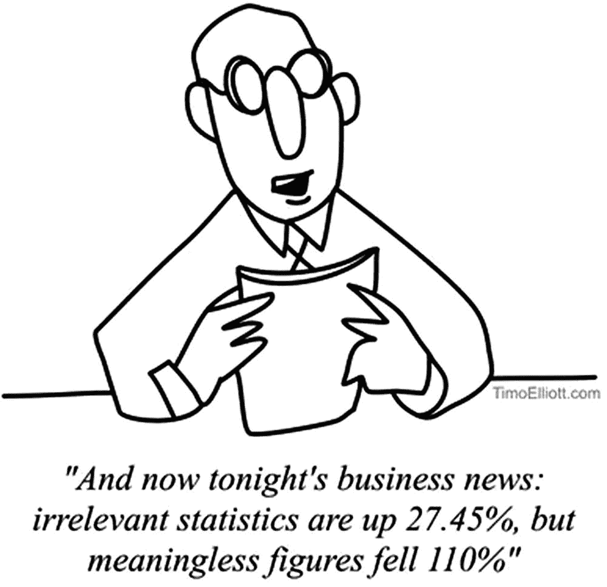
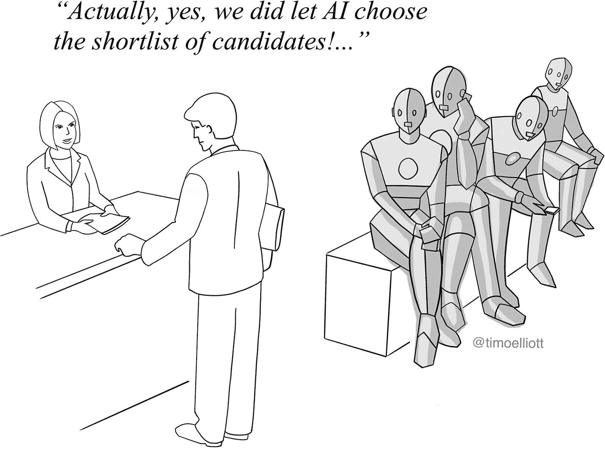

# 20. 分析数据


图 20-1 无用的分析

## 有意义分析的前提条件

拥有精确的算法和高质量的数据就足够了吗？

如果你倾向于回答“是”，那么让我试着让你失望……

即使你拥有可靠的数据，并且使用了数学上被证明的算法，结果也可能不是无懈可击的。

以下是两个主要挑战：

*   算法适用性的前提条件
*   规则含义的模糊解释

让我用应用统计学中著名的`ANOVA`（方差分析）为例。该方法常用于比较样本中不同组别的变异。我不会详述，但会指出一些潜在的陷阱。

### 所有前提条件都满足了吗？

通常，数据科学家会感激地接受统计软件提供的数学例程。

然而，这种便捷的访问方式伴随着这些例程被不经意地使用的风险。前提条件和适用性通常未被验证。

我们来看一个典型的例子：单因素方差分析。这种方差分析可靠性的三个关键假设是：

*   响应变量残差（近似）服从正态分布。
*   总体方差相等（“方差齐性”）。
*   给定组内的响应是独立同分布的正态随机变量。

在现实中验证这些假设并非易事。例如，你可以根据样本确定残差，但无法验证它们是否服从正态分布。此外，很难判断不同样本的方差是否足够相等。

### 研究者能否影响结果？

最后一点引出了第二个挑战：即使拥有正确确定的样本和精确的数学公式，许多决策仍留给研究者来决定。这一发现应当让所有将数据科学视为一门基于事实、不容置疑的数学学科的人感到惊讶。

偏差出现在两个阶段：首先是在数据准备阶段，然后是在数据分析阶段。

数据准备阶段，也称为探索性数据分析（`EDA`），是及早发现数据问题、排除初步错误等不可或缺的步骤。如果做得好，它会使分析结果更有意义。但这并非一个数学上精确描述的阶段。大多数决策都留给研究者来做。换句话说，它们基于经验和直觉。

随后的数据分析阶段，尽管有数学算法可用，但也同样为人为偏差留下了很大空间。

我将再次使用`ANOVA`作为例子，说明一种科学方法如何将大量决策和估计留给了人类。

让我们看看苏黎世大学的一份培训教材，在描述了`ANOVA`的执行过程之后：

```
"（……）Levene 检验用于检验不同组具有相同方差的假设。如果 Levene 检验不显著，则可以认为方差齐性成立。但如果 Levene 检验显著，则违反了`ANOVA`的前提条件之一。`ANOVA`被认为在轻微违反条件下具有容错性。特别是当各组规模足够大且大致相等时，违反通常被认为不成问题。

如果样本规模差异显著，方差齐性的严重违反会导致 F 检验失真。作为一种替代方案，您可以使用`Brown Forsythe`检验或`Welch`检验，它们是经过调整的 F 检验。（……）"^(⁵⁰)
```

我已经标出了所有留有解释余地和存在偏差空间的词语——数量惊人！

举个例子，以上文中的术语"显著"为例。你可能会争辩说："在统计学中，显著和不显著的定义非常精确，不是吗？因此，几乎没有或完全没有误读的空间。"

确实，"显著"和"不显著"之间的界限通常是精确定义的。然而，这个定义并非来自对可能的最佳（更不用说"正确"）阈值的客观确定。

无论你如何衡量显著性，它通常都是一个连续函数。因此，如果你靠近所选阈值，阈值两侧的显著程度几乎是相同的。^(⁵¹)

换句话说，"客观显著性"并不存在。虽然在"显著"和"不显著"之间选择某个分界点总有充分的理由，但其最终确定仍然带有一定的随意性：你总得在某处划一条线。

现实中，想象一下从总体中抽取两个随机样本。毫不奇怪，它们会得出几乎相同的分析结果。现在，要意识到"几乎"可能意味着一个结果略低于阈值，而另一个略高于阈值。

在这种情况下你该如何处理？你能抵挡住选择那个支持你最初假设（或你老板期望）的样本的诱惑吗？如果其他人使用了另一个样本呢？基于非常相似的统计结果，你们会得出截然不同的结论。

这个主题是通常不受质疑的数学陈述的典型案例。我邀请你挑战这类陈述，即使它们来自统计教科书。至少，你应该理解其背后的逻辑和决策，以限制人为偏差。

### 两种挑战并存的情况

有时你会发现两个问题同时存在：前提条件被列出却没有解释，并且以一种允许偏差的方式呈现。在`BA-Support.com`上可以找到一个很好的例子，同样是关于`ANOVA`：

```
"此检验仅在满足若干前提条件时才能使用。这些条件是：所有组要么包含超过 30 个观测值，要么服从正态分布，同时各组之间必须具有可比较的方差。

此外，描述组的变量应为名义尺度，而因变量（我们进行比较的变量，或者干脆就是'另一个！'）应为区间尺度。在一些教科书中，你还会读到各组规模应相似，但在`SPSS`中无需担心，因为它有校正不相等样本量的程序。" (`BA-Support`, 2019)
```

同样，标出的词语构成了大量可供人为偏差发挥的情况。我邀请你思考以下问题：

- "30 个观测值"的阈值从何而来？
- 真的有充分的理由将界限精确划在 30 和 31 个观测值之间吗——低于此就是"差"，高于此就是"好"？
- "可比较"是什么意思？这个决定是否留给了研究者，凭他的/她的经验和直觉？
- "应"暗示某事是推荐的而非强制性的。那么，如果你*不*遵循这个建议会发生什么？
- 在不知道某软件使用何种逻辑做出决策的情况下，信任该软件是否明智？

## 人工智能的一般局限性

人工智能带来了数不胜数的机遇。但我们需要意识到它的局限性以及如何应对这些局限。

### 数据源

即便使用了最优秀的算法，如果输入的数据质量低下，也会得出错误的结果。这应是显而易见的道理。然而，这仍被普遍忽视，因为主要焦点往往在于获取结果。而源自劣质数据的信息，看起来并不比基于高质量数据的信息更差。

因此，在许多情况下，数据科学家在寻找数据时，人们只期望他们从事以下活动：

-   使用关键词搜索网络
-   在无法以文件格式下载数据时进行屏幕抓取
-   下载文件（如有必要，获取二手数据）
-   重复使用他人之前下载过的文件
-   通过列名或内容等方式推断列的含义

这种方法导致了一系列典型的问题模式，降低了数据的价值：

-   数据的年龄通常不明确。它可能在某个时间点上是准确的，但如今已经过时。（而且“某个时间点”所代表的时间跨度正在不断缩短！）
-   数据的完整程度通常不明确：数据可能已被过滤，或者采集工作可能提前终止。
-   列的定义通常靠猜测：由于大多数平面文件或电子表格缺乏适当的说明，数据科学家被迫通过列名等方式来推断其含义。
-   偏差！通常无法得知一个数据表在创建时是否带有特定的操纵目的。即使提供数据的组织信誉良好，但数据整理过程中仍有人为因素参与。而且仅凭内容本身无法分辨：在数据文件中，一个诚实的“5”和被操纵的“5”看起来完全一样。
-   另一位数据科学家可能已经移除或合并了与其他列高度相关的列，这在其特定问题的背景下可能有充分的理由。但在后续使用相同数据回答不同问题时，那些细微的差异可能正是有趣的部分。

对此，你可能希望为任何数据科学家的数据获取工作增加具体职责：

1.  **了解来源**
    获取有关公开数据创建者和提供者的知识非常重要。没有这些知识，数据就如同互联网上一个正面的产品评价一样无用，因为你不知道评价者究竟是卖家还是收了钱才写的评价。
    类似 `https://datasetsearch.research.google.com`（最终于 2020 年发布）这样的数据搜索门户网站很棒，但它们并非“源头”，也不提供任何数据质量的保证。

2.  **联系提供者**
    在某些情况下，与在互联网上找到的数据的原始创建者或提供者取得联系，有助于你理解他们的动机和方法论。
    长远来看，良好的关系可能带来获取额外数据的权限，甚至促成双方定期、富有成效的交流。

3.  **了解数据历史**
    数据质量并非一成不变的属性。即使数据本身保持不变，其质量也会改变。了解数据源的数据质量历史有助于理解其现状：数据是否得到维护？是否处于持续审查中？还是仅仅是一次性的“发射后不管”努力的成果，无论当初执行得多么严谨？

4.  **阐明数据模型**
    数据源所使用的数据模型和术语，很可能与你所在组织对数据元素、关系以及数据结构的定义和命名方式不同。
    在此时进行一点研究，有助于避免日后出现严重问题，或是未被察觉的误解导致得出错误结论。

5.  **核对多个来源**
    很少有信息只通过单一来源获得。因此，寻找同一数据的多个来源是一个好原则，因为它允许你通过比较进行验证。
    请注意，不同方经常相互复制。就像日常生活中的谣言（如果你从不同来源听到，会显得更可信）一样，这可能导致对已确认质量产生虚假的认知。

6.  **客观地对数据源进行分类**
    为了能可重复地评估数据科学项目的结果，你需要对每个数据源的质量进行分类。这对于日后（可能由不同的数据科学家）在另一个上下文中使用相同数据也很重要。
    典型的属性包括内容的可靠性、描述的准确性以及更新的频率。

## 在判断数据源的偏差程度和可信度时，请记住，这不仅仅关乎数据的收集者。最终的数据可能并非基于事实，而是基于“代表性”调查或估算。

在全面评估需要付出不可接受的代价时，调查是深入了解情况的有效手段。但是受访者可能存在偏见。

例如，如果你询问 1000 名 CEO 其组织的数字化成熟度，或者询问 1,000,000 名客户其满意程度，你获得了全面的样本——但每个答案都可能带有偏见，而且受访者的评判标准可能不同。

### `记录你的数据源`

关于数据源的信息（包括数据文件本身及其来源）应同所有其他相关元数据一起进行记录（和维护），以便系统地让所有数据科学家都能获取这些知识。

文档应包含所有已知属性，例如（已确认的！）列的含义、所覆盖的时间点或时间段、创建年份、应用的任何过滤条件，以及文件创建的原始目的。

此外，你可能希望对标准和属性进行标准化，以便能够比较任意两个数据源。

### `协作`

如果贵组织的政策允许，我鼓励所有数据科学家与更广泛的数据社区合作，不仅限于组织内部。这并非为了披露内部信息，而是关于共享有关外部数据源的信息。

## 人工智能算法

让我用一个具体例子来说明人工智能的某些局限性。

这个例子是关于人脸识别的，这是神经网络最突出的应用案例之一。

我个人对已有的人脸识别技术成果印象深刻。然而，使用此类算法从求职者名单中筛选合适人选，会带来一些挑战，可能会让你重新考虑其适用性。

我甚至不是在谈论伦理道德方面——就连这项服务本身也不值所投入的金钱！

2019 年秋季，博比·赫拉德发表了一篇题为《AI 与面部分析首次应用于求职面试》的文章。文中描述了一家美国组织开发的软件，“该软件通过分析视频面试中的语调、词汇和面部表情来判断候选人的适合程度”（赫拉德，2019）。

该算法可能会无意中存在偏见。更糟糕的是，它可能是`故意带有偏见`。其创造者可以把它塑造成这样一种模式：让自己的简历获得最高评分，使自己看起来是最有希望的候选人。本质上，人工智能允许人们以一种非常不道德的方式，为自己的职业发展创造绝佳的工作机会。毕竟，它是一个黑箱——其他人永远不会发现……

就我而言，最糟糕的一点是：这种方法会阻碍人力资源部门随着时间的推移而进步！

以下是底层人工智能算法的一些缺陷。你在其他案例中也会发现这些问题：



图 20-2

HR = “人力资源”（Humanoid Resources）？

### 1. 过去错误的固化

过去因某些属性组合而未能被选中的候选人，未来也将不会被选中。如果过去的筛选标准并非最优，那么未来的标准也将如此。

### 2. 无法考虑需求模式的变化

世界在变化，需要不同类型的人才。这种向后看的算法如何能够理解需求的变化呢？

### 3. 无法判断学习程度

无监督学习是进步的关键。然而，在这种情况下，成功率很难被验证，尤其是无法被算法自身验证。这不是算法的问题，而是可用训练数据的问题。毕竟，判断一个新员工是否可以被认为是成功的，往往需要数年时间。

### 4. 不知道`为什么`

与许多人工智能算法一样，这个算法并没有告诉我们*为什么*某些特质在过去更为成功。要确定最佳候选人，你需要基于有意义的参数来构建招聘逻辑。一个无法区分因果关系和相关性的算法既无用又危险。

不要误会我的意思：我们不应认为确定相关性总是足够的！但我们需要清楚，何时需要因果关系，何时可以运用相关性。

当问题是“多做 A 是否就能多得到 B”时，因果关系至关重要。然而，如果我们想验证一个像“寻找 C 以便发现更多 D”这样的说法，那么运用相关性可能完全没问题。

### 5. 无法洞察训练数据之外的信息

人工智能的一大挑战是结果的适用性。没有任何 AI 算法能提供其训练数据之外可靠的洞察。如果一个元素在被算法“评估”时，并未包含在算法之前的训练或测试数据中，那么其结果充其量是无用的。这种情况在算法试图改善平均选择（例如，平均需要在地面上钻多少个孔才能找到特定的原材料）时或许可以接受。如果 50%的情况得到了改善，而另外 50%只是随机的，你可以认为这是一种成功——总体工作量会下降。但是，当你处理的是个体时，在大多数现代社会，追求平均意义上的改善在伦理上是不可接受的。

为什么我们需要一个具备数据素养的人力资源世界？就是为了防止这类方法成为人力资源部门的工具。没有数据管理员或隐私官应该被迫去指导人力资源人员！

### 6. 法律问题

使用这类算法的机构通常会强调，它只是评估的一个组成部分，在做出招聘决定前，大部分评估工作仍由人类完成。

然而，这种说法并不适用于那些*在*任何人类首次查看*之前*就被算法过滤掉的简历。无论如何，这些简历仍然是 100%由软件处理的，无论随后对其它简历应用了多少人工评估。

这就是为什么这种方法不仅在伦理上值得质疑，而且还违反了现行法律。通用数据保护条例（GDPR）第 22 条规定：“数据主体应有权不受完全基于自动化处理的决定所约束。”

总而言之，你不希望失去对流程的控制（如图 20-2 所示）。在这个问题上，我看到的最佳建议来自英国招聘机构汉诺威招聘有限公司。他们在其网站上写道：“最终，你对待候选人和客户数据的方式，应该像你希望自己的数据被对待的方式一样！”（比蒂，2018）。

## 人类行为

“我知道我在做什么”，这是我经常从数据科学家那里听到的话。但仅仅科学家*知道*是不够的。

数据科学关乎可信度。两个同事各自独立研究同一个问题只是时间问题。他们很可能会使用不同的（变体的）方法。请预料到他们会以不同的方式解读相同的情况，并得出不同的结果。

这些结果可能没有根本性差异。但至少它们会有足够的差异，以至于连市场部的外行人都能质疑小数位数所暗示的精确性。

什么有帮助？`透明度`！用通俗易懂的语言分享你在做什么。不要过度承诺——你不需要这样做！解释局限性。说一句“这个结果仅在 A 和 B 相互独立时才有效，但我们不知道它们独立到何种程度”并无大碍。

## AI – 何去何从？

围棋被认为是地球上最复杂的棋类游戏之一。你可能读过，2016 年，DeepMind 的 AlphaGo 计算机击败了韩国 reigning 世界冠军李世石。这一事件被广泛视为人工智能（AI）发展中的一大步。

我最近读到一篇 IBM 的文章，其中声称：“李世石被击败的重要成果，并非 DeepMind 的 AI 能学会征服围棋，而在于以此类推，它能学会征服任何比围棋简单的事物——这涵盖了极其庞大的范畴。”

听起来有道理？嗯，可能并非如此。

我对这个说法的主要问题在于“简单”这个词。它的比较级暗示我们谈论的是一个单一维度的尺度。换句话说，你可以得出这样的结论：任何两种基于智力的表现都可以按“难易程度”排序（至少其中一种是“下围棋”）。

但你如何定义“简单”？是击败围棋世界冠军更*简单*，还是说服绑匪释放所有人质并投降更简单？是赢得《危险边缘！》更简单，还是在讨论中说服持不同观点的人更简单？我们显然在这里面对的是人类大脑表现的多重维度。

如果让像 AlphaGo 这样的计算机实时计算足球运动员的最佳下一步动作，（撇开硬件限制不谈），就连本文作者也会表现得比它更胜一筹（这很能说明问题）。但凡看过 RoboCup——机器人足球世界杯——的人，都会明白我的意思……

我不知道 AI 会发展得多快。不过，一个指标是研究资金的投资。我最近与许多组织的讨论表明，他们正从“我们必须不惜一切代价参与其中”的阶段，转向“给我看价值”的阶段。真正的资金将流向那些带有商业案例的 AI 研究。

那么，如果你设身处地站在一个组织的角度思考，你会如何思考和行动？

一个管理良好的组织，考虑到客户、股东和员工这常见的利益相关者三角关系，必然会问：“AI 如何能让我们更成功？”即使是大学和非营利组织，总体上也越来越被创造切实价值的需求所驱动。

老实说：要让真正的人工智能（指复制人类大脑意义上的）为我们的社会（甚至单个组织）增值，需要长期巨大的投入。那么，是什么推动了组织的投资呢？

首先，组织通常倾向于为每项任务提供专门的解决方案。这并非 AI 所特有。没有哪家汽车制造商愿意投资一款既能运输笨重货物、又能赢得一级方程式赛车、同时还能提供豪华敞篷体验的汽车。通常，三种专门的解决方案能在各自领域以更低的总成本做得更好。为三个不同任务需要三种解决方案这个事实，并不会被视为尴尬之事，这是有充分理由的。

看看机器人学：虽然媒体上充斥着会微笑和握手的人形机器人，但大多数商业驱动的研究仍集中在专用机器人上，它们能以近乎完美的方式精确完成一件事（并且在执行另一任务前至少需要大量的重新配置）。工业界在此领域已研究数十年，并取得了令人瞩目的成功。

其次，进一步发展那些远落后于现有能力（此处指当前人类能力）的东西，其商业案例会很糟糕。投资回报遥不可及，而且毕竟充满不确定性。

正因如此，我相当确信 AI 的发展将继续专注于那些 AI 已通过专门解决方案提供优于（或可媲美）当前人类表现的领域。模仿人脑中巧妙的机制，例如神经元的工作方式，必将有助于这种方法取得成功。

同时，至少在可预见的未来，我不期望在开发无需为应对新挑战而重新编程的人类大脑克隆体方面取得实质性进展。

这听起来悲观吗？并非本意！

我坚信 AI 在`补充`人类能力方面的能力会不断增强。上帝没有把我们造得像神一样（看完晚间新闻后这很容易相信），所以，我们为什么要反过来投入宝贵的脑力去开发类人设备呢？

## 关于分析的推荐

基于我上述所言，我想提出一套指南，你可以要求整个分析团队遵循：我的“12 条分析指南”。

你可以根据自己的发现和优先事项随意调整它们——但我强烈建议制定此类指南，因为它们有助于整个团队采用一致的方法。

### I. 确定所需的精确度

有时，无需考虑所有数学前提条件。

当只需要（通过启发式算法）为第二个算法找到一个预优化的起始点时，尤其如此。在这种情况下，起始点的质量会影响剩余计算工作量，但不会影响最终结果。

然而，有时收敛性无法保证，而且你常常无法在事后验证你的算法加数据是否工作良好。即使你将数据分为训练数据和测试数据，后者也可能无法正确反映现实。

但是，只要你的模型“仅仅”是期望让流程更高效，只要你拥有较短的验证周期，并且能轻松衡量成功与否，你就不应该一开始就坚持最低精度水平。

你是否找到了可能的最佳算法并不重要——如果它能让事情变得更好，它的存在就是合理的。如果某个流程的性能是 70%，而你将其提升到了 80%，这就是增加了价值，尽管 80%远低于 100%。

在这种情况下，你可以在几天内将模型投入实际应用——在你并行运行它之后，最终得到的算法会提供改进的结果。

一旦你的解决方案上线，你就处于更有利的位置来进一步微调它，特别是当你能衡量其当前性能与 100%之间的差距时。

将这种进展绘制成图表有助于给你的业务客户留下深刻印象：你可以将你的团队所做的事情立即与某个对业务利益相关者重要的指标的改进联系起来。

### II. 不要仅仅因为公式`它能用`就使用它

假设你遇到一个有趣的案例。问题很明确；基础群体在你的数据库中已经可用。你可以调用统计软件中的一个函数，它会返回一个语法上（和数学上）正确的结果。所有输入参数都可用。诱惑很大。

但公式是否符合目的？也许有更好的方法——甚至可能利用现有的业务信息？

举个例子？你可能使用过无监督学习程序来对你的基础群体进行聚类。聚类的数量遵循科学认可的标准，例如，使用组内距离平方和。你的直觉告诉你，你已经找到了一个很好的折中点——进一步增加聚类数量不会显著提高你定义的分数，同时也要考虑到任何进一步聚类都会带来的聚类规模减小。用经济学的语言来说：你增加聚类数量的边际收益接近于零。

所以，无论你最终决定采用多少个聚类，你的决定都是基于数据、公式、直觉和经验的混合。然而，它可能`没有`基于基础群体的业务背景。

这就是为什么数据科学家需要准备好走出他们的舒适区。在业务方面有很多互补的智慧。例如，与合适的业务人员讨论可能会揭示，从业务角度来看，使用众所周知属性的组合，你的基础群体存在一种自然的聚类划分。

使用业务知识可能不仅比应用像肘部法则（即寻找收益曲线上的强拐点，指示边际收益的显著下降）这样广泛接受但与内容无关的方法更合适。它还会让业务人员更容易理解你在做什么，并且你作为实际问题解决者的可信度也会提高。

### III. 检查所有前提条件

你的基础群体是正态分布吗？真的吗？你能保证完全的统计独立性吗？

你无法从结果判断应用某个方法的所有前提条件是否都已满足。如果某个前提条件几乎不可能满足，你至少应该知道它在多大程度上是满足的。

只要可能，你应该定期验证所有前提条件是否都具备。在某些情况下，你可能会发现对于前提条件成立来说，你的结果太差了——而有时你的结果会证实你关于所有前提条件都已满足的假设。

想想选举民意调查，投票站的人出来时被问到他们刚刚投了哪个党的票。结果随后会作为投票结束后的第一个预测显示出来。调查机构通常会选择那些在上次选举中其联合结果非常接近最终结果的投票站。此外，这些人需要被随机选中，并且所有人都需要自愿地讲真话。

你会记得，这类民意调查的结果通常与选举的最终结果相对接近。但是它们是否达到了如果所有统计前提条件都满足时应该达到的理想水平？答案是否定的。如果你做一些数学计算，你会发现，从统计上讲，所有满足前提条件的民意调查中有 98%的结果会比观察到的结果更好！

当然，并非你在业务环境中的所有计算都能像这类民意调查一样迅速得到验证。但如果你有机会，比如说，稍后根据实际销售数据来检查你对整个产品组合销售分布的预测，你就应该这样做，以便更好地感受这些前提条件的有效性。^(⁵³)

### IV. 对局限性保持坦诚

数据和算法都有其固有的局限性。你可能会有理由冒险超越这些限制去使用它们。但要明确你的选择和动机。

有时你可能会被迫进行同比比较，而每年的数据来自两个不同的来源（例如，因为中间引入了新软件，或者因为数据提供者发生了变化）。请将此信息添加到结果的演示文稿中，作为警告。

另一个典型的局限性是你 AI 模型训练数据的来源。你通常无法自己收集这些数据，特别是如果你想将分析建立在数百万条记录的基础上。因此，你最终通常会使用同样有限的几个公开可用的数据存储库。问题在于：你的结果与他人一致并不能证明其正确性。它可能反而表明你们都使用了相同的数据源。

看看用于光学字符识别（OCR）和图像识别的图像库：它们通常是在特定背景下收集的，并且很可能超出该特定背景后就无法使用。

字符识别还带来了另一个挑战：没有 OCR 算法能够可靠地区分`0`（零）和大写字母`"O"`，或者区分`"I"`（即盎格鲁-撒克逊风格的数字`"1"`）和大写字母`"I"`（如果写的时候没有衬线）。同一个图像可能代表两种不同的东西。即使在数字家族内部，欧洲的`"1"`和盎格鲁-撒克逊的`"7"`看起来可能一模一样。为了安全区分，你还需要考虑上下文。如果你做不到，那就坦诚相告！

### V. 解释你的假设

请再看一下前面的聚类示例，并回想一下本章开头关于方差分析的内容。你做了多少次人工选择？

* 定义一个分数

* 选择衡量聚类内元素相似度的指标

* 平衡每个聚类内的方差与随聚类数量增加而增加的工作量等。

我们离无监督学习所需的水平还很远，该水平可以让我们把所有决策都留给一个能自主知道要考虑哪些信息的算法。这意味着由人类来做决策是可以的。

但你需要解释这些决策。是哪些假设让你做出了你所做的决定？

### VI. 切勿制造虚假的精确印象

想象一下，有人收集了一个 40 人团队的护照，记录他们的年龄，并计算了团队的平均年龄。假设计算出的平均年龄四舍五入后为 34 岁。

现在再想象另一个人，他不看护照，而是对每位团队成员的年龄进行估算。此人计算的团队平均年龄为 37.575 岁。

哪个人提供的结果更准确？

我想你明白我的用意。

坦率地说明你结果的精确程度，是建立可信度的一部分。与其说“该群体中的客户偿还贷款的可能性是 68%”，你或许更愿意这样表述：

“在满足算法所有前提条件的情况下，有 95%的概率表明，该可能性介于 65%到 71%之间。换句话说，如果该群体的真实可能性为 68%，那么平均每 20 次模拟中有 19 次会预测出介于 65%到 71%的可能性。每有一个前提条件未满足，不确定性就会增加。”

这样的表述更难理解，但一旦人们理解了，你就不必一再重复了。你将达成以下目标：

-   你助力你的组织踏上成为数据素养型组织的旅程。他们不需要能证明贝叶斯定理，但应该对数据分析能实现什么有基本的理解。

-   你管理了预期并保护了自己：人们应该对你的数据有多精确有一个现实的认知。而且你也不想被认为是“被证明错了”。

你始终要留有改进的余地。更多的数据和性能更强的计算机通常会提高准确性。这让你可以为更高的准确性贴上价格标签。如果一位高管对前面例子中六个百分点的范围不满意，你就知道你的提案应该是什么样的了。

### VII. 谨慎地自动化数据准备

数据准备的自动化可以节省大量时间，并通过减少人为因素（包括个人偏见）来提高可复现性。

请注意，这并不保证（甚至不能提高）数据的正确性。除了减少人为错误和加快流程之外，它只是让相同的数据看起来更好，并简化后续处理。然而，这可能会助长对数据质量的错误印象。

### VIII. 使用 DataOps

随着 DevOps 的兴起，即由同一个团队开发和运维软件，人们开始思考将这一理念扩展到数据主题。毫不意外，这个概念被命名为 DataOps。

DataOps 通过避免不同方只追求各自目标的情况，有助于正确设置激励机制。

此外，审查周期和对数据质量的持续监控有助于发现不合理的数据，例如通过启发式方法。

但请抵制将这种方法局限于分析领域的诱惑。等到为了分析目的而准备之前未经监控的数据时才开始使用 DataOps，就已经太晚了。

### IX. 精妙地权衡

你几乎永远无法找到某个问题的全局最优解。这个世界`就是太复杂了`（双关语）。有太多影响参数，而不同的优化标准通常无法客观地权衡。

这种情况迫使你做出妥协——要么进一步简化你的模型（每个模型在定义上都是简化的），要么减少待评估的选项列表（因为你拥有的选项很可能比已知宇宙中的原子还多）。

你可以在多个层面应用这两种策略。

-   你可以通过构建技术上尽可能复杂的模型来处理简化，也可以在仍然能获得语法有效结果的前提下尽可能简化。

-   或者，你可以通过巧妙运用算法来减少选项数量（例如，一旦找到一个被证明优于某组中每个选项的选项，我就不需要评估整个组的选项了）。

-   此外，你还可以在应用算法之前，基于非科学因素（例如你的业务战略）来减少你的选项列表。例如，你确定了一组选项，并且可以证明全局最优解就在这组选项中。但这些选项中没有一个是符合你组织在产品战略中决定专注的方向的。

但你怎么知道应该在多大程度上妥协呢？同样，你必须进行计算。并且，同样，你很快就会发现自己要找的“最佳”妥协程度是一项极其复杂的计算，复杂到无法执行。

第一个挑战是如何`衡量`你妥协的程度。坚持全面考虑`所有`参数显然意味着零妥协，而随机选择则是 100%的妥协。但你如何确定介于两者之间的任何一种方法到底是多少呢？

复杂性无法通过开发越来越精妙的算法来克服。算法越精妙，它就越复杂。而算法越复杂，你就越难以知道结果的准确性。换句话说，与猜测正确的平衡点相比，你什么也没赢到。

我们常以为，我们被迫径直从老式的直觉转向现代数据科学，并且数据科学将取代直觉。这种思维方式暗示数据科学是解决方案，并将提供终极答案。

相反，最佳选择可能仍然是在两个极端之间保持一个良好平衡的方法。然而，这可能需要改变目标：从旨在找出“正确的商业决策是什么”，转向确定如何以`最恰当`（而非完美）的方式应用数据驱动的方法。

是的，经验和直觉仍然是这项工作的一部分——这凸显了坦陈局限性的重要性（参见指南 IV“坦陈局限性”）。

### X. 排除情感因素

另一个有用的技能是区分“理性”和“感性”决策因素的能力。正如我们所看到的，即使是理性因素也存在缺陷。这就是为什么你至少应该消除诸如骄傲或愤怒之类的情感因素。

你如何培养这种技能？当然，你可以阅读关于情商的书籍（我鼓励你这样做），但与学习科学不同，你不能仅仅“阅读和记忆”。

这就是为什么我建议你与他人一起反思。保持开放的心态，期待他人给你带来惊喜。同样，与科学不同，你会发现两种不同的观点可能都是可以接受的。

因此，这种方法并不意味着在你的大脑知识库中添加另一条知识或一个规则引擎——你可能更希望拓宽你未来决策的基础。

### XI. 考虑模型之外的变量

在传统建模中，你需要有意识地决定哪些参数要纳入模型。在宏观经济学中，这通常被描述为"`其他条件不变`"（拉丁语 `Ceteris Paribus`）：任何你不想（或无法）构建到模型中的变量都被假定为恒定不变。因此，你必须在建模前就预先思考所有可能产生影响的方面，以便有意识地决定是否将它们纳入模型。

而在神经网络中，你往往依赖模型替你完成这项工作。模型会被期望隐含地发现所有相关方面：只要这些方面存在于训练数据中，它们就会自动对训练过程产生积极影响。

然而，这种无需提前考虑所有方面的做法也伴随着风险。风险源于你用于训练和验证模型的样本数据的`代表性`。

事实上，在收集数据时，你可能会遗漏某些方面。你自认为数据具有代表性，但可能无意中忽略了总体中的相关子集。

最常见的遗漏是未考虑`时间`因素。毋庸置疑，任何样本都是在过去收集的。但问题是，自那以后情况可能已经发生了变化！新冠疫情及其带来的消费者偏好剧变就是一个很好的例证。

有些方面的变化你可能甚至从未想到过，但它们却可能对你所评估的内容产生影响。再举一个例子，立法变更或丑闻曝光也可能显著改变人们的购买偏好，因此，事件发生前的样本无法反映当下的现实。

问题在于，这类失败很难被察觉。你会像往常一样用 70%的样本训练模型，用剩余 30%来测试算法。结果，由于测试数据与训练数据反映的是同一段过去的时间，你的测试数据就会证实模型的准确性。

好消息是，你对此可以有所作为。坏消息是，这需要付出额外的努力：你必须考虑所有可能产生影响的方面，即便是那些远离你核心考量的因素。

尤其需要注意的是，仅仅考虑你在样本中发现的所有特征是不够的，无论这个样本多么可靠。在某种程度上，你又回到了确定性模型的艰辛工作中：需要勤勉地审视所有潜在影响因素。

当然，你也可以采取一些缓解措施：尽可能使用涵盖最长时间跨度的训练数据，并按时间段对其进行切分。如果你的模型在处理过去不同时间段的数据时表现相似，那么它至少对`常规`变化（如时尚潮流更迭或政府更替）或`特定`事件（如疫情、自然灾害或奥运会）的存在具有不变性。然而，当训练数据覆盖的所有时间段都位于某个有影响的日子 X 之前，而你又试图预测日子 X 之后的情况时，这种方法就无济于事了。

以下是我的核心心得：一个优秀的模型需要的远不止一位训练有素的数据科学家——广泛的教育背景几乎同等重要。这是组建混合团队的有力理由，在这样的团队中，不同的技能组合可以相辅相成。

### XII. 全面定义成功

你如何验证某项人工智能举措是否成功？或者，当你迭代改进模型时，如何判断自己是否在正确的方向上前进？

乍一看，如果事先定义并衡量了一个可量化的业务标准，问题就很简单了。你能看到改进，并且能证明你的算法是成功的，即使你不知道自己是否本可以做得更好。

但这种判断可能出错，原因在于除了你所关注的那个单一目标标准外，你未能全面衡量其影响。

想象一下，一个警察局希望主动预防犯罪。我们可以假设他们有足够的历史数据来开发和训练一个算法，以判断任何已知人员近期犯罪的可能性。结果，警察局可以实施一项政策，将那些计算出的犯罪风险超过特定阈值的人关进监狱。

当然，即使是最专制的国家，大概率也不会实施这样的概念。但其背后的原理对你来说可能并不陌生，因为它一直被应用于其他用例。

有趣的一点在于：在上述案例中，你几乎可以肯定地发现，犯罪率确实会下降！人工智能算法会识别出许多真正的危险人物，他们被关在监狱里，从而无法实施犯罪。以安全之名，这项举措将被视为成功。

但难道就没有一些不良副作用吗？

如果在评估中不考虑一项举措的全部影响，你可能会忽略那些可能使整个结果变为负面的关键因素（在此案例中，即基本人权）。

在你的组织中，可能找不到同样极端的例子。但你往往会发现类似的模式。

一个非常简单的例子是评估增加收入的不同措施。如果其中一项措施是提供折扣，你不仅需要验证收入的增长（在此案例中几乎是确定的），还必须考虑折扣对利润率（最终对组织盈利底线）的负面影响。

以下是我的建议：确定所有可能受到数据驱动变革影响的领域，并事先将它们纳入一个整体目标函数中。

这样一个带权重的目标函数也迫使业务相关方理清思路并设定优先事项。

诚然，将所有参数转化为同一个度量标准（最常见的是对组织盈利底线的财务影响）需要大量工作。但幸运的是，数据可以帮助你完成这项工作——而你，正身处数据管理领域！

## 可解释人工智能（XAI）

与过去基于规则构建算法不同，许多现代人工智能方法都基于学习（因此有了`机器学习`这一说法），无论是通过示例还是通过奖励来学习。

传统的`确认性`方法，正如运筹学领域所熟知并在二十世纪下半叶成熟起来的那样，总是从确定所有规则和约束条件开始。这些规则和约束会被转化为一个模型，然后对其应用一个合适的（经过数学证明的）算法。

这种方法存在两大主要风险：

1.  **易受偏见和欺诈影响**

    确认性方法从一组位于精确算法之外的规则开始。这些规则通常由对底层问题有既得利益的人汇集而成，因此他们可能已有成见，甚至是在朝着预期的结果努力。

    其结果是，边界被忽略、约束被低估或不等式被“调整”。偏见的另一个重要来源是目标函数的创建，即针对整体归一化目标，对不同目标参数进行加权。

    由此产生的“问题”，通常是一个不等式系统，^(⁵⁴) 可以通过数学精确度进行计算——这暗示了结果是无可争议的正确。然而，如果底层模型受到了偏见的影响，那么结果反映的更可能是研究人员的抱负，而不是客观上的正确最优解。

2.  **模型的不完整性**

    每个优化问题都有无数个参数。任何节点、边界和约束条件的列表都代表了对真实问题的一种简化。

    虽然在早期，计算能力是主要的限制因素，但今天主要的约束是底层业务知识的完备性。如果人们不知道所有的约束条件，就无法将它们添加到模型中。

    当然，模型是对现实的简化。然而，在运筹学中，你无法预先判断模型是否足够代表真实情况，结果同样也不会告诉你这一点。

    只有在现实世界中使用该结果时，你才可能发现模型的好坏。但在大多数情况下，你最终会遇到一个无效的情况，因为某些约束条件在模型中被遗漏了。这种情况需要一个漫长的迭代过程，无法完全交给计算机处理。

这种情况表明，应该扭转方法，并给人工智能的并行发展第二次机会：从数据开始，然后推导出相关性和因果关系。

从基于规则的方法到神经网络的转变，意味着方向的改变：

从 `智慧到数据`（确认性） 转向 `数据到智慧`（探索性/贝叶斯）

你可能已经猜到，这一转变并没有解决人类的所有问题。事实上，它还带来了新的问题。

让我们来看看一些突出的挑战。

### 未知的因果关系

正如我们所看到的，如今的算法就像一个黑箱：你无法再知道神经网络为何得出某个结果。`因果关系不明确`。神经网络完全是关于基于阈值激活和触发的节点……

你如何改进一个你不知道其决策方式的算法？不可能微调规则——毕竟，没有规则，至少在确定性意义上没有。改进神经网络决策质量的唯一方法是通过越来越多的训练。但如果你没有训练数据了呢？

即使你留作验证用途的已知案例证实了足够高的成功率，但误报的情况又如何呢？

## 算法的局限性

想象一个算法能成功识别出 99% 的包含狗的图片。它甚至可能识别出其他图片中的动物类型。

但是，你怎么知道在现实生活中，它不会将一个（未经测试的）任意颜色模式识别为狗呢？“它可能是一只狗”和“它是狗的概率高于它是任何其他动物的概率”之间的阈值，通常是通过手动设置的阈值来确定的。

我几乎可以肯定，随着时间的推移，科学将会更好地理解这些黑箱。但这将是一个漫长而乏味的发现之旅，堪比持续了数十年（并且仍在进行）的对人类大脑本身的理解过程。

### 信任问题

对于患者来说，知道一个模式识别算法在帮助医生检测皮肤癌，通常是可以接受的。毕竟，结果不会比单靠人类判断更差。

但是，对于那些可能对单个个体做出不利决策的算法呢？

一个人工智能算法对其计算的对象一无所知。它通常不能说：“等等，这个被监控摄像头拍到的人不可能是罗纳德·里根——那一定是个狂欢节面具！”相反，我们需要预先丰富或修改数据，因为算法本身不是基于规则的。

你很容易就能想到更多与你我相关的实际例子，比如计算信用评分的人工智能算法。

这种困境的另一个例子是自动驾驶中的算法，它可能不得不在两个预计都会造成伤亡的选项之间做出决定。你会让你的汽车由一个可能得出“你的生命价值低于路上的一群人”这种结论的算法来驾驶吗？

### 伦理问题

基于证据的算法没有良知——而基于规则的算法则可以通过智能地设置边界，或在目标函数中选择不同的权重，使不道德的结果变得不可取，从而避免产生不道德的结果。

但是，如何发现一个人工智能算法认为最优的结果，实际上却是一个不道德的结果呢？

还记得本章前面“人工智能的普遍局限”中的人力资源例子吗：在那里，我们会基于一个连数据科学家都不理解其为何如此决策的算法，系统性地筛选候选人。

这不仅违反了《通用数据保护条例》（GDPR）和其他数据隐私法律，还在*没有*开发者主观意图的情况下，歧视了某些人群！换句话说，仅仅*感觉*自己是合乎伦理的是不够的。数据科学家还需要有意识地寻找可能产生不道德影响的因子，从而*采取*合乎伦理的行动。

### 出路何在？

这个问题被问得越来越频繁，由此催生了“可解释人工智能”（`XAI`）这一术语：*理解正在发生的事情*被视为解决`黑箱算法`、`伦理`和`信任`等问题的关键。

这场讨论才刚刚开始，目前尚未有令人满意的答案。

不过，以下问题或许能引导我们进行接下来的对话：

*   数据科学家将如何赢得用户的信任？没有人再相信那种仅凭可能并非最优的经验来筛选候选人的算法。

*   在哪些情况下，用户会接受“黑箱”，又在何时会拒绝它？

*   又该如何应对？是否会出现能够回溯决策过程的新算法？从学习型人工智能算法的梯度中推导出“生活规则”在多大程度上成为可能？对已知算法的改进，例如最近被推广的“逐层相关性传播”（`LRP`），是否足够成熟，能为现有的神经网络增加透明度？或者，是否会由那些设计之初就具备透明度的新方法占据主导地位？例如，你可以从维度较低的子问题入手，这些子问题涉及的方面较少，更容易被理解，并且人类或许仍能理解其中较少的相互依赖关系？

*   是否有可能对这样一个“黑箱”的输出应用另一种算法，以显示哪些参数（或参数组合）导致了“是/否”的决策？

*   如果透明度方法得以发展，如何对其进行分类，以便数据科学家知道在哪种情况下可以应用哪种算法？

*   你认为近期塑造可解释人工智能的举措会很快取得成功吗？或者，人们是否会像“学会”信任他们的网络电视设备或 Alexa 设备那样，逐渐习惯信任人工智能？

*   在我们的业务生活中，还有哪些地方会遇到黑箱？我们又在哪些方面理所当然地接受了它们？例如，因为组织不愿被迫泄露其商业机密？

*   如果所有数据科学家都使用同样少量的分析库和训练数据集，那么当其中一个存在偏见时，我们是否会接受其更严重的负面影响？

*   我们最终是否会拥有主要取决于算法影响力的伦理标准？数据科学家在选择或开发最适合特定问题的算法之前，是否能够（甚至必须）审查法律？组织是否会制定伦理准则（“负责任的人工智能政策”），以赢得超越法律要求的信任？

*   对于单个数据科学家来说，遵守所有这些“非技术性”准则会有多复杂？对于数据分析主管来说，确保整个团队合规行事又有多复杂？是否有可能对合规性进行审计？

这场讨论并非基于一个假设，即我们可以让所有现有的人工智能算法都足够透明。但对于其中一些算法，这肯定将成为可能，而其他算法则可能实现部分透明。例如，设想一个两步算法：第一阶段基于测试数据的训练来制定一套规则；第二阶段则应用最合适的规则，由于复杂的计算已在第一阶段完成，第二阶段可以近乎实时地进行。这样的算法可以共享在第二阶段中选定并应用了哪些规则。

你仍然不知道**为什么**这些规则在特定情况下被认为是最合适的，但至少你可以检查是否存在潜在缺陷，即某条规则被证明是客观错误或带有歧视性的。

最后，在算法的有效性与“可解释性”之间进行权衡可能既成为可能，也很有必要。人工智能解决方案提供商可能被迫降低算法的有效性，以遵守要求最低程度透明度的法律。

可以预期，此类监管将来自欧盟，这一点可以从其 2020 年 2 月发布的《人工智能白皮书》（欧盟委员会，2020 年）中看出。在该白皮书中，透明度被确定为欧盟委员会人工智能监管框架的七项关键要求之一。

在该白皮书第 15 页，欧盟委员会指出：

> *缺乏透明度（人工智能的不透明性）使得识别和证明可能违反法律的行为变得困难，包括保护基本权利、分配责任以及满足索赔条件的法律规定。因此，为了确保有效适用和执行，可能有必要在某些领域调整或澄清现有立法……*

建议密切关注事态发展，以防您的组织受欧盟立法管辖，或希望在任何一个欧盟国家开展业务。出于伦理原因，无论您身处何种情况，都应考虑这样做！

脚注 1 2 3 4 5
