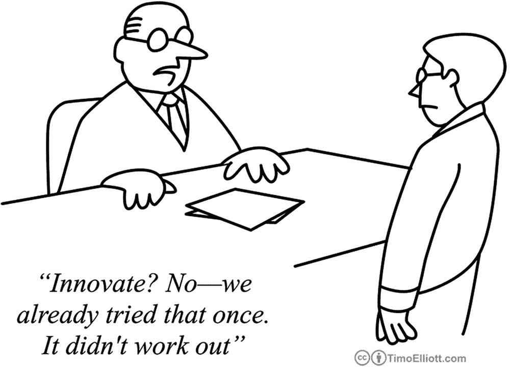
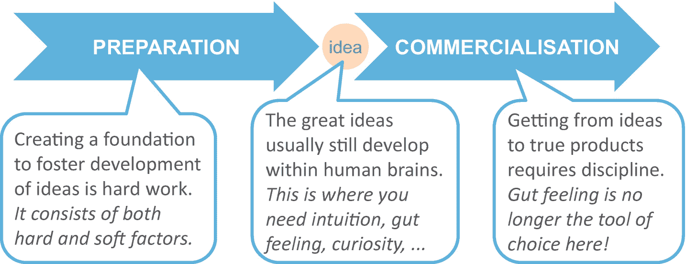

# 数据驱动创新

`图 23-1` – 并非所有人都拥抱创新

## 数据如何驱动创新？

### 揭秘创新

第一步，不妨先来揭开“创新”的神秘面纱？

`图 23-2` – 创新不止于一个好点子

#### 1. 创新总是颠覆性的？

创新未必意味着“下一个重大突破”。你无需设计出一台`永动机`或点铁成金的流程才算创新。若基于一个好想法，渐进式的改进同样极具创新性。

人们可能拒绝将影响力微小但绝妙的想法称为“创新”。但别让这阻碍你在各个层面进行创新！

创新是一种态度。你应该每天都尝试创新。

#### 2. 大公司无法创新？

创新与规模无关。

员工的创新能力与其所在组织的大小无关。

大型组织有时可能因官僚主义而无法快速实现想法——但它们的成熟度常能避免过早实施。这有助于专注于有前景的想法——同时不失创新性。

归根结底，创新主要关乎个人心态，而非组织规模。

#### 3. 创新只属于创意专家？

不，创新并非职业“创新者”或创新部门的专属话题。更重要的是，创新并非创意人士随意脑力活动所产生的不可规划的结果。

创造力对创新确实至关重要，但这既关乎天赋，也同样关乎技巧与组织方法。

请预期创新是 10%的绝妙点子加上 90%的辛勤工作。

图 23-2 表明了创新工作中需投入多少精力来营造一个利于创新的环境，以及将创意转化为具有商业效益的创新成果。

#### 4. 创新需要更多数据？

如今，创新者并不为收集或生成数据而苦恼。大多数组织仅使用了已拥有海量数据中的一小部分。

因此，建议首先专注于挖掘你已经掌握但尚未使用的数据。其次，大量数据可能已被采集，但除了支持日常运营活动外并未被利用。还有第三类数据，可以零成本或低成本收集。

仅这些数据源就蕴藏着巨大的创新潜力，以至于大多数组织甚至没有余力去处理额外的、可能收购而来的数据。

在具体案例中或许存在例外，例如收购你明知会需要的数据，但通常而言，组织应专注于利用现有^(⁵⁷)数据，而不是堆积更多的比特和字节。

而且，你应记得，不应基于未来可能用得上而收集个人数据，以免与`GDPR`等隐私法规冲突。

#### 5. 创新者必须了解自己的产品？

许多组织围绕其产品大力创新，取得了技术上令人瞩目的成果。但工程或流程设计上的精密性并不能保证创新成功。

相反，组织需要预测客户和消费者的想法、渴望和偏好。这包括深刻理解是什么促使他们改变主意。毕竟，你希望理解*并*影响你的客户。

但理解自身业务的需求又如何呢？嗯，对你现有产品过于熟悉甚至可能适得其反。你很容易陷入思维定势。

据报道，柯达数码相机的发明者史蒂文·萨松曾说过：“创新最常来自那些对话题一无所知的人。”

而柯达自身恰恰证明了这一点。想象一下，发明一种与所有现有相机技术都不同的相机技术，这是多么富有创造力。而我们都知道柯达在将这种创造力转化为创新方面有多么失败。他们以为自己知道相机应该是什么样子：*镜头后面必须有一卷胶卷。*真的吗？

创新的一个关键方面是质疑你今天所拥有**一切**的能力。这并非易事，因为审视那些你多年来一直认为不可或缺（甚至可能是你自己开发出来的）的东西，在情感上极具挑战性。

人们需要获得的正是这种能力，而非现有产品的知识。

#### 6. 创新只关注客户？

创新不仅仅在于创造直接影响客户所获价值的新事物。

这里有一个简单的例子：更高效或更环保地进行生产可能极具创新性，但并不一定要改进产品本身。

实际上，通过创新给客户留下深刻印象，却未为其创造切实价值，这也可能是一种理想的（附带）效果。

但创新也可以明确地关注其他相关的利益相关者群体：所有者、供应商和员工。

- “单位投入价值的产出价值”的任何提升通常都受到股东青睐，从而导致组织市场估值上升。投资者对“创新”的定义通常比单纯的客户满意度更广泛。

- 供应商不仅是创新的良好目标，让你能更高效地获取物资和服务。他们也是沿价值链进行协同创新的绝佳潜在合作伙伴。

- 创新可以让你的组织对现有和未来员工更具吸引力，即使不触及产品质量或生产效率。改善工作条件、更清晰的职业发展路径或更好的个人发展机会，都可以通过创新实现，而不仅仅是加薪。

### 什么是“数据驱动创新”？

想到数据与创新，你首先会想到什么？是数据处理方法的创新，例如无监督学习的新应用，或是云端的多域主数据管理？

所有这些都既迷人又重要，但时常会掩盖另一个方面：数据管理作为业务创新的推动者。

换句话说，数据驱动型组织不会首先改变创新的人员和流程。相反，他们会为这些人员和流程配备数据和工具，以简化其工作。

而且，探索那些基于数据或后来通过数据验证的、常规却富有创新性的想法，确实蕴含着巨大的机遇。

这就是“数据驱动创新”。它已被视为一门专门学科，人们开始使用缩写`DDI`来指代。经合组织早在 2013 年就发布了定义。^(⁵⁸)

必须认识到，`DDI`并非与“传统”创新竞争——它扮演着支持角色。同样的研发实验室将继续致力于创新解决方案，只是越来越多地由数据驱动。

### 利用数据进行创新

数据不仅仅是运营支持或预测的议题。它可以通过多种方式为创新提供动力。

特别是，数据可以揭示组织内外的相关性和因果关系。它还可以通过确定此前未知的需求或新的产品机会，来回答从未被问及的问题。

但数据也提供了定制产品或服务的替代方法，因为它有助于衡量客户为新产品或不同产品付费的意愿。

归根结底，大多数组织的创新能力并非受限于缺乏创意——只要员工能设身处地从消费者角度思考，创意就会层出不穷。相反，商业化进程常常因为对其商业成功可能性存在相当大的不确定性而被阻碍，换句话说，就是由于风险规避心理。

当然，数据并不局限于验证已有的创意。即使是新产品或服务的开发也可以得到数据的支持，例如，通过模拟数十种属性或成分的数百万种组合——如果手动操作，这需要耗费人类大量时间。

此外，数据可以开辟产品推广的新途径——通过针对个人进行沟通，并展示创新产品如何满足个体不同的需求。

但数据甚至可以支持诸如新生产流程的确定和验证这类普通意义上的创新。这些流程可以让我们以同样的价格生产出更好的产品，或者以更低的价格生产出同样的产品。
