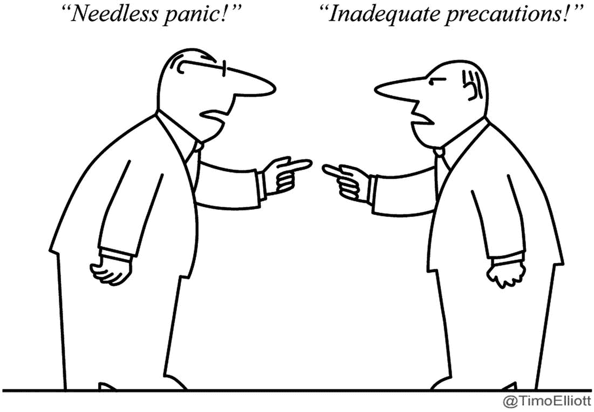

# 21. 危机中的数据管理

**图 21-1** 为危机做准备

## 为危机做好准备

### 想象那些难以想象的事

在我担任的一个数据管理职务中，我和我的团队曾为我们能想到的任何危机做好了准备。我们的电脑里装满了优秀的工具和数据。然后，一场勒索软件攻击袭击了整个组织。我们公司并非特定目标，但勒索软件扩散到了我们的网络中。我们所有基于 Windows 的系统都被感染，网络在几分钟内瘫痪。

一个由才华横溢的数据科学家、数据分析师和项目经理组成的团队最终只能坐在办公桌前，没有一台可用的个人电脑或笔记本电脑。当然，我们所有的危机计划都设想利用计算机来解决问题。

类似地，直到 2019 年，世界各地的组织都拥有出色的应急计划，所有这些计划的第一步都是让人们聚集在一起，共同评估形势并组建行动小组。2020 年初开始的新冠疫情危机需要这样的行动小组，但正是为了对抗这场危机，物理会议突然变得不可能。

当您为危机做准备时，要从过去的危机中吸取教训，但不要止步于此。想象那些难以想象的事！

您可能不必走极端，去为太空中的某个释放强烈无线电波、导致地球电信中断的事件做准备……不过，为什么不呢？

当然，您不必想象*所有*可能引发危机的原因。但换个角度，列出您组织业务中所有不可或缺的方面，怎么样？毕竟，应急计划的适用性通常取决于影响，而不是危机的起因。

要求您的团队打破常规思维，概括过去的危机，梳理几个流程，并确定执行该流程所需的所有方面。

您应该包括那些所有人都认为理所当然的元素——稍后在流程中再来考虑它们的概率。问问自己：“如果 X 方面不可用，会有什么影响？”记录下所有想法。

在接下来的一轮中，您可以专注于与数据相关的方面。数据在哪些方面是问题的一部分，又在哪些方面可能是解决方案的一部分？

最后，考虑一下概率。大部分准备工作应投入到（非致命性）影响与概率乘积最大的情景中。

### 做好活动优先级的准备

查看数据办公室成员今天正在进行的工作。所有这些活动都很有用——但哪些是至关重要的？准备好暂停那些在危机期间“仅有用”的活动，从而为危机专项活动腾出精力。

你在正常时期所做的任何准备工作，都能在紧急情况下为你节省宝贵时间。而新冠疫情可能为你提供一个独特的理由，让你在正常职责之外为危机做好准备。

随着时代变迁和人员流动，你可能会希望不时与团队一起审查计划。

### 成为组织危机计划的一部分

对危机的任何应对都需要数据。面对危机，人们可能会重拾旧习，试图自行寻找数据，甚至可能退回到凭直觉做主要决策的状态。

因此，至关重要的是让组织做好准备，在此类情况下依赖数据。数据办公室的角色必须事先制度化——试图在危机期间才这样做可能为时已晚。

这就是为什么你需要将危机管理作为常规沟通的一部分，与其他领导者进行讨论。

此外，你可能会希望确保数据办公室参与任何企业危机前规划，并自动成为危机应对团队的一部分。你不想在危机开始时浪费精力去争取被倾听。大多数灾难都具有跨职能的相关性，数据管理也是如此——这也是数据应处于任何应急计划核心的充分理由。

数据办公室的哪位成员应被任命为“危机负责人”？答案很直接：如果一场危机不值得首席数据官亲自领导，那它就不是真正的危机。

## 掌控危机

### 与公司优先级保持一致

所有优先级在危机中都会发生变化，并且随着危机的发展可能持续变化。为了设定正确的数据优先级，与董事会商定的危机优先级保持一致会有所帮助。换句话说，你将执行战略对齐的“快速通道”版本（参见第 4 章）。这种方法不仅确保你支持正确的目标，还有助于捍卫你的活动免受批评。

当然，你应该利用作为危机应对团队一员的机会，为优先级的设定过程提供意见。

### 不要试图成为英雄

如果你试图赢得名声，是不会成功的。名声应被视为可能的结果，而非目标。

当年我们遭受勒索软件攻击时，最大的风险是收入损失，因为这会耗尽我们的现金流。其结果是，每个人都竭力确保所有已提供的服务都能实际向客户开具账单。

解决这一挑战可能会让你声名鹊起。但我们认为没有必要成为处理这个问题的第十个团队，也不想让其他人让我们这些数据人员接手。

相反，我们密切观察了局势。我们很快意识到，主要风险与收入损失相反：不同的团队独立恢复了交易数据，这导致一项已提供的服务有被多次开票的风险。

我们决定建立一项交易记录匹配分析。我们几乎无法以 100%的确定性找到两条描述同一笔交易的记录——但我们也不需要。对数百万笔交易进行概率评分的计算，将我们引向了系统性重复产生的区域。

我们的重复项发现为组织增加了价值，与其他所有团队恢复交易的努力相辅相成。最终，我们一起受到了表扬。然而，如果没有人解决重复开票的风险，尽管所有参与方付出了巨大努力，也不会有人得到表扬。

### 准备好你的团队

你的团队绝不能将这种情况视为“某人的危机”，而应视为“我们的危机”。这对于你采取行动的能力至关重要。因此，你应该尽快、尽可能广泛地与团队中的每个人分享这一信息，最好在最初的危机会议上进行（无论是面对面还是远程）。

你可以传达以下信息：

*   明确团队成员每个人比组织更重要。安全和稳定具有最高优先级。

*   分享当前局势对组织的严重性。坦诚相待。

*   强调这个团队可以采取行动应对局势：我们或许无法结束危机，或解决所有由此产生的问题，但我们至少能够减轻影响。而这可能对组织的生存至关重要！

### 倾听你的团队

危机期间的第一个问题不是*如何*做正确的事，而是：*什么*是正确的事？

数据办公室的答案不一定非得来自首席数据官一人。很可能会有时间和空间进行头脑风暴——利用好它！即使你已经有想法，也不要过早抛出。并且要准备好，在头脑风暴过程中随时抛弃你的想法。

### 规划你的行动

与所有变革一样，将需要新的活动，某些现有活动会变得更加关键。同时，面对有限的资源，其他任务需要减少甚至停止。在前一类活动中，将有维持业务运行的活动、衡量影响的活动，以及建议战术步骤的活动。

你应该随时准备好一份全面的数据办公室活动清单（以项目符号列表形式），以便危机应对团队甚至董事会可以设定优先级（或者更理想的是，确认你的提议），而不会冒遗漏重要事项的风险。这一步将帮助你停止提供一些人们已习惯但危机期间相关性较低的数据服务。

在组织层面，危机相关的协调活动应整合到数据办公室内部的危机核心团队中。该团队还将与其他实体建立直接沟通渠道，以加快响应速度。

### 管理紧急状态

根据危机的严重程度，公司的一些规则和原则可能需要暂时解除或修改。每当你认为在数据领域需要这样做时，请获得危机应对团队的批准。

有时你可能需要申请全权委托，以免陷入两难境地：既要避免违反组织规则（这可能让你变得脆弱），又不得不为每一次偏离规则进行请示（这可能拖慢你的进度）。

数据领域的典型案例涉及数据隐私或数据安全。当然，你会以必要的谨慎态度使用任何被授予的自由。

## 从危机中学习

### 危机何时结束？

大多数危机并没有一个正式的结束日期。你通常可以预期情况会随时间好转。然而，你应该始终有意识地切换到正常模式。因此，在危机期间就结束标准达成一致是很有用的。

回归“正常模式”可能并不意味着回到危机前组织的运作方式。危机可能已经改变了组织、其行业（通常由技术进步引发），甚至整个世界，正如 2008 年金融危机和 2020 年新冠疫情所观察到的那样。

### 危机即催化剂

危机往往催生创新，而这些创新在正常情况下可能需要数年时间才能获得所有相关利益方的认同。由于许多创新都与数据相关——尤其在数字化领域——此类非常时期正是绝佳机遇。

危机过后，组织需要决定是保留这些创新，还是回归旧有的工作方式。

与此同时，那些在危机期间不得不暂停的某些活动，或许事后发现并无必要。我回想起曾被迫停止的无数报告，最终发现最初的申请者早已离职多年，而这些报告也无人问津。

你不妨借此机会，摒弃所有被证实可有可无的活动——让团队成员将精力投入到创造更高价值的工作中去。

### 经验教训

危机期间，你学会应对危机，但也能收获远超危机本身的经验。你会重新认识自己的组织、行业和客户。因此，不仅要记录"危机教训"，更要记录在此阶段发现的各类行为模式，这将是个好习惯。

你甚至可能发现，需要设立一个不同的数据管理组织架构，才能妥善应对危机后的局面。若将发现成果连同初步结论和方案纳入"经验教训"文档，将更易于论证变革的合理性——这对于你计划扩充职责或业务领域至关重要。

### 庆祝仪式

如同每个完成的项目，团队应当为共同渡过危机举行庆祝。这往往是首次集体回顾过往的机会。庆祝期间分享的故事（"还记得当时我们怎么应对……吗？"）将长久留在人们记忆中，成为组织遗产的一部分，并营造归属感。忠诚正建立于这样的经历。

庆祝能力是刻意宣告危机结束的另一理由，同时需强调善后工作依然繁重。若无明确的时间节点，组织可能在不经意间回归日常运营，而忽视危机期间员工付出的卓越努力与成就。

危机期间，许多员工展现出超乎常规的投入。你或许希望维持这种势头。为此，不应奖励已取得的成果——这会使他们松懈享受。相反，要赞扬他们的付出、勇气和积极进取的态度。这种方式能激励人们将这种表现延续到任何已完成的任务或已克服的危机之外。

## 并购中的数据

图 22-1

规模相当、业务趋同未必降低难度

### 当下问题何在？

众多组织间的合并——无论是强强联合还是收购兼并——都以失败告终。

随着并购在自由市场经济中成为常态，人们逐渐形成共识：多数失败源于对文化与人文因素的忽略。

这一认知促使全球组织更关注并解决并购中的文化问题，从而避免了许多历史性错误。

不幸的是，这种关注度的转移，也导致组织低估了运营兼容性的重要性。

因此，当代多数整合失败案例并非源于文化问题——尽管某些顾问试图让我们相信这一点。

相反，越来越多的并购因平庸的`兼容性`问题而折戟。无论是销售区域不匹配，还是产品组合结构迥异，大多数非技术性兼容问题都围绕`数据`处理方式的不同展开。

因此，数据问题不能作为并购后的补救措施。相反，整合两个或多个组织的所有环节，必须同时从业务视角、技术视角（适用时）和数据视角协同推进。

正因如此，除了制定不同软硬件环境的技术整合方案，成功的整合还需要系统性、跨职能的数据整合策略。

## 整合规划

典型的整合规划基于若干主题领域，需为这些领域设立工作组，并使其并行启动工作。常见的挑战包括工作组之间的相互依赖关系、以短期成功为导向的激励方案，以及对数据层面的忽视。

处于并购情境中的组织，理想情况下应遵循与任何业务变革流程相同的逻辑步骤顺序，并且从一开始就重点关注数据：

1.  **市场定位**

    我们希望合并后的组织代表什么？客户理想中希望从我们组织购买什么？为什么他们会选择我们而非竞争对手？

2.  **目标服务组合**

    我们未来的产品和服务是什么？我们打算如何构建和识别它们？预期的复杂度水平如何（例如，按市场或本地化功能单独定义的一系列产品）？我们能将服务组合结构化到何种程度，以便后续步骤（如生产或开票）能够自动化？我们的目标服务组合在哪些方面、在多大程度上偏离了之前的任何一个组合？

3.  **我们的目标流程是什么？**

    我们的服务组合需要流程来支撑。必须确定这些流程可以在多大程度上被预先定义，以及在哪些情况下，所提供服务的个性化迫使我们改用策略来应对。

    我们应该设计不同的备选方案，进行比较，并评估每个选项的影响。在确定成本、时间和资源可用性方面，我们应该尽可能精确，这些是在每种情况下选择目标流程的关键因素。

4.  **数据需求是什么？**

    我们如何构建数据的各个方面？我们在哪些方面存在数据模型不兼容？我们在哪里可以匹配两个（或更多）数据模型，在哪里可以找到变通方案，以及在数据存储库和日常运营中，哪些情况下无法在不丢失信息的前提下融合两个世界？

    适用与第（iii）点相同的步骤！需要开发不同的目标数据模型，并应用相同的标准来选择一个目标数据模型。这一点至关重要。

    在未确定目标数据模型作为工作方向的情况下，绝不允许进行任何软件开发。中间模型是可能的，甚至通常是必要的——但目标模型必须始终明确，并且必须优先考虑。

5.  **技术实施**

    基于第（iii）和（iv）点的结果，我们需要制定一份路线图，再次考虑变更成本。即使纯粹的成本计算并不支持，快速见效的方案也是可以接受的。

    这是出于心理层面的考虑：人们需要很快看到成果。如果他们一直等到流程的最后才有人启动最终解决方案，他们就会失去忠诚度。此外，每个人都可以从使用中间解决方案中学习，而这些学习成果可能有助于改进目标解决方案的设计。

    此外，还需要处理一些最终会被废弃的工作，特别是在不同区域以不同速度推进时，为了获得临时的兼容性。^(⁵⁵)

    需要规划出所有区域时间表之间的依赖关系，以确定关键路径。没有什么比九个已完成的工作流被迫等待第十个更令人恼火的了。

    不言而喻，这种方法不应被视为严格的顺序流程。它必须被视为一个迭代过程。几乎没有比并购更难提前规划的事情了，因为双方的人员每天都面临着意外。

## 数据方法

以下是在规划作为并购或整合一部分的数据处理时的一些建议。

### 谁应该管理数据整合？

挑战不应由直接受影响的业务部门各自孤立地解决。这种方法很容易导致解决了一个团队的问题，却对其他团队产生不利影响。

每次并购都应从评估整合过程中的数据问题开始。这项活动将产生一份长长的互操作性和报告方面的挑战清单，通常基于数据映射问题。

为了充分应对“并购中的数据”这一议题，应尽早明确数据领导权。如果合并导致两个原有的数据办公室并存，则应尽早决定由谁担任唯一的 `CDO`，同时两个团队的所有成员都需要为未来的工作做出贡献。在最终领导决策做出之前，尝试与你的同行达成“停火条件下的选美比赛”的共识。如果你获得了领导权，应立即设立一个专门的（临时）实体，负责整个并购计划中的数据方面事宜。如果并购或整合有专门的预算（通常会有），你应该争取合理的份额，这样你就能在不严重影响数据办公室日常工作的前提下处理数据问题。

### 理解动机

无论你面临的是整合还是收购，理解其驱动因素至关重要。这有助于决定是快速整合还是彻底整合（或者在两个极端之间找到平衡的方法）。

一个长期规划的战略性并购更容易采用“一步到位”的方法，而两个都因规模太小而无法生存的参与者进行的生存型并购，则可能首先侧重于“无论如何先让它运转起来”。

在你试图用与数据相关的考量来影响决策之前，必须充分理解管理委员会（甚至可能是潜在的监事会）背后的优先事项。

但你可以大致预期一个组织决定进行统一背后的不同动机，无论是出于并购、战略还是运营上的考量。

一些组织旨在整合以前独立的国家组织或实体，以便能够对其进行统一管理，并更轻松地比较其绩效。

有时，组织希望在所有实体中实现统一的产品供应，或者希望一个单一品牌代表相同的价值主张。

其他组织决定统一，以便能够外包或自动化标准化流程。（经验表明，组织应该在**外包之前**先进行标准化。如果你为同一活动外包了各种不同的流程，管理供应商将变得繁琐，成本可能会失控。^(⁵⁶))

在任何这些情况下，未来数据整合的业务案例通常应基于底层驱动因素的主要目的。

### 专注于互操作性

在任何合并或收购中，来自不同方的数据都必须汇集到一起——无论是出于运营目的、联合的订单到现金流程、客户可见性，还是财务报告需求。

这就是为什么首要的集成目标是*互操作性*，即一方需要能够捕获、解释和处理来自另一方的数据和/或系统。互操作性的一个重要方面是针对公司处理的所有事物（从原材料到发动机、产品和员工）采用统一的识别逻辑。

这个互操作性目标必须代表“新世界”，而不是两个“旧世界”中的任何一个。这意味着，在大多数情况下，收购组织也需要做出改变（除非收购规模相对较小）。

你还需要为联合报告建立映射。集成过程中典型的业务需求声明如下：

- “财务部门报告被收购组织损益的方式需要一些改变。”

- “谁能告诉我，一个实体的哪些数据已经可以在另一个实体的数据仓库中获取？”

虽然一个完全集成的组织会在集成完成后自然而然地解答这些问题，但在集成过程之前和期间，你还需要付出额外的努力来建立一个合适的报告环境。

即使在创建联合数据仓库和在不同实体之间物理传输数据方面取得了良好进展，数据元素的**结构和含义也往往存在巨大差异！**

请记住：如果你在任一方堆积了遗留问题，数据挑战将会成倍增加。

> **注意**
>
> 这些挑战并非并购所独有。对之前独立的国别组织或实体进行统一化，可能遵循完全相同的方法。从技术上讲，这些不同的实体是刚刚成为同一组织的一部分，还是已经在同一组织内共存多年，这并没有太大区别。

### 制定高层计划

无论整合组织背后是什么驱动力，经验表明你可以应用以下通用步骤序列：

- 确定不同实体中各主题的最佳实践。

- 以“可复用”的方式解决单个问题。创建通用的流程、指南等。

- 确定最合适的流程和应用程序（可能来自法人实体、子公司或中央职能部门）。

- 修改这些流程和 IT 应用程序，使其能够协同工作。

- 选择一两个初始实体来试点解决方案。

- 在全球推广时应用试点的经验教训。

### 确定“最佳组合”解决方案

每个实体可能在某些活动中表现最佳，或者使用更好的模型。你可以利用这种情况，构建一个比任何一个实体都更好的目标配置：

- 对所有待集成实体的解决方案和流程进行一次盘点。

- 使用相同标准对其进行衡量，以了解哪个实体在哪个流程中表现最佳。

- 确定现有的最佳解决方案。检查它们的兼容性和互操作性。

- 为目标配置选择最佳的有效组合。你可能需要做出妥协，因为不同实体可能在不同流程中表现最佳，而这些流程可能无法完全互操作。

### 请勿（过多地）并行创新

有时你会面临挑战，即人们不同意在整个集成期间暂停创新。请抵制这种想法。坚持“先统一，后优化”的原则。同时进行统一和优化是失败的秘诀。

此外，不尝试同时进行创新的统一过程会更快，而保持这一过程的短暂至关重要。

更重要的是，通过成功的集成，创新和优化将变得容易得多，因为你可以专注于单一的流程和数据结构版图。

最后，无论你的集成在何处遵循最佳组合方法，你都会在不知不觉中实现创新，因为你正在用更优的解决方案替换现有方案。

## 数据映射

为了成功集成两个或多个不同的实体，你需要对整个组织的所有部分有一个一致的视图。为此，你需要映射数据字段和数据元素。

你应该利用这个机会，并尽可能朝着一个规范化的模型努力，该模型将导向一个达成共识的业务目标状态。

如果这种状态尚未定义，你应将其列为最高优先级——它也是其他集成活动所必需的。

如果这种定义（在技术上或法律上）不可能实现，你的工作则应基于商定的临时步骤，否则任何有针对性的合并活动都不可能进行。

数据映射过程不是一项技术活动！它需要审慎的业务决策。这就是为什么它绝不能仅由 IT 部门来完成。

原因在于映射通常具有歧义性。当你无法找到完美的 1:1 映射时，你需要找到一个接近的映射。但应该选择哪种可能的方案呢？这个决定应基于业务考量：你需要考虑对组织业务的直接影响，还要考虑与最终目标的符合性。

一旦所有业务决策做出，数据办公室与 IT 架构团队需要紧密合作，以某种格式记录结果，该格式允许在 IT 应用程序中明确无误地实现底层流程。

典型的产物包括数据流图、实体-关系模型（用于目标步骤和过渡步骤）以及规范数据模型。

## 组织

你的“集成中的数据”组织需要一个联系人，负责所有映射需求。此人通常不执行映射工作，而是协调和统筹所有映射活动。严格的协调至关重要，以避免工作重复以及不同职能计划之间映射的缺口和不一致。

由此实体协调的所有映射计划都需要从数据角度进行`完整性检查`，就像你的组织对其他任何集成活动所做的那样。以下是一个典型的检查清单：

- 业务问题已陈述。
- 数据负责人已确定并准备好承担业务所有权。
- 跨职能问题已得到解决。
- 交付物清晰（需同时考虑业务交付物和数据交付物！）。
- 底层业务决策已做出。
- 依赖关系明确。
- 时间表已定义。
- 工作已组织。
- 敏捷变更流程已就绪。
- 遵循“数据原则”（参见第 6 章）。

一旦你处理了所有这些要点，“数据映射”实体的活动应仅限于监控、盘点和记录。

## 具体映射案例

没有“一刀切”的解决方案！典型的映射类型包括：

### `1:1 映射`

这是所有映射案例中最简单的一种，适用于数据中单个元素或结构方面虽然称呼不同但含义完全相同的情况。

其结果是形成一个传统的`术语表`主题：你需要定义主要表达式以及别名/同义词。这仍然需要各职能部门之间的协作，以确保你能做出最佳选择。

### `1:n 映射`

`1:n 映射`的一个典型例子是用代码表示的属性列表：一方针对多个不同变体使用了多个代码，而另一方则将所有变体归入一个代码下，因为它们在操作上没有差异。

适当的映射需要理解操作层面。你需要与所有受影响的业务职能部门（例如，生产部和产品管理部）紧密合作，以找到最佳的映射方案。

在某些情况下，如果无法通过其他方式避免丢失操作上必要的信息，你甚至可能不得不更改操作流程，以便在跨实体边界的处理过程中正确启用。

### `n:m 映射`

想象以下情况：在两个需要映射的属性列表中，粒度有时在一方更细，有时在另一方更细。

与上一种情况相比，你面临额外的挑战：你不能简单地决定选择粒度更细的一方并以此为起点。相反，必须接受或解决信息可见性的损失。

这种情况的解决方案或缓解措施通常通过在集成过程中的变通办法来实现。最大的挑战通常是组织不愿意投入资金修改那些计划在不久后被淘汰的工具和流程。

一个典型的解决方案是重新定义现有但未使用的代码。这伴随着歧义或误解的高风险。因此，此类案例需要仔细记录、传达，最重要的是，在所有业务职能部门中一致应用。

### 无对应代码

在这种情况下，一方使用的代码或数据元素是另一方所不知道的。

如果目标设置中要求使用此类代码，组织可以借此机会将其引入目前未使用该代码的一方。

然而，如果该代码在集成后应被淘汰，那么与产品集成活动的协调就至关重要：哪些服务/功能以及可见性将不再作为哪个产品/服务的一部分提供？从何时开始？这些决策将有助于理解变通办法或对现有解决方案的修改是否合理。

### 一维结构差异

这里使用的是相同的维度，但结构不同。

一个典型例子是报告日历，其基础周期可能不同。在存在共同分母的情况下，这种差异相对容易映射：如果一方按日历年度报告，而另一方按会计年度报告，你可以使用“月度报告”作为共同基础。

当你查看周度报告（通常是运营视角）与月度报告（典型的财务视角）时，情况就变得更加复杂。要映射这两个基础周期，可能需要妥协或组织变革。

### 复杂结构差异

有些情况基于完全不同的逻辑方法，导致数据结构难以映射。

一个来自运输行业的好例子是“货运”（或“托运”）的定义。这远不止是使用了不同的术语。其含义可能在多个维度上有所不同：单件与多件、生命周期、可见性、“合并开票”与“合并运输”、海关处理，等等。没有标准的映射方法，但很明显，需要跨职能协作。

### 含义代码

这类代码的一个字段中包含含有信息的子字符串。例如，客户标识符的前两位字符是客户所在的国家代码，或者总账科目代码的第一位数字用于分类科目类型。

目标模型永远不应预见到“含义代码”。它应该使用定义明确的属性来代替。当你今天面临这样的挑战时，你应该分解代码，并将属性添加到目标规范模型中（无论如何你都需要定义这个模型）。此外，代码结构需要作为元数据的一部分进行规定。克服含义代码的计划需要长远的眼光，以及对建立在此假设基础上的所有应用程序和流程进行详尽的盘点。

脚注 1 2