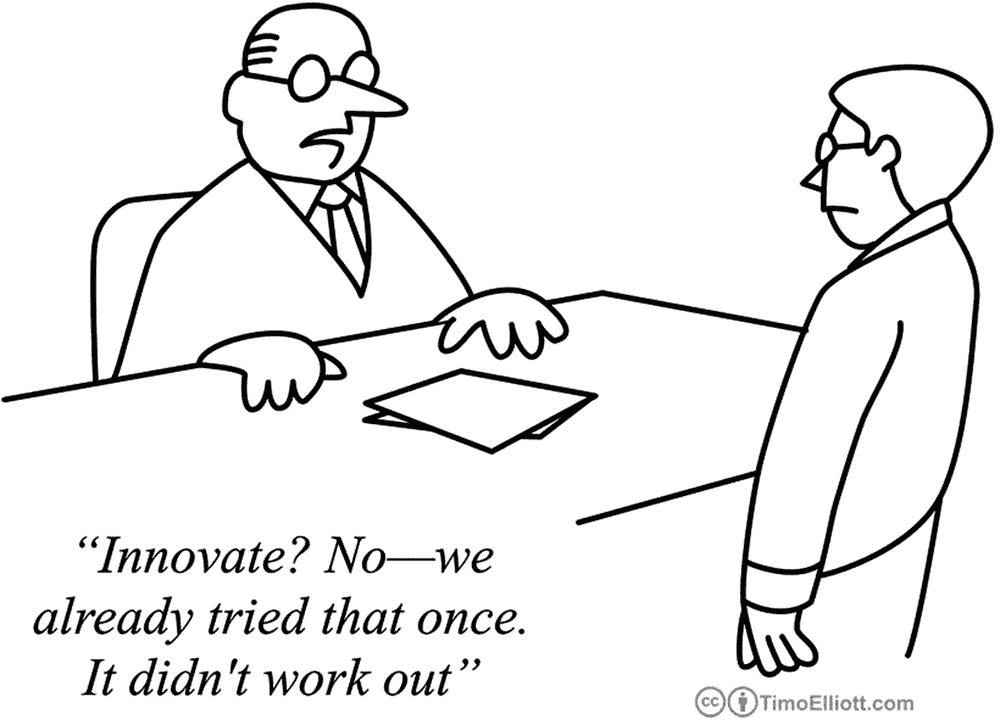
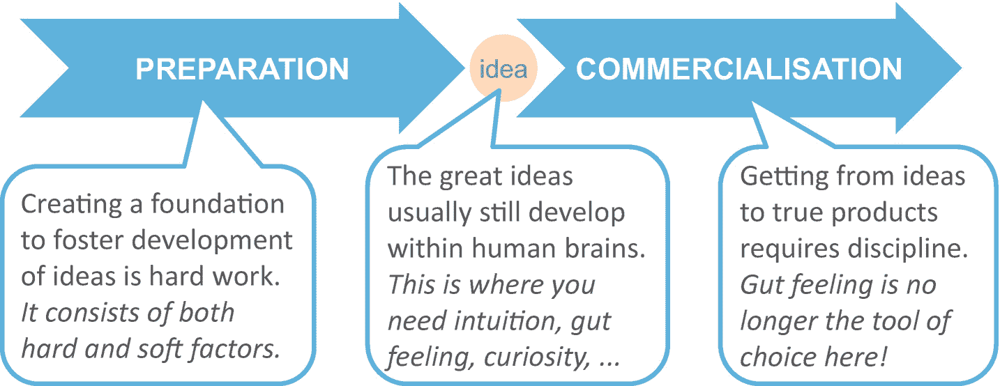

# 数据驱动创新

`图 23-1` – 并非所有人都拥抱创新

## 数据如何驱动创新？

### 揭秘创新

第一步，不妨先来揭开“创新”的神秘面纱？

`图 23-2` – 创新不止于一个好点子

#### 1. 创新总是颠覆性的？

创新未必意味着“下一个重大突破”。你无需设计出一台`永动机`或点铁成金的流程才算创新。若基于一个好想法，渐进式的改进同样极具创新性。

人们可能拒绝将影响力微小但绝妙的想法称为“创新”。但别让这阻碍你在各个层面进行创新！

创新是一种态度。你应该每天都尝试创新。

#### 2. 大公司无法创新？

创新与规模无关。

员工的创新能力与其所在组织的大小无关。

大型组织有时可能因官僚主义而无法快速实现想法——但它们的成熟度常能避免过早实施。这有助于专注于有前景的想法——同时不失创新性。

归根结底，创新主要关乎个人心态，而非组织规模。

#### 3. 创新只属于创意专家？

不，创新并非职业“创新者”或创新部门的专属话题。更重要的是，创新并非创意人士随意脑力活动所产生的不可规划的结果。

创造力对创新确实至关重要，但这既关乎天赋，也同样关乎技巧与组织方法。

请预期创新是 10%的绝妙点子加上 90%的辛勤工作。

图 23-2 表明了创新工作中需投入多少精力来营造一个利于创新的环境，以及将创意转化为具有商业效益的创新成果。

#### 4. 创新需要更多数据？

如今，创新者并不为收集或生成数据而苦恼。大多数组织仅使用了已拥有海量数据中的一小部分。

因此，建议首先专注于挖掘你已经掌握但尚未使用的数据。其次，大量数据可能已被采集，但除了支持日常运营活动外并未被利用。还有第三类数据，可以零成本或低成本收集。

仅这些数据源就蕴藏着巨大的创新潜力，以至于大多数组织甚至没有余力去处理额外的、可能收购而来的数据。

在具体案例中或许存在例外，例如收购你明知会需要的数据，但通常而言，组织应专注于利用现有^(⁵⁷)数据，而不是堆积更多的比特和字节。

而且，你应记得，不应基于未来可能用得上而收集个人数据，以免与`GDPR`等隐私法规冲突。

#### 5. 创新者必须了解自己的产品？

许多组织围绕其产品大力创新，取得了技术上令人瞩目的成果。但工程或流程设计上的精密性并不能保证创新成功。

相反，组织需要预测客户和消费者的想法、渴望和偏好。这包括深刻理解是什么促使他们改变主意。毕竟，你希望理解*并*影响你的客户。

但理解自身业务的需求又如何呢？嗯，对你现有产品过于熟悉甚至可能适得其反。你很容易陷入思维定势。

据报道，柯达数码相机的发明者史蒂文·萨松曾说过：“创新最常来自那些对话题一无所知的人。”

而柯达自身恰恰证明了这一点。想象一下，发明一种与所有现有相机技术都不同的相机技术，这是多么富有创造力。而我们都知道柯达在将这种创造力转化为创新方面有多么失败。他们以为自己知道相机应该是什么样子：*镜头后面必须有一卷胶卷。*真的吗？

创新的一个关键方面是质疑你今天所拥有**一切**的能力。这并非易事，因为审视那些你多年来一直认为不可或缺（甚至可能是你自己开发出来的）的东西，在情感上极具挑战性。

人们需要获得的正是这种能力，而非现有产品的知识。

#### 6. 创新只关注客户？

创新不仅仅在于创造直接影响客户所获价值的新事物。

这里有一个简单的例子：更高效或更环保地进行生产可能极具创新性，但并不一定要改进产品本身。

实际上，通过创新给客户留下深刻印象，却未为其创造切实价值，这也可能是一种理想的（附带）效果。

但创新也可以明确地关注其他相关的利益相关者群体：所有者、供应商和员工。

- “单位投入价值的产出价值”的任何提升通常都受到股东青睐，从而导致组织市场估值上升。投资者对“创新”的定义通常比单纯的客户满意度更广泛。

- 供应商不仅是创新的良好目标，让你能更高效地获取物资和服务。他们也是沿价值链进行协同创新的绝佳潜在合作伙伴。

- 创新可以让你的组织对现有和未来员工更具吸引力，即使不触及产品质量或生产效率。改善工作条件、更清晰的职业发展路径或更好的个人发展机会，都可以通过创新实现，而不仅仅是加薪。

### 什么是“数据驱动创新”？

想到数据与创新，你首先会想到什么？是数据处理方法的创新，例如无监督学习的新应用，或是云端的多域主数据管理？

所有这些都既迷人又重要，但时常会掩盖另一个方面：数据管理作为业务创新的推动者。

换句话说，数据驱动型组织不会首先改变创新的人员和流程。相反，他们会为这些人员和流程配备数据和工具，以简化其工作。

而且，探索那些基于数据或后来通过数据验证的、常规却富有创新性的想法，确实蕴含着巨大的机遇。

这就是“数据驱动创新”。它已被视为一门专门学科，人们开始使用缩写`DDI`来指代。经合组织早在 2013 年就发布了定义。^(⁵⁸)

必须认识到，`DDI`并非与“传统”创新竞争——它扮演着支持角色。同样的研发实验室将继续致力于创新解决方案，只是越来越多地由数据驱动。

### 利用数据进行创新

数据不仅仅是运营支持或预测的议题。它可以通过多种方式为创新提供动力。

特别是，数据可以揭示组织内外的相关性和因果关系。它还可以通过确定此前未知的需求或新的产品机会，来回答从未被问及的问题。

但数据也提供了定制产品或服务的替代方法，因为它有助于衡量客户为新产品或不同产品付费的意愿。

归根结底，大多数组织的创新能力并非受限于缺乏创意——只要员工能设身处地从消费者角度思考，创意就会层出不穷。相反，商业化进程常常因为对其商业成功可能性存在相当大的不确定性而被阻碍，换句话说，就是由于风险规避心理。

当然，数据并不局限于验证已有的创意。即使是新产品或服务的开发也可以得到数据的支持，例如，通过模拟数十种属性或成分的数百万种组合——如果手动操作，这需要耗费人类大量时间。

此外，数据可以开辟产品推广的新途径——通过针对个人进行沟通，并展示创新产品如何满足个体不同的需求。

但数据甚至可以支持诸如新生产流程的确定和验证这类普通意义上的创新。这些流程可以让我们以同样的价格生产出更好的产品，或者以更低的价格生产出同样的产品。

## 支持数据驱动的创新

当然，如果只是空想，创新是不会发生的。不创新的组织将被那些积极创新的组织超越。这就是为什么仅仅允许数据驱动的创新是不够的。相反，组织需要主动创建一种数据驱动的文化——不是通过海报和标语，而是通过鼓励和奖励每一个个体。

但是，组织如何有效支持数据驱动的创新呢？

### 找出障碍

数据驱动的创新可能因为多种原因，在组织的不同层面陷入僵局。

1.  **高层管理者。**

    创新是积极的吗？并非所有人都认同！那些帮助打造了成功组织（有时甚至历时数十年）的高管，可能会对现状以及组织过去取得的成就感到非常自豪。

    在管理层出现的第二个障碍，是经常将效率提升、成本节约与创新混为一谈：

    **成本节约**会被竞争对手立即复制（或者，或许*你的*组织正在复制竞争对手？），因此你很难仅通过降低成本来赢得市场。

    相比之下，**创新**则是竞争对手难以轻易复制的东西。

2.  **员工队伍。**

    员工队伍已经为数据驱动型组织做好了准备，因为数字原住民是精通数据的。

    真的是这样吗？

    要做出恰当判断，有助益的是认识到：私人数据处理与商业数据处理是不同的。

    想想你的智能手机。它可以通过手指轻点完成一切操作。你不需要与任何人协调。

    这是你在商业中处理数据的方式吗？

    我认为不应该，原因在于以下区别：

    *   在个人生活中，是**其他人**在确保数据为你**服务**。

    *   在商业生活中，期望的是**你**确保数据为**他人**服务。

    从这个意义上说，我们可以认为，那些**开发**智能手机的人才是精通数据的，而非用户。在你的组织里，你认识多少这样的智能手机开发者？

3.  **中层管理者。**

    组织中有哪位管理者会公开承认反对数据驱动型组织？可能没有！

    事实上，你几乎看不到有人公开反对成为数据驱动型组织的想法。相反，在许多传统组织中，可以观察到以下模式：

4.  **高层推动创新。**

    公开支持数据和数字化是高管们的常见礼节。如果你读过像《福布斯》这样的杂志对 CEO 们的采访，你就会明白我的意思……

5.  **员工乐于接受。**

    如果技术每天都能让你的个人生活更便捷，那么你很可能会在工作场所也欢迎这种进步！只要它不被视为竞争（威胁到自己的工作），数据驱动的进步通常被认为是积极的。

6.  **但****中层管理者****有顾虑。**

    我说的是谁？那些不参与组织战略制定，但管理着规模可观团队（例如，分公司经理）的所有管理者。他们被期望作为倡导者和倍增器，将战略贯彻下去。但是，很多时候，创新正是在这里失去了动力。

    这些管理者是傻瓜吗？他们理解不了吗？

不，大多数中层管理者足够聪明，通常他们也喜欢创新的想法！但他们有充分的、非常个人化的理由不去推动变革。

早在 2004 年，当 Rainer Meier 担任德国邮政企业传播部主管时，他就观察到了这一现象。他曾经称之为“中层管理之云”，并将其视为一个管理层级，在这里，知识得以沉淀，而变革则被视为一种威胁（Meier, 2004）。

那么，这些顾虑从何而来？面对这种情况又该如何应对？

一个希望拥抱变革的管理委员会，或许希望建立一个渠道，让中层管理者能够发出自己的声音。随后，需要发现其中的模式，并对关键（且通常是合理的）问题给出可靠的答案。以下是处理创新时一些典型的顾虑例子：

*   如果我失败了怎么办？我只有一次机会吗？我失去的会不会比得到的多？
*   这对我有什么好处？它符合我的职业发展轨迹吗？
*   创新是否会分散我团队日常工作的精力（而这是衡量我的标准）？
*   如果我不理解怎么办？毕竟，创新往往伴随着新技术，而这些技术是我 30 年前在大学里没能熟悉的。

成功的组织会将这些作为领导力发展的一部分，公开处理这些问题。你的组织有这样的计划吗？

## 组织创新

一个精心构思的框架有助于推动数据驱动的创新。我认为以下三个方面对于建立必要的坚实基础至关重要：

1.  **创建合适的组织结构**

在受保护的创新空间中推进创新想法会更容易。否则，创新就会被繁多的日常任务所淹没。

如果您希望让您的组织能够利用数据进行创新，您可能会倾向于采用以数据为中心的研发方法。毕竟，相同的数据源可能为不同的产品或服务领域的创新提供动力。

然而，并非所有创新的数据工作都需要从日常业务中剥离出来并放入研发环境中。即使在常规部门内部，您也可能希望提供组织支持，以便人们能够在不受行政任务干扰的情况下推进创新想法。

如果您的组织足够大，那么投资组建一支训练有素、能将想法变为现实的数据专家团队是一项很好的投资。这些人可以支持来自不同部门、拥有有前景想法的同事。

有时，即使是在阐述创新方法以及处理该方法的过程中，创造性的任务也需要不同的技能组合。因此，如果有人有了一个好主意，不要强迫那个人也完成所有后续步骤。您应该拥有那些既受过培训*并且*愿意接手的人。

2.  **管理**整个**创新流程**

有些人倾向于过早地放松下来，通常是在某个中间步骤交付了令人印象深刻的结果之后。

这类结果的例子包括：广受赞誉的概念、已签字的软件以及成功的试点项目。

您需要防止创新流程就此止步。

这时，一个详尽的“创新流程”描述就能派上用场。它涵盖了从构思和研究到产品化的整个链条，以确保在整个过程中，直到最后一步都得到充分关注。

一旦机会出现，一个好的创新流程就能确保该机会被识别、被正式化，并获得优先级的资源和分配——包括那些“苦差事”，例如通常繁琐的业务案例计算。

请注意，形式化并不一定会扼杀创造力。相反，一个精心设计的流程可以防止富有创造力的人分心，同时确保所有必要的非创造性活动得以完成。

此外，所有相关的业务职能部门都需要在早期阶段介入。如果一个创造性的想法在受保护的环境中停留太久，许多关键的、非技术性的副作用就会从视线中消失。

**示例 1**

设想一个考虑使用无人机进行货物配送的组织。

仅仅这个创造性的想法本身并非创新！

对这个概念进行试点相对容易，而此类测试的受控环境几乎能保证成功。

通过这样的举措，一个组织可以塑造其作为创新驱动者的声誉，正面的新闻报道也几乎是必然的。

但随后艰苦的工作就开始了：

1.  客户焦点：组织需要确定无人机配送能为客户增加价值的场景。客户为什么要为这样的服务支付（更多）费用？有多少客户会购买这样的产品？
2.  商业焦点：组织必须计算附加值，并通过以商业为导向的试点进行验证。这能为我们带来（更多）收入吗？
3.  运营焦点：必须确定所有可能偏离理想流程的情况，例如故意破坏或无人机之间潜在的碰撞。需要在工程、流程设计和软件方面开发解决方案。结果需要实现可操作化，以便在日常工作中运行并可扩展。
4.  法律焦点：在日益受监管的无人机业务中，合规性至关重要——同时需要预见到新的、尚未监管的方面。安全和保障问题也需要得到妥善处理。

总而言之，您可以预期，直到首次成功试点的努力，仅占整个工作的不到百分之十。

难怪在我们首次在媒体上看到那些著名物流企业的品牌配送无人机照片后的头两年内，没有一家主流物流公司建立起大规模的无人机业务。

3.  **使您的数据可用**

您应当组织好数据，以便所有潜在的创新者都能看到哪些数据可供他们使用。

并且请给予他们所有人的访问权限。这种访问应包含来自数据办公室的支持。它还应附带所有关于数据的相关信息，例如其来源的可靠程度、时效、结构及其元数据，还有其质量，例如完整性、格式符合度等等。

考虑到您组织中潜在的创新者可能比有限的数据专家和研究工程师数量更多，这一点是很有帮助的。

## 妥善处理业务案例

在组织的产品组合中增加任何新事物之前，业务案例是不可或缺的。然而，在创新过程中，业务案例不应过早应用，因为这种做法可能会在探索所有使其盈利的选项之前，就扼杀一个有前景的想法。

在缺乏信息来构建全面业务案例的情况下，应预先考虑采取两步走的方法：从一个低成本的预研项目开始，以确定该想法的商业可行性；如果预研项目确认了其创新潜力，再启动实施项目。

## 将数据融入您的创新文化

即使在创新文化高度发达的组织中，人们也常常不认为“数据”是创新的激励因素。他们想到的是头脑风暴、市场分析、创意管理等。

这个时候，“让我们问问数据！”的明确文化会大有帮助。

当然，数据本身永远不会创新，就像赛车本身无法赢得比赛一样。但即使是最好的赛车手也会欢迎更快的赛车。因此，让我们鼓励最优秀的创新者利用数据来提高他们成功的几率！

为了让所有人参与进来（而不仅仅是“天生的创新者”），您绝对应该考虑公开奖励正确的行为：

-   不应只是期待创造性想法出现并转化为创新，而应该让人们积极使用所提供的工具包。
-   创新者应当有勇气在无法再实现盈利时立即停止项目。这需要一种强大的文化，即奖励这种停止行为，而不是将其视为失败。
-   “每个部门拥有好故事的想法的数量”可以作为一项公开指标。这也适用于创新过程中的所有后续步骤，包括那些不太吸引人的步骤。
-   在早期阶段，应该允许人们进行探索，例如寻找其原始想法的更好变体。这就是为什么应该鼓励和奖励试错。您可以通过创建“探索空间”以及正式将工作时间用于创造性活动来实现这一点。（请将其视为“研发”的一部分，而不是损失的工作时间。）

好的例子将帮助人们理解数据的力量。这些例子不一定非得来自您自己的组织或您个人的经验，它们只需要是真实且可信的！

## 将数据构想商业化

根据 NewVantage 在 2019 年的一项调查（Brown, 2019），仅有 **11%** 的首席数据官承担创收责任。

许多组织可能错失了这一机遇，因为越来越多的组织正在将其整个商业模式建立在数据之上。

即使一个组织的主要目标并非直接基于数据商业化，首席数据官也不应该等待业务人员主动寻求帮助。

相反，数据本身可能就蕴藏着机遇——无论是内部使用，还是作为外部产品提供。

### “十万客户”策略

-   关于一个客户的信息只是奇闻轶事。
-   了解 100 个客户才能获得初步洞察。
-   拥有 10 万常规客户，从数据角度来看就是一座宝库。

如果你所在的组织拥有如此庞大的客户群，你可能希望制定一项策略来开发这项资产，甚至超越你的核心业务：即从你组织购买产品或服务的个人或组织。

没有任何其他数据领域能像客户数据这样，将自身信息与外部信息结合能带来如此巨大的机遇：社交媒体了解很多你的客户，而这些信息他们永远不会直接与你分享。

**数据管理定理 #12**

> 十万条数据记录的价值，远超一条数据记录价值的十万倍。

以下是为你“十万客户”策略提供的一些思路：

-   十万客户可能足以创建一个社区：人们围绕你的核心产品交流想法、问题和创意——这一切都在你组织可见的品牌和标志之下进行。
-   这些客户能让你收集到其他组织（至少是你所在行业之外的组织）无法收集的数据。这些数据可能对其他行业至关重要。
-   无需处理单个客户数据（请记住通用数据保护条例），一个包含 10 万条匿名记录的样本，就能让你确定具有统计意义的偏好和行为模式——你甚至可以将其出售：其他组织通常对属性层面的相关性和因果性感兴趣，而无需个性化数据。
-   你可以吸引这些客户使用你的其他服务（从而产生额外收入），他们与你的关系会为他们提供初始优惠。
-   你可以纵向扩展业务，使客户体验无缝衔接且简单直接。（并非只有像亚马逊这样的大公司才能做到！）
-   你可以基于交易数据的统计评估（而非猜测）来发现向上销售或交叉销售的机会。
-   你可以探究流失客户的共同点。这使得你能从客户流失分析转向预防客户流失，在已确定的客户群体离开之前对他们采取行动。
-   通过分析，你可以更系统地了解你的客户。一家葡萄酒厂不仅能知道有多少客户购买的*白葡萄酒瓶数足以装满一个酒柜*（从而可能对酒柜感兴趣），还能确定对这类产品持开放态度的客户比例。最终，他们甚至能找出哪些客户属性组合预示着购买辅助设备的可能性更高。仅有 100 个客户的数据不足以得出这些结论，因为众多属性组合中，很多可能只对应一两个客户。

-   你可以利用已广受认可的品牌推广完全不同的产品或服务，客户从一开始就能体验到因你的良好品牌而带来的信任感。
-   对 100 人的民意调查在统计上是存疑的。然而，以合理的成本询问更多人很困难。向 10 万名现有客户提问则为你提供了坚实的统计基础。他们虽然不能代表全体人口，但很可能代表了你的目标群体！
-   你可以收集到对其他组织有价值的数据，并出售这些数据，甚至可以以原始数据的形式出售。

如果你具备相应的规模，能够反复测试新想法，这是一项相当大的优势。小组织可能很敏捷，但大组织拥有广泛的客户基础以及持续尝试的财力。只有当你自己的组织尝试过后，你才知道某些方法是行不通的。其他组织可能因为采用了不同的尝试方式而失败——因此，贸然为自己的组织得出结论是有风险的。

尝试一些古怪的想法。回顾过去，大多数真正的创新都是这样开始的。假设所有普通的想法都已被探索过。通过尝试和失败，你不再会损害自己的声誉。如今，客户欣赏企业家的勇气。

### 数据创新工厂

你是否见过实验室与“正式上线”之间的鸿沟？

我观察到这种“工业化鸿沟”最常出现在“数据产品”中——无论是内部产品还是面向外部客户的产品。它们似乎很容易停留在“学术”层面。

如本章前面所述，数据创新工厂可能是组织数据驱动创新最可持续的方式。它将负责从最初的想法到试点阶段、产品定义，直至对最终成果进行初步评估的所有步骤。

这样一个中央机构还将确保不同的创新想法用相同的标准来衡量。这有助于消除优先级排序中的偏见。

这是你“言行一致”的机会：那些作为数据创新候选的想法，将通过数据来进行评判和评级。