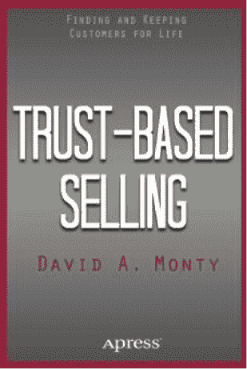
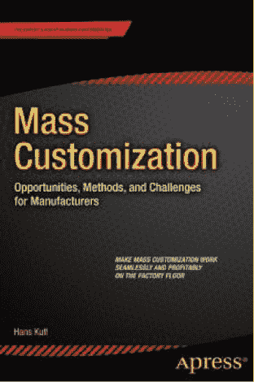
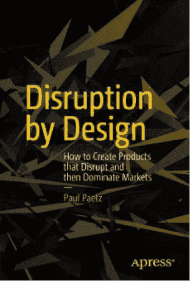
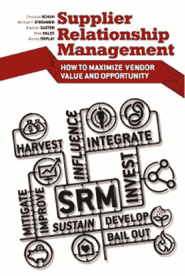
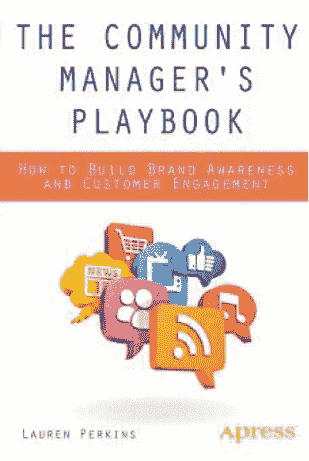
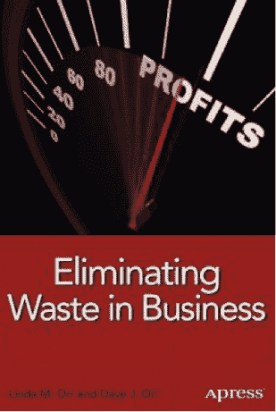
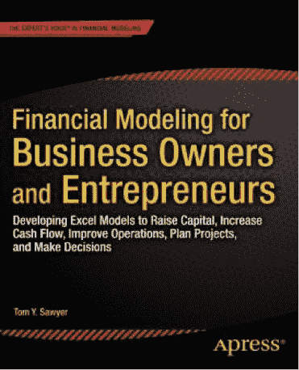
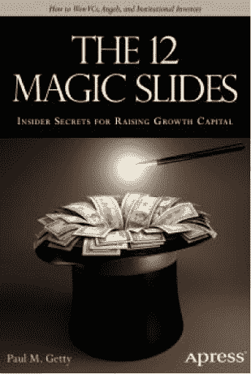

## 前言

美国企业机能失调。作为资本主义支柱的中小型企业，被引诱进入了一个错误且危险的运营模式。其运作方式如下：

步骤 1：投入心血、汗水、泪水和金钱，创办新企业或创新新产品或服务。

步骤 2：卖给尽可能大的客户。

步骤 3：最大化对该大客户的销售额。

步骤 4：应对随之而来的、不可避免的客户要求。

步骤 5：在利润越来越薄的情况下，努力维持高水准的质量和服务。

步骤 6：赔钱。

步骤 7：在努力维持生存的同时，思考哪里出了问题。

企业高失败率以及众多新产品和服务未能成功的背后，很大程度上根源于这一模式。企业主和管理者被引诱着将大部分产出卖给所谓的“大客户”，徒劳地希望无论如何，增加销量能转化为真正的利润。

大部分公司错误地认为，通过拥有一个或少数几个大客户（而非几十、几百甚至几千个小客户）所带来的效率提升，能保证良好的利润。这些公司还相信，这种更高的业务量与更高效率的结合，是未来成功的秘诀。

我们直接挑明吧：他们大错特错了。

当一家公司未能遵循“10%法则”，允许单个客户占其总收入的 10%以上时，“客户陷阱”就成为了现实。虽然管理一个大客户看似有许多积极的好处，但其下行风险最终远远超过任何积极因素。

仅凭其规模，大客户（那些占总收入 10%以上的客户）就能对其供应商的业务施加过度的控制。尽管在一段时间内情况可能顺利，但公司与大客户之间扭曲的关系将不可避免地朝着有利于大客户的方向倾斜。

就在不久前，公司还能以一种对自身有利的方式控制其产品和服务。毕竟，产品和服务是*它们*的。它们创造了产品；完成了测试；与将产品推向市场所需的大量律师、风险经理、保险公司和政府监管机构合作并获得批准；然后开发了生产、推广、分销、销售和服务的能力。这是它们自己的投入。这是*它们*的声誉；是*它们*的未来。

当时，客户与今天一样，被视为公司成功的关键。然而——这一点很重要——客户不应该变得如此庞大，以至于能够接管供应商的业务。相反，客户应该被管理（还记得“客户关系管理”这个词吗？）。这样做的好处是，产品和服务的价值可以被分享。请注意，不是平均分享，而是大部分价值应返还给最初创造该产品或服务的公司。仔细想想，这完全合乎情理。在资本主义风险与回报并存的环境中，承担更多风险的人按理应获得更多回报。

然而，当我们与全球的商业领袖交谈时，很明显，许多人意识到已经发生了一个根本性的转变。权力正在持续地从创造推动经济发展的产品和服务的主体，转移到那些在全球市场各个领域掌控越来越多的资源的超大型客户手中。太多公司错误地将与超大型客户的交易视为提升销售额、市场份额和利润的途径。实际上，仅仅因为其相对于供应商的规模，超大型客户会合乎逻辑地利用其杠杆作用来要求降价和其他让步。公司最终获得了微薄甚至不存在的利润率，其创新产品和服务往往被视同商品。它们可能“业务量很大”，但真正的、有形的收益却越来越难以获得。结果就是无利润的繁荣：业务活动很多，但几乎无利可图。

令人惊讶的是，商业格局的这种根本性转变几乎是在没有引起多少关注或进行真正分析的情况下发生的。在“规模化”、“精益化”、“效率”和“核心竞争力”（即公司专注于自己真正擅长的少数几件事，而将其他业务外包）等旗帜下，销售和分销的关键功能在很大程度上被拱手让与他人。几乎没有人注意到正在发生什么。对于许多公司来说，为时已晚。

### 本书内容

本书的副标题“如何避免商业中最大的错误”体现了我们帮助您避免落入客户陷阱的意图。本书分为两个截然不同的部分。

第一部分阐述了 10%法则以及什么是客户陷阱。它提供了证据，表明落入陷阱为何是最大的失误。

你可以在商界取得成就。首先，正如你将看到的，大型客户的规模和影响力会迅速消耗单个产品与服务的品牌资产。自有品牌、折扣策略、服务缺失以及大众市场定位，已经稀释了无数品牌的价值。

其次，通过大型客户进行销售，会使一家公司（尤其是创新型企业）与产品使用者之间的距离更远。当大型客户介入并掌握大部分销售和分销流程的控制权时，服务并响应消费者与终端用户需求的能力便会消失。更糟糕的是，大型客户营造了一种环境，使得创新成果过于迅速地商品化。在正常的商业进程中，今天的创新产品很可能在未来几年内沦为普通商品。然而，产品生命周期虽然保证了创新价值的下降趋势，却并未为创新的衰退设定具体时间表。与大型客户达成的交易会压缩产品生命周期，并加速商品化进程。

接下来，我们将探讨另一个鲜少被讨论、但却根植于“客户陷阱”的重大问题：信息透明度的缺失。随着大型客户日益掌握并持有权力，关于通往消费者和终端用户路径的信息被对创新型企业屏蔽。关键的销售和分销数据被扣留，迫使创新者“在黑暗中”进行管理和决策。

我们以探讨外包冲动来结束第一部分。政府、学术界及多数行业中的传统观点认为，公司之所以关闭其成本高昂的国内运营，是为了寻求其他国家的更佳前景和利润。诚然，美国公司确实被潜在利润和廉价劳动力的诱惑吸引至海外，但绝大多数公司是被某种更贴近美国国内产业结构的东西推向海外的，这并非出于对新市场、更低劳动力成本或更高采购效率的渴望：那就是美国功能失调的销售和分销体系。

## 前言

幸运的是，对于初创公司、中型企业乃至大型公司而言，都有可能避免陷入“客户陷阱”的困境。第二部分将探讨如何做到这一点。这从理性上看是乐观的。对于那些尚未陷入陷阱的公司以及那些已经陷入其中的公司，都存在简单而有效的方法，通过正确的产品销售和服务方式，来建立长期可持续发展的业务。我们将详细阐述以下几点：

-   如何从一开始就控制销售和分销渠道；从产品或服务的起源一直到终端用户购买为止

-   如何通过获取和实施渠道数据，直效营销能为选择不受大型客户诱惑的公司提供低成本、高回报的解决方案

-   如何在日益全球化的商业环境中，在不与海外大型客户打交道的情况下实现全球化

-   为何将几乎所有行业和商业领域的权力与控制权集中在少数大型客户手中，从长远来看是不可持续的

-   以及为何在世界各地，政府、创新者和客户都意识到，本地购买和支持独立企业是远为更好的选择

本书所描述的策略和战术带来的好处可能是巨大的——从保留对公司的运营控制权，到获得更高利润和更好销售业绩，再到为美国保留就业岗位。正如你将看到的，你*能够*掌控自己的命运，并通过避开“客户陷阱”而收获众多益处。

最终，我们相信，避免“客户陷阱”是建立真正可持续发展的企业的最佳途径。在围绕美国创新能力衰落、资源稀缺、全球竞争、经济前景不确定性以及政府角色质疑的诸多讨论中，我们深知，掌控销售和分销渠道是商业成功的基石，向来如此。

# 文档大纲

# 目录

- 目录
- 关于作者
- 致谢
- 前言
