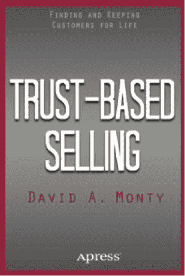
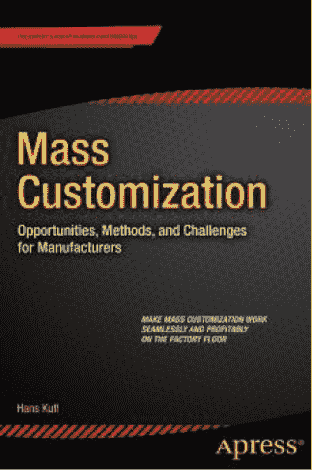
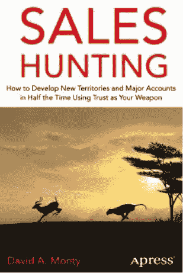
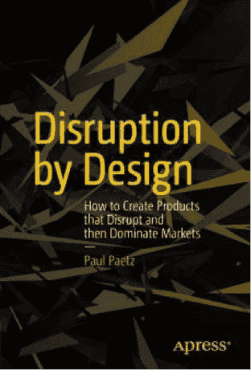
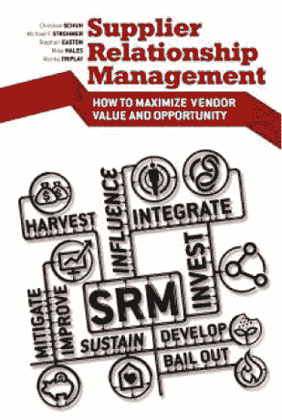
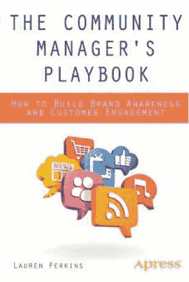
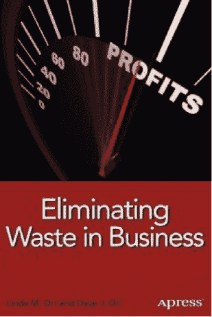
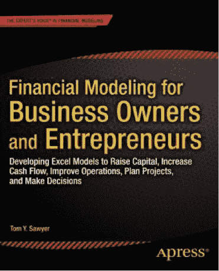
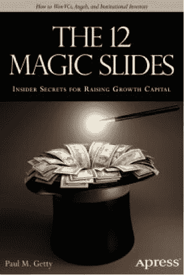

# 索引 163

深度创新，102

斯蒂尔公司，75

差异化，102

广告，88

大众市场分销，101

客户陷阱，84

附加销售，101

经销商的视角

流程创新，103

大型卖场，82–83

规模/体量，103

群体，81

自有品牌产品，99

会议，81

户外动力设备，83

生产商/分销商

照片拍摄，81

关系，93

推荐书，84

产品创新，100

替代品的可获得性，103

品牌认知度，103

深度创新，102

差异化，102

大众市场分销，101

附加销售，101

流程创新，103

规模/体量，103

起源

链锯培训，77–78

横切链锯，76

首款电动链锯，76

高度自主生产，79

国际制造

网络，79

市场领导者，78

大众市场零售商，76

或许，79

产品创新与质量，79

零售商，89

锯木厂，76

服务（*见* 服务）

销售与分销，106

直销，107

独立分销商，107

### R

风险管理，51

库存周转率，57

### S

战略思维，62

销售与分销，106

直销，107

独立分销商，107

批发商，56

大规模零售

连锁店，59

百货商店，57

邮购公司，58

垂直整合企业，60

大型企业，61

库存周转率，57

战略思维，62

### T

商业外观，99–100

### U

联合包裹服务公司（UPS），40

美国公司

蓝天饮料公司，140

中国摩托车经销权，138

哥斯达黎加的分销商，138

市场调研，138

自我参照准则 (SRC)，141

海外市场，140

沟通计划，145

服务

企业文化，146

客户资质，80

经销商绩效

知识渊博的销售人员，80

仔细审查，145

在线购物方案，81

激励措施，146

附加销售，80

国际经销商

总部位于斯波坎的初创公司，155

协议，144

《财务会计准则》

最低/理想标准设定，141

公告 (SFAS).，7

潜在互补者，142

***索引***

美国公司（*续*）

**W, X**

责任，144

自我参照准则，141

沃尔玛在中国，66

台湾竞争对手，139

批发商。*参见* 中间商

**V**

**Y, Z**

垂直一体化企业，60

洋基体育场，46

### 客户陷阱

## 如何避免商业中最大的错误

### 第一版

基于《分销陷阱》（荣获 2010 年 Berry-AMA 图书奖最佳市场营销书籍）

安德鲁·R·托马斯

蒂莫西·J·威尔金森

**《客户陷阱：如何避免商业中最大的错误》**

版权所有 © 2015 安德鲁·R·托马斯 与 蒂莫西·J·威尔金森

本作品受版权保护。出版商保留所有权利，无论涉及全部还是部分材料，特别是翻译、转载、插图复用、朗诵、广播、以缩微胶片或任何其他物理方式复制，以及电子信息存储与检索、电子改编、计算机软件，或当前已知或未来开发的任何类似或不同方法的权利。法律保留的例外情况包括：与评论或学术分析相关的简短摘录，或专为输入计算机系统并执行而提供的材料，仅供购买者个人使用。仅可在出版商所在地现行版权法条款允许下，对本出版物或其部分内容进行复制，且必须始终从 Springer 获得使用许可。可通过 Copyright Clearance Center 的 RightsLink 申请使用许可。违反者将根据相应版权法被追究责任。

ISBN-13 (平装): 978-1-4842-0386-6

ISBN-13 (电子版): 978-1-4842-0385-9

本书中可能出现商标名称、标识和图像。对于出现的商标名称、标识和图像，我们并非每次均使用商标符号，而仅以编辑方式使用，以维护商标所有者的利益，无意侵犯商标权。

本出版物中使用的商品名称、商标、服务标记及类似术语，即使未被明确标识，也不应被视为对其是否受专有权利保护的表达意见。

尽管本书中的建议和信息在出版时被认为是真实和准确的，但作者、编辑和出版商均不对可能出现的任何错误或遗漏承担法律责任。出版商对书中所含内容不作任何明示或暗示的保证。

董事总经理：韦尔穆德·斯帕尔

策划编辑：罗伯特·哈钦森

发展编辑：道格拉斯·庞迪克

编委会：史蒂夫·安格林、马克·贝克纳、加里·康奈尔、路易丝·科里根、詹姆斯·德沃尔夫

乔纳森·根尼克、罗伯特·哈钦森、米歇尔·洛曼、詹姆斯·马克汉姆、苏珊·麦克德莫特、马修·穆迪、杰弗里·佩珀、道格拉斯·庞迪克、本·雷诺-克拉克、格温南·斯皮林、马特·韦德、史蒂夫·韦斯

协调编辑：丽塔·费尔南多

文字编辑：莎伦·威尔基

排版：SPi Global

索引编制：SPi Global

封面设计：弗里德海姆·施泰嫩-布罗

本书通过 Springer Science+Business Media New York 向全球图书贸易发行，地址：233 Spring Street, 6th Floor, New York, NY 10013。电话：1-800-SPRINGER，传真：(201) 348-4505，电子邮件：`orders-ny@springer-sbm.com`，或访问 `www.springeronline.com`。Apress Media LLC 是加利福尼亚州的有限责任公司，其唯一成员（所有者）为 Springer Science+Business Media Finance Inc.（SSBM Finance Inc）。SSBM Finance Inc 是特拉华州的公司。

有关翻译事宜，请发送电子邮件至 `rights@apress.com`，或访问 `www.apress.com`。

Apress 及 friends of ED 图书可批量购买用于学术、企业或促销用途。大多数图书也提供电子版及许可证。如需更多信息，请参考我们的特殊批量销售–电子书许可网页：`www.apress.com/bulk-sales`。

作者在本文中引用的任何源代码或其他补充材料，读者可在 `www.apress.com` 获取。有关如何查找图书源代码的详细信息，请访问 `www.apress.com/source-code/`。

### Apress 商业：商业信息的公正来源

Apress 商业书籍提供必要的信息和实用建议，每本均由公认专家为从业者撰写。商业界各领域——以及各技术层级的忙碌经理和专业人士——都通过我们的书籍获取能解决问题的可行想法和工具，更新和提升专业技能，让工作更轻松，并抓住机遇。

无论商业领域的主题是什么——创业、金融、销售、营销、管理、监管、信息技术等——Apress 都因提供客观信息和不偏不倚的建议而备受赞誉，助您在日常工作中脱颖而出。我们的作者没有个人偏见；他们明白自己只有一项工作——简单、准确、深刻地传递最新信息，切实满足读者的真实需求。

如今，无论是在新闻媒体、互联网上，还是（如今经常在）书籍中，找到公正且真正为您着想的资讯都愈发困难。因此，我们希望您能享受这本精心打造、符合我们质量与公正标准的好书。

我们始终欢迎您对新书提出反馈或想法。或许您甚至想自己写一本书。无论何种情况，请通过 `editorial@apress.com` 联系我们，编辑会迅速回复。顺便提一下，在本书末尾，您会找到一份有用的相关书目列表。请访问 `www.apress.com` 订阅简报并获取未来购书的折扣。

*Apress 商业团队*

*致杰基、保罗·布莱恩和阿拉娜，是你们让一切变得有意义——安德鲁·R·托马斯*

*致 N.P.“范”·范·马伦，怀俄明州的荣誉银行家、岳父、朋友，并以此纪念我的父亲弗农·维吉尔·威尔金森——蒂莫西·J·威尔金森*

## 关于作者

`安德鲁·R·托马斯` 和 `蒂莫西·J·威尔金森` 合著了《分销陷阱：防止你的创新沦为商品》一书，该书荣获 2010 年 Berry-amaBook 最佳市场营销图书奖。

`安德鲁·R·托马斯博士`是阿克伦大学市场营销与国际商务副教授，他是《*纽约时报*》畅销书作者、合著者或编辑，参与作品达 18 部。

## 致谢

`timothy J wilkinson, Phd`，惠特沃斯大学商学院教授兼查尔斯·L·博普尔院长，在同行评审学术期刊上发表了 40 篇论文，包括《*Long Range Planning*》、《*Journal of World Business*》、《*Journal of Business Research*》、《*Journal of International Business Studies*》、《*Journal of International Management*》和《*Journal of Small Business Management*》。面向商界人士的文章则刊登于《*MIT Sloan Management Review*》、《*Business Horizons*》和《*The Wall Street Journal*》。

一本书的诞生，最终是对无数人欠下的一笔永远无法完全偿还的债务，我们的思想和著作皆立足于他们的思考与文字。我们荣幸地首先感谢`donald kaufman`，他早期的讨论及其提出的“10%法则”成为我们后来大量工作的基础。`kaufman`先生证明了一个人可以同时成为伟大的商人和优秀的人。他的遗产将在未来数十年继续经受住时间的考验。`Terry kelly`及其在子午线集团的团队多年来一直坚定地支持着我们。`mediaBridge public relations`的`dave wright`在为新思想打开新大门方面给予了极大的支持。我们感激`Jeff olson`，他持续以特有方式评论我们的作品，使我们有信心作为作者迎接更大的挑战。

我在阿克伦大学超过 12 年的经历是一段美妙的时光。这很大程度上归功于那些我有幸与之共事的人。`karen nelsen`、`Jim Barnett`、`Jim emore`、`dale Lewison`、`Bill Baker`、`marie david`、`doug hausknecht`、`deb owens`、`Bill hauser`、`Todd finkle`、`ravi krovi`和`Jim divoky`都大力支持我从商业生涯向学术生活的转变。我出色的朋友们——`Craig Vinkovich`、`elizabeth Bannon`、`greg dumont`和`Breen Bannon`——热情地倾听我漫无边际的想法，耐心远超常人所能承受。而我的妈妈、爸爸和奶奶，正如只有慈爱的父母和祖母能做到的那样，始终支持着我。

——`andrew r. Thomas`

我要感谢惠特沃斯大学的同事们一直以来的支持。我也感激我的导师们的鼓励和建议：`Lance eliot Brouthers`、`dale Lewison`、`mark pagano`、`José antonio rosa`、`Beck Taylor`和`gary young`。还要感谢`ruth pells`，她为我们惠特沃斯商学院的大量工作提供了组织协调；感谢（出色的）学生`alyssa haak`协助整理手稿；感谢我的嫂子`nancy Van maren`，她对初稿提出了尖锐的评论；尤其要感谢我的妻子`diane`，她耐心地忍受着丈夫那些“额外”的项目。

——`Timothy J. wilkinson`

## 前言

美国企业机能失调。作为资本主义支柱的中小型企业，被引诱进入了一个错误且危险的运营模式。其运作方式如下：

步骤 1：投入心血、汗水、泪水和金钱，创办新企业或创新新产品或服务。

步骤 2：卖给尽可能大的客户。

步骤 3：最大化对该大客户的销售额。

步骤 4：应对随之而来的、不可避免的客户要求。

步骤 5：在利润越来越薄的情况下，努力维持高水准的质量和服务。

步骤 6：赔钱。

步骤 7：在努力维持生存的同时，思考哪里出了问题。

企业高失败率以及众多新产品和服务未能成功的背后，很大程度上根源于这一模式。企业主和管理者被引诱着将大部分产出卖给所谓的“大客户”，徒劳地希望无论如何，增加销量能转化为真正的利润。

大部分公司错误地认为，通过拥有一个或少数几个大客户（而非几十、几百甚至几千个小客户）所带来的效率提升，能保证良好的利润。这些公司还相信，这种更高的业务量与更高效率的结合，是未来成功的秘诀。

我们直接挑明吧：他们大错特错了。

当一家公司未能遵循“10%法则”，允许单个客户占其总收入的 10%以上时，“客户陷阱”就成为了现实。虽然管理一个大客户看似有许多积极的好处，但其下行风险最终远远超过任何积极因素。

仅凭其规模，大客户（那些占总收入 10%以上的客户）就能对其供应商的业务施加过度的控制。尽管在一段时间内情况可能顺利，但公司与大客户之间扭曲的关系将不可避免地朝着有利于大客户的方向倾斜。

就在不久前，公司还能以一种对自身有利的方式控制其产品和服务。毕竟，产品和服务是*它们*的。它们创造了产品；完成了测试；与将产品推向市场所需的大量律师、风险经理、保险公司和政府监管机构合作并获得批准；然后开发了生产、推广、分销、销售和服务的能力。这是它们自己的投入。这是*它们*的声誉；是*它们*的未来。

当时，客户与今天一样，被视为公司成功的关键。然而——这一点很重要——客户不应该变得如此庞大，以至于能够接管供应商的业务。相反，客户应该被管理（还记得“客户关系管理”这个词吗？）。这样做的好处是，产品和服务的价值可以被分享。请注意，不是平均分享，而是大部分价值应返还给最初创造该产品或服务的公司。仔细想想，这完全合乎情理。在资本主义风险与回报并存的环境中，承担更多风险的人按理应获得更多回报。

然而，当我们与全球的商业领袖交谈时，很明显，许多人意识到已经发生了一个根本性的转变。权力正在持续地从创造推动经济发展的产品和服务的主体，转移到那些在全球市场各个领域掌控越来越多的资源的超大型客户手中。太多公司错误地将与超大型客户的交易视为提升销售额、市场份额和利润的途径。实际上，仅仅因为其相对于供应商的规模，超大型客户会合乎逻辑地利用其杠杆作用来要求降价和其他让步。公司最终获得了微薄甚至不存在的利润率，其创新产品和服务往往被视同商品。它们可能“业务量很大”，但真正的、有形的收益却越来越难以获得。结果就是无利润的繁荣：业务活动很多，但几乎无利可图。

令人惊讶的是，商业格局的这种根本性转变几乎是在没有引起多少关注或进行真正分析的情况下发生的。在“规模化”、“精益化”、“效率”和“核心竞争力”（即公司专注于自己真正擅长的少数几件事，而将其他业务外包）等旗帜下，销售和分销的关键功能在很大程度上被拱手让与他人。几乎没有人注意到正在发生什么。对于许多公司来说，为时已晚。

**本书内容**

本书的副标题“如何避免商业中最大的错误”体现了我们帮助您避免落入客户陷阱的意图。本书分为两个截然不同的部分。

第一部分阐述了 10%法则以及什么是客户陷阱。它提供了证据，表明落入陷阱为何是最大的失误。

你可以在商界取得成就。首先，正如你将看到的，大型客户的规模和影响力会迅速消耗单个产品与服务的品牌资产。自有品牌、折扣策略、服务缺失以及大众市场定位，已经稀释了无数品牌的价值。

其次，通过大型客户进行销售，会使一家公司（尤其是创新型企业）与产品使用者之间的距离更远。当大型客户介入并掌握大部分销售和分销流程的控制权时，服务并响应消费者与终端用户需求的能力便会消失。更糟糕的是，大型客户营造了一种环境，使得创新成果过于迅速地商品化。在正常的商业进程中，今天的创新产品很可能在未来几年内沦为普通商品。然而，产品生命周期虽然保证了创新价值的下降趋势，却并未为创新的衰退设定具体时间表。与大型客户达成的交易会压缩产品生命周期，并加速商品化进程。

接下来，我们将探讨另一个鲜少被讨论、但却根植于“客户陷阱”的重大问题：信息透明度的缺失。随着大型客户日益掌握并持有权力，关于通往消费者和终端用户路径的信息被对创新型企业屏蔽。关键的销售和分销数据被扣留，迫使创新者“在黑暗中”进行管理和决策。

我们以探讨外包冲动来结束第一部分。政府、学术界及多数行业中的传统观点认为，公司之所以关闭其成本高昂的国内运营，是为了寻求其他国家的更佳前景和利润。诚然，美国公司确实被潜在利润和廉价劳动力的诱惑吸引至海外，但绝大多数公司是被某种更贴近美国国内产业结构的东西推向海外的，这并非出于对新市场、更低劳动力成本或更高采购效率的渴望：那就是美国功能失调的销售和分销体系。

## 前言

幸运的是，对于初创公司、中型企业乃至大型公司而言，都有可能避免陷入“客户陷阱”的困境。第二部分将探讨如何做到这一点。这从理性上看是乐观的。对于那些尚未陷入陷阱的公司以及那些已经陷入其中的公司，都存在简单而有效的方法，通过正确的产品销售和服务方式，来建立长期可持续发展的业务。我们将详细阐述以下几点：

-   如何从一开始就控制销售和分销渠道；从产品或服务的起源一直到终端用户购买为止
-   如何通过获取和实施渠道数据，直效营销能为选择不受大型客户诱惑的公司提供低成本、高回报的解决方案
-   如何在日益全球化的商业环境中，在不与海外大型客户打交道的情况下实现全球化
-   为何将几乎所有行业和商业领域的权力与控制权集中在少数大型客户手中，从长远来看是不可持续的
-   以及为何在世界各地，政府、创新者和客户都意识到，本地购买和支持独立企业是远为更好的选择

本书所描述的策略和战术带来的好处可能是巨大的——从保留对公司的运营控制权，到获得更高利润和更好销售业绩，再到为美国保留就业岗位。正如你将看到的，你*能够*掌控自己的命运，并通过避开“客户陷阱”而收获众多益处。

最终，我们相信，避免“客户陷阱”是建立真正可持续发展的企业的最佳途径。在围绕美国创新能力衰落、资源稀缺、全球竞争、经济前景不确定性以及政府角色质疑的诸多讨论中，我们深知，掌控销售和分销渠道是商业成功的基石，向来如此。

