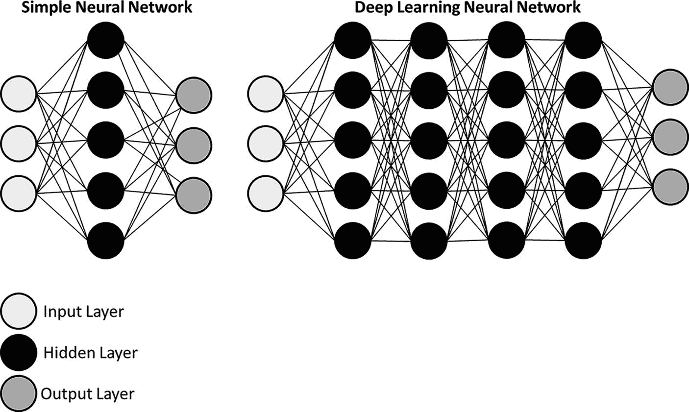

# 第 1 章：揭开数据科学及其他热门术语的神秘面纱

在商业世界中，数据已成为一件大事。你到处都能听到各种流行术语被抛来抛去，比如 `big data`（大数据）、`artificial intelligence`（人工智能）、`machine learning`（机器学习）、`data mining`（数据挖掘）、`deep learning`（深度学习）等等。这可能会让人感到困惑，让你在最佳技术选择及适用场景方面无所适从。在本章中，我们将通过简要回顾数据科学的历史，来揭开所有这些流行术语的神秘面纱。你将了解数据分析的历史如何催生了不同的思想流派和学科，而如今它们都汇聚在**数据科学**这个术语的伞下。

## 什么是数据科学？

2017 年，我们生成的数据比过去五千年的总和还要多。^(¹) 这是海量数据，并不令人意外。我们拥有的每台设备都会生成数据，我们与这些设备的所有互动会产生更多数据。

那么，你用智能手机拍了张照片？你生成了数据。你在平板电脑上阅读新闻？你在生成数据。你在笔记本电脑上听播客？你在生成数据。你上 Facebook 更新状态？你生成了数据。

你明白了吧。我们唯一可能不生成数据的事情大概就是呼吸了，但考虑到现有各种可穿戴设备能够追踪从心率到卡路里消耗的一切信息，这一点也值得商榷。^(²)

所有这些数据会怎样？它们肯定有某种用途，否则我们一开始就不会设置机制来生成它们了。

目前，部分数据有用，部分则不然。事实上，一些研究发现，只有不到 0.5% 的数据被分析并转化为可操作的见解。^(³) 但后面会详细讨论这一点。

重要的是，所有数据*都可以*被利用。我们只需要找到更好的利用方式。

而这正是数据科学的用武之地。数据科学有多种定义。其中一种定义是：

> 数据科学是一个“统一统计学、数据分析、机器学习及其相关方法的理念”，旨在利用数据“理解和分析实际现象”。^(⁴)

好吧，这些都是些宏大而华丽的辞藻，可能会让人困惑。让我们把它归结为最简单的定义：

> 数据科学就是利用数据做有用的事情。

言简意赅。这正是数据科学的全部意义所在。我们使用的方法当然重要，但这门学科的精髓在于，它让我们能够获取数据并进行转化，从而利用它做有用的事情。

例如，假设某人因气短去看医生。他们感到胃灼热且胸痛。医生进行了基本检查，包括测量血压，但一切似乎正常。

由于病人超重，医生立即推测症状由患者的体型引起，并建议更健康的饮食和锻炼。

三个月后，同一病人被送入急诊室，最终因心脏缺陷死在手术台上。

这听起来可能像你最喜欢医疗剧里的一集，即虚构情节，但它发生的频率比你想象的要高得多。事实上，在美国，5% 的患者被误诊，而在 2014/2015 财年，误诊给英国造成了超过 1.97 亿英镑的损失。^(⁵)

然而，借助数据科学，这种情况是可以避免的。对类似病例的分析表明，我们的患者表现出的症状不仅由肥胖引起，也可能由某些心血管疾病导致。

能够访问分析数据并将其与新数据输入进行比较的系统，本可以帮助医生更快地识别问题，而无需仅仅依赖自身的经验和知识。

因此，数据科学可用于拯救生命，这只是众多应用之一，而这非常有用。

### 数据科学是多学科交叉的

数据科学涉及多个学科，这也是为什么找到具备必要技能的数据科学家可能很困难。

因此，数据科学涵盖了从统计学和模式识别到业务分析和沟通的方方面面。它需要创造性思维，也同样需要分析性思维。^(⁶)

因此，数据科学涉及发现哪些数据有用以及有效的管理方法。它还需要确定应如何处理数据，以及从海量可用数据中可以获取哪些类型的见解。

数据科学需要编程和计算的知识，也需要可视化技术，以便能以一种人人都能理解的方式呈现见解。

此外，商业敏锐度也是必需的，因为虽然数据科学可以应用于任何商业领域，但了解企业需要哪种类型的答案以及如何向领导层呈现这些见解以便其理解，至关重要。

### 数据科学的核心领域

数据科学有三个核心领域，分别是人工智能、机器学习和统计学。

- **人工智能**旨在机器中复制人脑的功能。人工智能应执行的主要功能包括逻辑推理、自我修正和学习。虽然其应用范围广泛，但由于要让机器变得智能需要大量数据和计算能力，因此它也是一项高度复杂的技术。

- **机器学习**指计算机在编程范围之外进行学习和改进的能力。因此，它依赖于创建能够从所给数据中学习的算法。这些算法还被设计用于收集洞察，并对之前未分析过的数据进行预测。

机器学习有三种方法，即监督学习、无监督学习和强化学习，此外还有一些子领域（例如半监督学习）。在此，我们只讨论监督学习和无监督学习，因为这是商业中主要使用的方法。

假设你想根据内容对所有的照片进行分类。在监督学习中，你会向计算机提供带有标签的示例。因此，你会给它一张狗的照片并将其标记为“动物”，然后给它一张人的照片并标记为“人类”。之后，机器会对所有剩余的照片进行分类。

在无监督学习中，你只需将所有照片交给机器，让它自行找出不同的特征并整理你的照片。

在强化学习中，机器基于错误和奖励来学习。因此，机器会分析其行为及其结果。强化学习的一个很好的例子是迷宫中的老鼠需要找到路径到达一块奶酪。帮助老鼠实现这一目标的学习过程可以通过强化学习在机器中实现。这是最深奥的机器学习类型之一。

**统计学**是任何数据科学家武器库中的必备工具，因为它有助于开发和研究收集、分析、解释和呈现数据的方法。它使用的众多方法论使数据科学家能够：

- 设计实验并解释结果，以改进产品决策

- 构建信号预测模型

- 将数据转化为洞察

- 理解用户参与度、转化率、留存率、潜在客户等指标

- 进行智能估算

- 利用数据讲述故事

让我们更详细地了解这三个领域。

### 人工智能：一段简史

1954 年，在达特茅斯学院的一次研讨会上，人工智能研究领域应运而生。会上，与会者讨论了将在未来多年影响该领域的主题。

正如我们已经解释过的，人工智能的目标是创造一台“能思考的机器”，即模仿人脑功能的机器。当然，要做到这一点，需要理解人类思维，这就是人工智能与认知科学领域紧密相关的原因。

认知科学涉及研究人类思维及其过程，包括智力和行为。记忆、语言、感知、注意力、情感和推理都是研究的对象，为了更深入地理解这些能力，科学家借鉴了其他领域，包括：

- 语言学

- 心理学

- 哲学

- 神经科学

- 人类学

- 人工智能

人工智能在认知科学的发展中发挥了关键作用，认知心理学与人工智能之间存在着大量的相互影响。对人类认知的理解帮助我们改进了如何将其迁移到机器中的认知。反之亦然，心智计算理论^(⁷)曾是认知科学中的主导范式之一。根据该理论，心智像计算机一样工作，具有处理过程和有限的记忆。虽然这现在被认为已经过时，但它推动了数十年的研究。

#### 人工智能之梦

一切都始于一个宏伟的愿景。麻省理工学院人工智能实验室的负责人、被誉为人工智能之父的马文·明斯基曾指出：“人工智能是让机器完成那些需要人类智能才能完成的事情的科学。”^(⁸) 换句话说，梦想是创造一台智能机器。

那么，如何着手实现呢？首先，我们从直觉开始，即人类独特的逻辑推理能力。

逻辑推理，本质上，是基于各种前提进行推理，以得出具有逻辑确定性的结论的能力。例如：

> “如果所有人都会死，而苏格拉底是人，那么苏格拉底也会死。”

或者：

> “如果外面正在下雨，而我没有伞，我出去就会淋湿。”

为了将这种逻辑演绎能力转移到机器上，采用了基于规则或符号的方法。这涉及人类构建一套规则系统，并用这些规则对计算机进行编程。利用这些规则，推理算法能够推导出逻辑结论。

一个很好的例子是 `MYCIN`，^(⁹) 这是一个早期基于推理算法的成功运行系统。它被用于诊断感染并确定导致问题的细菌类型。它从未在临床环境中使用，但却是专家系统的一个绝佳例子，也是机器学习的前身。

该系统于 20 世纪 70 年代在斯坦福大学开发，拥有大约 600 条规则。^(¹⁰) 用户需要回答各种问题，程序随后会提供一份可能导致问题的潜在细菌列表，按概率从高到低排序。它还会提供其对每种诊断概率的置信度，以及它是如何得出该结论的。最后，它会提供推荐的疗程。

它的准确率达到 69%，据称该程序比初级医生更有效，与某些专家的水平相当。^(¹¹)

该程序是通过采访大量专家，并利用他们提供的专业知识和经验创建的。它使用了 `IF (条件) THEN (结论)` 形式的规则。例如，`IF (打喷嚏和咳嗽或头痛) THEN (流感)`。

该程序的一个局限性是计算能力。完成整个系统诊断大约需要 30 分钟，这在真实的临床环境中浪费了太多时间。

另一个问题也被提了出来，即伦理和法律问题。因此，问题出现了：如果程序做出了错误的诊断或推荐了错误的治疗，谁应该负责？

尽管从未投入使用，`MYCIN` 在将我们带到今天的技术水平方面仍然发挥了非常重要的作用，因为它是人工智能早期的成功案例之一，证明了其可行性。

#### 自动规划

规划是理性行为的重要组成部分。自动规划与调度是人工智能的一个领域，涉及创建能够选择并组织行动以实现特定结果的系统。

一个例子是传教士与食人魔问题^(¹²)，这是一个经典的 AI 谜题。定义如下：

> *在河的一岸有三个传教士和三个食人魔。他们都想过河到对岸。有一艘最多可载两人的船。但如果河的任何一岸食人魔数量超过传教士，传教士就会被吃掉。*

> *如何利用这艘船安全地将所有传教士和食人魔运送过河？*

这个问题有点残酷，看似简单，但类似的方法也可用于行程规划。

该领域的其他类似问题包括汉诺塔问题^(¹³)和旅行商问题。旅行商问题是优化领域的经典标杆，其目标是找到一条路径，让商人走遍一个国家（或其他地理区域）的所有城市。这条路径不能重复经过同一城市，同时要尽可能短。很容易看出这与现实生活中的车辆路线规划有何关联。在图 1-1 中，你可以看到针对德国所有主要城市的旅行商问题示例。

一幅德国地图上有一个闭合多边形，依次经过柏林、德累斯顿、纽伦堡、慕尼黑、斯图加特、法兰克福、科隆、杜塞尔多夫、埃森、汉诺威、不莱梅和汉堡。

图 1-1

旅行商问题示例

本质上，计算机所做的就是分析每一种可能性，舍弃那些不符合参数要求的情况，同时呈现所有符合要求的选项。

## AI 寒冬

如果没有经历“寒冬”，人工智能现在的发展可能会更快。`AI winter` 这个术语指的是人工智能领域兴趣减退，进而导致资金受限的时期。

1967 年，马文·明斯基预测“在一代人的时间内，‘创造人工智能’的问题将基本得到解决”。然而，到了 1982 年，他承认“AI 问题是科学界有史以来面临的最困难的问题之一”。^(¹⁴)

第一次重大 AI 寒冬始于 1974 年，结束于 1980 年；第二次始于 1987 年，结束于 1993 年。期间还有其他一些较小的事件，例如：

*   1966 年：机器翻译失败
*   1970 年：联结主义的放弃
*   1971–1975 年：DARPA 对卡内基梅隆大学语音理解研究项目的失望
*   1973 年：因莱特希尔报告，英国人工智能研究大幅缩减
*   1973–1974 年：DARPA 普遍削减学术性 AI 研究经费
*   1987 年：Lisp 机器市场崩溃
*   1988 年：战略计算倡议取消 AI 新支出
*   1993 年：专家系统逐渐触底
*   1990 年代：第五代计算机项目的原始目标悄然消失

第一次寒冬很大程度上由三个主要因素造成。首先是莱特希尔报告，詹姆斯·莱特希尔爵士教授在该报告中得出结论，其他科学可以完成 AI 领域所做的一切工作，这意味着许多最成功的 AI 算法无法解决现实世界的问题。^(¹⁵)

尽管存在争议，这份报告仍然导致英国人工智能研究全面停滞，只有少数几所大学继续研究。其结果是整个欧洲地区用于这项研究的经费被削减。^(¹⁶)

1969 年，美国通过了《曼斯菲尔德修正案》，要求 DARPA 资助那些有明确使命的研究，而不是没有明确方向的基础项目。本质上，研究人员必须证明他们的项目能很快产生对军方有用的技术。

结合莱特希尔报告（该报告被视为证明 AI 研究在可预见的未来不太可能提供任何有用成果的证据），DARPA 停止资助这类研究。到 1974 年，几乎不可能找到 AI 研究的资金。^(¹⁷)

另一个问题是卡内基梅隆大学的语音理解研究项目。DARPA 想要一个能够响应飞行员语音命令的系统，虽然团队开发了一个能理解英语口语的系统，但单词必须以特定顺序说出。

DARPA 认为受到了误导，并于 1974 年取消了资助。^(¹⁸) 有趣的是，到了 2001 年，语音识别市场达到了 40 亿美元，并且使用了卡内基梅隆大学团队开发的技术。^(¹⁹)

1980 年，专家系统在商业上的成功重新点燃了人们对 AI 领域的兴趣。到 1985 年，AI 领域投入超过十亿美元，并形成了一个支持该领域的产业。专门用于更好地处理 AI 首选编程语言的计算机，被称为 Lisp 机器，被制造出来。

不幸的是，由于 `Sun Microsystems` 等公司开发了更高效的替代品，`LISP` 机器市场崩溃了。这些通用工作站的性能要好得多，`LISP` 机器无法匹敌。这导致了第二次 AI 寒冬。

## 我们从 AI 研究中获得的启示

尽管存在种种问题，人工智能的研究还是发现了许多有益的东西。例如，如果不是因为 AI 研究，我们不会有处理逻辑规则的算法。

这类算法的一个早期例子是 `Prolog` 语言。作为最早基于逻辑的编程语言之一，即使在今天它仍然是最流行的语言之一。它被用于专家系统中的定理证明、类型推断以及自动规划。

AI 帮助我们的另一个领域也与此相关。自动规划与调度（用于驱动制造业中的自动机器人等事物）否则就不会存在。专家系统或知识表示也是如此。

当然，所有这些事物自那时起都经历了显著发展，我们离创造真正的人工智能越来越近，但在拥有真正智能的机器之前，我们还有很长的路要走。

另一个有趣的方面是，认知科学从 AI 中借鉴了很多，反之亦然。开发能够像人类一样思考的智能机器的愿望，需要更好地理解人类思维。这引发了对记忆、感知等更多方面的研究。

## 下一步：进入机器学习

作为术语，“机器学习”由亚瑟·塞缪尔（Arthur Samuel）于 1959 年在 IBM 工作期间创造，他是计算机游戏和人工智能领域的先驱。^(²⁰)

他将其定义如下：

> *“机器学习是关于赋予计算机无需显式编程即可学习的能力。”*

由于对基于逻辑的知识型方法的关注，机器学习与人工智能之间产生了裂痕。到 20 世纪 80 年代，专家系统主导了人工智能领域，统计学不再受到关注。

随后，机器学习被重组为一个独立领域，并在 20 世纪 90 年代开始获得显著发展。它不再专注于创造人工智能，而是转向解决更实际的问题。因此，它不再采用人工智能中盛行的符号方法论，而是开始使用来自统计学和概率论的模型。

虽然机器学习在概念上是人工智能的一个子领域，但其方法实际上与迄今为止的研究方向相反。^(²¹)

因此，“经典 AI”或“老派 AI”采用基于规则的自顶向下方法。本质上，这意味着给计算机提供必须遵循的规则，以达到期望的结果。这种方法的问题在于需要大量的人工输入。

系统设计者必须能够预测每一种可能性，并为其创建一套规则。此外，由于机器以“如果/那么”（`IF/THEN`）模式思考，不确定性难以处理。

不幸的是，世界并非总是如此清晰。在现实世界中，`IF`（事件 A）发生，并不总是意味着`THEN`（采取行动 B）就是解决方案。例如，`IF`（晴天）并不总是导致`THEN`（穿轻薄衣物）。外面可能是冬天，你可能需要穿厚外套。此外，系统只知道提供这个答案，因为它被事先告知该怎么做。

另一方面，机器学习采用自底向上、数据驱动的方法。因此，机器学习不是用必须遵循的规则来编程计算机，而是使用数据来教计算机该做什么。

除了提供数据之外，几乎不需要人工输入。这使得机器能更自然地处理不确定性，使其成为一种更有效的方法，因为世界本质上更倾向于概率性而非确定性。

用我们的下雨类比来说，机器学习的工作方式大致如下：系统被输入大量数据，并分析在某种天气下会发生什么。所以，当天气晴朗时，它看到人们穿着轻薄和厚重的衣物外出。当它意识到温度也很重要时，它会学到更多。本质上，它识别出模式：晴天 + 寒冷温度 = 更暖和的衣物。机器通过分析并学习所给的数据，自主完成这一过程。

机器学习在很长一段时间内的问题是，它需要大量数据才能有效工作。幸运的是，随着互联网和廉价存储等技术进步，数据驱动的方法变得越来越流行。它不仅更有效，而且从经济和技术角度来看也更具可行性。

### 机器学习的问题

当然，机器学习和其他事物一样，也有其缺点。首先，机器学习无法直接处理逻辑规则，如何将机器学习与推理相结合是一个未解决的问题。

以重力为例。机器学习可以得出结论：如果你松手，物体掉落的概率是 0.99。然而，这基于过去的数据，它无法做出逻辑上的飞跃：因为重力，`任何`物体松手后都会掉落。它可以根据过去的事件给出概率，但无法得出以下结论：`IF`（重力）`THEN`（物体掉落）。这种逻辑飞跃连婴儿都能做到，这表明尽管机器学习非常强大，但它远非 AI 发明者所设想的那种智能。

另一个问题是，机器学习并非完全透明。大多数算法是一个“黑箱”，输入从一端进入，结果从另一端输出。然而，我们看不到箱子内部发生了什么。想想谷歌著名的搜索算法。我们知道输入搜索字符串，能得到“最”相关的结果，但我们不知道这如何发生。

可解释的机器学习现在是一个非常活跃的研究领域。^(²²)

## 深度学习

深度学习是研究*深度神经网络*的领域，这是一种包含多个层的神经网络。普通神经网络通常只有一两个层，而深度神经网络的层数则要多得多（图 1-2）。

简单神经网络与深度学习神经网络示意图。简单神经网络包含 1 个输入层、1 个隐藏层和 1 个输出层。深度学习神经网络包含 1 个输入层、4 个隐藏层和 1 个输出层。

图 1-2

常规神经网络与深度神经网络的对比示例

被誉为“深度学习之父”的英国认知心理学家和计算机科学家杰弗里·辛顿发现，他关于神经网络的研究成果难以发表，于是不得不发明一个“更酷”的新术语。^(²³)

神经网络由神经元及其在大脑中连接的路径构成。由于人脑是人类已知最强大的计算设备，模仿其架构的做法自然合情合理，这便催生了人工神经网络的诞生。

传统上神经网络由三个层组成：输入层、中间层和输出层。中间层赋予神经网络执行非线性计算的能力，使其成为强大的学习机器。

深度学习的概念已经存在了几十年。^(²⁴) 然而，人们曾认为增加更多层数并无实际用处。此外，训练这些网络也相当困难。

深度学习利用人工神经网络使机器能够更快、更准确且大规模地学习。因此，它被用来帮助开发解决许多此前无法解决的问题的方案，例如语音识别、计算机视觉和自然语言处理。

例如，得益于深度学习，Siri 或 Cortana 等应用能够理解你的需求。图像识别功能可以帮助你找到现实中看到的家具。只需拍下家具的照片，应用程序就能在线为你找到它。

借助深度学习，机器还能识别照片中的不同主体——比如区分人类、马、猫或狗。它还可以用于自动为照片着色，最近甚至能自动移除照片背景，这让许多设计师感激不尽。

它还被用于自动生成文本。换句话说，得益于深度学习，你的电脑可以听写你的话语，并将其转化为文字。

基本上，深度学习能做很多很酷的事情！

但它究竟是如何做到的，又为何如此有效？深度神经网络的多个层使其能够提取`层次化特征`。我们的视觉系统在结构上就是分层的。大脑先识别简单的斑点和边缘，然后识别形状（如正方形和圆形），进而识别面部特征或其他更高级的概念。深度神经网络本质上模仿了这种功能。如果我们观察深度神经网络中间层所做的处理，就会发现它们提取了特征的层级结构。这正是深度神经网络在计算机视觉和语言应用中如此成功的原因。这些领域本质上都由层次化特征主导。`ConvNet Playground`^(²⁵)提供了一个模型探索器，让你能够看到 Inception（一个著名的深度神经网络）的不同层如何随着网络加深，为图像创建越来越复杂的表征。

然而，深度神经网络并非万能灵药。^(²⁶) 如果领域特征并非由多个交互变量或特征层级结构构成，或者数据量不足，那么使用深度神经网络可能适得其反。例如，如果你有一个包含 1000 行数据和十个变量的数据集，使用更简单的模型（如线性回归）会好得多，因为这种模型训练更快，且更不容易`过拟合`。

`过拟合`^(²⁷)是所有机器学习算法的祸根，指的是模型在现实世界中的表现远差于训练时的表现。更复杂的模型更容易出现这个问题。这就是为什么深度神经网络需要大量的调优和测试来确保其良好运行。

## 统计学

数据科学的另一个核心领域——统计学，是数学的一个分支，大约起源于 18 世纪，是首次系统分析数据的尝试。它为所有现代数据分析奠定了基础，包括描述性统计、回归与分类、显著性检验、预测等。

### 统计学的独特之处何在？

统计学通常处理较小的样本，这在很大程度上是历史原因造成的。互联网使得如今收集大量数据成为可能，但在“古代”，数据通常需要人工收集，因此样本量非常小。

随后，结果会在一定误差范围内外推至整个总体。此外，考虑到它诞生于 17 世纪，这意味着所有计算都必须手工完成。^(²⁸) 求解一个模型可能需要数天或数周。

统计学在模型假设和开发方面也非常严格，因为它根植于数学。从这个意义上说，它几乎类似于经典人工智能。在机器学习的部分内容建立在`贝叶斯统计学`基础之上后，这种差距确实有所缩小。

然而，两者的思维方式仍然不同。在机器学习中，重点是先完成任务，之后再提出问题。而在统计学中，必须先验证和确认假设，然后才能进行其他工作。

虽然统计学提供了更高的透明度和可解释性，但机器学习却带来了令人难以置信的性能。这种惊人的性能使我们能够完成以前认为不可能的任务！

当然，必须记住，机器学习是计算机时代的产物，意味着计算速度快得多。一个模型不再需要数天的工作，只需几分钟——甚至更短——并且一天之内可以尝试多种方法。

### 对决：统计学 vs. 机器学习

一些统计学家对机器学习极为排斥。^(²⁹) 近乎宗教般的排斥。有时，这甚至有点令人担忧。他们的问题在于机器学习缺乏透明度和理论支撑。

然而，实际上，统计学和机器学习是同一枚硬币的两面。而且，它们都是数据科学家工具箱中的工具，可以根据实际情况加以应用。因此，如果你追求可解释性，统计学是最佳选择；而若想要更强的预测能力，机器学习则更胜一筹。

### 数据科学的子领域

在上述数据科学核心领域发展的同时，其他领域也在同步发展。它们都与数据分析、人工智能等方面存在某种关联。这些领域包括：诺伯特·维纳于 1947 年提出的控制论，麦卡洛克和皮茨于 1943 年提出的人工神经网络，1990 年发展起来的计算智能，1959 年发展起来的机器学习，以及格雷戈里·皮亚捷茨基-夏皮罗于 1990 年提出的数据挖掘与数据库知识发现。^(³⁰)

所有这些术语存在的问题在于，并非每个人都以相同的方式理解它们，或理清它们之间的关系。在某些情况下，它们之间存在概念上的差异；但有时，这种差异取决于谈论者的身份及其研究背景。此外，还存在市场营销的因素，这也会给特定子领域带来不同的解读。

例如，有些人将人工智能视为核心领域，而自然语言处理、专家系统、神经网络、模糊逻辑和机器人技术则是其卫星领域。另一些人则认为人工智能是计算机科学的一部分，而`知识库系统、机器学习和逆向工程大脑`则是人工智能的关键。还有人认为`机器学习、深度学习和表示学习`都包含在人工智能之内。

换句话说，人们对这些技术术语的含义以及它们之间的关系有着不同的理解，这可能会造成极大的混淆。为了进一步证明我的观点，以下是第十一届英国计算智能研讨会对计算智能的定义。

> `计算智能（CI）`是人工智能的一个分支，其重点在于启发式算法，例如`模糊系统、神经网络`和`进化计算`。它通常与“传统的”、“符号化的”或“`老式人工智能（GOFAI）`”相对。电气与电子工程师学会计算智能学会使用“`模仿自然以解决问题`”这一标签来描述计算智能，尽管模仿自然并非其必要元素。

>

> 除了 CI 的三大支柱（模糊系统、神经网络和进化计算）之外，计算智能还包含`学习、适应、启发式`和`元启发式优化`的元素，以及任何使用这些技术中一种或多种组合的混合方法。最近，新兴领域如人工免疫系统、`群体智能、混沌系统`等也被添加到计算智能技术的范畴。术语“`软计算`”有时几乎可以与计算智能互换使用。^(³¹)

现在，让我们来看一下数据库知识发现的定义。

> `数据库知识发现`，简称 KDD，指的是从数据中发现知识的广泛过程，并强调特定数据挖掘方法的“高层次”应用。它引起了`机器学习、模式识别、数据库、统计学、人工智能、专家系统知识获取以及数据可视化`等领域研究人员的兴趣。KDD 过程的统一目标是`在大型数据库的背景下从数据中提取知识`。^(³²)

加粗的术语显示了所有这些领域和子领域之间的重叠，以至于某些核心领域反而被视为子领域的子领域。没错，这确实令人困惑，而这正是关键所在。

所有这些领域都是跨学科的，因为它们相互借鉴工具；尽管有时它们可能采取不同的方法，但重叠仍然如此之多，以至于问题非常棘手。即使是研究这些领域的人也会感到困惑。

以克里斯托弗·M·毕晓普的《模式识别与机器学习》为例，^(³³) 这是机器学习领域最重要的教科书之一。每个人都读过它，然而，人们不禁要问模式识别和机器学习之间的区别。但是，一旦深入研究，你会发现它涉及统计理论，而且通常只会让事情变得更加复杂。

而这还远远不是问题的终点。还有许多其他相关的流行术语和领域，例如：

* **自然语言处理（NLP）**：机器学习的子领域，专注于语言本身——通常依赖文本，但也可能包括语音。

* **推荐系统**：专门研究推荐引擎的领域，例如亚马逊和 Netflix 使用的推荐系统。

* **预测分析**：并非一个子学科，而是一个主要指代开发预测模型（即能够预测未来的算法）的术语。后者可以通过机器学习或统计学来开发。

换句话说，这一切都确实、确实令人困惑，而这正是“数据科学”这个术语应运而生的原因。

## AI 的新前沿：大型语言模型与 Transformer 网络

随着大型语言模型（`LLMs`）和 Transformer 网络的引入，人工智能领域已发生变革。这些进步代表了从传统计算方法的重要演变，为理解和生成人类语言提供了精妙的方法。

### 大型语言模型：复杂任务的精妙工具

大型语言模型因其能以高度接近人类语言能力的精度解释和生成文本，已成为 AI 领域的核心。这些模型经过海量互联网文本的严格训练，使其具备处理多样化语言任务的能力。`LLMs` 不仅限于文本生成，还在撰写专业邮件、综合报告合成，甚至软件开发流程的自动化等专业应用中展现出高超水平。

`LLMs` 最显著的特性之一是其适应性。基础训练完成后，它们可针对特定行业或任务进行微调，从而成为通用与专业场景中的多用途工具。

大型语言模型（`LLMs`）在主流技术领域的发展轨迹，深受 OpenAI 推出的 `ChatGPT` 影响。这款开创性模型展示了 `LLMs` 的实用性与潜力，点燃了各领域的广泛兴趣。OpenAI 的举措证明了此类模型能进行对话、回答问题，甚至执行传统上由人类完成的任务。此后，谷歌推出了 `Bard`，这项 AI 服务旨在对话场景中利用语言理解与生成的力量。这些科技巨头的入局标志着一个关键转折点，预示着 `LLMs` 大规模应用的到来。

因此，该领域正见证着越来越多的发展。新模型不断涌现，不断突破 AI 的可能性边界，拓展其在日常技术中的应用前景。这种快速演进凸显了 AI 的变革时期，更复杂的模型正被推向消费者和企业技术的最前沿。

### Transformer 网络：现代 AI 的架构基石

# Transformer 网络与人工智能应用

Transformer 网络正是这些强大语言模型的核心。这种创新架构通过实现数据并行处理，彻底革新了学习过程。凭借独特的注意力机制，Transformer 网络能优先处理数据中的相关片段，有效模仿人类聚焦关键信息的能力。

其应用已超越文本数据，Transformer 网络在图像和音频处理任务中也展现出卓越能力。这种适应性凸显了其作为应对多种 AI 挑战的通用架构的潜力。

## 由 LLMs 驱动的新一代 AI 应用

以 Transformer 网络为支撑的 `LLMs` 能力，为新一代 AI 应用打开了大门。在客户服务领域，聊天机器人已变得更加响应灵敏且具备语境意识，为用户提供无缝体验。创意产业正利用 AI 增强艺术创作过程，而企业则运用这些工具进行数据分析和战略规划。

在医疗领域，`LLMs` 开始辅助分析医学文献，提供有助于诊断和治疗规划的总结与见解。跨行业来看，这些 AI 模型正被整合以提升生产力和创新能力。

在我们拥抱 `LLMs` 与 Transformer 网络的潜力时，必须以热情与伦理考量并重的方式推进。确保负责任地使用这些技术，对于继续探索 AI 能力边界及其社会影响至关重要。

## 数据科学与人工智能：所需技能

`数据科学`极大地简化了对一切的阐释，除非有人想花半小时解释所有领域和子领域。即便如此，大多数人还是无法理解，尤其是那些非相关领域的人。

简单地说自己是一名处理数据的“数据科学家”要容易得多。这无疑比冗长地罗列自己懂机器学习、数据挖掘、统计学等要好得多。

然而，即便是“数据科学”这个词也并非无懈可击，可能会引起一些混淆。有些人可能认为数据工程、数据库、大数据和数据分析师是差不多一回事，但实际上并非如此。那么，它们之间有什么区别呢？我们来看看这些术语的含义。

-   **数据科学家**：数据科学家是与数据打交道的人。不过，近来这个词的含义有所扩展，指的是不仅分析数据，还在相关领域（如机器学习博士或统计学硕士）拥有某种高级培训经历的人。

-   **数据工程师**：数据工程师负责设计、构建和管理大数据信息的基础设施。他们开发有助于分析和处理数据的架构。打个烹饪的比方，数据科学家是厨师，而数据工程师则涵盖了所有的工具制造商（刀、锅、盆、炉灶等）和食材供应商，他们为厨师提供制作菜肴所需的一切。

-   **大数据**：大数据是一个流行词，因为它仅指代那些规模庞大、结构复杂，以至于传统数据处理应用软件根本无法应对的海量数据集。它与 NoSQL 数据库、云计算、Hadoop 等技术相关。不过，这个词现在已经不太常用了。

-   **MLOps**：MLOps 代表机器学习运维，是连接开发机器学习模型与将其投入真实世界以创造价值的关键桥梁。MLOps 专家就像是机器学习乐团的指挥，确保各个声部——开发、部署和维护——和谐演奏。他们利用像 `Kubernetes` 用于编排、`Docker` 用于容器化、`Jenkins` 或 `GitLab` 用于持续集成和交付等工具，创建流畅的工作流，将模型从原型转化为生产级资产。专注于 MLOps 的专业人士通常被称为“机器学习工程师”。

-   **深度学习**：深度学习是机器学习的尖端子集，其灵感源自人脑的神经网络。该领域涉及开发能够处理和解读大型数据集中复杂模式的模型，这需要精通 `TensorFlow` 和 `PyTorch` 等深度学习框架。这些专业人士对神经网络理论有深刻理解，并擅长利用包括 GPU 在内的计算资源来训练能够执行从图像识别到自然语言处理等任务的模型。

表 1-1 显示了不同类别数据专业人员所需的重要技能。

**表 1-1** 不同类别数据专业人员所需的重要技能，按 3 分制评分

| | 数据分析师 | 机器学习工程师 | 数据工程师 | 数据科学家 |
| --- | --- | --- | --- | --- |
| **编程工具** | **3/3** | 1/3 | **3/3** | **3/3** |
| **数据直觉** | **3/3** | **3/3** | 1/3 | **3/3** |
| **数据可视化** | **3/3** | 2/3 | 1/3 | **3/3** |
| **统计学** | 2/3 | 2/3 | 0/3 | **3/3** |
| **机器学习** | 0/3 | **3/3** | 0/3 | **3/3** |
| **软件工程** | 0/3 | 2/3 | **3/3** | 2/3 |
| **数据整理** | 0/3 | **3/3** | **3/3** | **3/3** |
| **数学** | 0/3 | **3/3** | 0/3 | 2/3 |
| **数据库** | 0/3 | 1/3 | **3/3** | 2/3 |

### 数据科学家需要知道什么？

我们将在本书后面深入探讨数据科学家，但这里先做一个快速概述。

虽然数据科学家可能背景各异，但你通常会看到三种类型。

首先是统计学家，其中有些人不喜欢被称为数据科学家。

其次是那些拥有计算机科学背景、学习过机器学习并在该领域获得硕士或博士学位的人。

最后是来自其他学科（如物理学）的人，他们学会了使用数据科学工具并转行到这个领域。

## 通用人工智能 vs. 狭义人工智能

我们时代最热门的话题之一就是“通用人工智能”。这个词指的是创造出和人类一样聪明的人工智能。认为这在可预见的未来能够实现的人，也相信“奇点”的概念。物理学中的奇点被定义为物理模型失效的时刻（例如，存在于黑洞中心的情况）。技术奇点则是一种我们所知的社会和技术知识都将失效，全新且不可预测的事物将会出现的情况。

这基于以下推理：虽然我们人类拥有智能，但我们的认知能力有限。我们的大脑无法容纳无限量的信息。我们可以快速思考，但速度比不上计算机进行计算。此外，我们会疲劳，需要睡眠。

通用人工智能将拥有我们自身的思考能力，但没有我们的任何局限性。因此，如果一台机器拥有天才数学家的智力，理论上它可以在一秒内提出大量的数学定理。它能发展出能力，做出人类需要好几辈子才能实现的发明。

有些人，比如埃隆·马斯克，将人工智能描述为对人类的威胁。另一方面，其他人则对通用人工智能改善生活的潜力更为乐观。

无论哪一方是正确的，所有专家现在都同意以下几点：

1.  我们还没有通往通用人工智能的清晰路径。没有任何单一方法或技术能保证实现这一结果。

2.  基于当前的技术进步，我们很有可能在本世纪内看到通用人工智能的实现。

3.  虽然通用人工智能的结果可能不像有些人预期的那么戏剧性，但所有人都同意，它将在从健康研究到军事的多个领域造成巨大的颠覆。

狭义人工智能，也称为弱人工智能，指的是为处理特定任务而设计的人工智能系统。它们在一套既定的能力框架内运行，擅长执行特定功能。例如，语言翻译程序、面部识别软件和推荐引擎都属于狭义人工智能的范畴。这些系统在其领域内效率极高，但缺乏超出其预定任务范围的能力。

1.  **虚拟个人助理**：Siri、Alexa 和 Google Assistant 能响应语音命令、执行互联网搜索、管理日程以及控制智能家居设备，但它们的编程设定使其只能在特定能力范围内运行。

2.  **推荐系统**：Netflix、Spotify 和亚马逊利用狭义人工智能分析你过去的行为和偏好，以推荐电影、歌曲和产品。

3.  **欺诈检测**：金融机构运用狭义人工智能监控交易。这些系统能根据预定义的规则和历史数据，标记出可能指示欺诈活动的异常模式。

4.  **交通导航**：像 Google Maps 和 Waze 这样的应用实时分析大量交通数据，为驾驶员推荐最快的路线。

5.  **语言翻译**：诸如谷歌翻译等工具利用狭义人工智能将文本或语音从一种语言转换为另一种语言，专注于翻译这一单一任务。

6.  **客服聊天机器人**：许多网站使用聊天机器人处理客户咨询，基于预定义的交互脚本对常见问题提供快速回复。

7.  **面部识别系统**：此类系统用于安全和身份识别目的，能够以高精度将人脸与图像数据库进行匹配。

8.  **医疗诊断**：某些人工智能应用通过分析医学图像来辅助医生精准检测癌症等疾病，但它们仍需人工监督。

我们无疑正生活在一个有趣的时代！

脚注 1 2 3 4 5 6 7 8 9 10 11 12 13 14 15 16 17 18 19 20 21 22 23 24 25 26 27 28 29 30 31 32 33