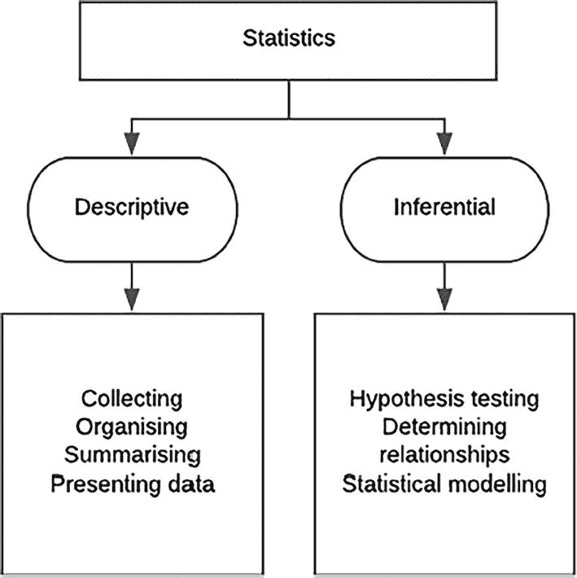
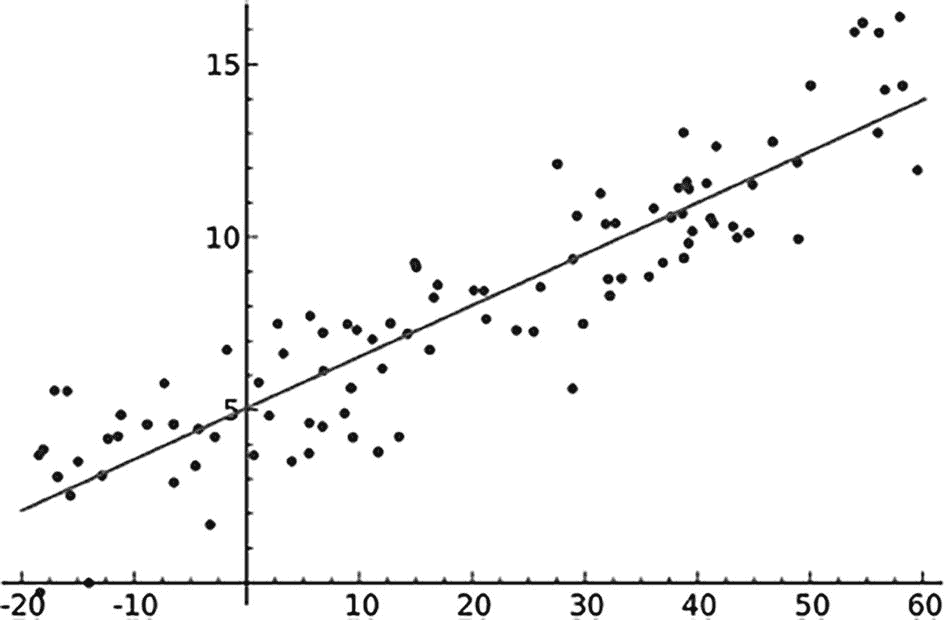
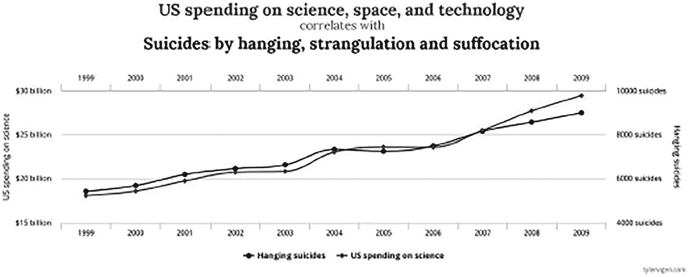
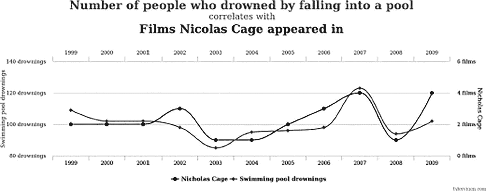
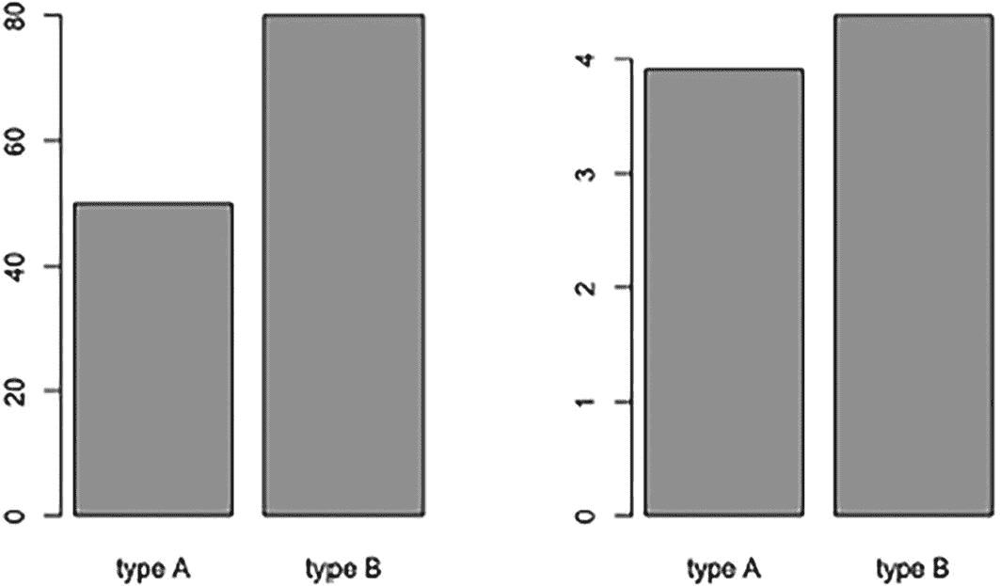
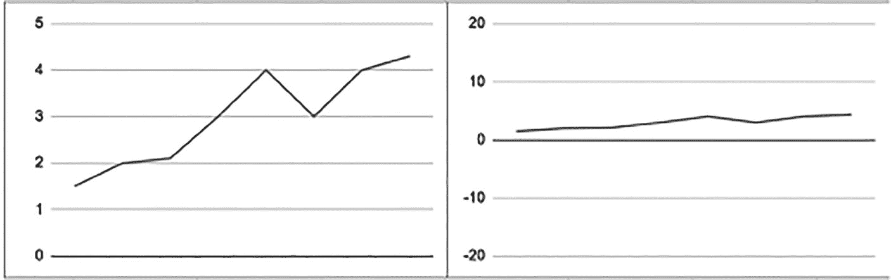
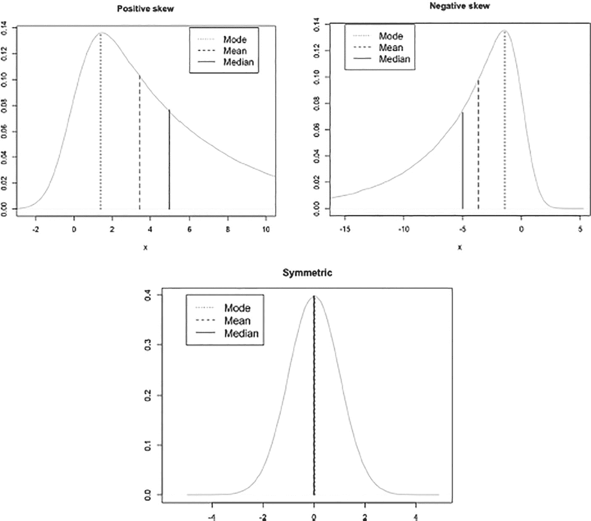

# 统计学简介

统计学有两个分支，即描述性统计和推断性统计（图 6-1）。

提及**统计学**这个词，大多数人首先想到的是描述性统计。这些内容你可能在高中就学过。它们包括收集数据、使用均值等汇总指标以及数据可视化。

而统计学家在想到**统计学**这个词时，脑海中浮现的通常是推断性统计。它涉及更高级的概念，如抽样和推断总体参数的值。



**图 6-1** 统计科学的两个分支

## 描述性统计

描述性统计涉及以方便且信息丰富的方式组织、总结和呈现数据。这类统计使用两类方法。

第一类是描述数据的数值方法。这些方法包括衡量数据位置的指标，如均值、中位数和众数。它们也包括衡量数据变异性的指标，如极差、方差和标准差。

第二类方法涵盖呈现数据的图形手段，你可能对此非常熟悉，例如条形图、饼图、直方图等。

我喜欢将描述性统计称为“高中统计学”。原因是大多数人在高中都学过描述性统计，并且认为描述性统计代表了统计科学的整个领域。然而，事实远非如此。

## 推断性统计

当统计学家谈论统计学时，这通常就是他们所指的内容。推断性统计比描述性统计更有趣、也更有用。它基本上代表了统计学的 90%，而描述性统计仅仅是冰山一角。

因此，推断性统计是一套基于样本数据，对总体的特征得出结论或进行推断的方法。推断性统计中使用的一些基本术语包括：

-   数据、元素、变量和观测值
-   总体：统计学家感兴趣的所有项目的集合
-   样本：从总体中抽取的一组数据
-   参数：对总体的描述性度量
-   统计量：对样本的描述性度量
-   推断：一套方法，如估计、检验和预测，用于基于样本数据对总体的特征得出结论或进行推断

那么，这一切意味着什么？推断性统计实际上做了什么？

推断性统计使我们能够量化不确定性。换句话说，假设你想了解关于总体的某些信息。让我们选一个简单的例子，比如一个国家的人的平均身高。

要确定这个数值，你的第一个想法可能是必须测量这个国家的每一个人。当一个国家有 5000 万人口时，这可不是一件容易的事。即使对于如此简单的事情，你也需要花费大量的时间和金钱去接触每一个人。研究每一个个体，至少是不切实际的，但在大多数情况下是不可能的。

借助推断性统计，你可以从总体中抽取一个样本，并通过概率分布来表达不确定性。它帮助我们将不确定性转化为可量化的指标，从而让我们能够进行计算。这就是我们能够进行统计建模和假设检验的原因。

所以，本质上，你可以抽取一个 1000 人的样本，然后将他们的平均身高推断到整个 5000 万人口。与处理 5000 万人相比，处理 1000 人要容易得多。

这种利用概率分布表达不确定性的想法虽然简单，但却极为强大。人类要感谢统计学的奠基人们，如罗纳德·费希尔、耶日·内曼和卡尔·皮尔逊，他们提出了 ANOVA（方差分析）和多元线性回归等方法，并为现代统计学的大部分内容奠定了数学基础。

如果没有推断性统计，大多数科学领域将缺乏做出明智决策的工具。每当你听到关于医学、心理学、经济学或其他领域的研究时，你应该知道这要归功于推断性统计。

## 如何使用统计学

好了，现在该看看如何运用统计学了。再次强调，我们将从宏观角度出发，不是从统计学家或数据科学家的视角，而是从非技术决策者的视角来看。

首先，你可能已经以某种形式在使用描述性统计了。像均值和众数这样的指标，或者条形图和直方图之类的图表，大多数人都能理解。然而，了解可能出现的某些陷阱很重要，我们稍后会详细讨论这些。

然后是推断性统计，它在两种情况下很有用。它可用于回答关于变量重要性的特定问题，也可用于回答关于总体差异的问题。

在本节结束时，你应该明白统计学总是被用来支持某个假设或故事，这涉及到描述性统计的广泛使用。虽然在分析中经常会用到推断性统计，但它往往与描述性统计相伴出现。

因此，作为高管、经理、创始人或决策者，你需要能够判断是否可以使用统计学来回答问题，以及这个故事的逻辑是否合理，并避免统计推断和结果呈现中可能涉及的所有陷阱和谬误。


### 推断性统计学示例

我们先来看几个推断性统计学的例子，这样不仅能让你更深入地理解这个概念本身，还能了解如何将其应用到你的业务中。

`假设检验`和`统计建模`是你使用推断性统计学的两个主要领域。

`预测`是另一个领域，它代表了一组用于预测未来数值的工具和方法。不过，我们不会深入探讨预测，因为它技术性更强、更进阶，并且通常可以通过机器学习来完成。

### 假设检验

`假设检验`通常用于两个目的：一是找出总体参数的值，二是进行比较。确定总体值实质上就是找出例如某个群体的平均身高或他们的平均收入是多少。

另一方面，比较涉及探索相似参数之间的差异和/或相似性。例如，你可以根据性别探索差异，比较在同一工作中男性和女性谁挣得更多。

`假设检验`是科学中极其重要的工具。例如，每当你听到关于新药的临床试验时，都会用到假设检验来检测是否观察到显著效果。在进行假设检验时，我们实质上是在比较两个假设：`零假设`和`备择假设`。因此，在临床试验的背景下，零假设就是新药对这种疾病没有效果。

假设检验会产生一个称为`p 值`的结果。这是给定数据后，零假设为真的概率。如果`p 值`很低（通常我们使用 5%的阈值），那么我们就拒绝零假设，接受备择假设。

在商业中，你主要在`A/B 测试`的场景下遇到假设检验。例如，当某人测试两个标题以查看哪个能产生最高的点击率时，他们就是在进行基于比较的假设检验。

有关统计检验的示例，请参见表 6-1。

**表 6-1** 一些统计检验示例

| 名称 | 用途 |
| --- | --- |
| `T 检验` | 用于检验两组均值是否相等 |
| `方差分析` | 用于检验多组均值是否相等 |
| `比例检验` | 用于检验两组比例是否相等 |
| `威尔科克森符号秩检验` | `t 检验`的非参数替代方法 |
| `斯米尔诺夫-科尔莫戈罗夫检验` | 用于检验变量是否服从正态分布 |
| `弗里德曼检验` | `方差分析`的非参数替代方法 |

#### 统计建模

当你需要确定一个变量是否影响另一个变量时，主要会用到`统计建模`。

例如，假设你已经针对“同一职位男性比女性挣得多”这一说法进行了假设检验，并得出结论该说法是准确的。然而，你想发现还有哪些其他变量可能影响收入。为此，你转而求助于统计建模。

图 6-2 展示了一个线性回归的例子，它是最著名的统计模型。



一幅包含一条直线和散点的图表。一条直线穿过（负 20，2）、（0，5）、（20，8）、（40，12）、（60，14）这些点。散点分布在直线周围。所有数值均为近似值。

**图 6-2** 简单线性回归示例

所以，你将这些变量输入模型，发现收入还受到年龄、经验、先前工作经历等因素的影响。你还可以找出这些变量对响应变量（即我们感兴趣的变量，在本例中是收入水平）的影响程度。

你是否听说过`线性回归`、`逻辑回归`或`广义线性模型`？所有这些都是统计模型的例子。这些模型构成了其他更专门领域（如计量经济学和心理测量学）中使用模型的基础。参见表 6-2。

**表 6-2** 统计模型示例

| 名称 | 用途 |
| --- | --- |
| `多元线性回归` | 最常见的统计模型，当响应变量为数值型时使用 |
| `泊松回归` | 当目标变量由正整数组成时使用 |
| `逻辑回归` | 用于二分类结果变量，例如，理解两类客户之间的差异 |
| `生存模型` | 当我们关心某物（例如一个机械零件）失效所需的时间时使用 |
| `对数线性模型` | 用于检验两个以上分类变量之间关系的模型 |

### 用统计误导他人

人们倾向于盲目信任统计数据，这可能会成为一个问题。接受看似完整的事实是很自然的，尤其当这些事实有大量数据和图表等支持时。然而，事实是统计数据可以被用来欺骗人们。也可能因为错误而导致结果偏差。

这一节至关重要，因为统计被滥用的情形相当普遍。我们将审视统计学被滥用的案例，认识到事物可能出错的诸多方式以及有人试图欺骗你的情况，这对于你来说非常重要。这样，你就能做出更明智的决策。


### 用图表说谎

那么，让我们从一种我最喜欢的用统计误导他人的方式开始——公然使用包含虚假相关性的图表说谎。这些图表表面上似乎有道理，但实际上毫无意义。

请看图 6-3 和图 6-4。图 6-3 显示了掉进游泳池淹死的人数与尼古拉斯·凯奇出演电影数量之间的相关性。图 6-4 则将美国在科学、空间和技术上的支出与上吊、勒颈和窒息自杀的人数关联起来。



一幅折线图，展示了美国在科学、空间和技术上的支出与当年因上吊、勒颈和窒息自杀的人数之间的相关性。上吊自杀人数和美国科学支出分别在 2009 年达到峰值，约为 275 亿美元对应 900 起自杀，以及 290 亿美元对应 9900 起自杀。数值均为近似值。

**图 6-4**  
美国在科学、空间和技术上的支出与因上吊、勒颈和窒息自杀的人数相关^(⁴⁶)



一幅折线图，展示了掉进游泳池淹死的人数与尼古拉斯·凯奇出演电影数量按年份绘制的相关性。尼古拉斯·凯奇在 2007 年和 2009 年达到峰值，对应约 120 起溺亡和 4 部电影。游泳池溺亡在 2007 年达到峰值，超过 120 起溺亡和 4 部电影。

**图 6-3**  
尼古拉斯·凯奇似乎在全球范围内推动了游泳池溺亡事件^(⁴⁵)

乍一看，这些可能像是很有趣的统计数据。第一张图似乎在暗示，当尼古拉斯·凯奇主演更多电影时，溺亡人数也更多。仅凭这张图，并且不了解统计数据可能具有误导性，你可能会得出结论：人们实际上可能是为了逃离尼古拉斯·凯奇的电影而自杀。

第二张图暗示，随着上吊、勒颈和窒息自杀人数的增加，美国在科学、空间和技术上的支出也在增加。因此，你可以得出结论：投资研发是增加总体人口死亡数的可靠方法！

当你把这些结论写出来时，就更容易意识到它们其实根本没什么道理。是的，这些是展示统计数据如何被用来误导的极端例子，但许多类似的例子都存在虚假相关性，即使不那么明显，这也是你需要小心的原因。

那么，相关性是虚假的意味着什么？这意味着两个变量存在相关性，但其背后并没有发生这种关联的理论依据。它们只是两个被关联起来、实则毫无真实联系的变量。并且我们不要忘记，相关性并不等同于因果关系。

换句话说，尼古拉斯·凯奇电影的数量与现实世界中游泳池溺亡人数毫无关联，因此它是一个虚假相关。相反，如果我们比较尼古拉斯·凯奇的收入和他主演的电影数量，那么这种相关性就有意义了，因为两者之间存在联系。

第二张图在试图欺骗人们方面更进一步，因为它的 X 轴被反转了。换句话说，数值沿轴递减而非递增，尽管 Y 轴的数值是随着高度增加而增大的。这是为了进一步强行制造相关性。

因此，统计学是一个很好的工具，但它不是一个无论怎样都能提供答案的魔法棒。使用统计学也不意味着你可以不必拥有正确的研究设计。在审视问题时，你还需要有正确的框架。

如果你想看更多虚假相关的例子，请访问 [`http://tylervigen.com/`](http://tylervigen.com/)。实际上这相当有趣，因为在所有这些相关性中，错误总是相同的，即所研究的两个变量背后缺乏理论依据。

记住，仅仅因为两个变量之间似乎存在很高的相关性，并不意味着它们真的相关。

问题在于，尽管所有这些例子都涉及虚假相关，但在许多情况下，它并不那么显而易见。

例如，假设某人患有糖尿病的时间长度与 60 岁前死亡的人数之间存在很高的相关性。表面上，不作深入探究，你可能会得出结论：一个人患糖尿病的时间越长，他们在 60 岁前死亡的可能性就越大。这可以做出漂亮的图表和一切。

然而，如果你开始深入挖掘，你会发现这些死亡包括了各种各样的原因，如车祸、谋杀、自杀等等。换句话说，即使部分相关，第二个变量的另一部分也完全无关。但结果是一样的，即研究此类图表的决策者会得出错误的结论。

另一种用图表说谎的方式是使用不同的刻度。在图 6-5 的例子中，我们有两个图表，每个图表有两个条形，代表类型 A 和类型 B。两个图表都使用了对数刻度，但没有明确说明。通过使用不同的刻度，你可以让两个项目看起来比实际更接近。



两幅直方图。左侧，类型 A 为 50，类型 B 为 80。右侧，类型 A 略低于 4，类型 B 大于 4。

**图 6-5**  
对数刻度如何扭曲组间差异感知的示例

另一种用图表说谎的简单方法是调整坐标轴的刻度范围。例如，在图 6-6 中，你可以看到左边的图显示出一个上升趋势，而右边的图则显示出一个大致稳定的趋势。两种情况下数据是相同的。唯一的区别是缩放的程度。



两幅折线图。左侧，线条向右延伸时依次穿过 y 值 1.5、2、3、4、3 和 4.3。右侧，线条向右延伸时依次穿过 y 值 1、2、2、4、3、4 和 5。所有数值均为近似值。

**图 6-6**  
相同的数据，不同的视图


### 描述性统计的误导性使用

现在，让我们来看看如何利用描述性统计来误导他人。一种常用的欺骗手段是使用集中趋势度量和汇总指标。本质上，集中趋势主要有三种度量方式，即均值、中位数和众数。

均值是一组数字的平均值，也就是将所有数字相加，然后除以数字的个数。中位数是一组数字按大小排列后的中间值，而众数则是一组数字中出现频率最高的值。

在对称分布中，均值、中位数和众数落在同一点上。然而，当数据呈正偏态时，均值小于中位数，中位数小于众数；而在负偏态分布中，情况则相反。见图 6-7。



三种概率分布。在正偏态中，众数位于 (1.5, 0.13)，均值位于 (3.5, 0.1)，中位数位于 (5, 0.08)。在负偏态中，众数位于 (-2, 0.13)，均值位于 (-4, 0.1)，中位数位于 (-5, 0.07)。在对称分布中，众数、均值和中位数均位于 (0, 0.4)。数值为近似值。

**图 6-7** 偏度以及均值、中位数与众数之间的关系

这一点很重要，因为现实生活中的许多分布都不是对称的。例如，假设一家公司，CEO 年薪 30 万美元，而其余十名员工每人年薪 5 万美元。

根据你希望呈现的形象，你可以出示不同的数据。例如，在我们的例子中，中位数是每年 5 万美元，但平均值是每年 7.2 万美元。

一家不怀好意的公司在招聘时可能会宣传平均工资为每年 7.2 万美元，但实际上，他们除了 CEO 之外，不愿意向任何员工支付超过 5 万美元的薪水。但这样一来，他们就能诱使一些人以为自己最终能赚到每年 7.2 万美元，而他们甚至不需要直说，因为这些数字本身就暗示了这一点。

### 抽样中的偏差

现在我们来探讨抽样中的偏差。抽样偏差有多种类型，但我们主要关注五种，即：选择偏差、区域偏差、自我选择偏差、诱导性问题偏差和社会期望偏差。这些是商业环境中最常见的几种。

#### 选择偏差

选择偏差是最重要的一种，其他偏差可以被视为与之相关，甚至是这种偏差的子集。

当样本不具有代表性，因为存在某种过程确保了样本中的受试者或项目是特殊的，而许多其他受试者或项目未被纳入时，就出现了这种偏差。

关于选择偏差有一个有趣的故事，主人公是统计学家亚伯拉罕·沃尔德。二战期间，政府找到他，希望他帮助提高美国飞机的生存率。沃尔德很聪明，他做的第一件事就是查看之前进行过的分析。^(⁴⁷^) 他注意到其中存在选择偏差。

之前的研究人员分析的是幸存返航的飞机，并建议在受损最严重的区域增加更多装甲，以提高防护能力。于是，飞机上弹孔最多、破损最严重的地方被装上了新的装甲。

结果，更多飞机被击落。额外的装甲使飞机变得更重，导致其灵活性降低、速度变慢。而返航的飞机仍然在相同区域带有损伤。

问题在于，研究人员是根据那些在明显具有韧性的区域受损的飞机得出结论的。毕竟，这些飞机的那些区域虽然受损，但它们仍然返回了基地。

沃尔德意识到，真正需要保护的是那些没有受损且脆弱的区域。一旦在这些区域加装装甲，飞机的生存率就提高了。

这是一个非常有趣的例子，展示了如何以极其睿智的方式运用统计学，甚至无需运行分析。他需要做的仅仅是意识到这种选择偏差的存在，然后将其修正。

#### 区域偏差

区域偏差发生在你试图将一个区域的结论推广到另一个区域时，在尝试跨文化推广时这个问题尤为突出。

举个例子，你在欧洲进行了市场营销研究，就自动认为同样的结果也适用于美国。不幸的是，这没有考虑到包括文化和金融因素在内的广泛因素都可能影响研究结果的可靠性。

#### 自我选择偏差

在自我选择偏差中，一个人决定参与研究的行为可能与他们已有的、并可能影响研究的特征相关，从而使参与者成为一个非代表性样本。

这听起来可能很复杂，但实际上比听起来要简单得多。例如，如果你设立一个展位来询问人们的梳妆打扮习惯，那么更有可能回答问题的往往是那些注重自身形象、早上愿意花更多时间打扮的人。

问题在于，你需要同时与那些爱打扮的人以及早上对梳洗打扮不太感兴趣的人交谈，这样样本才具有代表性。

#### 诱导性问题偏差

诱导性问题偏差不仅关乎问题的措辞和提问方式，也关乎可选的答案。

因此，如果你问：

你不觉得高中老师的薪水太低了吗？

1.  是的，他们应该拿更高的薪水。
2.  不，他们不应该拿更高的薪水。
3.  没有意见。

由于问题的措辞方式，大多数人会选择 A。因此，使用诱导性问题最终会得到有偏差的结果。

#### 社会期望偏差

社会期望偏差发生在人们希望表现得比实际更好的时候。例如，如果你在调查中询问人们洗澡的频率或回收垃圾的频率，你的数据就会存在偏差，因为没有人愿意承认自己做了社会不认可的事情。

换句话说，即使某人每两周才洗一次澡，他们也会告诉你他们每天或每三天洗一次，或者随便一个他们认为更容易被社会接受的数字。无论他们说什么，都很少会是真相。


### 现实世界中的抽样偏差

前面的例子都很简单。不过，2016 年美国总统大选的民调就是一个很好的案例，展示了这些抽样偏差如何共同影响结果。另一个例子是英国脱欧。^(⁴⁸)

在这两个案例中，民调机构的结果并不那么准确。大多数关于事态的解释都围绕着抽样中的偏差。关于发生了什么，有各种各样的理论。

例如，皮尤研究中心陈述如下：

> *一个可能的罪魁祸首是民意调查专家所称的* `无应答偏差`*。这种情况发生在某些特定人群系统地不回应调查，尽管调查面向所有选民群体提供了平等的机会。我们知道，有些群体——包括受教育程度较低的选民，他们在选举日是特朗普的关键支持群体——* `一直是民调专家难以触及的对象`*。驱动特朗普竞选的沮丧情绪和反体制情绪，可能也与* `不愿回应民调` *相关。*^(⁴⁹)

另一种理论认为，在线民调中存在自我选择偏差，即倾向于回答在线民调的人，更可能支持某一位特定候选人。还有一种假设是，支持另一方的人根本不希望参与民调。

这再次说明，统计可能出错，并非因为数学或模型本身，而是由于我们无法控制的因素，即抽样偏差。

从某种程度上说，这类似于虚假相关，因为统计学是一门应用科学，并非在真空中运行。如果你没有正确的数据，没有正确的理论，你仍然可以得出一组数字，但它们毫无意义。

### 用推断统计撒谎

那么，虽然用推断统计撒谎可能没那么容易，但那些抱有“这根本不可能”幻想的人可能会失望，因为确实可以做到。

这在研究中尤为常见。当你检验一个假设时，你会得到一个`p 值`，你需要它低于某个阈值，才能使检验具有统计显著性。通常这个阈值是 0.05。

有一种关于“`p 值`崇拜”的理论^(⁵⁰)，认为有大量研究论文的`p 值`都非常可疑地接近 0.05。本质上来说，它们刚好略低于 0.05，以便满足统计显著性的条件。这可能会使结果显著，但也只是勉强显著。

这种理论认为，这是有意为之。在学术界，竞争非常激烈，人们必须发表论文，否则就会丢掉工作。因此，许多人迫于压力，要让自己的`p 值`看起来比实际更显著。

一种方法是通过反复进行实验直到得到你想要的结果，另一种方法是对数据进行处理。不过，在某些情况下，你可能会发现一些结果显著的研究，但研究者的意图并非欺骗，而可能是模型假设没有得到满足。

所有的模型和统计都有一些假设，不幸的是，有很多研究论文并没有恰当考虑这些假设。

### 深度探讨：贝叶斯统计 vs. 频率学派统计

你可能听说过`贝叶斯`这个术语。有很多模型都包含“贝叶斯”这个词：`朴素贝叶斯`、`贝叶斯网络`、`贝叶斯推断`等等。

所有这些都指向统计学背后的一种思想流派。这一切都始于英国数学家*托马斯·贝叶斯牧师*，他提出了这个简单的公式：

```
P(A|B) = P(B|A) * P(A) / P(B)
```

这个公式描述了在事件 B 已经发生的情况下，事件 A 发生的概率。后来，皮埃尔-西蒙·拉普拉斯和哈罗德·杰弗里斯爵士进一步发展了这一理论，形成了如今贝叶斯统计学的基础。

贝叶斯统计学背后的一个主要思想是，可以将关于某事物的*先验*知识纳入我们的分析中，无论是模型还是显著性检验。另一方面，*频率学派统计学*（这是最流行的统计理论）不允许这样做，也不容纳这种情况。

因此，举个例子，假设你想进行一个实验来证明鬼魂存在。你有两个假设（鬼魂存在或不存在）。一位贝叶斯统计学家可以根据常识，事先为“鬼魂不存在”的假设分配一个非常小的概率。因此，在检验具有显著性之前，实验必须找到压倒性的证据来支持鬼魂存在的假设。而频率学派统计学家则没有这个选择。

让我们再看另一个例子。频率学派统计是基于无限次实验的概念构建的。例如，如果你抛一枚均匀硬币很多次（数千次或更多），那么抛出国徽面的实际概率将收敛于 0.5。

然而，这种类比如何适用于像足球比赛或选举这样的事件呢？这些事件是独一无二的。两个球队在特定时间点的一场比赛不会重复。即使重复，其背后的参数（例如，球员的疲劳程度或政党成员）也可能会改变。我们无法无限次地重复这些事件。在这种情况下，频率学派统计学家会遇到麻烦，但对贝叶斯统计学家来说就不是问题。在贝叶斯统计学中，概率表达的是事件发生的*主观信念*，而非重复实验。

贝叶斯统计学已被证明非常有用，并为机器学习的部分领域提供了理论基础。在统计学界，对于哪种理论最好，仍然存在许多分歧。在实践中，频率学派统计被更频繁地使用，但也有许多基于贝叶斯统计的应用。再次强调，关键在于为任务找到合适的工具！

脚注  
1 2 3 4 5 6


