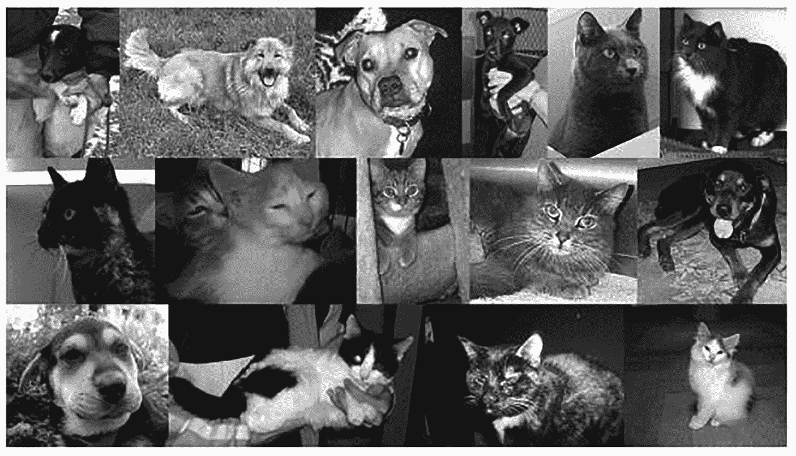
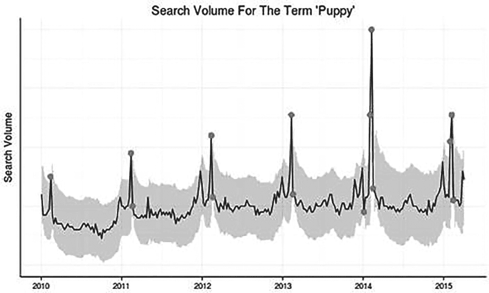
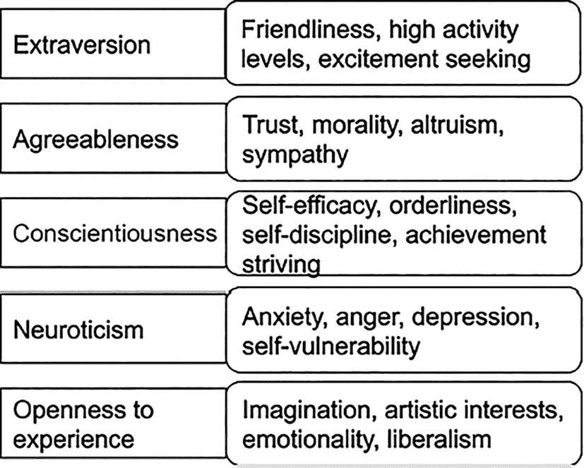
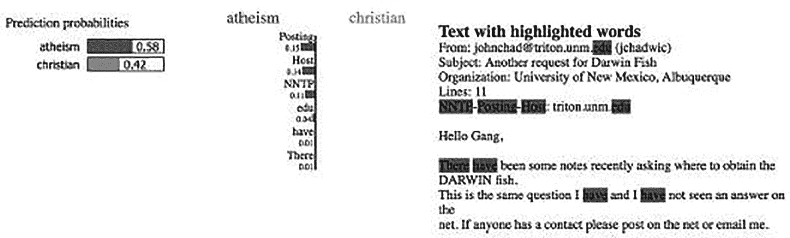

# 7. 机器学习简介

不同研究者对机器学习给出了多种定义。以下是该领域几位著名学者的定义：

> *机器学习是通过示例数据或过往经验，对计算机进行编程以优化性能标准的方法。*
>
> ——埃瑟姆·阿尔帕伊登^(⁵¹)

> *机器学习的目的是开发能够自动检测数据中模式的方法，并利用这些发现的模式来预测未来数据或其他感兴趣的结果。*
>
> ——凯文·P·墨菲^(⁵²)

> *模式识别领域关注的是通过计算机算法自动发现数据中的规律，并利用这些规律采取行动。*
>
> ——克里斯托弗·M·毕晓普^(⁵³)

虽然这些定义略有不同，但都涉及通过识别模式或其他方法从经验和数据中学习的算法。然后，它们会利用所学知识采取行动。

让我们看一个简单示例，以便更好地理解机器学习的工作原理。在图 7-1 中，我向你展示了一个由猫和狗图像组成的虚构数据集。

十五张狗和猫的单色照片。

图 7-1 分类示例

如果我让你分辨哪些图片是狗，哪些是猫，这简直易如反掌。但这是如何发生的呢？

首先，你的大脑接触过大量猫和狗的图片，也在现实生活中见过这些动物的实例。通过来自家庭、学校和电视等渠道的无数次反馈，你训练自己具备了区分这两种动物以及其他动物的能力。

然而，整个过程并不像看上去那么简单。你的大脑经过数千年的进化，已经优化到能轻松做出这些关联判断。即使你对猫和狗一无所知，你的大脑也能迅速发现这两个实体看起来像是不同的动物。大脑能非常快速地整合这些图像，并立即理解到尽管它们各不相同，但都属于同一个物种。

但对于机器而言，这要困难得多。正因如此，机器学习才如此重要——它旨在模仿这一过程，并在机器中加以复现。

## 机器学习的主要优势

从数据中学习对人类大脑来说非常容易，但对机器来说却很难，因为这需要正确的算法和大量数据才能实现。

然而，机器擅长的是实现和自动化。一旦掌握了算法，机器就能轻松处理成千上万甚至数百万张图像，且不会感到疲劳，这是人类大脑无法做到的。

这意味着你可以创造出具有超强能力的东西，即使我们谈论的只是像图像分类这样的狭窄应用领域。这也正是机器学习和大数据能成为如此强大组合的原因。

## 机器学习的类型

现在，我们快速了解一下机器学习的不同领域（表 7-1）。机器学习的主要领域是监督学习和无监督学习。强化学习正在兴起，而推荐系统等相关领域也与机器学习有关联，但它们更为专业，不在本书的讨论范围之内。

表 7-1 机器学习的类型

| 名称 | 用途 |
| --- | --- |
| 监督学习 | 使用模型 `M` 从输入 `X` 预测目标变量 `Y`。 |
| 无监督学习 | 在变量 `X` 中寻找模式（聚类是最常见的例子）。 |
| 强化学习 | 教会智能体如何优化环境中奖励函数。例如，一个视频游戏 AI 可以采取十种不同的行动，这些行动需要作为对环境的响应，以最大化达成目标（如最大化分数或击败人类玩家）。 |
| 主动学习 | 带有人类主动反馈的监督学习。 |
| 半监督学习 | 监督学习，其中部分示例没有标签。例如，一个包含 10,000 张图片的数据集，其中 1000 张没有标签，可以通过半监督学习技术进行分析。 |
| 推荐系统 | 寻找一组用户可能喜欢的项目推荐给用户（例如，要看的电影、要买的产品、要听的歌曲）。与监督学习密切相关。 |

### 监督学习

监督学习可分为分类和回归，两者非常相似。在监督学习中，算法会受到某种形式的监督。我们向算法提供原始数据集，同时也提供目标变量。后者可以是单个变量或多个变量。

然后，算法尝试理解如何将输入与输出匹配。例如，你向算法提供客户数据，然后它尝试判断某人是否会进行购买。

监督者（Supervisor）监控算法的运行。每当算法犯错时，监督者会尝试纠正它。这基本上就像算法在老师的指导下学习。

### 无监督学习

在机器学习的语境中，无监督学习通常指聚类。在这种情况下，我们向算法提供原始数据，但不提供目标变量，而是让算法自行其事，在提供的数据中识别模式。它试图寻找任何看起来有意义的规律，但不涉及监督。

这类学习是一个非常困难的问题，因为它定义不明确，并且几乎总是需要人工在流程的最终阶段进行解释。例如，算法可能会识别出与你试图解决的问题无关的模式，这就是为什么你需要深入分析结果并尝试更好地定义它们。

相比之下，监督学习则稍微容易一些，因为你可以运行算法并立即判断其工作效果。例如，你可以分析客户数据，并以 80% 的准确率预测留存率。这使得监督学习成为机器学习家族中最流行的领域之一。

值得注意的是，我们使用的某些术语，如分类、回归和聚类，在统计学和机器学习中都会用到。然而，即使这些术语指代的内容几乎相同，仍然存在一些差异。

在统计学中，可解释性很重要，而在机器学习中则不太重要。同样，在机器学习中，我们关注算法的预测性能，而在统计学中这一点也很重要。

当比较统计学和机器学习的术语时，可能会觉得有点混乱，因为有些模型，如逻辑回归模型，属于分类模型，在机器学习的语境下也被视为分类模型。这些差异主要是两个领域发展历史不同造成的，所以如果你听到不同背景的人以略有不同的方式使用这些术语，不必感到困惑。

### 深入探究监督学习

监督学习分为`分类`和`回归`两大类。两者之间的区别很简单。分类任务中，我们试图判断某个事物是否属于特定类别；而回归任务中，我们则试图预测一个实数。

分类模型的一个简单例子是判断一封电子邮件是否为垃圾邮件。这是每本机器学习入门教材中都会出现的经典任务。另一个常见的任务是图像识别或物体识别，例如“这是一张动物的图片吗？”或“这张图片中有人吗？”或“在这张图片的哪个位置可以找到人脸？”

分类也可以应用于其他领域。判断某只股票是上涨还是下跌就是其中一个应用，这通常被称为二元分类，因为只有两种类别——上涨或下跌。另一个应用是判断某人是否会点击广告，或者温度是否会升至零度以上。

在某些问题中，你也可以有多个类别。例如，如果你要预测选举结果，在大多数情况下，参与选举的政党会超过两个。在这种情况下，你可能会有四五个类别，每个类别代表一个参选的政党。

而回归则试图预测一个实数。因此，相比询问股票价格是涨是跌，我们试图确定两周后股票的价格。或者，如果我们试图预测客户对特定产品的需求，我们可以尝试推算出五天后的需求情况。又或者，与其判断某人是否会点击广告，我们更想知道会有多少人点击广告——这可能是相关的问题，但仍然是不同的问题。

温度也是如此。仅仅知道温度是否会上升这样模糊的概念可能无法满足你的需求，因此你可能会试图确定三周后的确切温度。

这两种问题——分类和回归——出现在许多领域和不同的场景中。

需要注意的是，同一个问题可以用不同的方法来解决。假设我们为一家对冲基金工作，想要预测股票价格，以便从中获利。

这个问题可以通过统计预测、机器学习回归、甚至分类（后者试图判断价格走势的方向，即上涨或下跌）来解决。

然而，每种方法的性能上限（即你能获得的最佳性能）是不同的。这会对你的策略产生不同的影响，具体取决于你想要达成的目标。

例如，你可能首先尝试使用分类模型来预测股票价格。但你会意识到，这样一来你只能知道价格是涨还是跌。这并不适合直接交易，所以你可能会考虑差价合约交易作为替代方案。然而，你可能会决定采用难度稍高的回归模型，因为更高的利润值得你付出更多努力。

关键在于要理解，一个问题往往不是一个单一的问题，而是你主要问题中包含的一系列其他问题。可以把它想象成乐高模型。每个模型都是一个整体——一座城堡、一架直升机、一艘太空船——但它们是由独立的积木块搭建而成的。在这个语境下，问题就是由子问题或积木块构成的城堡。

同时，尝试多种方法以确定哪种对你的需求最有效，也是值得投入的。这再次如同那些多模型的乐高套装。你可以用不同的方式使用相同的积木，来达成你需要的成果。

唯一的区别是，与乐高套装不同，你没有说明书，甚至没有启发灵感的图片来指引你的旅程——你必须不断测试不同的组装方法，直到最终得到你需要的结果。

不过，如果你身边有一位富有创造力的数据科学家来帮助你，那就好比手里有了乐高说明书和图片，会让事情变得轻松得多。

明智地选择你的“战场”也很重要。如果你发现回归模型能产生更好的性能，即使它更难实现，并且不是你最初的选择，切换到它以确保更好的结果仍然是个好主意。

### 更好地理解无监督学习

无监督学习是在没有任何指导的情况下从数据中学习模式。其主要应用是聚类，这是一种自动创建分组的方法，就像图 7-1 中的图像所示。

因此，你可以将一堆动物图片输入无监督学习算法，它可以在没有任何额外反馈的情况下自动将它们分成两类（猫和狗）。

无监督学习算法在商业中最突出的应用之一是客户细分。因此，将客户数据输入算法，它会识别模式并相应地细分你的客户群。

另一个应用是异常检测，有些人认为这属于一个独立的类别，因为它不仅使用无监督学习，还借鉴了监督学习的一些技术。不过，我把它放在这里，是因为了解它的存在是很有必要的。

降维是另一个应用，它涉及将大量变量缩减为所谓的“因子”或超级变量。例如，你可以取 20 个变量，并将它们归入一个因子之下。这有点像聚类，但针对的是变量。这样做的主要原因是它能让数据更容易理解。

#### 聚类示例

如前所述，无监督学习和聚类从根本上说都是非常困难的问题，主要是因为它们定义不明确。那么，假设我们得到了图 7-2 中的物体来进行聚类。

**图 7-2** 聚类示例

问题在于聚类方法有很多种。你可以根据颜色进行聚类。或者，你可以根据类型聚类，即根据物体是水果还是蔬菜来划分。或者你可能想根据形状进行聚类。

然而，如果你想要根据颜色进行聚类，这并不意味着其他方法是错误的。所有模式都是有效的。问题在于它们是否有用，而答案取决于你的目标是什么。

因此，聚类算法试图识别这些模式，但有时结果并不那么有用，或者与你需要的无关。这就是为什么你总是需要做一些实验才能得到正确结果。不过说到底，如果你知道自己在做什么，并尝试几种不同的算法，你最终会找到一种有效的算法。

无监督学习已经存在了几十年，因此有各种各样的非常强大的算法，如果数据中存在模式，它们就能识别出来。然而，重要的是要记住，仅仅因为你认为物体应该以某种方式聚类，并不意味着你尝试的第一个算法就会得出相同的结果。

#### 异常检测示例

异常检测关注的是不同情境下的异常或反常行为。图 7-3 是一个时间序列图，通过运行异常检测算法，我们可以看到“puppy”一词的搜索量每年一月份都会出现峰值。

2010 年至 2015 年“puppy”一词搜索量的折线图。线条上下波动，每年都有高点标记。2014 年搜索量最高。

**图 7-3** 时间序列上的异常检测示例^(⁵⁴)

这有什么用呢？如果你经营一家宠物店或一家狗收容所，你就可以知道什么时候是帮小狗寻找新家庭或增加小狗相关库存的最佳时机。

同样，这种分析被广泛应用于各种场景。它可以用于零售业中各类产品的分析，也可以用于分析社交媒体活动，以了解人们是否在谈论特定话题，以及某个话题是否引发了搜索量激增。

异常检测还广泛用于网络安全领域，用于检测黑客入侵。因此，如果发往服务器的流量中有 99%是正常的，而有 1%表现出异常行为，异常检测算法就会标记出可疑行为，以便采取相应措施。

#### 降维示例

在图 7-4 中，你可以看到大五人格特质的概要。这是心理学领域最成功的理论之一。

一个列出了 5 种人格特质的图表：外向性、宜人性、尽责性、神经质和对经验的开放性。每种特质都有示例。

**图 7-4** 大五人格特质概要

那么，大五人格理论与降维有什么关系呢？这个理论是通过进行因子分析推导出来的，因子分析是最重要的降维技术之一。

该人格理论是人们在回答问卷中大量问题后，应用因子分析将这些因素归纳为五个整体因素的结果。如你所见，根据这一理论，人格被分解为：

- 外向性

- 宜人性

- 尽责性

- 神经质

- 对经验的开放性

这是一个说明降维技术用途的绝佳例子。它有时也用于监督学习中，因为它可以去除数据中的噪声，但这更多是一个技术性问题。然而，它也可以应用于任何其他拥有大量变量的场景。

例如，在我的博士论文中，我研究了托特纳姆热刺足球俱乐部训练课中的 GPS 数据。我们使用的 GPS 设备收集了超过 100 个不同的变量，这让运动科学团队感到非常难以解读。因此，我采用了监督主成分分析，将它们减少到与伤病相关的五到六个因子，^(⁵⁵)这使得结果更容易理解。

如你所见，它可以应用于许多领域。没有什么能阻止你对用户人口统计数据或客户数据等进行同样的操作。

#### 可解释机器学习

机器学习常被称为黑箱，这并非没有道理。不仅算法对外行人来说可能难以理解，而且算法通常是为性能和预测能力而设计的，而不是为了可解释性。

然而，机器学习领域出现了一个新的细分方向，旨在改变这一切：可解释机器学习。

可解释机器学习专注于提出技术和方法，以使机器学习模型更加透明。例如，一种简单的技术称为“代理模型”技术。将一个决策树拟合到更复杂模型（例如深度神经网络）的预测结果上。这个决策树即使不是数据科学家的人也能轻松解读，并且可以迅速帮助你找出最重要的变量以及它们之间的相互作用。

另外两种更先进的技术是`LIME`和 Shapley 值解释。`LIME`代表局部可解释的模型无关解释，是一种可以用来解释任何结果的技术。Shapley 值解释则是一种受博弈论启发的技术，用于理解每个变量的重要性以及它们在模型内部如何相互作用，从而得出特定结论。

在图 7-5 中，你可以看到例如`LIME`如何为文本分类器识别出最重要的单词。该文本分类器试图区分讨论无神论和讨论基督教的帖子。该算法可以生成不同单词的重要性列表，这些单词随后在文本中被高亮显示。

LIME 解释的截图。预测概率分别为：无神论 0.58，基督教 0.42。在无神论一栏中，posting 为 0.15，host 为 0.14，N N P P 为 0.11，edu 为 0.04，have 为 0.01，there 为 0.01。在下一部分中，文本中的 edu、N N T P、posting、host、there 和 have 被高亮。

**图 7-5** `LIME`如何检查特征重要性的示例^(⁵⁶)

随着算法越来越多地被用于我们生活的方方面面来做决策，可解释机器学习方法将变得越来越重要。你可以通过以下链接了解更多信息：[`https://thedatascientist.com/interpretable-machine-learning/`](https://thedatascientist.com/interpretable-machine-learning/)

脚注 1 2 3 4 5 6