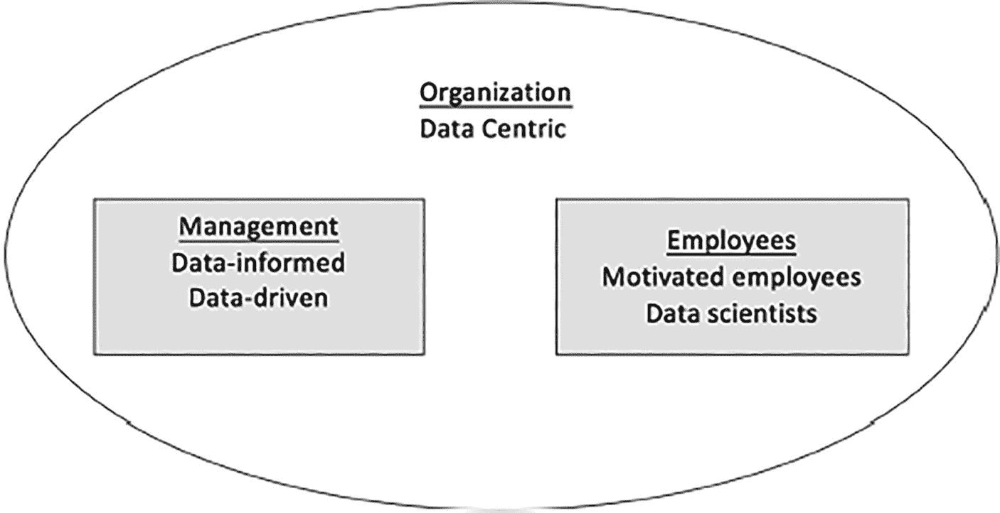
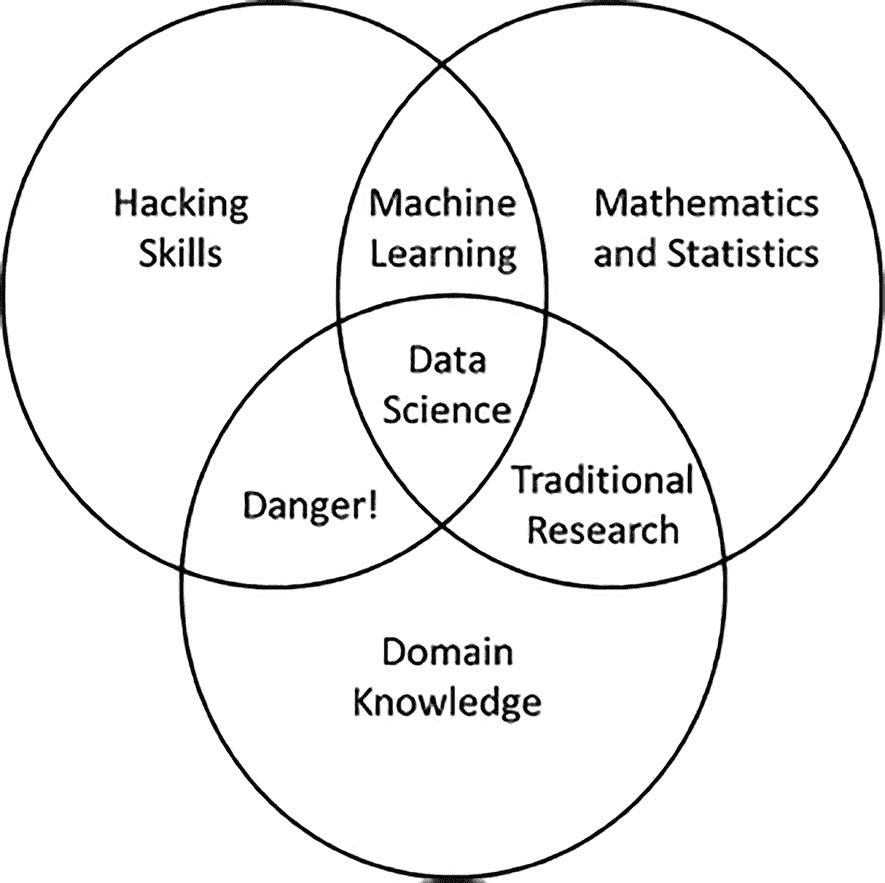
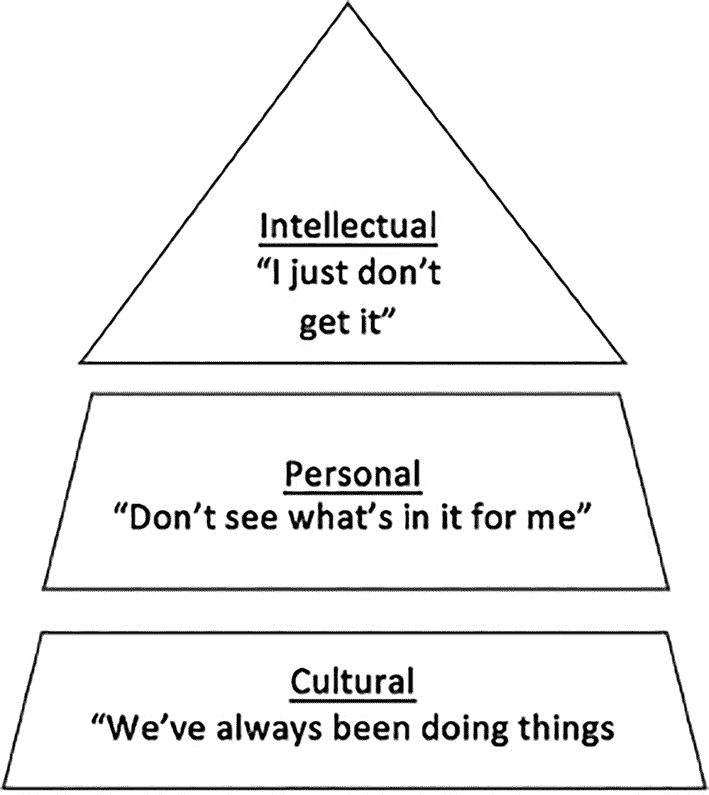

# 构建数据科学文化

因此，正如我之前承诺的，我们现在将探讨数据科学文化。我们将了解数据科学文化是什么样的，以及你需要在公司中做些什么来开始构建这种文化。

## 数据科学文化概述

首先，让我们看看拥有数据科学文化意味着什么。

### 理解数据科学文化的内涵

在进入实际主题之前，我想先谈谈电影《点球成金》（`Moneyball`）。如果你还没看过这部电影，我强烈建议你去看，因为它与当前的情况密切相关。换句话说，这部电影讲述的就是在组织内构建以数据为中心的文化。

这部电影基于同名书籍\[^([83])(#fn83)\]，主要描述了比利·比恩在奥克兰运动家队的工作。这支棒球队在当时是美国棒球锦标赛中表现最差的球队之一。然而，多亏了比利·比恩的努力，这支球队基本上从垫底位置一跃成为最佳球队之一，甚至成为了有力的竞争者。

比恩通过使用分析和统计方法做到了这一点。本质上，他分析了球员，尽管他们个人的表现很差，但他看到他们组合在一起会成为一支伟大的团队。于是，他签下了他们，由于他们个人表现不佳，其他球队认为他们是失败者，并且他们很便宜就能得到。所以，他基本上是用有限的预算组建了一支非常出色的团队。

整部电影中，你会看到布拉德·皮特（扮演比利·比恩）因俱乐部老将们传统的思维方式而遇到的阻力。他们就是不愿意接受他试图实施的新方法。当然，他最终证明他们是错的。

这是一部非常有趣的电影，但我不再继续讨论了。如果你对这个话题感兴趣，你绝对应该去看，我假设你感兴趣，因为你正在读这本书。

现在，让我们来分析数据科学文化的重要性。

### 数据科学文化的三个层级

数据科学文化应该从三个层级来分析，即管理层级、员工层级和组织层级（图 12-1）。



图表包含两个矩形，分别标记为管理层（包含“数据知情”和“数据驱动”）和员工层（包含“积极主动的员工”和“数据科学家”）。它们位于一个椭圆形状内，标记为组织（“以数据为中心”）。

`图 12-1` 一个以数据为中心的组织，包含了数据驱动的管理层、对数据友好的员工队伍以及数据科学家

#### 管理层级

在管理层级，关键在于保持理性，而不是像《点球成金》里那样凭直觉或采用传统方法。在这个层级，在数据科学文化中，直觉的唯一作用就是帮助消化食物（这是它们原本的功能）。

这也关乎“数据知情”和“数据驱动”。我们稍后会更仔细地探讨这些术语。

#### 员工层级

在员工层级，这关乎我们之前讨论过的内容，即招聘`数据科学家`并管理他们。这关乎找到合适的人，并为他们创造一个友好的环境。这也关乎确保那些需要与数据科学家互动的员工（如软件开发人员、产品经理等）具备数据意识，并相信数据科学的价值。

#### 组织层级

在组织层级，拥有正确的文化意味着将管理层级和员工层级中的正确要素结合起来。其结果是一个`以数据为中心`的组织。这将使你能够最大化数据科学的影响力，从数据收集阶段到研究和应用阶段。那时，你就会开始在你的组织中看到实实在在的成果。

---

另外，你还需要小心，因为如果这些领域专家落入危险区域，他们可能会造成比你意识到的更多的问题。现在真的是时候记住那句老话了：如果你手里只有一把锤子，那么所有东西看起来都像钉子。例如，一个毕生从事`深度学习`研究的专家可能会认为他可以用`深度学习`解决所有问题，这并不准确。这就是你需要小心的原因。毕竟，有时候你只需要一个苍蝇拍来赶走那只烦人的嗡嗡叫的苍蝇。

然而，正如我之前提到的，你应该考虑对那些了解自身局限性、渴望超越常规领域并尝试新事物的人更加开放。这些人知道他们需要花几个月时间来学习新领域的细节，但他们非常愿意投入工作。有时，走这条路会有多种回报，因为在这个过程中你还会赢得他们的忠诚——毕竟，没有多少雇主能像你这样开明并愿意给他们机会。

## 示例：如何评估数据科学家？

你更愿意雇佣谁来做你的数据科学家？

1.  一位从排名前十的大学毕业、拥有机器学习硕士学位的应聘者？

2.  一位自学数据科学的开发者？

3.  一位拥有统计学学位和十多年经验的应聘者？

事实是，没有正确答案。工作表现可能取决于多种因素。在谷歌学术上快速搜索一下，会返回海量的结果。例如，搜索词“智商与工作表现”返回了超过 20 万项研究，其中大多数引用的智商与工作表现之间的相关性约为 0.5，这是显著的。搜索词“工作经验年限与工作表现”返回了超过 400 万个结果，而“工作表现预测因素”则返回了超过 100 万个结果，论文中引用的因素从情商到个性都有。

事实是，每种情况都不同。在数据科学和技术领域，很容易找到那些拥有显赫资历却无法胜任工作的员工。文化契合度、个性因素以及个人环境都会影响员工的表现。

然而，为了确保员工能发挥最佳表现，你可以做的是创造合适的环境。这就是为什么在附录中，你会找到一些工具，它们可以帮助你构建数据科学项目，以便你能够定义清晰的结果，并了解要完成这个项目需要具备哪些技能的人来帮助你。

作为经验法则，当你招聘的项目没有严格的时间限制时，认知能力、智商和驱动力可能是最重要的因素。^(⁸²) 例如，如果你有一个成熟的数据科学团队，可以培养拥有正确驱动力的人，那么你或许能以较低的薪水雇佣到一个人，他将与你的数据科学团队一起成长。

另一方面，当你面临时间限制时，最好的方法是雇佣经验丰富、资历深厚的人。如果你面临的挑战定义得非常明确，那么雇佣一位过去解决过这个确切问题的人可能是个好主意。

脚注 1 2 3 4 5 6 7 8 9 10

# 数据知情与数据驱动

首先，我们来探讨一下**数据知情**与**数据驱动**之间的区别。当我们说一个组织或个人是数据知情的，意味着他们确实将数据及其背景作为输入，融入到讨论和决策过程中。

例如，如果你使用仪表盘和关键绩效指标（KPI）这类工具，那么你就是数据知情的。如今，成为数据知情非常容易。你可以使用`Excel`或其他简单工具，制作一些简易图表来了解组织内部情况，这并不困难。

而数据驱动则意味着更上一层楼。它指的是你开始运用更智能的算法和方法来获取数据。然后，你通过使用算法为你做决策，或者将算法的输出纳入考量，来转变决策过程。

那么，与此相反的做法是什么呢？与数据知情或数据驱动相对的，就是凭直觉做决策。或者凭传统经验，这在准确性或有效性方面也好不了多少。

我们再来看几个例子。

当你是**数据知情**时，你可能会使用仪表盘或`Excel`来收集来自多个来源的数据。当然，正如我们之前在第 2 章中讨论过的，你已经适当地组织了数据，并且确保记录了整个过程以避免任何问题。这些数据是可访问的，你所有的员工都知道它，并且了解在哪里可以找到数据以及如何使用它。

而**数据驱动**则意味着将事情*向前推进一步*。这是大多数公司未来应该努力达到的状态。当你达到这个阶段，意味着你允许数据和数据科学帮助你做出潜在的颠覆性决策。在某些情况下，它们甚至可能完全取代人类的决策。

所以，例如，如果你使用算法进行交易，那么你就是数据驱动的。如果你的应用或网站使用了推荐系统，那么你也是数据驱动的。

显然，数据驱动并不意味着每一个决策都需要由算法来做，但它确实意味着你在组织的某些部分以及决策过程中，会使用算法输出。

那么，为什么你要这样做呢？数据驱动能提高效率，并且确实可以改善决策。例如，在预测客户可能想要什么方面，推荐系统可以比人类做出更好的决策。此外，如果你希望进行大规模销售，在达到某个临界点后，你就需要有一种算法，在推荐商品或策展内容时，能够真正替代人工。这只是一个例子，但在不同行业还有很多其他例子。

**警告！**

埃里克·彼得森引用了埃森哲首席科学家基肖尔·斯瓦米纳坦关于“高层管理者需要了解的关于分析学”的讨论。^(⁸⁴)

> `数据`是一把双刃剑。如果使用得当，它能带来合理且充分知情的决策。如果使用不当，同样的数据不仅会导致糟糕的决策，还会导致那些在高度自信下做出的糟糕决策，这反过来又可能引发错误且代价高昂的行动。

换句话说，如果你正确使用数据和数据科学，你会看到效率提升和利润空间改善。然而，如果你没有以正确的方式使用数据，那么很容易就会落入`图 12-2`（上一章已出现过）所示的危险区。



```
一个维恩图，展示了黑客技能、数学与统计学、以及领域知识在数据科学处交汇。黑客技能与数学和统计学在机器学习处交汇。数学与统计学和领域知识在传统研究处交汇。黑客技能与领域知识在危险区处交汇。
```

**图 12-2** 数据科学家维恩图

问题在于，你最终处于一种状态：你在决策过程中使用了数据，但由于你没有正确的理论，或者没有进行正确的测试，导致决策是错误的。然而，你仍然信心满满，因为你认为自己采用了科学方法。

降低这种风险的最简单方法是，聘请覆盖图中数学和统计学圆圈的数据科学家，他们会使用正确的理论和流程来进行数据科学工作。当然，你还需要建立正确的文化，以便数据科学家能与其他部门互动，并且每个人都能相互审视彼此的工作。

## 为数据科学家营造友好环境

在员工层面，你需要为数据科学家营造一个友好的环境。我们在上一章关于招聘数据科学家的内容中已经讨论了很多这方面。本质上，你需要记住，数据科学家追求的不只是金钱回报。他们还希望有合适的文化，希望获得智力上的刺激，希望感受到自己在进步、在学习新事物，以及自己的工作能产生影响。

同时，要记住数据科学家通常性格内向。让每个人都能与他们喜欢的人组成团队，并在正确的文化中工作，这对所有员工都很重要，但对这类人来说，这可能比普通人更为关键。

牢记这一切是拥有快乐员工的关键，而这将转化为更高的生产力。

## 在组织层面以数据为中心

当一个组织以数据科学为核心时，它就是**以数据为中心**的，这包含几层不同的意思。

首先，这意味着你对数据和数据科学领域的状况拥有 360 度的全局视角。数据科学是一个独立的部门，这意味着数据科学家拥有更多的自由和许可去探索新事物，即使这些事物可能具有颠覆性。他们承担了更多责任，这能给予他们更强的激励，但也带来了更大的风险。

然而，正因为你拥有这种 360 度的全局视角，你可以化解这种风险。在所有重要部门之间，特别是在开发人员与数据科学家之间，以及数据科学家与管理层之间，建立了恰当的沟通和汇报渠道。

这很重要，因为你需要确保数据科学家的工作能产生影响，并且你也需要清楚地了解正在收集哪些数据、这些数据如何被使用、以及它们是如何被实施的——这些信息非常容易被忽略。

为了澄清这一点，当我们谈论数据收集时，决策者需要注意两个重大问题。

一个是法律问题，由于欧盟和英国的《通用数据保护条例》，这在当今变得非常重要。涉及数据隐私的问题多种多样，对于不了解数据如何被使用和收集，真的没有任何借口可言。

其次，重要的是要了解数据科学家在研究什么，并确保研究成果能以积极的方式在组织内实施和使用。因此，建立有效的沟通渠道就变得至关重要。一个部门可以审查另一个部门的工作，以确保所做的事情与组织相关。

让我们来看几个可能出错的例子。

### 示例 1：当数据并非核心时

我们先来看一个案例，了解当数据科学不处于核心位置时会发生什么。这种情况往往发生在试图削减成本、资金短缺的中小型企业中。

当一家公司想做数据科学，却又不想招聘新人时，他们可能会让内部员工去做数据科学。他们可能会雇佣一个开发人员来做机器学习，但也仅此而已。

如果有人能监管这个软件开发人员，这倒不失为一个主意。否则，有人可能会直接运行一个从代码库获取的模型，却不知道如何正确地测试这个模型。例如，他们可能会使用交叉验证。模型上线后，最终结果却惨不忍睹，因为你已经身处危险区域。换句话说，你用了这样一个人：他具备黑客技能和领域知识，但却缺乏支撑这些工作的理论知识。

因此，你会做出一些自己非常有信心的决策，但这些决策实际上是错误的。从技术上讲，对自己的错误充满信心，比仅仅犯错更糟糕。

### 示例 2：项目无法落地

另一个常见例子主要出现在存在人员问题或沟通问题的大型组织中：你招聘了数据科学家，但他们的工作成果却无法落地。

虽然无法落地的原因多种多样，让我们来看看其中一种情况：数据科学家不熟悉所在领域。你雇佣了一个看起来履历非常优秀的人。你也非常相信数据科学，并给予他们充分的自由和资源去做想做的事。

问题在于，这种情况下很容易形成“信息孤岛”，尤其是当数据科学家与其它部门沟通时，某种程度上像是在说另一门语言。一个常见的错误是，数据科学家花了数月时间研发某个项目，却因为不熟悉业务领域而无法实施。他们没有意识到，由于实际工作条件的约束或缺乏商业角度的相关性，他们创造的东西根本无法落地。

这种情况在刚毕业的博士中非常常见，他们仍然处于那种非常学术化的思维模式中，倾向于做复杂花哨的东西，而不是做那些能产生影响的简单事情。

因此，建立正确的数据科学文化，不仅仅是基于数据做决策，更是要将创造力转化为成果。这意味着既要给予数据科学家自由和资源，又要确保有适当的检查机制，以保障其工作具有相关性，并且能够且将会被实施。

### 示例 3：沟通不畅

另一个可能导致问题发生的例子是沟通不畅，这相当常见。

假设没有人在软件开发人员和数据科学家之间负责沟通协调。尽管他们同为技术人员，但大部分时间他们讲的是不同的语言。结果就形成了“信息孤岛”，这些孤岛随后又难以打破。而信息孤岛会导致不良实践并延长开发周期。

首先，问题在于沟通风格的差异。例如，与开发人员相比，数据科学家是否更喜欢大量使用数学和不同的表达方式？此外，对彼此工作方式缺乏了解也是一个问题。

开发人员喜欢文档齐全，也喜欢进行测试。另一方面，数据科学家可能有不同的方法。他们甚至可能使用不同的编程语言，这也可能成为问题。

在这种情况下，一种解决方案是尝试让人们成对工作。另一种选择是雇佣有机器学习经验的人，他们可以弥补数据科学家和开发人员之间沟通不畅的问题。

或者，你也可以反其道而行之，雇佣一位拥有软件开发经验的数据科学家。

还有人提议，尝试在所有部门强制执行特定的软件开发方法。

问题在于，这些方法并不总是有效，主要是因为数据科学与软件开发有些不同，有时你可能会陷入尴尬的境地。所以，主要区别在于，数据科学的进展通常不像软件开发那样是渐进式的。它更像是“要么全有，要么全无”。

你可能花几周时间做研究，然后突然就得到了结果。相反，在软件开发中，你可能每天都会增加一个新功能。

因此，即便每天召开站会让大家分享工作进展并不是个坏主意，但也不要全盘照收所有关于软件方法的建议。当然，你可以借鉴这些思路，但要根据自己的具体情况进行调整。

## 《点球成金》：一个关于数据科学文化的故事

体育界曾经与科技和统计的世界非常脱节。大多数体育专业人士可能会觉得讨论数据库或机器学习算法相当无聊。体育是一个完全不同的世界，而比利·比恩的方法在棒球界看来格格不入。

比利·比恩洞察到，当时比赛中使用的大多数指标都已经过时了。球员是由那些曾担任教练或球员的球探挑选的。比利·比恩发现，像上垒率这样的统计数据比传统上使用的其他统计数据能更好地预测成功。

通过这种方式，奥克兰运动家队能够创造出与过去完全不同的价值评估，并以大约 4400 万美元的预算与那些花费近三倍资金的球队竞争。这种方法被称为“赛伯计量学”。该术语源于缩写 SABR，代表美国棒球研究学会。

遗憾的是，奥克兰运动家队最终未能赢得冠军（尽管他们非常接近胜利），并且一旦其他俱乐部开始效仿他们的方法，他们就失去了优势。

自那以后，体育界被数据科学所渗透，设备和算法主导了比赛的许多方面。体育分析会议定期举行，其中最大型的在麻省理工学院斯隆管理学院举办（`www.sloansportsconference.com`）。

我也做过体育分析方面的研究，涉及预测运动损伤和比赛结果（例如哪支队伍会赢）。你可以在我的博客 `http://thedatascientist.com` 上了解更多。

## 建立数据科学文化的步骤

让我们看看建立一种有利于数据科学的文化所需的步骤。

### 首先，你为什么需要数据科学？

首先，你需要问问自己为什么需要数据科学。企业中通常有三种常见情况：

1. 数据科学是你业务的核心组成部分：也许你是一家人工智能或机器人公司，或者你以某种方式处于深度科技领域。在这种情况下，你通常必须自己掌握相关知识。

2. 你经营一家公司并希望提高效率，例如，你可能想要优化运营。

3. 你想提高销售额，那么你可能想要构建推荐系统来改善面向消费者的产品/服务。

你不太可能属于第一种情况，否则你就不会读这本书了。所以，你很可能处于第二或第三种情况，当然，这两种情况也可以结合。

此时，你需要问问自己为什么需要数据科学，这样才能明确下一步的方向。现在，让我们来看看变革的阻力。

# 变革的阻力

如果你是一家初创公司，那么你很可能灵活性较强，因此变革的阻力不会成为问题。然而，如果你身处大型组织，下面这些内容就会非常相关。

变革的三种阻力类型是：文化阻力、个人阻力和智力阻力（图 12-3）。



图表顶部有一个三角形，标注为“智力阻力”，并附有引述“我就是搞不懂”。其下方是两个梯形，分别标注为“个人阻力”，引述“看不到对我有什么好处”，以及“文化阻力”，引述“我们一直都是这么做的”。

图 12-3 变革的阻力类型

## 文化阻力

文化阻力在《点球成金》中有所体现。我们面对的是一个庞大而古老的组织，或是多层级的管理层，或是那些与数学、统计学或数据关联甚少的领域。体育与金融的对比就是一个很好的例子。

正如《点球成金》所示，体育界仍在努力深入分析领域，但尚未真正实现。即使在《点球成金》事件发生的年代，比利·比恩试图在奥克兰运动家队推行的那些做法，在通常处于数据分析前沿的金融领域，也算不上什么特别之处。

## 个人阻力

个人阻力在较小的公司中也会出现，指的是员工不喜欢这种变革。

举一个我亲身经历的例子：我曾与一位客户合作，等待了两个月才有人给我指派一位数据库专家。然后，我不得不给主管打电话，又等了一个月。

可能发生的情况是，员工们已经超负荷工作，结果又被分配了更多任务。因此，员工们根本看不到做任何事——比如导出数据库或尝试实施某个算法——能带来什么好处。

## 智力阻力

最后，还有一种情况是人们对他们不理解的事物感到恐惧。想想电影《终结者》中的“天网”，就像人们害怕机器会接管世界一样。

在组织中，智力阻力并不常见，因为大多数人都明白数据是有用的，它可以提高效率和销售额。然而，如果智力阻力的迹象哪怕只露出一丝端倪，那么聘请一位优秀的数据主管就是一个好的开始。这个人能够掌控数据，向人们展示数据，并展示数据如何能够改善公司内部的几乎一切事物。

# 变革之路

谈到你的变革之路，有三点需要记住。首先，你必须确定数据科学家将如何带你实现变革。这意味着要创造一个数据科学友好的环境，让他们能够畅所欲言，并尝试运营那些具有巨大潜在影响的项目。变革是缓慢的，但如果人们开始看到结果，他们就会因为理解了其中的好处而慢慢改变想法。

在某些情况下，找到一位支持者也非常重要。这个人能够为这个新方向注入热情。这位支持者真心相信这种新方法，并且拥有足够的热情和地位，能够真正推动公司其他成员朝着这个新目标前进。

这通常是一位深受欢迎的高层员工。既可能是你，也可能是某位数据科学家或首席数据官。

通常，最佳选择是那些已经在组织中且人缘很好的人，是大家无论其谈论什么都会尊重并倾听的人。这也有助于员工将这次变革视为一次学习经历，以及对公司（因此也是对他们自己）更有益的事情。

在变革之路上要记住的最后一点是，关注员工的利益至关重要，因为没有人喜欢在没有回报的情况下做更多的工作。然而，那些有求知欲和进取心的员工会看到学习和帮助组织的好处，因为这最终能转化为他们自己的成果。

# 如何开始

谈到实施数据科学文化，我见过两种方法。第一种是“小步快跑”法，第二种是“用例驱动”法。

在小步快跑法中，你收集大量数据，决策者则自我学习数据科学知识。然后，他们尝试使用简单的图表和统计数据，从而变得更具数据洞察力。一旦他们对数据感到得心应手，就会采取下一步行动：聘请专人来解读数据。

用例驱动法则更像是一种自上而下的方法。当公司遇到某种特定类型的问题时，他们会制定一个计划，并可能首先聘请人来帮忙设计计划并解决这个特定问题。然后，他们再考虑这些发现如何与其他用例相关联。

小步快跑法最为常见，因为在 Excel 或仪表盘中收集和可视化数据很容易。当一家公司对数据感兴趣，是因为听说其他人都在收集和使用数据，但数据本身并非优先事项时，就会采用这种方法。

因此，当公司解决了主要问题并实现盈利时，他们可能会决定聘请某人，因为他们手头有所有这些数据，并希望能利用这些数据做些事情。这种方法之所以合理，是因为它不会对当前运营造成太大干扰，而且如果数据收集不是你优先考虑的事情，你也不必把事情推得太快、太远。

然而，这种方法也可能引发各种问题。这是一种较慢地采用数据科学的方式，但同时你也会遇到我们在第 2 章中讨论过的所有问题。换句话说，在事先没有考虑或没有目标的情况下收集了一大堆数据，最终演变成一场灾难。

用例驱动法则不太常见，通常用于公司有明确用例的情况。其优势在于，通过更有针对性的方法，可以提供更直接的结果。然而，这需要公司具备一定程度的数据意识，并且需要能够接触到值得信赖的数据科学家。

请注意，公司不必在两种方法中二选一。很多时候，他们可能会先采用第一种方法，最终却转向了后一种。

# 从何处着手

“何处”与“如何”同样重要。因此，你首先要梳理你的组织对数据的使用情况。你需要理解从数据收集到使用的整个流程，并发现你可能拥有的任何“暗数据”。

同时，要强调战略和创新，并努力帮助员工理解这为什么重要。奖励良好行为，这对数据科学家来说至关重要。许多数据科学家渴望得到认可，并希望感觉自己正在对世界或公司产生影响。因此，在博客和社交媒体上推广优秀的工作成果会大有裨益，同时也要在公司内部与所有人分享最佳用例。

最后，创建一种嵌入式文化是打破各自为政、改善沟通的途径。你希望数据科学家与开发者、产品负责人以及管理者密切合作。这是确保研究具有相关性、成果得到实施，并且能在公司内部产生影响的唯一途径。

# 理解并运用暗数据

暗数据是指未被使用的运营数据，例如日志文件、销售通话或邮件记录，以及类似的信息。

这类数据之所以重要，是因为其数量庞大且正在被尘封。德勤报告指出，到 2020 年我们将拥有 44ZB 的数据。这个数字可能并非 100%准确，但这仍然是海量数据。需要注意的是，许多数据来源并未明确指明；它包含了音频、笔记、视频、图像文件等等。

此外，德勤特别提到了物联网及其他非传统数据源。这类数据易于收集，却并非总能被利用。因此，它们会迅速变成暗数据，仅仅沉睡在数据仓库中，等待有人能将其解读。

## 暗数据能为你带来什么？

暗数据能为你带来诸多益处，但很难提供一套适用于所有情况的通用准则。不过，这里有几个例子。

例如，你可能有一些电子邮件地址。在某些情况下，你可以从邮箱地址中提取性别和年龄，从日志文件中提取访客行为，或从客户通话中提取情感倾向。接着，你可以利用使用日志或客户日志等数据，创建用于预测用户留存率的模型。这只是一个例子，还有着无限的可能性。

请记住，数据的非结构化特性可能会使其难以利用。然而，如果你能做到，回报将非常丰厚。

# 迈向更以数据为驱动的其他步骤

如前所述，你需要营造一种鼓励战略和创新的开放文化。一位领军人物可以成为至关重要的资产，因为他们有助于激励员工。

有多种方法可以创建这种文化。例如，你可以每月组织一两次内部黑客马拉松，或者允许员工自由探索自己的想法。其他公司已经成功实践了这种方式，它之所以有效，是因为它能保持员工的快乐和投入。

另一个有趣的方法是使用 Kaggle 平台来组织内部竞赛。如果你的公司拥有非常多的数据科学家，这种方法会很有效。它为人们提供了一次享受乐趣和学习新事物的机会。

最后，如果可能的话，开放你的数据，允许你的员工邀请其他人参与一些小项目。当然，这并非适用于所有公司。但如果条件允许，这可能是发现新人才的绝佳方式。

# 奖励良好行为

谈到奖励良好行为，有好点子的员工需要得到某种形式的认可。也许你可以在博客上发布他们的成果，或者将代码库和软件开源并注明开发者。这是该领域内大型组织正在做的事情。

例如，谷歌和脸书都有自己的研究博客。脸书还有一个名为`Prophet`的预测库，你可以在上面读到由公司内部创建该库的员工撰写的文章。

这是一种极好的方法，因为每个人都希望自己为某个新奇而卓越的事物所做的贡献能得到认可。他们没有理由被匿名。他们的名字就赫然在列。此外，数据科学家喜欢展望未来。如果他们想另谋高就，知道新雇主可以轻松地在线找到他们及其工作，这对他们来说是好事。这就是数据科学家和软件开发者也有 GitHub 账号的原因。

所以，这不只是奖金的问题，也可能关乎成就感。

# 创建嵌入式文化

最后，在尝试为数据科学构建合适文化时，最重要的事情之一就是创建一种嵌入式文化。这意味着你希望数据科学家与其他部门紧密合作，并且希望各方之间有良好的沟通以及完全的透明度。

每日站会让人们分享自己手头的工作，这是一种促进沟通和透明度的标准方式。然而，需要小心，因为数据科学家工作的缓慢特性可能会让每日站会变得令人烦躁。他们的工作不是渐进式的，你最不希望看到的就是一群内向的人因为拿不出成果而感到不自在。这就是为什么每周站会可能是更好的选择。

你还应该考虑为新入职的数据科学家设立导师计划。初级数据科学家可能充满热情，有时你能从一些优秀大学发现非常有天赋但经验稍显不足的人才。这可能是他们的第一份真正的工作，所以让一位资深数据科学家来教育和指导他们是一个好主意，这将帮助他们变得出色。

# 案例研究：Booking.com 以正确的方式运用数据科学

Booking.com 是一家将数据科学运用得当的公司。他们每 24 小时销售超过 150 万间酒店客房，并且有数百万人持续浏览该网站，这意味着他们拥有海量的数据。他们持续利用这些数据来改进现有服务并开发新服务。

## 数据科学家团队与文化

Booking.com 拥有超过 120 名数据科学家，他们有着不同的背景、经历和工作偏好。公司文化显然是数据驱动的，并且其发展方式为数据科学家提供了完美的舞台。从用各种需要他们不断学习新知识的项目来挑战他们，到通过同事主持的研讨会和演示来帮助他们学习，数据科学家在 Booking.com 几乎没有感到无聊的机会。

## 嵌入式组织结构

其组织结构也值得效仿，因为它正是我们之前讨论过的嵌入式结构。他们的数据科学家是业务中不可或缺的一部分。他们是团队的一员，这些团队包括开发者、产品负责人以及各种其他专家。这种团队组建方式使他们能够将一个想法从概念推进到实施阶段。

## 敏捷工作方法

在日常工作中，他们遵循所谓的“预定敏捷核心要素方案”，这意味着他们有每日站会、待办事项清单、回顾会议、关键绩效指标、目标和关键成果、团队目标等等。这种方法使他们能够迅速前进，或者迅速失败并从失败中学习。

## 对数据科学家的要求与回报

正因如此，Booking.com 的数据科学家被期望具备出色的沟通能力以及商业意识。换句话说，仅有技术技能是不够的。

然而，数据科学家在 Booking.com 工作很开心，因为他们不断在处理新项目、学习新事物。他们无需等待数据出现，他们的建议和推荐会被采纳，他们被允许尝试新方法，并且被真正当作数据科学家来对待。

## 结论与启示

所以，在创建以数据为中心的文化方面，效仿 Booking.com 的模式不会是个坏主意。当然，你无需照搬他们所做的一切。毕竟，它是一家大公司。也许，在你的情况下，你不太在意沟通，而更关注技术层面。

但是，如果你想创建一种嵌入式文化，那么一定要研究一下 Booking.com 是如何做到的。

脚注
