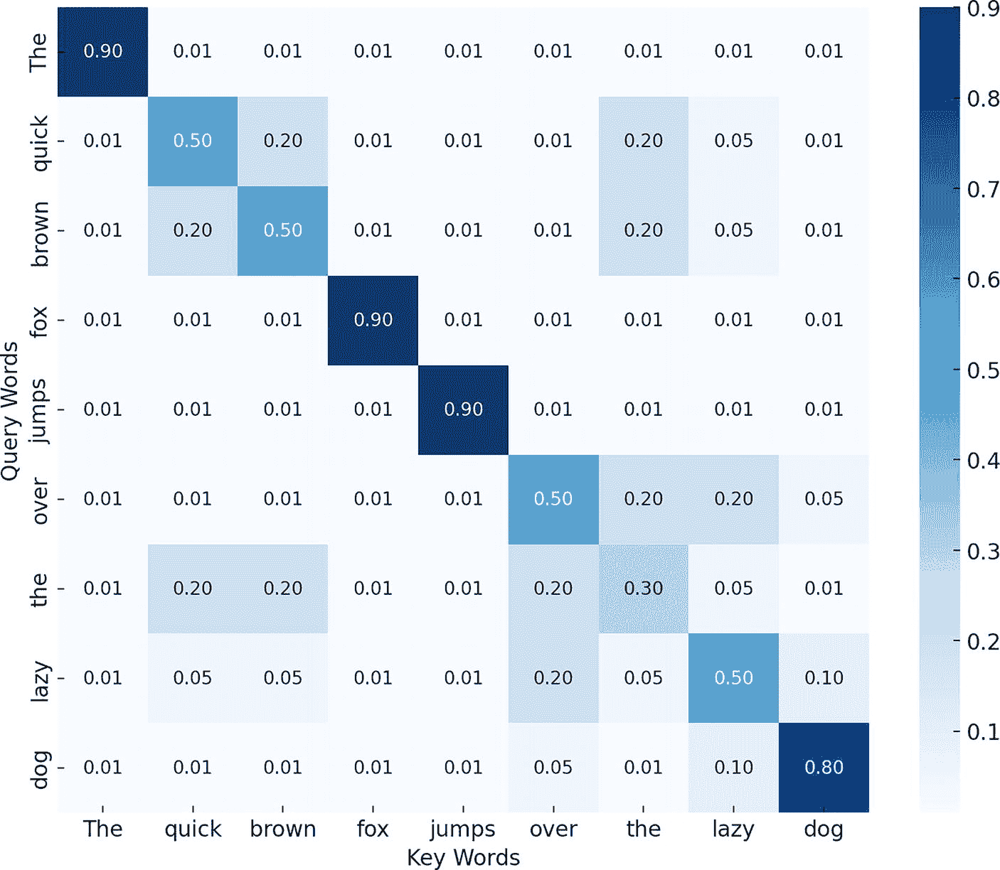

# 8. 人工智能导论

人工智能（AI）是一个总括性术语，涵盖了一个非凡的计算机科学领域，致力于创建能够执行此前需要人类智能才能完成的任务的系统。从古代自动机的神话，到驱动我们数字世界的现代算法，创造智能机器的追求一直是人类雄心的一部分。

自诞生以来，AI 的概念已经发生了显著的演变。它始于模拟人类智能的大胆梦想，如今已成为日常技术中不可或缺的一部分。无论是流媒体服务的微妙推荐、虚拟助手的动态响应，还是补全我们句子的预测性文本，AI 已将自己编织进我们日常生活的结构中。

AI 的发展历程既有振奋人心的突破，也有被称为“AI 寒冬”的停滞期。然而，每一次解冻，都伴随着人类突破机器能力边界的执着追求，带来了新的活力和进步。

今天，AI 处于创新的前沿。先进算法的发展和计算能力的指数级增长，使 AI 迅速从学术论文走向实际应用。我们现在正目睹 AI 执行着曾经被认为机器不可能完成的任务，从诊断疾病到驾驶汽车。

随着 AI 的持续进化，它挑战着我们对机器和工作的传统理解，既引发了敬畏，也促使我们对它所塑造的未来进行反思。本章旨在揭开 AI 的神秘面纱，追溯其历史根源，解释其基本原理，并展示它为我们未来带来的变革性影响。

## AI 的演变

### 早期岁月：基础与图灵测试

人工智能的基础奠定于 20 世纪中期，那是一个充满乐观精神、渴望复制人类认知的时代。被誉为现代计算机之父的数学家艾伦·图灵，于 1950 年提出了`图灵测试`，用以衡量机器展现出与人类等同或无法区分的智能行为的能力。图灵的工作为后来的人工智能研究注入了动力，而 1956 年的达特茅斯会议则正式标志着 AI 作为一个研究领域的诞生。早期 AI 研究聚焦于问题求解和符号主义方法，致力于将人类知识和推理编码为基于逻辑和规则的系统。

### AI 寒冬：失落的时期

AI 的发展历程并非一帆风顺。该领域经历了数次“寒冬”，这些时期以预期未达成导致的资金和兴趣大幅下滑为特征。第一次寒冬发生在 20 世纪 70 年代，起因于詹姆斯·莱特希尔爵士发布的一份报告，该报告批评了 AI 领域过于雄心勃勃的承诺，导致研究经费削减和整个领域普遍感到失望。第二次寒冬紧随其后，发生在 80 年代末至 90 年代初，当时现有技术的局限性日益凸显，资金再次枯竭。

### 复兴：互联网、算力与大数据

随着互联网的出现和大数据的爆发，AI 的命运开始扭转。海量可用数据成为了新机器学习算法的燃料，这些算法不再需要手工编写规则，而是可以直接从数据中学习。与此同时，计算能力的飞速提升，尤其是图形处理单元（GPU）的问世，使得更复杂的模型能够更快地得到训练。

这些技术进步，加上神经网络和深度学习的突破，促成了 21 世纪 AI 的复兴。这次复兴不仅重燃了人们的兴趣，还让 AI 系统在特定任务上达到了甚至在某些情况下超越了人类水平的表现，将我们带入了一个 AI 应用似乎无边无际的时代，从自动化日常任务到推动量子计算研究，无不涉及。

## AI 中的基础概念

### 机器学习：现代 AI 的核心

机器学习（简称 ML）是当代 AI 的基石，其核心理念是系统可以从数据中学习、识别模式并在最少人工干预下做出决策。这种从显式编程到数据驱动学习的范式转变，对 AI 的成功至关重要。通过使用能够从数据中迭代学习的算法，ML 使得 AI 能够开发出预测模型，这些模型广泛应用于从电子邮件过滤到医疗保健中复杂诊断的无数场景。

### 深度学习：神经网络在行动

深度学习是 ML 的一个子集，其灵感来源于人脑中信息处理的模式。它利用被称为神经网络的算法，这些算法由类似于神经元的层级结构组成。这些网络能够自主学习并做出智能决策。深度学习对于推动 AI 发展至关重要，它使机器能够识别图像、理解口语，甚至生成类似人类的文本。这些网络的深度（通常由许多层组成）使其能够以前所未有的复杂性和抽象程度处理数据，从而推动了计算机视觉和语音识别等领域的进步。

### 自然语言处理（NLP）：理解人类语言

自然语言处理是 AI 发展历程的见证，它处理的是计算机与人类语言之间的交互。`NLP`结合了计算语言学（对人类语言的基于规则的建模）与统计模型、机器学习和深度学习模型。这些技术使计算机能够处理和分析大量的自然语言数据。其结果是能够执行诸如文本翻译、回答问题以及文档摘要等任务。`NLP`是 Siri 和 Alexa 等虚拟助手以及谷歌翻译等翻译服务的核心，它们与人类用户的交互正变得日益无缝。

`NLP`领域因大型语言模型（LLM）的出现而发生了变革。LLM 是一种深度学习模型，旨在以高度复杂的方式理解、生成并有时翻译人类语言。像 GPT（生成式预训练 Transformer）和 BERT（来自 Transformer 的双向编码器表示）这样的 LLM，利用海量的文本数据来学习语言模式、细微差别和上下文关系。这些模型能够执行各种复杂任务，包括语言翻译、问答、文本摘要甚至内容创作，其精细程度日益接近人类水平。

## AI 中 Transformer 的到来

人工智能从早期阶段发展到今天复杂的系统，是技术史上非凡的一章。随着 2017 年研究论文《注意力就是一切》的发表而诞生的 `Transformer` 网络，是自然语言处理（NLP）领域的一大步。它采用了并行数据处理和`注意力机制`，有助于更好地理解和生成语言。

这种`注意力机制`是一项关键特性，它允许模型聚焦于数据的不同部分并赋予其不同的重要性权重。它改进了机器理解语言上下文的能力（图 8-1）。

以查询词为纵轴、关键词为横轴绘制的句子“`the quick brown fox jumps over the lazy dog`”的概率得分矩阵。`(the, the)`、`(fox, fox)`和`(jumps, jumps)`的值为 0.9。`(dog, dog)`的值为 0.8。

**图 8-1** 实践中的注意力机制

在 `Transformer` 网络的基础上，像 OpenAI 的 GPT 和谷歌的 BERT 这样的大型语言模型（LLM）扩展了文本生成和解释的范围。这些模型能够生成从文章到代码的文本，展示了其广泛的适用性。特别是`BERT`，它提升了搜索引擎和机器人理解查询并做出回应的方式。

其他模型，包括`RoBERTa`、`DistilBERT`和`T5`，已经改进或重新构想了 `Transformer` 模型，使其更高效或更通用。`XLNet`在`BERT`的基础上进行了构建，以提升在一系列语言任务上的性能。

在对话式 AI 领域，`ChatGPT`做出了显著贡献，特别是通过利用人类反馈来生成更自然的对话。谷歌 Bard 虽然在其公开描述中细节较少，但预计将借助谷歌的`LaMDA`把广泛的知识带入对话语境中。

这些 `Transformer` 模型的引入开启了人工智能与人类智能合作的新篇章，AI 在创造性和智力追求中扮演着更积极的角色。这种伙伴关系预计将在各个领域带来重大变革，提升我们应对复杂挑战的方式。

## 生成式 AI 的崛起

让我们探索生成式模型的复杂世界，特别是生成对抗网络（`GANs`），并深入探讨它们在图像处理和人工智能中的作用。

在图像处理领域，卷积神经网络（`CNNs`）已成为模式识别的基础。这些网络擅长对图像和视频中的物体进行分类和识别，这项技能对于从社交媒体滤镜到医疗诊断等众多应用至关重要。`CNNs` 利用卷积运算来过滤和解读视觉数据，提取对准确分析至关重要的显著特征。

生成对抗网络（`GANs`）由伊恩·古德费洛及其团队于 2014 年提出^(⁵⁸)，代表了一类革命性的机器学习框架，其原始论文已被引用超过 6 万次。它由两个神经网络——`生成器`和`判别器`——组成，它们进行一场竞技博弈，从而促进生成越来越逼真的合成数据。`生成器`负责创造新的数据实例，而`判别器`则评估其真实性，推动数据生成的持续改进和完善。

`GANs` 的 versatility 在各个领域都显而易见。例如，艺术界受益于 `GANs` 通过分析现有艺术品海量数据集来合成新作品的能力。时尚和广告行业利用 `GANs` 构思新颖的设计和图像。值得注意的是，`GANs` 还催生了深度伪造技术，即通过逼真的视频或图像将一个人的肖像叠加到另一个人身上，这既引发了人们的兴趣，也带来了伦理担忧。

### 稳定扩散与 DALL-E：图像生成的演进

`Stable Diffusion` 模型标志着 AI 图像生成的另一个重要里程碑。`Stable Diffusion` 及其同类模型（如 `DALL-E 2`）以生成细节和品质出众的图像而闻名，它们建立并超越了 `GANs` 的能力。`DALL-E 2` 是其前身（最初采用 `GANs`）的演进版本，采用了稳定扩散方法，在 OpenAI 对扩散模型有效性的广泛研究以及 `CLIP` 的基础上，创造了更加多样化和高保真度的图像。

`DALL-E 2` 及其同代模型，如 `Mid-Journey` 和 `Stability.ai`，通过实现从文本提示合成图像，彻底改变了创意 AI 领域。这些模型为艺术家和设计师提供了工具，使他们能够以前所未有的精度和艺术性来构思和渲染视觉概念。

扩散模型的工作原理是通过一个逆转扩散的过程，逐步将样本从简单分布（如高斯噪声）转化为复杂的数据分布（如自然图像的分布）。扩散过程通常涉及在多个步骤中向数据添加噪声，直到数据完全随机化。然后，模型学习逆转这一过程，有效地进行“去噪”，从而从噪声中生成新的数据样本。

`GANs`、`CNNs` 以及 `Stable Diffusion` 和 `DALL-E 2` 等先进模型的融合，展示了 AI 在生成和完善视觉内容方面取得的显著进展。随着这些技术的持续发展，它们有望重塑众多行业，提供新颖的解决方案，并增强人类创造力与 AI 创新之间的协同作用。

**图 8-2**

`Stable Diffusion` 可以创建非常逼真且多变的图像。上图是使用 `DALL-E` 创建的。

## AI 的应用

### 医疗保健

*   AI 辅助诊断^(⁵⁹)：`IBM Watson for Oncology` 是一个革命性的 AI 系统，通过分析医学图像和患者数据，提供个性化的癌症治疗建议。其在癌症诊断方面的准确性可与人类肿瘤学家相媲美。

    `IBM Watson for Oncology` AI 系统

*   AI 驱动的药物发现^(⁶⁰)：AI 公司 `BenevolentAI` 利用机器学习技术识别新的药物靶点，并开发新的疾病治疗方法。他们已与制药公司合作，以更快、更有效的方式将新药推向市场。

### 金融

*   欺诈检测^(⁶¹)：领先的金融服务公司 `Mastercard` 采用 AI 分析交易数据，以 99%的准确率识别欺诈活动。其 AI 系统显著减少了欺诈损失，并增强了持卡人的安全性。

    `Mastercard` AI 系统

*   风险评估^(⁶²)：知名的金融信息和分析提供商 `S&P Global` 利用 AI 评估公司和借款人的信用状况，其表现优于传统的信用评级方法。其 AI 系统提高了风险评估的准确性，并降低了金融风险。

### 零售

*   产品推荐^(⁶³)：亚马逊的 AI 系统由机器学习算法驱动，根据客户的购买和浏览历史向其推荐商品。这种个性化方法提升了客户参与度，增加了销售额，并改善了整体购物体验。

    亚马逊 AI 系统

*   需求预测^(⁶⁴)：全球零售巨头 `Walmart` 利用 AI 预测其门店的产品需求。这种预测能力改善了库存管理，降低了成本，并确保了产品的可供性。

### 交通运输

*   自动驾驶汽车^(⁶⁵)：自主车辆技术先驱 `Waymo` 开发的自动驾驶汽车已在公共道路上行驶了数百万英里，证明了其安全性和可靠性。他们的自动驾驶汽车有潜力彻底改变交通运输，提供更安全、更高效、更便捷的出行方式。

    `Waymo` 自动驾驶汽车

*   交通优化^(⁶⁶)：全球技术领导者 `IBM` 开发了一款 AI 系统，用于分析交通数据并推荐交通信号灯配时调整。这种方法可将拥堵程度降低高达 10%，从而改善交通流量，减少出行时间，并节省燃料。

### 农业

*   精准农业^(⁶⁷)：领先的农业设备制造商 `John Deere` 开发了诸如 `See & Spray` 技术等 AI 驱动工具。这一创新系统使农民能够将除草剂喷洒精准靶向特定植物，将除草剂使用量减少高达 90%，从而最大限度减少对环境的影响，并促进可持续农业实践。

*   作物产量优化^(⁶⁸)：由 `Agrible` 开发的 AI 系统 `AgribleFarmhand` 分析天气模式、土壤质量和作物健康数据。该综合分析为最佳种植时间、灌溉需求和虫害管理提供了见解，从而提高了作物产量和质量，并提升了农业生产力。

### 制造业

*   预测性维护^(⁶⁹)：工业巨头 `GE` 开发了诸如 `Predix` 等 AI 驱动系统。这一预测性维护工具能够监控设备性能并预测潜在故障。这种主动方法能够实现预防性维护，减少停机时间，最小化生产中断，并优化制造流程。

    `GE Predix` AI 系统

*   质量控制^(⁷⁰)：领先的机器人公司 `ABB` 和 `FANUC` 开发了具备 AI 能力的机器人，能够对制造产品进行视觉检查和缺陷检测。这些智能机器人确保了产品质量和一致性，维持了高制造标准，并减少了产品缺陷。

## AI 发展时间线

*   2000 年代初—机器学习的兴起：对机器学习的兴趣重新燃起，`SVM`（支持向量机）和`Random Forest`（随机森林）等算法在分类和回归任务中广受欢迎。

*   2006 年—深度学习崛起：“深度学习”概念被提出，标志着向深层架构神经网络的转变。

*   2009 年—ImageNet 与计算机视觉的进步：`ImageNet`数据集发布，极大地推动了计算机视觉领域的发展。

*   2012 年—深度学习的突破：`AlexNet`在 ImageNet 挑战赛中获胜，展示了深度学习在图像识别方面的强大能力。

*   2014 年—序列学习与 LSTM 网络：`LSTM`网络的改进提升了语音识别和机器翻译的性能。

*   2015 年—AlphaGo：谷歌 DeepMind 的`AlphaGo`于 2016 年击败一位职业围棋选手，展示了人工智能的战略能力。

*   2016-2017 年—人工智能产业化：人工智能开始更深入地融入各行各业，应用领域广泛。

*   2018 年—人工智能伦理与偏见：人们对人工智能伦理的关注度提高，包括算法中的偏见和公平性问题。

*   2019 年—GPT-2 与 NLP 进步：`GPT-2`的发布，是自然语言处理领域的一次重大进步。

*   2020 年—GPT-3 与人工智能的广泛采用：`GPT-3`的发布，展示了大型语言模型的潜力。

*   2020 年—AlphaFold 2：谷歌 DeepMind 的`AlphaFold 2`是计算生物学领域的重大突破，能够高精度预测蛋白质的三维结构。

*   2021 年—人工智能在疫苗研发中的应用：人工智能在新冠疫苗的快速研发中发挥了关键作用，通过分析海量数据来设计靶向疫苗。

*   2021 年—自动驾驶与机器人出租车的进展：自动驾驶技术趋于成熟，行业开始测试无人驾驶汽车并推出机器人出租车服务。

*   2022 年—ChatGPT：`ChatGPT`推出，将`GPT-3`集成到对话式 AI 框架中，实现了复杂的对话系统。

*   2023 年—GPT-4：`GPT-4`发布，增强了理解和生成复杂文本的能力，进一步推动了自然语言处理的发展。

脚注 1 2 3 4 5 6 7 8 9 10 11 12 13 14