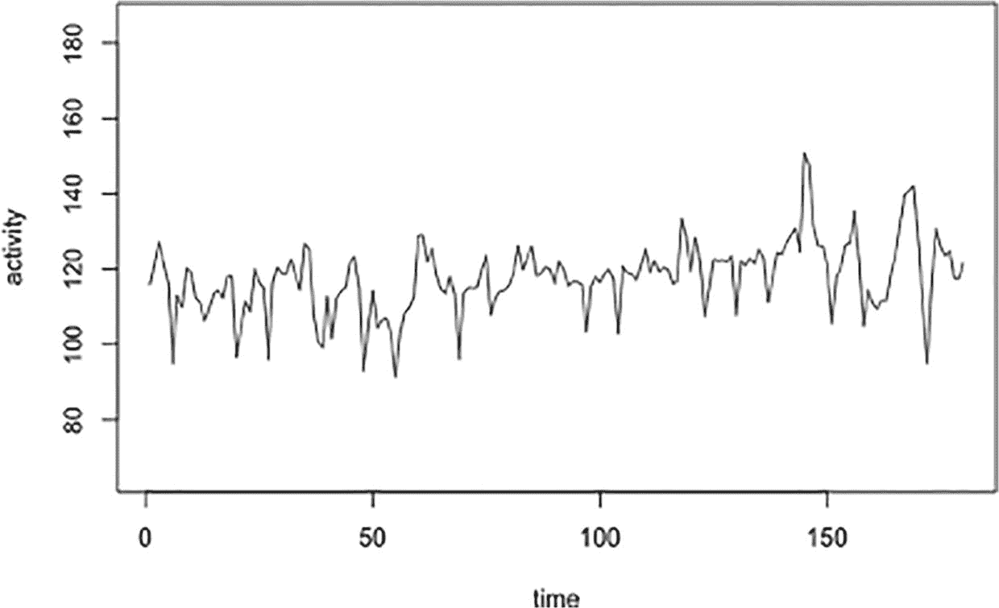

# 9. 问题解决

在本章中，我们将从决策者的角度来探讨如何解决问题，因为这是本书的核心内容。因此，我们不会关注数据科学家如何解决问题，而是你将如何与数据科学家协作解决问题。

没有人期望领域专家——也就是你——具备使用数据科学的资质。然而，你在解决问题时需要能够像数据科学家一样思考，因为这将帮助你更好地定义问题，也更容易找到合适的人选并管理他们。

你需要能够提出问题，并且如前所述，一个非常有效的方法是将问题转化为提问。你还需要了解解决这个问题是否有价值。任何事情都需要时间和金钱，因此你需要了解问题解决的结果是否适用于你的业务。最后，你需要了解应该聘请谁来帮助你，以及是否需要不止一个人。

## 理解问题是否可解

要判断某个问题是否可解，首先你需要意识到所有可能出错的地方。根据我的经验，我发现企业在使用数据科学时主要面临两个问题。

首先，他们往往抱有错误的期望，导致实际解决方案要么比他们想象的要简单得多，要么要困难得多。其次，他们没有合适的数据。

数据科学家可以帮助你了解问题是否可解、解决问题的难易程度，以及需要多少时间和资源。

因此，你需要做的是找到合适的人选——最好是你信任的人——并与他们一起工作。

你绝对不应该在没有咨询数据科学家的情况下凭空假设！许多问题的出现都是因为人们做出了错误的假设，尤其是在技术问题上，例如项目的复杂性或涉及的时间框架。如果你对某事不确定——即使你确定——最好还是问清楚，而不是去做假设。

## 快速启发式判断

现在我们来看几个启发式方法，帮助你判断数据科学是否可以应用于特定问题。

首先，你需要确定问题是否可以表述为：

-   一个统计建模问题
-   一个假设检验
-   一个监督学习问题
-   一个无监督学习问题

让我们看几个例子。

### 统计建模问题

当你试图确定变量`X`对变量`Y`是否重要，以及两者之间的关系时，应该使用统计建模。统计模型可以告诉你哪些因素是显著的，以及影响的方向是什么。

例如，你可能注意到年纪较大的人似乎更喜欢你的产品。因此，你可能想确定年龄是否在购买决策中起作用。在这种情况下，你需要聘请一位统计学家，因为你将使用统计建模。

如前所述，统计学的重点在于透明性。当你关心理解变量之间的关系时，你可能倾向于使用统计学。

### 假设检验

当你想要比较两组数据时，假设检验就是你想要采用的方法。如果你想弄清楚`X`和`Y`是否有差异，就可以使用它。一个例子是`A/B 测试`。

假设你想为你的产品推出一个新功能，但不确定这是否是个好主意。你所要做的就是创建两个不同的组，并将它们相互比较。

同样，你可能想要比较两个已有的组。例如，你可能想研究性别的影响，而不考虑具体背景。你可能想看看性别是否对销售有影响，那么你可以创建两个组，每组一个性别，然后进行比较。

假设检验与统计建模密切相关，有时同一个问题可以通过不同的假设检验或模型来回答。无论是这种情况还是前一种情况，你都知道需要一位具备统计学技能的数据科学家。


### 监督学习

这种方法稍微复杂一些。我们之前已经提到过两种场景，即分类和回归，这些显然都是可以使用监督学习的情况。你有一个数据集，并且希望利用某些输入变量来预测一个结果变量 `Y`。

一个很好的经验法则是：在任何你想要自动化人类所做的事情的场景中，你都可以使用监督学习。如果有人坐在那里检测垃圾邮件或标注图像，并且你有一个数据集，你可以将这些数据连同人类的示例一起输入给机器，机器将尝试模仿人类的决策过程。

此外，当你想要预测未来的值时，监督学习也是一个很好的选择，这也就是预测分析——例如预测某人未来破产的风险（即他们的信用评分）、未来产品的需求，或股票的价格。

请注意，监督学习算法通常不太擅长解释它们是如何得出决策的。机器学习的效果很好，但它主要是一个黑盒。因此，如果你的首要任务是理解数据，你可能还需要进行探索性数据分析或创建一些统计模型，例如线性回归或逻辑回归。

### 无监督学习

无监督学习在相当多的场景中都很有用。首先，最显而易见的是，当你知道数据中存在分组时，无监督学习非常有用。例如，客户细分就是这样一个场景。

降维是另一个用例。如果你有一个包含大量变量的非常复杂的数据集，并且不确定该如何处理它，那么转向降维技术，例如因子分析，是一个好主意。

除了无监督学习可以帮助你更好地理解数据之外，无监督学习的输出结果还可以用作监督模型的输入，以提高其性能。

## 更多经验法则

因此，如果你有需要分类的图像和音频，那么你应该转向深度学习。后者已经发展到相当程度上的商品化，像谷歌和 IBM 这样的科技巨头都提供深度学习即服务。

如果你经营的是 B2C 业务，你就需要研究推荐系统和购物篮分析。推荐系统已经成为消费者的标配。

购物篮分析（或称关联规则挖掘）代表了一组算法，它们试图识别频繁出现的模式，以发现用户特征与其行为之间的关联。这些模式的形态是：如果有人购买了 `X`，那么他们很可能会购买 `Y`。

如果你想开发一个聊天机器人，市面上有一些平台可以帮助你做到这一点，例如 `Dialogflow`。^(⁷¹) 需要指出的是，尽管聊天机器人已经取得了长足的进步，但它们并没有许多人声称的那么先进。它们确实融入了一些智能和机器学习技术，但仍有很长的路要走。不过，构建它们并不困难。

最后，有时你需要预测一个时间序列的未来值。时间序列预测本身就是一个专门的领域。统计学中有一个子领域专门处理这类问题，但人们也会转向机器学习来回答这类问题。因此，在实践中，你可能需要融合两种方法。由于预测非常具有挑战性，而且有很多可能出错的方式，我通常建议人们尝试看看是否可以将其作为分类或回归问题来处理。

## 当经验法则失效时

上述经验法则并非每次都有效。然而，当它们失效时，通常是由于以下原因之一。

### 模糊的项目计划

如果你的项目计划模糊不清或过于宏大离谱，经验法则就会失效。你经常会听到人们说他们想要构建一个能够评估商业计划并预测未来十年的人工智能，或者他们希望自己的人工智能能够预测一切。

显然，他们是《星际迷航》看多了，忘记了技术还没有那么先进。它当然不是能够解决任何问题的灵丹妙药，对于机器学习和人工智能也是如此。

因此，制定一个重点明确、范围更窄的计划会有效得多，这在交付成果方面也更易于管理和更切合实际。

### 用天网去拍苍蝇

另一个问题是，当你试图开发一个人工智能来消灭一只苍蝇，而它却决定动用全世界的核武库——这也被称为试图使用超级先进的机器学习来完成人类可以轻松做到的事情。

例如，你可能想创建一个能够理解对话并为你预约的聊天机器人。这是一个很棒的主意，但你必须考虑开发和部署它所需要的时间和资源，以及最终结果是否真的是人们会使用的东西。当然，你仍然可以继续，但你需要意识到开发这类软件所涉及的困难。

另一个相当复杂的想法是尝试自动化数据收集。在不同环境下尝试自动化数据收集是有意义的，但在大多数情况下，花点钱通过众包来解决会更有效。

我见过不少初创公司失败，因为虽然它们的想法显然很有价值，但时间和金钱上的开发成本对于一家新成立的公司来说过于巨大。而且，它们试图解决的问题，即使成本稍高，也可以被人类更轻松地解决。

### 缺乏合适的数据

另一个常见的问题是，企业在没有合适的数据或数据质量很差的情况下，就试图雇佣数据科学家。然后，数据科学家花费大量时间试图整理数据，而不是真正地朝着解决方案努力。

## 其他考虑因素

你还需要考虑其他一些事情，即数据质量、数据变量数量方面的量以及数据规模。

数据在很多情况下都可能出问题。例如，你可能样本量非常小，或者数据质量很差，或者你没有正确的变量。

有人曾让我检查他们求职平台上性别与薪酬之间的差异。不幸的是，性别是他们没有收集的变量，所以我们只能利用名字和姓氏来处理。解决方案是尝试从一个人的名字中猜测性别，但 30% 的名字是中性的，所以我们不得不放弃这些数据。

他们的方法完全没有意义。如果他们知道自己对性别差异感兴趣，为什么不直接询问人们的性别呢？这毫无道理，简直荒谬至极。

你绝对不想采取同样的方法。因此，请尽量遵循我们在第 2 章中讨论的原则，并在开始收集数据之前就思考你将如何使用这些数据。*不做计划就等于计划失败*。这就是为什么从一开始就拥有数据战略是件好事。^(⁷²)


## 你真正需要解决的是什么问题？

有时候，你以为正在解决的问题，其实并不是真正需要解决的那个。比方说，你想预测比特币的价格来获利。这是一个非常困难的问题——我在这方面做过很多工作，所以很清楚。

然而，如果你的目标是从比特币中获利，这实际上是另一个问题。也许你感兴趣的是价格是在上涨还是下跌。或者，你可能想用强化学习来创建一个算法交易机器人，替你完成这项任务。

关键在于，你实际试图解决的问题会直接影响你模型的最终成功率！优秀的数据科学家知道如何明智地选择“战场”，从而最大化成功的机会。我们之前看到一个例子，数据采集的考量与商业计划相互作用。这里的情况也是一样的。

务必确保与数据科学家讨论这些问题。我见过数月的努力付诸东流，因为客户说他们需要做一件事（例如，回归分析），但实际情况是，如果数据科学家尝试解决一个不同的问题（例如，将回归问题转化为一个三类分类问题），问题本可以更容易地解决。

**示例：通往顶峰的路有千万条**

有句谚语说：“通往山顶的路有千万条，但山顶的风景始终如一。”这句话在数据科学领域再正确不过了。正如本章所阐释的，有时一个问题根本就不是问题。企业混淆“想要”与“需要”的情况并不少见。

我曾有一位客户，问我是否知道如何编写循环神经网络的代码。我回答知道，但我很好奇他为何对这个技术如此执着。后来发现，他是想进行图像识别。关于图像识别和深度学习，首先，你极有可能用到的是卷积神经网络。其次，有许多由谷歌等大公司和研究机构发布的现成架构，直接使用其中一种或许更好。

最后，他做图像识别的目的是为了将其用于一个推荐系统。而事实是，对于这个特定的用例，他完全可以要求用户为图片提供标签。因此，图像识别并非该问题的关键部分，真正的问题在于向用户推荐与他们过去喜欢的物品属性相似的其他物品。

在尚未掌握全部事实的情况下过于具体，只会造成混乱。还有其他类似的情况。我之前已经举过金融领域的例子，另一个例子与医疗应用有关。

假设你对运动损伤感兴趣，并希望预测运动员何时会受伤。有几种不同的方法可以处理这个问题：

*   **回归分析**——预测一名运动员能坚持多少天才受伤？
*   **分类**——将时间划分为三或四个类别（例如，1 周、1 个月等），并将其作为分类问题来处理。
*   **生存模型**——类似于回归分析，但在此情况下会使用不同的模型和假设。

这些模型的性能各不相同，并且它们可能以不同方式与你面临的问题相互作用。例如，分类方法的分辨率最差（在这种情况下，一周可能是一个很长的时间间隔），但问题更容易解决。生存模型比回归分析更适合这种情况，并且其背后的假设更为合理，但可供选择的生存模型数量远少于回归模型。

一如既往，天下没有免费的午餐。每一个选择都伴随着权衡，这就是为什么数据科学家必须清楚，模型的输出结果如何能被用于解决实际问题。

## 10. 常见陷阱

现在，我们将探讨数据科学过程中一些常见的陷阱。我们会回顾当数据科学家试图解决问题时，可能出现偏差的一些情况。我们从“不该做什么”开始。

## 不该做什么

首先，你不应该尝试独自解决问题。你可能会忍不住直接告诉数据科学家你想要的解决方案是什么，但这并非正确的做法，稍后你会明白原因。

你的任务是去发现问题的本质，对其进行表述，并遵循本书前面提到的原则向数据科学家解释清楚。然后，你需要放手，将问题委派出去。

这在你看来可能微不足道，但其发生频率远比你想象的要高。现在，让我们看一个例子，来理解为什么这会是如此大的一个问题。


## 示例：糟糕的合作

假设你有一款健康科技领域的应用，并希望当用户采取某些积极行动时给予奖励。但同时，你也想探究该应用是否对用户行为有真正的长期影响，以及这种影响具体是怎样的。那么，你可能会问：如果用户安装了应用，他们是否会持续增加运动量，还是最终会恢复到正常的运动水平？

看待这个问题有几种不同的方式。我们拥有许多可用变量，例如“之前”和“之后”的活动水平，以及一些其他因素，比如人口统计数据。你可以进行假设检验，也可以应用统计模型。在尝试解决这个问题时，两种方案都是可行的。

然而，经过仔细审视后，我们会意识到统计模型是更好的解决方案，因为我们拥有不同类型的变量，而且它能提供比假设检验更高的灵活性。此外，在数据收集时，并没有设置对照组，这意味着假设检验可能存在一定偏差。

于是，我们运行一个模型，并将应用的安装情况作为一个变量¹。我们要判断这个变量是否具有统计显著性，或者是否具有正的系数，这能表明应用安装后活动水平有所提高。

模型可能像这样：

```
ActivityLevels = AppInstallation + DemographicFactor1 + DemographicFactor2 +...+ DemographicFactorN
```

我们发现变量`AppInstallation`具有正的系数且 p 值显著，这意味着它具有积极影响。

然而，这时我们就开始遇到各种问题了。第一个问题是客户不理解这个模型。他们不熟悉各种术语和概念，而且也没有准备去学习这些概念。

问题是，他们之后需要基于这项研究来筹集资金，但他们却不知道如何向投资者解释清楚情况。

此时，情况开始变得糟糕，因为客户开始提出各种建议，实际上是在试图代替数据科学家解决问题。

他们可能会建议一些已经在模型中考虑过的内容。

例如，他们可能会建议也把其他因素纳入考虑，但模型已经考虑了数据中所有可用的因素。

然后，他们可能会建议测量相对于基线的百分比差异，但这正是模型在隐式完成的工作。

好吧，他们又说。接着，他们想出了一个更绝妙的主意：我们来测量我们的应用对用户的精确影响。而这恰恰是模型中的系数所做的事情。

最后，他们可能建议使用图表，因为这样更容易理解——而且图表看起来总是很性感——尽管它什么也证明不了。

于是，我们创建了图表，看起来就像图 9-1 所示。



一张活动量随时间变化的折线图。线条有多个明显的波动，最低点约为(55, 90)，最高点约为(145, 150)。所有数值均为近似值。

图 9-1  
假设性应用的图表

问题是这张图表并没有告诉我们多少信息。

统计模型的设计就是为了考虑不同的因素。而在我们这个问题的情形中，有多个因素在相互影响。因此，当你创建图表时，效果并不总是清晰可见，因为它被其他因素所淹没了。

这就是进行显著性检验不失为一个好主意的原因，因为它能就当前情况给出一个确定的答案。

然而，客户要么不理解进行显著性检验的必要性，要么就是根本不愿意投入精力。就在这时，我们开始陷入无休止的循环。客户继续提出类似的建议，并试图推动科学家为这个问题开发解决方案，但他们的建议在方法论上站不住脚。

这确实是一个糟糕的局面。首先，你有一个拒绝理解工作以有效呈现结果的客户，结果，这迫使数据科学家产出了在科学上并不严谨的工作。

最有效的解决方案是将问题分解成两部分。第一部分是制作一份包含一些图表的演示文稿，客户可以用它向投资者解释情况。这可能不完全准确，但对于筹集资金可能有用。

接着，第二部分是创建一个方法论上严谨的模型，可以供内部使用，即使客户并不真正理解它。这未必是件坏事。虽然客户可能难以理解这个模型，但它仍然可以用于决策过程，以改进应用的某些方面。

这样会让每个人都满意，因为客户有了性感闪亮的东西向投资者展示，让他们看到想看到的内容；但与此同时，他们也有了一个科学上严谨的统计模型，可以作为业务决策的基础。

那么，这种情况下问题出在哪里呢？主要问题是客户试图通过提出各种不同的建议来取代数据科学家——实际上是在做部分数据科学家的工作。他不信任数据科学家能做好自己的工作，但同时又不懂统计检验是如何工作的，也不知道如何评估科学家的工作。

这些问题又因客户不愿学习任何关于模型的知识而变得更加严重，导致了一个尴尬的局面，每个人都浪费了大量时间试图确定最佳的工作方式。

当然，最好的方法本来是信任数据科学家，而不是这样来回反复。真正的问题是，这一切的根源在于业务方从一开始就没有制定数据策略。

如果当初研究设计得当，数据本可以更有效地收集，这也将确保数据科学家拥有正确的信息来开展工作。最终的结果也会更容易被所有人理解，包括投资者。

大多数与数据相关的问题都源于缺乏适当的规划。请以此为鉴，始终尽可能提前做好规划。


## 真正的问题

数据科学可能非常复杂，并非所有人都能理解。然而，如果你试图构建人人都能理解的东西，那么你就将工作降低到了最低共同标准。最终的结果可能就像反疫苗运动那样。

想象一下，如果所有正在进行的医药研究都以一种人人都能理解的方式进行，会发生什么？由于信息的复杂性，这根本不可能实现。这就像把航天飞机的“钥匙”交给一个连飞机乘客都没当过的人。那架航天飞机最好的情况是哪里也去不了，最糟的情况则是在某人面前爆炸。

你需要专家来验证研究、理解其内容并进行审查。就像你需要经过训练的航天飞机飞行员才能让航天飞机升空一样。

显然，在商业环境中，你不能期望决策者、创始人或部门主管成为数据科学专家。因此，在确保科学可靠性（以确保基于模型的决策是合理的）与打造易于解释的模型之间找到平衡至关重要。

然而，如前所述，如果企业从一开始就没有遵循正确的原则（例如没有制定正确的数据策略等），问题会变得更糟。另一个问题是缺乏数据科学教育，而这正是本书试图帮助解决的。

如果有人接受了关于数据科学流程的适当教育，哪怕只是从高维度视角了解，他们在处理模型、解读结果以及根据结果采取行动时也会更得心应手。因此，无知是件可怕的事情，尤其是在涉及人工智能和机器学习时。

## 解决方案是什么？

尽管商业世界不一定总是数据驱动或科学驱动的，但你显然能看到数据驱动和科学驱动决策的价值，这也是你正在阅读本书的原因。

那么，我们该如何解决这个问题呢？首先，你不能期望每个人或每个组织都实现数据驱动，但你可以采取一些措施来最小化问题发生的可能性。

当然，首要且最重要的事情是，从一开始就制定正确的数据策略。不过，你还可以做的另一件事是，确保雇佣合适的人选并信任他们。这并非总能实现，但请尽力而为。

此外，不要过度使用大量模型来发挥“创造力”，也不要试图指导数据科学家去做特定的事情，而是放手让他们工作。

数据科学与商业的互动非常频繁，我经常看到有人因为不理解数据科学是如何被应用的而感到不安，并试图指导数据科学家去做各种事情。如果你雇佣一个信任的人并让他们各司其职，反而会节省更多金钱和时间。

在开始收集数据之前，你还必须考虑研究方案。考虑在数据收集开始之前就雇佣相关人员，因为他们可以解释事情应该如何进行。这样，他们就可以向你展示研究应该如何开展，从而让每个人都清楚发生了什么、如何收集数据以及数据是否能够被收集到，同时让你在理解研究并向他人展示时感到安心。

如前所述，在上述例子中，如果假设检验能够更容易地进行，那么大部分问题本可以得到解决。所以，不要像那些人一样，而是做一个提前思考所有可能问题的人。

### 因果推断

前面提到的模型属于因果推断的范畴。因果关系是一个非常古老的问题，但在过去几年里开始变得越来越热门。**朱迪亚·珀尔**，历史上最重要的计算机科学家之一、贝叶斯网络的创建者、图灵奖（计算机界的诺贝尔奖）得主，曾呼吁一场“因果革命”。

根据朱迪亚·珀尔的观点，存在三个分析层次，他称之为“因果阶梯的层级”。

在第一层级，我们研究关联。我们可以提出诸如“如果我观察到某个症状，这会如何改变我对某种疾病的看法？”之类的问题。

在第二层级，我们研究干预。例如，我们可以提出“如果我服用阿司匹林，我的头痛会痊愈吗？”这样的问题。

在第三层级，我们研究反事实。我们可以提出“如果我去另一个城市上大学，我的人生会怎样？”这样的问题。

朱迪亚·珀尔认为，真正的智慧在于因果关系的第三层级，而人类之所以能在地球上如此成功，原因之一就是我们具备了这种思考能力。他说，尽管深度学习对许多问题来说是一种非常成功的方法，但它本质上不过是曲线拟合，基本上停留在因果关系的第一个层级。珀尔认为，除非我们能够构建出像人类一样能思考到因果关系第三层级的算法，否则真正的 AI 永远无法实现。

朱迪亚·珀尔的观点既引发了批评，也激发了热情。可以肯定的是，因果关系这一话题开始受到越来越多的关注，并且它与一些最重要的问题密切相关，例如健康结果和政策干预。微软也发布了一个用于因果推断的开源库，名为 `DoWhy`，因此，我们可以肯定在未来几年内会看到越来越多的研究和软件库涌现。

