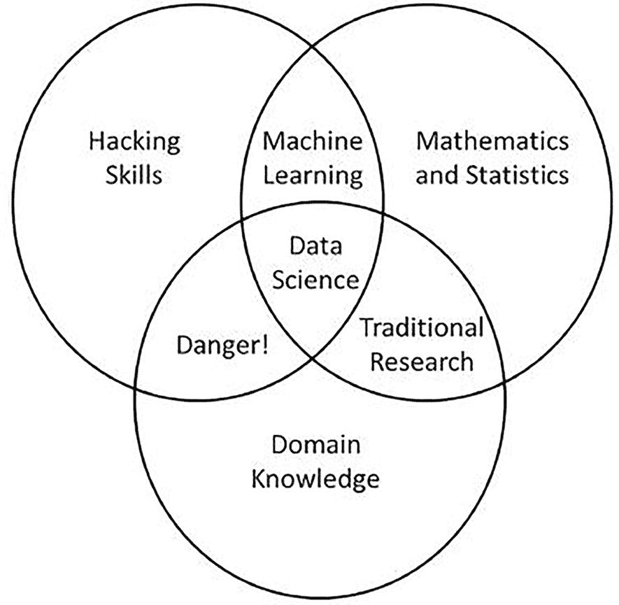
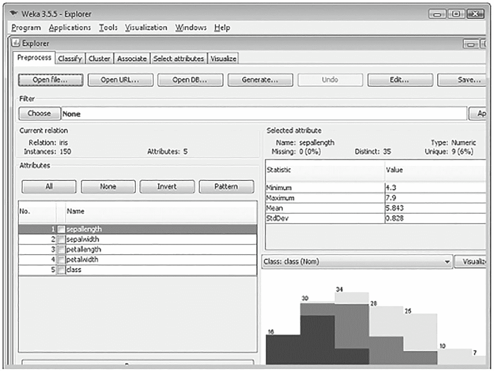

# 11. 雇佣与管理数据科学家

我们已经讨论了为什么你应该雇佣数据科学家，以及它将为你的业务带来的诸多好处。我们还探讨了让他们各司其职而不试图指导他们工作的重要性。但要做到这一点，你需要雇佣一个你信任的人。

在本章中，我们将具体探讨如何雇佣和管理数据科学家以获得最佳效果。首先，让我们试着更好地理解数据科学家。

## 走进数据科学家的内心

一个称职的数据科学家需要具备广博的知识和多样的技能，但某些技能比其他技能更为重要。

如图 11-1 所示，数据科学家需要具备黑客技能、数学与统计学知识以及领域专长。虽然每一项技能单独来看都极具价值，但如果他们只拥有其中两项，那他们就不是数据科学家——而且在某一种特定情况下，这实际上可能导致问题。

黑客技能、数学与统计学以及领域知识相交于数据科学的维恩图。黑客技能与数学和统计学相交于机器学习。数学与统计学和领域知识相交于传统研究。黑客技能与领域知识相交于危险区域。

图 11-1 数据科学维恩图

### 代码黑客技能

好吧，当我提到代码黑客技能时，我不是在说入侵 NASA，而是指数据科学家需要拥有出色的计算机知识和扎实的编程技能。这并不意味着他们需要计算机科学学位，因为有很多优秀的“黑客”一生从未上过任何计算机课程。

然而，数据科学家必须能够以算法的方式思考、理解向量化操作，并在命令行中处理文本文件。没有这些技能，就不可能成为一名数据科学家。大多数情况下，数据科学家产出的代码实际质量不需要达到生产级水平。这就是为什么我们使用“代码黑客”这个术语，而不是“软件工程”，因为后者意味着代码应达到非常高的标准。数据科学家将代码作为解决问题的工具。不过，如果你能找到一位同时拥有出色编码技能的数据科学家，那自然也无妨。

### 数学与统计学知识

一旦利用那些黑客技能将数据整理成型，就该进行分析并提取洞察了。为此，数据科学家需要具备数学和统计学知识，以便应用正确的方法和模型。

同样，数据科学家不需要拥有统计学博士学位也能高效工作，但他们必须知道如何开发和使用数学与统计模型，包括如何解读结果。

### 领域知识

领域知识对数据科学家来说很重要：他们需要理解主题本身，而不仅仅是其技术层面。虽然这不是硬性要求，但缺乏领域知识可能会引发各种问题（我们已经看到过一些例子，后续还会有更多）。领域专业知识使数据科学家能够将其他技能应用到数据上，从而实现预期目标。每当你转向解决一个从未接触过的领域中的问题时，数据科学家都必须自学该领域的特性。

### 仅有两项技能并不足够

只拥有这三项技能/知识中的两项是不够的。一个精通数学和统计学但没有实质专业知识的熟练黑客，可能非常适合机器学习。然而，他们的技能并不能让他们成为数据科学家。

同样，如果有人拥有实质性专业知识并懂数学和统计学，那么他们可能更偏向于传统研究。这种交叉领域基本上构成了学术界的大部分——不过应该注意的是，年轻的研究人员正在选择不断发展并学习更多技术。然而，没有那些黑客技能，他们永远成不了数据科学家。

真正的问题出现在当某人既是熟练的黑客又拥有实质性专业知识时。这会创造出一个危险人物，因为他们知道得足够多，足以做出看似合理的分析，但却完全不清楚自己是如何得出结论的，或者自己到底创造了什么。

从根本上说，这类人具备对某个问题应用分析技能的能力，但缺乏确保自己行为正确的理论基础。因此，他们可能会运行一个统计测试，却做出错误的假设。然而，由于他们相信自己是在基于数据做决策，便会产生一种虚假的自信心，这可能导致严重问题。

所以，请记住，一个称职的数据科学家将是一位熟练的黑客，具备数学和统计学知识，并且在你选择的领域拥有实质性专业知识。

## 数据科学家的动力是什么？

与某人高效合作意味着要了解他们是什么样的人以及他们的动力来源。不幸的是，人们往往难以理解数据科学家，正是因为他们的技能范围如此广泛，以至于无法被整齐地归入某个框框。

数据科学家不仅仅是懂数学和统计学、能像专业人士一样操作电脑的人。他们还要具备出色的沟通和可视化技能，能够与高层管理人员有效沟通，并能生动地讲述故事。他们还对业务充满热情，对数据充满好奇。他们不断渴望学习更多，希望解决问题并产生影响，即便没有通常伴随这一角色的权威。他们是具有战略眼光、积极主动、富有创造力和创新精神的人，喜欢与他人合作。

他们绝对热爱脑力激荡，解决问题就是他们的看家本领。他们天生具有好奇心和成长的驱动力，这意味着他们喜欢学习新事物和获取新技能。

事实上，学习新技能是当今市场不可或缺的组成部分。这就是“红皇后假说”在现实中的体现，其核心观点是：一个有机体必须不断适应、进化和繁衍，仅仅是为了生存。

## 什么会让数据科学家失去工作热情？

如果你让数据科学家做大量重复性的工作，你最终会得到一个极度缺乏工作热情的人。因此，如果他们不得不花费大量时间清理数据或做任何等同于数沙子的工作，那么你将面对一个根本不想待在这里的人。工作成果也会因此受到影响。

同样，如果因为你要他们解决的问题过于简单而让他们感到无聊，你也讨不到任何好处。当然，有时候简单问题也需要解决，但如果你决定迈出这一步并雇佣一位数据科学家，请确保充分利用他们的能力。否则，这就像雇佣一位米其林星级大厨只为给你做一个烤芝士三明治。

危险在于，这位大厨会因为无聊而偏离主题，给你端上一个经过解构和重构、与你想吃的那个简单三明治几乎毫无共同之处的烤芝士三明治。

此外，另一个问题源于沟通不畅。当高层管理人员不理解数据科学家在做什么时，沟通中的摩擦往往就会出现。

一个简单的例子是，数据科学家最终做了大量极其枯燥的数据整理工作，而这仅仅是因为与开发人员就数据应该如何存储的问题沟通不畅。

再回到我们米其林星级大厨的类比，赫斯顿·布卢门撒尔是一位世界知名厨师，他的“招牌”是分子料理。他使用一系列在厨房中并不常见的工具和食材。假设你雇佣他为一场活动提供餐饮服务，他告诉你他需要什么，但因为你不理解他的流程，你只在厨房里备齐了所有常规工具和食材。

当他到达准备烹饪时，他最终不得不制作一顿对他来说完全乏味的传统餐食，结果做出的食物可能还算可以，但远达不到他本应能做出的水准。

## 当数据科学家找工作时

目前，对于初级以上的优秀数据科学家来说，这是一个卖方市场，数据科学家是卖方——你知道的，因为他们出售自己的技能和专业知识。事实是，对技能娴熟人才的需求很高，但供给远不能满足需求。

例如，伦敦的一位普通数据科学家每周会收到一到十份招聘人员的信息或电话。这意味着他们在选择参与什么项目时处于主导地位。

因此，为了提高雇佣到合适人选的几率，你需要了解数据科学家想要什么。

### 数据科学家想要什么？

首要之事当然是薪酬。毕竟，数据科学家也是人——尽管他们的技能组合和稀缺性有时让他们看起来像神话中的神兽——他们不仅需要钱来生活，也希望自己的价值得到适当的回报。

然而，仅仅提供一份令人瞠目的高薪是不够的，因为其他因素也很重要，比如他们将与之合作的团队、将要解决的问题、使用的技术栈，以及与学术界的关系。

#### 团队

一些数据科学家更愿意在团队中与自己喜欢的人共事。这通常意味着更极客、不那么正式的文化，甚至是在家办公。

当然，这不一定适用于每家公司，因为你不可能为了招聘一位数据科学家而在一夜之间彻底改变整个企业文化，但你可以尽量做出让步，以改善工作关系。

#### 问题

虽然我们已经讨论过交给数据科学家过于简单的问题的风险，但你还会发现，许多数据科学家对特定类型的问题有偏好。例如，有些人可能更喜欢处理具有社会影响力的问题，而另一些人则可能专注于像医学这样他们喜欢的领域。

其他时候，他们可能对问题本身有偏好。例如，有些人更喜欢处理文本数据。

不过，你通常会看到，这与做和学习新事物紧密相关，而这正是定义数据科学家的特质。

#### 技术栈

所使用的技术也扮演着重要角色。一些数据科学家会更喜欢使用他们已熟悉的技术栈，而另一些人则想学习新东西。然而，你会发现大多数数据科学家会像避开瘟疫一样避开旧技术和遗留代码。

有时，学习新技术对数据科学家来说极为重要。这可能是因为一些新兴技术正在主导领域，比如`Python`，而他们可能想要从`MATLAB`过渡到`Python`和`R`。

或者，数据科学家可能想扩展自己的技能组合，因为某些技术（比如与深度学习相关的技术）能带来更好的薪酬，也更有趣。

#### 与学术界的关系

许多数据科学家出身于学术界，习惯于阅读/撰写论文和参加学术会议。这对所有人来说都是一个优势，因为参加会议可能是保持他们在领域前沿的重要一环。因此，激励数据科学家的一种方式就是提供会议津贴。

而且，正如我所说，这对你也有好处，因为你的数据科学家会了解到数据科学领域新兴的发展动态，他们会了解到之前未曾涉足的领域或应用，并会与他们领域内的其他人交流。

你可以预期一位博士级别的数据科学家希望参加的一些数据科学会议包括：

- `ICML`：国际机器学习大会
- `NeurIPS`：神经信息处理系统大会
- `SIGKDD`：ACM SIGKDD 国际知识发现与数据挖掘会议
- `ECML PKDD`：欧洲机器学习与数据库知识发现会议
- `AI Stats`

### 避免传统限制

招聘数据科学家时一个常见的问题是，雇主常常采取与招聘企业内其他职位相同的方法。这通常涉及询问对方是否有特定领域的经验。

然而，许多数据科学家（包括我自己）会特意寻找他们以前没有涉足过的领域。这完全是出于学习新事物和避免无聊的动力，因为你没做过的事情肯定比你有经验的事情更有趣。

作为潜在雇主，你需要理解的关键点是，数据科学家所使用的技术具有普遍适用性，而领域本身是次要的。换句话说，不要因为一位优秀的数据科学家没有你特定领域的经验就错过他们。

### 数据科学是一个通用工具箱

数据科学中的技术可以应用于各种问题。在一个方面的经验可以转化为在其他方面的经验。例如，一位数据科学家可能用相同的算法来预测疾病爆发，也可以用它们来预测有多少人会点击广告。

把它想象成一位糕点师。他们学习广泛的技术，包括处理不同类型的面团、制作酱料、制作奶油等等。而且他们在制作蛋糕方面经验丰富。然而，正因为他们对这些技术高度熟练，他们可以轻松地从做蛋糕切换到做馅饼。

例如，我常见到人力资源部门犯的一个错误是：

- “我们在寻找一位有 5 年`TensorFlow`经验的人，”人力资源部说。

- “好吧，但是`TensorFlow`才出现两年，”候选人或招聘公司回答道。

对于数据科学家而言，他们知识的广度通常比单纯的年限更能体现其技能。

问题是许多雇主不了解数据科学家的技能组合——当然，你不是这样，因为你正在读这本书，对数据科学以及数据科学家的职责有了更深入的理解。结果就是，由于缺乏理解，许多数据科学家被局限在了某个特定领域。

我们以一位在金融领域工作的数据科学家为例。在金融领域，数据科学会使用时间序列和预测建模等工具。然而，这些工具并不仅限于金融领域。它们对许多其他领域也同样有效，比如体育博彩甚至零售。例如，在零售业，你可以用时间序列来预测需求。

然而，大量雇主看到这位数据科学家有金融经验，就会自动认为他们的技能只适用于金融领域。这意味着他们可能会错过一位出色的数据科学家。

所以，不要犯同样的错误，给这些人一个机会，即使他们不符合你心中对完美员工的严格定义。

### 发现年轻人才

数据科学有点像体育，天赋在其中扮演着巨大角色，尤其因为它需要技术技能和软技能的结合，正如我们之前讨论过的。这个人需要能够理解他人，能够建立别人看不到的联系，并且能够良好沟通，这超越了技能组合中的技术层面。他们还必须能够顺利地将软技能和技术技能结合起来，这并不总是听起来那么容易。

所以，当你发现有人明显具备从事这项工作的天赋时，一定要牢牢抓住他们，即使他们正处于职业生涯的起步阶段。请记住，今天的一位初级数据科学家，如果你给予机会并用心培养，未来可能成为你的高级数据科学家。

你如何能找到有才华的年轻数据科学家？首先，你想看看那些教授这门学科的顶尖大学。然后，一旦确定了潜在的候选人，就要超越他们的大学成果去寻找。你可以在`GitHub`这样的网站上查看他们做过的课外项目。

你还应该考虑创建一个导师计划。这将让你能够识别有数据科学天赋的人，其中一些人，你可能直到与他们近距离合作后才会意识到他们有这样的潜力。

### 典型的数据科学家两难抉择

对于数据科学家而言，他们在选择为谁工作时会面临一些两难抉择。选项无非是初创公司和大公司。二者各有其优缺点。

首先说说初创公司。对于数据科学家来说，在初创公司工作无疑会更有趣。他们会接触到新技术和新问题，并且拥有更大的灵活性。然而，缺点是薪水可能较低，而且稳定性也是个问题，毕竟许多初创公司最终都以失败告终。

然后是大公司。主要的优势在于薪资会丰厚得多，福利待遇也同样诱人。稳定性也是一个重要因素。一家大公司不太可能一夜之间倒闭，让数据科学家陷入困境。

然而，从另一个极端来看，事实是数据科学家可能会因为工作枯燥乏味、毫无刺激感而抓狂，因为他们需要处理陈旧的技术和遗留代码，并且还得负责清理这些代码。所以，这绝对谈不上有趣，一点都没有。

### 立即冻结你的数据科学家招聘计划

如果你的公司还没为数据科学做好准备，那你就该停止招聘数据科学家的尝试。什么是为数据科学做好准备好了呢？

首先，你需要确保公司已经建立起一种数据驱动的文化。组织中的每个人都需要理解数据的价值，并且愿意有效地使用它。

如果每个人都认为数据是浪费时间，或者觉得你只是因为这是最新的“潮流”才这么做，那么你招聘数据科学家就是在浪费金钱和时间。

不过别担心，稍后我们会讨论如何建立数据科学文化，届时你就会清楚自己需要做什么了。

下一个要考虑的因素是，你是否拥有可用的数据。如果你还没收集好数据，那不妨等数据到位再说。否则，你就是在花钱请一位数据科学家干坐着当摆设。这也会激怒数据科学家，因为正如我提过的，无聊是他们最讨厌的事情之一。而一个无事可做的数据科学家会感到无聊，并且很可能在你一眨眼功夫就离职了。

最后，你需要确保数据科学家的工作能产生实际影响。如果只是雇个人把数据弄得好看点，用来炫耀一下，那就没什么其他用处，那纯粹是浪费资源。你需要确保自己心里有明确的目标——一个需要解答的重要问题——否则你既浪费了自己的时间，也浪费了数据科学家的时间。

当你真正雇佣了一位数据科学家时，不要仅仅把他们当成一个高级的报告工具。他们的价值远不止于此，你需要听取他们的想法，并信任他们的建议。不要犯那种以为自己无所不知的错误。

说到底，你会去教你的电工如何重新布线你的房子吗？或者你会去指导你的外科医生如何给你做手术吗？当然不会。你会让他们做自己的工作，并听取他们的建议，因为他们是专家。那么，对待你的数据科学家，你为什么就要另搞一套呢？

你还需要让他们展翅高飞。如果他们想用全新的方法来解决某个问题，不要太惊讶。仅仅因为这与你的想法不一致，并不意味着它没有效果。事实上，尝试新事物正是找到最有效解决方案的最佳途径。

请记住，一遍又一遍地做同样的事情却期待不同的结果，那简直是疯了。所以，你需要给予你的数据科学家尝试新事物的自由。

为了让你更清楚地明白为什么还没准备好就不该招聘数据科学家，我想起不久前的一家公司招聘数据科学家的例子。然而，那位数据科学家仅仅两个月后就辞职了，而且离职时还很不愉快。

事情是这样的：公司没有任何数据可供这位科学家处理。他们还在收集数据，但他们操之过急了，不知怎地认为在收集信息的同时，需要先有一位数据科学家在座充充门面。

更糟糕的是，他们根本没有明确的目标。他们只是想要“洞察”，这个目标对于任何人都太模糊了，根本无法着手。当然，没有明确的目标，你可以想象数据收集过程也不符合标准。

老实说，我很确定那位数据科学家辞职不仅仅是因为无聊——尽管那也是一个问题。他可能知道自己将要和一群完全不懂他在做什么的人打交道。他得先教育他们，然后强迫他们设定目标，再试图把一堆杂乱无章的数据变成他能处理的东西。这实在太费劲了，根本不值得。

## 数据科学部落

现在我们来看看不同类型的数据科学家。我称他们为“部落”，因为我觉得这个词非常适合描述数据科学领域内不同的群体。你不可能只有一种类型的人，因为成为数据科学家的途径也不止一条。

这不像成为医生那样，唯一的路径就是上医学院、做住院医师、然后获得认证。对于数据科学家来说，有好几种方式可以达到同样的最终目标。

这就是为什么我认为我们基本上可以把数据科学家分为*三个主要部落*和*三个较小的部落*。

就主要部落而言，我们有**计算机科学家**、**统计学家**以及来自其他领域的**定量分析专家**。

较小的部落则包括**自学成才的数据科学家**、**软件平台用户**和**领域专家**。

这里还有一点很重要，那就是数据科学家和数据工程师现在被认为是完全不同的角色，即便在早期这两种角色经常被混淆，也即便数据科学家通常拥有计算机科学背景但同时也具备一些数据工程技能。

### 主要部落

那么，让我们快速了解一下这三个主要部落：计算机科学家、统计学家以及其他定量分析专家。

#### 计算机科学家

计算机科学家是那些拥有计算机科学学位，并随后攻读了机器学习硕士或博士学位的人。他们的优势在于通常具备非常优秀的编码、数据库和软件技能，但问题在于，他们通常会忽视理论上的传统统计技术，而后者在某些特定领域和问题中可能非常有用。

计算机科学家非常擅长处理诸如预测建模这类机器学习任务中的问题。他们通常有参加`Kaggle`竞赛的经验，而`Kaggle`正是这类问题的典型代表。

请注意，`Kaggle`是一个举办预测建模和分析竞赛的平台。⁷⁸ 公司和用户上传数据集，然后统计学家、数据科学家和/或其他专家竞相创建最佳模型来预测和描述这些数据集。这是一种众包形式，依赖于这样一种理念：在预测建模任务中可以运用无数种策略，并且无法事先知道哪位分析师或哪种方法会是最好的。`Kaggle`现在是`Google Cloud`的一部分。⁷⁹

给你一个数据集，你只需找到一个好的算法来预测某些东西。大多数计算机科学家拥有扎实的编码技能，这意味着将他们的工作与平台的其他部分集成起来更容易，特别是如果你是一家小公司或初创企业的话。他们中的大多数会使用`Python`，并且能毫无困难地编写自己的`API`。所以，本质上，你可以利用他们的技能同时完成许多事情，因为他们既能编写代码，也能进行集成。

此外，他们拥有扎实的数据库技能，因此可以完成大量的数据工程工作。即使你拥有自己的数据工程师，这也仍然很有价值，因为这些人可以轻松地检索数据、将其整理成可用的格式等等。这将为你节省开发人员的时间。他们或许还能就数据库的结构提出建议，让你的工作更加轻松。

然而，他们缺乏适当的统计学知识，因此对于某些适合使用统计学的特定问题，比如研究设计，这些人无法真正提供帮助。

#### 统计学家

统计学家是通常拥有统计学学位的人。他们甚至可能拥有统计学或机器学习的硕士或博士学位。他们通常在该领域拥有良好的理论基础，但缺乏编码或数据库技能。

统计学家拥有非常扎实的统计学和理论知识。如果你感兴趣的是研究设计或统计建模，因为你想了解某个事物背后的驱动因素，那么他们是最佳人选。

如果你想对复杂问题建模，同时确保建模过程透明，并且你能理解正在发生的事情，他们也是最佳选择。

由于在数学和理论方面受过严格训练，他们也非常善于批判性地审视其他数据科学家的工作。

然而，问题在于，大多数时候，他们的编码和数据库技能并不出色。他们最可能使用的语言是`R`，并将其作为一种工具。他们可能没有其他语言或数据库方面的经验，这将使他们的工作与系统集成变得更为困难和耗时。

此外，一些统计学家在预测建模方面训练不足。就其本身而言，预测建模在统计学背景下很少被视为重要内容，而更偏向于机器学习。

因此，要检查他们是否有 Kaggle 经验。如果你有兴趣利用他们的技能进行预测建模，确保他们熟悉某种机器学习概念（例如交叉验证）也是值得的。

## 其他定量专家

最后，我们有我称之为的其他定量专家。这些人来自数学密集型学科，如物理学、数学、精算学、计量经济学等。这些人可能拥有硕士或博士学位，但并非机器学习和统计学方向。

这些人基本上都是发现数据科学领域比他们自己的研究领域有更多（且更好）的工作机会，并试图转行的人。他们试图利用自己的数学和/或编码知识来实现这一目标。在这个群体中，你会看到技能和知识方面的巨大差异。

这些定量专家有点特殊，因为他们通常拥有一些扎实的技能，并带来了多样化的思维方式，这在数据科学中非常重要。此外，如果你正在处理的问题属于他们的特定领域，那么雇佣他们绝对是非常棒的选择。

然而，问题在于他们往往缺乏机器学习或统计学的严格训练，这在某些情况下可能会引发严重问题。

因此，对于其他定量专家，这往往是主观的，因为因人而异。但主要的缺点是，这些人通常缺乏该领域的正规教育。

他们往往是自学成才，你需要理解这一事实，并检查他们的实际效果如何。例如，你很可能在 GitHub 或 Kaggle 上找到他们工作的例子。而且你确实应该事先检查一下。请注意，自学成才并非坏事——绝无此意。但是，你需要检查以确保他们的技能符合你的需求。

这些人通常是学习了一个领域，却发现薪水并不理想，或者找工作几乎不可能。然后他们发现数据科学家的薪水很高，所以，例如，一位化学家可能会决定创建几个小项目，上传到 GitHub，或者参加几次 Kaggle 上的竞赛，试图找到一份数据科学家的工作。

根据我的经验，在这些人的所有专长中，我发现最有效的是物理学家。物理学充满了应用数学，这使得他们很容易阅读机器学习论文，特别是因为这本质上是同一类型的数学。此外，物理学家需要能够自己做一些编码工作，因此其技能组合与机器学习所需的技能相似。

需要注意到的一个重要点是，领域专家将拥有其各自领域的专业知识，这可能会对你很有帮助。例如，你可能想雇佣一位在计量经济学方面有经验并且有一点机器学习知识的人，因为你的问题在某种程度上与计量经济学相关。或者，你可能想聘用一位物理学家，因为你正在处理传感器数据或雷达数据。

然而，你必须对这些其他定量专家保持警惕，因为有些人会试图伪装。他们可能会花两周时间学几个教程和在线课程，然后突然就认为自己已经是数据科学家了。这仅仅是因为他们想得到这份工作。你必须非常警惕这些人，因为他们可能会毁掉你的整个项目，并导致很多问题。

这并不意味着你不应该考虑那些经验不足但为人诚实，并证明自己聪明且愿意学习的人。他们希望获得更多经验，是有潜力成为杰出数据科学家的聪明人。

然而，在我看来，最好让这些人担任初级职位，并有一名更有经验的人来监督他们。当然，监督他们的人应该是一名高级数据科学家。如果你没有高级数据科学家，请先雇佣一位。然后，你可以作为初级人员跟踪他们的进展，看看他们如何成长。根据他们的发展情况，你可以选择是否提拔他们。

## 交汇点

值得注意的是，大约五到六年的经验之后，所有群体通常会到达一个交汇点。换句话说，当一个人积累了多年经验，参与过相当多的项目（大约 10 到 30 个），并且在不同领域的多家公司工作过，他们通常已经掌握了广泛的技能。如果他们还拥有博士学位，那只是锦上添花。

因此，他们既用`R`也用过`Python`编写代码，并且他们这里学一点，那里学一点，基本上各方面都懂一些。他们对业界的现状也有很好的认识。这意味着他们了解所有可用的方法和技术，即使自己不知道如何实现。

这一点很重要，因为他们知道一个问题应该如何解决。即使他们不知道如何自己动手，他们也知道该找谁谈、该雇佣谁来完成任务。有时，拥有技能本身并不重要，重要的是意识到自己的局限，并了解有哪些解决方案，以及如何找到能实施这些方案的人。

所以，如果你看到有人最初是物理学家，但在数据科学领域工作了十年，并且为众多不同领域的公司工作过，那么这种人很可能就属于这一类。

因此，当你找到一个经验丰富的人时，不必过分担心他们的背景。更重要的是他们多年来学到了什么，以及他们是否真正拥有技能，并了解所有可用的技术和方法。

你需要小心的是那种虽然经验丰富，但年复一年都在做同一两个项目的人。这些人并不是我指的类型。我指的是那些多年来积极尝试学习新事物的人，比如获取`R`、`Python`的经验，或许还有一些研究设计方面的知识，等等。

### 较小的群体

那么，现在我们来看看较小的群体。我说较小的群体，是指这些群体中的人数不如大群体那么多。此外，这些人往往不完全是数据科学家，而主要是具备一些分析能力的人。

因此，我们有`自学成才`这一类人。他们通常是学过某些随机专业的人，或者甚至是软件开发出身。他们可能参加过几次 Kaggle 竞赛，而这差不多就是他们经验的全部了。

虽然来自大群体的量化专家在某些方面也可能自学成才，但他们的学科背景已经教会了他们一些可以迁移到数据科学领域的技能。

在此特定情形下，我指的是学人文学科的人，例如。一位艺术史学家突然发现自己的领域没有太多职业机会，或者一位考古学家发现挖土并不像他们期望的那样有趣或经济回报丰厚，然后突然决定成为一名数据科学家。

然后是`软件平台用户`，这种人只知道如何使用某个特定工具，比如仪表盘或`Weka`（见图 11-2）或`RapidMiner`这类软件。如果你的问题很简单，这些人能提供很高的性价比。例如，如果你只需要做一些报告，那么这些人是最佳选择，因为他们肯定更便宜。

Weka 3.5.5 资源管理器界面截图，其选项卡包括预处理、分类、聚类、关联、选择属性和可视化。下方是编号和名称的表格，以及带有统计数据和值的选定属性，以及一个分类直方图。

图 11-2  Weka 资源管理器图形用户界面

与雇佣一个拥有深度学习博士学位的专家相比，他们对你分配的工作也会满意得多。否则，就像聘请一位主厨去煎两个鸡蛋，而一个普通厨师就能做得同样好，还不会因工作而感到厌烦。

然而，这种人无法帮助你解决更复杂的问题，因为他们可能恰好陷入了我们之前讨论过的危险区域，即本章开头维恩图所示的情况。换句话说，他们缺乏扎实的数学和统计学基础，所以能够将工具应用于某些场景，但你不是那些可以信任他们来构建模型或预测工具的人。

最后但同样重要的是`领域专家`。这类人对机器学习有非常深入的了解，但仅限于一个非常小的细分领域。最常见的例子之一就是专门从事深度学习和计算机视觉的人。这些人本科阶段学习的就是计算机视觉，或者拥有计算机视觉的硕士或博士学位。

现在，如果你的问题是计算机视觉相关的，那么他们绝对是你要雇佣的人，因为他们会非常出色。但如果你有不同的问题，他们就不一定是最佳人选。显然，如果他们是在高级水平上从事机器学习或统计学，那么学习新技能对他们来说并不难。然而，他们可能需要几个月的时间才能掌握解决不同类型问题所需的知识。