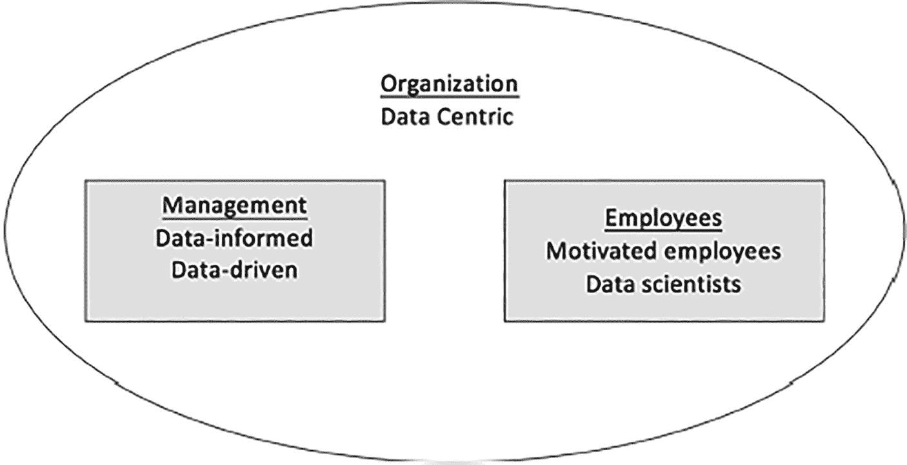

# 构建数据科学文化

因此，正如我之前承诺的，我们现在将探讨数据科学文化。我们将了解数据科学文化是什么样的，以及你需要在公司中做些什么来开始构建这种文化。

## 数据科学文化概述

首先，让我们看看拥有数据科学文化意味着什么。

### 理解数据科学文化的内涵

在进入实际主题之前，我想先谈谈电影《点球成金》（*Moneyball*）。如果你还没看过这部电影，我强烈建议你去看，因为它与当前的情况密切相关。换句话说，这部电影讲述的就是在组织内构建以数据为中心的文化。

这部电影基于同名书籍\[^([83])(#fn83)\]，主要描述了比利·比恩在奥克兰运动家队的工作。这支棒球队在当时是美国棒球锦标赛中表现最差的球队之一。然而，多亏了比利·比恩的努力，这支球队基本上从垫底位置一跃成为最佳球队之一，甚至成为了有力的竞争者。

比恩通过使用分析和统计方法做到了这一点。本质上，他分析了球员，尽管他们个人的表现很差，但他看到他们组合在一起会成为一支伟大的团队。于是，他签下了他们，由于他们个人表现不佳，其他球队认为他们是失败者，并且他们很便宜就能得到。所以，他基本上是用有限的预算组建了一支非常出色的团队。

整部电影中，你会看到布拉德·皮特（扮演比利·比恩）因俱乐部老将们传统的思维方式而遇到的阻力。他们就是不愿意接受他试图实施的新方法。当然，他最终证明他们是错的。

这是一部非常有趣的电影，但我不再继续讨论了。如果你对这个话题感兴趣，你绝对应该去看，我假设你感兴趣，因为你正在读这本书。

现在，让我们来分析数据科学文化的重要性。

### 数据科学文化的三个层级

数据科学文化应该从三个层级来分析，即管理层级、员工层级和组织层级（图 12-1）。

图表包含两个矩形，分别标记为管理层（包含“数据知情”和“数据驱动”）和员工层（包含“积极主动的员工”和“数据科学家”）。它们位于一个椭圆形状内，标记为组织（“以数据为中心”）。

**图 12-1** 一个以数据为中心的组织，包含了数据驱动的管理层、对数据友好的员工队伍以及数据科学家

#### 管理层级

在管理层级，关键在于保持理性，而不是像《点球成金》里那样凭直觉或采用传统方法。在这个层级，在数据科学文化中，直觉的唯一作用就是帮助消化食物（这是它们原本的功能）。

这也关乎“数据知情”和“数据驱动”。我们稍后会更仔细地探讨这些术语。

#### 员工层级

在员工层级，这关乎我们之前讨论过的内容，即招聘数据科学家并管理他们。这关乎找到合适的人，并为他们创造一个友好的环境。这也关乎确保那些需要与数据科学家互动的员工（如软件开发人员、产品经理等）具备数据意识，并相信数据科学的价值。

#### 组织层级

在组织层级，拥有正确的文化意味着将管理层级和员工层级中的正确要素结合起来。其结果是一个**以数据为中心**的组织。这将使你能够最大化数据科学的影响力，从数据收集阶段到研究和应用阶段。那时，你就会开始在你的组织中看到实实在在的成果。

---

另外，你还需要小心，因为如果这些领域专家落入危险区域，他们可能会造成比你意识到的更多的问题。现在真的是时候记住那句老话了：如果你手里只有一把锤子，那么所有东西看起来都像钉子。例如，一个毕生从事深度学习研究的专家可能会认为他可以用深度学习解决所有问题，这并不准确。这就是你需要小心的原因。毕竟，有时候你只需要一个苍蝇拍来赶走那只烦人的嗡嗡叫的苍蝇。

然而，正如我之前提到的，你应该考虑对那些了解自身局限性、渴望超越常规领域并尝试新事物的人更加开放。这些人知道他们需要花几个月时间来学习新领域的细节，但他们非常愿意投入工作。有时，走这条路会有多种回报，因为在这个过程中你还会赢得他们的忠诚——毕竟，没有多少雇主能像你这样开明并愿意给他们机会。

## 示例：如何评估数据科学家？

你更愿意雇佣谁来做你的数据科学家？

1.  一位从排名前十的大学毕业、拥有机器学习硕士学位的应聘者？
2.  一位自学数据科学的开发者？
3.  一位拥有统计学学位和十多年经验的应聘者？

事实是，没有正确答案。工作表现可能取决于多种因素。在谷歌学术上快速搜索一下，会返回海量的结果。例如，搜索词“智商与工作表现”返回了超过 20 万项研究，其中大多数引用的智商与工作表现之间的相关性约为 0.5，这是显著的。搜索词“工作经验年限与工作表现”返回了超过 400 万个结果，而“工作表现预测因素”则返回了超过 100 万个结果，论文中引用的因素从情商到个性都有。

事实是，每种情况都不同。在数据科学和技术领域，很容易找到那些拥有显赫资历却无法胜任工作的员工。文化契合度、个性因素以及个人环境都会影响员工的表现。

然而，为了确保员工能发挥最佳表现，你可以做的是创造合适的环境。这就是为什么在附录中，你会找到一些工具，它们可以帮助你构建数据科学项目，以便你能够定义清晰的结果，并了解要完成这个项目需要具备哪些技能的人来帮助你。

作为经验法则，当你招聘的项目没有严格的时间限制时，认知能力、智商和驱动力可能是最重要的因素。^(⁸²) 例如，如果你有一个成熟的数据科学团队，可以培养拥有正确驱动力的人，那么你或许能以较低的薪水雇佣到一个人，他将与你的数据科学团队一起成长。

另一方面，当你面临时间限制时，最好的方法是雇佣经验丰富、资历深厚的人。如果你面临的挑战定义得非常明确，那么雇佣一位过去解决过这个确切问题的人可能是个好主意。

脚注 1 2 3 4 5 6 7 8 9 10

