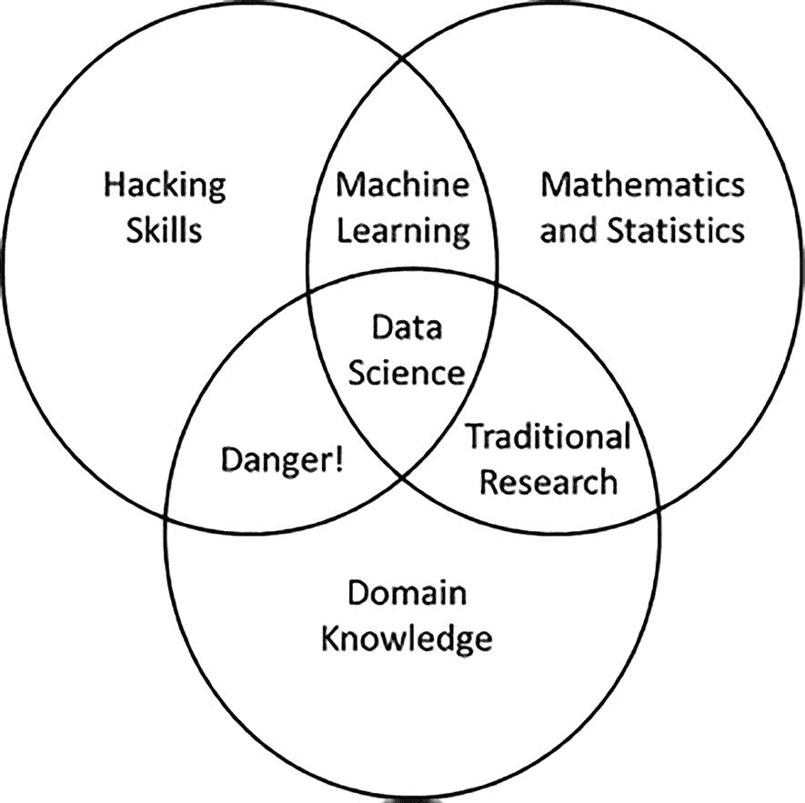

# 数据知情与数据驱动

首先，我们来探讨一下**数据知情**与**数据驱动**之间的区别。当我们说一个组织或个人是数据知情的，意味着他们确实将数据及其背景作为输入，融入到讨论和决策过程中。

例如，如果你使用仪表盘和关键绩效指标（KPI）这类工具，那么你就是数据知情的。如今，成为数据知情非常容易。你可以使用`Excel`或其他简单工具，制作一些简易图表来了解组织内部情况，这并不困难。

而数据驱动则意味着更上一层楼。它指的是你开始运用更智能的算法和方法来获取数据。然后，你通过使用算法为你做决策，或者将算法的输出纳入考量，来转变决策过程。

那么，与此相反的做法是什么呢？与数据知情或数据驱动相对的，就是凭直觉做决策。或者凭传统经验，这在准确性或有效性方面也好不了多少。

我们再来看几个例子。

当你是**数据知情**时，你可能会使用仪表盘或`Excel`来收集来自多个来源的数据。当然，正如我们之前在第 2 章中讨论过的，你已经适当地组织了数据，并且确保记录了整个过程以避免任何问题。这些数据是可访问的，你所有的员工都知道它，并且了解在哪里可以找到数据以及如何使用它。

而**数据驱动**则意味着将事情*向前推进一步*。这是大多数公司未来应该努力达到的状态。当你达到这个阶段，意味着你允许数据和数据科学帮助你做出潜在的颠覆性决策。在某些情况下，它们甚至可能完全取代人类的决策。

所以，例如，如果你使用算法进行交易，那么你就是数据驱动的。如果你的应用或网站使用了推荐系统，那么你也是数据驱动的。

显然，数据驱动并不意味着每一个决策都需要由算法来做，但它确实意味着你在组织的某些部分以及决策过程中，会使用算法输出。

那么，为什么你要这样做呢？数据驱动能提高效率，并且确实可以改善决策。例如，在预测客户可能想要什么方面，推荐系统可以比人类做出更好的决策。此外，如果你希望进行大规模销售，在达到某个临界点后，你就需要有一种算法，在推荐商品或策展内容时，能够真正替代人工。这只是一个例子，但在不同行业还有很多其他例子。

**警告！**

埃里克·彼得森引用了埃森哲首席科学家基肖尔·斯瓦米纳坦关于“高层管理者需要了解的关于分析学”的讨论。^(⁸⁴)

> `数据`是一把双刃剑。如果使用得当，它能带来合理且充分知情的决策。如果使用不当，同样的数据不仅会导致糟糕的决策，还会导致那些在高度自信下做出的糟糕决策，这反过来又可能引发错误且代价高昂的行动。

换句话说，如果你正确使用数据和数据科学，你会看到效率提升和利润空间改善。然而，如果你没有以正确的方式使用数据，那么很容易就会落入图 12-2（上一章已出现过）所示的危险区。

一个维恩图，展示了黑客技能、数学与统计学、以及领域知识在数据科学处交汇。黑客技能与数学和统计学在机器学习处交汇。数学与统计学和领域知识在传统研究处交汇。黑客技能与领域知识在危险区处交汇。

**图 12-2** 数据科学家维恩图

问题在于，你最终处于一种状态：你在决策过程中使用了数据，但由于你没有正确的理论，或者没有进行正确的测试，导致决策是错误的。然而，你仍然信心满满，因为你认为自己采用了科学方法。

降低这种风险的最简单方法是，聘请覆盖图中数学和统计学圆圈的数据科学家，他们会使用正确的理论和流程来进行数据科学工作。当然，你还需要建立正确的文化，以便数据科学家能与其他部门互动，并且每个人都能相互审视彼此的工作。

## 为数据科学家营造友好环境

在员工层面，你需要为数据科学家营造一个友好的环境。我们在上一章关于招聘数据科学家的内容中已经讨论了很多这方面。本质上，你需要记住，数据科学家追求的不只是金钱回报。他们还希望有合适的文化，希望获得智力上的刺激，希望感受到自己在进步、在学习新事物，以及自己的工作能产生影响。

同时，要记住数据科学家通常性格内向。让每个人都能与他们喜欢的人组成团队，并在正确的文化中工作，这对所有员工都很重要，但对这类人来说，这可能比普通人更为关键。

牢记这一切是拥有快乐员工的关键，而这将转化为更高的生产力。

## 在组织层面以数据为中心

当一个组织以数据科学为核心时，它就是**以数据为中心**的，这包含几层不同的意思。

首先，这意味着你对数据和数据科学领域的状况拥有 360 度的全局视角。数据科学是一个独立的部门，这意味着数据科学家拥有更多的自由和许可去探索新事物，即使这些事物可能具有颠覆性。他们承担了更多责任，这能给予他们更强的激励，但也带来了更大的风险。

然而，正因为你拥有这种 360 度的全局视角，你可以化解这种风险。在所有重要部门之间，特别是在开发人员与数据科学家之间，以及数据科学家与管理层之间，建立了恰当的沟通和汇报渠道。

这很重要，因为你需要确保数据科学家的工作能产生影响，并且你也需要清楚地了解正在收集哪些数据、这些数据如何被使用、以及它们是如何被实施的——这些信息非常容易被忽略。

为了澄清这一点，当我们谈论数据收集时，决策者需要注意两个重大问题。

一个是法律问题，由于欧盟和英国的《通用数据保护条例》，这在当今变得非常重要。涉及数据隐私的问题多种多样，对于不了解数据如何被使用和收集，真的没有任何借口可言。

其次，重要的是要了解数据科学家在研究什么，并确保研究成果能以积极的方式在组织内实施和使用。因此，建立有效的沟通渠道就变得至关重要。一个部门可以审查另一个部门的工作，以确保所做的事情与组织相关。

让我们来看几个可能出错的例子。

#### 示例 1：当数据并非核心时

我们先来看一个案例，了解当数据科学不处于核心位置时会发生什么。这种情况往往发生在试图削减成本、资金短缺的中小型企业中。

当一家公司想做数据科学，却又不想招聘新人时，他们可能会让内部员工去做数据科学。他们可能会雇佣一个开发人员来做机器学习，但也仅此而已。

如果有人能监管这个软件开发人员，这倒不失为一个主意。否则，有人可能会直接运行一个从代码库获取的模型，却不知道如何正确地测试这个模型。例如，他们可能会使用交叉验证。模型上线后，最终结果却惨不忍睹，因为你已经身处危险区域。换句话说，你用了这样一个人：他具备黑客技能和领域知识，但却缺乏支撑这些工作的理论知识。

因此，你会做出一些自己非常有信心的决策，但这些决策实际上是错误的。从技术上讲，对自己的错误充满信心，比仅仅犯错更糟糕。

#### 示例 2：项目无法落地

另一个常见例子主要出现在存在人员问题或沟通问题的大型组织中：你招聘了数据科学家，但他们的工作成果却无法落地。

虽然无法落地的原因多种多样，让我们来看看其中一种情况：数据科学家不熟悉所在领域。你雇佣了一个看起来履历非常优秀的人。你也非常相信数据科学，并给予他们充分的自由和资源去做想做的事。

问题在于，这种情况下很容易形成“信息孤岛”，尤其是当数据科学家与其它部门沟通时，某种程度上像是在说另一门语言。一个常见的错误是，数据科学家花了数月时间研发某个项目，却因为不熟悉业务领域而无法实施。他们没有意识到，由于实际工作条件的约束或缺乏商业角度的相关性，他们创造的东西根本无法落地。

这种情况在刚毕业的博士中非常常见，他们仍然处于那种非常学术化的思维模式中，倾向于做复杂花哨的东西，而不是做那些能产生影响的简单事情。

因此，建立正确的数据科学文化，不仅仅是基于数据做决策，更是要将创造力转化为成果。这意味着既要给予数据科学家自由和资源，又要确保有适当的检查机制，以保障其工作具有相关性，并且能够且将会被实施。

#### 示例 3：沟通不畅

另一个可能导致问题发生的例子是沟通不畅，这相当常见。

假设没有人在软件开发人员和数据科学家之间负责沟通协调。尽管他们同为技术人员，但大部分时间他们讲的是不同的语言。结果就形成了“信息孤岛”，这些孤岛随后又难以打破。而信息孤岛会导致不良实践并延长开发周期。

首先，问题在于沟通风格的差异。例如，与开发人员相比，数据科学家是否更喜欢大量使用数学和不同的表达方式？此外，对彼此工作方式缺乏了解也是一个问题。

开发人员喜欢文档齐全，也喜欢进行测试。另一方面，数据科学家可能有不同的方法。他们甚至可能使用不同的编程语言，这也可能成为问题。

在这种情况下，一种解决方案是尝试让人们成对工作。另一种选择是雇佣有机器学习经验的人，他们可以弥补数据科学家和开发人员之间沟通不畅的问题。

或者，你也可以反其道而行之，雇佣一位拥有软件开发经验的数据科学家。

还有人提议，尝试在所有部门强制执行特定的软件开发方法。

问题在于，这些方法并不总是有效，主要是因为数据科学与软件开发有些不同，有时你可能会陷入尴尬的境地。所以，主要区别在于，数据科学的进展通常不像软件开发那样是渐进式的。它更像是“要么全有，要么全无”。

你可能花几周时间做研究，然后突然就得到了结果。相反，在软件开发中，你可能每天都会增加一个新功能。

因此，即便每天召开站会让大家分享工作进展并不是个坏主意，但也不要全盘照收所有关于软件方法的建议。当然，你可以借鉴这些思路，但要根据自己的具体情况进行调整。

## 《点球成金》：一个关于数据科学文化的故事

体育界曾经与科技和统计的世界非常脱节。大多数体育专业人士可能会觉得讨论数据库或机器学习算法相当无聊。体育是一个完全不同的世界，而比利·比恩的方法在棒球界看来格格不入。

比利·比恩洞察到，当时比赛中使用的大多数指标都已经过时了。球员是由那些曾担任教练或球员的球探挑选的。比利·比恩发现，像上垒率这样的统计数据比传统上使用的其他统计数据能更好地预测成功。

通过这种方式，奥克兰运动家队能够创造出与过去完全不同的价值评估，并以大约 4400 万美元的预算与那些花费近三倍资金的球队竞争。这种方法被称为“赛伯计量学”。该术语源于缩写 SABR，代表美国棒球研究学会。

遗憾的是，奥克兰运动家队最终未能赢得冠军（尽管他们非常接近胜利），并且一旦其他俱乐部开始效仿他们的方法，他们就失去了优势。

自那以后，体育界被数据科学所渗透，设备和算法主导了比赛的许多方面。体育分析会议定期举行，其中最大型的在麻省理工学院斯隆管理学院举办（`www.sloansportsconference.com`）。

我也做过体育分析方面的研究，涉及预测运动损伤和比赛结果（例如哪支队伍会赢）。你可以在我的博客 `http://thedatascientist.com` 上了解更多。

## 建立数据科学文化的步骤

让我们看看建立一种有利于数据科学的文化所需的步骤。

### 首先，你为什么需要数据科学？

首先，你需要问问自己为什么需要数据科学。企业中通常有三种常见情况：

1. 数据科学是你业务的核心组成部分：也许你是一家人工智能或机器人公司，或者你以某种方式处于深度科技领域。在这种情况下，你通常必须自己掌握相关知识。

2. 你经营一家公司并希望提高效率，例如，你可能想要优化运营。

3. 你想提高销售额，那么你可能想要构建推荐系统来改善面向消费者的产品/服务。

你不太可能属于第一种情况，否则你就不会读这本书了。所以，你很可能处于第二或第三种情况，当然，这两种情况也可以结合。

此时，你需要问问自己为什么需要数据科学，这样才能明确下一步的方向。现在，让我们来看看变革的阻力。

