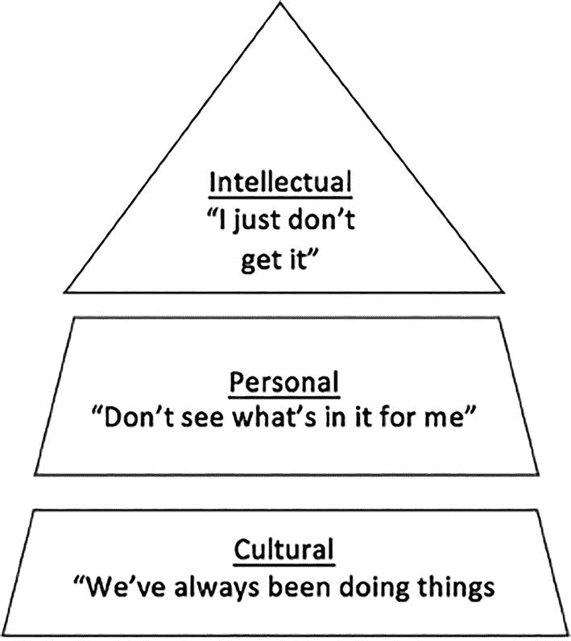

# 变革的阻力

如果你是一家初创公司，那么你很可能灵活性较强，因此变革的阻力不会成为问题。然而，如果你身处大型组织，下面这些内容就会非常相关。

变革的三种阻力类型是：文化阻力、个人阻力和智力阻力（图 12-3）。

图表顶部有一个三角形，标注为“智力阻力”，并附有引述“我就是搞不懂”。其下方是两个梯形，分别标注为“个人阻力”，引述“看不到对我有什么好处”，以及“文化阻力”，引述“我们一直都是这么做的”。

**图 12-3** 变革的阻力类型

## 文化阻力

文化阻力在《点球成金》中有所体现。我们面对的是一个庞大而古老的组织，或是多层级的管理层，或是那些与数学、统计学或数据关联甚少的领域。体育与金融的对比就是一个很好的例子。

正如《点球成金》所示，体育界仍在努力深入分析领域，但尚未真正实现。即使在《点球成金》事件发生的年代，比利·比恩试图在奥克兰运动家队推行的那些做法，在通常处于数据分析前沿的金融领域，也算不上什么特别之处。

## 个人阻力

个人阻力在较小的公司中也会出现，指的是员工不喜欢这种变革。

举一个我亲身经历的例子：我曾与一位客户合作，等待了两个月才有人给我指派一位数据库专家。然后，我不得不给主管打电话，又等了一个月。

可能发生的情况是，员工们已经超负荷工作，结果又被分配了更多任务。因此，员工们根本看不到做任何事——比如导出数据库或尝试实施某个算法——能带来什么好处。

## 智力阻力

最后，还有一种情况是人们对他们不理解的事物感到恐惧。想想电影《终结者》中的“天网”，就像人们害怕机器会接管世界一样。

在组织中，智力阻力并不常见，因为大多数人都明白数据是有用的，它可以提高效率和销售额。然而，如果智力阻力的迹象哪怕只露出一丝端倪，那么聘请一位优秀的数据主管就是一个好的开始。这个人能够掌控数据，向人们展示数据，并展示数据如何能够改善公司内部的几乎一切事物。

