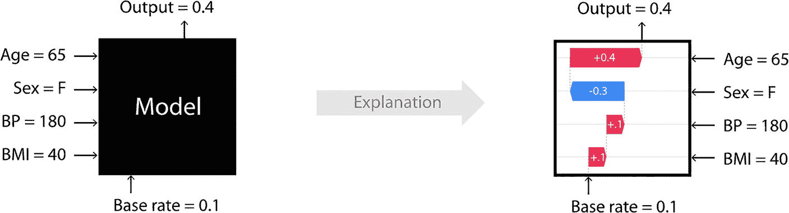

# 13. 人工智能伦理

人工智能（AI）技术的快速发展带来了诸多益处和便利，影响着从医疗保健到金融的各个领域。然而，这一技术演进也引发了重大的伦理问题，必须加以解决，以确保这些进步能够造福社会。

人工智能伦理已从理论概念演变为技术治理的关键组成部分。最初，AI 中的伦理考量主要是学术讨论。但随着 AI 技术日益融入日常生活，制定伦理指南和标准的实际需求变得显而易见。这一演进标志着关注点从"AI 能做什么"转向"AI 应该做什么"，使技术进步与人类价值观和社会规范保持一致。

以下是指导 AI 伦理的关键概念。

1.  **AI 中的偏见**：偏见是指对某事物、某个人或某个群体相比其他事物、人或群体表现出的倾向或偏好，通常被认为是不公平的。在 AI 中，偏见可能源于有偏差的数据、有缺陷的算法，或 AI 开发过程中人类决策的主观性。
2.  **AI 中的公平性**：AI 中的公平性旨在确保所有个体，无论其背景如何，都能获得公平的待遇和结果。它力求避免对特定群体的歧视，并旨在让算法基于相关标准而非带有偏见的假设做出决策。
3.  **AI 中的透明度**：透明度涉及 AI 系统运行的公开性和清晰度。这意味着 AI 算法的工作方式应对用户和利益相关者可理解、可解释，从而培养信任感和可靠性。
4.  **AI 中的问责制**：问责制是关于确定谁对 AI 系统做出的决策负责。它要求 AI 开发者和用户必须对 AI 技术产生的结果负责，特别是当这些结果对社会产生重大影响时。

## AI 中的偏见

AI 系统中的偏见是最重大的伦理问题，源于技术本身固有的局限性和预设倾向。所有其他问题在很大程度上都与之相关。

偏见可能来自多个来源，每个来源都导致有偏差的结果和歧视性做法。

1.  **有偏差的训练数据**：AI 系统根据其训练数据进行学习和决策。如果这些数据不能代表人口的多元化构成，AI 就会形成有偏差的理解。例如，主要基于白种人面部数据集训练的面部识别技术，在识别其他种族人群时被发现错误率更高。训练数据中的这种偏差会无意中延续并放大已有的社会偏见。
2.  **算法偏见**：算法本身可能因其设计方式及其设定的目标而存在偏见。一个算法可能被有意或无意地编程，偏向某些结果而非其他结果。例如，用于贷款审批的 AI 可能优先考虑来自特定邮政编码地区的申请人，从而无意中使那些来自欠富裕地区的人处于不利地位。
3.  **AI 开发中的主观性**：编程和设计 AI 系统的个体带有自身的偏见和观点，这会影响 AI 算法的开发方式。这种主观性可能导致 AI 系统反映出其创造者有意识或无意识的偏见，从而使这些偏见在技术的决策过程中根深蒂固。

AI 偏见的后果包括：

1.  **歧视**：AI 偏见可能导致对特定群体产生歧视性结果。例如，用于贷款审批的 AI 系统可能会不成比例地拒绝有色人种的贷款申请，反映并强化了已有的社会偏见。
2.  **社会不平等**：AI 偏见可能加剧社会不平等。例如，在教育环境中使用 AI，识别进入高级课程学生的系统可能偏向白人学生而非有色人种学生，从而使教育差距长期存在。
3.  **信任缺失**：当 AI 系统被认为存在偏见时，可能导致公众对这些技术失去信任。这种怀疑态度会阻碍 AI 在各个领域的采纳和有效利用。

为减轻 AI 偏见，可以采取以下措施：

1.  **使用无偏见数据**：使用尽可能无偏见的数据至关重要。这可能涉及收集新的、更具代表性的数据，或应用方法来消除现有数据集中的偏差。
2.  **开发公平算法**：创建公平且不歧视的算法至关重要。这可能包括实施有公平意识的机器学习技术，有意识地避免产生偏见。
3.  **组建多元化团队**：AI 开发中的多元化团队有助于确保考虑多种视角，减少产生偏见结果的可能性。
4.  **审计 AI 系统**：定期审计 AI 系统是否存在偏见有助于识别和纠正任何问题，确保系统随着时间的推移尽可能保持无偏见和公平。

### AI 中的公平性

AI 中的公平性意味着 AI 系统不应基于无关或歧视性因素偏袒某一群体而忽视另一群体。这涵盖了多个维度，如种族、性别、年龄或社会经济地位。公平的 AI 系统旨在保持公正，基于客观且相关的标准做出决策，而非基于其算法或数据中嵌入的偏见。

实现 AI 中的公平性是一项复杂的任务，主要因为"公平"在不同语境下的定义具有主观性。例如，在医疗保健领域，公平可能意味着所有患者平等地获得诊断工具；而在金融领域，则可能意味着无论申请人背景如何，都能获得平等的贷款机会。另一个挑战是用于训练 AI 系统的数据集中固有的偏见。这些数据集通常反映了历史或社会偏见，可能导致 AI 系统延续甚至放大这些偏见。

AI 公平性中有三个关键原则：

1.  **个体公平性**：该原则强调公正地对待个体，避免基于其受保护特征（如种族、性别或社会经济地位）而做出不公平地使特定个体处于不利地位或享有特权的决策。
2.  **群体公平性**：该原则侧重于为整个群体确保公平的结果。它力求避免做出系统地偏袒或不利于特定群体的决策，从而导致机会、获取途径或资源方面的差异。
3.  **反事实公平性**：该原则考虑 AI 决策对个体生活的影响，将其实际结果与 AI 未介入的假设情景进行比较。它旨在确保 AI 不会恶化已有的不平等或制造新的不平等。

针对 AI 公平性的缓解策略包括：使用多样化和包容性的数据集、进行具有公平意识的算法设计、持续监测，并遵守伦理指南和法规。

### 人工智能的透明度

人工智能的透明度，从根本上讲，是指人工智能系统能够被人类理解的能力。随着人工智能技术，特别是先进的深度学习模型，变得越来越复杂，这一概念也愈发重要。这些模型复杂的架构虽然在处理和决策方面功能强大，但通常缺乏清晰的解释性。由此产生的系统“黑箱”特性带来了巨大挑战，因为其内部运作和决策背后的理由并不显而易见。

人工智能系统的不透明性可能导致若干风险。缺乏透明度，用户、开发者和监管机构就很难信任这些系统。这种不信任在医疗保健、刑事司法和自动驾驶汽车等高风险领域尤其成问题，因为在这些领域，人工智能的决策可能产生深远影响。此外，无法理解人工智能系统如何得出其决策，使得识别和纠正偏见变得困难，从而导致潜在的公平性和伦理问题。

可解释人工智能（XAI）应运而生，成为一个关键领域，旨在弥合人工智能先进能力与透明度需求之间的差距。XAI 致力于使人工智能的决策过程变得清晰、易于理解和可解释。这涉及开发能够为其决策提供可理解解释的人工智能模型，使其更易于访问和更具问责性。例如，医疗领域的 XAI 系统不仅可以预测患者的诊断结果，还能基于可识别的症状和病史，为其预测提供理由。

解决这些问题主要有两种方法：使用可解释模型和使用事后解释方法。

#### 开发可解释模型

*   **更简单的模型架构**：在可行的情况下，选择线性回归或决策树等模型，因为它们在将输入转换为输出的过程中，本身就提供了更高的透明度。

*   **复杂模型中的特征重要性**：在必要的复杂模型中，整合能够突出输入数据中哪些特征最具影响力的技术，例如在神经网络中使用注意力机制。

*   **模块化设计**：将复杂模型分解为更小、更易解释的组件。每个模块可以专注于问题的特定方面，使整个过程更易于理解。

*   **基于规则的层**：结合与复杂模型重叠或集成的基于规则的层或逻辑，为理解决策提供更可解释的框架。

#### 事后解释方法

**图 13-1** 沙普利值解释演示（来自 [`https://github.com/shap/shap`](https://github.com/shap/shap)），适用免费商业许可（[`https://github.com/shap/shap/blob/master/LICENSE`](https://github.com/shap/shap/blob/master/LICENSE)）

*   **特征重要性分析**：运用 SHAP（沙普利加法解释）或 LIME（局部可解释模型无关解释）等技术，评估并说明不同输入特征在模型决策过程中的重要性（图 13-1）。

*   **用于近似的决策树**：使用决策树来近似复杂模型的行为，提供一种更简单的、基于规则的方式来理解决策是如何做出的。

*   **反事实解释**：生成反事实实例，以展示修改某些输入如何改变模型的输出，有助于理解模型在特定场景下的行为。

*   **可视化工具**：实施可视化工具，以图形方式表示模型内部的数据流和转换，例如可视化神经网络层的激活模式或绘制决策边界。

### 现实场景与案例研究

以下案例研究说明了在开发和实施人工智能系统时确保公平性和伦理考量的复杂性与挑战。随着人工智能持续渗透到社会的各个方面，必须建立清晰的伦理指南，促进透明度，并推动持续的对话，以确保人工智能被负责任地使用，并公平地惠及所有个体。

**案例研究 1：招聘流程中存在偏见的人工智能**

近年来，人工智能在招聘中的应用越来越受欢迎，承诺在候选人筛选中实现效率和客观性。然而，人们对于人工智能驱动的招聘工具可能会延续其训练数据中存在的偏见表示担忧。

示例：据报道，亚马逊的人工智能驱动的简历筛选工具因其训练的历史数据中包含更高比例的男性申请人，而偏向男性候选人而非女性候选人。这一事件突显了确保人工智能系统在无偏见数据上训练，并经过严格测试以检测和减轻潜在偏见的重要性（参考来源：[`www.theguardian.com/technology/2018/oct/10/amazon-hiring-ai-gender-bias-recruiting-engine`](http://www.theguardian.com/technology/2018/oct/10/amazon-hiring-ai-gender-bias-recruiting-engine)；[`www.theguardian.com/technology/2018/oct/10/amazon-hiring-ai-gender-bias-recruiting-engine`](http://www.theguardian.com/technology/2018/oct/10/amazon-hiring-ai-gender-bias-recruiting-engine)）。

**案例研究 2：司法量刑中的人工智能与公平性辩论**

人工智能在司法量刑中的应用引发了对公平性和算法偏见可能性的担忧。基于人工智能的风险评估工具越来越多地被用于预测被告再犯的可能性，这可能会影响量刑决策。

示例：ProPublica 对一个被广泛使用的风险评估工具 COMPAS 的调查发现，与白人被告相比，该工具更有可能将黑人被告错误地归类为高风险。这引发了人们对人工智能系统可能延续刑事司法系统中种族差异的担忧（参考来源：[`https://github.com/propublica/compas-analysis`](https://github.com/propublica/compas-analysis)；[`https://github.com/propublica/compas-analysis`](https://github.com/propublica/compas-analysis)）。

**案例研究 3：自动驾驶汽车与电车难题**

自动驾驶汽车的发展引发了围绕自动驾驶汽车决策算法的伦理辩论。电车难题作为一个经典的伦理困境，提出了自动驾驶汽车在伤害不可避免的情况下应如何反应的问题，例如在撞向一名行人或转向撞向一群行人之间做出选择。

这些决策对人工智能在现实世界场景中的伦理使用具有重大影响（参考来源：[`https://medium.com/@tanayj/self-driving-cars-and-the-trolley-problem-5363b86cb82d`](https://medium.com/@tanayj/self-driving-cars-and-the-trolley-problem-5363b86cb82d)；[`https://medium.com/@tanayj/self-driving-cars-and-the-trolley-problem-5363b86cb82d`](https://medium.com/@tanayj/self-driving-cars-and-the-trolley-problem-5363b86cb82d)）。

**案例研究 4：医疗保健中的人工智能——益处与伦理困境**

人工智能有潜力通过提高诊断准确性、协助治疗规划和实现个性化医疗来彻底改变医疗保健。然而，数据隐私、算法偏见以及人工智能可能加剧现有医疗保健差距等伦理问题也随之而来。

示例：用于诊断某些疾病的 AI 驱动算法，可能会无意中反映训练数据中存在的偏差，从而导致误诊或有偏见的治疗建议。确保 AI 医疗系统的公平性和问责制，对于保护患者福祉并维持对 AI 驱动医疗决策的信任至关重要（参考文献：[`www.researchgate.net/publication/337587576_The_Debate_on_the_Ethics_of_AI_in_Health_Care_a_Reconstruction_and_Critical_Review`](http://www.researchgate.net/publication/337587576_The_Debate_on_the_Ethics_of_AI_in_Health_Care_a_Reconstruction_and_Critical_Review)）。

## AI 伦理法规

人工智能的快速发展引发了全球关于这些强大技术伦理影响的讨论。随着 AI 渗透到社会的方方面面，从医疗保健到金融再到交通运输，制定确保 AI 以负责任且合乎伦理的方式开发和部署的准则与法规变得日益重要。

不同的国家和文化根据其社会价值观、法律体系和技术成熟度，对 AI 伦理采取了不同的方法。这些多样化的观点凸显了监管 AI 的复杂性，以及需要细致入微地理解围绕这些技术的伦理关切。

**欧盟：隐私与数据保护处于核心地位**

欧盟在 AI 伦理方法上高度重视隐私和数据保护。于 2018 年实施的《通用数据保护条例》（GDPR）（[`https://eur-lex.europa.eu/eli/reg/2016/679/oj`](https://eur-lex.europa.eu/eli/reg/2016/679/oj)），是一项具有里程碑意义的立法，为在欧盟运营的企业设定了严格的数据保护标准。GDPR 关于透明度、目的限制、数据最小化和问责制的原则，与围绕 AI 数据收集和使用的伦理关切是一致的。

此外，欧盟还发布了几套关于 AI 伦理的准则和建议，包括《可信赖人工智能伦理指南》（[`https://digital-strategy.ec.europa.eu/en/library/ethics-guidelines-trustworthy-ai`](https://digital-strategy.ec.europa.eu/en/library/ethics-guidelines-trustworthy-ai)），其中列出了 AI 系统被视为可信赖需满足的七项关键要求：

1. **人类能动性与监督：** 人工智能系统应在人类控制下设计和运行，并明确划分责任与问责机制。
2. **技术稳健性与安全性：** 人工智能系统应设计得稳健、安全且可靠，以防止意外伤害或滥用。
3. **隐私与数据治理：** 人工智能系统应尊重并保护个人隐私，确保负责任的数据收集、使用和存储实践。
4. **透明度：** 人工智能系统的决策过程应具有透明度，使其结果能够被理解和解释。
5. **多样性、非歧视与公平性：** 人工智能系统的设计和运行应避免偏见、歧视和不公平的结果。
6. **社会与环境福祉：** 人工智能系统的开发和使用应以有益于社会和环境的方式进行，促进可持续性和伦理考量。
7. **问责制：** 人工智能系统应对其决策和结果负责，并设有明确的补救和追索机制。

**美国：以市场为导向，伴以新兴监管举措**

美国传统上对 AI 伦理采取更以市场为导向的方法，强调创新和经济竞争力。美国政府鼓励私营部门发展 AI 技术，同时也承认伦理考量的必要性。

近年来，美国国内要求加强 AI 监管的呼声日益高涨。2022 年，白宫发布了《AI 权利法案》蓝图（[`www.whitehouse.gov/ostp/ai-bill-of-rights/`](http://www.whitehouse.gov/ostp/ai-bill-of-rights/)），概述了确保 AI 开发和部署公平、负责且透明的原则。此外，多个州已颁布了自己的 AI 相关立法，涉及人脸识别技术和算法偏见等问题。

**中国：聚焦国家管控与监控能力**

中国在 AI 发展方面的宏伟战略以确立全球领导地位为中心，重点关注国家管控与监控能力。这种方法是中国政府为主导 AI 领域而进行更广泛投资的一部分。正如路透社一篇报道所指出的，^(⁹⁰) 中国在 AI 方面强调国家监管的做法与西方关于 AI 伦理和治理的观点形成了鲜明对比。

在卡内基国际和平基金会的马特·希恩进行的一项详细探索中，^(⁹¹) 指出中国的 AI 法规涵盖了推荐算法、聊天机器人和合成生成内容等领域。这些法规不仅关乎信息控制，也涉及 AI 的社会、伦理和经济影响。

尽管取得了这些进展，但 AI 在中国被用于社会控制和大规模监控的担忧依然存在，尤其是在中国拥有广泛的监控基础设施的背景下。技术霸权追求与个人自由及全球技术伦理潜在风险之间的张力，始终是中国 AI 发展历程中的一个关键方面。

脚注 1 2

