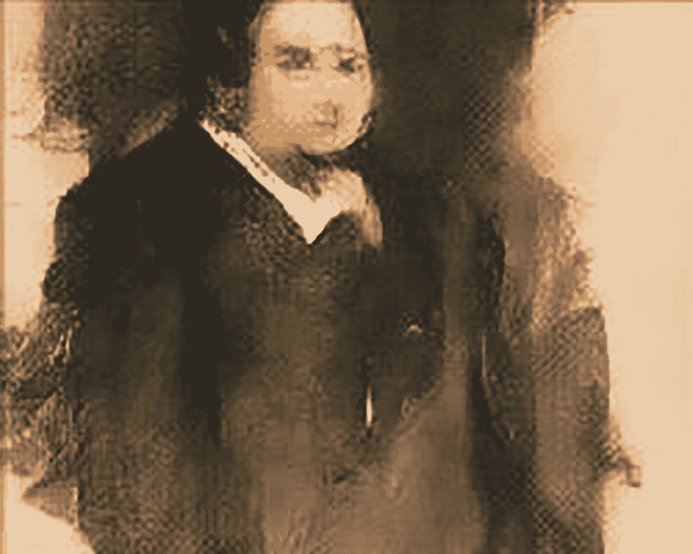

# 人工智能与创造力

自从生成对抗网络出现以来，人工智能与创造力的领域呈指数级增长。人工智能驱动的工具可以协助艺术家、作家和作曲家产生新的想法、探索创作可能性，并创作出创新作品。

2018 年 10 月，纽约市佳士得拍卖行成为首家拍卖使用人工智能创作的艺术品的主要拍卖行。这件名为《埃德蒙·贝拉米肖像》（图 14-1）的艺术品由一家名为 Obvious 的巴黎艺术团体创作。该人工智能使用了一个包含 17、18 和 19 世纪 15000 幅肖像画的数据集来创作这幅作品。

一幅细节模糊的男子肖像画。

图 14-1

人工智能生成的埃德蒙·德·贝拉米肖像

该作品以 43.25 万美元的落槌价成交，是其预售估价 7000 至 10000 美元的 40 多倍。此次拍卖是人工智能艺术的一个重要里程碑，标志着人工智能作为一种合法艺术形式正被日益接受。

如前所述，人工智能可以帮助作家克服写作瓶颈，为情节发展、角色创作和对话提供建议。由人工智能驱动的写作助手能够分析大量文本数据以识别模式和关系，帮助作家产生新想法并探索新的创作方向。通过使用 ChatGPT 和 Google Bard 等工具，这已经成为现实。然而，这也引发了关于整个编剧行业未来的问题，这些问题在 2023 年的好莱坞罢工中扮演了重要角色。^(⁹³)

人工智能也正在影响音乐行业，为音乐家提供作曲、制作和个性化方面的先进工具。像 MuseNet、Boomy、Humming.ai 和 AIVA 这样的人工智能驱动应用正处于这场革命的前沿，促进了原创作品和新形式音乐表达的产生。这些工具擅长根据流派或情绪等参数生成音乐，正在重塑艺术家创作和观众体验音乐的方式（AIVA, 2023；MuseNet, 2023；Boomy, 2023；Humming.ai, 2023）。

人工智能在音乐中的作用远不止作曲。它有助于探索多样化的声音景观，帮助艺术家尝试和声、节奏和风格。这种创新催生了诸如人工智能生成音乐和算法音乐等新颖流派，反映了人工智能在创意领域日益扩大的影响力（AI-Generated Music, 2023；Algorithmic Music, 2023）。

在制作和表演方面，人工智能辅助声音设计、混音、母带处理，甚至在现场演出中提供实时伴奏和自适应反馈。这些由人工智能驱动的工具提升了音乐表演的质量和动态特性（Bostrom & Yudkowsky, 2016）。

此外，人工智能极大地个性化了个人的音乐体验。通过推荐引擎，人工智能分析用户偏好以推荐新音乐，促进发现和更广泛的音乐探索。它还能促成艺术家之间的合作，促进共享项目和思想交流（Mittelstadt, Wachter, & Floridi, 2019）。

总之，人工智能不仅是音乐领域任务自动化的工具，更是创造力和创新的催化剂。随着人工智能的发展，它有望加深对音乐创作、表演和分享的影响，彻底改变我们与这种艺术形式互动和欣赏它的方式。

