# 第 1 章 Power Query 简介

随着你深入学习，你将掌握数据转换的精髓。

`Power Query` 使你能够根据需要塑造数据，从清理、合并到筛选和聚合。这些转换构成了深入分析的基石，将数据从一团谜题转变为清晰的图景。

此外，`Power Query` 充当着不同数据源之间的桥梁。无论你是处理 Excel 工作表、数据库、Web API 还是 CSV 文件，`Power Query` 都提供了一个统一的界面来访问、转换和整合这些数据源，形成连贯的叙述。

那么，让我们一同踏上这段穿越 `Power Query` 世界的旅程吧。

当你阅读完后续章节后，你将掌握将 `Power Query` 作为变革性工具的能力，超越数据挑战，揭示出能让你做出更好、更明智决策的洞察。

## Power Query 简介

`Power Query` 是一个在 Excel 和 Power BI 中精炼和清理数据的强大工具。它涵盖了 ETL（提取、转换、加载）的三个主要任务：提取、清理和加载表格。这些任务包括：

-   从各种数据库中提取数据，包括
    SQL、Access、Microsoft Azure，以及其他来源，如
    网站、Excel 文件、文本文件等
-   通过移除多余列、更改
    值格式、添加新列、合并表等操作来清理数据
-   加载数据（到 Excel、Power Pivot 或 Power BI）

该工具最初作为 Excel 2010 及后续 2013 版本的加载项引入。

在这些版本中，通过安装加载项，Excel 中会新增一个名为 `Power Query` 的选项卡，如图 1-1 和 1-2 所示。


**图 1-1.** *Excel 2010 中的 Power Query 选项卡*

**图 1-2.** *Excel 2013 中的 Power Query 选项卡*

在 Excel 2016 及更高版本中，此工具被添加到了 `数据` 选项卡下的 Excel 主命令中。在 Excel 2021 以及 365 中，与 `Power Query` 相关的命令位于 `数据` 选项卡下的 `获取和转换数据` 组中，用户可以使用这些命令执行数据提取、修改和加载过程（图 1-3）。

**图 1-3.** *Excel 365 中的 Power Query*

在 Power BI 中，与 `Power Query` 相关的命令位于 `主页` 选项卡的 `数据` 部分，如图 1-4 所示。

**图 1-4.** *Power BI 中的 Power Query*

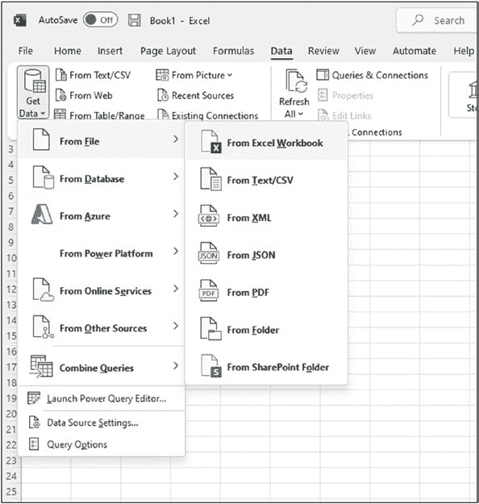

## Excel 中的 Power Query

在 Excel 中，要从其他 Excel 文件等不同来源提取值，只需选择 `数据` 选项卡 `获取和转换数据` 部分中的 `获取数据` 命令（图 1-5）。

**图 1-5.** *从 Excel 文件中提取数据*

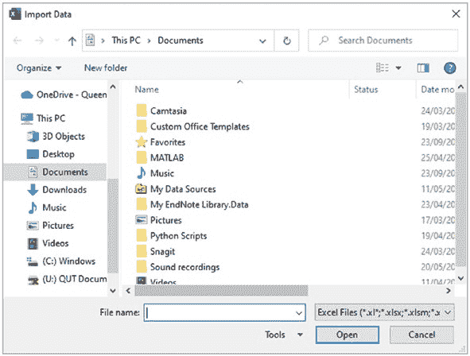

如图 1-5 所示，提供了从不同数据源提取表格的各种选项。要从另一个 Excel 文件提取值，请选择 `来自文件`，然后选择 `来自 Excel 工作簿`。将出现如图 1-6 所示的窗口，你可以在此浏览并选择所需的 Excel 文件。

**图 1-6.** *指定 Excel 文件*

通过指定所需的 Excel 文件（在此示例中为 `06-Inventory.xlsx`）并单击 `打开`，将打开一个新窗口，如图 1-7 所示。

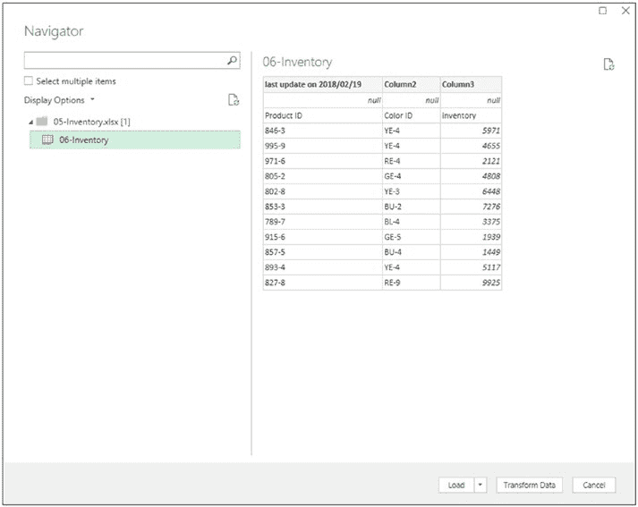

**图 1-7.** *表选择窗口*

你将在该窗口的左侧看到所选 Excel 文件中所有表格和工作表的列表。根据用户需求，可以选择一个或多个表格并在 `Power Query` 中调用以进行清理过程。在此示例中，通过选择 `05-Inventory` 表并单击 `转换数据` 按钮，数据将被加载到 `Power Query` 中，如图 1-8 所示。（至此，数据提取过程完成。）

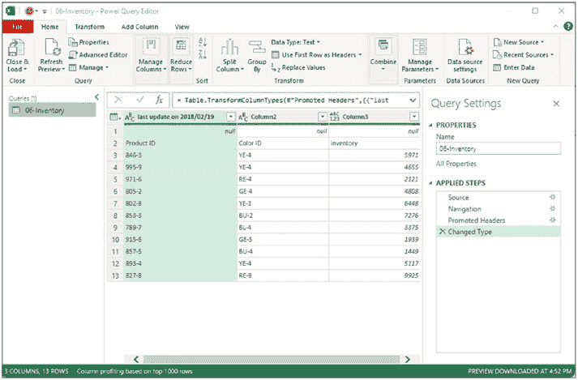
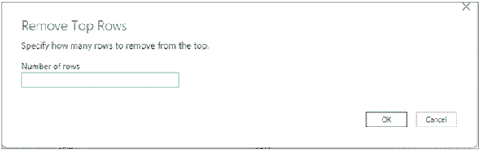

**图 1-8.** *在 Power Query 中提取数据*

现在，你可以通过各种命令执行清理过程。例如，要移除表的第一行（空行），只需从 `主页` 选项卡的 `减少行` 部分中选择 `删除前几行` 命令。将出现如图 1-9 所示的窗口，用于确定要从表顶部移除的行数。

**图 1-9.** *选择要删除的行数*

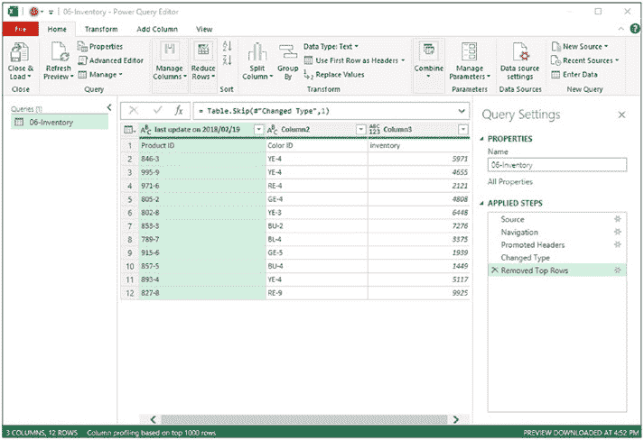

在字段中输入 `1` 并确认。如图 1-10 所示，表的第一行被移除。

**图 1-10.** *删除第一行数据*

接下来，要将列标题替换为第一行，请从 `转换` 选项卡中选择 `将第一行用作标题` 命令。结果见图 1-11。

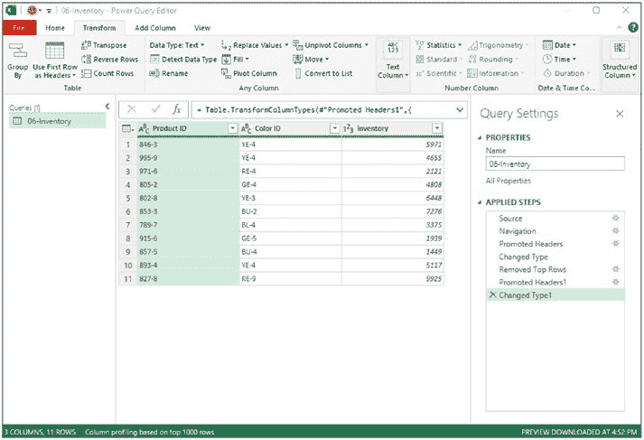

**图 1-11.** *用第一行数据替换列标题*

图 1-11 所示表格中的 `Product ID` 列由两部分组成：主要部分（破折号之前）和子部分（破折号之后）。

假设你想将这两部分分开。选择 `Product ID` 列，然后从 `主页` 选项卡的 `拆分列` 部分中选择 `按分隔符拆分` 命令。结果见图 1-12。

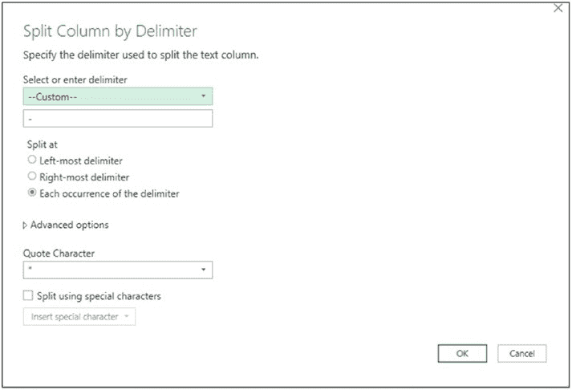

**图 1-12.** *分离列中的数据*

然后，根据图 1-12 选择 `自定义` 模式，在下方的框中输入一个破折号并确认，你将得到如图 1-13 所示的结果。

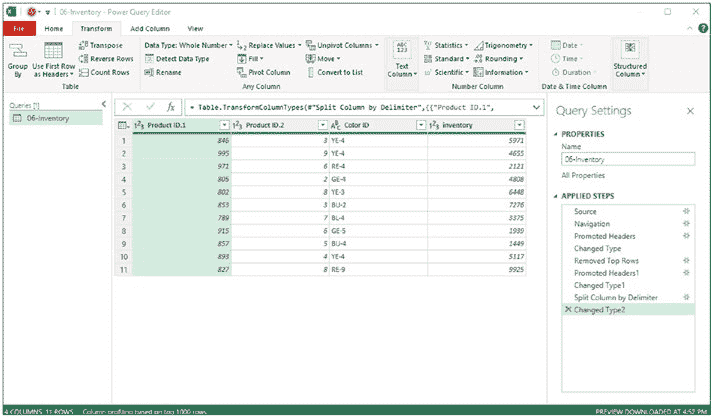
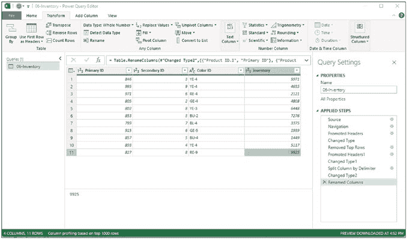

**图 1-13.** *拆分后的列*

最后，要将第一列和第二列的名称分别更改为 `Primary ID` 和 `Secondary ID`，只需右键单击列标题，选择 `重命名`，然后输入所需的名称。结果见图 1-14。

**图 1-14.** *更改列名*

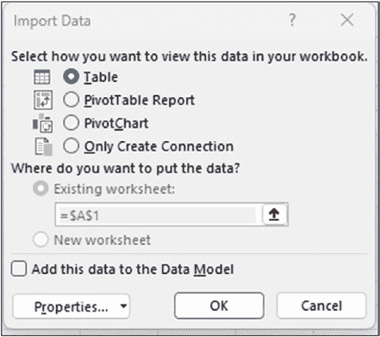

你已经得到了期望的结果，因此在此示例中，数据清理阶段到此结束（数据清理过程不仅限于所提到的命令，将在后面进一步说明）。在最后一步，将数据作为表加载到 Excel（或被视为数据模型的 Power Pivot）中。从 `文件` 选项卡中选择 `关闭并上载至` 命令，加载窗口将出现，如图 1-15 所示。

**图 1-15.** *选择加载位置*

在此窗口中，你可以指定最终表应如何加载到 Excel 中。如果你选择 `表`，结果将在 Excel 中可见，如图 1-16 所示。

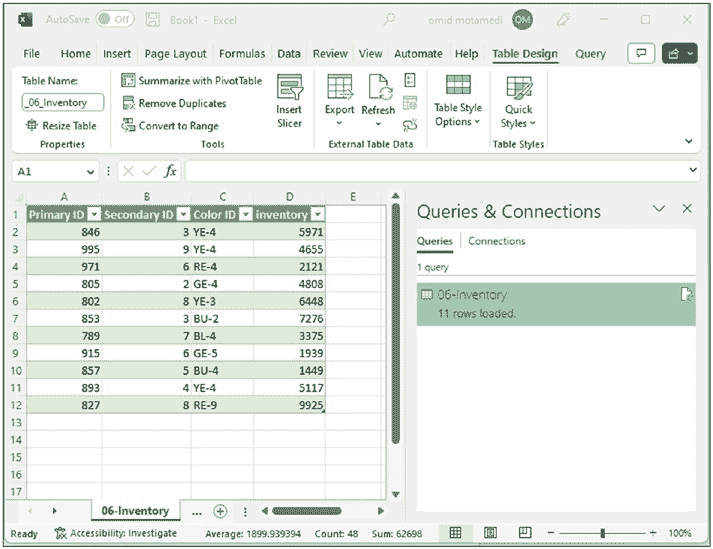

**图 1-16.** *Excel 中的最终表格*

因此，在此示例中，从其他 Excel 文件中提取了值，进行了清理，并最终作为表加载到了 Excel 文件中。

## Power BI 中的 Power Query


在 Excel 和 Power BI 中使用 Power Query 的过程是相同的，并且包含相同的命令。例如，要在 Power BI 中执行上一节提到的过程，只需从 `开始` 选项卡的 `数据` 部分选择 `Excel 工作簿` 命令，然后在打开的窗口中输入相关 Excel 文件的地址，即可看到如图 1-17 所示的页面。

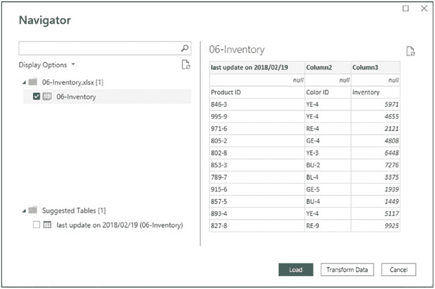

**第 1 章 Power Query 简介**

***图 1-17.** 在 Power BI 中选择表格*

在此窗口中，通过在左侧窗口中选择所需的一个或多个表格，然后选择 `转换数据` 命令，数据将被传输到 Power Query，如图 1-18 所示。

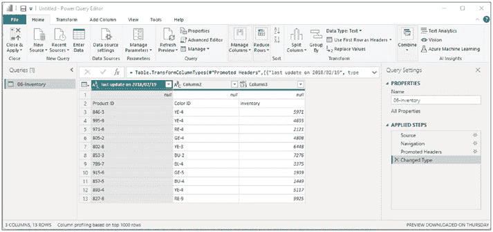

**第 1 章 Power Query 简介**

***图 1-18.** Power BI 中的 Power Query 窗口*

提取部分至此完成。Power BI 中的数据清理和加载过程与 Excel 类似，执行上一节解释的步骤即可获得相似的结果。

## Power Query 界面

如图 1-19 所示，Power Query 窗口（在 Excel 和 Power BI 中）由六个不同的部分组成：

1.  **查询窗格**：此部分显示 Excel 或 Power BI 文件中的查询列表，用户可以在此部分选择、修改或对查询进行分组。
2.  **选项卡**：此部分显示 Power Query 的命令。
3.  **公式栏**：此部分用于在输入等号后在 Power Query 中编写公式。

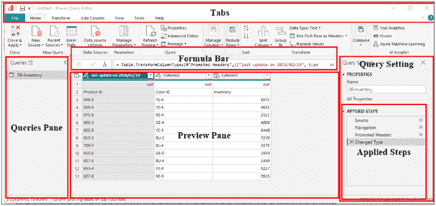

**第 1 章 Power Query 简介**

4.  **查询设置**：此部分顶部包含查询名称，底部包含 `应用的步骤` 部分。
5.  **应用的步骤**：在此部分中，可以看到应用于所选查询中数据表的所有命令列表。用户可以重命名（右键单击它们）、重新排序（拖放到所需位置）、修改（单击每个步骤名称旁的齿轮图标）或删除（右键单击它们）这些命令。
6.  **预览窗格**：此部分显示从 `应用的步骤` 部分选择的命令的结果。

***图 1-19.** Power Query 窗口的不同部分*

## M 代码

要重新打开 Power Query 窗口并修改在 Excel 文件中创建的查询，应在 Excel 的 `开始` 选项卡的 `数据` 部分激活 `查询和连接` 模式。活动查询的列表将显示在 `查询和连接` 部分（如图 1-20 所示）。可以通过右键单击查询并选择 `编辑` 选项来修改查询。

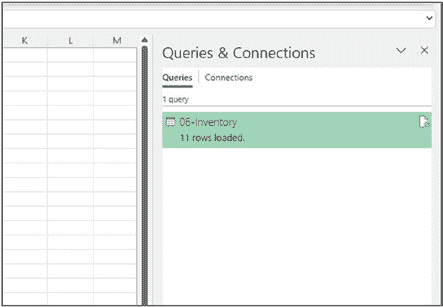

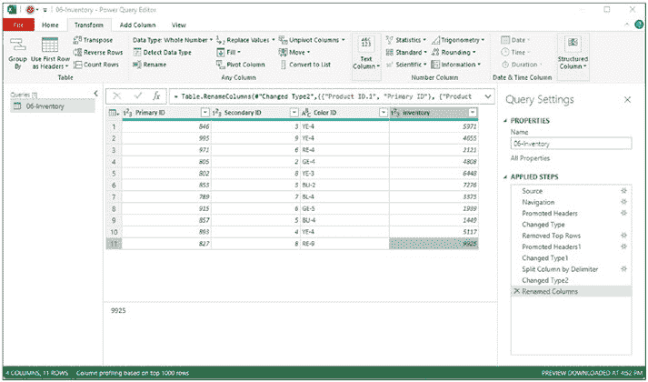

**第 1 章 Power Query 简介**

***图 1-20.** 查询和连接命令*

查询结果将显示出来，如图 1-21 所示。

***图 1-21.** 更改列名*

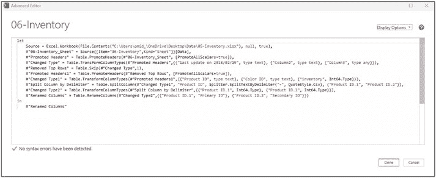

**第 1 章 Power Query 简介**

可以在 `应用的步骤` 部分逐步修改查询，或者通过在 `开始` 选项卡中选择 `高级编辑器` 命令来一次性修改，这将导向如图 1-22 所示的结果。

***图 1-22.** 高级编辑器*

`高级编辑器` 窗口包含在数据提取和清理过程中执行的所有步骤，它们以 M 语言编写，如下所示。

（如果您对此还不清楚，不必担心。您将在本书结束前学会这些命令并能够自己编写。）

```
Source = Excel.Workbook(File.Contents("C:\Users\omid_ OneDrive\Desktop\Data\05-Inventory.xlsx"), null, true),
#"06-Inventory_Sheet" = Source{[Item="06-Inventory",Kind="Sheet"]}[Data],
#"Promoted Headers" = Table.PromoteHeaders(#"06- Inventory_ Sheet", [PromoteAllScalars=true]),
#"Changed Type" = Table.TransformColumnTypes(#"Promoted Headers",{{"last update on 2018/02/19", type text},
{"Column2", type text}, {"Column3", type any}}),
#"Removed Top Rows" = Table.Skip(#"Changed Type",1),
#"Promoted Headers1" = Table.PromoteHeaders(#"Removed Top Rows", [PromoteAllScalars=true]),
#"Changed Type1" = Table.TransformColumnTypes(#"Promoted Headers1",{{"Product ID", type text}, {"Color ID", type text}, {"inventory", Int64.Type}}),
#"Split Column by Delimiter" = Table.SplitColumn(#"Changed Type1", "Product ID", Splitter.SplitTextByDelimiter("-", QuoteStyle.Csv), {"Product ID.1", "Product ID.2"}),
#"Changed Type2" = Table.TransformColumnTypes(#"Split Column by Delimiter",{{"Product ID.1", Int64.Type},
{"Product ID.2", Int64.Type}}),
#"Renamed Columns" = Table.RenameColumns(#"Changed Type2",{{"Product ID.1", "Primary ID"}, {"Product ID.2",
"Secondary ID"}})
in
#"Renamed Columns"
```

通过执行清理过程中的每个命令（例如，重命名列、拆分 `Product ID` 列或删除第一行），都会在前面的命令中添加一行。每个命令行由用等号分隔的两部分组成。变量名（也显示在 `应用的步骤` 部分中）位于等号左侧，该变量的计算公式位于右侧。例如，在以下命令中，变量名为 `#"Removed Top Rows"`，并使用 `Table.Skip` 函数进行计算，如下所示：

```
#"Removed Top Rows" = Table.Skip(#"Changed Type",1)
```

在此示例中，`Table.Skip` 函数接收名为 `#"Changed Type"` 的表（在上一步中计算得出）并删除第一行。然后，它将新表作为输出显示。因此，变量 `#"Removed Top Rows"` 的值等于一个表。

**第 1 章 Power Query 简介**

通常，`Table.Skip` 在 Power Query 中定义如下：

```
Table.Skip(
  table as table,
  optional countOrCondition as any
) as table
```

该函数有两个输入（用逗号分隔）。第一个输入是 `table as table`，这意味着第一个输入是表格式，称为 `Table`（`as` 后面指定了输入类型），第二个输入是可选的（由于使用了 `Optional` 这个词），命名为 `countOrCondition`，格式为 `any`。最后，由于表表达式在函数末尾注册，该函数的输出始终是一个表。

在这段代码的另一行中，变量 `#"Changed Type2"` 定义如下：

```
#"Changed Type2" = Table.TransformColumnTypes(#"Split Column by Delimiter",{{"Product ID.1", Int64.Type}, {"Product ID.2", Int64.Type}})
```

为了提高此命令的可读性，可以将其显示为以下几行：

```
#"Changed Type2" = Table.TransformColumnTypes(
  #"Split Column by Delimiter",
  {{"Product ID.1", Int64.Type}, {"Product ID.2", Int64.Type}}
)
```

正如您在此命令中所见，`Table.TransformColumnTypes` 函数使用了两个不同的参数；第一个是表类型，第二个变量是列表类型。

**第 1 章 Power Query 简介**

## 结论

在本章中，您了解了 Power Query，这是一个在各种数据分析和可视化环境中进行数据转换和处理的重要工具。这是您 Power Query 之旅的开端。

本章提供了一个简单的 Power Query 应用示例，以便您熟悉 Power Query 和 M 语言的基本功能。您还了解了 M 语言在数据转换中的作用。您还看到了使用命令清理表中值的方法。在本书的其余部分，将深入解释所有主要函数。

下一章将深入探讨 Power Query 中的数据类型，包括空值、逻辑值、数值、文本、列表、记录和二进制。

