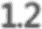
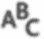
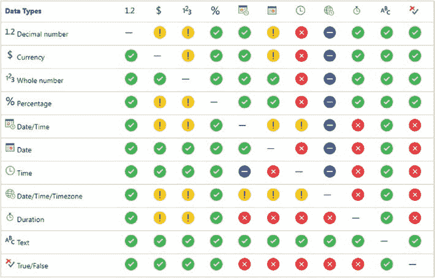

# 第 2 章 数据类型

与其他软件一样，Power Query 支持不同的数据类型（格式），并提供了大量根据类型修改值的函数。Power Query 支持简单的数据类型，如数字、文本和时间/日期，也支持复杂的数据类型，如列表、表格和二进制。本章重点介绍 Power Query 中使用的基本数据类型及其特性，以及类型转换的处理。学完本章后，你将扎实掌握如何在 Power Query 中有效管理和操作不同类型的数据，为后续章节更高级的数据转换和分析奠定基础。

## Power Query 中的数据类型

由于 Power Query 中的每个函数都只能应用于特定数据格式的值，因此数据类型在该软件中非常重要。

为了说明数据类型的重要性，我们考虑一个简单的函数 `Text.Start`。它用于提取文本的前几个字符。如果第一个输入是文本，则该函数的输出将等于该文本的前几个字符；但如果第一个输入不是文本格式，则输出将是一个错误。因此，根据输入的类型，该函数的结果会有所不同，甚至可能导致错误，如表 2-1 所示。

© Omid Motamedisedeh 2024

O. Motamedisedeh, *《Power Query 函数终极指南》*,

[`doi.org/10.1007/978-1-4842-9754-4_2`](https://doi.org/10.1007/978-1-4842-9754-4_2#DOI)

**表 2-1.** `Text.Start` 示例

**公式** | **结果**

--- | ---

`=Text.Start("Hello",3)` | `"Hel"`

`=Text.Start("1232",2)` | `"12"`

`=Text.Start(1232,2)` | 错误

因此，了解数据的格式以及如何在不同数据格式之间进行转换非常重要。表 2-2 显示了 Power Query 中的数据类型及其定义。

**表 2-2.** Power Query 数据类型

**定义** | **数据类型**

--- | ---

null | `Null`

true/false | `Logical`

0 1 -1 1.5 2.3e-5 | `Number`

`#time(09,15,00)` | `Time`

`#date(2013,02,26)` | `Date`

`#datetime(2013,02,26, 09,15,00)` | `DateTime`

`#datetimezone(2013,02,26, 09,15,00, 09,00)` | `DateTimeZone`

`#duration(0,1,30,0)` | `Duration`

"hello" | `Text`

`#binary("AQID")` | `Binary`

`{1, 2, 3}` | `List`

`[ A = 1, B = 2 ]` | `Record`

`#table({"X","Y"},{{0,1},{1,0}})` | `Table`

`(x) => x + 1` | `Function`

`type { number } type table [ A = any, B = text ]` | `Type`


### Null

在 Power Query 中，`null` 值用于表示缺失值，其定义为 `null`。可以对 `null` 值执行某些数学运算。假设变量 `x` 等于 `null`，`y` 是非 `null` 值，各种数学运算及其结果如表 2-3 所示。

**表 2-3.** 对 `null` 值的运算

**公式** | **结果**

--- | ---

`x > y` | null

`x >= y` | null

`x < y` | null

`x <= y` | null

`x = y` | null

`x <> y` | null

`x ?? y` | `y`

`y ?? x` | `y`

### 逻辑值

逻辑值数据类型，符号为

，包含两种状态：

`true` 或 `false`。为了比较此组中的值，可以将 `true` 视为等同于数字 `1`，将 `false` 视为等同于数字 `0`。

通常，逻辑值是通过将一个值与另一个值进行比较（例如 `2>3`）或通过信息函数（如 `Number.IsOdd`）的输出获得的。

如果 `x` 和 `y` 等于逻辑值，则使用数学运算符以及逻辑运算符（包括 `and`、`or` 和 `not`），如 `x` and `y`、`x` or `y` 和 `not x`，是对这些值的主要运算。

### 数字

数字类型包含大量的数值（整数和小数）。除了数字之外，还有两个值，名为 `#infinity`（正数除以零得到）和 `#-infinity`（负数除以零得到），它们分别代表正无穷大（可能的最大数）和负无穷大（可能的最小数），也包含在此组数据中。

# 第 2 章 数据类型

`#nan` 值（等于零除以零的结果）也包含在此数据类型组中。通常，任何数学运算和比较运算，例如 `x > y`、`x >= y`、`x < y`、`x <= y`、`x = y`、`x <> y`、`x + y`、`x - y`、`x * y`、`x / y`、`x ?? y` 和 `+x`，都可以对 Power Query 中的数值 `x` 和 `y` 执行。

表 2-4 提供了不同的数字格式。




`表 2-4.` `数字格式`

| `描述` | `符号数据格式` |
| --- | --- |
| 此数据格式用于表示十进制数，是最常用的数字格式之一。此格式可以包含 -1.79E+308 到 -2.23E-308 范围内的所有负十进制数，以及 2.23E-308 到 1.79E+308 范围内的所有正十进制数，包括数字 0。 | `十进制数` |
| 此格式在 Excel 中称为“货币”，具有特定的小数位数，可以显示小数点后四位、小数点前 19 位的数字。 | `定点十进制数` |
| 此格式用于显示整数，不显示小数部分。此格式可以显示 -9,223,372,036,854,775,807 (-2⁶³+1) 到 9,223,372,036,854,775,806 (2⁶³-2) 范围内的所有数字。 | `整数` |
| 此格式与用于显示十进制数的格式非常相似，只是数字会以百分比符号显示。 | `百分比` |

## 时间和日期

在 Power Query 中，有多种数据格式可用于将信息显示为时间和日期。Power Query 中的时间定义为 `#time(小时, 分钟, 秒)`，其中第一个输入值必须在 0 到 23 之间，第二个和第三个输入值必须在 0 到 59 之间。

除时间外，Power Query 中的日期定义为 `#date(年, 月, 日)`，其中年份的输入值在 1 到 9999 之间，另外两个参数分别接受 1 到 12 和 1 到 31 之间的数字。

要同时输入日期和时间值，可以使用 `#datetime(年, 月, 日, 小时, 分钟, 秒)`。在这种数据类型更全面的形式中，可以使用 `datetimezone`，如下所示：

```
#datetimezone(
  年, 月, 日,
  小时, 分钟, 秒,
  时区偏移小时, 时区偏移分钟
)
```

其中每个输入的允许范围如下：

- `1 ≤ 年 ≤ 9999`
- `1 ≤ 月 ≤ 12`
- `1 ≤ 日 ≤ 31`
- `0 ≤ 小时 ≤ 23`
- `0 ≤ 分钟 ≤ 59`
- `0 ≤ 秒 ≤ 59`
- `-14 ≤ 时区偏移小时 ≤ 14`
- `-59 ≤ 时区偏移分钟 ≤ 59`

此组中的另一种数据类型表示持续时间，它等于两个时间或日期值之间的差值。此数据类型在 Power Query 中定义为 `#duration(天, 小时, 分钟, 秒)`。通常，除了日期和时间函数外，还可以对此类数据执行任何数学计算或比较运算。

与日期相关格式的特性涵盖在表 2-5 中。


`表 2-5.` `日期格式`

| `描述` | `符号数据格式` |
| --- | --- |
| 此格式用于显示日期，可以显示从 1900 年到 9999 年范围内的任何日期。每个日期值可以由一个整数确定，其中 1900 年 1 月 1 日视为等同于 1；1900 年 1 月 2 日等于 2；依此类推。因此，将数字 365 转换为日期值时，将得到等同于 1901 年 1 月 1 日的日期。 | `日期` |
| 此格式用于表示时间。时间等同于一个小于 1 的正十进制数。因此，将 24 小时视为等同于数字 1，则中午 12 点等同于 0.5，早上 6 点等同于 0.25。 | `时间` |
| 此格式用于显示日期和时间并列的值。每个日期/时间值等同于一个十进制数，其中日期部分由整数确定，时间部分由小数确定。 | `日期/时间` |
| 此格式与日期和时间格式类似。区别在于 | `日期/时区` |

# 第 2 章 数据类型

## 时区

计算时也会考虑时区。然而，将数据加载到数据模型并考虑时区的有效值后，结果将以简单的日期和时间格式呈现。

`/Timezone`

此格式表示两个日期或时间之间的时间间隔 `Duration`（持续时间）。




## 文本

文本格式使用符号 `,`，包含多种取值范围，必须用双引号（`" "`）括起来进行定义，例如 `"ABC"` 甚至 `"2"`。在 Power Query 中，文本格式用于长度最多为 2.68 亿个字符的文本。当数字输入在双引号内时，其格式会转换为文本，并且不再对其执行数学运算。在运算符类型中，比较运算符（`<=>`）、检查空值的运算符以及用于连接两个文本的 `&` 运算符可用于文本值。

## 二进制

在 Power Query 中，使用符号 `,` 的二进制值相当于特殊格式文件中包含的二进制位串。例如，要将 Excel 文件中的信息作为表调用到 Power Query 中，首先会以二进制值的形式调用该信息，然后使用各种函数将其转换为表。

## 列表

列表包含一组按特定顺序排列的值（具有不同的数据类型）。为简单起见，可以将列表视为表中没有标题的一列。在 Power Query 中，要定义一个列表，只需将所需的值放在 `{ }` 内，并使用逗号将它们彼此分隔开。例如，这里给出了不同的列表示例：

```
={1,2,3,4}
={1,2,3,{4,5}}
={1,"a",2,"B",{"C","D"}}
={[a=1,b=2],2,{1},{1,2},[c=2],[d={1,2,3,}]}
```

## 记录

Power Query 中的另一种数据类型是记录。为简单起见，可以将记录视为表的单行，其中每个值都有一个标题（或名称），并且每个标题只有一个值。要定义一个记录，只需在 `[ ]` 内输入字段标题及其值，并用逗号分隔不同的字段，例如 `[a=1,b=2]`。在前面的示例中，记录有两个字段，名称分别为 `a` 和 `b`，它们的值分别为 `1` 和 `2`。记录中值的类型没有限制，可以包含各种类型，如列表、记录和表。以下是记录的不同示例：

```
[a=1,v={1,2,3,4}]
[a=[b=1,c=2],d=[e={1,2,3,4},f=null]]
[a="xyz",b={1,2,3}]
```

## 表

表是一种数据格式，其中值按行组织，并具有特定的列标题。表中的数据可以具有多种格式，Power Query 中有不同的函数来管理表。表可以直接在 Power Query 中创建，也可以从其他源调用。

## 函数

另一种数据类型是函数，将在后面的章节中详细解释。




# 类型转换

Power Query 中有多个函数用于将不同的数据格式转换为另一种格式，但在了解这些函数之前，需要注意的是，并非所有数据格式都可以转换为其他格式。例如，你无法使用任何函数将文本格式`"Hello"`转换为数字。

Power Query 中不同数据格式之间相互转换的可能性如图 2-1 所示。

- 转换是可能的，但会从原始数据中删除一个值。
- 转换是可能的，但会向原始数据中添加一个值。
- 转换没有限制。
- 转换是不可能的。

`图 2-1.` Power Query 中的数据转换

Power Query 中有多个函数用于将不同的数据格式相互转换，本章其余部分将提供其中最重要的函数。

# 将值转换为数字格式

# 将值转换为数字格式

与将不同格式的值转换为数字格式相关的函数见表 2-6。所有这些函数都接收特定类型的输入，并输出一个数字格式的值。

`表 2-6.` 将值转换为数字格式

| 函数 | 描述 |
| --- | --- |
| `Number.FromText(text as text) as number` | 使用此函数，可以将文本格式存储的数值转换为数字。例如，如果数字 `123` 以文本形式存储，可以使用此函数将其转换为数字。 |
| `Number.From(value as any) as number` | 此函数用于将其他格式存储的数值转换为数字格式。 |
| `Int32.From(value as any) as number` | 此函数用于将值转换为 32 位整数表示形式。 |
| `Int64.From(value as any) as number` | 此函数用于将值转换为 64 位整数表示形式。 |
| `Single.From(value as any) as number` | 此函数根据给定的值返回一个单精度数字。 |
| `Double.From(value as any) as number` | 此函数根据给定的值返回一个双精度数字。 |
| `Decimal.From(value as any) as number` | 此函数根据给定的值返回一个十进制数字。 |
| `Currency.From(value as any) as number` | 此函数根据给定的值返回一个货币值。 |

# 将值转换为文本格式

用于将不同格式的值转换为文本格式的函数列表见表 2-7。所有这些函数都接收特定类型的输入，并输出文本格式的结果。

**表 2-7.** 将值转换为文本格式

| 函数 | 描述 |
| --- | --- |
| `Text.From(value as any) as text` | 此函数用于将任何格式的值转换为文本。 |
| `Number.ToText(number as number) as text` | 此函数用于将数字格式的值转换为文本格式的值。 |
| `Logical.ToText(logical as logical) as text` | 使用此函数，可以将 `True`/`False` 值转换为文本。 |
| `Date.ToText(date as date) as text` | 使用此函数，可以将日期格式的值转换为文本格式的值。 |
| `Time.ToText(time as time) as text` | 使用此函数，可以将时间格式的值转换为文本格式的值。 |
| `DateTime.ToText(datetime as datetime) as text` | 使用此函数，可以将日期和时间格式的值转换为文本格式的值。 |
| `DateTimeZone.ToText(datetimezone as datetimezone) as text` | 使用此函数，可以将日期、时间和时区格式的值转换为文本格式的值。 |

# 将值转换为日期和时间格式

有一些函数用于将不同格式的值转换为日期，见表 2-8。

**表 2-8.** 将值转换为日期格式

| 函数 | 描述 |
| --- | --- |
| `Date.FromText(text as text) as date` | 此函数用于将文本值转换为日期。 |
| `Time.FromText(text as text) as time` | 此函数用于将文本值转换为时间。 |
| `DateTime.FromText(text as text) as datetime` | 此函数用于将文本值转换为日期和时间。 |
| `DateTimeZone.FromText(text as text) as datetimezone` | 此函数用于将文本值转换为日期、时间和时区。 |
| `Date.From(value as any) as date` | 此函数用于将任意格式的值转换为日期。 |
| `Time.From(value as any) as time` | 此函数用于将任意格式的值转换为时间。 |
| `DateTime.From(value as any) as datetime` | 此函数用于将任意格式的值转换为日期和时间。 |
| `DateTimeZone.From(value as any) as datetimezone` | 此函数用于将任意格式的值转换为日期、时间和时区。 |

# 将值转换为记录格式

有一些函数用于将日期和时间格式的值转换为记录格式的值，见表 2-9。

**表 2-9.** 将日期值转换为记录格式

| 函数 | 描述 |
| --- | --- |
| `Date.Torecord(date as date) as record` | 使用此函数，可将日期格式的值转换为文本格式的值。 |
| `Time.Torecord(time as time) as record` | 使用此函数，可将时间格式的值转换为文本格式的值。 |
| `DateTime.Torecord(datetime as datetime) as record` | 使用此函数，可将日期时间格式的值转换为文本格式的值。 |
| `DateTimeZone.Torecord(datetimezone as datetimezone) as record` | 使用此函数，可将日期、时间和时区格式的值转换为文本格式的值。 |

**结论**

在本章中，你探索了 Power Query 中的不同数据类型及其特性。你学习了更改数据类型的可能性以及用于数据类型转换的函数。你还了解了因使用错误数据类型可能产生的错误。

现在，你已经掌握了数据类型，可以准备学习用于处理不同数据类型值的函数了。下一章将介绍用于数字类型值的函数。
