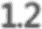
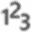

# 第 2 章 数据类型

`#nan` 值（等于零除以零的结果）也包含在此数据类型组中。通常，任何数学运算和比较运算，例如 `x > y`、`x >= y`、`x < y`、`x <= y`、`x = y`、`x <> y`、`x + y`、`x - y`、`x * y`、`x / y`、`x ?? y` 和 `+x`，都可以对 Power Query 中的数值 `x` 和 `y` 执行。

表 2-4 提供了不同的数字格式。







`表 2-4.` `数字格式`

| `描述` | `符号数据格式` |
| --- | --- |
| 此数据格式用于表示十进制数，是最常用的数字格式之一。此格式可以包含 -1.79E+308 到 -2.23E-308 范围内的所有负十进制数，以及 2.23E-308 到 1.79E+308 范围内的所有正十进制数，包括数字 0。 | `十进制数` |
| 此格式在 Excel 中称为“货币”，具有特定的小数位数，可以显示小数点后四位、小数点前 19 位的数字。 | `定点十进制数` |
| 此格式用于显示整数，不显示小数部分。此格式可以显示 -9,223,372,036,854,775,807 (-2⁶³+1) 到 9,223,372,036,854,775,806 (2⁶³-2) 范围内的所有数字。 | `整数` |
| 此格式与用于显示十进制数的格式非常相似，只是数字会以百分比符号显示。 | `百分比` |

## 时间和日期

在 Power Query 中，有多种数据格式可用于将信息显示为时间和日期。Power Query 中的时间定义为 `#time(小时, 分钟, 秒)`，其中第一个输入值必须在 0 到 23 之间，第二个和第三个输入值必须在 0 到 59 之间。

除时间外，Power Query 中的日期定义为 `#date(年, 月, 日)`，其中年份的输入值在 1 到 9999 之间，另外两个参数分别接受 1 到 12 和 1 到 31 之间的数字。

要同时输入日期和时间值，可以使用 `#datetime(年, 月, 日, 小时, 分钟, 秒)`。在这种数据类型更全面的形式中，可以使用 `datetimezone`，如下所示：

```
#datetimezone(
  年, 月, 日,
  小时, 分钟, 秒,
  时区偏移小时, 时区偏移分钟
)
```

其中每个输入的允许范围如下：

- `1 ≤ 年 ≤ 9999`
- `1 ≤ 月 ≤ 12`
- `1 ≤ 日 ≤ 31`
- `0 ≤ 小时 ≤ 23`
- `0 ≤ 分钟 ≤ 59`
- `0 ≤ 秒 ≤ 59`
- `-14 ≤ 时区偏移小时 ≤ 14`
- `-59 ≤ 时区偏移分钟 ≤ 59`

此组中的另一种数据类型表示持续时间，它等于两个时间或日期值之间的差值。此数据类型在 Power Query 中定义为 `#duration(天, 小时, 分钟, 秒)`。通常，除了日期和时间函数外，还可以对此类数据执行任何数学计算或比较运算。

与日期相关格式的特性涵盖在表 2-5 中。


`表 2-5.` `日期格式`

| `描述` | `符号数据格式` |
| --- | --- |
| 此格式用于显示日期，可以显示从 1900 年到 9999 年范围内的任何日期。每个日期值可以由一个整数确定，其中 1900 年 1 月 1 日视为等同于 1；1900 年 1 月 2 日等于 2；依此类推。因此，将数字 365 转换为日期值时，将得到等同于 1901 年 1 月 1 日的日期。 | `日期` |
| 此格式用于表示时间。时间等同于一个小于 1 的正十进制数。因此，将 24 小时视为等同于数字 1，则中午 12 点等同于 0.5，早上 6 点等同于 0.25。 | `时间` |
| 此格式用于显示日期和时间并列的值。每个日期/时间值等同于一个十进制数，其中日期部分由整数确定，时间部分由小数确定。 | `日期/时间` |
| 此格式与日期和时间格式类似。区别在于 | `日期/时区` |