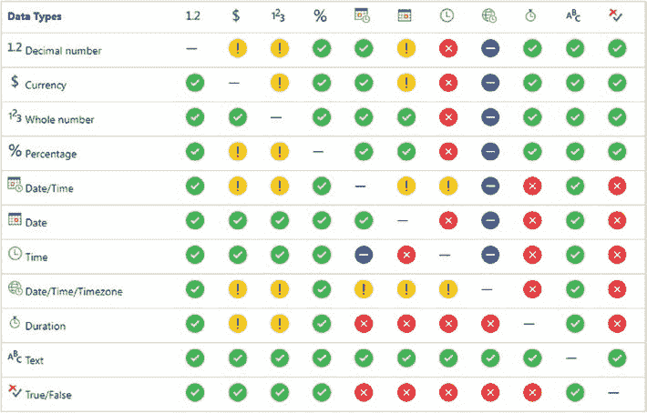

# 第 2 章 数据类型

## 时区

计算时也会考虑时区。然而，将数据加载到数据模型并考虑时区的有效值后，结果将以简单的日期和时间格式呈现。

`/Timezone`

此格式表示两个日期或时间之间的时间间隔 `Duration`（持续时间）。


## 文本

文本格式使用符号 `,`，包含多种取值范围，必须用双引号（`" "`）括起来进行定义，例如 `"ABC"` 甚至 `"2"`。在 Power Query 中，文本格式用于长度最多为 2.68 亿个字符的文本。当数字输入在双引号内时，其格式会转换为文本，并且不再对其执行数学运算。在运算符类型中，比较运算符（`<=>`）、检查空值的运算符以及用于连接两个文本的 `&` 运算符可用于文本值。

## 二进制

在 Power Query 中，使用符号 `,` 的二进制值相当于特殊格式文件中包含的二进制位串。例如，要将 Excel 文件中的信息作为表调用到 Power Query 中，首先会以二进制值的形式调用该信息，然后使用各种函数将其转换为表。

## 列表

列表包含一组按特定顺序排列的值（具有不同的数据类型）。为简单起见，可以将列表视为表中没有标题的一列。在 Power Query 中，要定义一个列表，只需将所需的值放在 `{ }` 内，并使用逗号将它们彼此分隔开。例如，这里给出了不同的列表示例：

```
={1,2,3,4}
={1,2,3,{4,5}}
={1,"a",2,"B",{"C","D"}}
={[a=1,b=2],2,{1},{1,2},[c=2],[d={1,2,3,}]}
```

## 记录

Power Query 中的另一种数据类型是记录。为简单起见，可以将记录视为表的单行，其中每个值都有一个标题（或名称），并且每个标题只有一个值。要定义一个记录，只需在 `[ ]` 内输入字段标题及其值，并用逗号分隔不同的字段，例如 `[a=1,b=2]`。在前面的示例中，记录有两个字段，名称分别为 `a` 和 `b`，它们的值分别为 `1` 和 `2`。记录中值的类型没有限制，可以包含各种类型，如列表、记录和表。以下是记录的不同示例：

```
[a=1,v={1,2,3,4}]
[a=[b=1,c=2],d=[e={1,2,3,4},f=null]]
[a="xyz",b={1,2,3}]
```

## 表

表是一种数据格式，其中值按行组织，并具有特定的列标题。表中的数据可以具有多种格式，Power Query 中有不同的函数来管理表。表可以直接在 Power Query 中创建，也可以从其他源调用。

## 函数

另一种数据类型是函数，将在后面的章节中详细解释。


