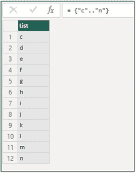
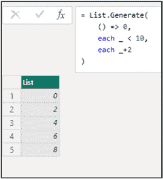

# 第 6 章

# 列表函数

你的旅程始于对基础概念的深入探索，例如日期编码、时区和算术运算的细微差别。掌握这些知识后，你进一步探索了日期和时间函数在将原始时间戳转换为可理解且有意义的`信息`中的强大作用。

随着深入学习，你发现了这些函数如何助力提取星期模式、计算重要事件之间的持续时间，以及标准化时间数据格式。这为有效的时间分析奠定了基础。

在下一章中，你将探索一系列用于操作列表值的函数。基于这些函数，你可以轻松生成不同的列表、过滤和排序列表中的值、从列表中提取特定值，或合并列表。

在浩瀚的数据处理领域中，单个数据点往往交织在一起，构成更大的叙事脉络。这正是列表的用武之地。从销售交易集合到调查响应数组，列表捕捉了数据关系与依赖关系的本质。欢迎来到专为探索 Power Query 中列表函数领域而设的章节。这些函数是你解开复杂数据结构、释放互联信息真正潜能的`关键`。

列表是编织数据故事脉络的线索。想象一下，将一份订单拆解为其组成产品、跟踪项目多步骤工作流，或理解客户偏好的动态变化。这些场景都需要掌握列表函数，这些工具使数据专业人士能够以前所未有的方式操作、剖析和重组数据，而过去这些操作曾是复杂的挑战。

本章的旅程始于对列表作为多功能数据结构的`基础理解`。你将探索其独特属性，从有序特性到容纳异构数据类型的能力。掌握这些知识后，你将深入列表创建的世界，从手动组合元素到通过计算表达式动态生成。

但列表并非孤立存在；它们相互作用、转换并适应变化。你将探索 Power Query 提供的列表函数库，以精确规格重塑数据集合。无论是基于特定条件过滤元素、排序以揭示模式，还是合并列表以拼接碎片化信息，你都将对数据处理的艺术产生全新的认知。

© Omid Motamedisedeh 2024

O. Motamedisedeh 著，*The Ultimate Guide to Functions in Power Query*（Power Query 函数终极指南），

[`doi.org/10.1007/978-1-4842-9754-4_6`](https://doi.org/10.1007/978-1-4842-9754-4_6)

### 在 Power Query 中定义列表

要创建列表，你可以轻松地将值插入 `{ }` 之间，并用逗号分隔，或使用相关函数。要定义从 1 到 5 的数字列表，只需在公式栏中输入以下表达式。结果如图 6-1 所示。

```
={1,2,3,4,5}
```

**图 6-1.** 从 1 到 5 的数字列表

要定义字符列表，可以使用以下公式。结果如图 6-2 所示。

```
={"a","b","c"}
```

**图 6-2.** 字符列表的定义

要创建数字列表（例如数字 1 到 100），无需在 `{ }` 中注册所有数字，只需输入起始数字，后跟两个点号和结束数字即可。在这种情况下，相应列表中的整个数字集将被定义。见图 6-3。

```
={1..100}
```

**图 6-3.** 数字 1 到 100 的定义

此方法不仅适用于数字。字符 `c` 到 `n` 之间的内容可以轻松定义如下，结果如图 6-4 所示：

```
={"c".."n"}
```

# 第 6 章 列表函数

`= {"c".."n"}`



**图 6-4.** 定义包含从 c 到 n 之间所有字符的列表

一些公式见表 6-1。

**表 6-1.** 定义列表

| **公式** | **结果** |
|-------------|------------|
| `= {3..9}` | `{3,4,5,6,7,8,9}` |
| `= {"w","z"}` | `{“w”,“z”}` |
| `= {"w".."z"}` | `{“w”,“x”,“y”,“z”}` |
| `= {"W".."Z"}` | `{“W”,“X”,“Y”,“Z”}` |
| `= {"#".."&"}` | `{“#”,“^”,“%”,“&”}` |

除了直接定义列表外，还可以从表格的列中提取值来创建列表。实际上，表格的每一列都代表一个值列表（数字、文本等）。要将表格的某一列提取为列表，只需在方括号 `[]` 中输入表名和列名即可。例如，考虑 `TableA`（见表 6-2）。

**表 6-2.** `TableA`

| **产品** | **价格** | **材料** |
|-------------|-----------|--------------|
| W11 | 100 | 金属 |
| s06 | 75 | 木材 |
| r08 | 12 | 玻璃 |

公式 `TableA[Price]` 的结果等于一个列表，包含 `{100,75,12}`；而公式 `TableA[Product]` 的结果等于产品名称列表，形式为 `{“W11”,“S06”,“R08”}`。

此外，要创建列表，也可以使用 `List.Numbers`、`List.Generate` 以及其他函数，如下所示。

## 函数

### List.Numbers

`List.Numbers` 的使用方法如下，用于生成包含特定间隔数字序列的列表：

```
List.Numbers(
  start as number,
  count as number,
  optional increment as nullable number
) as list
```

如上所示，该函数接收三个数值参数，并始终返回一个数字列表。

1. 第一个输入表示列表的起始数字。
2. 列表的长度在第二个输入中确定。
3. 第三个输入表示列表中数字之间的间隔。如果未输入，则此输入默认为数字 1。

根据函数说明，该函数的结果见表 6-3。

**表 6-3.** `List.Numbers` 示例

| **公式** | **结果** |
|-------------|------------|
| `= List.Numbers(3,4)` | `{3,4,5,6}` |
| `= List.Numbers(3,4,-1)` | `{3,2,1,0}` |
| `= List.Numbers(3,4,6)` | `{3,9,15,21}` |

### List.Generate

`List.Generate` 的使用方法如下，用于创建列表（包含数字、文本、记录或表格）：

```
List.Generate(
  initial as function,
  condition as function,
  next as function,
  optional selector as nullable function
) as list
```

`List.Generate` 接收四个参数。它们都是函数，最后一个参数是可选的。

1. 第一个参数表示列表的起始数字（函数类型）。
2. 列表中生成值的停止条件在第二个参数中定义（函数类型）。



3. 在此参数中，确定生成列表中新值的公式（函数类型）。
4. 此输入是可选的，称为选择器。利用此输入，可以修改函数的结果。

让我们从一个简单的示例开始，该示例表示一个小于 10 的偶数列表。该函数可以定义如下：

`= List.Generate(()=>0, (x)=>x<10, (x)=>x+2)`

在第一个输入中，第一个值是 `0`。根据第二个输入，列表中的所有值都应小于 `10`（列表中的值生成将持续到达到大于或等于 `10` 的值为止）。在第三个输入中，每次迭代时，列表的新值都是基于前一个值加上 `2` 生成的。此输入是一个函数，它接收 `x` 作为输入，并将 `x+2` 作为输出，其中 `=>` 是函数符号。

基于上述示例，所需列表从数字 `0` 开始，每一步都将前一个数字加上 `2`，此过程一直持续到达到大于或等于 `10` 的数字为止。

因此，此公式的结果是 `{0,2,4,6,8}`。见图 6-5。

**图 6-5.** 使用 `List.Generate` 创建偶数

在前一个示例中，变量`x`可以被`_`替换，因此公式将变为如下形式：

`= List.Generate(()=>0, (_)=>_< 10, (_)=>_+2)`

在这种情况下，`(_)=>`可以被替换为每个表达式，如下所示：

`= List.Generate(() =>0, each _ < 10, each _+2)`

此函数的输入本身也是函数类型，其说明如表 6-4。

**表 6-4.** `List.Generate`的参数*

`() =>0`，

在该输入中，指定列表从数字 0 开始。

`each < 10`，还指定列表中的数字必须小于 10。

`each _+2`

此外，指定列表中的每个数字等于前一个数字加 2。

在另一个示例中，可以使用以下公式创建一个列表，其中包含 1 到 5 的阶乘值：

`= List.Generate(()=> 1, each _<6, each _+1, each Number.Factorial(_))`

此函数的输入如表 6-5 所示。

**表 6-5.** `List.Generate`的参数*

`()=> 1`，

所需的变量从 1 开始。

`each _<6`，

列表会持续生成，直到变量小于 6。

`each _+1`，

每一步中变量的值等于其前一步的值加 1。

`each Number.Factorial(_))`，

每个变量的阶乘值应显示在输出中。

根据函数说明，此公式的值等于`{1,2,6,24,120}`，其中第一个值等于 1 的阶乘，第三个值等于 3 的阶乘。

在另一个示例中，以下公式的结果为`{2,4,8,16,32,64,128,256,512}`：

`= List.Generate(()=> 2, each _<1000, each _*2)`

此公式的输入如表 6-6。

**表 6-6.** `List.Generate`的参数*

`()=> 2`，

变量从 2 开始。

`each _<1000`，

此过程会重复执行，直到变量小于 1000。

`each _*2`

在每一步中，变量的值等于其前一个值乘以 2。

根据上述说明，此公式的值等于一个数字序列，其中每一步的数字都是由前一个数字乘以 2 得到的，并且此过程重复执行，直到数字小于 1000。因此，结果等于`{2,4,8,16,32,64,128,256,512}`。

另一个使用`List.Generate`的示例由以下公式给出。此公式用于通过两个变量`x`和`y`创建小于 10 的斐波那契数列。（斐波那契数列是`{0, 1, 1, 2, 3, 5, 8, 13, ...}`，该数列中的每个数字都是前两个数字之和。）

`= List.Generate(() => [x = 0, y = 1], each [x] < 10, each [x = [y], y = [x]+[y]], each [x])`

此函数的不同输入如表 6-7。

**表 6-7.** `List.Generate`的参数*

`() => [x = 0, y = 1]`，最初，变量`x`和`y`的值分别为 0 和 1。

`each [x] < 10`，

列表数字的创建过程会持续进行，直到变量`x`达到一个大于或等于 10 的数字。

`each [x = [y], y = [x]+[y]]`，

在每个阶段，`x`的值等于前一阶段`y`的值，而`y`的值等于前一阶段`x`和`y`值的和。

`each [x]`

最后，`x`变量的值显示在输出中。

根据函数说明，公式的结果等于`{0,1,1,2,3,5,8}`。

在前一个示例中，在第四个参数中使用`each [y]`代替`each [x]`意味着在输出中显示变量`y`的值，结果变为`{1,1,2,3,5,8,13}`；将第四个参数替换为`each [x]+[y]`意味着将在输出中显示变量`x`和`y`的和，因此结果将是`{1,2,3,5,8,13,21}`。

### List.Times

`List.Times`的使用方式如下，用于创建一个由时间格式值组成的列表：

```
List.Times(
    start as time,
    count as number,
```

# 列表函数

## `List.Times`

```
List.Times(
    start as time,
    count as number,
    step as duration
) as list
```

`List.Times` 函数接受三个输入，如下所示：

1.  第一个输入为时间格式，表示列表的第一个值。通常使用`#time`函数创建此输入。
2.  第二个输入为数字格式，指定输出列表的长度。
3.  第三个输入为持续时间格式，指定列表中每个时间与其前一个时间之间的差值。由于所需列表中的值为时间格式，其差值应为持续时间类型，因此通常使用`#duration`函数创建此输入。

根据函数说明，以下公式的结果是列表`{#time(1,10,0), #time(2,20,0), #time(3,30,0), #time(4,40,0)}`：

```
List.Times(#time(1,10,0), 4, #duration(0,1,10,0))
```

## `List.Dates`

`List.Dates` 用于创建一个包含日期格式值的列表，使用方式如下：

```
List.Dates(
    start as date,
    count as number,
    step as duration
) as list
```

此函数接受三个参数，如下所示：

1.  第一个参数指定列表的初始数据，通常使用`#date()`函数定义。
2.  第二个输入指定列表包含的数据数量。
3.  第三个输入被视为列表中的步长，指定列表中每个数据与其前一个数据之间的差值。由于列表中的数据类型为日期，其差值应为持续时间类型，通常使用`#duration()`函数定义。

基于以上说明，以下公式的结果等于这三个日期：`{#date(2021, 1, 12), #date(2021, 1, 13), #date(2021, 1, 14)}`

```
List.Dates(#date(2021, 1, 12), 3, #duration(1, 0, 0, 0))
```

## `List.DateTimes`

与用于创建时间或日期格式值列表的`List.Times`和`List.Dates`函数类似，`List.DateTimes`函数也用于创建列表，但输出列表同时包含日期和时间值。该函数定义如下：

```
List.DateTimes(
    start as datetime,
    count as number,
    step as duration
) as list
```

此函数接受三个输入，如下所示：

1.  在第一个输入中，指定所需列表的初始日期和时间。由于此函数的输出列表包含日期和时间类型的值，通常在其第一个输入中使用`#datetime()`函数。
2.  输出列表中的成员数量在第二个输入中指定。
3.  在第三个输入（即步长）中，指定最终列表中每个值与其前一个值之间的差值。此输入中输入的数据必须为持续时间格式，通常使用`#duration()`函数创建。

根据函数说明，以下公式的结果等于三个日期和时间：

```
{#datetime(2021, 1, 12,1,0,0), #datetime(2021, 1, 13,3,0,0), #datetime(2021, 1, 14,5,0,0)}
```

```
List.Dates(#datetime(2021, 1, 12,1,0,0), 3, #duration(1, 2, 0, 0))
```

## `List.Random`

`List.Random` 用于创建一个包含 0 到 1 之间随机数字的列表，使用方式如下：

```
List.Random(
    count as number,
    optional seed as nullable number
) as list
```

此函数接受两个参数，如下所示：

1.  在第一个参数中，通过输入一个整数来确定列表的长度。
2.  第二个参数是可选的，表示与随机数生成相关的种子。

根据函数说明，公式`List.Random(3)`的结果等于一个包含三个 0 到 1 范围内随机数字的列表。

### 排序列表中的值

如前所述，Power Query 中的列表包含一组具有特定顺序的值。要更改列表内值的顺序，可以使用`List.Reverse`和`List.Sort`。

## `List.Reverse`

# 第 6 章 列表函数

## `List.Reverse`

`List.Reverse` 在 Power Query 中是一个非常简单的函数，用于反转列表中值的顺序。该函数接受一个 `list` 格式的参数，并在输出中显示反转后的列表，其形式如下：`List.Reverse(list as list) as list`

为阐明此函数的用法，表 6-8 中提供了一些相关示例。

**表 6-8** `List.Reverse` 示例

| 公式 | 结果 |
|---------|--------|
| `= List.Reverse({1..4})` | `{4,3,2,1}` |
| `= List.Reverse({"a",1,"b",10})` | `{10,"b",1,"a"}` |
| `= List.Reverse({3,8,1})` | `{1,8,3}` |

## `List.Sort`

通过使用 `List.Sort`，可以对列表中的值进行升序和降序、按字母顺序、按数字顺序或任何其他逻辑进行排序。此函数的定义如下：

```
List.Sort(
   list as list,
   optional comparisonCriteria as any
) as list
```

因此，该函数接受以下两个参数：

1.  第一个参数中定义了参考列表。
2.  在此函数的第二个参数中，指定了排序逻辑。此输入是可选的；如果不输入，列表中的值将按升序排序。但是，可以在该输入中输入 `Order.Descending` 以降序对值进行排序。在高级情况下，可以通过函数定义自定义排序逻辑。

该函数的一些基本示例在表 6-9 中给出。

**表 6-9** `List.Sort` 示例

| 公式 | 结果 |
|---------|--------|
| `=List.Sort({1,5,-2,-3})` | `{-3,-2,1,5}` |
| `= List.Sort({1,5,2,3},Order.Descending)` | `{5,3,2,1}` |
| `= List.Sort({"a","x","b","c"})` | `{"a","b","c","x"}` |
| `= List.Sort({"a","x","b","c"},Order.Descending)` | `{"x","c","b","a"}` |

如前几个示例所示，以下公式的结果等于 `{-3, -2, 1, 5}`：

```
= List.Sort({1, 5, -2, -3})
```

这是因为 `-3` 小于 `1`，所以被列在开头。但是，如果不考虑数字的符号进行比较，可以使用以下公式：

```
= List.Sort({1, 5, -2, -3}, (x) => Number.Abs(x))
```

在此公式中，您通过考虑值的绝对值（而非原始值）对列表中的值进行排序。因此，上述公式的结果等于 `{1, -2, -3, 5}`。

也可以使用以下公式对列表进行排序，而不考虑值的符号，并从大到小排列：

```
= List.Sort({1, 5, -2, -3}, {(x) => Number.Abs(x),Order.Descending})
= List.Sort({1, 5, -2, -3}, {(x) => Number.Abs(x),1})
= List.Sort({1, 5, -2, -3}, {each Number.Abs(_),1})
```

在另一个示例中，通过使用以下公式，偶数在输出中优先列出，其次是奇数：

```
= List.Sort({1, 2, 5, 4, 3}, (x) => Number.IsOdd(x))
```

上述公式的输出等于 `{4, 2, 3, 1, 5}`，其中所有偶数排在前面，后面跟着奇数。要将奇数和偶数在其组内从小到大排序，可以使用以下公式：

```
= List.Sort({1, 2, 5, 4, 3}, {{each Number.IsOdd(_)},{each _}})
```

上述公式中定义了两步排序。首先，根据 `{each Number.IsOdd(_)}` 对值进行排序。然后，如果此公式的结果对于多个值相同，则根据 `{each _}` 条件（从小到大）对其进行排序。因此，结果为 `{2,4,1,3,5}`。

在另一个示例中，以下公式不使用第一个字符（左侧字符）对列表中的文本进行排序，而是使用最后一个字符（右侧字符）作为排序依据：

```
= List.Sort({"AXY", "XYA", "WND", "ACC"}, each Text.End(_, 1))
```

上述公式的结果等于 `{"XYA", "ACC", "WND", "AXY"}`。

### 从列表中提取

在 Power Query 中，有许多用于从列表中提取值的函数，本节将对这些函数进行探讨。

### `List.First` 和 `List.Last`

`List.First` 用于提取列表中的第一个值，`List.Last` 用于提取列表中的最后一个值，如下所示：

```
List.First(
   list as list,
   optional defaultValue as any
) as any

List.Last(
   list as list,
   optional defaultValue as any
) as any
```

# 第 6 章 列表函数

这两个函数都接受以下参数：

1.  第一个参数中输入引用列表。
2.  这些函数的第二个参数是可选的，如果引用列表为空，则该参数会显示在输出中。

根据函数说明，以下公式的结果等于 1：

`= List.First({1..10})`

而以下公式的结果等于 -1：

`= List.First({ },-1)`

## List.FirstN 和 List.LastN

这两个函数彼此相似，区别在于 `List.FirstN` 用于从列表开头提取特定数量的值，而 `List.LastN` 用于从列表末尾提取特定数量的值。两者的定义如下：

```
List.FirstN(
  list as list,
  countOrCondition as any
) as any
```

```
List.LastN(
  list as list,
  optional countOrCondition as any
) as any
```

这两个函数接受两个输入，其中第一个输入是列表格式，第二个输入是数值格式。

1.  第一个输入中输入引用列表。
2.  在此输入中，输入要从列表开头（或末尾）提取值的数量。在此输入中，也可以定义筛选条件来代替具体数字。在这种情况下，将从列表开头（或末尾）显示满足相关条件的最大一组值作为输出。换句话说，将从列表开头（或末尾）提取值，直到遇到第一个不符合条件的实例。

根据函数说明，这些函数在不同示例中的输出如表 6-10 所示。

**表 6-10.** `List.FirstN` 的示例

| 公式 | 结果 |
| :--- | :--- |
| `= List.FirstN({1..10},3)` | `{1,2,3}` |
| `= List.FirstN({1..10},5)` | `{1,2,3,4,5}` |
| `= List.FirstN({1..10},each _<5)` | `{1,2,3,4}` |
| `= List.FirstN({5, 4,1, 2, 6, 1}, each _>3)` | `{5.4}` |
| `= List.LastN({1..10},3)` | `{8,9,10}` |
| `= List.LastN({1..10},5)` | `{6,7,8,9,10}` |
| `= List.LastN({1..10},each _<5)` | `{1,2,3,4}` |
| `= List.LastN({5, 4,1, 2, 6, 1}, each _<3)` | `{1}` |

在示例 `List.LastN({5, 4,1, 2, 6, 1}, each _<3)` 中，说明列表末尾小于 3 的值应显示在输出中。如您所见，引用列表中也包含数字 2（它小于 3 并满足条件），但输出仅包含数字 1。原因是，只有在满足条件时，列表末尾的值才会显示在输出中，一旦遇到不满足条件的值，搜索操作就会停止，并且不再检查后续的值。因此，在此示例中，由于数字 6（倒数第二个数据）大于 3，因此不会检查数字 6 之前的数据。

## List.Range

此函数用于从列表的不同部分提取值，定义如下：

```
List.Range(
  list as list,
  offset as number,
  optional count as nullable number
) as list
```

此函数接受以下三个输入：

1.  在此函数的第一个输入中，输入引用列表。
2.  在此输入中，通过输入数字来确定提取值的起始点。
3.  此函数的第三个输入指示要从列表中提取的值的数量。

此函数的不同示例如表 6-11 所示。

**表 6-11.** `List.Range` 的示例

| 公式 | 结果 |
| :--- | :--- |
| `= List.Range({1..10},5,3)` | `{6,7,8}` |
| `= List.Range({1..10},1,3)` | `{2,3,4}` |
| `= List.Range({1..10},3,1)` | `{4}` |

## List.Max 和 List.Min

`List.Max` 和 `List.Min` 用于提取列表中的最大值和最小值，定义如下：

```
List.Max(
  list as list,
  optional default as any,
  optional comparisonCriteria as any,
  optional includeNulls as nullable logical
) as any
```

```
List.Min(
  list as list,
  optional default as any,
  optional comparisonCriteria as any,
  optional includeNulls as nullable logical
) as any
```

# 列表函数

这些函数接收以下四个输入，其中只有第一个输入是必需的，其余为可选：

1.  在第一个输入中输入参考列表。

2.  第二个输入是可选的，当结果等于 `null`（参考列表为空）时，指定函数的返回值。

3.  该函数的第三个输入也是可选的，用于指定比较值的标准。

4.  该函数的第四个输入可以是 `True`（考虑 `Null` 值）或 `False`（忽略 `Null` 值）。

根据函数说明，这些函数针对不同示例的结果如表 6-12 所示。

**表 6-12.** `List.Max` 示例

| 公式 | 结果 |
|---|---|
| `=List.Max({1..10})` | 10 |
| `=List.Max({},-1)` | -1 |
| `=List.Max({"a".."n"},-1)` | “n” |
| `=List.Max({-20..10},null,each Number.Abs(_))` | 20 |

## `List.MaxN` 和 `List.MinN`

`List.MaxN` 和 `List.MinN` 用于提取列表中最大的 n 个或最小的 n 个值，其语法如下：

```
List.MinN(
    list as list,
    countOrCondition as any,
    optional comparisonCriteria as any,
    optional includeNulls as nullable logical
) as list
```

```
List.MaxN(
    list as list,
    countOrCondition as any,
    optional comparisonCriteria as any,
    optional includeNulls as nullable logical
) as list
```

根据上述语法，这些函数接收以下四个输入：

1.  在第一个输入中输入参考列表。

2.  在这些函数的第二个输入中，确定数量 n（要提取的最大或最小值的数量）或提取条件。

3.  该函数的第三个输入是可选的，表达数据比较的逻辑。

4.  第四个输入是可选的，可以是 `True`（考虑 `Null` 值）或 `False`（忽略 `Null` 值）之一。

根据函数说明，这些函数在不同状态下的结果如表 6-13 所示。

**表 6-13.** `List.MaxN` 示例

| 公式 | 结果 |
|---|---|
| `=List.MaxN({-20..10},3)` | `{10,9,8}` |
| `=List.MaxN({"a",1,-1,"N"},3)` | `{"a","n",1}` |

## `List.Select`

`List.Select` 是 Power Query 中最重要且最强大的函数之一，用于根据自定义条件从列表中提取值，其语法如下：

```
List.Select(
    list as list,
    selection as function
) as list
```

该函数接收两个输入，其输出始终是一个列表。

1.  第一个输入是参考列表。

2.  第二个输入以一个函数的形式定义从参考列表中选择值的条件。该输入可以定义多种场景，下面将进行讨论。

让我们从一个示例开始。在公式 `List.Select({1..10}, each _>5)` 中，参考列表是一个从 1 到 10 的数字列表，条件定义为 `each _>5`，这意味着应提取参考列表中大于 5 的数字并在输出中显示。

因此，此公式的结果等于列表 `{6,7,8,9,10}`。

该函数的不同示例如表 6-14 所示。

**表 6-14.** `List.Select` 示例

| 函数 | 结果 |
|---|---|
| `=List.Select({1..10},each _>5)` | `{6,7,8,9,10}` |
| `=List.Select({1..10},each _>5 and _<8)` | `{6,7}` |
| `=List.Select({1..10},each Number.IsOdd(_))` | `{1,3,5,7,9}` |
| `=List.Select({1..10},each Number.Mod(_,3)=0)` | `{3,6,9}` |
| `=List.Select({1,"a",3,"x","n"},each Value.Is(_,type number))` | `{1,3}` |

在前面的示例中，条件 `each Number.IsOdd(_)` 表示只应从参考列表中提取奇数，条件 `each Number.Mod(_,3)=0` 表示只应从列表中提取 3 的倍数，最后，条件 `each Value.Is(_,type number)` 表示只应从参考列表中提取数字类型的值。

## `List.FindText`

要从列表中提取包含特定字符或文本的文本值，可以使用以下语法的 `List.FindText`：

```
List.FindText(
```

# 第 6 章 列表函数

`List.FindText` 函数的语法如下：

```
List.FindText(list as list, text as text) as list
```

此函数包含两个输入：

1.  第一个输入中应输入参考列表。
2.  此输入中应输入您要搜索的文本。例如，在此输入中输入 `"a"`，表示输出中将显示包含字母 `"a"` 的参考列表中的值；输入 `"ab"`，表示输出中将显示包含字母 `"ab"` 的参考列表中的值。

基于函数说明，表 6-15 提供了此函数应用的一些示例。

**表 6-15.** `List.FindText` 的示例

| **公式** | **结果** |
| --- | --- |
| `= List.FindText({"a".."z"},"m")` | `{"m"}` |
| `= List.FindText({"a".."z"},"M")` | `{ }` |
| `= List.FindText({"abc","bcf","deg","z"},"b")` | `{"abc","bcf"}` |

## 移除列表中的值

在 Power Query 中，有许多用于从列表中移除值的函数，本节将对这些函数进行介绍。

### `List.RemoveNulls`

此函数用于从列表中移除空值，其语法如下：

```
List.RemoveNulls(list as list) as list
```

此函数仅接受一个列表形式的输入，在移除该列表中的空值后，结果将显示在输出中。

根据以上说明，以下公式的结果等于 `{1,2,"",3,"null"}`：

```
= List.RemoveNulls({1,null,2,null,"",3,"null"})
```

如您所见，此公式的输出也包含了值 `"null"`，因为单词 `null` 被输入在双引号内，视为文本值，此函数不会将其视为空值。

### `List.Distinct`

`List.Distinct` 用于移除列表中的重复值，其结果始终是一个包含唯一值的列表。

```
List.Distinct(
    list as list,
    optional equationCriteria as any
) as list
```

此函数接受两个参数，如下所示：

1.  第一个参数中应输入参考列表。
2.  此函数的第二个参数是可选的，允许您指定比较值的自定义条件。

基于以上说明，此函数在不同示例下的结果如表 6-16 所示。

**表 6-16.** `List.Distinct` 的示例

| **公式** | **结果** |
| --- | --- |
| `= List.Distinct({1,3,2,1,2,5,1})` | `{1,3,2,5}` |
| `= List.Distinct({1,1,1,1,1,1,1})` | `{1}` |
| `= List.Distinct({"a","A","b","a"})` | `{"a","a","b"}` |
| `= List.Distinct({"a","A","b","a"},Comparer.OrdinalIgnoreCase)` | `{"a","b"}` |
| `= List.Distinct({1..10},each Number.IsOdd(_))` | `{1,2}` |

### `List.RemoveFirstN` 和 `List.RemoveLastN`

`List.RemoveFirstN` 和 `List.RemoveLastN` 用于从列表的开头或结尾移除指定数量的值，其语法如下：

```
List.RemoveFirstN(
    list as list,
    optional countOrCondition as any
) as list
```

```
List.RemoveLastN(
    list as list,
    optional countOrCondition as any
) as list
```

这些函数接受两个参数，如下所示：

1.  第一个参数中应输入一个参考列表。
2.  第二个输入决定了应从参考列表的开头或结尾移除多少个值。

### `List.RemoveRange`

`List.RemoveRange` 用于移除列表中的值，其语法如下：

```
List.RemoveRange(
    list as list,
    index as number,
    optional count as nullable number
) as list
```

此函数接受三个输入，如下所示：

1.  第一个输入中应输入一个参考列表。
2.  在此输入中，确定移除值的起始位置。
3.  第三个输入决定了应从参考列表中的起始位置（由第二个输入确定）开始移除多少个值。

表 6-17 中提供了使用 `List.RemoveRange` 的多个示例。

**表 6-17.** `List.RemoveRange` 的示例

| **公式** | **结果** |
| --- | --- |
| `= List.RemoveRange({1..10},3,5)` | `{1,2,3,9}` |
| `= List.RemoveRange({1..10},4,4)` | `{1,2,3,4,9,10}` |

### `List.RemoveItems`

使用具有以下语法的 `List.RemoveItems`，可以从列表中移除特定的值：

```
List.RemoveItems(
    list1 as list,
    list2 as list
) as list
```

该函数以列表形式接收以下两个输入：

1.  第一个输入是参考列表。
2.  该函数的第二个输入是一个值列表，表示要从参考列表中移除的值。

根据上述说明，在下面的公式中，参考列表包含从 1 到 10 的所有数字。第二个输入指定应从参考列表中移除数字 3 到 8。因此，该公式的结果等于 `{1,2,9,10}`：

```
=List.RemoveItems({1..10},{3..8})
```

此外，`List.RemoveMatchingItems` 函数用于从参考列表中移除值；区别在于该函数接收三个输入，匹配条件可以在第三个输入中指定。

```
List.RemoveMatchingItems(
    list1 as list,
    list2 as list,
    optional equationCriteria as any
) as list
```

## `List.Skip`

`List.Skip` 类似于 `List.RemoveFirstN`，用于从列表开头移除一定数量的值或满足特定条件的值，语法如下：

```
List.Skip(
    list as list,
    optional countOrCondition as any
) as list
```

该函数接收以下两个输入：

1.  第一个输入中传入参考列表。
2.  第二个输入中传入要从列表开头移除的值的数量或移除条件。

根据函数说明，以下公式的结果等于 `{5,6,7}`：

```
=List.Skip({1..7},4)
```

同样，以下公式的结果也等于 `{5,6,7}`：

```
= List.Skip({1..7},each _<5)
```

## `List.Alternate`

`List.Alternate` 使用以下语法，用于按照特定模式（例如，每隔一个值移除一次）从列表中移除或保留一系列值：

```
List.Alternate(
    list as list,
    count as number,
    optional repeatInterval as nullable number,
    optional offset as nullable number
) as list
```

该函数接收以下四个输入：

1.  第一个输入中传入参考列表。
2.  第二个输入确定每次迭代中跳过的值的数量。
3.  第三个输入确定在跳过的值之间选择多少个值。
4.  此输入为可选项，确定开始跳过值的起始点。在此输入中输入数字 2 表示应保留列表的前两个值（显示在输出中），跳过和保留值的模式从列表的第三个值开始。

根据上述说明，以下公式指定仅移除参考列表中的第一个值，其余值均报告在结果中。因此，该公式的结果等于 `{2..10}`。

```
= List.Alternate({1..10}, 1)
```

在以下公式中，指定应每隔一个值在列表中跳过。因此，公式的结果等于列表中的所有偶数，即 `{2,4,6,8,10}`。

```
= List.Alternate({1..10}, 1,1)
```

在以下公式中，指定每次迭代中应跳过一个值，并保留接下来的两个值，此过程持续到列表末尾。因此，公式的结果为 `{2,3,5,6,8,9}`。

```
= List.Alternate({1..10}, 1,2)
```

以下示例与上一个示例相反，每次迭代中跳过两个值，并保留下一个值。因此，以下公式的结果等于 `{3,6,9}`：

```
= List.Alternate({1..10}, 2,1)
```

以下公式与上述公式类似，区别在于模式是从列表中的第二个值之后开始执行。`{1,2,5,8}`

```
= List.Alternate({1..10}, 2,1,2)
```

### 列表合并

Power Query 中有多个函数用于将两个或多个列表合并在一起，本节将对此进行说明。除了这些现有函数外，还可以使用 `&` 运算符轻松合并列表。因此 `{1,2} &`

# 列表函数

`{1,4,3}`是`{1,2,1,4,3}`。但为了研究更高级的列表合并场景，应使用以下函数。

## `List.Combine`

该函数用于合并两个或多个列表，语法如下：`List.Combine(lists as list) as list`

该函数接收一个输入，格式为`list`，因此所有要合并的列表必须放置在一个引用列表内作为该函数的输入。然后，在该函数的输出中，引用列表内提供的所有列表会被合并，并显示在一个新列表中。

因此，以下公式的结果等于`{1,2,1,4,3}`：

```
= List.Combine({{1,2},{1,4,3}})
```

而以下公式的结果等于`{1,2,1,3,1,3}`：

```
= List.Combine({ {1,2},{1,3},{1,3}})
```

## `List.InsertRange`

要在特定位置向列表添加新值（值列表），可以使用`List.InsertRange()`，语法如下：

```
List.InsertRange(
    list as list,
    index as number,
    values as list
) as list
```

该函数接收三个输入：

1. 第一个输入表示引用列表。

2. 该函数的第二个输入通过输入一个数字来确定添加新值的位置。

3. 要添加到引用列表的值以列表形式插入到该输入中。

基于函数说明，该函数在不同公式中的结果如表 6-18 所示。

**表 6-18.** `List.InsertRange`示例

| 公式 | 结果 |
|------|------|
| `= List.InsertRange({"abc","bcf","deg","z"},2,{"b","a"})` | `{"abc","bcf","b","a","deg","z"}` |
| `= List.InsertRange({1..5},2,{1..3})` | `{1,2,1,2,3,3,4,5}` |
| `= List.InsertRange({1..5},1,{1..3})` | `{1,1,2,3,1,3,4,5}` |

## `List.Zip`

要合并多个列表中对应的值，可以使用`List.Zip()`，语法如下：

`List.Zip(lists as list) as list`

该函数接收一个列表形式的输入。输入的列表包含多个列表，并且在输出中它们对应的值会各自聚合到单独的列表中。

例如，在第一个输入中输入`{{1..3},{4..5}}`的结果是`{{1,4},{2,5},{3,null}}`。

类似地，公式`= List.Zip({{1..4},{3..5},{2..7}})`的结果等于以下列表：

```
{ {1,3,2},{2,4,3},{3,5,4},{4,null,5},{null,null,6},{null,null,7} }
```

## `List.Union`

`List.Union`的语法如下，用于合并两个或多个列表，功能与`List.Combine`类似。区别在于该函数会忽略重复值（在所有列表中重复出现的值）。

```
List.Union(
    lists as list,
    optional equationCriteria as any
) as list
```

该函数接收以下两个输入：

1. 该函数的第一个输入是引用列表，包含要合并的列表。

2. 该函数的第二个输入允许你指定用于比较值的自定义条件。

因此，对于不同示例，该函数的结果如表 6-19 所示。

**表 6-19.** `List.Union`示例

| 公式 | 结果 |
|------|------|
| `= List.Union({{1,2},{1,4,3}})` | `{1,2,4,3}` |
| `= List.Union({{1,2,1},{1,4,3}})` | `{1,2,1,4,3}` |
| `= List.Union({{1,2},{1,3},{1,3}})` | `{1,2,3}` |
| `= List.Union({{1,2,3,2},{1,3,2,4}})` | `{1,2,3,2,4}` |
| `= List.Union({{1,2},{1,3},{1,4,1}})` | `{1,2,1,3,4}` |

## `List.Intersect`

`List.Intersect`的语法如下，用于提取两个或多个列表中的公共值：

```
List.Intersect(
    lists as list,
    optional equationCriteria as any
) as list
```

输出包含在所有输入列表中重复出现的值。该函数接收两个参数。

1. 第一个参数表示一个引用列表，包含一组要计算交集的列表。

2. 第二个参数用于指定比较列表中元素的自定义条件。

根据函数说明，该函数在不同情况下的结果如表 6-20 所示。

**表 6-20.** `List.Intersect`示例

| 公式 | 结果 |
|------|------|
| `= List.Intersect({{1..4},{2..5}})` | `{2,3,4}` |
| `= List.Intersect({{1..4},{2..5},{3..6}})` | `{3,4}` |
| `= List.Intersect({{1,2},{1,3},{1,4,1}})` | `{1}` |

## `List.Difference`

`List.Difference` 用于计算两个列表之间的差异，其结果始终是一个包含第一个列表中存在但第二个列表中不存在的值的列表。

```
List.Difference(
    list1 as list,
    list2 as list,
    optional equationCriteria as any
) as list
```

该函数接收三个输入，如下所示：

1. 第一个列表输入到第一个参数中。

2. 第二个列表输入到第二个参数中。

3. 这个可选输入允许用户指定用于比较值的自定义条件。

基于此说明，该函数在不同输入情况下的结果如表 6-21 所示。

**表 6-21.** `List.Difference` 示例

| 公式 | 结果 |
|------|------|
| `= List.Difference({1..10},{3..12})` | `{1,2}` |
| `= List.Difference({3..12},{1..10})` | `{11,12}` |
| `= List.Difference({3..12},{1..30})` | `{ }` |

### 对列表数据进行数学计算

Power Query 中有多个函数以列表作为输入，并对列表中的值执行数学运算后，输出一个值（数字）。其中最著名的函数之一是 `List.Count`，可用于获取列表的长度。因此，以下公式的结果等于列表中数字的个数，即 5：

`=List.Count({1..5})`

还有其他函数，可分为以下几组。

#### 第一组函数

第一组函数列于表 6-22 中，它们都接收一个列表作为输入。

**表 6-22.** 数学函数在列表上的应用

| 函数 | 结果 |
|------|------|
| `List.Count` | 引用列表中值的数量 |
| `List.NonNullCount` | 引用列表中非空值的数量 |
| `List.StandardDeviation` | 引用列表中值的标准差 |

#### 第二组

第二组包括表 6-23 中列出的函数。

**表 6-23.** 数学函数在列表上的应用

| 函数 | 结果 |
|------|------|
| `List.Sum` | 计算列表中所有数字的总和 |
| `List.Product` | 计算引用列表中所有数字的乘积 |
| `List.Average` | 计算列表中所有数字的平均值 |

这些函数接收两个输入：

1. 引用列表输入到第一个参数中。

2. 计算结果精度（可选），可以是 `Precision.Double` 或 `Precision.Decimal`，输入到第二个参数中。

#### 下一组

下一组包括用于计算列表中数字众数的 `List.Mode` 和中位数的 `List.Median`。它们的定义如下：

```
List.Median(
    list as list,
    optional comparisonCriteria as any
) as any
```

```
List.Mode(
    list as list,
    optional equationCriteria as any
) as any
```

这些函数接收两个输入，如下所示：

1. 引用列表输入到第一个参数中。

2. 此输入允许你指定用于比较值的自定义条件。

`List.Percentile` 是本组中的另一个函数，用于提取第 n 个百分位数，具体如下：

`List.Percentile(`
`list` as list,
`percentiles` as any,
optional `options` as nullable record
) as any

此函数按顺序接收三个输入：引用列表、所需的百分位数（以小数形式输入，如 0.25）以及精度。

基于上述说明，表 6-24 提供了该函数结果的多个示例。

表 6-24. 列表数学函数示例

| 公式 | 结果 |
| --- | --- |
| `List.Count({1..10,4})` |  |
| `List.NonNullCount({1..10,4})` |  |
| `List.StandardDeviation({1..10,4})` | 2.788867 |
| `List.Sum({1..10,4})` |  |
| `List.Product({1..10,4})` |  |
| `List.Average({1..10,4})` |  |
| `List.Mode({1..10,4})` |  |
| `List.Median({1..10,4})` | 4.5 |
| `List.Percentile({1..10,4},0.25)` | 3.25 |

## 列表信息函数

为了检查两个列表是否相等，可以在两个列表之间使用 `=` 运算符，如下列公式所示：

`={1,2,3}={1,3,2}`

在检查两个列表是否相等时，只有当两个列表中的值（在值和格式方面）相同且顺序也一致时，结果才会是`True`。由于在上述公式中，第二个列表中的数字 3 和 2 相对于第一个列表发生了调换，因此上述公式的结果将为`False`，而以下公式的结果将为`True`：

`={1,2,3}={1,2,3}`

除了检查两个列表的相等性外，在 Power Query 中还可以使用多个函数来检查列表中的值是否存在，这些函数的结果将根据条件返回`True`或`False`。

## 第 6 章 列表函数

以下公式将讨论如何检查指定列表中是否存在某个值。

### `List.IsEmpty`

要检查一个列表是否为空或至少包含一个值，可以按如下方式使用`List.IsEmpty`：

```
List.IsEmpty(list as list) as logical
```

此函数接收一个列表作为输入。如果输入列表内至少注册了一个值，则此公式的结果为`False`；如果列表不包含任何值，则此函数的结果为`True`。

换句话说，在以下情况中，此函数的结果为`True`，而在其他情况下，此函数的结果为`False`：

`=List.Empty({ })`

### `List.IsDistinct`

要检查列表内是否存在重复值，可以按如下方式使用`List.IsDistinct`函数：

```
List.IsDistinct(
    list as list,
    optional equationCriteria as any
) as logical
```

根据函数语法，此函数接收以下两个输入：

1.  第一个输入中输入引用列表。

2.  此函数的第二个输入（可选）允许您指定用于比较列表中值的自定义条件。如果未输入，则在文本比较中会区分大小写。

如果引用列表基于第二个输入中定义的逻辑包含重复值，则此函数的结果为`False`；否则，此函数的结果为`True`。

根据函数说明，以下公式的结果为`True`：

`= List.IsDistinct({1..10})`

而以下公式的结果为`False`：

`= List.IsDistinct({1..10,1})`

### `List.Contains`

使用`List.Contains`可以检查引用列表中是否存在某个特定值（仅一个值）。此函数的定义如下：

```
List.Contains(
    list as list,
    value as any,
    optional equationCriteria as any
) as logical
```

根据上述语法，此函数接收三个输入：

1.  第一个输入中输入引用列表。

2.  在此函数的第二个输入中，输入您想要检查是否存在于引用列表中的值。

3.  此函数的第三个输入为可选，允许您指定用于比较值的自定义条件。

如果引用列表包含在第二个输入中注册的值，则此函数的输出为`True`，否则为`False`。因此，以下公式的结果为`True`：

`= List.Contains({1..10},3)`

而以下公式的结果为`False`：

`= List.Contains({1..10},11)`

### `List.ContainsAll`

要检查列表中是否存在两个或更多值，可以按如下方式使用`List.ContainsAll`：

```
List.ContainsAll(
    list as list,
    values as list,
    optional equationCriteria as any
) as logical
```

此函数接收以下三个输入：

1.  第一个输入中输入引用列表。

2.  第二个输入中输入要检查是否存在于引用列表中的值列表。

3.  第三个输入允许您指定用于比较值的自定义条件。

如果引用列表包含第二个输入中的所有值，则此函数的结果为`True`；在其他情况下，此函数的结果为`False`。

有关此函数的一些简单示例，请参见表 6-25。

表 6-25. `List.ContainsAll`的示例

| 公式 | 结果 |
|---------|--------|
| | |

# 列表函数

## `List.ContainsAll`

```
= List.ContainsAll({1..10},{1,3,7})
true

= List.ContainsAll({1..10},{1,3,11})
False
```

## `List.ContainsAny`

`List.ContainsAny` 与 `List.ContainsAll` 类似，区别在于，如果参照列表包含第二个输入中的至少一个值，则 `List.ContainsAny` 的结果为 `true`。

`List.ContainsAny` 的定义如下：

```
List.ContainsAny(
   list as list,
   values as list,
   optional equationCriteria as any
) as logical
```

该函数接收三个输入：

1.  第一个输入是参照列表。
2.  第二个输入是要检查是否存在于参照列表中的值列表。
3.  第三个输入定义了比较值的逻辑，允许你指定自定义的比较条件。

该函数的一些简单示例见表 6-26。

**表 6-26.** `List.ContainsAny` 的示例

| 公式 | 结果 |
|---------|--------|
| `= List.ContainsAny({1..10},{1,3,7})` | `true` |
| `= List.ContainsAny({1..10},{1,3,11})` | `true` |
| `= List.ContainsAny({1..10},{12,13,11})` | `False` |

## `List.AllTrue`

此函数接收一个列表作为输入，如果参照列表中的所有值都等于 `True`，则此函数的结果为 `True`；否则，此函数的结果为 `False`。其定义如下：

```
List.AllTrue(list as list) as logical
```

需要注意的是，输入到此函数中的列表必须包含 `True` 或 `False` 值，如果包含数字或文本，此函数将返回错误。

## `List.AnyTrue`

此函数定义如下：

```
List.AnyTrue(list as list) as logical
```

此函数接收一个列表作为输入，如果该列表中至少有一个值等于 `True`，则此函数的结果为 `True`；否则，此函数的结果为 `False`。

### 列表中的位置

本节解释与提取列表中值位置相关的函数。

### `List.Positions`

`List.Positions` 函数在 Power Query 中的定义非常简单，如下所示：

```
List.Positions(list as list) as list
```

此函数接收一个列表作为输入，其输出是一个说明值位置的列表。此函数的输出仅取决于参照列表中的值数量，而不取决于它们的值或类型。换句话说，对于包含两个值的列表，此函数的结果始终等于 `{0,1}`；对于包含三个值的列表，其结果始终等于 `{0,1,2}`。

因此，以下公式的结果等于 `{0,1,2}`：

```
= List.Positions({1,10,-1})
```

### `List.PositionOf`

要提取某个值的位置，可以按如下方式使用 `List.PositionOf`：

```
List.PositionOf(
   list as list,
   value as any,
   optional occurrence as nullable number,
   optional equationCriteria as any
) as any
```

此函数接收四个输入：

1.  第一个输入是参照列表。
2.  第二个输入是你正在搜索位置的值。
3.  第三个输入是可选的，当搜索值在参照列表中重复出现多次时使用。此输入指定哪个重复项出现在输出中。输入 `Occurrence.First` 表示输出中显示第一个重复项的位置。使用 `Occurrence.Last` 表示显示最后一个重复项的位置。最后，使用 `Occurrence.All` 时，所有重复项的位置会以列表形式显示在输出中。
4.  此函数的第四个输入也是可选的，允许你指定自定义的比较条件。

此函数的各种示例见表 6-27。

**表 6-27.** `List.PositionOf` 的示例

| 公式 | 结果 |
|---------|--------|
| `= List.PositionOf({1..10},5)` | |
| `= List.PositionOf({4,5,3,5,2},5)` | |
| `= List.PositionOf({4,5,3,5,2},5,Occurrence.First )` | |
| `= List.PositionOf({4,5,3,5,2},5,Occurrence.Last )` | |
| `= List.PositionOf({4,5,3,5,2},5,Occurrence.All )` | `{1,3}` |
| `= List.PositionOf({"a","b","A","A"},"A")` | `2` |

### `List.PositionOfAny`

`List.PositionOfAny` 与 `List.Position` 相似，但不同之处在于，该函数可以在参考列表中同时搜索两个或更多值，并提取它们的位置。该函数的定义如下：

```
List.PositionOfAny(
list as list,
values as list,
optional occurrence as nullable number,
optional equationCriteria as any
) as any
```

`List.PositionOfAny` 接收四个输入。

1.  第一个输入中，输入参考列表。
2.  第二个输入中，输入要搜索其位置的值列表。
3.  该函数的第三个输入是可选的，当搜索的值在参考列表中多次重复出现时使用。在此输入中，输入 `Occurrence.First` 表示函数返回第一次出现的位置，输入 `Occurrence.Last` 表示返回最后一次出现的位置。若要确定所有出现的位置，可以在该函数中使用 `Occurrence.All`。
4.  该函数的第四个输入是可选的，允许你为值比较指定自定义条件。

表 6-28 中提供了该函数的各种示例。

**表 6-28.** `List.PositionOfAny` 示例

| 公式 | 结果 |
| --- | --- |
| `= List.PositionOfAny({1..10},5)` | `4` |
| `= List.PositionOfAny({4,5,3,5,2},5)` | `1` |
| `= List.PositionOfAny({4,5,3,5,2},{5,3},Occurrence.First)` | `1` |
| `= List.PositionOfAny({4,5,3,5,2},{3},Occurrence.Last)` | `3` |
| `= List.PositionOfAny({4,5,3,5,2},{5,3},Occurrence.All)` | `{1,2,3}` |
| `= List.PositionOfAny({"a","b","A","A"},{"a","A"})` | `0` |

### 替换和转换值

Power Query 中有些函数允许你用新值替换列表中的值。

### `List.ReplaceValue`

使用 `List.ReplaceValue` 意味着可以将列表中的值替换为新值，如下所示：

```
List.ReplaceValue(
list as list,
oldValue as any,
newValue as any,
replacer as function
) as list
```

该函数接收四个输入。

1.  第一个输入中输入参考列表。
2.  第二个输入代表你想要用新值替换的旧值。
3.  第三个输入中输入新值。
4.  该函数的第四个输入代表替换类型，其定义为一个函数。在此输入中，可以使用两种模式：`Replacer.ReplaceValue` 和 `Replacer.ReplaceText`，分别用于替换数字和文本。

根据函数说明，该函数在不同模式下的结果如表 6-29 所示。

**表 6-29.** `List.ReplaceValue` 示例

| 公式 | 结果 |
| --- | --- |
| `= List.ReplaceValue({1..4},4,3,Replacer.ReplaceValue)` | `{1,2,3,3}` |
| `= List.ReplaceValue({1..4},4,3,Replacer.ReplaceText)` | `{1,2,3,4}` |

| `= List.ReplaceValue({"a","b","B"},"b","B",Replacer.ReplaceText)` | `{"a","B","B"}` |

### `List.ReplaceMatchingItems`

`List.ReplaceMatchingItems` 类似于 `List.ReplaceItems`，但 `List.ReplaceItems` 只能将列表中的一个值替换为新值，而 `List.ReplaceMatchingItems` 可用于将列表中的多个值替换为新值。该函数的定义如下：

```
List.ReplaceMatchingItems(
list as list,
replacements as list,
optional equationCriteria as any
) as list
```

**第 6 章 列表函数**

该函数接收三个输入。

1.  第一个输入定义了参考列表。

2.  第二个输入定义为一个列表的列表，其中每个内部列表包含两个值。第一个值表示旧值，第二个值表示新值。因此，要将列表中的 `1` 替换为 `-1`，并将 `4` 替换为 `-4`，此输入应定义为 `{{1,-1},{4,-4}}`。

3.  该函数的第三个输入是可选的，允许你为值比较指定自定义条件。

根据函数说明，该函数在不同示例中的结果如表 6-30 所示。

**表 6-30.** `List.ReplaceMatchingItems` 示例

| 公式 | 结果 |
| --- | --- |
| `= List.ReplaceMatchingItems({1..5},{{1,5}})` | `{5,2,3,4,5}` |
| `= List.ReplaceMatchingItems({1..5},{{1,5},{2,6}})` | `{5,6,3,4,5}` |

# 第 6 章 列表函数

## `List.ReplaceRange`

若要基于位置（例如，从第 5 个到第 12 个值）用新值替换列表的一部分，可按如下方式使用 `List.ReplaceRange`：

`List.ReplaceRange(`
`list` as list,
`index` as number,
`count` as number,
`replaceWith` as list
`) as list`

此函数接受四个输入。

1. 第一个输入表示参考列表。
2. 在此函数的第二个输入中，指定了从列表中删除值的起始位置。（编号从 0 开始）。
3. 应在第三个输入中确定需要删除值的数量。
4. 在第四个输入中，输入应替换已删除值的值列表。

基于此函数的输入，表 6-31 中提供了该函数的多个示例。

**表 6-31.** `List.ReplaceRange` 示例

| 公式 | 结果 |
| --- | --- |
| `= List.ReplaceRange({1..10},3,6,{5})` | `{1,2,3,5,10}` |
| `= List.ReplaceRange({1..10},0,6,{5})` | `{5,7,8,9,10}` |
| `= List.ReplaceRange({1..10},1,8,{5,6})` | `{1,5,6,10}` |

# 第 6 章 列表函数

## `List.Transform`

`List.Transform` 可用于通过特定逻辑或运算更改列表中的值。例如，使用此函数，可以将所有值加 1，或乘 2，可以将英文字母转换为大写或小写，或者可以移除多余空格。该函数的定义如下：

```
List.Transform(
    list as list,
    transform as function
) as list
```

此函数接收两个输入。

1. 此函数的第一个输入定义了参考列表。
2. 此函数的第二个输入采用函数形式，并确定转换逻辑。

有多种方式定义第二个输入，但最简单的方法之一是在此输入的开头输入单词 `each`。然后，`_` 确定列表中的值，因此 `each _+2` 可用于将所有值加 2，或 `each Number.Abs(_)` 可用于移除值的符号。

另一种方式是，不提及 `each` 然后使用 `_` 表示列表中的值，而是可以在括号中使用一个特定变量（例如 `x`），然后在 `=>` 之后确定运算。因此，可以在第二个输入中使用 `(x) => x+1` 以将列表中的所有值加 1。

基于以上解释，表 6-32 中提供了该函数的各种示例。

# 第 6 章 列表函数

**表 6-32.** `List.Transform` 示例

| 公式 | 结果 |
| --- | --- |
| `= List.Transform({1..5},each _+ 2)` | `{3,4,5,6,7}` |
| `= List.Transform({1..5},each Number.Factorial(_))` | `{1,2,6,24,120}` |
| `= List.Transform({1..5},each Number.Round(Number.Exp(_)))` | `{3,7,20,55,148}` |
| `= List.Transform({"abc","DEF","mNg"}, each Text.Proper(_))` | `{"abc","Def","Mng"}` |

---

## `List.TransformMany`

`List.TransformMany` 可用于通过特定逻辑更改或转换列表中的值，具体如下：

```
List.TransformMany(
    list as list,
    collectionTransform as function,
    resultTransform as function
) as list
```

基于此语法，此函数接受三个输入：

1.  第一个输入定义了参考列表。
2.  在第二个输入中，定义了转换函数。
3.  在第三个输入中，定义了重新转换函数的方法。换句话说，将第一个输入视为 `x`，第二个输入中定义的函数形式为 `(x) =>`，其结果被视为 `y`。在此函数的第三个输入中，定义了一个新函数，形式为 `(x, y) =>`。

---

# 第 6 章 列表函数

在以下公式中，参考列表（`x`）是 `{1,2,3}`，并且基于第二个输入中定义的函数，第二个列表（`y`）是 `{2,4,6}`。

考虑到这两个列表，公式的结果是 `{"1-2","2-4","3-6"}`。

```
= List.TransformMany(
  {1,2,3},
  (x) => {2*x},
  (x,y) => (Text.From(x) & "-" & Text.From(y))
)
```

---

## 其他函数

除上述函数外，Power Query 中还有其他用于修改列表的函数。

### `List.Single`

该函数接收一个列表形式的输入。如果列表中只有一个值，则将该值作为输出显示。否则，该函数的结果将是一个错误。该函数的定义如下：

`List.Single(list as list) as any`

因此，公式 `List.Single({1})` 的结果是数字 `1`，而公式 `List.Single({1..4})` 的结果是一个错误。同样，公式 `List.Single({ })` 的结果是 `null`。

### `List.SingleOrDefault`

此函数类似于 `List.Single` 函数，但在本函数中，可以指定一个值作为输出显示，以替代错误。

该函数在 Power Query 中的定义如下：

```
List.SingleOrDefault(
   list as list,
   optional default as any
) as any
```

此函数接收两个输入。

1.  第一个输入定义了参考列表。

2.  此函数的第二个输入是可选的，如果函数的结果是错误，则在此输入中输入的值将替代错误显示。

因此，公式 `List.SingleOrDefault({1})` 的结果等于数字 `1`，公式 `List.SingleOrDefault({1..4})` 的结果是一个错误，但公式 `List.SingleOrDefault({1..4}, -1)` 的结果等于 `-1`。

### `List.Repeat`

使用 `List.Repeat`，可以按照指定的次数重复列表中的值，如下所示：

```
List.Repeat(
   list as list,
   count as number
) as list
```

此函数接收两个输入。

1.  第一个输入表示参考列表。

2.  列表中的值重复的次数由此输入决定。

根据函数说明，此函数在不同条件下的结果如表 6-33 所示。

**表 6-33.** `List.Repeat` 示例

| 公式 | 结果 |
| :--- | :--- |
| `=List.Repeat({1,2},2)` | `{1,2,1,2}` |
| `=List.Repeat({1..3},2)` | `{1,2,3,1,2,3}` |
| `=List.Repeat({1,2},3)` | `{1,2,1,2,1,2}` |

### `List.Split`

通过使用具有以下语法的此函数，可以将一个大列表转换为多个较小的列表：

```
List.Split(
   list as list,
   pageSize as number
) as list
```

此函数接收两个输入。

1.  第一个输入定义了参考列表。

2.  第二个输入决定了子集列表的长度。例如，在此输入中输入 `2`，参考列表将被分割成多个长度为 `2` 的列表。

根据函数说明，此函数的结果通过表 6-34 中的几个示例提供。

**表 6-34.** `List.Split` 示例

| 公式 | 结果 |
| :--- | :--- |
| `=List.Split({1..5},2)` | `{{1,2},{3,4},{5}}` |
| `=List.Split({1..5},3)` | `{{1,2,3},{4,5}}` |
| `=List.Split({1..5},4)` | `{{1,2,3,4},{5}}` |

### 总结

在本章中，你开始探索 Power Query 中多功能且动态的列表函数世界。列表作为数据点的集合，在理解数据关系和依赖关系方面扮演着关键角色，掌握其操作技巧为复杂的数据转换打开了大门。

你的旅程始于理解列表的基本性质、其有序结构以及容纳异构数据类型的能力。你学习了如何手动创建列表以及通过计算表达式动态生成列表，这为高级列表操作奠定了基础。

随着深入探索，你发现了 Power Query 提供的列表函数的强大功能。这些函数使你能够重塑数据集合，从过滤和排序元素到合并列表以创建内聚的数据结构。这种多功能性使你能够精确地应对复杂的数据处理挑战。

此外，你还探索了嵌套列表的领域，其中列表内的列表创建了反映现实世界关系的层次结构。在处理多维数据结构并应对其复杂性时，这项技能非常宝贵。

你此次旅程的核心是聚合和汇总的概念。你发现了列表函数将广泛数据集提炼为简洁洞察的潜力。计算总计、平均值和识别趋势的技术使你能够从海量数据点中提取有意义的信息。

在下一章中，你将熟悉与修改记录相关的函数，包括从记录中提取特定值、合并列表以及修改记录属性。
