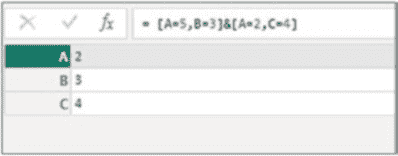
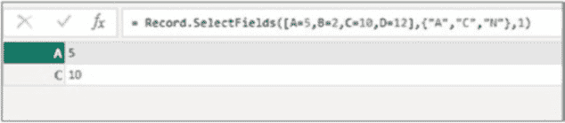
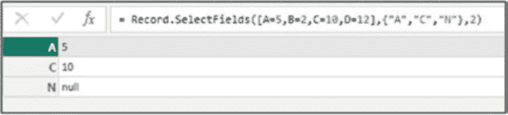
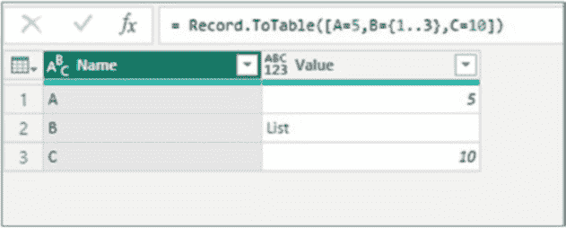

# 第 7 章 - 记录

在数据操作的交响乐中，零散的信息片段常常和谐地奏出更完整的旋律。记录就是这样一种多功能且动态的数据结构，它允许我们封装并理解实体各属性之间的相互作用。本章深入探讨 Power Query 中的记录函数世界，通过利用结构化关系的力量，揭示将原始数据转化为有意义见解的艺术。

本章的旅程从记录的基础探索开始：它们的结构、属性以及容纳混合数据类型的能力。有了这种理解，你将深入记录的创建领域，学习如何手动以及通过计算表达式来构建这些动态容器。

## 定义记录

记录是一组值，每个值都有一个特定的标题，并且每个标题只能输入一个值。为简单起见，可以将记录视为表中的一行。要定义记录，需要首先提及标题（类似于表中的列标题），然后在 `[ ]` 之间显示一个等号及其值，如下所示以及图 7-1 中所示：

`=[A=123,B=81,C="XYZ"]`

**图 7-1.** 在 Power Query 中定义记录

在记录中，一个字段的值可以基于其他字段计算。因此，使用记录，可以通过定义变量在多步中执行高级计算。请考虑以下示例以及图 7-2：

`= [A=5,B=A+3,C=A+B]`

**图 7-2.** 定义记录

记录的每个字段可以是一个值、一个列表、另一个记录或一个表。在以下公式和图 7-3 中，字段 `A` 等于一个数字，字段 `B` 和 `D` 是列表，字段 `C` 本身等于另一个记录：

`= [A=5,B={1..3},C=[A=1,B=3],D={2}]`

**图 7-3.** 包含另一个记录的记录

如前所述，记录可以看作是表中的一行，因此通过包含表名以及 `{ }` 内所需的行号，结果是一个记录，其字段标题与表中的列标题相同，字段值等于所选行的值。例如，考虑表 7-1 中所示的 `TableA`。

**表 7-1.** `TableA`

| 产品 | 价格 | 材料 |
| :--- | :--- | :--- |
| W11 | 100 | 金属 |
| s06 | 150 | 木材 |
| r08 | 125 | 玻璃 |

`TableA{0}` 的值等于以下记录：

`[Product="W11", Price=100, Material="Metal"]`

`TableA{2}` 的值等于以下记录：

`[Product="R08", Price=125, Material="Glass"]`

由于记录的性质，在 Power Query 中不能使用运算符执行数学运算（加法、乘法、除法和减法），但可以使用 `&` 运算符合并两个记录。

# 记录操作

在此情况下，如果两个记录具有相同字段，则最后一条记录中该字段的值将作为该字段的结果显示，而不同的字段将在输出中并排显示。因此，以下公式的结果为`[A=2, B=3, C=4]`。参见图 7-4。

```
= [A=5,B=3]&[A=2,C=4]
```



图 7-4. 记录的合并

除了合并记录外，Power Query 中还有其他修改记录的函数，本节未全部介绍。

## 记录属性

要提取记录中的字段数量及其名称和值，可使用以下函数。

### `Record.FieldCount`

要计算记录中的字段数量，使用`Record.FieldCount`如下：

```
Record.FieldCount(record as record) as number
```

该函数的结果始终是一个数字，显示输入记录中的字段数量。因此，以下公式的结果等于 1：

```
= Record.FieldCount([A=5])
```

以下公式的结果等于 2：

```
= Record.FieldCount([A=5,b=2])
```

以下公式的结果等于 4：

```
= Record.FieldCount([A=5,B={1..3},C=[A=1,B=3],D={2}])
```

### `Record.FieldNames`

`Record.FieldNames`用于提取记录中的字段标题，如下所示：

```
Record.FieldNames(record as record) as list
```

此函数接收一个记录作为输入，并返回其字段名称列表作为输出。因此，以下公式的结果为`{"A", "B"}`：

```
= Record.FieldNames([A=5,B=2])
```

以下公式的结果为`{"Name", "Family"}`：

```
= Record.FieldNames([Name="Omid",Family="Motamedi"])
```

### `Record.FieldValues`

`Record.FieldValues`类似于`Record.FieldNames`，但它返回的是引用记录中的值，而非标题。其定义如下：

```
Record.FieldValues(record as record) as list
```

此函数接收一个记录作为输入，其结果等于一个值列表。因此，以下公式的结果等于`{5,2}`：

```
= Record.FieldValues([A=5,B=2])
```

以下公式的结果等于`{"Omid", "Motamedi"}`：

```
= Record.FieldValues([Name="Omid",Family="Motamedi"])
```

### `Record.ToList`

`Record.ToList`用于将记录转换为列表，如下所示。此函数接收一个记录类型的输入，并输出其字段值作为列表。

```
Record.ToList(record as record) as list
```

使用此函数的不同示例如表 7-2 所示。

表 7-2. `Record.ToList` 示例

| 公式 | 结果 |
|------|------|
| `= Record.ToList([A=5,B=2,C=10])` | `{5,2,10}` |
| `= Record.ToList([A=5,B={1..3},C=10])` | `{5,{1,2,3},10}` |

### `Record.Field`

`Record.Field`用于提取记录中某个字段的值，如下所示：

```
Record.Field(
    record as record,
    field as text
) as any
```

此函数接收两个输入：

1. 第一个输入是引用记录。
2. 第二个输入以文本形式指定所需字段的名称。

根据函数说明，以下公式的结果等于 5：

```
= Record.Field([A=5,B=2],"A")
```

以下公式的结果等于 Omid：

```
= Record.Field([Name="Omid",Family="Motamedi"],"Name")
```

但由于以下公式中定义的记录不包含字段 C，其结果会报错，如图 7-5 所示：

```
= Record.Field([A=5,B=2],"C")
```

图 7-5. 计算错误

### `Record.FieldOrDefault`

此函数在 Power Query 中的定义如下：

```
Record.FieldOrDefault(
    record as nullable record,
    field as text,
    optional defaultValue as any
)
```

此函数类似于`Record.Field`。区别在于，使用此函数时，用户可以在第三个输入中定义一个值，如果引用记录不包含第二个输入中定义的字段，则显示该值而不是错误。

因此，在以下示例中，由于定义的记录不包含字段 C，以下公式的结果将是一个错误：

```
= Record.Field([A=5,B=2],"C")
```

而以下公式的结果等于 null：

```
= Record.FieldOrDefault([A=5,B=2],"C")
```

并且以下公式的输出值等于 -1：

```
= Record.FieldOrDefault([A=5,B=2],"C",-1)
```

### `Record.HasFields`

要检查记录是否包含特定字段，可以按如下方式使用 `Record.HasFields`：

```
Record.HasFields(
  record as record,
  fields as any
) as logical
```

此函数接收两个输入，如果引用记录包含第二个输入中定义的所有字段，则其输出始终为 `true`；如果定义的记录不包含第二个输入中输入的至少一个字段名，则其输出为 `false`。

1. 第一个输入是引用记录。
2. 第二个输入中输入字段名称列表。要搜索单个字段，其名称可以直接以文本格式输入，但要搜索多个字段，则应以列表形式输入其名称。

表 7-3 展示了此函数的不同应用。

表 7-3. `Record.HasFields` 示例

| 公式 | 结果 |
| --- | --- |
| `= Record.HasFields([A=5,B=2,C={1..4}],"C")` | `true` |
| `= Record.HasFields([A=5,B=2,C={1..4}],"D")` | `false` |
| `= Record.HasFields([A=5,B=2,C={1..4}],{"A","C"})` | `true` |
| `= Record.HasFields([A=5,B=2,C={1..4}],{"A","D"})` | `false` |

## 记录修正

本节将介绍用于修改记录的函数。

### `Record.AddField`

要向引用记录添加字段，可以使用具有以下语法的 `Record.AddField`：

```
Record.AddField(
  record as record,
  fieldName as text,
  value as any,
  optional delayed as nullable logical
) as record
```

此函数接收以下四个输入：

1. 第一个输入中输入引用记录。
2. 第二个输入中以文本格式输入新字段的名称。
3. 第三个输入中输入新字段的值。
4. 此函数的第四个输入是可选的，以 `true` 或 `false` 形式输入。

根据函数说明，要向包含名为 A 和 B 的两个字段的记录中添加一个名为 C 且值为 10 的新字段，可以使用以下公式：

```
= Record.AddField([A=5,B=2],"C",10)
```

在这种情况下，结果是一个包含所有字段（A、B 和 C）的记录，即 `[A=5,B=2,C=10]`。

### `Record.Combine`

要同时向一个记录添加多个字段，或者将多个记录合并在一起，可以按如下方式使用 `Record.Combine`：

```
Record.Combine(records as list) as record
```

要合并多个记录，应将这些记录全部放入一个列表中，作为此函数的第一个输入。在这种情况下，结果等于合并所有记录后得到的记录。

例如，要合并两个记录，可以使用以下公式，结果得到 `[A=5,B=2,C=10]`：

```
= Record.Combine({[A=5,B=2],[C=10]})
```

类似地，以下公式的结果等于 `[A=5,B=2,C=10,D=2*C,E=1]`：

```
= Record.Combine({[A=5,B=2],[C=10,D=2*C,E=1]})
```

### `Record.SelectFields`

`Record.SelectFields` 用于提取引用记录的子集，用法如下：

```
Record.SelectFields(
  record as record,
  fields as any,
  optional missingField as nullable number
) as record
```

此函数接收以下三个输入：

1.  第一个输入定义了引用记录。
2.  第二个输入是您正在查找其值的字段列表。
3.  此输入是可选的，当引用列表不包含第二个输入中提到的至少一个字段名时使用。在此输入中输入数字 `0` 将导致错误。输入数字 `1` 将得到一个记录，其中缺失的字段已被移除。输入数字 `2` 时，不匹配的字段会显示在输出中，但其值为 `null`。

根据以上解释，以下公式的结果等于 `[A=5,C=10]`：

```
= Record.SelectFields([A=5,B=2,C=10], {"A","C"})
```

# 第 7 章 记录

`Record.SelectFields([A=5,B=2,C=10,D=12],{"A","C"})` 而以下公式的结果会显示一个错误，如图 7-6 所示：

`Record.SelectFields([A=5,B=2,C=10,D=12],{"A","C","N"})`

**图 7-6.** 错误结果





然而，在第三个输入项中输入数字 1，以下公式的结果将如图 7-7 所示：`Record.SelectFields([A=5,B=2,C=10,D=12],{"A","C","N"},1)`

**图 7-7.** 不匹配的字段不显示

在第三个输入项中输入数字 2，以下公式的结果将如图 7-8 所示：`Record.SelectFields([A=5,B=2,C=10,D=12],{"A","C","N"},2)`

**图 7-8.** 不匹配的字段显示为空值

## `Record.RemoveFields`

要从记录中删除一个或多个字段，使用`Record.RemoveFields`，用法如下：

```
Record.RemoveFields(
   record as record,
   fields as any,
   optional missingField as nullable number
) as record
```

此函数接收以下三个输入：

1. 第一个输入是引用记录。
2. 第二个输入是一个字段名称列表，用于指定要从引用记录中删除的字段。（要删除记录中的一个字段，需以文本格式在此输入中填入字段名称；要删除多个字段，则需将字段名称放入一个列表内。）
3. 此输入为可选参数，用于处理第二个输入中指定的字段名称在引用记录中不存在的情况。这种情况下，如果此输入填入值 0（或不填此输入），结果会报错；如果填入数字 1 或 2，则会忽略此不一致问题。

根据函数说明，以下公式的结果等于`[B=2,C=10,D=20,E=1]`：

```
= Record.RemoveFields([A=5,B=2,C=10,D=2*C,E=1],"A")
```

类似地，以下公式的结果等于`[D=20,E=1]`：

```
= Record.RemoveFields([A=5,B=2,C=10,D=2*C,E=1],
   {"A","B","C"})
```

而以下公式的结果会报错：

```
= Record.RemoveFields([A=5,B=2,C=10,D=2*C,E=1],
   {"A","B","C","X"})
```

以下公式的结果等于`[D=20,E=1]`：

```
= Record.RemoveFields([A=5,B=2,C=10,D=2*C,E=1],
   {"A","B","C","X"},1)
```

## `Record.RenameFields`

可以使用`Record.RenameFields`来更改记录中的字段名称，用法如下：

```
Record.RenameFields(
   record as record,
   renames as list,
   optional missingField as nullable number
) as record
```

此函数接收以下三个参数：

1. 第一个输入填入引用记录。
2. 第二个输入以列表形式填入字段的旧名称和新名称。要将字段名称从 A 改为 X，需在列表中按`{"A","X"}`的格式填入旧名称和新名称；但若要同时更改多个字段的名称，则需要将每对旧名称和新名称分别放入各自的列表中，然后将所有这些列表放入一个列表。因此，要将字段 A 的名称改为 X，字段 B 的名称改为 W，此输入应填写为`{{"A","X"},{"B","W"}}`。
3. 此输入为可选参数，用于处理引用记录中不包含第二个输入中指定的字段名称的情况。这种情况下，如果此输入填入值 0（或不填此输入），结果会报错；如果填入数字 1 或 2，则会忽略此不一致问题。

根据函数说明，此函数的不同示例如表 7-4 所示。

**表 7-4.** `Record.RenameFields`示例

| 公式 | 结果 |
|---------|--------|
| `= Record.RenameFields([A=5,B=2,C=10],{"A","X"})` | `[X=5,B=2,C=10]` |
| `= Record.RenameFields([A=5,B=2,C=10],{{"A","X"},{"B","W"}})` | `[X=5,W=2,C=10]` |
| `= Record.RenameFields([A=5,B=2,C=10],{"U","X"})` | error |
| `= Record.RenameFields([A=5,B=2,C=10],{"U","X"},1)` | `[a=5,B=2,C=10]` |

## `Record.ReorderFields`

要更改列表中字段的顺序，可以使用`Record.ReorderFields`，用法如下：

```
Record.ReorderFields(
   record as record,
   fieldOrder as list,
   optional missingField as nullable number
) as record
```

此函数接受以下三个输入：

1. 在第一个输入中，输入引用记录。
2. 在第二个输入中，以列表形式按所需顺序输入字段名称。此输入中无需包含所有字段的名称；提到的字段名称会排在前面，其余字段则排在后面。
3. 此输入为可选参数，当引用记录中不包含第二个输入中输入的字段名称时使用。在这种情况下，如果在此输入中输入值 0（或者不输入该参数），则结果会报错；如果输入数字 1 或 2，则会忽略此不一致问题。

表 7-5 展示了此函数的各种示例。

**表 7-5.** `Record.ReorderFields` 示例

| 公式 | 结果 |
|---|---|
| `= Record.ReorderFields([A=5,B=2,C=10],{"C","B", "A"})` | `[C=10,B=2,a=5]` |
| `= Record.ReorderFields([A=5,B=2,C=10],{"X","B", "A"})` | 错误 |
| `= Record.ReorderFields([A=5,B=2,C=10],{"X","B", "A"},1)` | `[B=2,C=10,a=5]` |

## `Record.TransformFields`

使用 `Record.TransformFields`，可以如下改变记录中值的格式：

```
Record.TransformFields(
    record as record,
    transformOperations as list,
    optional missingField as nullable number
) as record
```

此函数接受以下三个参数：

1. 第一个参数代表引用记录。
2. 字段名称及其新格式在另一个列表中输入。此输入定义为一个包含两个值的列表：首先定义列名称，然后在第二个输入中定义转换逻辑。
3. 此输入为可选参数，通过它来指定当引用记录不包含第二个输入中列出的任何字段名称时该如何处理。

使用此函数，以下公式的结果为 `[A="4", B=4, C=4]`：

```
Record.TransformFields([A="4", B=4, C="4"], {C, Number.FromText})
```

### 记录转换

以下是 Power Query 中用于将记录转换为列表或表格的几个函数。

### `Record.FromList`

顾名思义，此函数用于将列表转换为记录，如下所示：

```
Record.FromList(
    list as list,
    fields as any
) as record
```

此函数接受以下两个输入，其输出始终为记录类型。

1. 在此函数的第一个输入中，以列表形式输入字段值。
2. 在此函数的第二个输入中，以列表形式输入字段名称。

基于函数说明，此函数的各种用法如表 7-6 所示。

**表 7-6.** `Record.FromList` 示例

| 公式 | 结果 |
|---|---|
| `= Record.FromList({1,2,3},{"A","B","C"})` | `[a=1,B=2,C=3]` |
| `= Record.FromList({1,"XWZ",3},{"A","B","C"})` | `[a=1,B="XWZ",C=3]` |
| `= Record.FromList({1,2,3},type [A=number,B=number,C=number])` | `[a=1,B=2,C=3]` |

### `Record.FromTable`

使用 `Record.FromTable`，可以将满足特定条件的表格转换为记录，如下所示：

```
Record.FromTable(
    table as table,
    optional missingField as nullable number
) as record
```

# Record.FromTable

`Record.FromTable(table as table) as record`

如您所见，此函数接收一个表格类型的输入，并将其转换为记录。要使用此函数，输入表格必须包含两列。第一列包含文本格式的值。然后，在输出记录中，引用表格第一列的值会被视为字段名称，表格第二列的值则被视为输出值。



## Record.ToTable

通过使用 `Record.ToTable`，可以将记录转换为表格，如下所示：

`Record.ToTable(record as record) as table`

此函数接收一个记录类型的输入，并根据以下格式将该记录转换为一个两列的表格。表格的第一列包含记录字段的名称，第二列包含字段的值。请参见图 7-9。

**图 7-9.** 将记录转换为表格

## 总结

本章全面探讨了 Power Query 中的记录函数，深入剖析了如何利用结构化关系的力量，将原始数据转化为有意义的见解。

旅程始于对记录作为动态数据结构的基础理解。你了解到它们能够封装实体的各种属性，类似于为数据表示创建多维画布。通过这一过程，你掌握了手动创建记录以及通过计算表达式生成记录的方法。

当你揭示记录函数在数据转换和丰富方面的能力时，其真正精髓得以显现。你探索了多种函数，这些函数使你能够剖析、合并和重塑记录。从筛选属性、提取值，到合并记录以创建完整的数据快照，你学会了精确地塑造数据。

在下一章中，你将通过学习与表相关的函数来继续你的旅程，因为表是 Power Query 中最重要的数据类型。你将学习如何合并多个独立表格中的值，以及如何追加或修改单个表格。
